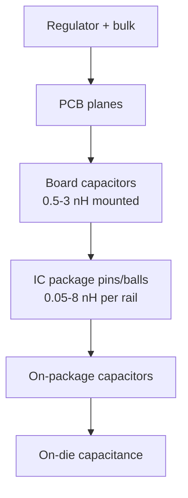

::: testing
Whether you know that "packaging" acts at **two levels**: the capacitor's package (case size, geometry, technology) and the IC's package (leads, balls, bond wires, on-package capacitors). The interviewer wants:

1. How case size and terminal geometry set ESL and SRF.
2. How capacitor technology (MLCC vs polymer vs electrolytic) changes ESL and ESR.
3. How the IC package sets an inductance floor and why BGA/flip-chip are better than QFP.
4. What you do about each: smaller or low-ESL parts, arrays, on-package capacitors, pin allocation.
:::

::: why
Two decoupling designs with identical capacitor values can differ by an order of magnitude at 100 MHz because of package choices. Knowing what a 0201 vs a 1206 buys you, why a QFP can't be decoupled as well as a BGA, and when to pay for low-ESL capacitors lets you make sensible cost-performance trade-offs rather than defaulting to 0603 everywhere.
:::

::: concepts
- **ESL from geometry**: shorter, wider current paths give lower inductance ([[q0509]], [[q0030]]).
- **Case size**: 0201, 0402, 0603, 0805, 1206 ([[q0502]]).
- **Low-ESL geometries**: reverse-geometry, multi-terminal and array capacitors.
- **Capacitor technology**: MLCC, polymer, tantalum, aluminium electrolytic.
- **IC package inductance**: bond wires, lead frames, balls and bumps ([[q0510]]).
- **On-package and on-die capacitance**: the highest-frequency decoupling lives inside the package.
:::

::: answer
"Packaging matters at two levels. First, the capacitor's package: inductance depends on the geometry of the current path through it, so a smaller case like 0402 or 0201 has less ESL than an 0805 or 1206, roughly 0.3 to 0.5 nanohenries against one nanohenry or more. There are also low-inductance constructions: reverse-geometry capacitors, where the terminals are on the long side so the current path is short and wide, and multi-terminal or array parts, which can get down to a few tenths of a nanohenry. And the technology matters: electrolytics and tantalums have much more ESL and are bulk parts, while ceramics are the high-frequency parts.

Second, the IC's own package, which sets a floor you can't change in layout. Bond wires are about a nanohenry per millimetre, a QFP's supply lead is several nanohenries, whereas a BGA or flip-chip has far less because the path is short and there are many parallel power and ground balls. So a chip in a QFP can't be decoupled as well at high frequency however good your layout is, and high-end processors put capacitors on the package or die. Practically, I'd choose small packages for the highest tier, low-ESL parts if I need the extra, check the package datasheet for supply pin inductance and how many power and ground pins there are, and place capacitors against those pins."
:::

::: technical
**Capacitor package.** ESL scales with the loop formed by the current through the part: roughly with body length and the spacing between the electrode layers' terminals.

| Style | Typical ESL | Typical SRF (100 nF) |
|---|---|---|
| 0201 MLCC | 0.2–0.4 nH | 25–35 MHz |
| 0402 | 0.4–0.6 nH | 20–25 MHz |
| 0603 | 0.6–0.8 nH | 18–20 MHz |
| 0805 | 0.8–1.1 nH | 15–18 MHz |
| 1206 | 1.2–1.5 nH | 13–15 MHz |
| Reverse geometry (0306/0508) | 0.15–0.3 nH | 30–40 MHz |
| Multi-terminal / array | 0.1–0.3 nH effective | |
| Polymer / tantalum SMD | 1–3 nH | (large C, low SRF) |
| Aluminium electrolytic | 5–20 nH | |

(typical vendor-dependent figures; mounted values are higher: see [[q0510]])

**Technology.** MLCC: low ESL and ESR, DC-bias and temperature dependence. Polymer/tantalum: higher ESR (10–100 mΩ) useful for damping, ESL 1–3 nH. Electrolytic: highest ESL/ESR, bulk only.

**IC package inductance (supply pin to die), typical orders:** QFP/TQFP lead and wire 3–8 nH; QFN 1–2 nH; BGA ball plus substrate trace 0.3–1.5 nH (but many in parallel); flip-chip bumps and package substrate lower still. Per-rail inductance is divided by the number of power/ground pins: $L_{rail}=L_{pin}/N_{pins}$.

**Effect.** Total path = capacitor and mounting + package. If package is 2 nH and board is 1 nH, going from 1 to 0.5 nH on the board gives 3.0 → 2.5 nH (17 %), while using a lower-inductance package gives a far bigger step. On-package capacitors sit inside the package inductance and serve the fastest current.

**Choosing.** Smallest practical case for the top tier; low-ESL parts only where a PDN simulation shows the benefit; many small capacitors in parallel ($L/N$) are often cheaper than exotic parts.
:::

::: short
"Packaging acts on two levels. The capacitor's case size and construction set its ESL: 0201 and 0402 are around 0.3 to 0.5 nH, 1206 over a nanohenry, with reverse-geometry and array capacitors lower still, and electrolytics far higher. The IC's package sets a floor: a QFP lead and bond wire are several nanohenries, a BGA or flip-chip much less, and big processors put capacitors on the package. I pick small, low-ESL parts for the top tier and account for the package in my budget."
:::

::: long
"There are two packages in the loop, the capacitor's and the chip's.

For the capacitor, the ESL comes from the geometry of the current path through it. A smaller case has a shorter path: an 0201 or 0402 is about 0.3 to 0.5 nanohenries, an 0805 around one, a 1206 over a nanohenry. There are also constructions designed for low inductance: reverse-geometry capacitors put the terminals on the long side, so the current path is short and wide, and multi-terminal or array parts, effectively many small capacitors in one body, get down to a few tenths of a nanohenry. The capacitor technology matters too. Ceramics are the high-frequency parts. Polymer and tantalum have one to three nanohenries and some useful ESR for damping. Aluminium electrolytics are five to twenty nanohenries, so they're strictly bulk.

For the IC, the package sets a floor you can't fix in layout. Bond wires are about a nanohenry per millimetre. A QFP's supply lead plus wire can be several nanohenries, so even a perfect capacitor at the pin sees that in series. A BGA or flip-chip has a much shorter path and many power and ground balls in parallel, which divides the inductance, so the same capacitor is far more effective. High-performance processors go further with capacitors on the package or die.

So in design, I'd use the smallest practical case for the top tier, consider low-ESL parts if a PDN simulation shows I need them, but often just putting more small capacitors in parallel is cheaper. And I'd read the package information to see the supply pin inductance and number of power/ground pins, because that tells me how much the board can gain at all."
:::

::: terms
- **Case size**: standard MLCC dimensions (0201, 0402, 0603, 0805, 1206).
- **Reverse-geometry capacitor**: MLCC with terminals on the long sides; low ESL.
- **Multi-terminal / array capacitor**: several terminals or integrated cells that parallel current paths.
- **Bond wire**: wire from die to lead frame, about 1 nH/mm.
- **BGA / flip-chip**: ball or bump arrays with short, parallel supply paths.
- **On-package capacitor**: capacitor mounted on the IC substrate.
- **On-die capacitance**: capacitance of the die's internal structures and decoupling cells.
- **Polymer / tantalum**: bulk capacitor technologies with moderate ESR.
:::

::: exceptional
An average answer says "smaller packages are better". An exceptional one:

- Separates the **capacitor package** from the **IC package** and describes the floor set by the latter.
- Gives ESL by case size, notes reverse-geometry and array types, and the technology differences.
- Uses $L_{rail}=L_{pin}/N$ to explain why BGAs and processors with many power balls decouple better.
- Shows with arithmetic that when the package dominates, improving the board gives little, and vice versa.
- Mentions on-package or on-die capacitors and parallel arrays as cost-effective alternatives to exotic parts.
:::

::: mistakes
- **Believing a bigger case is better** because it has more capacitance. Above SRF it is worse.
- **Paying for low-ESL parts without checking mounting.** If vias dominate, ESL savings vanish.
- **Ignoring the IC package.** A QFP with long leads can't match a BGA, regardless of board work.
- **Using electrolytics for high-frequency decoupling.** ESL is 5–20 nH.
- **Forgetting DC-bias in small cases**: a tiny 10 µF may have less capacitance than a larger one.
:::

::: deep
## Capacitor package: why geometry sets inductance

Inductance relates to the magnetic flux of the current loop. In a chip capacitor the current runs in the electrode layers between the two end terminals and returns through the neighbouring layers. A longer body means a longer path and larger loop; a wider body means more parallel layers and less inductance per unit length. Hence the ranking: 0201 < 0402 < 0603 < 0805 < 1206.

Reverse-geometry (LICC) parts swap the terminal sides so the current path is the *short* dimension and there are more parallel paths. Vendors quote ESL of 0.1-0.3 nH for these at the same capacitance as a conventional part, at a higher price. Multi-terminal and interdigitated (IDC) parts add terminals so current paths are in parallel and opposite polarities are interleaved to exploit mutual cancellation.

```plot
{"title":"100 nF in different packages (ESL only, same ESR 20 mΩ)","x":{"label":"f","unit":"Hz","min":1e6,"max":1e9,"log":true},"y":{"label":"|Z|","unit":"Ω","min":1e-2,"max":1e2,"log":true},
 "vars":{"c":"100e-9","esr":0.02,"w":"2*pi"},
 "series":[
  {"label":"1206 (1.3 nH)","fn":"sqrt(esr^2+(w*x*1.3e-9-1/(w*x*c))^2)","color":"red"},
  {"label":"0603 (0.7 nH)","fn":"sqrt(esr^2+(w*x*0.7e-9-1/(w*x*c))^2)","color":"orange"},
  {"label":"0402 (0.5 nH)","fn":"sqrt(esr^2+(w*x*0.5e-9-1/(w*x*c))^2)","color":"accent"},
  {"label":"reverse geometry (0.2 nH)","fn":"sqrt(esr^2+(w*x*0.2e-9-1/(w*x*c))^2)","color":"green"}]}
```
Figure: Same capacitance and ESR, different package inductance. The low-frequency curves overlap; above resonance the curves separate by the ESL ratio. At 100 MHz: 1206 is 0.82 Ω, 0603 0.44 Ω, 0402 0.31 Ω, reverse geometry 0.13 Ω (ESL only; mounting adds to all of them).

> [!NOTE]
> These are *component-level* numbers. On a board, mounting inductance (vias and fan-out) is added to each, which compresses the differences. A 1.3 nH 1206 on a good mount can beat a 0.5 nH 0402 on a poor one ([[q0510]]).

## Capacitor technology

| Technology | ESR | ESL | Typical role |
|---|---|---|---|
| MLCC (C0G/X7R/X5R) | 5–50 mΩ | 0.2–1.5 nH | 10 kHz–200 MHz decoupling |
| Polymer / tantalum SMD | 10–100 mΩ | 1–3 nH | bulk, damping anti-resonance |
| Aluminium polymer | 10–50 mΩ | 2–5 nH | bulk at regulator |
| Aluminium electrolytic | 0.1–1 Ω | 5–20 nH | very low-frequency bulk |

ESR is not always bad: moderate ESR in a bulk capacitor damps the anti-resonance peak between bulk and ceramics ([[q0506]]).

## IC package: the floor you can't remove

The path from the PCB pad to the die includes the lead or ball, the substrate or lead-frame trace, and for wire-bonded dies a bond wire (roughly 1 nH per mm of wire). Typical orders (vendor- and package-dependent):

| Package style | Supply path inductance (per pin) | Notes |
|---|---|---|
| QFP/TQFP | 3–8 nH | long leads and bond wires |
| QFN/DFN | 1–2 nH | short bond wires, exposed pad |
| BGA (wire-bond) | 1–2 nH | substrate routing + wire |
| BGA / LGA (flip-chip) | 0.3–1 nH | bumps direct to substrate |

Many supply pins in parallel divide the inductance: a processor with 20 core power balls of 1 nH each has about 50 pH. A QFP with one VDD pin at 5 nH has 100× that.


Figure: The delivery chain from regulator to die. Each stage serves faster current than the one before it, and the IC package sits between the board capacitors and the die. The board can only be as good as the package lets it be.

Seeing the floor: if the package contributes 2 nH and the board 1 nH, total is 3 nH. Improving the board loop to 0.5 nH gives 2.5 nH, a 17 % gain. Improving the package to 0.5 nH instead gives 1.5 nH, a 50 % gain. Moving the board loop from 3 nH to 1 nH when the package is 0.2 nH gives a 3× improvement. So always ask which term dominates.

## On-package and on-die capacitance

For the last 100 MHz-GHz of the PDN, capacitors sit inside the package (land-side or die-side capacitors on high-end processors and FPGAs) and on the die (decoupling cells, MOS capacitors, inherent capacitance of the circuitry). These handle current faster than any board part can because they are inside the package inductance. Board capacitors then only need to cover the frequency range below the package/die resonance, which is typically tens of MHz.

## Practical consequences

- Use **0402 or 0201** for the top tier in dense layouts; 0603 is fine where speed allows.
- For a processor/FPGA, follow the vendor's decoupling guide: counts, values and cases are derived from the package's inductance.
- Choose a **package** with more, closer supply pins if you have the choice; allocate several power/ground pins per rail.
- Use **low-ESL or array capacitors** where board space for many parts is not available and simulation shows the benefit.
- Don't use electrolytic or large polymer parts for the 10+ MHz job.

```sim
{"id":"impedance-explorer","part":"capacitor","c":1e-7,"esr":0.02,"esl":1.3e-9}
```
Figure: With ESL 1.3 nH (a 1206-like part) the resonance is at about 14 MHz. Change ESL to 0.2 nH to see a reverse-geometry part's resonance move to about 36 MHz and the high-frequency impedance fall by 6x.

> [!UNCERTAIN]
> ESL and package-inductance numbers are typical ranges; they differ by vendor, series, package variant and test fixture. Use vendor S-parameter models and package electrical data for real design.
:::

::: applications
- **Processor/FPGA boards**: backside arrays of 0402/0201 capacitors plus on-package capacitors.
- **RF modules**: 0201 and small C0G capacitors close to the supply pins.
- **Low-cost QFP MCU boards**: 100 nF 0402/0603 at each pin; the package limits the benefit at higher frequency.
- **High-speed ADCs and DACs**: low-ESL capacitors on the supply and reference pins.
- **Power stages**: reverse-geometry or multi-terminal capacitors at the switching node input.
:::

::: assumptions
- MLCC ESL numbers are typical component-level values; mounted values are higher.
- IC package inductances are typical ranges for each style and vary strongly with vendor, die size and bond layout.
- The lumped inductance model is valid below the frequencies where distributed effects in the package appear (several hundred MHz to GHz).
- Cost is not considered; low-ESL parts cost more than extra standard capacitors.
- Another valid reading of "packaging" is the *IC* package only; the answer covers both.
:::

::: followups
### What is a reverse-geometry capacitor?
An MLCC whose terminals are on the long sides instead of the short ends (for example 0306 instead of 0603). The current path is shorter and wider, with more parallel paths, so ESL falls from about 0.7 nH to about 0.2 nH for similar capacitance.

### Why does a BGA decouple better than a QFP?
The supply path from ball to die is short and there are many power and ground balls in parallel, so rail inductance is tens of pH to 1 nH. A QFP has long leads and bond wires of several nH per pin, with fewer pins per rail. The capacitors can only be as effective as the package lets them.

### When is an 0201 worth it?
In dense BGA fields where space limits how many parts and how close you can place them, and for the top tier above 50 MHz. The ESL drop (0.2–0.4 nH) is only useful if vias and fan-out are also tight; otherwise mounting dominates.

### What if the package inductance dominates?
Then the board work has limited upside. Use the vendor's recommended network, make sure all power/ground pins are connected and decoupled, rely on package/die capacitance for the top end, and focus on the lower tiers you can control.

### Scenario: your design uses a QFP MCU and fails EMC at 80 MHz. Can better capacitors fix it?
Partly. The QFP's lead inductance (several nH) limits what board capacitors can shunt at 80 MHz, so I would also reduce the source: lower drive strength and edge rates, add series damping resistors on fast outputs, and use a ground plane. I'd put small capacitors directly at each supply pin pair. If it still fails, switch to a QFN or BGA variant with lower pin inductance.
:::

::: interpretations
"Packaging" can mean the capacitor's package, the IC's package, or both. This page covers both: the capacitor case and technology, and the IC package as an inductance floor. Related: parasitic sources in [[q0510]], impact of inductance in [[q0509]], SRF in [[q0512]].
:::

::: references
- Eric Bogatin, *Signal and Power Integrity: Simplified*: capacitor models, package inductance and PDN design.
- Howard Johnson and Martin Graham, *High-Speed Digital Design: A Handbook of Black Magic*: package inductance and bypassing.
- MLCC manufacturers' documentation on low-ESL (reverse-geometry, array) capacitors and S-parameter models (check the specific vendor).
- IC vendors' package electrical models and PCB layout guidelines.
:::

::: rubric
- Capacitor case size sets ESL (smaller is lower) with approximate values :: Directly answers the "packaging" question at component level.
- Low-ESL constructions (reverse-geometry, multi-terminal, array) :: Shows knowledge of options beyond case size.
- Capacitor technology differences (MLCC vs polymer vs electrolytic) :: Distinguishes high-frequency from bulk parts.
- IC package inductance as a floor (QFP vs BGA/flip-chip) :: The second level of packaging many candidates miss.
- Many parallel power/ground pins divide inductance :: Explains why BGAs are better.
- On-package/on-die capacitance and which term dominates :: Shows judgement about where to spend effort.
:::

::: quiz
```json
[
 {"type":"mcq","level":"fundamental","q":"Which MLCC case size generally has the lowest ESL?","options":["1206","0805","0603","0201"],"answer":3,"explain":"Smaller bodies have shorter current paths and lower ESL."},
 {"type":"mcq","level":"fundamental","q":"Which capacitor technology is only suitable as bulk capacitance because of its high ESL?","options":["Aluminium electrolytic","0402 MLCC","Reverse-geometry MLCC","Multi-terminal array"],"answer":0,"explain":"Aluminium electrolytics have 5-20 nH ESL and are used for low-frequency bulk."},
 {"type":"numeric","level":"intermediate","q":"A rail has 24 supply balls, each 1.2 nH. What is the rail's package inductance in nH (parallel, ignoring mutual coupling)?","answer":0.05,"tolerance":0.02,"unit":"nH","explain":"Identical inductances in parallel divide by N: $L=1.2\\text{ nH}/24=0.05$ nH, i.e. 50 pH. This is why many power balls make a BGA rail so low-inductance."},
 {"type":"numeric","level":"intermediate","q":"The package contributes 2 nH and the board loop 1 nH. Improving the board loop to 0.5 nH reduces the total by what percentage?","answer":16.7,"tolerance":0.03,"unit":"%","explain":"Total goes from 3.0 to 2.5 nH, a 0.5/3.0 = 16.7 % reduction."},
 {"type":"numeric","level":"advanced","q":"A reverse-geometry 100 nF capacitor has ESL 0.2 nH. What is its SRF in MHz?","answer":35.6,"tolerance":0.03,"unit":"MHz","explain":"$f_0=1/(2\\pi\\sqrt{0.2\\times10^{-9}\\times10^{-7}})=1/(2\\pi\\times4.47\\times10^{-9})=35.6$ MHz."},
 {"type":"truefalse","level":"advanced","q":"If the IC package inductance dominates the loop, improving board capacitor placement by a few hundred pH will make a large difference to high-frequency performance.","answer":false,"explain":"When the package adds several nH, a few hundred pH of board improvement changes the total by only a small percentage. The package choice or on-package capacitance matters more."}
]
```
:::
