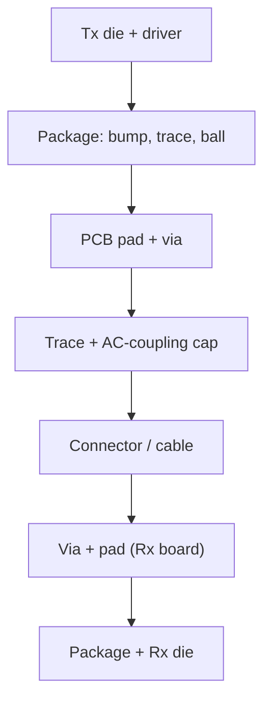

::: basics
### In plain words
A high-speed link is a chain of pieces: the chip's package, solder balls, vias, the trace, a coupling capacitor, a connector and maybe a cable, then the same on the far side. Each hand-off between pieces is an interface where the geometry changes. Every interface can reflect part of the signal and also slow its edges. Together they can close the eye even when the copper trace itself is fine.

### Picture it
Think of a relay of water pipes. Each joint between pipes of slightly different size makes a little splash back and a little slowdown. One joint is no problem. A dozen joints in a row can turn a crisp spurt into a smear. The pipes themselves may be perfect. The joints are the interfaces.

### Words you need
- **Interface**: any transition where the structure or impedance changes, such as pad to via or connector to cable.
- **Return loss**: how much of a wave bounces back, in dB ([[q0711]]).
- **ISI (inter-symbol interference)**: earlier bits smearing into later ones ([[q0698]]).
- **Rise time**: how long an edge takes to go from low to high.
- **RSS combination**: independent rise-time contributions add as the square root of the sum of squares.

### The simplest example
In a 50 Ω line, a 1 nH series inductance adds about 22 ps of rise time, and a 0.5 pF shunt capacitance adds about 27.5 ps. A clean 30 ps edge passes both. The new rise time is $\sqrt{30^2 + 22^2 + 27.5^2} \approx 46$ ps. A few more such interfaces push it past half a bit at 10 Gb/s. That is the whole idea. The rest of this page covers spaced reflections that ripple, crosstalk and mode conversion at connectors, and how to measure and fix each interface.
:::

::: testing
Whether you view a link as a **cascade of interfaces** (die, package, solder joint, via, AC cap, connector, cable, receiver), each with its own L/C and impedance step, and can say how each degrades signal quality in *two* ways: reflections (return loss, ringing, standing waves) and **distortion** (bandwidth limiting, ISI, mode conversion, crosstalk). The strongest answers quantify one example (a 1 nH or 0.5 pF discontinuity adds 20–30 ps of rise time), use RSS combination, mention resonance between spaced discontinuities, and know how to see all this on an eye diagram or S-parameters.
:::

::: why
At multi-gigabit speeds the copper trace is rarely the dominant impairment; the transitions are. Channel designers spend their time on pad, via, connector and package interfaces, and failures show up as closed eyes with no obvious "cause". The interviewer wants to see that you can reason about a whole channel, not just a trace. This builds on the individual sources in [[q0526]].
:::

::: concepts
- **Interface**: any transition between structures or media where geometry or impedance changes (die→package→PCB→connector→cable).
- **Return loss and insertion loss**: S-parameter views of reflection and attenuation. See [[q0711]].
- **Lumped L/C bandwidth limit**: a series L or shunt C is a low-pass filter. See [[q0722]].
- **Rise time degradation**: $t_{r,out}=\sqrt{t_{r,in}^2+\sum t_{r,i}^2}$.
- **Mode conversion and crosstalk** at connectors. See [[q0694]].
- **Eye diagram**: shows combined effects as closure. See [[q0698]].
:::

::: answer
"I think of the channel as a chain: driver die, package, solder ball or pad, via, trace, AC-coupling cap, connector, maybe a cable, and then the same in reverse at the receiver. Each link in that chain is an interface where the geometry and so the impedance changes, and each one hurts in two ways.

First, reflections. Each impedance step sends some energy back. One reflection is small, but they add up, they re-reflect between each other, and two discontinuities separated by a delay create a resonance, a ripple in the frequency response. Second, distortion. A via or pad that's a nanohenry or a fraction of a picofarad acts like a low-pass filter, so it slows the edge. For a 50 ohm line, 1 nanohenry in series adds about 22 picoseconds of rise time and 0.5 picofarad in shunt adds about 27, and those add in root-sum-square, so six 22 picosecond interfaces stretch a 30 picosecond edge to about 62, which is more than half a bit at 10 gigabit. Connectors and vias also create crosstalk and convert differential to common-mode.

The interfaces that usually matter most are the package and BGA, vias, AC-coupling cap pads, connectors, and ESD or test pads. I fix them by minimising the count, shrinking parasitics, matching impedance through each transition and sometimes using equalisation to undo what's left. I check with TDR, S-parameters or an eye diagram."
:::

::: technical
**Cascade view.** Signal path: Tx die → package (bond/bump, trace) → BGA ball → PCB pad → via → trace → AC cap → via → connector → cable → connector → via → trace → pad → package → Rx die. Each transition has an equivalent small circuit.

**First-order effects of a small discontinuity** in a $Z_0$ line:
- Series $L$: reflection peak $\approx L/(2Z_0t_r)$; low-pass with $f_{3dB}=2Z_0/(2\pi L)$ (for $L=1$ nH, 15.9 GHz); added 10–90% rise time $\approx2.2\cdot L/(2Z_0)=22$ ps.
- Shunt $C$: reflection peak $\approx Z_0C/(2t_r)$; $f_{3dB}=1/(2\pi\,C\,Z_0/2)$ (for 0.5 pF, 12.7 GHz); rise-time addition $\approx2.2\cdot Z_0C/2=27.5$ ps.
Independent contributions combine as RSS: $t_r=\sqrt{t_{r0}^2+\sum t_i^2}$. Starting from a 30 ps edge with the 22 ps and 27.5 ps contributions: $\sqrt{30^2+22^2+27.5^2}=46$ ps.

**Spaced discontinuities** produce ripple: two reflections separated by one-way delay $t_s$ interfere with period $f=1/(2t_s)$; with 20 mm spacing ($t_s=118$ ps) a ripple repeats every ~4.2 GHz.

**Interfaces that introduce distortion.** Package (bond wire L, pin C, lossy substrate), BGA/solder balls, vias and via stubs, AC-coupling capacitor pads, ESD/protection devices (C = 0.2–1 pF), connectors and cable launches (L/C, crosstalk, mode conversion), common-mode chokes, board-to-board and socket interfaces, and the termination itself (lead L).

**Quality impact.** Reduced eye height and width (ISI from bandwidth limit and reflections), added deterministic jitter, return loss ripples, crosstalk pickup, and mode conversion/EMI.
:::

::: short
"Every interface in the path (package, ball, via, AC cap, connector, cable) is a small impedance discontinuity. Each reflects part of the edge and also acts as a low-pass filter: 1 nH in a 50 Ω line adds about 22 ps of rise time, 0.5 pF about 27 ps, and they combine in RSS. Spaced discontinuities also resonate, and connectors add crosstalk and mode conversion. I minimise their number and parasitics, match impedance through them, and check with TDR, S-parameters or an eye diagram."
:::

::: long
"I treat a link as a cascade: driver die, package, ball, PCB pad, via, trace, AC-coupling cap, connector, cable, and then back through the same on the receiver side. Every transition between those is an interface where the geometry changes, so the impedance changes.

Each one affects signal quality in two ways. First, reflections: it sends part of the wave back, the reflections can re-reflect between interfaces, and if two discontinuities are separated by a delay t, they interfere with a period of one over twice t, so you get ripple in the frequency response and ISI in the time domain. Second, distortion. Most real interfaces are small L's and C's, and an L or C in a transmission line is a low-pass filter. A nanohenry in a 50 ohm line has a 3 dB bandwidth of 16 gigahertz and adds about 22 picoseconds to the rise time; half a picofarad in shunt, about 13 gigahertz and 27 picoseconds. Independent effects combine as root-sum-square, so starting with a 30 picosecond edge and adding both gives about 46 picoseconds. Stack six interfaces and you've used half a bit at 10 gigabit.

Beyond that, connectors and via fields couple adjacent lanes, which is crosstalk, and any asymmetry converts differential to common-mode. ESD parts and test pads add capacitance, and the package adds bond-wire inductance.

So for the design: minimise the number of interfaces, reduce each one's parasitics, with smaller pads, anti-pads, back-drilled vias, good connector footprints, and match impedances through the transitions. Where I can't, I use equalisation, pre-emphasis at the driver and CTLE or DFE at the receiver, to undo the bandwidth loss. And I verify with TDR for the impedance profile, S-parameters for return and insertion loss, and an eye diagram for the net effect."
:::

::: terms
- **Interface / transition**: junction between two structures (pad–via, connector–cable, package–board).
- **Return loss**: $-20\log|S_{11}|$; how much is reflected.
- **Insertion loss**: $-20\log|S_{21}|$; how much is lost through the channel.
- **ISI (inter-symbol interference)**: previous bits smearing into the current bit via reflections and bandwidth limits.
- **RSS combination**: root-sum-square addition of independent rise-time contributions.
- **Mode conversion**: differential-to-common-mode conversion at asymmetric transitions.
- **Equalisation**: pre-emphasis/CTLE/DFE to compensate channel loss and ISI.
- **Impedance discontinuity**: any step in local $Z$ that reflects part of the wave.
:::

::: exceptional
An average answer says "connectors and vias cause reflections." An exceptional answer:
- Names the **whole chain** (die, package, ball, pad, via, trace, AC cap, connector, cable) and what each contributes.
- Separates **reflection** from **distortion** and gives **numbers** (22 ps, 27 ps, RSS, 3 dB bandwidths).
- Notes **interaction**: spaced discontinuities create ripples at $1/2t_s$; reflections re-reflect.
- Mentions **crosstalk and mode conversion** at connectors and via fields.
- Gives the **toolbox**: fewer/smaller interfaces, matching, equalisation, plus TDR/S-parameter/eye verification.
:::

::: mistakes
- **Looking only at the trace.** At ≥ 5 Gb/s the vias, pads, connector and package often dominate loss and reflection.
- **Summing rise-time degradation linearly.** Independent contributions add in RSS.
- **Believing a matched termination at the end makes the interfaces irrelevant.** Interfaces still reflect and band-limit.
- **Optimising one interface in isolation.** Reflections from two interfaces interact; check the cascade.
- **Forgetting the AC-coupling cap pads** and ESD devices as capacitive discontinuities.
- **Ignoring connector crosstalk and mode conversion** when focusing on a single-ended view.
:::

::: deep
## The chain


Figure: Every arrow is an interface. A typical backplane link crosses 8–12 of them, and at 10+ Gb/s the sum of their parasitics usually sets the return loss and a large share of the bandwidth loss, alongside the copper and dielectric loss of the traces.

## How one interface distorts

Model a transition as a small series inductance $L$ in a line of impedance $Z_0$ terminated by $Z_0$ on both sides. The voltage transfer is $H(s)=\dfrac{2Z_0}{2Z_0+sL}$: a single-pole low-pass with $f_{3dB}=\dfrac{2Z_0}{2\pi L}$ and time constant $\tau=\dfrac{L}{2Z_0}$. For $L=1$ nH, $Z_0=50$ Ω: $\tau=10$ ps, $f_{3dB}=15.9$ GHz, added 10–90% rise time $2.2\tau=22$ ps. For shunt $C$: $H=\dfrac{1}{1+sCZ_0/2}$, $\tau=Z_0C/2=12.5$ ps for 0.5 pF, $f_{3dB}=12.7$ GHz, added rise time 27.5 ps.

```plot
{"title":"Rise time after cascading identical 22 ps interfaces (30 ps input edge, RSS)","x":{"label":"Number of interfaces","unit":"","min":0,"max":10},"y":{"label":"Output rise time","unit":"s","min":0,"max":8e-11},
 "vars":{"t0":3e-11,"ti":2.2e-11},
 "series":[{"label":"√(t0² + N·ti²)","fn":"sqrt(t0^2+x*ti^2)"}],
 "hlines":[{"at":5e-11,"label":"half a bit at 10 Gb/s"}],
 "points":[{"x":6,"y":6.17e-11,"label":"6 interfaces: 62 ps"}]}
```
Figure: Six interfaces, each adding 22 ps of rise time, turn a 30 ps edge into about 62 ps, which is more than half a 100 ps unit interval; the edge no longer reaches full amplitude in the middle of the bit and ISI follows. RSS grows as √N, so it's the *number* of parasitic interfaces that hurts.

Check: $\sqrt{30^2+6\times22^2}=\sqrt{900+2904}=61.7$ ps.

## How interfaces interact

Two discontinuities of reflection $\rho_1$, $\rho_2$ separated by one-way delay $t_s$ send back a combined wave $\rho_1+\rho_2e^{-j2\omega t_s}$. Magnitude peaks at $\omega=\pi/t_s$, i.e. $f=1/(2t_s)$ and repeats. A connector and a via 20 mm apart ($t_s=118$ ps) ripple at 4.2 GHz and its multiples; the sum can be twice either alone or zero if they have opposite sign and half-period spacing (this is the basis of via compensation by L–C pairs).

```sim
{"id":"eye-diagram","rate":1e10,"bw":7e9,"noise":0.02,"jitter":0.02,"preemph":0}
```
Figure: Lower the channel bandwidth (`bw`) as if you had added interfaces and watch the eye close from ISI; add pre-emphasis to recover it. The eye shows the combined effect of all the interfaces and the trace.

## Interface by interface

| Interface | Dominant parasitic | Typical effect | Mitigation |
|---|---|---|---|
| Package (bond wire, ball) | L ~1–3 nH, C 0.5–1 pF | strong band-limiting, reflection | flip-chip/short package; model with S-parameters |
| BGA pad and via | L 0.5–1 nH, C 0.3–0.5 pF | reflection, loss, crosstalk | small pads, anti-pads, ground vias, back-drill |
| AC cap (0402) + pads | C of pads 0.2–0.5 pF, ESL ~0.5 nH | dip/bump in impedance | cut plane under pads, use smaller package, place symmetrically |
| ESD/protection | C 0.2–1 pF | shunt-C bandwidth limit | low-C parts, place near connector |
| Connector | L/C, crosstalk, mode conversion | return loss, lane crosstalk | optimise footprint, ground pins, via fields |
| Cable | loss, skin effect, impedance tolerance | attenuation, ISI | quality cable; equalise |
| Termination | lead L, tolerance | mismatch | small package, ODT |

## Mode conversion and crosstalk at interfaces

A differential pair entering a connector sees asymmetric geometry; the pin fields couple adjacent pairs. Mode conversion shows up as $S_{cd21}$ and as lane-to-lane crosstalk (NEXT/FEXT). It degrades eye height (crosstalk is a noise source) and radiates (common-mode).

## Worked example: a 10 Gb/s link

A link with 30 ps drivers crosses 6 interfaces, each adding 22 ps (lumped approximation). The edge becomes 62 ps. At the Nyquist frequency (5 GHz), a single-pole response with $\tau=\sqrt{6}\times10$ ps (RSS of the time constants) $\approx24.5$ ps has loss $20\log\sqrt{1+(2\pi\cdot5\text{ GHz}\cdot24.5\text{ ps})^2}=20\log\sqrt{1+0.59}=2.0$ dB: a 2 dB penalty on top of copper and dielectric loss. If the six interfaces are reduced to three (e.g. by removing the connector and a via pair), rise time becomes $\sqrt{30^2+3\times22^2}=48$ ps and the loss at Nyquist about 1.1 dB.

## Real hardware behaviour

- **S-parameter budgets** allocate return loss and insertion loss per interface; each is verified with a TDR or VNA on test coupons.
- **De-embedding** removes fixture effects when measuring.
- **Equalisation** (TX FIR, RX CTLE/DFE) compensates the lumped bandwidth losses but not large reflections, which create reflection-induced ISI at fixed delays.

## Worked example: why a via with 1 nH and 0.4 pF can be nearly invisible

The table lists a via's parasitics as an inductance and a capacitance, which suggests two separate defects. But a series L between two shunt C halves (a "T" or "pi" section) is a short piece of transmission line, and its impedance and delay are

$$Z_{via}=\sqrt{\frac{L}{C}}=\sqrt{\frac{1\ \text{nH}}{0.4\ \text{pF}}}=50\ \Omega,\qquad T_d=\sqrt{LC}=\sqrt{(10^{-9})(4\times10^{-13})}=20\ \text{ps}$$

With these numbers the via's natural impedance already equals the line's, so it behaves like a 20 ps (about 3.4 mm of microstrip) section of 50 Ω line and reflects almost nothing, as long as the lumped model's two parasitics are split properly across the transition. When the numbers are unbalanced, for example 1 nH with only 0.1 pF ($\sqrt{L/C}=100\ \Omega$) or 0.2 nH with 0.4 pF (22 Ω), the via becomes a short section of off-impedance line and reflects according to its mismatch. This is the physical basis of via optimization: tune the anti-pad (which sets $C$) and add a ground via (which lowers $L$ by sharing the return) until $\sqrt{L/C}\approx Z_0$. The lumped approximation itself holds only for edges slower than roughly 6 times the delay: with $T_d=20$ ps, for edges of $t_r\gtrsim120$ ps. For a 30 ps edge the via's internal structure matters and a field-solver S-parameter model is required.

## Worked example: how much loss does a protection diode cost at 25 Gb/s?

An ESD diode adds a shunt capacitance to the line. From the page, a shunt $C$ in a $Z_0$ line is a single-pole low-pass with $\tau=Z_0C/2$. For $C=0.5$ pF, $\tau=12.5$ ps and $f_{3dB}=12.7$ GHz. At 25 Gb/s, the Nyquist frequency is 12.5 GHz, essentially at the corner, so the diode alone costs

$$A=20\log_{10}\sqrt{1+(2\pi f\tau)^2}=20\log_{10}\sqrt{1+(2\pi\cdot12.5\times10^{9}\cdot12.5\times10^{-12})^2}=20\log_{10}\sqrt{1+0.96}=2.9\ \text{dB}$$

Replace it with a 0.2 pF part: $\tau=5$ ps, $f_{3dB}=31.8$ GHz, and the loss at 12.5 GHz is 0.6 dB. That 2.3 dB difference from one component is a large share of a typical channel loss budget, which is why high-speed interfaces specify the protection device's capacitance (and often forbid external ESD parts on the fastest lanes, relying on on-die protection). The same arithmetic ranks the other parasitics in the table: a 0402 AC capacitor with pad capacitance of 0.3 pF behaves similarly, which is why it is placed in a plane cut-out and why the choice of package for the capacitor matters.

## Worked example: reflection ripple from two interfaces

A connector and a via 20 mm apart each reflect with $|\rho|=0.05$ ($-26$ dB). Their combined reflection is $\rho_1+\rho_2e^{-j2\omega t_s}$ with $t_s=118$ ps. If the two have the same sign the magnitude varies between 0 and 0.10 as frequency sweeps, with peaks every $1/(2t_s)=4.2$ GHz. The worst case is $|S_{11}|=20\log_{10}(0.10)=-20$ dB (20 dB return loss), 6 dB worse than either alone, and on a VNA trace you see a ripple with a period of 4.2 GHz in $S_{11}$. If instead the two have opposite signs, the peaks and nulls swap: the combined reflection is near zero at low frequency (they cancel) and peaks at 2.1 GHz and every 4.2 GHz after. Measuring the ripple period gives you the spacing between the culprits directly: a period $\Delta f$ means a separation of $t_s=1/(2\Delta f)$, or in length $\ell=v/(2\Delta f)$ with $v=1/5.9\ \text{ps/mm}$. This is how engineers locate features from frequency-domain data when no TDR is available.

## Limiting cases: when the lumped cascade fails

- **RSS assumes independent single poles.** The $\sqrt N$ growth is a planning rule. For a real channel the cascade of reflections and the loss of the trace itself matter; use S-parameter cascading (multiply ABCD or T matrices) when a decision depends on 1 dB.
- **Large reflections.** The first-order formulas assume $\rho\ll1$. A big pad, a stub or a poorly matched connector can reach $\rho>0.2$, where the reflection and the transmitted wave need the full transmission-line solution, and multiple re-reflections between interfaces contribute.
- **Frequency-dependent parasitics.** Via capacitance and inductance change with frequency, connectors' mode-conversion rises with frequency, and cables have stronger loss. A single lumped number per interface is a low-frequency model.
- **Equalization.** A receiver equalizer shapes the channel's response; a channel with 12 dB of smooth loss can be better than one with 6 dB and a notch from a reflection at a fixed delay, which an equalizer cannot undo.

## Real-hardware considerations

- **Test coupons and de-embedding.** Fixture launch structures (SMA footprints) can contribute as much parasitic as the structure you are measuring. Build a "through" coupon with just the launches and de-embed it, or use time-gating, or the measured $S$-parameters mean little.
- **Assembly variation.** Solder volume on connector pins, ESD diode placement tolerance and via barrel plating thickness shift the parasitics by tens of percent, so design margin for the interface must include the spread.
- **Cross-talk is also an interface effect.** Pin fields and via arrays couple neighboring lanes; the ground-pin pattern and the pair-to-pair spacing are chosen from the connector's vendor data, and they are among the first things to check when two lanes interfere.
- **Mode conversion.** A skew of 5 ps between the two traces of a pair at an interface converts differential energy to common-mode; a common-mode choke or a connector with good symmetry reduces the radiated part, but the skew is a layout decision made upstream.

## Bench verification

A VNA with 4-port capability measures the whole cascade: $S_{dd21}$ gives the insertion loss, $S_{dd11}$ the return loss, $S_{cd21}$ the mode conversion, and the crosstalk terms between lanes. Convert to the time domain (a TDR or the VNA's time-domain transform) to see each interface as a bump and locate it. Compare with the budget: a sanity check is that the sum of per-interface loss at Nyquist plus trace loss matches the total within a dB or so. Where the measurement disagrees, compare coupon-by-coupon (with and without the connector, with and without the via) to find which interface contributed the extra parasitics, and fix that one first. A final check with the real transmitter and receiver, an eye diagram or bit-error-rate test with the equalizer settings in use, shows whether the budget closes in practice.
:::

::: applications
- **Backplane/channel design** for 10–112 Gb/s links: modelled as cascaded S-parameter blocks.
- **Connector selection** for PCIe, SFP/QSFP: footprint optimisation, via back-drilling.
- **Package/board co-design** of BGA breakout and AC-capacitor placement.
- **Chip-to-chip links** on mobile boards: minimise interfaces (e.g. no connector) for margin.
- **Test fixtures and probing**: fixture interfaces de-embedded from measurements.
:::

::: assumptions
- Uses **first-order lumped** models for L and C discontinuities, valid when they're small relative to the wavelength; larger structures need full-wave analysis.
- 22 and 27.5 ps values assume $Z_0=50$ Ω with matched terminations on both sides.
- RSS addition assumes independent, roughly Gaussian-shaped responses; real cascades can be better or worse due to interactions.
- "Interfaces" is interpreted as transitions between structures along the whole channel, as in the interpretations below.
:::

::: followups
### Why do independent rise-time contributions add in root-sum-square?
For Gaussian-like responses the variances of the impulse responses add, so widths add in quadrature. For single-pole low-pass stages it's an approximation, but accurate enough for planning: $t_{r,tot}\approx\sqrt{\sum t_{r,i}^2}$.

### How do you see these interfaces on a TDR?
Each shows as a bump along the time axis: capacitive features (pads, ESD) as dips, inductive (via barrels, bond wires) as peaks, connectors as a dip-peak-dip pattern. Their position in time maps to physical position, and their area (impedance × time) relates to the L or C.

### How would you reduce the effect of a connector on a 25 Gb/s link?
Optimise the PCB footprint (anti-pads, ground pin vias, no stubs), choose a connector rated for the speed, back-drill vias, keep the pad geometry matched to the connector pins, and add equalisation. Then verify with S-parameters against the channel budget.

### What if two identical discontinuities are separated by exactly half a bit time?
The reflections from the two add at the frequency where their separation equals half a wavelength of the round trip, giving a resonance/ripple; ISI from the second reflection arrives half a UI after the first, possibly landing at the sampling instant. Move them or make them unequal.

### Can equalisation fix reflections?
Partly. Linear equalisers (CTLE/FFE) fix bandwidth limitation; DFE can cancel post-cursor ISI including some reflections at fixed delay. They can't remove reflection energy that arrives at long delays beyond the DFE taps, or the common-mode and crosstalk noise, so reducing discontinuities remains necessary.
:::

::: interpretations
"any interfaces" is read as **all interfaces (transitions)** in the path, as in [[q0526]]. "Interface" could also mean the *logic/protocol* interface; here it means **physical transitions** between structures or media. "Distortion" is taken to include bandwidth-limit ISI, reflections, crosstalk and mode conversion.
:::

::: references
- Eric Bogatin, *Signal and Power Integrity: Simplified*: discontinuities, rise-time degradation, RSS, S-parameters.
- Stephen Hall & Howard Heck, *Advanced Signal Integrity for High-Speed Digital Designs*: connectors, vias, packages and channel modelling.
- Howard Johnson & Martin Graham, *High-Speed Digital Design: A Handbook of Black Magic*: reactive discontinuities.
- David Pozar, *Microwave Engineering*: cascaded two-port (ABCD, S-parameter) analysis.
:::

::: rubric
- Describes the channel as a cascade of interfaces with parasitic L/C and impedance steps :: Systems view of signal quality.
- Explains reflections *and* bandwidth-limit distortion :: Two distinct impacts.
- Quantifies one example (22/27 ps; RSS; 3 dB bandwidths) :: Shows engineering rigour.
- Mentions interaction/resonance between spaced discontinuities :: Advanced understanding.
- Lists specific interfaces (package, via, AC cap, ESD, connector, cable) :: Direct answer to "what interfaces".
- Mitigation plus verification via TDR/S-parameters/eye :: Practical completion.
:::

::: quiz
```json
[
 {"type":"mcq","level":"fundamental","q":"How does a small shunt capacitance in a line (such as a pad) affect an edge?","options":["It amplifies the edge","It slows the edge and reflects part of it","It has no effect","It speeds up the edge"],"answer":1,"explain":"A shunt capacitance is a low-pass element and an impedance dip: the edge slows and a negative reflection results."},
 {"type":"numeric","level":"intermediate","q":"A 1 nH series inductance in a 50 Ω line (matched on both sides) has a time constant $L/(2Z_0)$. What is the added 10–90% rise time $2.2\\tau$ in ps?","answer":22,"tolerance":0.03,"unit":"ps","explain":"$\\tau=1\\text{ nH}/100\\ \\Omega=10$ ps; $2.2\\tau=22$ ps."},
 {"type":"numeric","level":"intermediate","q":"A 30 ps edge passes through two independent discontinuities adding 22 ps and 27.5 ps. What is the resulting rise time in ps (RSS)?","answer":46.3,"tolerance":0.03,"unit":"ps","explain":"$\\sqrt{30^2+22^2+27.5^2}=\\sqrt{900+484+756}=46.3$ ps."},
 {"type":"numeric","level":"intermediate","q":"Two discontinuities are separated by a one-way delay of 118 ps. At what frequency (GHz) does the reflected ripple repeat, $1/(2t_s)$?","answer":4.24,"tolerance":0.03,"unit":"GHz","explain":"$1/(2\\times118\\text{ ps})=4.24$ GHz."},
 {"type":"truefalse","level":"advanced","q":"Independent rise-time degradations from several interfaces should be added linearly.","answer":false,"explain":"They combine approximately as root-sum-square: $\\sqrt{\\sum t_i^2}$."},
 {"type":"multi","level":"advanced","q":"Which are typical sources of distortion in a high-speed channel?","options":["Package bond-wire inductance","Via and pad capacitance","Uniform trace over a solid plane with no loss","Connector crosstalk and mode conversion"],"answer":[0,1,3],"explain":"Package L, via/pad C and connector effects all distort. A lossless uniform line at its characteristic impedance only delays the signal."}
]
```
:::
