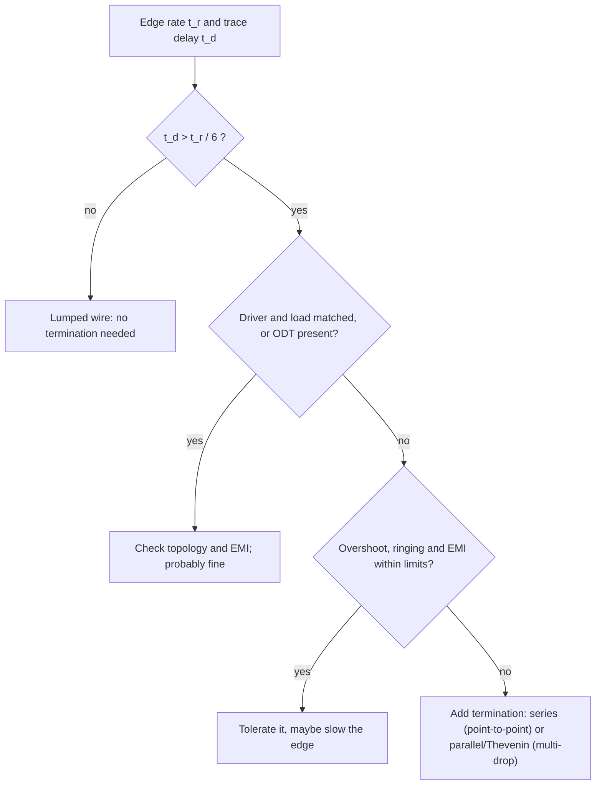

::: testing
Whether you can give a **decision rule, not a slogan**: terminate when the interconnect is electrically long compared with the edge (one-way delay above about $t_r/6$), the driver and load aren't already matched, and the resulting reflection/overshoot/ringing would exceed the noise margin, EMI budget or receiver ratings. A strong answer also lists the cases where it is *not* needed (short/slow nets, on-die termination, matched drivers) and the cost side (power, area, swing, delay).
:::

::: why
Over-terminating wastes power and board area; under-terminating gives intermittent, temperature-dependent failures that are very hard to debug. Knowing the threshold and being able to compute it for a given net is routine design-review material, and it's the bridge from the theory ([[q0711]]) to the layout ([[q0529]], [[q0530]]).
:::

::: concepts
- **Electrical length**: the line is a transmission line when $t_d>t_r/6$ (heuristic). See [[q0709]].
- **Source and load mismatch**: driver $R_{out}$ vs $Z_0$; receiver high-Z. See [[q0714]].
- **Ringing and overshoot**: sequence of reflections; severity set by $\Gamma_s\Gamma_L$ and $t_d/t_r$. See [[q0696]].
- **Noise margin and receiver limits**: undershoot/overshoot must stay in spec. See [[q0687]].
- **On-die termination (ODT)** removes the need for an external part.
- **Topology**: multi-drop and long stubs need termination.
:::

::: answer
"I'd add external termination when the trace is long compared with the edge and the driver and load aren't already matched, so reflections would hurt.

The test I use is delay against rise time. If the one-way delay of the trace is less than about a sixth of the rise time, the reflections merge into the edge and I can ignore them: that's about 28 millimetres for a one nanosecond edge. If it's longer, I look at the mismatch. A CMOS driver of 20 ohms into a 50 ohm line and a high-impedance receiver has a source reflection of minus 0.67 and a load reflection of plus one, so the receiver sees overshoot of tens of percent and ringing. I'd check whether the overshoot stays inside the receiver's input range and noise margin; if it doesn't, I terminate.

Other triggers: clocks, where a false edge double-clocks something; multi-drop buses; differential and high-speed links where eye margin matters; EMI, because ringing radiates; and when the receiver has no on-die termination.

When I don't terminate: short, slow nets like GPIO, I²C and low-speed SPI where the edge is slow; interfaces where the chips have ODT built in, like DDR data; and signals where a termination would cost too much power. It's a trade: series termination is cheap and low power, parallel termination costs DC current."
:::

::: technical
**Rule of thumb.** Termination is needed when $t_d>t_r/6$ (some use $t_r/4$ or $t_r/8$) *and* the reflections exceed the budget. Critical length $\ell_c=t_r/(6\,t_{pd})$: 28 mm for $t_r=1$ ns, 2.8 mm for 100 ps, 56 mm for 2 ns (at 5.9 ps/mm).

**Severity estimate.** For source $R_s$, line $Z_0$, open load, $\Gamma_s=(R_s-Z_0)/(R_s+Z_0)$, $\Gamma_L=+1$. For $R_s=20\ \Omega$ into 50 Ω: $\Gamma_s=-0.43$ (and $-0.67$ for 10 Ω). Computing the receiver voltage with a ramp edge, peak overshoot is ≈ 11% of the final value at $t_d/t_r=1/6$ and about 43% once $t_d\ge t_r/2$ (full-amplitude lattice). Check overshoot against the receiver's absolute maximum (typically $V_{DD}+0.3$ V) and ringing against noise margin.

**Triggers.**
1. $t_d>t_r/6$ and overshoot/undershoot > ~10% of swing or beyond the input limits.
2. **Clock/strobe/enable lines** where a ringing edge can double-clock.
3. **Multi-drop buses** and any stubs.
4. **Differential links** (always terminated: 100 Ω across the pair, often on-die).
5. **EMI**: ringing or fast edges radiate; series resistors also slow edges.
6. **High-speed memory/serial buses** where the standard specifies a termination scheme.
7. **Driver can't be matched** (strong or very weak driver, unknown output impedance).

**Not needed.** $t_d<t_r/6$; slow edges or short traces; receivers with ODT/matching drivers (e.g. LVDS inputs, DDR with ODT); signals where the rest of the system tolerates ringing (e.g. discrete slow control lines).

**Cost.** Series: ~0 DC power, slightly slower edge, receiver must be at the end. Parallel to ground: $V^2/R$ DC power (3.3 V into 50 Ω is 218 mW while high; average ~109 mW at 50% duty). Thevenin: static power $V_{CC}^2/(R_1+R_2)$, e.g. 54 mW for two 100 Ω. AC: little DC power, more components.
:::

::: short
"I terminate when the trace is electrically long, meaning one-way delay above about a sixth of the rise time, and the driver and receiver aren't matched, so reflections would cause overshoot or ringing beyond the receiver's limits and noise margin. That's typical for fast clocks, multi-drop buses, differential and high-speed links, and anything with an EMI problem. I skip it for short, slow nets and for receivers with on-die termination, and I choose series termination when power matters and parallel when I need a clean wave along the line."
:::

::: long
"For me the question is whether reflections will matter, and there's a quick way to decide. Take the one-way delay of the trace, about 6 picoseconds per millimetre on FR-4, and compare it with the rise time. If the delay is less than roughly a sixth of the rise time, the reflections arrive before the edge has finished and they blend into it. That's about 28 millimetres for a one-nanosecond edge, or under 3 millimetres for 100 picoseconds. If the line is longer than that, I look at how bad the mismatch is. A typical CMOS driver of 20 ohms into a 50 ohm trace and a high-impedance receiver has reflection coefficients of minus 0.43 at the source and plus one at the load. Computing it out, once the delay is more than a sixth of the rise time I get about 10 percent overshoot, and it grows to around 40 percent for longer lines. Then I compare with the receiver's limit and the noise margin, and if it fails, I terminate.

Beyond that, there are special cases where I terminate regardless: clocks and strobes where a ringing edge could double-clock a flip-flop, multi-drop buses and anything with stubs, differential pairs, which are always terminated at the receiver, usually on-die, high-speed memory and serial links where the standard specifies a scheme, and EMI situations, because ringing and fast edges radiate.

I don't terminate short, slow nets, like GPIO, I²C and low-speed SPI, where the edge is slow and the line is lumped, and I don't add external parts when the receiver has on-die termination.

And I pick the type by the trade-off: series termination is cheap and low power but needs the receiver at the end; parallel termination gives a full-amplitude wave along the line but costs DC power, which Thevenin or AC termination can reduce."
:::

::: terms
- **Electrical length**: ratio of line delay to rise time; long means reflections matter.
- **Critical length ($\ell_c$)**: $t_r/(6t_{pd})$.
- **Overshoot / undershoot**: excursion above/below the rail due to reflections.
- **Ringing**: damped oscillation from repeated reflections.
- **ODT**: on-die termination.
- **Multi-drop**: one driver, multiple receivers on a line.
- **Noise margin**: voltage between the signal level and the receiver's threshold.
- **Absolute maximum rating**: input voltage limit beyond which damage or latch-up can occur.
:::

::: exceptional
An average answer says "for long, fast traces." An exceptional answer:
- Gives the **quantitative criterion** ($t_d>t_r/6$; 28 mm at 1 ns; 2.8 mm at 100 ps) and ties it to **overshoot** (≈ 11% at the threshold, up to ≈ 43% for 20 Ω driver, open load).
- Lists **non-length triggers**: clocks, multi-drop, stubs, differential, standards, EMI, uncontrolled drivers.
- Lists **when not to** (short/slow, ODT) and the **cost** (power, area, delay).
- Chooses **series vs parallel** by trade-off and says to **verify** (simulation/scope).
- Mentions **receiver limits** (absolute max, input clamp diodes) as the real pass/fail criterion.
:::

::: mistakes
- **Terminating everything "to be safe".** Wastes power and area, and parallel termination can reduce noise margin.
- **Using clock frequency instead of edge rate** to judge. A 1 MHz signal with a 500 ps edge may need termination.
- **Skipping termination on a clock because "it works on the bench".** Margins vary with temperature, loading and the next revision's faster edges.
- **Adding termination to a multi-drop bus with series resistors only.** Intermediate receivers see a half-step.
- **Forgetting that a fast driver family change** (new logic family or "improved" drive strength) changes $t_r$.
- **Ignoring EMI** as a reason to slow edges with a series resistor even on a short net.
:::

::: deep
## The decision flow


Figure: Start with electrical length, then check whether the mismatch actually produces a problem. Terminate only if the answer to the last question is no. The shortcut at the top removes most nets on a board.

## Why $t_r/6$?

Consider a driver with $R_s=20\ \Omega$ into a 50 Ω line and an open receiver. A step arrives at the load at $t_d$ and doubles; the reflection returns and bounces. With a finite edge $t_r$ the successive wave fronts overlap if $t_d<t_r/2$; the receiver voltage is the superposition. Computing the peak receiver voltage numerically from the lattice (with a linear ramp input):

```plot
{"title":"Peak overshoot at the receiver vs t_d / t_r (20 Ω driver, 50 Ω line, open load)","x":{"label":"t_d / t_r","unit":"","min":0.05,"max":1},"y":{"label":"Peak overshoot above final value","unit":"%","min":0,"max":50},
 "series":[{"label":"overshoot","points":[[0.05,3],[0.1,6.1],[0.15,9.4],[0.17,10.8],[0.2,11.4],[0.25,12.2],[0.3,18.3],[0.35,24.5],[0.4,30.6],[0.45,36.7],[0.5,42.9],[0.75,42.9],[1,42.9]]}],
 "vlines":[{"at":0.1667,"label":"t_d = t_r/6"}]}
```
Figure: At $t_d=t_r/6$ the overshoot is already about 11% of the final value; beyond $t_d=t_r/2$ it saturates at 43%, the full-lattice value for $\Gamma_s=-0.43$, $\Gamma_L=1$. So the sixth-of-the-rise-time rule corresponds to roughly 10% overshoot for a typical CMOS driver: a sensible place to start worrying.

The factor depends on the driver: with a strong 10 Ω driver ($\Gamma_s=-0.67$) the overshoot is larger, so use a stricter ($t_r/8$ or $t_r/10$) criterion; with a weak 40 Ω driver ($\Gamma_s=-0.11$) there is almost no ringing, so termination is rarely needed.

## Applying it: a few nets

Using $t_{pd}=5.9$ ps/mm:

| Net | $t_r$ | Length | $t_d$ | $t_r/6$ | Verdict |
|---|---|---|---|---|---|
| I²C, 100 mm | 300 ns | 100 mm | 0.59 ns | 50 ns | No termination |
| GPIO LED, 50 mm | 5 ns | 50 mm | 0.30 ns | 0.83 ns | No |
| SPI at 10 MHz, 100 mm, 2 ns edge | 2 ns | 100 mm | 0.59 ns | 0.33 ns | Marginal: add a 33 Ω series resistor on SCK |
| 50 MHz clock, 1 ns edge, 90 mm | 1 ns | 90 mm | 0.53 ns | 0.17 ns | Yes: series termination on the clock |
| 100 ps edge, 10 mm | 0.1 ns | 10 mm | 59 ps | 17 ps | Yes |
| Differential pair at 5 Gb/s | 40 ps | any > 1 mm | – | 7 ps | Yes: 100 Ω termination (ODT) |

```sim
{"id":"tline-lab","z0":50,"rs":20,"rl":"open","td":5e-10,"tr":1e-9,"term":"none"}
```
Figure: Slide `td` and `tr` and read the overshoot at the load. With td = 0.5 ns and tr = 1 ns, the line is 'long' ($t_d/t_r=0.5$) and shows ~40% overshoot. Set `term` to `series` and the ringing disappears; set `td` to 0.1 ns and it merges into the edge.

## The cost of termination

| Type | DC power example (3.3 V, $Z_0=50$ Ω) | Notes |
|---|---|---|
| None | 0 | ringing if long |
| Series (33 Ω) | ≈0 | edge slowed slightly; receiver at the end only |
| Parallel to ground (50 Ω) | 218 mW high, ≈109 mW average | high swing loss with CMOS drivers |
| Thevenin (100/100 to VCC/GND) | 54 mW static | $V_{TH}=1.65$ V mid-rail |
| AC (50 Ω + 100 pF) | ≈ 0 DC | draws current only at edges; some data-dependent droop |
| Differential 100 Ω | $I_{drv}^2R$: 3.5 mA × 350 mV ≈ 1.2 mW | standard for LVDS |

## Receiver limits as the real criterion

The receiver doesn't care that the line is long; it cares whether the voltage at its pin stays within its absolute-maximum range (often $V_{DD}+0.3$ V; clamp diodes conduct beyond that) and whether ringing re-crosses the threshold (non-monotonic edges). For a 3.3 V CMOS receiver with 20 Ω driver and 43% overshoot of a 3.3 V step, the pin sees up to 4.7 V—a violation. Simulation with IBIS models, or a scope probe at the receiver, is the proof.

> [!UNCERTAIN]
> The sixth-of-the-rise-time criterion and the "10% overshoot" association depend on the driver impedance and the edge shape (linear ramp vs exponential); some references use $t_r/4$ or $t_r/10$. Use it as a screening test, not a guarantee.

## Real hardware behaviour

- **Edge rates change** between driver families and revisions: a "same part number, new die shrink" can speed edges tenfold.
- **Slew-rate control** or drive-strength settings on MCUs are free alternatives to external series termination.
- **Marginal behaviour** shows up with temperature, supply and loading changes, or when a probe (extra capacitance) "fixes" the signal.

## Worked example: a 150 mm clock that rings

Take a 3.3 V CMOS clock driver with $R_s=20\ \Omega$ driving a 150 mm microstrip (50 Ω, $t_{pd}\approx5.9$ ps/mm) into a single high-impedance receiver. Edge time is $t_r=1$ ns. First the screening test:

$$t_d = 150\ \text{mm}\times 5.9\ \text{ps/mm}=0.885\ \text{ns}\;>\;\frac{t_r}{6}=0.167\ \text{ns}$$

The line is electrically long by a factor of five, so termination is on the table. Now the reflection coefficients and the bounce (lattice) diagram. At the source, $\Gamma_s=\frac{20-50}{20+50}=-0.429$. At the open receiver, $\Gamma_L=+1$. The first wave launched onto the line is the divider value $3.3\cdot\frac{50}{70}=2.36$ V. At the receiver it doubles to 4.71 V (because $1+\Gamma_L=2$), reflects back, hits the source, is inverted and shrunk by 0.429, and returns. The receiver voltage after each arrival is 4.71, 2.69, 3.56, 3.19, 3.35, 3.28 V, converging on 3.3 V. The ring period is $4t_d=3.54$ ns (≈282 MHz), and the first overshoot is $4.71-3.3=1.41$ V or 43%. That is 1.4 V above a 3.3 V rail: the receiver's input clamp diode conducts, and on a part with an absolute maximum of $V_{DD}+0.3$ V you are outside the rating on every edge.

The fix is a series resistor at the driver pin. Choose it so that $R_s+R_{series}\approx Z_0$, so $R_{series}\approx 30\ \Omega$ (a standard 33 Ω is fine). The line now launches $3.3\cdot\frac{50}{100}=1.65$ V, the open far end doubles it to 3.3 V, and the reflection returning to the source sees $\Gamma_s=0$ and is absorbed. The receiver gets one clean edge, delayed by $t_d$. The price is that the intermediate half-step sits on the line for $2t_d=1.77$ ns, so nothing else on the line may sample before that. This is why series termination is for point-to-point nets only: a second receiver mid-line would see the 1.65 V plateau and might double-clock.

## When the simple model breaks

- **The driver is nonlinear.** A CMOS output moves between saturation and triode as the output swings, so its impedance varies with output voltage and differs between rising and falling edges, and $\Gamma_s$ is not a constant. IBIS pull-up and pull-down V-I tables capture this; a hand lattice with a single $R_s$ is an estimate.
- **The receiver has capacitance.** A real input is $C_{in}\approx2$ to 5 pF rather than an open circuit, which rounds the reflection and lowers the peak. It also adds delay and a pole of $Z_0C_{in}$ roughly (50 Ω × 4 pF = 0.2 ns), which matters at 100 ps edges.
- **Stubs and vias.** A 10 mm stub on a 1 ns edge is $t_d\approx59$ ps, below $t_r/6$, so it is harmless; the same stub on a 150 ps edge is not.
- **Loss.** On FR-4 at multi-GHz the edge slows with distance, so a long line can become less of a problem than its length suggests. The $t_r$ in the test should be the edge at the *far* end of the line.

## Bench verification

Probe at the receiver pin, not at the driver; the driver end looks fine in the unterminated case because the reflection arrives $2t_d$ later and only shows as a delayed step. Use a scope with bandwidth of at least $0.35/t_r$ times a safety factor (for a 1 ns edge, 350 MHz is the bare minimum; use 1 GHz) and a short ground spring instead of the 15 cm ground lead, whose inductance rings at a few hundred MHz and fools you into "fixing" a probe artifact. Look for overshoot beyond the rail, a non-monotonic edge crossing the receiver threshold, and a ring period of about $4t_d$; if the ring period matches, the diagnosis is confirmed. Then solder the series resistor, re-measure, and check that the edge is monotonic and the delay increased by the RC you expected. A quick EMI sanity check with a near-field probe before and after is a nice confirmation that the ringing was radiating.
:::

::: applications
- **Clock distribution**: series resistors at buffer outputs on any clock longer than a few cm.
- **SDRAM and DDR**: fly-by $V_{TT}$ terminations on address/command, ODT on data.
- **Parallel buses to FPGAs/ASICs**: series or Thevenin terminations per the vendor's guide.
- **LVDS/CML/SerDes**: 100 Ω termination at the receiver (on-die in most chips).
- **Backplane multi-drop buses (legacy)**: end-of-line termination.
:::

::: assumptions
- Uses the heuristic $t_d>t_r/6$ and a linear-ramp edge; real edges are non-linear and drivers have non-constant output impedance.
- Overshoot values assume a 20 Ω driver and an open (capacitive) receiver; other drivers change the numbers.
- "External" termination means discrete components; ODT and driver-impedance calibration (e.g. DDR ZQ) replace them in many designs.
- Power numbers assume 3.3 V and 50% duty.
:::

::: followups
### A 30 mm SPI clock with a 2 ns edge: terminate?
$t_d=177$ ps against $t_r/6=333$ ps: electrically short, so reflections blend into the edge. I'd skip a terminator but may still add a 33 Ω series resistor if EMI or a long cable is expected, and I'd verify on a scope.

### What if the line is short but the receiver has a very sensitive threshold (e.g. a clock input)?
Then even small ringing can re-cross the threshold. I'd terminate or slow the edge anyway, since the criterion is "does ringing cause a false edge", not the length alone.

### How does a lower-impedance driver change the answer?
A 10 Ω driver gives $\Gamma_s=-0.67$: more ringing, so the threshold is stricter (e.g. $t_d>t_r/10$). A 40 Ω driver nearly matches 50 Ω, so I might not need a resistor at all. The driver's IBIS model tells me.

### Series or parallel when I do need it?
Series for point-to-point nets with the receiver at the end: low power, cheap, tolerant. Parallel (or Thevenin/AC) for multi-drop, when receivers along the line must see a clean wave, or for differential links. See [[q0533]].

### Why do some designers terminate even short traces?
EMI and robustness: a series resistor of 22–33 Ω costs nothing, slows the edge a bit, reduces radiated emissions, and protects against future edge-rate changes. It's an engineering judgement; I'd still keep the resistor optional (0 Ω option) in the first layout.
:::

::: interpretations
"External termination components" means discrete resistors/capacitors, as opposed to on-die termination. "When would you need" is answered as a design decision rule (when reflections would violate noise margin or limits). Termination *types* are in [[q0532]] and the series vs parallel comparison in [[q0533]].
:::

::: references
- Howard Johnson & Martin Graham, *High-Speed Digital Design: A Handbook of Black Magic*: when termination is required and electrical-length criteria.
- Eric Bogatin, *Signal and Power Integrity: Simplified*: critical length, termination choices.
- Interface datasheets and layout guides (JEDEC DDR, LVDS, MIPI) for specified terminations.
- IBIS model documentation for evaluating driver output impedance and overshoot.
:::

::: rubric
- Gives the criterion: delay vs rise time ($t_d>t_r/6$) with numbers :: A quantitative, defensible test.
- Considers driver/load mismatch and the resulting overshoot/ringing :: Reflection severity depends on mismatch.
- Names special cases: clocks, multi-drop, differential, standards, EMI :: Real-world triggers.
- States when not needed: short/slow nets, ODT :: Avoids over-engineering.
- Notes the costs (DC power, area, edge slowing) and picks series vs parallel :: Trade-off thinking.
- Checks receiver limits and verifies with simulation/scope :: Practical validation.
:::

::: quiz
```json
[
 {"type":"mcq","level":"fundamental","q":"Which comparison is the standard first test for whether a trace needs termination?","options":["Clock frequency vs 100 MHz","One-way delay vs one-sixth of the rise time","Trace width vs 0.1 mm","Supply voltage vs 3.3 V"],"answer":1,"explain":"If $t_d>t_r/6$ the line is electrically long and reflections matter; otherwise the trace behaves as a lumped wire."},
 {"type":"numeric","level":"fundamental","q":"Critical length for $t_r=1$ ns at 5.9 ps/mm using $t_r/6$ (mm)?","answer":28.2,"tolerance":0.03,"unit":"mm","explain":"$1000/(6\\times5.9)=28.2$ mm."},
 {"type":"numeric","level":"intermediate","q":"A 20 Ω driver drives a 50 Ω line. What is the source reflection coefficient $\\Gamma_s$?","answer":-0.4286,"tolerance":0.03,"unit":"","explain":"$(20-50)/(20+50)=-0.4286$."},
 {"type":"numeric","level":"intermediate","q":"A 90 mm FR-4 trace (5.9 ps/mm) is driven with a 1 ns edge. What is the delay $t_d$ in ps?","answer":531,"tolerance":0.02,"unit":"ps","explain":"$90\\times5.9=531$ ps, which exceeds $t_r/6=167$ ps, so termination should be considered."},
 {"type":"truefalse","level":"intermediate","q":"Differential links with no on-die termination should be left unterminated if the traces are short.","answer":false,"explain":"Differential receivers need a 100 Ω (or specified) termination to absorb the signal; short length doesn't remove the need unless the receiver has ODT."},
 {"type":"multi","level":"advanced","q":"Which situations typically justify external termination?","options":["A fast clock on a 90 mm trace driven by a 10 Ω driver","An I²C line at 100 kHz","A multi-drop bus with stubs","A receiver with ODT on a short DDR data net"],"answer":[0,2],"explain":"A fast clock with a low-impedance driver on a long trace and a multi-drop bus both reflect strongly. Slow I²C and ODT-equipped receivers don't need external parts."}
]
```
:::
