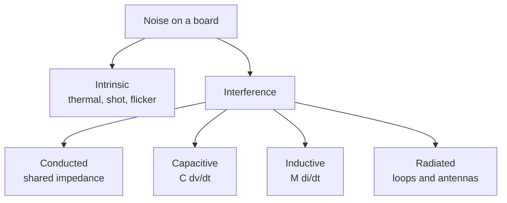

::: basics
### In plain words
Noise on a circuit board has two kinds. Natural noise comes from the parts themselves. Interference is unwanted signal from other circuits, such as a switching regulator (a power circuit that switches on and off fast) or a fast clock, leaking into a sensitive part. Interference is usually much bigger, and the board's layout decides how much arrives. You cannot fix a bad layout in software afterward.

### Picture it
Picture an open-plan office. A loud meeting is the noise source, and someone trying to read is the victim. Noise travels along a path: through the open floor, a shared hallway, or a thin wall. The floor plan decides how much gets through. You can move the reader away or add walls.

### Words you need
- **Interference**: unwanted signal coupled in from another circuit.
- **Source, path, victim**: the circuit making noise, the route it takes, and the circuit it harms.
- **ADC**: a chip that converts a voltage into a number. A 12-bit ADC gives numbers from 0 to 4095.
- **LSB**: the smallest voltage step an ADC can tell apart.
- **Noise margin**: how much noise a digital input tolerates before it misreads a 0 as a 1, or the reverse.

### The simplest example
A 12-bit ADC with a 3.3 V reference splits the range into 4096 steps. One step (1 LSB) is 3.3 V / 4096 = about 0.8 mV. Now say 1 mV of noise from a nearby regulator reaches its input. That is more than one whole step, so the lowest bits are just noise. The ADC behaves like a part with about 10 bits instead of 12, and averaging in software cannot remove noise synchronized with the regulator.

That is the whole idea: interference reaches victims through paths the board creates. The rest of this page covers the consequences and why layout is the place to prevent them.
:::

::: testing
Whether you see noise as a *system* problem with a source, a coupling path and a victim, and whether you know why the PCB is where the coupling paths are created. The interviewer wants to hear:

1. Noise is not only "thermal noise in a resistor". On a board, most of it is *interference* from other circuits.
2. The layout decides how strongly that interference reaches sensitive nodes, and layout can't be fixed in firmware or after fabrication.
3. Concrete consequences: lost ADC bits, false logic transitions, reduced radio range, failed EMC tests, flaky products.
:::

::: why
Boards put switching converters, fast digital edges, radios and microvolt-level analog signals within centimetres of each other. Every trace has capacitance and inductance, every plane has impedance, every loop is an antenna. The same schematic can work or fail depending on the layout, which is why hardware interviews keep returning to it. It also costs real money: a noise problem found after fabrication means a respin, and one found after certification means a delay.
:::

::: concepts
- **Intrinsic noise**: thermal ($\sqrt{4kTR\Delta f}$), shot and flicker noise are set by physics and the device; you manage them by component choice and bandwidth.
- **Interference**: deterministic unwanted signals from other circuits, which the board can create or prevent. See [[q0559]].
- **Source–path–victim model**: every noise problem has all three, and you can attack any of them. See [[q0565]].
- **Coupling mechanisms**: shared impedance (conducted), capacitive, inductive, radiated.
- **Noise margin and ADC resolution**: how much noise a digital input or an analog measurement can tolerate. See [[q0688]] for ground bounce.
- **Parasitic capacitance and inductance** of traces, planes and vias, which the layout sets.
:::

::: answer
"At board level, noise matters because the board is where noise gets from where it's made to where it does damage. There are two kinds. Intrinsic noise, like thermal and shot noise, is set by the components and the bandwidth. Interference is unwanted signal coupled in from other circuits, a switching regulator, a fast clock, a motor driver, a radio. Interference is usually much bigger, and the PCB decides how much of it arrives.

Every source has a coupling path to a victim: shared impedance in the ground or power, capacitive coupling between traces, magnetic coupling between loops, or radiation. The traces, planes and vias set all of those. A 12-bit ADC with a 3.3 V reference has an LSB of 0.8 mV, so a millivolt of noise on its reference or input costs bits. A digital input with 400 mV of noise margin can false trigger from ground bounce. A radio's sensitivity drops dB for dB with the noise floor.

And it can't be patched later: you can't fix a bad return path in firmware, and an EMC failure after the board is built means a respin. So I think about noise at layout time: small loops, solid return planes, partitioning, decoupling, and keeping aggressors away from victims."
:::

::: technical
**Taxonomy.**
- *Intrinsic*: thermal noise density $e_n = \sqrt{4kTR}$ (about 4 nV/√Hz for 1 kΩ at room temperature), shot noise $i_n = \sqrt{2qI\Delta f}$, flicker (1/f). Controlled by component and bandwidth choices.
- *Interference*: conducted via shared impedance (ground, power rails), capacitively coupled ($i = C_m\,dv/dt$), inductively coupled ($v = M\,di/dt$), or radiated (loops and short antennas). The PCB's geometry sets $C_m$, $M$, loop areas and shared impedances.

**Consequences, with numbers.**
- *ADC resolution*: ENOB $\approx (20\log_{10}\frac{V_{FS}/(2\sqrt2)}{v_n} - 1.76)/6.02$. A 16-bit, 5 V ADC (LSB 76 µV) with 1 mV rms of noise has ENOB about 10.5: 5.5 bits lost. A 12-bit, 3.3 V ADC with 1 mV rms: 9.9 bits.
- *Digital noise margin*: classic 3.3 V LVTTL thresholds leave about 0.4 V margin. Simultaneous switching: 8 outputs, 15 pF each, 3.3 V in 1 ns through 2 nH of shared ground inductance gives $v = N L\,di/dt \approx 0.8$ V of bounce.
- *RF desense*: in-band noise raises the receiver's noise floor and reduces sensitivity ([[q0568]]).
- *Compliance*: emissions and immunity tests (FCC, CISPR, IEC 61000-4-x) are decided by the layout as much as by the schematic.
- *Reliability*: ESD and surges couple into the board by the same paths.

**Why board level.** The layout defines: loop areas (radiation and pickup), return paths (shared impedance), spacing (crosstalk), plane splits and stack-up, decoupling effectiveness and placement, and where components sit relative to each other. These cannot be changed by software and are expensive to change after fabrication.
:::

::: short
"Noise at board level is mostly interference: switching regulators, fast edges and radios coupling into sensitive nodes through shared impedance, capacitance, inductance and radiation. The PCB layout sets all of those paths. The consequences are real: a millivolt of noise costs a 12-bit ADC bits, ground bounce can false trigger a digital input, in-band noise cuts radio sensitivity, and an EMC failure means a respin. You can't fix it in firmware, so you design for it at layout time."
:::

::: long
"I'd start by splitting noise into two kinds. There's intrinsic noise, thermal, shot, flicker, which comes from the physics of the components. I manage that with component choices and by limiting bandwidth. Then there's interference, which is unwanted signal from other circuits on the same board or outside: a switching regulator, a fast clock edge, a motor driver, a radio. That's usually much larger than the intrinsic noise, and the board decides how much of it reaches where.

Every interference problem has a source, a coupling path and a victim. The paths are shared impedance, like two circuits sharing a ground return; capacitive coupling between adjacent traces; magnetic coupling between loops; and radiation. Every one of those is set by the geometry of the board: how close things are, how big the loops are, how continuous the planes are.

The consequences are concrete. A 12-bit ADC with a 3.3 volt reference has an LSB of 0.8 millivolts, so a millivolt of noise costs about two bits. Digital inputs with a few hundred millivolts of noise margin can false trigger when eight outputs switch and bounce a shared ground, which can easily be a volt. A radio's sensitivity gets worse dB for dB with the in-band noise. And emissions or immunity failures at compliance can mean a respin.

The point of board-level noise control is that it can't be fixed afterwards in software. So I design for it up front: keep loops small with solid return planes, partition noisy and quiet circuitry, decouple at the pins, keep aggressors and victims apart, and filter at the connectors."
:::

::: terms
- **Interference**: unwanted signal from another circuit or external source, as opposed to intrinsic noise.
- **Thermal (Johnson) noise**: $\sqrt{4kTR\Delta f}$ across a resistance, set by temperature and bandwidth.
- **Coupling path**: the route from aggressor to victim: conducted, capacitive, inductive or radiated.
- **Shared impedance**: a common impedance (like a ground trace) carrying currents from more than one circuit.
- **Noise margin**: how much noise a digital input tolerates before misreading a level.
- **ENOB**: effective number of bits, the resolution after noise and distortion are accounted for.
- **Ground bounce**: voltage between two "ground" points due to $L\,di/dt$ from simultaneously switching outputs.
- **EMC**: electromagnetic compatibility, the ability of a device to work in its environment without disturbing it or being disturbed.
:::

::: exceptional
**An average answer** says "noise can corrupt signals, so we keep sensitive and noisy circuits apart".

**An exceptional answer**:
- Distinguishes intrinsic noise from interference and says layout mainly controls the second.
- Uses the source–path–victim framework and names the four coupling mechanisms.
- Quantifies: LSB size vs noise for an ADC (and bits lost), noise margin vs ground bounce, or noise floor vs radio sensitivity.
- Explains why it's a *layout* issue: planes, loops, spacing and decoupling are set at board level and are expensive to change.
- Mentions EMC compliance and the cost of respins, and that the same layout practices help both emissions and immunity.
:::

::: mistakes
- **Treating noise as only thermal noise.** On boards, interference dominates; thermal noise is usually the floor you reach after layout is right.
- **Thinking filtering alone fixes it.** A filter treats the victim; reducing the source or the path is often cheaper and more effective.
- **"Digital noise is harmless because it's digital."** Digital edges inject current spikes into supplies and grounds that analog circuits see directly.
- **Ignoring return paths.** Currents must return; a signal's noise is often the return current taking a bad path.
- **Assuming it can be fixed in firmware.** Averaging helps only with random noise, not with synchronous interference or saturated front ends.
- **Believing a simulation without parasitics shows the problem.** The schematic doesn't contain the coupling; the layout does.
:::

::: deep
## Two different things called "noise"

**Intrinsic noise** is physics. A resistor at temperature $T$ has a noise voltage density $\sqrt{4kTR}$ (4.07 µV rms in 100 kHz for 10 kΩ, from $\sqrt{4kTR\Delta f}$). Transistors add shot and flicker noise. You reduce it by choosing lower resistances, lower bandwidth, better devices. It sets the *floor* of what you can measure.

**Interference** is another circuit's signal appearing where it doesn't belong. It is deterministic (it's the clock, the PWM, the radio, 50/60 Hz mains), it is usually orders of magnitude bigger than intrinsic noise, and it can be removed in principle. The board's layout largely determines how much of it arrives.


Figure: Intrinsic noise is a property of components and bandwidth. The four interference branches are all created by layout geometry, which is why they are a board-level concern.

## Source, path, victim

Every interference problem has three parts, and you can break any of them:

| Part | Examples | Fix |
|---|---|---|
| **Source** | Switch node dv/dt, clock edges, PWM, motor drive, radio PA | Slow the edge, reduce current, shrink the loop, spread-spectrum |
| **Path** | Common ground impedance, adjacent traces, loops, free-space | Separate, shield, filter, give currents their own return, add planes |
| **Victim** | ADC input, comparator, reference, receiver front end | Lower impedance, filter, differential signalling, shielding, buffer |

The layout is the only place where the *path* is designed. This is why the topic belongs to PCB design more than to circuit theory.

## Four consequences with numbers

**1. Lost resolution.** A 12-bit ADC with $V_{ref}$ = 3.3 V has an LSB of 0.806 mV. If the reference or the input carries 1 mV rms of noise, the effective resolution is

$$\text{ENOB} \approx \frac{20\log_{10}\!\left(\frac{V_{FS}/(2\sqrt2)}{v_n}\right) - 1.76}{6.02} = 9.9\text{ bits}.$$

A 16-bit ADC at 5 V (LSB 76 µV) with the same noise gives 10.5 bits; five and a half bits of an expensive converter are gone.

```plot
{"title":"Effective resolution vs rms noise at the ADC input","x":{"label":"RMS noise","unit":"V","min":1e-5,"max":1e-2,"log":true},"y":{"label":"ENOB","unit":"bits","min":6,"max":16},
 "vars":{"v16":5,"v12":3.3},
 "series":[{"label":"16-bit, 5 V","fn":"min(16,(20*log10(v16/(2*sqrt(2))/x)-1.76)/6.02)"},{"label":"12-bit, 3.3 V","fn":"min(12,(20*log10(v12/(2*sqrt(2))/x)-1.76)/6.02)","color":"red"}],
 "vlines":[{"at":"1e-3","label":"1 mV rms","color":"muted"}]}
```
Figure: Each 6 dB (a factor of two) of noise costs one bit. The 16-bit converter has far more to lose: with 1 mV rms of noise it behaves like a 10.5-bit part. The flat tops show the converter's own resolution limit (ideal quantisation, no other noise).

**2. False logic transitions.** Digital inputs have a noise margin. For classic 3.3 V LVTTL levels ($V_{IL}$ = 0.8 V, $V_{OL}$ = 0.4 V) it's about 0.4 V on the low side. If eight outputs each charge 15 pF through 3.3 V in 1 ns, each draws about $C\,dv/dt = 49$ mA, so the group demands about $4\times10^{8}$ A/s. Through 2 nH of shared ground inductance, that is $v = L\,di/dt \approx 0.8$ V of ground bounce, which is twice the margin.

```sim
{"id":"ground-bounce","n":8,"l":2e-9,"cl":15e-12,"tr":1e-9,"vdd":3.3}
```
Figure: With the same eight outputs, 2 nH and 1 ns edges, the sim already shows about 1.5 V of bounce, above its 0.3·V_DD (0.99 V) false-trigger threshold. Its peak di/dt (about 0.7 A/ns) is higher than the average-di/dt estimate of 0.8 V above, so treat both as order-of-magnitude. Now raise the ground-pin count to 4 or slow the edge to 3 ns and watch the bounce drop below the threshold: that is what more ground pins, a closer plane and edge-rate control buy you.

**3. Sensitivity of radios.** Receivers have a noise floor of $-174\text{ dBm/Hz} + 10\log B + NF$. Any in-band interference adds to it. See [[q0568]].

**4. Compliance and field failures.** The same loops that pick up noise also radiate it (reciprocity, [[q0561]]). Regulators limit emissions (for example FCC Part 15, CISPR 32) and require immunity to fields and transients (IEC 61000-4-x). Failing means rework.

## Why it must be handled in layout

A schematic has no sense of distance. It looks identical whether the input capacitor is 2 mm or 20 mm from the IC. The layout supplies the missing physics:

- **Loop area** sets inductance, radiation and pickup ([[q0562]]).
- **Return path continuity** sets shared impedance ([[q0494]], [[q0497]]).
- **Spacing and stack-up** set capacitive and inductive coupling ([[q0566]]).
- **Decoupling placement** sets how high the supply impedance is at the frequencies where chips draw current ([[q0553]]).
- **Partitioning** sets which circuits can hear each other ([[q0483]]).

None of these can be changed in firmware, and all are costly to change after fabrication. A layout review with a noise mindset ("which are my aggressors, which are my victims, what is the path?") is cheaper than a respin.

## What firmware *can* do

Averaging, oversampling and digital filtering reduce *random* noise by $\sqrt{N}$ for $N$ samples. They do nothing for synchronous interference (e.g., a PWM harmonic aliasing into the sample), offsets from ground drops, or a front end that clips. Schedule ADC samples away from switching edges where you can, but treat that as a patch.

## Worked example: budgeting noise at an ADC and a radio

Take a battery-monitoring input on a 12-bit, 3.3 V ADC. The converter's own quantization noise is $\text{LSB}/\sqrt{12}=0.806\ \text{mV}/3.46=233\ \mu$V rms, which gives the ideal 12 bits. The interference you measure on the pin with the buck converter running is 1 mV rms, four times worse than quantization, so ENOB drops to 9.9 bits as computed above. Ask what you can recover:

- **Oversample 64× and average.** For white (uncorrelated) noise the rms falls by $\sqrt{64}=8$, to 125 µV, which is a gain of $\log_2 8=3$ bits, so the averaged result is good to about 12.9 bits of noise performance. This only works if the noise is random from sample to sample. The 1 mV that is really a 500 kHz buck-converter ripple sampled at a rate that is a multiple of the switching frequency is not random: it aliases to a constant offset and does not average away.
- **Fix the layout so the interference is 100 µV instead of 1 mV.** Now the noise is below the quantization floor, and the converter delivers its full 12 bits with no firmware effort. A factor of 10 in noise (20 dB) is worth 3.3 bits.

The two remedies multiply: layout lowers the amplitude and firmware polishes what remains. But firmware cannot cure offset caused by a ground drop, since that is the same on every sample.

Now a radio. A 1 MHz bandwidth receiver with a 5 dB noise figure has a noise floor of $-174+10\log_{10}(10^6)+5=-109$ dBm. Suppose a switching regulator harmonic leaks into the antenna path at $-100$ dBm in band. The sum of the two powers is $10\log_{10}(10^{-10.9}+10^{-10})=-99.5$ dBm, so the effective noise floor rose by 9.5 dB (desensitization), and range shrinks by a factor of about $10^{9.5/20}=3$ in free space. A "small" board-level leakage of 9 dB above the thermal floor costs two-thirds of the range, and the only cure is on the board: filter, shield, or move the source.

## Limiting cases and when the simple picture is wrong

- **Noise below the quantization floor:** once interference is under about 0.3 LSB rms, further layout improvement does not improve the ADC reading. Stop optimizing and spend the effort elsewhere.
- **Perfectly random noise:** zero-mean noise at a level near one LSB is actually helpful (dither), since it linearizes the quantizer so averaging recovers sub-LSB resolution. A perfectly quiet input with a fixed value just reads the same code every time.
- **Impulsive noise:** a single large transient (an ESD or relay event) is not described by rms. The relevant number is whether any spike exceeds the noise margin or the clamp-diode threshold, so peak values and rates matter more than averages.
- **Slow signals versus fast edges:** a 1 Hz thermistor reading can be filtered with a 10 Hz low-pass that rejects nearly all broadband interference, while a 1 MHz signal cannot. Know the signal bandwidth first.

## Bench verification of a noise problem

1. **Measure the noise floor properly.** With the scope probe tip shorted to its ground spring at the measurement point, read the instrument floor. Then probe the node under test with the system off, then on, and compare. The board's contribution is the quadrature difference, $\sqrt{V_{on}^2-V_{floor}^2}$, since uncorrelated noise adds in power.
2. **Look at the time domain** and note whether the noise is synchronous with something: the switching frequency, the PWM period, a clock burst, the 50/60 Hz mains. Trigger on the suspected source. A trace that stays locked to the trigger tells you which aggressor it is.
3. **Look at the spectrum** with an FFT or a spectrum analyzer: narrow lines at a harmonic comb mean a switcher or clock; a broad hump around the ring frequency means a layout resonance.
4. **Run the experiment that breaks one link:** disable the suspected source, slow its edge, or add shielding or a filter. If the noise falls as predicted, you have identified source, path and victim, not just a correlation.
:::

::: applications
- **Precision sensor boards (thermocouples, strain gauges, ECG)**: microvolt signals next to digital logic; partitioned analog section, guard rings, filtered inputs.
- **Switching-converter boards**: small hot loops and quiet feedback sensing so the converter doesn't interfere with itself ([[q0547]]).
- **Wireless modules (Wi-Fi, Bluetooth, cellular, GPS)**: layouts that keep digital harmonics out of the receive band.
- **Motor controllers**: separation of power stage, gate drive and current sense, with filtering at the connectors.
- **High-speed digital boards**: return-path continuity and decoupling to keep ground bounce below the noise margin.
- **Automotive and industrial products**: surviving EMC immunity tests by connector filtering and protection.
:::

::: assumptions
- **"Board-level" means noise generated or coupled on or around the PCB.** Chip-level noise (substrate noise, on-die supply noise) is a different scope.
- **Numbers use idealised models**: a lumped 2 nH shared inductance, a sine-wave full-scale for ENOB, and thermal noise at 300 K.
- **The ENOB estimate assumes noise is white and uncorrelated with the signal.** Synchronous interference produces spurs rather than a raised floor.
- **LVTTL thresholds** (0.8 V / 2.0 V; 0.4 V / 2.4 V) are used as an example; modern logic families differ.
- **Alternative angle**: for an RF-heavy product, "why is noise a consideration" is mainly about sensitivity ([[q0568]]); for a power product, mainly about EMC compliance.
:::

::: followups
### What's the difference between noise and interference?
Noise in the strict sense is random, intrinsic fluctuation from physics (thermal, shot, flicker), with a statistical spectrum. Interference is a specific unwanted signal from another circuit (a clock harmonic, switching ripple, mains hum). Both degrade a signal, but interference is deterministic, usually larger, can have a recognisable frequency, and can be eliminated by changing the source, path or victim. On boards, most problems are interference.

### Why can't you fix a noisy board in firmware?
Firmware can average random noise by $\sqrt{N}$ and can time samples, but it can't remove noise that saturates the front end, offsets from ground drops, or synchronous interference correlated with the sample clock. It also can't fix radiated emissions or an RF receiver desensitised by noise. Those are analog and electromagnetic problems and the fix is geometric.

### An ADC reads 3 LSB of noise with the motor off and 40 LSB with it on. How do you find the coupling path?
Scope the ADC input or reference with the motor on, and look at the noise's shape and frequency: does it follow PWM edges (switching, pickup) or the motor's commutation (current spikes in shared ground)? Probe the ground between the motor driver and the ADC for a voltage; disconnect one thing at a time; try the ADC input shorted. If the noise stays with the input shorted, it's through ground or reference; if it vanishes, it's pickup on the input line.

### How would you quantify the loss in bits from noise?
Compute ENOB from the SNR: SNR = $20\log_{10}$ of full-scale rms over noise rms, then ENOB = (SNR − 1.76)/6.02. For a 3.3 V, 12-bit ADC with 1 mV rms noise that's 9.9 bits, for 0.3 mV it's 11.6. Each factor of two in noise costs a bit.

### Harder: two boards have identical schematics. One passes EMC, the other fails. Why?
The layout. Loop areas, stackup, the presence of an unbroken return plane under high-speed nets, placement of decoupling and filters, connector grounding, via stitching and cable routing all differ and none show up in the schematic. I'd compare near-field scans or scope hot-loop currents and look at return path continuity first.
:::

::: interpretations
"Why is noise a consideration at the board-level?" is the opening question of a block (Q558–Q573) on noise, EMI, coupling, desense and shielding. It asks for the *why* (consequences and the board's role), not the techniques, which come in [[q0562]], [[q0564]] and [[q0566]]. The definition of EMI itself is in [[q0559]].
:::

::: references
- Henry W. Ott, *Electromagnetic Compatibility Engineering*: chapters on noise coupling mechanisms, grounding and PCB layout.
- Howard Johnson & Martin Graham, *High-Speed Digital Design: A Handbook of Black Magic*: noise, ground bounce and crosstalk.
- Horowitz & Hill, *The Art of Electronics*, 3rd ed.: chapters on low-noise design and on grounding and shielding.
- Analog Devices, *Op Amp Applications Handbook*, and *Data Conversion Handbook*: noise, grounding and layout of mixed-signal circuits (topic level).
:::

::: rubric
- Separates intrinsic noise from interference :: Shows you know what the layout can and cannot control.
- Frames it as source, path, victim, with the board creating the path :: The core engineering model for every EMC and noise problem.
- Names the coupling mechanisms (shared impedance, capacitive, inductive, radiated) :: These are what the layout techniques each target.
- Gives concrete consequences with numbers (LSB vs noise, ground bounce vs noise margin) :: Turns an abstract claim into something measurable.
- Mentions RF sensitivity and EMC compliance :: Noise matters for both performance and regulations.
- Says it can't be fixed later in firmware or cheaply after fabrication :: Explains why it is a layout-time concern.
- Mentions the practices: planes, loop area, partitioning, decoupling :: Links the why to the how.
:::

::: quiz
```json
[
 {"type":"mcq","level":"fundamental","q":"Which of these is *interference* rather than intrinsic noise?","options":["Thermal noise in a 10 kΩ resistor","Shot noise in a diode","Switching ripple from a buck converter appearing on an ADC input","Flicker noise in an op-amp"],"answer":2,"explain":"Interference is an unwanted signal from another circuit. Thermal, shot and flicker noise are physical properties of the components."},
 {"type":"numeric","level":"fundamental","q":"What is the LSB size of a 12-bit ADC with a 3.3 V reference? Give it in mV.","answer":0.806,"tolerance":0.02,"unit":"mV","explain":"$3.3/4096 = 0.806$ mV. A millivolt of noise is therefore more than one LSB."},
 {"type":"numeric","level":"intermediate","q":"A 16-bit, 5 V full-scale ADC sees 1 mV rms of broadband noise. Using SNR = 20 log10[(V_FS/(2√2))/v_n] and ENOB = (SNR − 1.76)/6.02, what is the ENOB?","answer":10.5,"tolerance":0.02,"unit":"bits","explain":"$V_{FS}/(2\\sqrt2) = 1.768$ V rms. SNR = $20\\log_{10}(1768) = 64.9$ dB. ENOB = (64.9 − 1.76)/6.02 = 10.5 bits."},
 {"type":"numeric","level":"intermediate","q":"Eight outputs each draw 49.5 mA with edges that ramp over 1 ns, all returning through 2 nH of shared ground inductance. Estimate the ground bounce, treating di/dt as total current over 1 ns. Give it in V.","answer":0.79,"tolerance":0.05,"unit":"V","explain":"Total current 0.396 A in 1 ns gives di/dt = 3.96×10⁸ A/s. $v = L\\,di/dt = 2\\times10^{-9}\\cdot3.96\\times10^{8} = 0.79$ V."},
 {"type":"truefalse","level":"advanced","q":"Averaging many ADC samples in firmware removes interference that is synchronous with the sampling clock.","answer":false,"explain":"Averaging reduces random noise by √N, but interference correlated with the sample clock (e.g., a PWM harmonic aliasing at a fixed phase) adds coherently and survives averaging. It has to be fixed in hardware or by moving the sampling instant."}
]
```
:::
