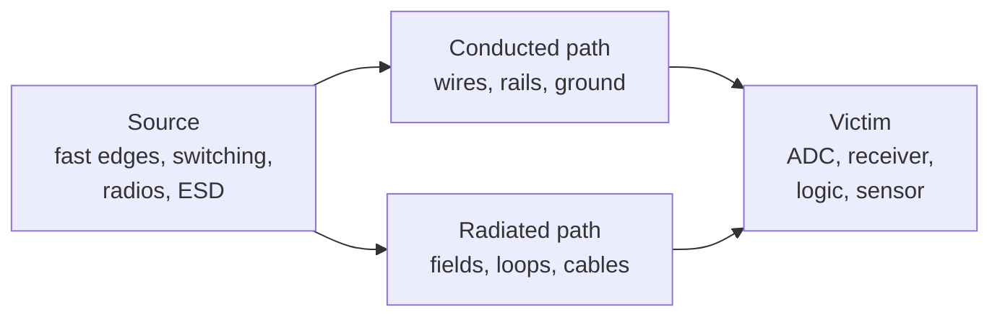

::: testing
Whether you can define EMI precisely and organise it, rather than say "noise from electronics". The interviewer is listening for:

1. **A definition with the three-part model**: a source, a coupling path and a victim.
2. **Conducted vs radiated**, and **differential-mode vs common-mode**.
3. **An intuition for where it comes from**: fast edges and currents in loops and cables, and why edge rate matters more than clock frequency.
4. The link to **EMC** and regulations (emissions and immunity).
:::

::: why
Every product sold in most markets has to pass emissions limits and show some immunity to disturbances. EMI is also the reason a board that works on the bench fails in the field: next to a radio, on a long cable, near a motor. Hardware engineers who understand EMI as *currents flowing in loops* rather than as a mystery can design it out at layout time, which is much cheaper than adding shielding after a failed test.
:::

::: concepts
- **Electromagnetic fields**: time-varying currents create magnetic fields and time-varying voltages create electric fields; together they radiate.
- **Fourier content of edges**: fast edges contain harmonics far above the clock frequency. See [[q0558]].
- **Source–path–victim model**. See [[q0565]].
- **Differential-mode and common-mode currents**: the two current types that make up emissions.
- **Loops and antennas**: a current loop radiates like a small magnetic dipole, a cable carrying common-mode current radiates like a short monopole.
- **EMC (compatibility)**: emissions limits plus immunity requirements. See [[q0561]], [[q0563]].
:::

::: answer
"EMI, electromagnetic interference, is unwanted electromagnetic energy that disturbs the operation of a circuit or system. It always has three parts: a source that makes it, a coupling path, and a victim that's affected. The same word covers energy the board emits, which can interfere with radios and fail compliance, and energy that arrives from outside and upsets the board, which is an immunity question.

There are two ways it travels. Conducted EMI moves along wires, power lines and shared grounds. Radiated EMI moves through the air as fields. On a PCB, nearly all the radiated EMI comes from two things: current loops, which act as small magnetic antennas, and common-mode current on cables, which acts as a short monopole.

The big point is that EMI comes from edges and currents, not just clock frequency. A trapezoidal digital signal has harmonics out to about one over pi times the rise time, so a 10 MHz clock with a 2 nanosecond edge still has meaningful content at 150 MHz and beyond. That's why slowing the edge, shrinking the loop and controlling the return path are the usual first fixes, and why EMC testing runs up to a gigahertz and beyond."
:::

::: technical
**Definition.** EMI is any electromagnetic disturbance that degrades the performance of a device, equipment or system. EMC is the ability of equipment to function acceptably in its electromagnetic environment without introducing intolerable disturbance to anything in it.

**Classification.**
- By path: *conducted* (cables, power and ground; regulatory limits typically start near 150 kHz and run to 30 MHz) and *radiated* (fields, typically 30 MHz and up; tested to 1 GHz and often higher, depending on product class and clock speeds).
- By mode: *differential-mode* (DM) currents flow out on one conductor and return on the other; *common-mode* (CM) currents flow in the same direction on both conductors and return through parasitic capacitance, the chassis or earth. DM currents are the signal, CM currents are usually the by-product and often dominate radiation because cables are efficient antennas.
- By spectrum: *narrowband* (clock harmonics, oscillators) vs *broadband* (switching transients, ESD, motor brushes).

**Spectrum of a digital edge.** For a trapezoidal pulse of amplitude $A$, width $\tau$, period $T$ and rise time $t_r$, the harmonic envelope is flat up to $1/(\pi\tau)$, falls at −20 dB/decade up to $1/(\pi t_r)$, then −40 dB/decade. A 10 MHz, 50 % duty clock with $t_r$ = 2 ns has corners near 6.4 MHz and 159 MHz.

**Radiation from the two basic antennas.** A small loop (area $A$, current $I$) at distance $r$: $E \approx 1.32\times10^{-14}\,f^2AI/r$. A short common-mode current element (length $L$) over a ground plane: $E \approx 1.26\times10^{-6}\,fLI/r$ (textbooks differ by a factor of 2 depending on whether $I$ is per wire or total and whether a ground reflection is included; see [[q0561]]). The loop grows as $f^2$ and area; the cable as $f$ and length. Microamps of CM current can fail a radiated test.

**Units.** Emissions are quoted in dBµV (conducted) and dBµV/m (radiated) against limits, for example FCC Part 15 and CISPR 32 classes A and B. Immunity tests are described in IEC 61000-4-x (ESD, radiated and conducted RF, fast transients, surge).
:::

::: short
"EMI is unwanted electromagnetic energy that disturbs a circuit. It has a source, a coupling path and a victim, it can be conducted along wires and grounds or radiated through the air, and it's made of differential-mode and common-mode currents. On a PCB, radiation mostly comes from current loops and from common-mode current on cables, driven by fast edges: the harmonics extend to about 1 over pi times the rise time, far above the clock frequency. So edge rate, loop area and return paths are what I control."
:::

::: long
"EMI is electromagnetic energy from one circuit, or from outside, that gets into another circuit and degrades its operation. I think of it with the source, path, victim model. The source is anything with fast-changing voltage or current: a clock, a switching regulator, a motor driver, a radio, ESD. The victim is anything sensitive: an ADC input, a receiver, a reset line. And the path is either conducted, through wires, power rails and shared ground, or radiated, through space.

Two more distinctions help. Differential-mode currents are the intended signal, going out on one conductor and back on the other; if the loop they make is small, the radiation is small. Common-mode currents flow the same direction on both conductors and return through parasitic capacitance or the chassis. They're usually unintended, but a cable carrying them is a pretty good antenna, so a few microamps can fail a radiated emissions test.

What drives all this is edges, not clock frequency. A trapezoid with rise time t_r has harmonics with roughly flat amplitude until one over pi times the pulse width, then falling at 20 dB per decade, and 40 dB per decade beyond one over pi t_r. A 10 MHz clock with a 2 nanosecond edge has a corner near 160 MHz, so there's real energy there, and a loop of a few square centimetres radiates in proportion to the square of frequency. So the first fixes are slow the edge as far as timing allows, shrink the loop with a solid return plane, and filter the cables at the connector.

EMC is the whole discipline, emissions limits like FCC Part 15 or CISPR 32, and immunity tests like IEC 61000-4-x."
:::

::: terms
- **EMI**: electromagnetic interference, unwanted electromagnetic energy that degrades a circuit.
- **EMC**: electromagnetic compatibility, operating in an environment without causing or suffering unacceptable interference.
- **Conducted / radiated emissions**: energy leaving through cables vs through the air.
- **Differential-mode (DM) current**: signal current out on one conductor and back on the other.
- **Common-mode (CM) current**: current flowing in the same direction on a set of conductors, returning via parasitic capacitance, chassis or earth.
- **Susceptibility / immunity**: how well a circuit tolerates incoming interference.
- **Narrowband vs broadband**: discrete harmonics vs a continuous spectrum.
- **dBµV/m**: field strength unit used for radiated emission limits.
:::

::: exceptional
**An average answer** defines EMI as "unwanted noise from electronics" and mentions shielding.

**An exceptional answer**:
- Uses the source–path–victim model and separates emissions from immunity.
- Distinguishes conducted vs radiated and DM vs CM, saying that CM current on cables dominates many radiated failures.
- Says edge rate, not clock frequency, determines the high-frequency content, with the $1/(\pi t_r)$ corner and a number.
- Gives the two antenna models (loop area and common-mode cable) and the scaling with frequency.
- Mentions regulatory context (FCC, CISPR, IEC 61000-4) without making up clause numbers.
:::

::: mistakes
- **"EMI is just radio noise."** Conducted EMI along power and signal lines is half of regulation and often the first to fail.
- **Blaming the clock frequency.** A 1 MHz signal with a 1 ns edge is a stronger source above 100 MHz than a 100 MHz sine.
- **Thinking of the signal trace alone.** The *return* current completes the loop, and the loop's area is what radiates.
- **Treating shielding as the first resort.** Layout (loops, return paths, edge rate, filtering) is cheaper and usually more effective.
- **Confusing emissions and immunity.** Emissions are what your board radiates; immunity is how it survives others. The same layout practices help both, but they are tested separately.
- **Ignoring common mode.** A perfectly balanced differential pair can still radiate if a tiny CM current rides along the cable.
:::

::: deep
## Definition and the three-part model

Electromagnetic interference is energy that reaches a circuit and changes its behaviour in an unwanted way. Always ask three questions:

1. **Source**: what is making it? (An edge, a switching node, a radio.)
2. **Path**: how does it get there? (Conducted along a wire, capacitive, inductive, radiated.)
3. **Victim**: what does it disturb? (An ADC, a comparator, a receiver, a reset pin.)


Figure: Break any one of the three boxes and the interference stops: reduce the source (slower edges), interrupt the path (filter, shield, separate, shrink the loop) or harden the victim (lower impedance, filtering).

## Why edges, not clocks

A periodic trapezoid with amplitude $A$, pulse width $\tau$, period $T$ and rise time $t_r$ has a line spectrum with envelope

$$|c_n| \approx 2A\frac{\tau}{T}\;\min\!\Big(1,\frac{1}{\pi f\tau}\Big)\;\min\!\Big(1,\frac{1}{\pi f t_r}\Big),\qquad f = n/T.$$

So the spectrum is flat to $f_1 = 1/(\pi\tau)$, then −20 dB/decade until $f_2 = 1/(\pi t_r)$, then −40 dB/decade. For a 10 MHz, 3.3 V, 50 % duty clock, $\tau$ = 50 ns, with $t_r$ = 2 ns: $f_1$ = 6.4 MHz and $f_2$ = 159 MHz. Slowing the edge to 6 ns moves $f_2$ to 53 MHz and reduces the level at 1 GHz by about 10 dB (70.5 to 60.9 dBµV) relative to the 2 ns edge.

```plot
{"title":"Harmonic envelope of a 10 MHz, 3.3 V clock (50 % duty) for three rise times","x":{"label":"Frequency","unit":"Hz","min":1e6,"max":1e9,"log":true},"y":{"label":"Envelope","unit":"dBµV","min":50,"max":135},
 "vars":{"a":3.3,"d":0.5,"tau":"50e-9"},
 "series":[{"label":"t_r = 0.5 ns","fn":"20*log10(1e6*2*a*d*min(1,1/(pi*x*tau))*min(1,1/(pi*x*0.5e-9)))","color":"red"},{"label":"t_r = 2 ns","fn":"20*log10(1e6*2*a*d*min(1,1/(pi*x*tau))*min(1,1/(pi*x*2e-9)))"},{"label":"t_r = 6 ns","fn":"20*log10(1e6*2*a*d*min(1,1/(pi*x*tau))*min(1,1/(pi*x*6e-9)))","color":"green"}],
 "vlines":[{"at":"1/(pi*50e-9)","label":"1/(πτ) = 6.4 MHz","color":"muted"},{"at":"1/(pi*2e-9)","label":"1/(πt_r) = 159 MHz","color":"muted"}]}
```
Figure: Same clock frequency, different edge rates. Above each trace's second corner the spectrum drops at 40 dB/decade, so a 6 ns edge puts 10 dB less energy at 1 GHz than a 2 ns edge, with no change to the clock. Edge rate is the lever.

## Two kinds of current: differential and common mode

```circuit
{"caption":"Differential-mode current: signal out, equal and opposite return","elements":[
 {"t":"V","a":[0,2],"b":[0,6],"label":"signal"},
 {"t":"wire","pts":[[0,2],[0,0],[14,0],[14,2]]},
 {"t":"R","a":[14,2],"b":[14,6],"label":"load"},
 {"t":"wire","pts":[[0,6],[0,8],[14,8],[14,6]]},
 {"t":"arrow","a":[5,-0.8],"b":[9,-0.8],"label":"I"},
 {"t":"arrow","a":[9,9.6],"b":[5,9.6],"label":"I"},
 {"t":"text","at":[7,4],"text":"small loop area","muted":true,"anchor":"middle"}
]}
```
Figure: With the return directly under or beside the signal, the two equal and opposite currents make weak fields that largely cancel. The smaller the enclosed loop, the less this radiates or picks up.

```circuit
{"caption":"Common-mode current: same direction on both wires, returning through stray capacitance","elements":[
 {"t":"V","a":[0,2],"b":[0,6],"label":"V_{cm}"},
 {"t":"wire","pts":[[0,2],[0,0],[6,0]]},
 {"t":"box","at":[6,-2],"w":6,"h":4,"label":"cable (both wires)"},
 {"t":"wire","pts":[[12,0],[18,0],[18,2]]},
 {"t":"C","a":[18,2],"b":[18,6],"label":"C_{stray}"},
 {"t":"wire","pts":[[18,6],[18,8],[0,8],[0,6]]},
 {"t":"gnd","at":[9,8]},
 {"t":"arrow","a":[2.5,-0.8],"b":[5.5,-0.8],"label":"I_{cm}"},
 {"t":"text","at":[9,5],"text":"return through earth / chassis: a large loop","muted":true,"anchor":"middle"}
]}
```
Figure: A small noise voltage between the board ground and the cable's far end drives a current down the cable and back through stray capacitance. The loop is huge and uncontrolled, so the cable radiates even if the signal itself is perfectly balanced.

## Conducted and radiated, and the regulations

- **Conducted**: noise on mains or signal cables. Regulations typically limit it from about 150 kHz to 30 MHz.
- **Radiated**: fields measured by an antenna at a defined distance, typically from 30 MHz up to 1 GHz and beyond depending on product class and clock rates.
- **Immunity**: the opposite direction: the product must keep working when exposed to ESD, radiated and conducted RF, fast electrical transients, surges.

> [!UNCERTAIN]
> Frequency ranges, limit levels and test distances differ by region, product class (for example A vs B), and standard edition. The ranges given here are typical, not a substitute for the current applicable standard.

## A feel for the magnitudes

A small loop of area $A$ (m²) carrying current $I$ at frequency $f$ produces a far-field $E = 1.316\times10^{-14}f^2AI/r$. At 100 MHz, with $I$ = 10 mA, $A$ = 1 cm², measured at 3 m: 44 µV/m = 32.8 dBµV/m. Enlarge the loop to 10 cm² and it's 52.8 dBµV/m, which exceeds the FCC Class B limit at 3 m of 43.5 dBµV/m (88 to 216 MHz) by about 9 dB. That is the quantitative reason a loop of a few square centimetres on a clock line matters. The details, and the common-mode antenna, are in [[q0561]] and [[q0562]].

## Where EMI shows up in design

- **Emissions**: fast signal and clock traces, switching converters, motor drives, cables leaving the board.
- **Immunity**: high-impedance analog inputs, reset and interrupt lines, long cables ([[q0563]]).
- **Self-interference (desense)**: your own digital harmonics landing in your own receiver band ([[q0568]]).

## Worked example: why microamps of common-mode current fail a test

The loop estimate above says a 1 cm² loop with 10 mA of differential current gives 32.8 dBµV/m at 3 m and 100 MHz, comfortably under a 43.5 dBµV/m limit. Now compare a cable carrying *common-mode* current. A cable of length $L$ with common-mode current $I_{cm}$ acts as a short antenna, and a standard approximation for a cable shorter than about a quarter wavelength over a reflecting ground is

$$E \approx 1.26\times10^{-6}\,\frac{f\,L\,I_{cm}}{r}$$

with $f$ in Hz, $L$ in meters, $I$ in amps and $r$ in meters. For a 0.5 m cable at 100 MHz, 3 m away, with $I_{cm}=20\ \mu$A:

$$E = 1.26\times10^{-6}\times\frac{10^{8}\times0.5\times20\times10^{-6}}{3}=420\ \mu\text{V/m}=52.5\ \text{dB}\mu\text{V/m}$$

That is 9 dB over the 43.5 dBµV/m limit with a current of only 20 µA, 500 times smaller than the 10 mA differential current. Solving for the current that just meets the limit (150 µV/m) gives $I_{cm}\approx7\ \mu$A. The two mechanisms differ so dramatically because the differential currents nearly cancel in the field while the common-mode current flows in the same direction in both conductors and the cable behaves like one antenna element, with a path length of half a meter instead of one centimeter.

Where would 20 µA come from? Suppose the ground reference of a board is moved by only 100 mV at 100 MHz by ground bounce, and the cable's capacitance to the surroundings is 10 pF. The current is $I=2\pi fCV=2\pi\times10^8\times10^{-11}\times0.1=630\ \mu$A, almost 90 times over the 7 µA budget. This is why a modest ground voltage (not a large signal) on a connector shield or the cable's reference can dominate the emission, and why common-mode chokes (several hundred ohms at 100 MHz) and a quiet connector ground are the standard fix.

> [!UNCERTAIN]
> The $1.26\times10^{-6}fLI/r$ expression is a short-antenna approximation whose constant is twice the free-space Hertzian-dipole value ($60\pi/c\approx6.3\times10^{-7}$); texts attribute the factor of 2 to a ground reflection or, in Paul's form, to $I$ flowing in each of two conductors, so treat it as good to about 6 dB. Real emissions depend on cable length relative to wavelength, cable routing, and the chamber geometry, so use it to rank causes, not to predict a pass or fail.

## Limiting cases

- **$L\ll\lambda$:** the formulas above hold and emission grows linearly with frequency, loop area, and current. Doubling the frequency doubles a cable's emission for the same current and quadruples a loop's.
- **$L$ near $\lambda/2$:** the cable becomes a resonant dipole and the emission peaks sharply; a cable whose length is a half-wave at a harmonic of the clock gives the classic "one frequency fails" test result.
- **Shielded cable with a poor termination:** a shield that ends in a pigtail adds inductance, so at tens of MHz the shield no longer carries the return current and the transfer impedance rises.
- **Edge rate:** harmonics above $1/(\pi t_r)$ fall at 40 dB/decade instead of 20, so making edges no faster than timing needs is a nearly free reduction above that corner. Below the corner the spectrum is set by clock frequency and duty cycle, and slowing the edge buys little there.

## Bench verification: finding the aggressor before the chamber

1. **Near-field probes** (a small loop for magnetic, a stub for electric) and a spectrum analyzer or an SDR on a bench. Sweep over the board and cables: the hot spots at the peak frequencies show where the current is.
2. **Current probe on the cable.** Clamp a clamp-on RF current probe around the whole cable (both wires together) so only common-mode current is measured. Compare the reading to the 7 µA-class budget: a reading of 20 to 100 µA at a failing frequency pinpoints the cable as the antenna.
3. **Change one thing at a time:** add a ferrite clamp, move a ground connection, slow an edge, and watch the peak. A drop of 6 to 10 dB from a ferrite means the common-mode path is confirmed.
4. **Pre-compliance scan** on the final cable arrangement, with the cable positions fixed and recorded; a few centimeters of cable movement changes a result by several dB.
:::

::: applications
- **Consumer and IT products**: passing FCC Part 15 / CISPR 32 emissions before sale; typical failures are clock harmonics and cable common-mode.
- **Automotive electronics**: strict emissions (to protect on-board radios) and immunity (ignition noise, transients, mobile transmitters).
- **Medical devices**: low emissions and high immunity are both required for safety.
- **Wireless products**: preventing digital noise from desensitising Wi-Fi, Bluetooth, cellular and GPS receivers.
- **Switching power supplies**: the dominant source of conducted EMI on mains; designed with input filters and compact layouts.
- **Motor control**: PWM edges and long motor cables; filters and shielded cable.
:::

::: assumptions
- **Spectrum formula**: the trapezoid envelope assumes ideal, symmetric edges and a periodic signal; real signals have ringing and jitter that add peaks.
- **Antenna formulas** assume far-field, free-space conditions and a small loop or short monopole (dimensions well below a wavelength); in a real test setup, reflections off the ground plane can add up to +6 dB.
- **Regulatory numbers** are typical and should be checked against the standard for the product and region.
- **Radiated and conducted limits** differ between Class A (commercial) and Class B (residential) equipment.
- **EMI vs RFI**: some textbooks use "RFI" for the radio-frequency subset. Treat them as the same family.
:::

::: followups
### What's the difference between EMI and EMC?
EMI is the phenomenon: unwanted electromagnetic energy affecting a circuit. EMC is the property of a product: it doesn't emit more than the limits allow and it keeps working when exposed to a specified level of interference. EMC is tested; EMI is what you design to avoid.

### Why do fast edges cause more EMI than a fast clock?
The spectrum of a digital signal extends to roughly $1/(\pi t_r)$ regardless of clock rate. A 10 MHz clock with a 0.5 ns edge has energy out to 640 MHz; a 100 MHz sine wave has none above 100 MHz. Since radiation from a loop scales as $f^2$, the higher harmonics are the dangerous ones. Slowing the edge to what the timing allows is often the cheapest fix.

### What is common-mode current and why is it so bad for radiation?
It's current flowing the same direction on both conductors of a cable, returning through the environment (parasitic capacitance, chassis, earth). The return loop is large and uncontrolled and the cable is a physically long conductor, so it radiates efficiently. For a 0.3 m cable at 100 MHz, around 12 µA of CM current is enough to reach the FCC Class B limit at 3 m (idealised estimate).

### A product passes emissions but its Wi-Fi range is poor. Is that EMI?
Possibly self-interference: broadband digital noise raising the receiver's noise floor (desense). It wouldn't necessarily show up in a regulatory scan if it's below the limit but in the receive band. See [[q0568]]. Check by turning subsystems off one at a time and watching the receiver's noise floor.

### Harder: how would you find which part of a board is radiating?
Near-field probes (loop for H-field, stub for E-field) with a spectrum analyser, scanned over the board with the product running. Peaks at clock harmonics point to a trace or IC; peaks that follow a cable being moved point to common mode. Then verify a fix by adding a ferrite on the cable or changing the edge rate and re-measuring.
:::

::: references
- Henry W. Ott, *Electromagnetic Compatibility Engineering*: definitions, coupling mechanisms, differential- and common-mode radiation models.
- Clayton R. Paul, *Introduction to Electromagnetic Compatibility*: spectral content of trapezoidal signals; radiation from loops and cables.
- CISPR 32 (multimedia equipment emissions) and the FCC Part 15 rules: emissions limits for information technology equipment (see the current editions).
- IEC 61000-4 series: immunity test methods (ESD, radiated and conducted RF immunity, fast transients, surge).
:::

::: rubric
- Defines EMI with source, path and victim :: The standard model that guides every mitigation.
- Distinguishes conducted vs radiated, and emissions vs immunity :: Shows you know the scope of the problem.
- Explains differential-mode vs common-mode current :: Common mode is the usual cause of radiated failures.
- States that harmonic content is set by edge rate ($\approx 1/(\pi t_r)$) not clock frequency :: This is the key insight for controlling EMI at the source.
- Mentions loops and cables as the antennas on a PCB :: Directly connects the physics to layout.
- Refers to regulations (FCC, CISPR, IEC 61000-4) without inventing details :: Shows industry awareness with integrity.
:::

::: quiz
```json
[
 {"type":"mcq","level":"fundamental","q":"Which is the best description of EMI?","options":["Any noise from a power supply","Unwanted electromagnetic energy that disturbs the operation of a circuit or system","Only radio-frequency signals radiated from antennas","Noise generated inside resistors"],"answer":1,"explain":"EMI is any unwanted electromagnetic disturbance, conducted or radiated, with a source, a coupling path and a victim."},
 {"type":"numeric","level":"intermediate","q":"A clock has a rise time of 2 ns. At roughly what frequency does the harmonic envelope begin to fall at 40 dB/decade, f = 1/(π t_r)? Give it in MHz.","answer":159,"tolerance":0.02,"unit":"MHz","explain":"$1/(\\pi\\cdot2\\times10^{-9}) = 1.59\\times10^{8}$ Hz = 159 MHz."},
 {"type":"mcq","level":"intermediate","q":"Which change reduces EMI above 500 MHz most for a 10 MHz clock, without changing its frequency?","options":["Doubling the supply voltage","Slowing the rise time from 0.5 ns to 3 ns","Shortening the clock period","Using a larger decoupling capacitor on the oscillator only"],"answer":1,"explain":"The high-frequency spectrum is set by the edge: with $t_r$ = 3 ns the 40 dB/decade corner is at 106 MHz instead of 637 MHz. Doubling voltage increases emissions by 6 dB."},
 {"type":"truefalse","level":"intermediate","q":"A perfectly balanced differential pair cannot radiate.","answer":false,"explain":"Differential-mode fields cancel when balanced, but any common-mode current riding on the pair (from skew, ground offset or imbalance) radiates from the cable like a monopole. Microamps are enough to fail a radiated test."},
 {"type":"numeric","level":"advanced","q":"A 1 cm² loop carries 10 mA at 100 MHz. Using E = 1.316×10⁻¹⁴ f² A I / r at r = 3 m, what is the field in dBµV/m?","answer":32.8,"tolerance":0.03,"unit":"dBµV/m","explain":"$E = 1.316\\times10^{-14}\\cdot10^{16}\\cdot10^{-4}\\cdot0.01/3 = 4.39\\times10^{-5}$ V/m = 43.9 µV/m, which is 32.8 dBµV/m."}
]
```
:::
