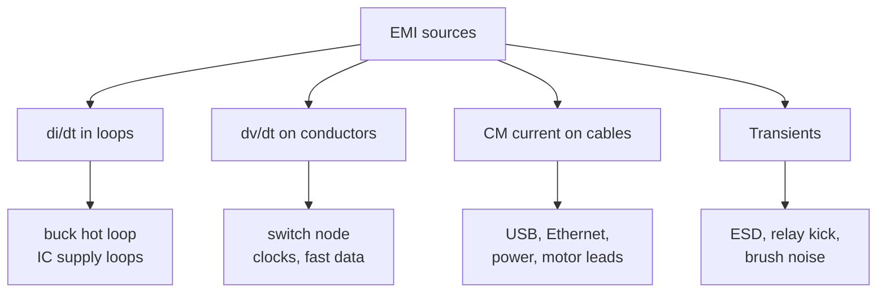

::: testing
Whether you can name *specific* EMI sources on a board and, more importantly, say *why* each one radiates or conducts. A list is the minimum; a strong answer organises the sources by mechanism:

1. **Fast di/dt in loops** (switching converters, digital supply currents).
2. **Fast dv/dt on conductors** (switch nodes, clock traces, fast edges).
3. **Common-mode current on cables** (the unintended antenna).
4. **Transients and bursts** (ESD, relays, motor brushes).

The interviewer also wants to see you know the quiet cause behind many failures: a broken return path.
:::

::: why
When a product fails emissions testing the first question is "what's radiating?". Engineers who can walk the board mentally and list the likely culprits (the buck converter's hot loop, the DDR clock, the USB cable) can fix a board in days instead of weeks. And it's equally useful for design review: spotting a signal crossing a plane split or a switch-node pour that is larger than needed is a standard layout-review skill.
:::

::: concepts
- **Loop radiation**: a current loop radiates like a small magnetic dipole, $E\propto f^2AI$. See [[q0559]].
- **Switch-node dv/dt**: a node swinging at volts per nanosecond couples capacitively into everything near it. See [[q0547]].
- **Return current path**: current returns under the signal at high frequency; breaking that path makes a larger loop. See [[q0494]].
- **Common-mode current**: unintended current on a cable that makes it a monopole antenna.
- **Spectral content of edges**: harmonics to $1/(\pi t_r)$. See [[q0558]].
- **Parasitic ringing**: stray L and C ring at 100 MHz+ after fast transitions.
:::

::: answer
"I'd group the sources by what physically makes the field. First, big, fast current loops: the hot loop of a switching converter, so the input capacitor, the high-side switch and the low-side switch or diode, carrying amps that change in a few nanoseconds. Digital supply loops too, the pulsed current a chip pulls through its decoupling capacitor.

Second, fast voltage swings on conductors: the switch node, which swings maybe 12 V in 5 nanoseconds, so 2.4 V per nanosecond, and clocks and fast data lines. Those couple capacitively and radiate through their trace and any copper pour attached to them.

Third, common-mode current on cables. Ground bounce, skew in differential pairs or a split return path can put a few microamps of noise on a cable, and the cable is an efficient antenna. That's the classic reason a board passes on the bench and fails with its cable attached.

Fourth, transients: ESD, relay and solenoid kick, motor brushes, which are broadband bursts.

Underneath many of these is a bad return path, like a high-speed signal crossing a split in the ground plane so its return current takes a long detour, and ringing from parasitic inductance and capacitance on the switch node, which pushes the energy up to 100 or 200 MHz where the limits are tight."
:::

::: technical
**By mechanism.**

| Mechanism | Radiates as | Typical PCB sources |
|---|---|---|
| High di/dt in a loop | Small magnetic loop, $E\propto f^2AI$ | Buck/boost hot loop; digital IC supply loops; clock loop with poor return; output-stage loops of class-D and motor drives |
| High dv/dt on a conductor | Small electric monopole/patch | Switch node, clock and fast data traces, heat sinks tied to a switch node, oscillator pads |
| Common-mode current | Short monopole/dipole over ground, $E\propto fLI$ | Cables (USB, Ethernet, power, motor), attached heat sinks, floating metal |
| Transients | Broadband bursts | ESD, relay/solenoid kick, brush motors, hot-plug |

**Specific sources.**
- *Switching regulators*: the switch node (e.g., 12 V in 5 ns = 2.4 V/ns), the hot loop (input cap–high-side–low-side), inductor leakage field, diode recovery, and ringing at $f = 1/(2\pi\sqrt{L_{loop}C_{oss}})$: 5 nH with 300 pF rings near 130 MHz (illustrative values).
- *Clocks and buses*: harmonics up to $1/(\pi t_r)$; DDR, USB, HDMI, Ethernet.
- *Crystals and oscillators*: narrowband spikes, plus PLL reference spurs.
- *Ground and power noise*: simultaneous switching noise ([[q0688]]) driving power and ground planes, which can radiate from board edges or excite cable common mode.
- *Return-path discontinuities*: plane splits, slots, layer changes without a return via.
- *Unterminated lines and stubs*: reflections and ringing that add high-frequency content.
- *Intentional radiators* (Wi-Fi, BT, cellular PAs) and their harmonics.
- *Motors and relays*: PWM edges on long cables; arcing at brushes; inductive kick.

**Note on antenna sizes.** A trace is an inefficient antenna below about $\lambda/20$, but loops of a few cm² and cables of tens of cm are efficient enough at 30 MHz to 1 GHz. Metal heat sinks and shields attached to noisy nodes can become effective patch antennas.
:::

::: short
"I group sources by mechanism. Fast di/dt in loops: a buck converter's hot loop or a chip's supply loop. Fast dv/dt on conductors: the switch node and clock traces. Common-mode current on cables, which act as antennas. And transients like ESD or relay kick. Underneath many of them is a broken return path, such as a signal crossing a plane split, and parasitic ringing that moves energy up to 100 MHz or more. The usual suspects are the switching converter, the clock and fast buses, and whatever cable leaves the board."
:::

::: long
"The way I'd tackle it is by mechanism, because the mechanism tells you the fix. The first group is current loops with fast changing current. The classic is the hot loop of a buck converter: input capacitor, high-side switch, low-side switch or diode, carrying a few amps and switching in maybe 5 nanoseconds. A small loop radiates like a magnetic dipole, and the field goes up with frequency squared and with loop area. Digital ICs do the same thing on a smaller scale, pulling pulses of current through decoupling capacitors.

The second group is fast voltage swings on conductors. The switch node of that same converter swings 12 volts in 5 nanoseconds, 2.4 volts per nanosecond, and anything near it picks that up capacitively; if there's a big copper pour on it, it's an antenna. Clock traces and fast data lines are the digital version, with harmonics up to about one over pi times the rise time.

The third group is common-mode current on cables. That's often the actual radiator, because a cable is long and it's attached to the board's ground noise. It comes from ground bounce, a split return plane, or imbalance in a differential pair. A few microamps on a 30 centimetre cable at 100 MHz can fail the radiated test.

The fourth is transients: ESD, relay and solenoid kick, brush noise.

And two cross-cutting causes: return-path discontinuities, like a signal crossing a ground slot so the return takes a big detour, and ringing from parasitic inductance and capacitance, which puts the energy at 100 to 300 MHz where limits are tight. When I debug, I scan with a near-field probe to find which of these it is."
:::

::: terms
- **Hot loop**: the high-di/dt current loop of a switching converter (input capacitor, high-side switch, low-side switch or diode).
- **Switch node**: the node where the inductor, high-side and low-side devices meet; swings between rail and ground at high dv/dt.
- **dv/dt, di/dt**: rate of change of voltage and current, which drive capacitive and inductive coupling and radiation.
- **Return path**: the path the return current takes; at high frequency it hugs the signal trace on the adjacent plane.
- **Plane split / slot**: a gap in a reference plane that breaks the return path.
- **Common-mode current**: unintended same-direction current on a cable.
- **Simultaneous switching noise (SSN)**: supply and ground disturbance from many outputs switching at once.
- **Near-field probe**: a small loop or stub used with a spectrum analyser to locate emission sources.
:::

::: exceptional
**An average answer** lists "clocks, switching regulators, high-speed buses, cables".

**An exceptional answer**:
- Organises by mechanism (di/dt loops, dv/dt conductors, CM cable current, transients) and says what each radiates as.
- Calls out specific hot spots: the buck hot loop, the switch node with its dv/dt in V/ns, and ringing frequency.
- Identifies return-path discontinuities (plane splits, layer changes) as a root cause, not just a "source".
- Says the cable is usually the antenna and that microamps of CM current matter.
- Mentions how you'd find them: near-field probing, disconnecting subsystems, changing edge rates.
:::

::: mistakes
- **Listing only "the clock".** Switching regulators, cables and transients are just as common culprits.
- **Treating a differential pair as automatically quiet.** Skew, imbalance and plane gaps convert it to common mode.
- **Forgetting that the return current is part of the source.** A perfectly routed trace over a slot is a big loop.
- **Large copper pours on the switch node** "for heat". They are antennas as well as heat spreaders.
- **Overlooking attached metal** (heat sinks, shields, enclosures) tied to a noisy node. They radiate better than the traces.
- **Assuming only digital sections matter.** Analog circuits with large swings, oscillators and RF sections are sources too.
:::

::: deep
## Think in mechanisms

All radiated EMI comes from time-varying current flowing in a conductor geometry that is an efficient antenna. That reduces the question to: where are the biggest, fastest currents, and what are the geometries they flow through?


Figure: Four mechanisms, with typical board-level examples underneath. Fixes follow the mechanism: shrink loops for di/dt, slow edges and reduce area for dv/dt, filter and bond cables for CM current, protect and snub for transients.

## The switching regulator is the star

A buck converter converts a few amps with edges of a few nanoseconds, which makes it the largest EMI source on most boards. Three things radiate:

**1. The hot loop.** When the high-side switch turns off, the current commutates from the high-side to the low-side device through the loop Cin → high-side → low-side → Cin. That loop carries the full inductor current stepping on and off in nanoseconds.

```circuit
{"caption":"Buck converter hot loop: the current path that switches in nanoseconds","elements":[
 {"t":"C","a":[0,2],"b":[0,6],"label":"C_{in}","labelSide":"other"},
 {"t":"wire","pts":[[0,2],[0,0],[4,0]],"flow":true},
 {"t":"SWclosed","a":[4,0],"b":[8,0],"label":"Q_H"},
 {"t":"wire","pts":[[8,0],[12,0]],"flow":true},
 {"t":"dot","at":[12,0]},
 {"t":"wire","pts":[[12,0],[12,2]]},
 {"t":"Schottky","a":[12,6],"b":[12,2],"label":"D / Q_L","labelSide":"other"},
 {"t":"wire","pts":[[12,6],[12,8],[0,8],[0,6]],"flow":"reverse"},
 {"t":"wire","pts":[[12,0],[15,0]]},
 {"t":"term","at":[15,0],"label":"to inductor","side":"right"},
 {"t":"region","at":[-3,-1.5],"w":16,"h":11,"label":"hot loop","color":"red"},
 {"t":"text","at":[13.8,1.2],"text":"switch node: dv/dt","color":"orange","anchor":"start"}
]}
```
Figure: The red region is the pulsed current loop. Its area sets both the radiated field ($\propto A$) and the loop inductance that rings with the switch's output capacitance. The switch node (orange) carries the voltage swing; keep its copper small.

**2. Ringing.** Loop inductance ($L_{loop}$, perhaps 2 to 10 nH depending on layout) and the switch's output capacitance ($C_{oss}$, a few hundred pF in many power devices) form a resonant tank that is shock-excited by each edge. The ring frequency is $f = 1/(2\pi\sqrt{LC})$. With 5 nH and 300 pF it is 130 MHz; with 2 nH it moves to 205 MHz; with 10 nH it drops to 92 MHz. Ringing in the FM/TV bands is what turns a clean-looking converter into an emissions failure. A snubber or gate resistor damps it ([[q0562]]).

> [!UNCERTAIN]
> Loop inductance and $C_{oss}$ values here are illustrative; real values depend on the layout and the devices. Measure the ring frequency on the scope and calculate the loop inductance from it, rather than trusting a rule of thumb.

**3. The switch node itself.** Swinging 12 V in 5 ns is 2.4 V/ns. A 1 cm² copper pour on that node has a capacitance of a few pF to the nearest plane, and the displacement current $C\,dv/dt$ flows into every neighbouring trace. Also the inductor's stray field couples into nearby loops.

## Digital sources

- **Clocks and buses.** Harmonics up to $1/(\pi t_r)$; the loop of each clock and its return gives radiation ∝ $f^2A$.
- **Supply current loops.** Each IC's pulsed supply current flows through the decoupling capacitor loop. Poor placement makes a big loop.
- **Simultaneous switching.** Many outputs switching at once give $v = N L\,di/dt$ on shared ground and power pins. That voltage drives the power and ground planes as a source for edge radiation and for common-mode on cables ([[q0688]]).
- **Oscillators and PLLs.** Narrowband spikes; a crystal's loop is small but its harmonics can land in a receiver band.

## Return-path discontinuities

At low frequency, current returns by the shortest-resistance route, which may be far from the signal. At high frequency (above about 1 MHz) it returns by the path of least *inductance*, which is directly under the signal trace on the reference plane. If the plane has a slot or split, or the signal changes layers without a nearby ground via, the return current has to go around, and the loop area (plus the inductance) increases.

```svg
<svg viewBox="0 0 600 250" xmlns="http://www.w3.org/2000/svg" font-family="Inter, sans-serif" font-size="13">
  <text x="150" y="22" text-anchor="middle" fill="var(--d-ink)">Continuous plane: small loop</text>
  <rect x="30" y="45" width="240" height="150" fill="var(--d-box)" stroke="var(--d-muted)"/>
  <line x1="40" y1="95" x2="260" y2="95" stroke="var(--d-blue)" stroke-width="3"/>
  <line x1="40" y1="105" x2="260" y2="105" stroke="var(--d-green)" stroke-width="3" stroke-dasharray="6 3"/>
  <polygon points="40,95 260,95 260,105 40,105" fill="var(--d-green)" opacity="0.2"/>
  <text x="150" y="85" text-anchor="middle" fill="var(--d-blue)" font-size="12">signal trace (top)</text>
  <text x="150" y="130" text-anchor="middle" fill="var(--d-green)" font-size="12">return current, directly beneath</text>
  <text x="150" y="215" text-anchor="middle" fill="var(--d-muted)">loop area is tiny</text>
  <text x="450" y="22" text-anchor="middle" fill="var(--d-ink)">Slot in the plane: big loop</text>
  <rect x="330" y="45" width="240" height="150" fill="var(--d-box)" stroke="var(--d-muted)"/>
  <rect x="440" y="45" width="14" height="100" fill="var(--d-red)" opacity="0.35" stroke="var(--d-red)"/>
  <line x1="340" y1="95" x2="560" y2="95" stroke="var(--d-blue)" stroke-width="3"/>
  <polyline points="340,105 435,105 435,150 459,150 459,105 560,105" fill="var(--d-red)" fill-opacity="0.15" stroke="var(--d-red)" stroke-width="3" stroke-dasharray="6 3"/>
  <text x="450" y="85" text-anchor="middle" fill="var(--d-blue)" font-size="12">same trace, crosses the slot</text>
  <text x="450" y="215" text-anchor="middle" fill="var(--d-red)">return detours around the slot: loop area up</text>
</svg>
```
Figure: At high frequency the return current (dashed) hugs the trace on the plane below. A slot forces it around the end, which enlarges the loop and also adds inductance, so the signal gets slower and noisier and the structure radiates more.

## Common-mode currents on cables

Any noise voltage between the board's ground and the far end of a cable drives common-mode current along it. Sources of that voltage:

- Ground bounce and plane noise at the connector.
- A signal return that takes a path through the connector shell or chassis.
- Imbalance in a differential pair (skew, unequal capacitance) converting DM to CM.
- A switch node coupling into the cable shield or a ground wire.

The cable then radiates like a monopole: $E \approx 1.26\times10^{-6}\,f L I/r$ ([[q0561]] works through the numbers). At 100 MHz, a 0.3 m cable carrying 12 µA is already at the FCC Class B limit at 3 m (idealised).

## Transients

- **ESD**: nanosecond edges and tens of amps, with spectral content into the GHz.
- **Relays and solenoids**: when the coil current is interrupted, $L\,di/dt$ produces a spike limited only by parasitic capacitance, producing broadband bursts.
- **Brushed motors**: sparks at the commutator give broadband noise.
- **Hot-plug and inrush events** on power rails.

## Finding the actual source

A near-field magnetic loop probe on a spectrum analyser, moved around the running board, shows hot spots; peaks at multiples of a clock point to that clock; peaks that change when a cable is moved point to common mode. Isolate by powering down subsystems, changing the switching frequency, or slowing an edge, and watching the spectrum.
:::

::: applications
- **Switch-mode adapters and chargers**: the dominant emissions source is the primary-side hot loop and the switch node; designed with small loops, snubbers and an input EMI filter.
- **Laptops and phones**: DDR, display (MIPI/eDP), USB 3 and the switching regulators are the usual sources of radiated spectra and of self-interference with Wi-Fi/GPS.
- **Motor controllers**: PWM edges on long motor cables are conducted and radiated sources.
- **LED lighting drivers**: switching regulators and PWM dimming; frequent EMC problem products.
- **Automotive modules**: switching regulators, communication buses (CAN, LIN, Ethernet) and relay drivers.
:::

::: assumptions
- **Numbers are illustrative.** Ringing frequency and loop inductance depend on the specific devices and layout; the formulas are what carry over.
- **Far-field, small-antenna approximations** (loop and short monopole) are used for scale; real emissions depend on enclosure, cable routing and test setup.
- **A "source" here means anything that generates the field.** In practice a source may only radiate because of a bad path (e.g., a slot or a cable) coupling to it.
- **Mostly switching and digital sources are discussed.** RF intentional radiators have their own regulation (spurious emissions, harmonics).
- **Alternative taxonomy**: some references split sources by "intentional" vs "unintentional" radiators, or by "natural" vs "man-made". Mechanism-based classification is more useful for layout work.
:::

::: followups
### Why is the switch node such a big source?
It has a large voltage swing with a very short transition, so $dv/dt$ is high (2.4 V/ns for 12 V in 5 ns), and it usually has copper area attached for the inductor connection. That area is a capacitor to everything nearby, so displacement current $C\,dv/dt$ couples into neighbouring circuits, and the node behaves like a small patch antenna. Keep the node's copper just big enough for current and thermal needs, and put a ground plane under it.

### A signal crosses a split in the ground plane. What happens?
The return current can't cross the gap, so it follows a path around the split. The loop area grows and the loop inductance increases, so radiation goes up, the signal develops ringing and noise, and the nearby layers see crosstalk. Fix by routing the signal over solid plane, adding stitching capacitors across the split where it can't be avoided, or restructuring the planes.

### How can a fully differential, balanced USB cable still fail radiated emissions?
Differential-mode radiation cancels, but common-mode current doesn't. Ground bounce at the connector, skew between the two lines, or return currents through the shell put a small common-mode current on the cable. A cable is an efficient antenna, so microamps are enough. Fixes include a common-mode choke, a clean shield termination at the connector and keeping noise off the connector ground.

### Estimate the ringing frequency on a switch node.
$f = 1/(2\pi\sqrt{L_{loop}C_{oss}})$. If I measure 120 MHz on the scope and I know $C_{oss}$ is about 300 pF, then $L = 1/((2\pi f)^2 C) = 1/((7.54\times10^8)^2\cdot3\times10^{-10}) = 5.9$ nH. Adding a small capacitor across the node changes the ring frequency in a known way, so I can infer the other quantity.

### Scenario: board fails radiated emissions with peaks at multiples of 25 MHz. What do you check first?
Multiples of 25 MHz suggest a 25 MHz clock (common for Ethernet PHYs or crystal references). I'd probe the clock trace and its return: is it over a continuous plane, short, with a series resistor to slow the edge? Is it routed near a cable or the board edge? Is there a common-mode current on the Ethernet cable? Then add a series resistor, move or route the clock inside the board, or add filtering/shield termination at the connector, and re-measure.
:::

::: references
- Henry W. Ott, *Electromagnetic Compatibility Engineering*: sources of emissions on PCBs, return-path discontinuities, common-mode cable radiation.
- Howard Johnson & Martin Graham, *High-Speed Digital Design: A Handbook of Black Magic*: return currents, ground slots and switching noise.
- Clayton R. Paul, *Introduction to Electromagnetic Compatibility*: loop and common-mode radiation models.
- Switching-regulator datasheets and application notes from major vendors (for example Texas Instruments and Analog Devices) discussing hot loops, switch-node ringing and snubbers; check the specific part's layout section.
:::

::: rubric
- Groups sources by mechanism (di/dt loops, dv/dt conductors, CM cables, transients) :: A mechanism-based list tells you the fix, not just the culprit.
- Names the buck-converter hot loop and the switch node with numbers :: These are the most common EMI sources on real boards.
- Mentions clocks/fast edges and their harmonic content :: Digital edges are the other major source.
- Identifies return-path discontinuities as a root cause :: Shows understanding of why layout, not only the circuit, creates EMI.
- Says cables act as antennas for common-mode current :: Common-mode radiation is behind most radiated failures.
- Includes transients (ESD, relays, motors) :: Broadband sources are often missed.
- Describes how to locate a source (near-field probing, disconnecting subsystems) :: Debugging method shows practical experience.
:::

::: quiz
```json
[
 {"type":"mcq","level":"fundamental","q":"Which part of a buck converter is typically the largest source of radiated EMI?","options":["The output capacitor","The hot loop and switch node","The feedback divider","The enable pin"],"answer":1,"explain":"The hot loop carries amps with nanosecond edges and the switch node has volts per nanosecond; both are strong sources. The output capacitor and feedback network carry little fast current."},
 {"type":"numeric","level":"fundamental","q":"A switch node swings 12 V in 5 ns. What is dv/dt? Give it in V/ns.","answer":2.4,"tolerance":0.02,"unit":"V/ns","explain":"$dv/dt = 12\\text{ V}/5\\text{ ns} = 2.4$ V/ns. Every pF of capacitance on that node therefore injects 2.4 mA into whatever it couples to."},
 {"type":"numeric","level":"intermediate","q":"A hot loop has 5 nH of inductance and the switch has 300 pF of output capacitance. At what frequency does it ring? Give it in MHz.","answer":130,"tolerance":0.03,"unit":"MHz","explain":"$f = 1/(2\\pi\\sqrt{LC}) = 1/(2\\pi\\sqrt{5\\times10^{-9}\\cdot3\\times10^{-10}}) = 1.3\\times10^{8}$ Hz = 130 MHz."},
 {"type":"mcq","level":"intermediate","q":"A fast signal trace runs over a slot in its reference plane. What is the main EMI consequence?","options":["The trace's resistance increases","The return current detours, enlarging the loop and radiation","The signal's amplitude doubles","Nothing, because the signal is differential"],"answer":1,"explain":"At high frequency the return current follows the trace beneath it. A slot forces a detour around it, which enlarges the current loop (more radiation and inductance)."},
 {"type":"truefalse","level":"advanced","q":"Common-mode current on a cable only matters if it is large (milliamps).","answer":false,"explain":"A cable is an efficient antenna: at 100 MHz, roughly 12 µA of common-mode current on a 0.3 m cable can reach the FCC Class B limit at 3 m (idealised estimate)."}
]
```
:::
