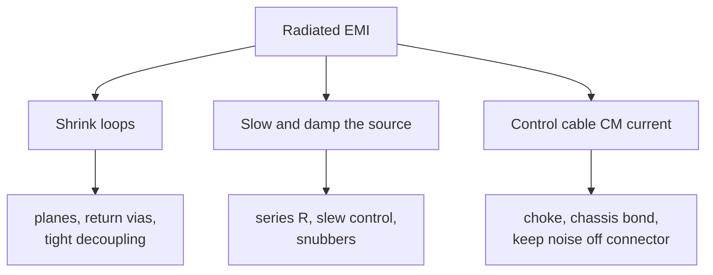

::: basics
### In plain words
A circuit board radiates mostly from two things: current loops, and noise current on cables. So the layout fixes are to make loops small, make edges only as sharp as the timing needs, damp ringing, and filter cables where they leave the board. The first step is a solid ground plane right under fast signals.

### Picture it
Think of a megaphone. The bigger its opening, the farther it projects sound. A current loop is like the opening: more enclosed area means more radiation. Speaking softly is like slowing the edges. A long pipe that carries sound outside is like a cable that carries noise out of the box.

### Words you need
- **Loop area**: the area enclosed by a signal's outbound path and its return path. A bigger loop radiates more.
- **Ground plane**: a solid copper layer at 0 V. Return current flows in it, right under the signal trace.
- **Edge rate**: how fast a signal switches. Slower edges carry less high-frequency energy.
- **Common-mode current**: current flowing the same direction on both wires of a cable, which makes the cable an antenna. See [[q0559]].
- **Common-mode choke**: a small part that blocks that same-direction current but passes the wanted signal.

### The simplest example
Take a 10 cm trace running 0.2 mm above a solid ground plane. The return current flows right under it, so the loop is 0.2 mm × 100 mm = 20 mm², or 0.2 cm². Now cut a slot in the plane that makes the return wander 10 cm away. The loop is about 10 cm × 10 cm = 10 cm². That is 50 times the area, and radiation grows in proportion to area, so 50 times the field. Separately, an edge three times slower carries about a third of the high-frequency energy.

That is the whole idea: small loops, soft edges, quiet cables. The rest of this page covers stack-up, converter hot loops and connector parts.
:::

::: testing
Whether you can turn the physics of radiation into layout actions. Radiation comes from loops and from cable common-mode current, driven by edge rate, so the answer should be organised around reducing **loop area**, **edge rate and current**, and **common-mode current on cables**, plus the stack-up that enables them. The interviewer wants specifics (return plane under signals, hot-loop placement, series resistors, filtering at connectors, via stitching) and some sense of how much each buys you in dB.
:::

::: why
This is the practical payoff of the EMI block. Most boards that pass first time do so because the stack-up, placement and return paths were right before routing began; most that fail are fixed with the same measures applied late and less effectively. Being able to say "halving the loop area is 6 dB, slowing the edge from 2 to 6 ns is about 10 dB at high frequency" lets you prioritise.
:::

::: concepts
- **Loop radiation** $E\propto f^2AI$: area and current are the levers. See [[q0561]].
- **Edge-rate spectrum**: above $1/(\pi t_r)$ the level falls as $1/f^2$ and scales as $1/t_r$. See [[q0559]].
- **Return-current path**: high-frequency return hugs the signal on the adjacent plane. See [[q0494]], [[q0560]].
- **Common-mode current on cables**: filtered or bonded at the connector.
- **Stack-up**: every signal layer adjacent to a solid plane. See [[q0478]], [[q0479]].
- **Decoupling and hot-loop layout**. See [[q0547]], [[q0553]].
:::

::: answer
"I'd work through it by the radiation mechanisms. A loop radiates in proportion to area, current and frequency squared, so first I make loops small. That means a solid ground plane directly under every fast signal layer so the return current sits under the trace, no slots or splits under fast nets, ground vias next to every layer change, and decoupling capacitors tight against the pins. For a switching converter, the hot loop gets placed first and kept tiny.

Second, reduce the energy at the source: slow edges to what timing allows with series resistors or slew-rate control, lower the switching frequency or use spread spectrum where it helps, and use gate resistors or snubbers to damp switch-node ringing.

Third, the cables. Cable common-mode current is often the real antenna, so I filter at the connector with a common-mode choke or ferrite and decoupling, tie the shield or connector shell to chassis with a low-inductance 360 degree connection, and keep noisy traces away from connectors and board edges.

Finally, the board itself: route the fastest signals on inner layers between planes, stitch ground planes around the edge, use differential signalling for fast links, and keep apertures and slots small. If that's still not enough, shield cans, but that's the last resort."
:::

::: technical
**Loop area.** $E\propto A$: halving area is −6 dB, one-tenth is −20 dB.
- Continuous reference plane under each fast signal; never route over splits or slots; if a layer change moves the reference plane, add a ground via within a few mm of the signal via.
- Stack-up: each signal layer adjacent to a plane, and thin dielectric between signal and plane (smaller loop inductance, tighter coupling).
- Decoupling: smallest-footprint capacitors at the pins, power and ground vias adjacent to pads.
- Switching converters: hot loop (Cin, high-side, low-side) on one layer, compact, with a ground plane directly beneath ([[q0547]]).

**Edge rate and current.** Above $f_2 = 1/(\pi t_r)$ the spectrum scales as $1/t_r$ (in amplitude), so tripling $t_r$ gives $20\log_{10}3 = 9.5$ dB. An RC edge from a series resistor: $t_r\approx 2.2RC$; 33 Ω into 10 pF gives about 0.8 ns. Use the slowest edge that meets timing, or drive-strength/slew-rate settings. Lower clock frequency reduces the number of harmonics; spread-spectrum clocking lowers peak narrowband readings (but not total power, so it doesn't help desense, [[q0568]]).

**Ringing.** Damp with gate resistors, RC snubbers, ferrite beads in series, or small boot resistors; shorten loop inductance to push ringing frequencies up and amplitudes down.

**Cables and connectors.**
- Common-mode choke and/or ferrite plus a capacitor to chassis at the connector.
- Connector shell bonded to chassis, not left to the board ground at one pin ([[q0571]]).
- Keep fast and switching traces away from connectors and board edges (return currents and fringing fields leak at the edge).
- Differential signalling for high-speed external links.

**Plane edges and apertures.** Stitch ground planes around the perimeter with vias spaced below $\lambda/20$ of the highest concerned frequency (for example 15 mm at 1 GHz); if a slot is unavoidable keep it short and aligned with the current flow, never across it (a slot that cuts across the return path forces the detour).

**Last resort: shielding** ([[q0569]]).

> [!UNCERTAIN]
> The "20H rule" (pulling power planes back from the board edge by 20× their separation from ground) is widely quoted but has mixed support; treat it as optional, and prefer edge stitching and edge-rate control.
:::

::: short
"I attack it by mechanism. Make loops small: solid ground plane under every fast signal, no splits, ground vias at layer changes, tight decoupling and a compact switcher hot loop. Reduce the source: slow edges with series resistors or slew control, damp ringing with snubbers or gate resistors. Deal with cables: common-mode chokes or ferrites and a proper chassis bond at the connector, and keep fast traces off the edge. Shield cans are the last resort, because layout fixes cost nothing."
:::

::: long
"Radiated emissions come from current loops and from common-mode current on cables, driven by fast edges, so I organise the techniques that way.

Loop area first, because radiation is proportional to it, and it also costs nothing. Every fast signal gets a solid reference plane directly beneath it on the adjacent layer, so the return current sits right under the trace and the loop is tiny. I never route a fast net across a split or slot, and when a signal changes layers I put a ground via right next to its via. Decoupling capacitors go tight against the pins with short vias. On a switching converter I place the input capacitor, high-side and low-side devices first, as one compact hot loop with ground directly under it.

Second, the source energy. I slow edges to what timing needs: above one over pi times the rise time the spectrum scales as one over the rise time, so going from 2 to 6 nanoseconds is almost 10 dB at high frequency. A series resistor near the driver does it. For switchers I damp the switch node with a gate resistor or snubber, and reduce ringing by cutting loop inductance. Spread spectrum can lower the peak readings.

Third, cables, because they're the antennas. A common-mode choke or ferrite and a capacitor at the connector, and the connector shell bonded to chassis with a low-inductance connection. And I keep fast and switching traces away from connectors and board edges, and stitch ground planes around the perimeter.

If it still fails, a shield can, but that's the last resort since it costs BOM, assembly and rework."
:::

::: terms
- **Loop area**: area enclosed by a signal and its return; radiation scales with it.
- **Reference plane**: the plane adjacent to a signal layer that carries its return current.
- **Return via / stitching via**: a ground via placed next to a signal via (or around the board) to give return current a path between layers.
- **Slew-rate control**: limiting the output edge speed of a driver.
- **Snubber**: an RC network that damps ringing on a switching node.
- **Common-mode choke**: a coupled inductor that blocks common-mode current while passing differential signals.
- **Spread-spectrum clocking**: modulating a clock frequency to spread its energy over a wider band.
- **Chassis bond**: low-inductance connection of a connector shell or shield to the enclosure.
:::

::: exceptional
**An average answer** says "use ground planes, short traces, decoupling and shielding".

**An exceptional answer**:
- Organises by mechanism (loops, edge rate, cable CM current) and gives approximate dB benefit for each.
- Gets the return path right: fast signals over unbroken planes, return vias at layer changes, no splits.
- Treats the hot loop of a switching converter as a first-placement item.
- Handles the connector: filtering, chassis bonding, keeping noisy nets away from it.
- Calls shielding the last resort and mentions the downsides; flags folklore (20H) as debated.
:::

::: mistakes
- **Routing the fastest signal on an outer layer over a split plane** and relying on the shield can later.
- **Splitting the ground plane "for noise"** under fast signals, which creates a slot that radiates.
- **Using a ferrite where a path is needed.** Filtering a cable doesn't help if the noise voltage is across the connector ground; fix the source of CM voltage too.
- **Leaving the connector shell connected only through the signal ground** with a thin trace; the shell must bond to chassis.
- **Slowing edges beyond what timing allows**, which breaks setup/hold or eye margin.
- **Assuming spread spectrum fixes everything.** It lowers peak narrowband readings, not the total in-band power a receiver sees.
:::

::: deep
## Strategy: lever by lever

Radiation from a loop is $E = 1.316\times10^{-14}f^2AI/r$ and from a cable $E\approx1.26\times10^{-6}fLI/r$ ([[q0561]]). Each variable is a lever:

| Lever | Technique | Typical gain |
|---|---|---|
| $A$ | Solid plane under traces, tight decoupling, compact hot loop | −6 dB per halving |
| $I$ | Lower drive current, series termination, lower swing | −6 dB per halving |
| $f$ content | Slower edges, lower clock, fewer fast nets | $20\log(t_{r2}/t_{r1})$ above corner |
| $I_{cm}$ | Filter and bond cables, keep noise off connector ground | 10–30 dB on cable-dominated emissions |
| Coupling | Shield, enclosure (last) | Depends on seams and apertures |


Figure: Three families of fixes mapped to the physics. Spend effort in this order: loops (free), source (cheap), cables (cheap), shielding (expensive).

## Loop area: where the return current goes

Above roughly 1 MHz, return current takes the path of least inductance, directly under the signal. A solid plane under the signal makes the loop thickness equal to the dielectric height $h$ (for example 0.1 mm), so $A = h\cdot\ell$ is tiny. With a stackup such as signal–ground–power–signal and 0.2 mm prepreg, outer layer signals have $h$ = 0.2 mm; for a 10 cm trace, $A = 0.2\text{ mm}\times100\text{ mm} = 0.2$ cm², against 10 cm² for a loop that wanders 10 cm away. That 50:1 area ratio is 34 dB.

```svg
<svg viewBox="0 0 600 260" xmlns="http://www.w3.org/2000/svg" font-family="Inter, sans-serif" font-size="13">
  <text x="150" y="20" text-anchor="middle" fill="var(--d-ink)">Solid plane: return under signal</text>
  <rect x="30" y="60" width="240" height="8" fill="var(--d-blue)"/>
  <rect x="30" y="68" width="240" height="26" fill="var(--d-box)" stroke="var(--d-muted)"/>
  <rect x="30" y="94" width="240" height="10" fill="var(--d-green)"/>
  <text x="150" y="52" text-anchor="middle" fill="var(--d-blue)" font-size="12">signal trace</text>
  <text x="150" y="85" text-anchor="middle" fill="var(--d-muted)" font-size="11">dielectric h</text>
  <text x="150" y="120" text-anchor="middle" fill="var(--d-green)" font-size="12">ground plane (return)</text>
  <text x="150" y="160" text-anchor="middle" fill="var(--d-ink)">loop height = h: tiny</text>
  <text x="450" y="20" text-anchor="middle" fill="var(--d-ink)">Return forced far away</text>
  <rect x="330" y="60" width="240" height="8" fill="var(--d-blue)"/>
  <rect x="330" y="68" width="240" height="26" fill="var(--d-box)" stroke="var(--d-muted)"/>
  <rect x="330" y="94" width="110" height="10" fill="var(--d-green)"/>
  <rect x="470" y="94" width="100" height="10" fill="var(--d-green)"/>
  <polyline points="440,99 440,190 470,190 470,99" fill="none" stroke="var(--d-red)" stroke-width="2" stroke-dasharray="5 3"/>
  <text x="450" y="52" text-anchor="middle" fill="var(--d-blue)" font-size="12">signal crosses a gap</text>
  <text x="455" y="215" text-anchor="middle" fill="var(--d-red)">return detours: loop 50x bigger</text>
  <text x="455" y="236" text-anchor="middle" fill="var(--d-muted)" font-size="12">(side view; see the top view in the sources page)</text>
</svg>
```
Figure: Side view of a microstrip. With a continuous plane the enclosed loop is the dielectric thickness times the length. A gap makes the return take a detour and the loop area can grow by orders of magnitude. The dashed detour is schematic: in the real board it runs sideways in the plane, around the end of the gap (top view in [[q0560]]).

Rules that follow:
- Every fast signal layer is adjacent to a solid plane ([[q0478]]).
- No fast net crosses a split; if a plane change is needed, add a stitching via or capacitor right there.
- Swap reference planes only with a ground via beside the signal via; if both planes are ground, a via within a couple of mm; if one is power, add a decoupling capacitor close by.
- Place decoupling capacitors so the loop (capacitor, pin, via to planes) is as small as possible ([[q0553]]).

```sim
{"id":"return-path","h":0.2,"slot":true,"slotLen":20,"f":100}
```
Figure: With the trace 0.2 mm above the plane the return current stays within about ±1.3 mm (90%), and a 20 mm slot in that plane adds a +5.8 dB emission penalty at 100 MHz. Untick the slot for the 0 dB baseline, then raise h and watch the loop thicken.

## Source: edge rate and ringing

Above $f_2=1/(\pi t_r)$ the envelope falls as $1/f^2$ and scales with $1/t_r$. Slow a 2 ns edge to 6 ns and the high-frequency level falls by $20\log_{10}(3)=9.5$ dB with no layout change. A series resistor $R_s$ with the line and input capacitance $C$ gives $t_r\approx 2.2R_sC$ (33 Ω and 10 pF: 0.73 ns). Edge rate must still meet setup and hold times and eye opening, so apply it only where margin exists, typically on slow signals that the designer made fast by default (GPIO, SPI clocks, LEDs).

For switch nodes, a gate resistor slows the switch's dv/dt and di/dt (at a cost of switching loss), and an RC snubber across the low-side device damps ringing at the loop-resonance frequency ([[q0560]]).

Spread-spectrum clocking modulates the clock by a percentage (for example ±0.5 %), lowering the peak of each narrowband harmonic by several dB in a spectrum analyser's resolution bandwidth. The total energy is unchanged, so a receiver listening in-band still sees it ([[q0568]]).

## Cables and connectors

Often the board is fine and the cable radiates. Measures:

1. **Filter at the connector**: a common-mode choke on differential/power cables, ferrite beads on single-ended lines, a small capacitor to chassis; place them at the connector, before the noise can enter the cable.
2. **Bond the shield** 360° to the chassis at the connector; avoid pigtails ([[q0571]]).
3. **Keep noisy sections away** from the connector side of the board and don't route fast signals along the board edge near the connector.
4. **Use differential signalling** for high-speed external links, which carries less return current in the cable shield.

## Board edges and apertures

Fields fringe from the edge of a plane pair. Stitching grounds along the perimeter with vias spaced at less than $\lambda/20$ at the highest frequency of concern (15 mm at 1 GHz) confines fields between ground planes. Slots in planes (for example from a long row of through-hole pins or vias too close together) act as slot antennas; leave copper between vias.

## Last resort: shielding

A shield can cuts radiation from a known noisy area but adds BOM, assembly cost, height, rework difficulty and heat trapping ([[q0569]]). Treat it as a safety net, designed for in layout (footprint reserved) but not relied on.

## Worked comparison

A clock (3.3 V, 10 MHz, 2 ns edge) on a 10 cm trace with a continuous plane at 0.2 mm has a loop area of 0.2 cm². A bad route with a 10 cm² loop is 17 dB worse. Add a series resistor to slow the edge from 2 to 6 ns and the 1 GHz harmonic drops 9.5 dB. Together: a 27 dB improvement without any shield, which is the difference between failing by 10 dB and passing by 17 dB.
:::

::: applications
- **Smartphones and laptops**: spread-spectrum clocks, controlled-edge display and memory interfaces, and shielded RF sections.
- **Switching adapters**: compact primary hot loops, snubbers and Y-capacitors to chassis.
- **Industrial controllers**: filtered I/O connectors and chassis-bonded shells.
- **Automotive ECUs**: edge-rate-controlled bus drivers and common-mode chokes on CAN and Ethernet.
- **USB and HDMI devices**: connector-shell bonding and choke design to keep cable CM current low.
:::

::: assumptions
- **Quoted dB gains are first-order** (loop-area and edge-rate scaling); real results depend on cable layout and enclosure.
- **A continuous reference plane** is assumed available in the stack-up. On 2-layer boards, the equivalent is a ground grid with returns routed directly alongside signals.
- **Edge rate can only be slowed within timing limits.** Where timing is tight, other levers are needed.
- **Spread spectrum helps compliance scans** (quasi-peak/peak detectors with limited resolution bandwidth) but not self-interference.
- **Folklore warning**: the 20H rule and some "split ground for analog" advice have limited or conflicting support; verify with measurement.
:::

::: followups
### What's the single most effective layout action for radiated EMI?
Ensuring every fast signal and every switching current has a short, tight return path on an unbroken plane, which minimises loop area. Since radiation is proportional to area (and the area ratio between a good and a bad route can be 50:1), it dominates other measures and costs nothing.

### Why does a series resistor on a clock reduce EMI?
It forms an RC with the load and line capacitance, slowing the edge, so the spectrum above $1/(\pi t_r)$ drops in proportion to $1/t_r$. It also damps reflections and ringing. Tripling the rise time reduces high-frequency harmonics by about 9.5 dB. Put it near the driver, and check timing margin.

### Does spread-spectrum clocking reduce interference to my radio?
Not necessarily. It lowers the peak at each harmonic as seen by a narrow-RBW spectrum analyser, which helps pass a compliance scan, but the total power is the same, and a receiver with a bandwidth wider than the spread still sees the same energy. For desense, you need to move or filter the noise.

### A product passes with the cable removed and fails with it attached. What do you do?
Common-mode current on the cable. Measure it with a current probe, find where the CM voltage comes from (ground noise at the connector, imbalance), add a choke or ferrite at the connector, improve the shield bond, and clean up the board noise that drives it. I'd verify with the current probe before and after.

### Harder: when would adding a shield can be better than fixing the layout?
When the source can't be changed and is localised: an RF module's transmit chain, a buck regulator that must sit close to a sensitive node, a legacy IC with fast edges. Cans are also good for desense of a receiver. But cans leak at seams, add cost, and don't fix cable CM, so use them for known hot spots rather than as a blanket.
:::

::: references
- Henry W. Ott, *Electromagnetic Compatibility Engineering*: PCB layout, return paths, decoupling, cable filtering and spread-spectrum clocking.
- Howard Johnson & Martin Graham, *High-Speed Digital Design: A Handbook of Black Magic*: return currents, stack-up and edge control.
- Clayton R. Paul, *Introduction to Electromagnetic Compatibility*: loop and common-mode radiation models.
- Switching-regulator application notes from the major vendors on layout and snubbers (check the layout section of the specific part).
:::

::: rubric
- Reduces loop area with solid reference planes and no splits :: Radiation scales with area and this costs nothing.
- Handles layer changes (return/stitching vias) :: A common hidden cause of EMI failures.
- Keeps switcher hot loops compact and decoupling tight :: Targets the biggest on-board source.
- Slows edges/uses series termination, with the $1/t_r$ reasoning :: Reduces the source spectrum quantitatively.
- Damps ringing (snubber, gate resistor) :: Removes the 100 MHz+ peaks.
- Filters and bonds cables at the connector :: Cable CM current is often the real antenna.
- Treats shielding as last resort and notes limitations :: Shows cost awareness.
:::

::: quiz
```json
[
 {"type":"mcq","level":"fundamental","q":"Which layout change most directly reduces radiation from a fast signal trace?","options":["Making the trace wider","Putting an unbroken ground plane directly beneath it","Using a thicker board","Increasing the clock frequency"],"answer":1,"explain":"The plane gives the return current a path directly under the trace, minimising loop area, and radiation is proportional to loop area."},
 {"type":"numeric","level":"intermediate","q":"By how many dB does the high-frequency spectrum fall if you slow an edge from 2 ns to 6 ns (above both corner frequencies)?","answer":9.5,"tolerance":0.03,"unit":"dB","explain":"Above $1/(\\pi t_r)$ amplitude scales as $1/t_r$, so the change is $20\\log_{10}(6/2) = 9.54$ dB."},
 {"type":"numeric","level":"intermediate","q":"A 10 cm trace over a plane with 0.2 mm dielectric has a loop area of 0.2 cm². A badly routed return gives a 10 cm² loop. By how many dB is the bad route worse? Give it in dB.","answer":34,"tolerance":0.03,"unit":"dB","explain":"Area ratio 10/0.2 = 50. Radiation is proportional to area, so $20\\log_{10}50 = 34$ dB."},
 {"type":"mcq","level":"advanced","q":"Spread-spectrum clocking is best described as:","options":["Reducing total radiated power","Lowering the peak of narrowband harmonics seen by a narrow-RBW analyser, without reducing total energy","Eliminating common-mode current","Removing the need for decoupling"],"answer":1,"explain":"Modulation spreads each harmonic across a band, lowering its peak reading. Total energy is unchanged, so it helps compliance scans but not in-band receiver desense."},
 {"type":"truefalse","level":"advanced","q":"Adding a common-mode choke at the connector is enough even if ground noise at the connector is driving large common-mode voltage onto the cable.","answer":false,"explain":"The choke raises impedance against CM current but a large driving voltage still pushes some through, and the choke can't fix the underlying noise. You also need to reduce the board noise at the connector and bond the shield properly."}
]
```
:::
