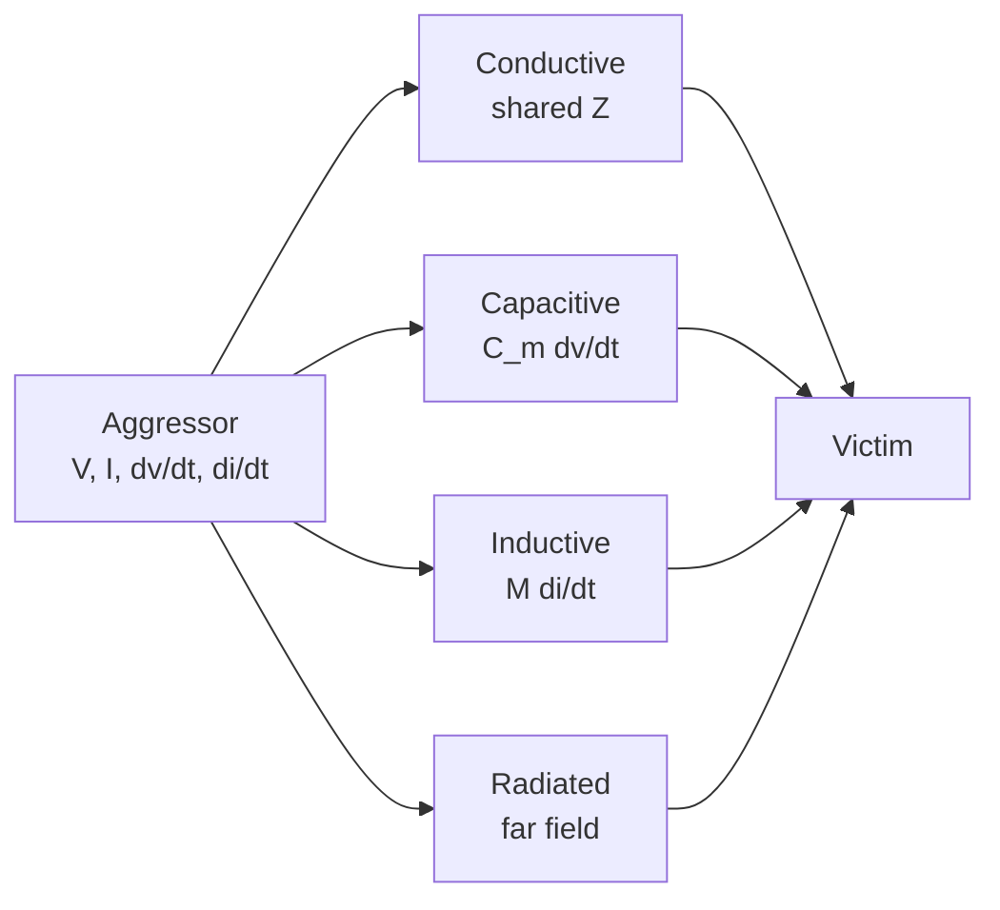

::: basics
### In plain words
Noise gets from one circuit to another in four ways. Two circuits can share a wire, so one's current creates a voltage the other sees. A changing voltage can push current through the tiny capacitance between nearby conductors. A changing current can induce voltage in a nearby loop through the magnetic field. Or noise can travel through space as radio waves. To prevent it, quiet the source, cut the coupling, or toughen the receiver.

### Picture it
Think of an apartment building. Two flats on one water pipe share pressure, so a neighbor flushing drops yours. That is shared wiring. A thin shared wall passes bangs, like capacitance. Two linked chain rings tug each other when you pull one, like magnetic coupling. A loud stereo heard across the street is radiation.

### Words you need
- **Aggressor and victim**: the circuit that makes the noise and the circuit it disturbs.
- **Shared impedance**: a wire or ground path two circuits both use, so one's current makes a voltage for the other.
- **Mutual capacitance**: two nearby conductors act like a tiny capacitor, two metal plates with a gap. Fast voltage changes on one push current into the other.
- **Mutual inductance**: the magnetic link between two loops. A changing current in one induces voltage in the other.
- **Impedance of the victim**: how hard the victim node is to push around. High impedance is the most vulnerable.

### The simplest example
Say the mutual capacitance is 0.5 pF and the victim wire has 4.5 pF to ground. A 3.3 V edge in 1 ns divides between the two capacitances, so at most 3.3 × 0.5 / 5.0 = 0.33 V reaches a high-impedance victim. If the victim is a low-impedance 50 Ω line, it quickly drains the injected charge and sees only about 81 mV. A 1 kΩ line sees about 0.30 V.

That is the whole idea: find which path it is, then cut the cheapest link. The rest of this page covers the model and remedy for each path.
:::

::: testing
Whether you have a clean taxonomy of coupling mechanisms and can attach a model and a remedy to each:

1. **Conductive (common impedance)**: two circuits share a path.
2. **Capacitive (electric field)**: $i = C_m\,dv/dt$.
3. **Inductive (magnetic field)**: $v = M\,di/dt$.
4. **Radiative (far field)**.

Plus the principle that *impedance* of the victim and *edge rate* of the aggressor set how bad it is, and that prevention is always "reduce the coupling, reduce the aggressor, or harden the victim".
:::

::: why
Almost every noise or crosstalk problem on a board is one of these four, and the fix depends on which. Adding a shield to cure a shared-ground problem does nothing; widening spacing does nothing for a common-impedance problem. Interviewers like this question because a candidate who can model each mechanism with one equation can diagnose an unfamiliar symptom on the spot.
:::

::: concepts
- **Common-impedance coupling**: a shared resistance or inductance converts one circuit's current into another circuit's voltage. See [[q0688]], [[q0497]].
- **Capacitive coupling**: mutual capacitance between conductors. See [[q0022]].
- **Inductive coupling**: mutual inductance between loops.
- **Radiated coupling**: far-field energy from loops and antennas. See [[q0559]].
- **Victim impedance**: high-impedance nodes are more sensitive to capacitive coupling, low-impedance loops to magnetic.
- **Crosstalk**: capacitive plus inductive coupling between adjacent traces. See [[q0694]].
:::

::: answer
"There are four ways. First, conductive coupling through a shared impedance: two circuits share a ground or supply path, so one circuit's current creates a voltage drop that the other sees. A classic is a digital return current flowing through the same ground trace as an analog reference. The voltage is I times Z, or L di/dt.

Second, capacitive coupling. Any two conductors have a mutual capacitance, and a changing voltage on one injects a current of C dv/dt into the other. It matters most for high-impedance victims.

Third, inductive coupling. Two current loops share magnetic flux, so a changing current in one induces M di/dt in the other. It scales with loop area and matters most for low-impedance victims and long parallel runs.

Fourth, radiation, where energy propagates through space, which is the same as EMI.

To prevent it, I attack whichever side is cheapest: increase separation or shield for capacitive; shrink loops and use planes for inductive; give each circuit its own return, add decoupling and use planes for common impedance; slow the aggressor's edges; lower the victim's impedance or use differential signalling; and filter. The 3W spacing rule and ground guards help crosstalk."
:::

::: technical
**1. Common impedance.** If circuits A and B share an impedance $Z_c$ (a ground trace, a supply rail, a connector pin), then A's current $I_A$ produces $v = I_AZ_c$ in B's reference. At RF, $Z_c \approx j\omega L$: 3 nH shared inductance with 100 mA changing in 1 ns gives 0.3 V. Fix: separate returns, planes (low $L$), star points, decoupling.

**2. Capacitive.** Mutual capacitance $C_m$ between conductors; victim to ground impedance $Z_v$ with capacitance $C_g$. The transfer function from aggressor to victim:
$$\frac{V_v}{V_a} = \frac{sR_vC_m}{1+sR_v(C_m+C_g)}$$
High-pass: at low frequency $\approx sR_vC_m$ (grows with frequency and $R_v$); above $1/[R_v(C_m+C_g)]$ it saturates at $C_m/(C_m+C_g)$. Example: $C_m$ = 0.5 pF, $C_g$ = 4.5 pF, a 3.3 V edge in 1 ns: $R_v$ = 50 Ω gives about 81 mV; 1 kΩ gives 0.30 V; 100 kΩ gives 0.33 V (the divider limit).

**3. Inductive.** $v = M\,di/dt$, with $M$ growing with the shared flux (loop areas, proximity, parallel length), reduced by a nearby plane. Example: 2 nH mutual, 20 mA in 1 ns gives 40 mV. A low-impedance victim loop sees the induced voltage in series with the loop.

**4. Radiative.** Far-field coupling through loops and monopoles ([[q0561]]); dominant when separation is a fraction of a wavelength or more.

**Crosstalk on parallel traces** is capacitive plus inductive: near-end (backward) crosstalk is proportional to the sum of the capacitive and inductive coupling coefficients; far-end (forward) crosstalk to their difference and to edge rate and coupled length, and it nearly vanishes in a homogeneous stripline.

**Prevention.** Reduce *aggressor* strength (slower edges, lower swing), reduce *coupling* (spacing, shielding, planes, orthogonal routing, separate returns), harden the *victim* (low impedance, filtering, differential signalling).
:::

::: short
"There are four mechanisms. Conductive coupling through a shared impedance, like a common ground trace, where $V = IZ$ or $L\,di/dt$. Capacitive coupling between conductors, $i = C_m\,dv/dt$, worst for high-impedance victims. Inductive coupling between loops, $v = M\,di/dt$, worst for large loops and long parallel runs. And radiation. To prevent it: separate returns and planes for common impedance, spacing and shielding for capacitive, small loops for inductive, plus slower edges and a lower-impedance or differential victim."
:::

::: long
"I split coupling into four mechanisms, each with its own equation and fix.

Conductive, or common-impedance, coupling happens when two circuits share a piece of conductor, a ground trace, a supply rail, a connector pin. One circuit's current flows through that impedance and the voltage drop appears in the other circuit's reference. At RF it's mostly inductance, so 3 nanohenries with 100 milliamps changing in a nanosecond is 0.3 volts. The fix is to not share: separate return paths, a solid ground plane to cut the inductance, star connections, and decoupling.

Capacitive coupling is mutual capacitance between conductors. A changing voltage on the aggressor injects C dv/dt into the victim, and the victim's impedance turns that into a voltage. With half a picofarad and a 3.3 volt, 1 nanosecond edge, a 50 ohm victim gets about 80 millivolts and a 1 kilohm victim about 300. So high-impedance nodes are the sensitive ones. Fixes: more spacing, a grounded shield or guard between, a plane between layers, slower edges, lower victim impedance.

Inductive coupling is two loops sharing magnetic flux: M di/dt. It scales with loop area and with how far they run together, and it hurts low-impedance victims. Fixes: small loops, return planes close to the signals, spacing, orthogonal routing, twisted pairs.

And radiative coupling, which is the far-field version I'd handle with filtering, shielding and loop control.

For crosstalk between traces it's capacitive plus inductive together, and the rules are spacing, a reference plane close to the traces, and not running long parallel."
:::

::: terms
- **Common-impedance coupling**: interference via an impedance shared by two circuits.
- **Mutual capacitance ($C_m$)**: capacitance between two conductors, which couples dv/dt as current.
- **Mutual inductance ($M$)**: shared flux between two loops, which couples di/dt as voltage.
- **Aggressor / victim**: the disturbing and disturbed circuits.
- **Crosstalk**: unwanted coupling between adjacent signal paths.
- **Near-end / far-end crosstalk (NEXT/FEXT)**: coupling observed at the aggressor's driver end / at the far end.
- **Guard trace**: grounded trace between aggressor and victim.
- **3W rule**: space traces at least three trace-widths apart (centre to centre) to reduce coupling.
:::

::: exceptional
**An average answer** says "signals couple capacitively and inductively; separate them".

**An exceptional answer**:
- Lists all four mechanisms and gives each an equation ($IZ$, $C\,dv/dt$, $M\,di/dt$, radiation).
- Explains that victim impedance matters: high-impedance nodes suffer from capacitive coupling, low-impedance loops from inductive.
- Gives numbers (50 Ω vs 1 kΩ victim, 0.3 V across 3 nH) and a transfer function.
- Matches the remedy to the mechanism and says why a remedy for one won't fix another.
- Notes homogeneous stripline has near-zero far-end crosstalk and that planes reduce both capacitive and inductive coupling.
:::

::: mistakes
- **Treating all noise as "capacitive".** A common-ground problem is not cured by spacing or shielding.
- **Assuming a shield helps magnetic coupling.** A thin non-magnetic shield does little at low frequency against magnetic fields; reduce loop area instead.
- **Ignoring return paths.** Coupling through a shared return is the most common and least visible mechanism.
- **Using a floating guard trace.** An ungrounded guard may couple *more*; tie it to ground with vias.
- **Forgetting victim impedance.** The same coupling capacitance gives 80 mV on a 50 Ω line and 0.3 V on a 1 kΩ line.
- **Assuming differential means immune.** Imbalance converts common-mode coupling to differential.
:::

::: deep
## The four paths


Figure: Four independent paths from the same aggressor to the same victim. A cure for one does nothing for the others, so diagnose the mechanism first.

## 1. Common-impedance coupling

Suppose a digital IC and an analog reference share a ground return trace of inductance $L$ = 3 nH. When the IC's current changes by 100 mA in 1 ns the trace has $L\,di/dt$ = 0.3 V across it, and the analog reference, tied to the far end, moves by that much. The voltage doesn't depend on how far apart the circuits are, only on the shared impedance.

```sim
{"id":"ground-bounce","n":4,"l":3e-9,"cl":10e-12,"tr":1e-9,"vdd":3.3}
```
Figure: Simultaneous switching through shared ground inductance is the textbook common-impedance case. Reduce the inductance (more ground pins, planes) and see the bounce collapse; then raise the number of outputs to see it scale.

Fixes: separate returns that meet at one point, ground planes (low inductance), decoupling at the source so the current loop stays local, and keeping sensitive references away from shared paths ([[q0494]], [[q0495]], [[q0496]]).

## 2. Capacitive coupling

```circuit
{"caption":"Capacitive coupling: the aggressor drives a divider of C_m against the victim's impedance","elements":[
 {"t":"Vsq","a":[0,2],"b":[0,6],"label":"aggressor"},
 {"t":"wire","pts":[[0,2],[0,0],[6,0]]},
 {"t":"C","a":[6,0],"b":[10,0],"label":"C_m","value":"0.5 pF"},
 {"t":"wire","pts":[[10,0],[14,0]]},{"t":"dot","at":[14,0]},
 {"t":"wire","pts":[[14,0],[14,2]]},
 {"t":"C","a":[14,2],"b":[14,6],"label":"C_g","value":"4.5 pF","labelSide":"other"},
 {"t":"wire","pts":[[14,0],[18,0],[18,2]]},
 {"t":"R","a":[18,2],"b":[18,6],"label":"R_v"},
 {"t":"wire","pts":[[0,6],[0,8],[18,8],[18,6]]},
 {"t":"wire","pts":[[14,6],[14,8]]},{"t":"dot","at":[14,8]},
 {"t":"gnd","at":[9,8]},
 {"t":"term","at":[14,-1.5],"label":"V_victim","side":"top"}
]}
```
Figure: The victim node sees a capacitive divider $C_m/(C_m+C_g)$ at high frequency and a high-pass $sR_vC_m$ at low frequency. Smaller $R_v$ pushes the transition up in frequency and reduces the coupled voltage.

```bode
{"systems":[{"label":"R_v = 50 Ω","num":["50*cm",0],"den":["50*(cm+cg)",1]},{"label":"R_v = 1 kΩ","num":["1000*cm",0],"den":["1000*(cm+cg)",1],"color":"orange"},{"label":"R_v = 100 kΩ","num":["100000*cm",0],"den":["100000*(cm+cg)",1],"color":"red"}],"vars":{"cm":"0.5e-12","cg":"4.5e-12"},"f":{"min":1e5,"max":1e10},"show":"mag","magRange":[-60,0]}
```
Figure: Coupled amplitude versus frequency for three victim impedances. All saturate at −20 dB ($C_m/(C_m+C_g)$ = 0.1), but the 100 kΩ victim reaches it near 320 kHz while the 50 Ω victim only gets there near 640 MHz. High-impedance nodes are the vulnerable ones; a fast edge has energy at hundreds of MHz where even the 1 kΩ line is saturated.

Numbers for a 3.3 V, 1 ns edge (slew 3.3 V/ns): victim 50 Ω: 81 mV; 1 kΩ: 0.30 V; 100 kΩ: 0.33 V (divider limit).

Fixes: spacing ($C_m$ falls steeply with separation), a grounded guard or a plane between layers, orthogonal crossing ([[q0567]]), slower edges, lower victim impedance (buffer, termination), shorter parallel length.

## 3. Inductive coupling

Two loops with mutual inductance $M$: $v = M\,di/dt$. Two PCB loops each 1 cm² placed 5 mm apart have $M$ on the order of a nanohenry. With 20 mA in 1 ns and $M$ = 2 nH: 40 mV in series with the victim loop. Because it's a series voltage, a *low*-impedance, large-area victim loop is the problem, the opposite of the capacitive case.

Fixes: shrink both loops (a solid plane under each trace reduces flux linkage), increase separation, orient loops orthogonally, twist pairs for off-board wires, avoid long parallel runs.

## 4. Radiative coupling

When separation approaches a fraction of a wavelength, coupling is via radiation: see [[q0561]]. Fixes: reduce the radiation at the source and use shielding ([[q0569]]).

## Crosstalk between traces

For two coupled microstrips driven by a step, the victim near end sees a pulse proportional to $K_b = \frac14\left(\frac{C_m}{C}+\frac{L_m}{L}\right)$ (weak-coupling approximation), lasting twice the coupled delay; the far end sees a pulse proportional to coupled length and edge rate, with magnitude depending on the *difference* of capacitive and inductive coupling. In an ideal homogeneous stripline the two cancel and far-end crosstalk is nearly zero. Rules: spacing ≥ 3 trace widths (or more, relative to height above plane), keep traces close to their reference plane (smaller $h$ confines fields), avoid long parallel runs, use ground guards when needed ([[q0566]]).

## Choosing the fix

| Symptom | Likely mechanism | First fix |
|---|---|---|
| Noise follows another circuit's current | Common impedance | Separate/low-impedance returns, planes |
| Noise follows dv/dt and is worse on high-Z nodes | Capacitive | Spacing, guard, lower impedance |
| Noise follows di/dt and is worse in big loops | Inductive | Shrink loops, planes, orthogonal |
| Noise changes when cable or enclosure moves | Radiative/common-mode | Filtering, shielding, CM control |

## Worked example: sizing crosstalk between two microstrips

Two 50 Ω microstrips run in parallel for 100 mm and the aggressor carries a 3.3 V step with $t_r=1$ ns. The propagation delay is 5.9 ps/mm, so the coupled delay is $t_d=0.59$ ns. Suppose the coupling ratios, from a field solver or an estimate, are $C_m/C=0.10$ and $L_m/L=0.10$ at the chosen spacing.

**Near end (backward).** The weak-coupling coefficient is
$$K_b=\tfrac14\!\left(\frac{C_m}{C}+\frac{L_m}{L}\right)=\tfrac14(0.10+0.10)=0.05,$$
so the saturated near-end pulse is $0.05\times3.3\ \text{V}=165$ mV. It is "saturated" (reaches this full amplitude) only if the coupled region is long enough that the pulse of duration $2t_d$ is at least as long as the edge: $2t_d\ge t_r$, i.e. length $\ge t_r/(2\,t_{pd})=1\ \text{ns}/(2\times5.9\ \text{ps/mm})=85$ mm. The 100 mm run just reaches it; a 20 mm run would give only about $2\times0.118/1=24\%$ of that amplitude, 39 mV. Now double the spacing so both coupling ratios fall to 0.05: $K_b=0.025$ and the pulse is 82 mV. A 165 mV spike against a 3.3 V logic level is 5%, fine for a digital line with 0.4 V noise margin but not for an analog line or a clock being used as an edge-sensitive input.

**Far end (forward).** The far-end coefficient depends on the *difference* between capacitive and inductive coupling: $K_f=\tfrac12\left(\frac{C_m}{C}-\frac{L_m}{L}\right)$ times $t_d/t_r$. In a microstrip the fields partly live in air and partly in the dielectric, so the two do not cancel exactly. Take $C_m/C=0.08$ and $L_m/L=0.12$: $K_f=-0.02$ and the far-end pulse is $-0.02\times(0.59/1)\times3.3=-39$ mV, with the opposite polarity of the aggressor. Note the dependence on $t_d/t_r$: the far-end error grows with coupled length and with faster edges, while the near-end pulse saturates. Halving the edge time to 0.5 ns doubles it to $-78$ mV.

> [!UNCERTAIN]
> The coupling ratios used here are illustrative values of the right order for closely spaced microstrips; the actual values depend on spacing, trace height, dielectric constant and solder mask. Use a field solver or the stack-up calculator in your layout tool for real numbers.

## Limiting cases and when the simple models break

- **Capacitive model:** it assumes the victim is not loaded by a long transmission line. If the victim is a terminated 50 Ω line, it is a distributed coupled-line problem and the near-end/far-end analysis above replaces the lumped one.
- **Inductive model:** valid for loops that are small compared with the wavelength. At 1 GHz and above the "loop" is a transmission line and the coupling is a traveling wave.
- **Crosstalk is not linear in the number of aggressors:** a victim with several neighbors switching together sums the pulses (worst case), so the bus is budgeted for all-neighbors-switching with the same polarity, not one aggressor.
- **Return path discontinuities** raise coupling dramatically: if both traces cross the same gap in the plane, the shared return loop couples them through common impedance, a mechanism the capacitive and inductive formulas do not include.

## Bench verification: telling the mechanisms apart

1. **Drive only the aggressor** with a known edge and terminate the victim at both ends with its normal terminations. Probe the near and far end of the victim, triggering on the aggressor. A pulse that has the same polarity as the aggressor and lasts $2t_d$ is near-end crosstalk; a narrow pulse at the far end of opposite polarity points at the capacitive/inductive imbalance.
2. **Vary the victim's impedance:** put a 50 Ω in parallel with a high-impedance victim input. Capacitive coupling injects a current, so the noise voltage falls roughly in proportion to the drop in victim impedance. Inductive coupling is a series voltage in the victim loop and barely changes; neither does common-impedance coupling.
3. **Change the aggressor's current while keeping its voltage edge:** run it once unterminated (full $dv/dt$, little current) and once into a low-impedance termination (same $dv/dt$, large $di/dt$). Noise that grows with the aggressor's current is inductive; noise that stays with the voltage edge is capacitive.
4. **Move the cable or the shield:** a change in noise means a radiated or common-mode path, not a board-level near-field path.
:::

::: applications
- **Mixed-signal boards**: keeping digital return currents out of the analog reference path (common impedance).
- **High-impedance sensor inputs (pH, photodiode, electret)**: guard rings to reduce capacitive and leakage coupling.
- **Parallel buses (DDR, SPI) on adjacent layers**: spacing and orthogonal routing to limit crosstalk.
- **Switching converters**: keeping the switch node away from feedback traces (capacitive) and the inductor away from sense loops (inductive).
- **Audio and instrumentation wiring**: twisted pairs and shielded cables for off-board runs.
:::

::: assumptions
- **Lumped models** ($C_m$, $M$) apply when dimensions are well below a wavelength (below about $\lambda/10$ at the highest frequency of the edge).
- **Weak coupling**: the formulas for crosstalk assume that the victim doesn't strongly load the aggressor.
- **Numbers are illustrative**: $C_m$ = 0.5 pF and $M$ = 2 nH depend on the geometry; use a field solver or measured data for real values.
- **The four mechanisms act together**; separating them is for diagnosis.
- **Alternative classification**: some textbooks group coupling as "conducted" (common impedance) vs "radiated/near-field" (capacitive, inductive, far-field); the remedies are the same.
:::

::: followups
### Why are high-impedance nodes more vulnerable to capacitive coupling?
Because the coupled current $C_m\,dv/dt$ develops a voltage across the victim's impedance. At 1.65 mA (0.5 pF at 3.3 V/ns) a 50 Ω victim sees 82 mV while a 1 kΩ victim saturates around 0.3 V. Lowering the node impedance with a buffer, termination or a smaller resistor shrinks the effect.

### Why does a ground plane reduce both capacitive and inductive crosstalk?
It captures the fields close to each trace: more of each trace's capacitance is to the plane than to its neighbour, so the divider $C_m/(C_m+C_g)$ falls, and the return currents in the plane oppose the flux that would link the neighbour, reducing $M$. The thinner the dielectric to the plane, the stronger the effect.

### How do you tell common-impedance coupling from capacitive coupling on the bench?
Common-impedance noise appears in proportion to the *current* of the other circuit and shows up when you measure ground-to-ground between the two circuits. Capacitive coupling follows the aggressor's *voltage* edges, is worse on high-impedance nodes, and drops when you lower the victim's impedance (add a resistor to ground) or move the traces. Probing with a scope on both nodes and changing the load or the edge rate helps.

### What does the 3W rule do?
Spacing traces by three trace widths (centre to centre) reduces coupled flux, a rule of thumb usually quoted as keeping about 70 % of a trace's field lines from reaching its neighbour (with 10W quoted for about 98 %). It's a guideline, not a guarantee; what matters is the spacing relative to the height above the reference plane. Treat the numbers as approximate.

### Scenario: an ADC reference line picks up noise from a nearby SPI clock. How do you diagnose and fix?
Scope the reference with the clock running; if the noise edges align with the clock's edges, it's coupling. Try lowering the reference's impedance with a bigger local capacitor or buffer (capacitive coupling), check whether the return of the SPI current shares copper with the reference ground (common impedance), look at the loop area of both. Fixes: spacing and a guard, route over a plane, put a series resistor to slow the clock edge, separate return paths.
:::

::: references
- Henry W. Ott, *Electromagnetic Compatibility Engineering*: chapters on capacitive and inductive coupling and on grounding.
- Clayton R. Paul, *Introduction to Electromagnetic Compatibility*: crosstalk models for coupled lines and inductive/capacitive coupling.
- Howard Johnson & Martin Graham, *High-Speed Digital Design: A Handbook of Black Magic*: crosstalk and ground bounce chapters.
- Eric Bogatin, *Signal and Power Integrity: Simplified*: mutual capacitance and inductance, crosstalk.
:::

::: rubric
- Names the four mechanisms (conductive, capacitive, inductive, radiated) :: A complete taxonomy shows structured thinking.
- Gives the model for each ($IZ$ or $L\,di/dt$, $C\,dv/dt$, $M\,di/dt$) :: Equations let you estimate and diagnose.
- Explains victim impedance dependence :: Shows you know which nodes are vulnerable to which mechanism.
- Matches prevention to mechanism :: The point of the taxonomy.
- Mentions return paths / common impedance explicitly :: The most frequently missed mechanism.
- Mentions spacing, planes, orthogonal routing, guard traces, slower edges :: Standard layout techniques.
- Gives at least one numeric example :: Quantification separates real experience from textbook recall.
:::

::: quiz
```json
[
 {"type":"mcq","level":"fundamental","q":"Two circuits share a ground trace and one circuit's digital current shifts the other's reference. Which coupling mechanism is this?","options":["Capacitive","Inductive","Common-impedance (conductive)","Radiated"],"answer":2,"explain":"A shared impedance converts one circuit's current into a voltage that appears in the other's reference."},
 {"type":"numeric","level":"intermediate","q":"3 nH of shared ground inductance carries a current that changes by 100 mA in 1 ns. What voltage is developed? Give it in V.","answer":0.3,"tolerance":0.03,"unit":"V","explain":"$v = L\\,di/dt = 3\\times10^{-9}\\cdot0.1/10^{-9} = 0.3$ V."},
 {"type":"mcq","level":"intermediate","q":"Which victim is most sensitive to capacitive coupling from a fast edge?","options":["A 50 Ω terminated line","A 100 kΩ high-impedance node","A short-circuited line","A low-impedance power rail"],"answer":1,"explain":"The coupled current $C_m\\,dv/dt$ develops a voltage across the victim impedance, so the higher the impedance, the larger the voltage (up to the divider limit)."},
 {"type":"numeric","level":"intermediate","q":"Mutual capacitance is 0.5 pF and the aggressor slews at 3.3 V/ns. How much current is injected into the victim? Give it in mA.","answer":1.65,"tolerance":0.02,"unit":"mA","explain":"$i = C_m\\,dv/dt = 0.5\\times10^{-12}\\cdot3.3\\times10^{9} = 1.65\\times10^{-3}$ A."},
 {"type":"truefalse","level":"advanced","q":"Moving two traces farther apart will fix noise caused by a shared ground impedance.","answer":false,"explain":"Common-impedance coupling does not depend on the spacing of the signals; it depends on the shared return path. Separate returns or lower the shared impedance."}
]
```
:::
