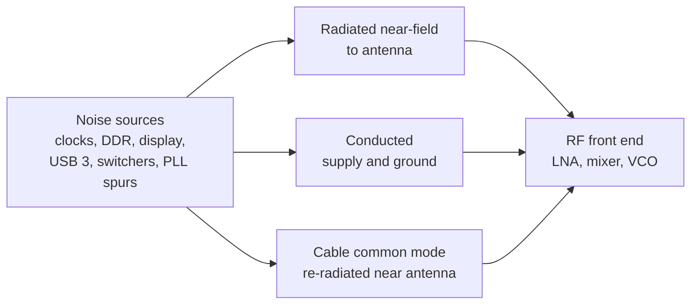

::: basics
### In plain words
Desense, short for desensitization, is when a radio receiver, such as Wi-Fi or GPS, loses sensitivity because noise raises the floor under the weak signals it is trying to hear. The noise often comes from the product's own clocks, displays or power supplies. The result is shorter range and slower data. It can pass legal emissions tests, because receivers are far more sensitive than those limits.

### Picture it
Picture trying to hear a whisper in a quiet room. If a fan starts humming, the whisper must now be louder to be heard, even though the fan is not loud. The hum is the noise floor and the whisper is the weak radio signal. You can quiet the fan, move away from it, or close a door between you.

### Words you need
- **Receiver sensitivity**: the weakest signal a receiver can still decode.
- **Noise floor**: the unavoidable background noise level that weak signals must rise above.
- **In-band**: at the same frequencies the receiver listens to.
- **Decibel (dB)**: a log scale for ratios. A 3 dB change is a doubling of power.
- **Isolation**: how many dB of separation you create between a noise source and the antenna or receiver.

### The simplest example
Suppose in-band interference reaches the receiver at exactly the same power as its noise floor. Total noise is then double, which is 3 dB worse, so the receiver needs a 3 dB stronger signal. If the interference is 10 dB below the noise floor, the loss is only about 0.4 dB. In free space, a 3 dB loss cuts range by about 29%, and a 1 dB loss by about 11%. A common design goal is to keep interference at least 10 dB below the floor.

That is the whole idea: desense is a noise budget. The rest of this page covers required isolation, noise sources, and board techniques.
:::

::: testing
Whether you understand receiver desensitisation as a *noise budget* problem and can connect board-level EMI to RF performance. The interviewer is looking for:

1. **Definition**: loss of receiver sensitivity caused by noise or strong signals, usually generated by the same product.
2. **Why it's bad**: dB of sensitivity is range and throughput; it can be invisible to regulatory tests.
3. **The numbers**: thermal noise floor, and $10\log(1+I/N)$.
4. **Techniques**: separation, filtering, shielding, edge-rate control, clock planning, supply isolation, antenna placement.
:::

::: why
Every phone, laptop, IoT device and car module has a radio sitting a few centimetres from processors, memories, displays and switching regulators. Many wireless products pass regulatory tests and still have poor range because the radio's noise floor is raised by the host. Desense is the most common "RF performance versus digital" issue in hardware teams, and it is solved at layout time.
:::

::: concepts
- **Thermal noise floor**: $N = -174\text{ dBm/Hz} + 10\log B + NF$. See [[q0558]].
- **EMI coupling paths**: conducted, capacitive, inductive, radiated. See [[q0565]].
- **Interference-to-noise ratio** and sensitivity loss.
- **Harmonics of digital clocks and edges**. See [[q0559]].
- **Shielding and filtering**. See [[q0569]], [[q0564]].
- **Receiver blocking (compression)** by strong out-of-band signals.
:::

::: answer
"Desense, short for desensitisation, is when a receiver loses sensitivity because noise or a strong signal from somewhere else, usually from my own product, interferes with it. A receiver is designed so its noise floor is set by thermal noise and its own noise figure. If in-band interference lands on the antenna or couples into the front end, it adds to that floor and the weakest signal it can receive gets stronger by the same dB.

The math is simple: the degradation is 10 log of one plus the interference-to-noise ratio. If the interference equals the noise, I lose 3 dB. At 10 dB below the noise it's 0.4 dB. And 3 dB of sensitivity is about 30 percent of range in free space, or a big throughput drop.

I want to avoid it because it hurts range, throughput and battery life, and it can be invisible to emissions testing: the noise can be well under the regulatory limit and still be above the receiver's floor, which is tens of dB lower.

Board-level, I fight it by keeping noisy digital sections and their cables away from the antenna and RF front end, shielding noisy or sensitive blocks, filtering supplies and lines that cross between zones, slowing edges, choosing clocks whose harmonics miss the radio's bands, using good ground planes and via stitching, and placing the antenna away from connectors and displays."
:::

::: technical
**Definition.** Desense is a degradation of receiver sensitivity (the minimum detectable signal for a target SNR) due to interference in-band (raising the noise floor), or out-of-band but strong (compressing or intermodulating the front end), or from the product's own transmitter leaking into its receiver.

**Noise floor.** $N = -174 + 10\log_{10}B + NF$ dBm. Example, GPS L1 (1575.42 MHz) with $B$ = 2 MHz and $NF$ = 2 dB: $N \approx -109$ dBm. A Wi-Fi channel with $B$ = 20 MHz and $NF$ = 6 dB: $N \approx -95$ dBm.

**Sensitivity loss.** With in-band interference power $I$ at the receiver input:
$$\Delta S = 10\log_{10}\!\left(1+\frac{I}{N}\right)\ \text{dB}.$$
$I/N$ = 0 dB gives 3.0 dB; −6 dB gives 1.0 dB; −10 dB gives 0.41 dB; −20 dB gives 0.04 dB. A typical design target is $I/N\le-10$ dB or better.

**Range.** In free space, range scales as $10^{-\Delta S/20}$: 3 dB desense is 29 % less range; 1 dB is 11 %.

**Isolation needed.** If an internal source puts −30 dBm of in-band energy at the antenna port equivalent (illustrative), to reach $I/N$ = −10 dB with $N$ = −109 dBm you need $I$ = −119 dBm, i.e. 89 dB of isolation.

**Sources.** Harmonics of clocks, memory, display and USB 3 interfaces; switching regulator spurs; PLL reference spurs; baseband and codec clocks; TX harmonics or sidebands from another radio in the same device (self-interference); LED PWM.

**Techniques.** Physical separation and antenna placement; shielding of the noise source or the RF section; filtering and decoupling on supplies and interface lines (ferrites, common-mode chokes, LC); slower edges and reduced swing; spread-spectrum or frequency planning so harmonics avoid band; cable shielding and bonding; solid planes and via fences; dedicated low-noise LDO with high PSRR for RF supplies; frequency-offset clock choice; firmware coexistence tricks (time-division) as a last resort.
:::

::: short
"Desense is loss of receiver sensitivity caused by noise from elsewhere, usually the same product. In-band interference adds to the thermal noise floor, and the sensitivity loss is 10 log of one plus I over N: 3 dB when interference equals noise, 0.4 dB at 10 dB below. It costs range and throughput and can pass regulatory tests because the receiver floor is tens of dB below the limits. To avoid it: separate and shield the RF section, filter lines crossing zones, slow edges, plan clocks so harmonics miss the band, and keep the antenna away from noisy cables and displays."
:::

::: long
"Desense, or desensitisation, is a loss of receiver sensitivity caused by something raising its effective noise floor, almost always noise from another part of the same product. A receiver's best sensitivity is limited by thermal noise: minus 174 dBm per hertz plus 10 log of the bandwidth plus the noise figure. For GPS with 2 MHz bandwidth and a 2 dB noise figure that's about minus 109 dBm. Anything in band that gets to the front end adds to that.

The degradation is 10 log of one plus I over N. If the interference is equal to the noise floor, I lose 3 dB; at 10 dB below, 0.4 dB; at 6 dB below, 1 dB. 3 dB of sensitivity is about 30 percent of the range in free space, or a drop in throughput as the modulation steps down. It should be avoided because it can't be seen in the regulatory test: a clock harmonic can be 20 dB under the radiated limit and still 60 dB above the GPS noise floor.

Example: a source of minus 30 dBm in band at the front end would need 89 dB of isolation to be 10 dB under the noise. That's why it takes layers of defence.

At board level: placement and antenna position first, away from displays, USB connectors and the application processor; a ground plane and via fences around the RF section; shield cans over the RF circuits or over the noisy source; filtering on supplies and interface lines that cross between zones, with ferrites, LC filters and a dedicated high-PSRR LDO for RF; slowing edges on digital interfaces; choosing or spreading clocks so harmonics don't land in the radio's channel; and shielding and bonding cables. Then validate by comparing the receiver noise floor with each subsystem on and off."
:::

::: terms
- **Desense**: desensitisation, reduced receiver sensitivity from interference.
- **Sensitivity**: the minimum input signal at which the receiver meets a given quality target.
- **Noise figure (NF)**: how much a receiver degrades SNR, in dB.
- **Interference-to-noise ratio (I/N)**: in-band interference power relative to the noise floor.
- **Blocking / compression**: a strong signal reducing front-end gain.
- **Self-interference / coexistence**: interference between radios (or digital sections) in the same product.
- **PSRR**: power-supply rejection ratio of a regulator.
- **Via fence**: row of ground vias forming a wall around a region.
:::

::: exceptional
**An average answer** says "noise from digital circuits reduces the radio's range, so shield it".

**An exceptional answer**:
- Defines desense with the noise-floor equation and the $10\log(1+I/N)$ formula, quoting 3 dB, 1 dB, 0.4 dB values.
- Converts dB to range and explains why regulatory tests miss it (receiver floor is tens of dB lower than limits).
- Computes the isolation needed for a given in-band source.
- Gives a prioritised list: placement, partitioning, shielding, filtering, clock planning, supply isolation.
- Mentions verification: noise floor with subsystems on/off, near-field probing, and TX-to-RX self-interference.
:::

::: mistakes
- **Assuming that passing FCC/CE tests means no desense.** Limits are far above receiver noise floors.
- **Believing spread-spectrum clocking fixes it.** Total in-band power is unchanged if the receiver bandwidth is wider than the spread.
- **Only shielding the receiver.** The cables and antenna can pick up noise outside the shield; shield and filter the noisy source and its cables too.
- **Ignoring the supply.** A noisy rail feeding an LNA or VCO modulates it; use isolated, filtered rails.
- **Forgetting out-of-band causes.** Strong signals from a co-located transmitter can compress the LNA even though they're not in band.
- **Placing the antenna by the USB or display connectors** to save board space.
:::

::: deep
## Why a receiver is so sensitive

A receiver's noise floor is thermal noise from the antenna resistance plus the receiver's added noise: $N = kTB\cdot F$. At room temperature $kT$ = −174 dBm/Hz. For bandwidth $B$ and noise figure $NF$ (dB):

$$N = -174 + 10\log_{10}B + NF\ \text{dBm}.$$

| Radio | Bandwidth | NF | Noise floor |
|---|---|---|---|
| GPS L1 C/A | 2 MHz | 2 dB | −109 dBm |
| Wi-Fi 2.4 GHz channel | 20 MHz | 6 dB | −95 dBm |

(Example figures; real front ends differ.) Regulatory radiated limits correspond to field strengths that, through a small antenna, give powers many tens of dB above −109 dBm. So a spur can pass emissions and still wreck GPS.

## The desense formula

If an interferer of power $I$ (dBm, referenced to the receiver input) falls in band, total noise becomes $N+I$ in linear power, so the SNR for any given signal falls by

$$\Delta S = 10\log_{10}\!\left(1+10^{(I-N)/10}\right).$$

```plot
{"title":"Sensitivity loss vs interference-to-noise ratio","x":{"label":"I/N","unit":"dB","min":-30,"max":10},"y":{"label":"Desense","unit":"dB","min":0,"max":10},
 "series":[{"label":"10·log10(1 + I/N)","fn":"10*log10(1+pow(10,x/10))"}],
 "points":[{"x":-20,"y":0.043,"label":"−20 dB: 0.04 dB"},{"x":-10,"y":0.41,"label":"−10 dB: 0.4 dB"},{"x":-6,"y":0.97,"label":"−6 dB: 1.0 dB"},{"x":0,"y":3.01,"label":"0 dB: 3 dB"}],
 "hlines":[{"at":3,"label":"3 dB = about 29% less free-space range","color":"muted"}]}
```
Figure: Interference only starts to matter within about 10 dB of the noise floor, but is brutal beyond it: at equal power you lose 3 dB, at +10 dB you lose 10.4 dB. A target of $I/N\le-10$ dB keeps desense below about 0.4 dB.

Range impact in free space: $r\propto10^{-\Delta S/20}$, so 1 dB loses 11 %, 3 dB loses 29 %. In real indoor environments the effect on throughput is often as bad: the radio steps down to a lower modulation rate.

## Where desense comes from


Figure: Three paths reach the receiver: direct near-field coupling to the antenna or front end, conducted noise on shared rails and grounds, and cables that pick up noise and radiate it near the antenna. Each needs a different remedy.

- **Digital harmonics.** Memory clocks, display links (MIPI/LVDS), and USB 3 have high-speed edges whose harmonics land at GHz bands (a well-known example is USB 3.0 energy overlapping the 2.4 GHz Wi-Fi/Bluetooth band).
- **Switching supplies.** Their harmonics and ringing at 100 MHz+ and sometimes mixing products land in band.
- **PLL/oscillator spurs** and phase noise on the receiver's own LO.
- **Self-interference.** In a device with multiple radios (cellular + Wi-Fi + GPS), harmonics or intermodulation from a transmitter can fall in another's receive band.
- **Out-of-band blocking.** A strong TX signal compresses the LNA, reducing gain even though it isn't in band.
- **Supply noise** into the LNA/VCO (supply-induced modulation).

## How much isolation do you need?

If a source delivers $I$ = −30 dBm in band at the position equivalent to the antenna port, and the GPS noise floor is −109 dBm, you need $I\le N-10$ = −119 dBm for 0.4 dB desense: 89 dB of isolation. No single measure provides that; you stack them: physical separation (10–30 dB), shielding can (20–40 dB when well sealed), filtering and ground stitching (10–30 dB), source reduction (slower edges, lower swing: 10–20 dB).

> [!UNCERTAIN]
> The dB values per measure are rough ranges; actual isolation depends on frequency, geometry, shield seam quality and cable routing. Measure with a near-field probe and on-off tests rather than trusting estimates.

## Techniques at board level

1. **Partition and placement.** Radio, antenna and RF supplies at one end of the board, away from processors, memory, display and USB connectors. Antenna keep-out region with no copper or components. Antenna farthest from cables.
2. **Ground and via fences.** Solid ground under the RF section; ground via fence (spacing below $\lambda/20$ at the band: 6.25 mm at 2.4 GHz, 3 mm at 5 GHz, 9.5 mm at 1.575 GHz).
3. **Shielding cans** over the RF section and/or over noisy sources such as the processor, DC-DC regulator and memory ([[q0569]]).
4. **Filtering**: ferrite beads, LC pi filters and common-mode chokes on supplies and interfaces that cross between zones; dedicated high-PSRR LDOs for LNA and VCO supplies.
5. **Reduce source energy**: slower edges (series resistors), lower swing, differential links with common-mode control, avoiding unnecessary clocks.
6. **Frequency planning**: choose clock and switching frequencies so harmonics miss the receive channel; spread-spectrum helps only if the receiver bandwidth is narrower than the spread, and doesn't lower total power.
7. **Cables**: shielded cables with 360° bonding to chassis, common-mode chokes; display and USB cables are classic desense injectors near antennas.
8. **Firmware coexistence** (last resort): time-multiplex noisy activity (such as DDR bursts) away from receive windows, or change clock rates when channels are in use.

## Diagnosing

- Measure the receiver's noise floor (RSSI or spectrum analyser at its IF/output) with subsystems on and off: display, memory stress, USB 3 traffic, CPU load, charger.
- Near-field probe scanning for hot spots in the receive band.
- Shield or ferrite experiments: foil over a suspected source, clamp-on ferrite on a cable, and see the floor drop.
- Conducted tests: supply the RF section from a clean bench supply.

## Worked example

GPS front end: noise floor −109 dBm. A display link harmonic couples −125 dBm into the antenna feed: $I/N$ = −16 dB, desense 0.11 dB, acceptable. After a design change the harmonic rises 15 dB to −110 dBm: $I/N$ = −1 dB, desense 2.5 dB, and acquisition time and tracking threshold suffer visibly. Adding a ferrite on the display flex (10 dB) brings it back to −120 dBm: 0.36 dB.
:::

::: applications
- **Smartphones and tablets**: display links, DDR and USB 3 harmonics versus cellular, GPS and Wi-Fi bands; heavy shielding and careful antenna placement.
- **Laptops with Wi-Fi/Bluetooth**: USB 3 ports near Wi-Fi antennas; shielded USB 3 connectors and ferrites.
- **GNSS trackers and automotive telematics**: GPS receivers next to cellular modems and switching regulators.
- **IoT sensor nodes with BLE/LoRa**: noisy DC-DC converters on the same board as the radio.
- **Smart watches and wearables**: tightly packed, so shielding and filtering are mandatory.
:::

::: assumptions
- **Thermal-noise-limited receiver** at 290 K (−174 dBm/Hz); real receivers may have a higher effective floor from antenna or environment noise, which reduces the sensitivity to interference but not to zero.
- **In-band interference is treated as noise-like**; narrowband spurs inside a channel can be tracked or notched in some radios, and CW tones affect modulation types differently.
- **Range scaling $10^{-\Delta S/20}$** applies to free-space (inverse-square) propagation; indoors, the impact differs.
- **Isolation values per measure** are rough and vary widely.
- **Interference referenced to the receiver input** (after antenna gain and coupling); for radiated pickup the antenna's effective aperture matters.
:::

::: followups
### Why can a product pass FCC/CE and still have desense?
Emission limits are set so that nearby *broadcast* receivers are protected, in terms of field strengths of tens of dBµV/m at metres of distance. A product's own receiver sits centimetres from the noise source with an antenna designed to pick up −100 dBm signals. Interference that is 20 to 40 dB under the regulatory limit can still be 40 dB above the receiver's noise floor.

### What does 3 dB of desense mean for a Wi-Fi link?
Free-space range falls by 29 %, or the link must reduce its modulation/coding rate to maintain error rate, so throughput can drop by tens of percent at the cell edge. In an RF-limited product that's a significant, user-visible degradation.

### Does a shield around the receiver alone solve it?
Not necessarily. A can protects the front end from radiated pickup but not conducted noise on the supply and grounds that pass in, or noise that couples to the antenna and cable outside the can. A complete approach shields or filters the source, filters crossings, and positions the antenna away from noisy cables.

### How can a USB 3 port desense a 2.4 GHz radio?
USB 3 uses 5 Gb/s signalling with spectral energy extending through the GHz range, and imbalance on the cable or connector leaks common-mode energy that radiates from the cable near the antenna. The energy spans the 2.4 GHz band, raising the noise floor of nearby Wi-Fi/Bluetooth receivers. The mitigations are better shielding and bonding of the connector, common-mode chokes, moving the antenna, and shielding the antenna feed.

### Scenario: GPS sensitivity drops 4 dB when the display is on. How do you debug it?
Measure the GPS noise floor (C/N0 or RSSI) with the display on and off, to confirm the correlation. Use a near-field probe over the display flex, driver and PMIC with a spectrum analyser at 1575 MHz to find the source. Test with a ferrite or copper-foil shield over the flex; try changing the display clock or interface speed, or filtering the display's supply. Fix with shielding, filtering, ground bonding of the flex, moving the antenna, or changing a clock to move the harmonic out of the GPS band.
:::

::: interpretations
"Desense" is shorthand for "desensitisation" of a radio receiver. The question has three parts: what it is, why it should be avoided, and board-level techniques. Compare with [[q0561]] (why avoid radiated EMI), which covers regulatory aspects, while this page focuses on the product's own receivers. The shielding techniques are expanded in [[q0569]] to [[q0573]].
:::

::: references
- Henry W. Ott, *Electromagnetic Compatibility Engineering*: intra-system EMC and noise-source suppression.
- David M. Pozar, *Microwave and RF Design of Wireless Systems*, or Razavi, *RF Microelectronics*: receiver noise figure and sensitivity (topic level).
- Friis noise-figure cascade and sensitivity formulas, as in any RF-systems textbook.
- Manufacturer layout guidelines for GNSS, Wi-Fi and Bluetooth modules (module datasheets typically include antenna keep-out and shielding guidance).
:::

::: rubric
- Defines desense as loss of receiver sensitivity from interference :: The basic definition the question asks for.
- Uses the noise-floor equation and $10\log(1+I/N)$ :: Quantitative understanding rather than a vague claim.
- Explains why it matters (range, throughput, invisible to compliance tests) :: The "why avoid" part of the question.
- Identifies typical sources (clocks, display, USB 3, switchers, self-interference) :: Practical knowledge of what causes it.
- Lists board-level techniques: placement, shielding, filtering, edge/clock control, grounding :: The "how" part.
- Mentions diagnosis (on/off tests, near-field probing) :: Shows hands-on thinking.
- Notes limits of spread-spectrum and other partial fixes :: Avoids a common misconception.
:::

::: quiz
```json
[
 {"type":"mcq","level":"fundamental","q":"What is desense?","options":["Increased receiver sensitivity from filtering","Loss of receiver sensitivity caused by noise or strong interference, often from the same product","A type of ESD damage","Reduction of transmit power"],"answer":1,"explain":"Desensitisation means the receiver's effective noise floor is raised by interference, so weaker signals can no longer be received."},
 {"type":"numeric","level":"intermediate","q":"A receiver has B = 2 MHz and NF = 2 dB. What is its thermal noise floor? Use N = −174 + 10log10(B) + NF. Give it in dBm.","answer":-109,"tolerance":0.01,"unit":"dBm","explain":"$-174 + 63.0 + 2 = -109$ dBm."},
 {"type":"numeric","level":"intermediate","q":"In-band interference equals the receiver's noise floor (I/N = 0 dB). How much desense is that? Give it in dB.","answer":3,"tolerance":0.02,"unit":"dB","explain":"$10\\log_{10}(1+1) = 3.01$ dB."},
 {"type":"numeric","level":"advanced","q":"Interference is 10 dB below the noise floor. What is the desense? Give it in dB.","answer":0.41,"tolerance":0.03,"unit":"dB","explain":"$10\\log_{10}(1+0.1) = 0.414$ dB."},
 {"type":"truefalse","level":"advanced","q":"Spread-spectrum clocking reliably eliminates desense because it reduces the peak level of the harmonics.","answer":false,"explain":"Spreading lowers the peak seen with a narrow measurement bandwidth, but if the radio's channel bandwidth covers the spread, the total in-band noise power is essentially unchanged."}
]
```
:::
