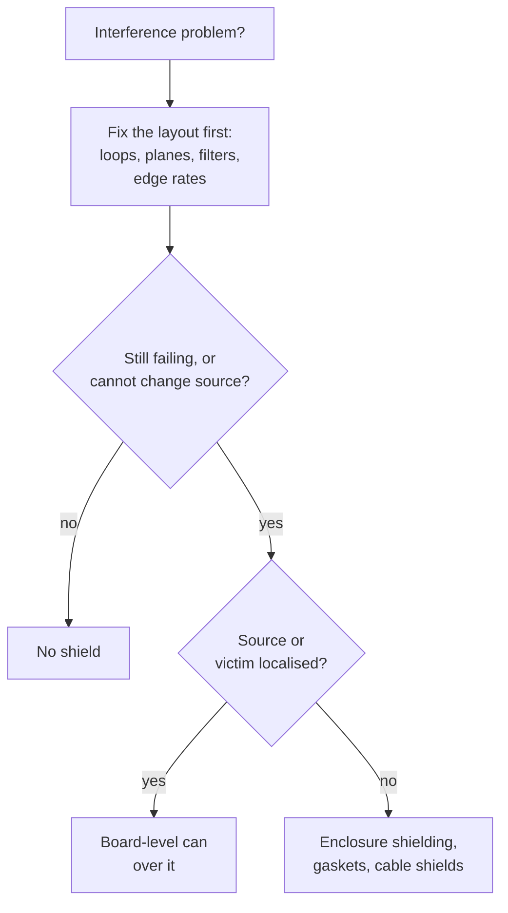

::: testing
Whether you understand an EMI shield as a conductive barrier with a purpose (contain a source or protect a victim) and whether you know it is a *last resort* with costs, not a first fix. The interviewer wants:

1. **What they are**: board-level cans and frames, enclosures, coatings, gaskets, cable shields.
2. **Why/when**: RF sections, noisy sources you cannot fix at layout, sensitive analog, compliance gaps, desense.
3. **Trade-offs**: cost, assembly, rework, heat, height and leakage through seams.
:::

::: why
In real products shield cans are everywhere: phones, Wi-Fi modules, GPS receivers, power amplifiers. Knowing when a can is justified (and when better layout would do) is a sign of design judgement. It is also a regular interview topic because it ties together fields, grounding and manufacturing.
:::

::: concepts
- **Conductive barrier**: metal reflects and absorbs electromagnetic energy. See [[q0570]].
- **Source and victim**: a shield can enclose either. See [[q0565]].
- **Grounding**: a shield must be connected properly. See [[q0571]].
- **Placement**: see [[q0572]]. Closed enclosure: [[q0573]].
- **Layout-first principle**: shielding is a last resort after loops, planes, filtering and edge control. See [[q0562]].
- **Desense and immunity**: typical reasons for shielding. See [[q0568]], [[q0563]].
:::

::: answer
"An EMI shield is a conductive enclosure or barrier that goes around a circuit, or sits between two circuits, to stop electromagnetic energy from getting in or out. On a PCB it's usually a stamped metal can, often tin-plated steel or nickel silver, soldered to a ground fence of pads on the board, sometimes with a separate frame and a snap-on lid so you can get at the parts underneath. At the system level it's a metal or metallised-plastic enclosure with gaskets, and for cables it's the braid or foil shield.

I'd use one when layout can't do the job: an RF transmitter or receiver section, so it neither radiates nor picks up noise; a noisy source like a switching regulator, clock generator or processor I can't change; very sensitive analog like a microvolt sensor front end; or when a product fails radiated emissions or has desense and I need a quick targeted fix.

The cost side is real: the can adds BOM and assembly cost, height and heat trapping, makes rework and probing harder, and it leaks at seams and openings. So I treat it as a last resort, but I reserve footprint space for it at layout time so it can be added without a respin."
:::

::: technical
**Types.**
- *Board-level shields (BLS)*: one-piece cans or two-piece frame + lid, usually tin-plated steel, nickel silver (non-magnetic, good solderability) or brass; soldered (reflow with SMT pick-and-place) to ground pads around the perimeter; also clip-on or conductive-gasket types.
- *Flexible/film shields and absorbers*: foils, conductive tapes, ferrite or lossy sheets over small areas.
- *Enclosure shielding*: metal case or conductive coating (vacuum metal, conductive paint) with conductive gaskets at seams.
- *Cable shields*: braid, foil, drain wire, terminated at connectors.
- *PCB-integrated shielding*: ground planes and via fences forming part of the cage ([[q0572]]).

**When needed.**
1. Intentional radiators and sensitive receivers (cellular, Wi-Fi, BT, GNSS) to meet spurious emission and desense requirements ([[q0568]]).
2. Noisy sources that can't be fixed at the source (a legacy module, a high-speed processor, a power stage).
3. Very low-level analog (µV sensors, high-gain amplifiers, crystal/VCO sections).
4. Compliance rescue after a pre-compliance scan, and immunity problems from external fields.
5. Regulatory or safety requirements (some products must be shielded by design).

**Effectiveness.** Shielding effectiveness $SE = A + R + B$ (absorption + reflection + multiple-reflection correction). Thin metal gives large $A + R$ at RF, so the real limit is *leakage through apertures and seams*: a slot of length $l$ gives roughly $SE\approx20\log_{10}(\lambda/2l)$ dB, for example 15.9 dB for a 10 mm slot at 2.4 GHz. Seams must be closed with fence spacing below $\lambda/20$ ([[q0570]]).

**Costs.** BOM and placement cost, height, heat trapping and thermal design, rework difficulty (a soldered can must be hot-air removed), test access, weight, and the need for a ground fence that costs board area and routing.
:::

::: short
"An EMI shield is a conductive barrier, usually a soldered metal can on the PCB or a conductive enclosure, that keeps electromagnetic energy from leaving a noisy circuit or entering a sensitive one. I'd use it for RF sections, noisy sources I can't fix at the source, very sensitive analog, or to fix a compliance or desense problem. But it adds cost, height, heat and rework difficulty and leaks at seams, so I treat it as a last resort after layout, filtering and edge control, while reserving footprint for it up front."
:::

::: long
"An EMI shield is a conductive barrier that's meant to stop electromagnetic energy crossing a boundary, either containing a source or protecting a victim. On a board, it's typically a stamped metal can, tin-plated steel or nickel silver, soldered to a ring of ground pads, sometimes as a frame plus a snap-on lid so I can still rework what's underneath. At product level it's a metal or conductively coated enclosure with gaskets, and for cables it's the braid or foil.

When do I need one? First, RF circuitry: a transmitter that must not radiate spurs, or a receiver, like GPS or Wi-Fi, that must not hear the processor. Second, a noisy source I can't fix by layout: a high-speed processor, a legacy module, a switching regulator. Third, very sensitive analog, like microvolt sensor front ends or oscillators. And fourth, as a rescue after a failed pre-compliance scan, where a can over a known hot spot is the fastest fix.

But I treat it as a last resort. A can adds cost for the part and assembly, adds height, traps heat, makes probing and rework harder, and it only works as well as its seams and openings. The effectiveness of a perfect metal wall is huge, well over 60 dB at RF, but a 10 millimetre slot at 2.4 GHz only gives about 16 dB. So the real design is the fence of ground vias and the seam spacing under a twentieth of a wavelength.

So I fix loops, returns, filtering and edge rates first, and I reserve the can's footprint on the board so it can be fitted without a respin if it's needed."
:::

::: terms
- **Board-level shield (BLS) / can**: a metal enclosure soldered or clipped to the PCB over a circuit.
- **Frame and lid**: two-piece shield that allows access beneath.
- **Shielding effectiveness (SE)**: attenuation in dB provided by a shield.
- **Aperture / seam**: any gap or opening that lets fields leak.
- **Via fence**: row of ground vias forming part of the shield wall.
- **Gasket**: conductive compliant material that closes enclosure seams.
- **Nickel silver / tin-plated steel**: common can materials.
- **Absorber**: lossy material that dissipates RF energy rather than reflecting it.
:::

::: exceptional
**An average answer** says "a metal cover that blocks EMI".

**An exceptional answer**:
- Names the types (cans, frames, coatings, gaskets, cable shields) and materials.
- Gives clear criteria for when to use one and says it is a *last resort* after layout measures.
- Mentions the costs (BOM, assembly, rework, heat, height, test access).
- Knows that effectiveness is limited by apertures and seams, with a formula and $\lambda/20$ spacing.
- Reserves footprint during layout and notes the shield works with the ground plane and fence as a cage.
:::

::: mistakes
- **Using a shield to cover a layout flaw** (big loops, split planes), which leaves the cause in place and the cable radiating.
- **Assuming a can is a perfect enclosure.** Seams, ventilation holes, and traces entering and leaving create leaks.
- **Shielding only the victim** and ignoring the noise carried out on supplies and cables.
- **Forgetting thermal effects.** A can traps heat over a regulator or processor.
- **Leaving no test access or rework path**, so debugging the circuit under the can is impossible.
- **Not planning the footprint.** Retrofitting a can needs keep-out space and ground pads.
:::

::: deep
## What a shield is for

A shield changes the coupling path. It does one of two jobs:

- **Containment**: surround a *source* so its fields stay inside (stop radiated emissions or interference to nearby radios).
- **Protection**: surround a *victim* so external fields can't reach it (immunity, desense).

Either way, the can and the ground plane under it form a nearly closed conductive box (a Faraday cage, [[q0573]]); the PCB's ground plane is the "sixth side".

```svg
<svg viewBox="0 0 600 270" xmlns="http://www.w3.org/2000/svg" font-family="Inter, sans-serif" font-size="13">
  <rect x="40" y="200" width="520" height="14" fill="var(--d-green)" opacity="0.7"/>
  <text x="300" y="236" text-anchor="middle" fill="var(--d-green)" font-size="12">PCB ground plane (the floor of the cage)</text>
  <rect x="40" y="186" width="520" height="14" fill="var(--d-box)" stroke="var(--d-muted)"/>
  <path d="M130,186 L130,90 L330,90 L330,186" fill="none" stroke="var(--d-ink)" stroke-width="4"/>
  <rect x="120" y="180" width="20" height="6" fill="var(--d-ink)"/>
  <rect x="320" y="180" width="20" height="6" fill="var(--d-ink)"/>
  <text x="230" y="80" text-anchor="middle" fill="var(--d-ink)">shield can (soldered all round)</text>
  <rect x="170" y="150" width="60" height="30" rx="3" fill="var(--d-red)" opacity="0.6"/>
  <text x="200" y="170" text-anchor="middle" fill="var(--d-ink)" font-size="12">noisy IC</text>
  <path d="M215,148 Q215,118 245,118" stroke="var(--d-red)" stroke-width="2" fill="none" stroke-dasharray="4 3"/>
  <path d="M250,118 L330,118" stroke="var(--d-red)" stroke-width="2" fill="none" stroke-dasharray="4 3"/>
  <text x="250" y="110" fill="var(--d-red)" font-size="11">fields stopped</text>
  <rect x="400" y="150" width="60" height="30" rx="3" fill="var(--d-blue)" opacity="0.6"/>
  <text x="430" y="170" text-anchor="middle" fill="var(--d-ink)" font-size="12">RF / GPS</text>
  <circle cx="135" cy="193" r="4" fill="var(--d-ink)"/>
  <circle cx="325" cy="193" r="4" fill="var(--d-ink)"/>
  <text x="135" y="260" text-anchor="middle" fill="var(--d-muted)" font-size="11">ground via</text>
  <text x="325" y="260" text-anchor="middle" fill="var(--d-muted)" font-size="11">ground via</text>
</svg>
```
Figure: Cross-section of a board-level shield. The can is soldered to a ground ring; vias connect that ring to the ground plane, so can plus plane enclose the noisy IC. The RF section to the right is outside this can and would get its own.

## Deciding whether to use one


Figure: Shielding comes after layout fixes. If the problem is localised, a can over the source or the sensitive block is the cheapest effective answer; if it's distributed, shield at the enclosure.

## Why and when (with reasons)

| Situation | Why a shield helps |
|---|---|
| Cellular/Wi-Fi/BT/GNSS radio sections | Contain transmitter spurs and keep digital noise out of receivers ([[q0568]]) |
| Switching regulator or DC-DC module placed near sensitive circuits | Contains $dv/dt$ and magnetic fields |
| Microvolt-level analog front ends (ECG, strain gauge) | Immunity to external fields and nearby digital |
| High-speed processor/memory subsystems | Compliance rescue for radiated emissions |
| Crystal oscillators and VCOs | Stop injection and radiation of sensitive nodes |
| Whole product with plastic housing | Conductive coating or internal metal frame to meet limits |

## How well can it work?

For solid metal the theoretical shielding effectiveness at RF is very high. At 100 MHz, 35 µm copper has about 46 dB absorption loss alone (skin depth 6.6 µm), plus 88 dB of reflection for a plane wave, so over 130 dB in principle ([[q0570]]). In practice the number is set by leakage: a single slot of length $l$ gives

$$SE\approx 20\log_{10}\frac{\lambda}{2l}\ \text{dB}.$$

At 2.4 GHz ($\lambda$ = 125 mm): $l$ = 5 mm gives 21.9 dB, 10 mm gives 15.9 dB, 20 mm gives 9.9 dB. To keep 40 dB or more at 2.4 GHz you need openings under about 0.6 mm in length, which is why seams are closed by soldering all the way round or with fence spacing below $\lambda/20$ (6.25 mm at 2.4 GHz) and a good gasket on enclosure seams.

> [!UNCERTAIN]
> The slot formula is a first-order rule of thumb for a single narrow slot in a thin wall. Arrays of holes, wall thickness, and nearby cables or components change real SE; measured results can differ by 10 dB or more.

## The costs

| Item | Typical impact |
|---|---|
| Part + assembly | A can adds BOM cost and a placement step; two-piece frames add more |
| Board area | Ground fence, keep-out clearance (components typically kept a fixed distance from the wall) |
| Height | Can must clear tall components, which sets minimum thickness |
| Thermal | Traps heat over hot parts; may need thermal pads to the lid |
| Rework/test | Soldered cans must be removed to reach parts; probe points must be outside or use access holes |
| Weight and tolerance | Small, but matters in wearables; flatness and pick-and-place accuracy |

## Design habits

- Reserve footprint and ground fence for likely shield areas in the first layout ("depopulated" shield footprint if not fitted).
- Put test points and critical probing nodes outside the shield.
- Use a frame + lid for areas that need tuning or rework.
- Filter all lines that cross the shield boundary (feed-through caps or ferrites); an unfiltered trace is a hole in the shield.
- Add thermal relief for hot parts under the can.

## Worked example: how big a gap can the can tolerate?

Use the slot rule $SE\approx20\log_{10}\!\big(\lambda/2l\big)$ and suppose the can must give at least 30 dB of attenuation. Solving for the largest allowed slot:

$$l_{max}=\frac{\lambda}{2\times10^{30/20}}=\frac{\lambda}{63.2}$$

At 2.4 GHz ($\lambda=125$ mm) that is 2.0 mm; at 5.8 GHz ($\lambda=51.7$ mm) it is 0.82 mm. So the same can that is adequate for a 2.4 GHz radio can fail for 5.8 GHz purely from its seams. Here is how a single 3 mm gap (for example, the distance between two solder joints on the can's skirt) behaves with frequency:

| Frequency | $\lambda$ | $SE$ with a 3 mm gap | $SE$ with a 1 mm gap |
|---|---|---|---|
| 0.9 GHz | 333 mm | 34.9 dB | 44.4 dB |
| 2.4 GHz | 125 mm | 26.4 dB | 35.9 dB |
| 5.8 GHz | 51.7 mm | 18.7 dB | 28.3 dB |
| 10 GHz | 30 mm | 14.0 dB | 23.5 dB |

Shielding effectiveness degrades 20 dB per decade of frequency as the gap grows electrically. Two more points complete the picture. First, leaks add: for $N$ identical, comparable apertures radiating independently the shielding effectiveness drops by roughly $10\log_{10}N$, so ten 3 mm gaps at 2.4 GHz give about $26.4-10=16.4$ dB, not 26 dB. A can soldered at ten isolated points is a sieve with ten slots, which is why a continuous solder joint or a fence of close pads is specified. Second, the weakest aperture sets the result: a perfect can with one unfiltered trace passing through its wall has the trace as the leak, since the trace carries the interference out as a conducted current. A common-mode filter at the wall, or a feed-through capacitor, closes that path.

## Resonances inside the can

A shield can is also a cavity, and a cavity has resonant modes. For a rectangular cavity of dimensions $a$ and $b$ (with the PCB plane as the floor) the lowest mode of a flat can sits at

$$f_{101}=\frac{c}{2}\sqrt{\frac{1}{a^2}+\frac{1}{b^2}}$$

For a 20 mm × 30 mm can (with a height small compared with the other sides), $f=1.5\times10^{8}\times\sqrt{1/0.0004+1/0.0009}\,\text{Hz}=9.0$ GHz, well above most radios, so a small can is usually safe. A 100 mm × 100 mm can on a board resonates at about 2.1 GHz, just below the 2.4 GHz Wi-Fi band (components and dielectric inside the can pull it lower still), and can *amplify* emissions at that frequency if a source excites it. The standard remedies are partitioning the large can with internal walls or a ground fence, using absorber material on the lid, or adding a few grounding posts, which break up the mode.

## When the shield makes things worse

- **Poorly grounded lid:** a can connected to the plane at one corner is a floating conductor that can radiate as a patch antenna, with the fields it couples from the source.
- **A shield too close to a high-Q component** (an inductor, an antenna) detunes it and lowers its Q by eddy currents; keep clear of the wall by a distance comparable to the component's size, and re-tune after fitting the can.
- **Thermal:** a can that traps heat shifts a crystal oscillator's frequency or accelerates failures, a failure mode that EMC testing does not reveal.

## Bench verification

1. **With a near-field probe and spectrum analyzer**, scan the board with the can fitted and removed (or a loose can held in place for the comparison) and read the dB difference at the problem frequencies. This estimates the real shielding effectiveness, and it also shows the seams: a probe sliding along the edge peaks at a leak.
2. **Check all penetrations:** probe at the point where each cable and trace crosses the shield boundary. A hot spot at a feed-through means the filter is missing or ineffective.
3. **Press the lid** with a finger or a bit of copper tape over the suspect seams. If the emission drops, the seam is leaking and more fence pads or a gasket will cure it.
4. **Confirm in the pre-compliance setup** that the fix works with the real cables attached; a shielded board with an unfiltered cable simply moves the antenna outside the can.
:::

::: applications
- **Smartphones and wearables**: nearly every RF and PMIC section is under a can or a conformal metal coating.
- **Wi-Fi/Bluetooth and GNSS modules**: shielded modules (with the can integrated) simplify host design and compliance.
- **Switching power modules**: metal-cased or shielded inductors and cans to contain fields.
- **Automotive radios and telematics**: shielded RF and cellular sections.
- **Medical devices**: shielded enclosures and cables for low-level signals.
- **Test equipment**: shielded compartments in analyzers and oscilloscopes.
:::

::: assumptions
- **Shield is solid, thin and well grounded**; seams closed or short compared with $\lambda/20$.
- **Plane-wave theory** applies at a distance; near-field magnetic shielding at low frequency (kHz to MHz) needs high-permeability material or large thickness ([[q0570]]).
- **Costs are qualitative**; actual numbers depend on volume and vendor.
- **Alternative approach**: absorbers and ferrite sheets can reduce internal cavity resonances or local coupling where a can isn't possible.
- **Standards and requirements** (for example for medical or military equipment) may dictate shielding independent of the cost trade-off.
:::

::: followups
### Why do shield cans often leak at 2.4 GHz even though the metal is thick?
The metal is not the problem; the openings are. A 10 mm slot or a seam with a 10 mm gap passes about 16 dB of attenuation at 2.4 GHz, since $SE\approx20\log(\lambda/2l)$ with $\lambda$ = 125 mm. So fence spacing and seams must be under about $\lambda/20$ = 6 mm, and wires entering the can must be filtered.

### Can and frame-plus-lid: how do you choose?
A one-piece can is cheapest and gives the best seal, but you can't reach the components afterward without removing it. A frame plus lid costs more, but allows tuning, test and rework of the circuit underneath. Use a frame and lid for RF tuning, prototypes or reliability-sensitive areas; a one-piece can for mature, stable designs.

### How do you handle signals going into and out of a shielded area?
Route them on inner layers or via a controlled path under the wall, and filter at the crossing: ferrite beads, feed-through capacitors or RC/LC filters, so that noise doesn't ride the trace across the barrier. A trace crossing unfiltered carries noise right through the shield.

### When is a shield *not* the right answer?
When the actual radiator is a cable (common-mode current), or the problem is a layout flaw such as a broken return path. A can over the board won't stop a cable from radiating and may even worsen things by enclosing a resonant cavity. Fix the source or path first.

### Scenario: GPS performance is bad when the processor is busy; you have two weeks and no board respin. What do you try?
First, confirm by on/off tests and a near-field scan that the processor and memory region is the source. Then try a shield can (or conductive foil prototype) over the processor/memory and the GPS front end, ferrites on relevant supplies, and a lower memory clock or an alternate clock frequency. If the footprint exists, populate it; if not, an enclosure-level conductive tape or an absorber sheet over the hot spot might help as a stopgap.
:::

::: references
- Henry W. Ott, *Electromagnetic Compatibility Engineering*: shielding theory, seams and apertures.
- Clayton R. Paul, *Introduction to Electromagnetic Compatibility*: shielding effectiveness and aperture leakage.
- Manufacturer application notes on board-level shielding from shield-can vendors (design guidelines for ground pad geometry and fence spacing); check the specific vendor.
- Wireless module datasheets (Wi-Fi, BT, GNSS) with shielding and layout recommendations (topic level).
:::

::: rubric
- Describes EMI shields as conductive barriers for containment or protection :: Basic definition with the two jobs.
- Names forms (cans, frames, enclosures, gaskets, cable shields) :: Shows practical familiarity.
- Gives criteria for when they are needed (RF, noisy sources, sensitive analog, rescue) :: Answers the "when" part directly.
- Treats shielding as a last resort after layout measures :: Engineering judgement.
- Lists costs and downsides (BOM, height, heat, rework, test access) :: Shows trade-off awareness.
- Knows leakage via seams/apertures limits effectiveness ($\lambda/20$) :: Technical insight beyond "metal blocks fields".
- Mentions reserving footprint and filtering crossing lines :: Practical design habits.
:::

::: quiz
```json
[
 {"type":"mcq","level":"fundamental","q":"Which statement best describes the role of a board-level EMI shield?","options":["It increases the signal level of a circuit","It encloses a source or victim to keep fields from escaping or entering","It reduces power consumption","It replaces the ground plane"],"answer":1,"explain":"A shield is a conductive barrier that contains emissions from a source or protects a sensitive circuit from external fields."},
 {"type":"numeric","level":"intermediate","q":"What is the shielding effectiveness of a single 10 mm slot at 2.4 GHz using SE ≈ 20log10(λ/2l)? Take λ = 125 mm. Give it in dB.","answer":15.9,"tolerance":0.03,"unit":"dB","explain":"$20\\log_{10}(125/(2\\cdot10)) = 20\\log_{10}(6.25) = 15.9$ dB."},
 {"type":"numeric","level":"intermediate","q":"What is λ/20 at 2.4 GHz (free space)? Give it in mm.","answer":6.25,"tolerance":0.02,"unit":"mm","explain":"λ = 3×10⁸/2.4×10⁹ = 125 mm; /20 = 6.25 mm. This is a typical maximum spacing for ground vias or seam contacts."},
 {"type":"mcq","level":"advanced","q":"A product radiates mostly from a long unfiltered cable. What is the best first fix?","options":["A shield can over the main processor","Filtering/choking and bonding the cable at the connector","A thicker can","A larger ground pour under the processor"],"answer":1,"explain":"The cable carries common-mode current and is the antenna. A can over the processor does not touch it. Filter and bond at the connector first."},
 {"type":"truefalse","level":"advanced","q":"A shield can is always effective as long as the metal is thick enough.","answer":false,"explain":"Effectiveness is limited by seams, slots, ventilation holes and unfiltered conductors crossing the wall, not by wall thickness."}
]
```
:::
