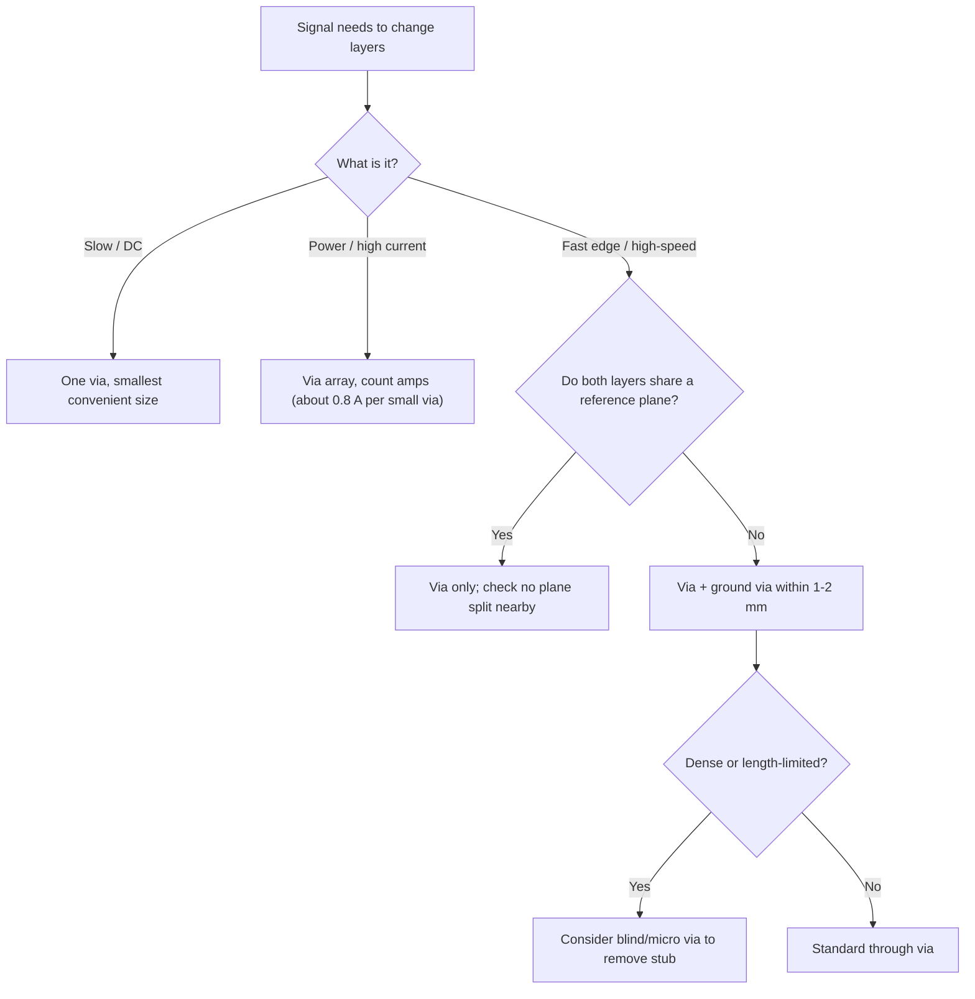

::: basics
### In plain words
To connect one signal across two layers, you use a via. The right setup depends on the signal. A slow signal needs just one via. A power connection needs several vias in parallel, because each carries only about an amp. A fast signal's return current must also change layers, so you put a ground via right next to the signal via.

### Picture it
Picture a train on a loop of track. The train goes out along one track and must come back along another. If the outbound track climbs a hill through a tunnel, the return track should go through a tunnel right beside it. If the return track takes a long road across town, the loop gets huge. The ground via is that second tunnel.

### Words you need
- **Via**: a plated hole connecting copper on different layers.
- **Return current**: the current that flows back to the source. At high frequency it flows in the plane just under the trace.
- **Reference plane**: the solid copper layer a signal's return current uses.
- **Ground via**: a via tied to ground, placed beside a signal via to give the return current a short path.

### The simplest example
For a slow on/off control signal, one via is plenty. For power, a 0.3 mm via carries roughly 0.84 A for a 10 °C temperature rise, a conservative figure. A 2 A rail needs 2 / 0.84 = 2.4, so at least three vias. A 10 A rail needs about 12. For a fast signal, the loop made by the signal via and its nearest ground via acts like a small inductor, which resists fast changes in current. On a 1.6 mm board it is about 1.2 nH with the ground via 1 mm away, and about 2.4 nH at 6 mm.

That is the whole idea: the via is easy, but the return path and current count matter. The rest of this page covers via choice and switching reference planes.
:::

::: testing
Whether you give the one-word answer ("a via") and then show you know what an engineer actually does around it. The interviewer wants to hear:

1. **A via** is the standard way, and which kind you'd pick (through by default, blind or micro if the stack-up demands it).
2. That a layer change is also a **return-path change**: a high-speed signal needs a ground (or plane-connecting) via beside it.
3. How many vias a **power or high-current** connection needs.
4. The less common alternatives (a through-hole component pin, a jumper, a connector) and when you'd pick one.
:::

::: why
This is the most common layout operation on a board, and the one most often done carelessly. A single-ended 100 kHz sensor line doesn't care. A DDR address line, a USB 3 pair or a 10 A rail absolutely does. The difference between "I put a via" and "I put a via, a stitching via next to it, and checked the return plane" is the difference an interviewer is listening for. It also leads straight into via types ([[q0576]]) and when not to use vias ([[q0581]]).
:::

::: concepts
- **Via basics**: a plated hole that joins copper on different layers. See [[q0574]].
- **Return current**: at high frequency the return flows in the nearest reference plane directly under the trace, so a layer change interrupts it.
- **Reference plane change**: if the signal goes from a layer referenced to ground to a layer referenced to a different plane, the return needs a path between them.
- **Via current rating**: a 0.3 mm via carries on the order of 1 A, so power connections use arrays.
- **Stack-up constraints**: which layers can be reached depends on whether the fab offers blind/buried/micro vias. See [[q0474]].
:::

::: answer
"The normal way is a via: you place a plated hole at the end of the trace on the first layer, with a pad on that layer and a pad on the second layer, and the barrel connects them. In the layout tool I'd start the route on layer 1, hit the layer-change key, and the tool drops the via and continues on layer 2.

What I'd think about is what kind of signal it is. For a slow signal, say an I²C line or an enable pin, one standard through via is fine. For power, I'd put several vias in parallel, since each one is only good for about an amp. For a fast signal, the return current also has to change layers, so I'd put a ground via right beside the signal via, within a millimetre or two, and I'd make sure both layers sit over a solid reference plane. If I can't give the signal that, I'd avoid changing layers.

If the stack-up has blind or buried vias I'd use those where they save space, but through vias are cheapest. In odd cases, like a bodge on a prototype, a through-hole wire link or a component pin also joins layers because its holes are plated, but for a production board the answer is a via."
:::

::: technical
**Mechanism.** Place a pad and plated barrel on the trace endpoint. The barrel electrically joins the pad on the origin layer to the pad on the destination layer. In practice the router inserts it when you switch layers.

**Choice of via.** Through via by default (cheapest). Blind or buried only if the density or the stack-up requires. Microvia in HDI designs. See [[q0576]].

**Slow or DC signals.** One via. Resistance is about 1.3 mΩ for 0.3 mm drill, 25 µm plating, 1.6 mm board, so IR drop is negligible.

**Power.** About 0.84 A per 0.3 mm via for a 10 °C rise using the IPC-2221 internal-layer fit, conservative and indicative only. A 2 A rail needs at least 3 vias, a 10 A rail about 12. Use more for margin and so that current doesn't crowd.

**High-speed signals.** The return current follows the signal in the plane just beneath the trace. After the via, it needs to find the reference plane for the new layer:
- If both layers reference the **same** plane (for example, both are adjacent to L2 ground), the return can use that plane and few extra vias are needed.
- If the reference **changes** (ground to ground, but on different layers), place a ground via next to the signal via to connect the two reference planes.
- If the reference changes from ground to **power**, the return must pass through decoupling capacitors nearby, which is poor. Prefer ground-to-ground layer changes.

The loop inductance of a signal via and its nearest return via is roughly $L\approx\frac{\mu_0 h}{\pi}\ln\frac{d}{r}$ (two parallel wires, $d \gg r$), so a closer ground via gives lower inductance. For $h=1.6$ mm, $r=0.15$ mm and $d=1$ mm this is about 1.2 nH, and for $d=6$ mm about 2.4 nH.

> [!UNCERTAIN]
> The "ground via within 1–2 mm" placement is a widely used rule of thumb rather than a standard. The best distance depends on the speed, the stack-up and the fab's minimum via-to-via spacing. For multi-gigabit links, follow the transceiver vendor's layout guide.

**Alternatives.** Through-hole component pins (a connector or a test pin) also connect layers because they are plated holes. A 0 Ω resistor or wire jumper can connect two separate nets on one layer but doesn't connect layers. Edge plating (castellations) or flex cables connect separate boards.
:::

::: short
"I connect them with a via: a plated hole with pads on both layers, and I'd use the router's layer-change command to drop it. For a slow signal one through via is fine, for power I use several in parallel, and for a fast signal I add a ground via right next to the signal via so the return current can change layers too. If the stack-up allows, I'd use blind or microvias where space is tight."
:::

::: long
"The answer is a via, a plated hole that has a pad on each of the two layers and a copper barrel connecting them. In my layout tool I'd route the trace on the first layer, switch layers, and the tool drops the via and continues the route.

The detail that matters depends on what the signal is. For a slow or DC signal, say a GPIO or an enable line, one standard through via is fine; it's about a milliohm. For a power rail, I'd count current: one 0.3 millimetre via is good for about an amp, so a 3 amp rail gets at least four vias, and I'd spread them out so the plane current doesn't crowd.

For a high-speed signal I think about the return current. At high frequency, the return runs in the reference plane directly under the trace. When the signal drops through a via, that return has to switch layers too. If both layers sit next to the same ground plane, nothing is needed. If they reference different planes, I put a ground via right next to the signal via, within a millimetre or two, so the return has a short path. Otherwise it flows through the nearest decoupling capacitors, and the loop inductance goes up, which shows up as ringing, crosstalk and radiation.

For the via type, I'd default to a through via since it's cheapest. If the board uses HDI, I'd use blind or microvias where space is tight, or a buried via for inner layer to inner layer. If the board has only two layers and I need to cross a trace, I might use a zero ohm jumper, but that's not a layer connection.

So: a via for the connection, several for current, and a nearby ground via for fast signals."
:::

::: terms
- **Layer change**: moving a trace from one copper layer to another, almost always through a via.
- **Return current**: the current that flows back to the source, at high frequency in the plane directly under the trace.
- **Stitching (return) via**: a ground via placed near a signal via to give return current a path between reference planes.
- **Reference plane**: the plane a signal's electric field terminates on and where its return current flows.
- **Fanout**: short stub traces and vias from a pad that let a dense component escape to other layers.
- **Via array**: several vias in parallel for current or heat.
- **Through via**: runs from the top to the bottom layer. See [[q0576]].
- **Plane split / slot**: a gap in a reference plane that forces return current to detour.
:::

::: exceptional
**An average answer**: "With a via."

**An exceptional answer**:
- Says "via", then immediately classifies the signal: slow, power, or fast.
- Gives numbers: roughly 1 A per small via, so a 5 A rail needs about 6 or more; ground via within about a millimetre or two of a fast signal via.
- Explains that the layer change also moves the return path, and that the best layer pairs share the same reference plane.
- Knows that moving from a ground-referenced layer to a power-referenced layer is worse than ground-to-ground.
- Mentions the cost-driven default (through vias) and when blind/buried/micro vias are justified.
- Is clear that "jumper" and "through-hole pin" are exceptions, not the normal answer.
:::

::: mistakes
- **Using one via for a power rail.** A 0.3 mm via is about 1 A. Count amps and use an array.
- **Forgetting the return path.** A signal via with no ground via nearby forces the return through a distant path or the decoupling caps.
- **Changing layers between planes of different potential without a nearby cap or tie.** Return current then has to cross the dielectric as displacement current through the planes' capacitance.
- **Using a via where a trace could stay on one layer** for a critical signal. Each via is a discontinuity. See [[q0515]].
- **Putting the via inside a pad of a small passive** without thinking about solder wicking. See [[q0582]].
- **Placing stitching vias after routing is finished.** The space is gone, so plan them with the signal vias.
:::

::: deep
## The basic answer

You connect two layers with a via. In CAD you route the trace on layer A, press the layer-change key, and the tool inserts a via with the router's default drill and pad size and continues on layer B. The hole is drilled through the board, plated, and the barrel joins the two pads.

The question gets interesting when you ask what's travelling through the via.

## Case 1: a slow signal

A GPIO, I²C line, enable, or LED drive does not care about nanohenries. The via adds about 1.3 mΩ and a nanohenry or so; with a 100 kHz signal that's invisible. One standard via is fine. You can use the smallest via your fab does cheaply, and you can put it wherever routing is convenient. Only the pad and the antipad take space.

## Case 2: a power connection

For power the limit is current. The barrel is a thin copper tube of roughly 0.0216 mm² cross-section. With the IPC-2221 internal-layer fit $I = 0.024\,\Delta T^{0.44}A^{0.725}$ (area in mil², $\Delta T$ in °C) one via carries about 0.84 A for a 10 °C rise. That fit is for flat conductors, so treat it as an indicator.

| Rail current | Vias at 0.84 A each | Typical choice |
|---|---|---|
| 1 A | 1.2 | 2 |
| 2 A | 2.4 | 3–4 |
| 5 A | 6 | 8 |
| 10 A | 12 | 14–16 |

Two further reasons for arrays: the parallel inductance is lower, and a plane with the vias spread out feeds the load more evenly. If the vias are clumped at one spot, the current crowds there, producing a hot spot and extra IR drop. See [[q0534]].

## Case 3: a fast signal

Here the important physics is that **the signal is not only on the trace**. A microstrip's electric field runs from the trace to the plane below, and the return current flows in that plane directly underneath the trace, because that is the path of least inductance. When the signal reaches a via and goes to another layer, three things change at once: the signal current goes down the barrel, the field must re-attach to another plane, and the return current has to follow.

```svg
<svg viewBox="0 0 640 300" role="img" aria-label="Side view of a signal via with a nearby ground via and the return current path">
  <g font-family="Inter, sans-serif" font-size="12" fill="var(--d-ink)">
    <rect x="30" y="50" width="580" height="190" fill="var(--d-box)" stroke="var(--d-ink)"/>
    <rect x="30" y="46" width="240" height="8" fill="var(--d-orange)"/>
    <text x="40" y="38" fill="var(--d-orange)">signal trace on L1</text>
    <rect x="30" y="106" width="580" height="8" fill="var(--d-muted)" opacity="0.6"/>
    <text x="40" y="100" fill="var(--d-muted)">L2 ground plane</text>
    <rect x="30" y="176" width="580" height="8" fill="var(--d-muted)" opacity="0.6"/>
    <text x="40" y="170" fill="var(--d-muted)">L3 ground plane</text>
    <rect x="270" y="236" width="340" height="8" fill="var(--d-orange)"/>
    <text x="470" y="262" fill="var(--d-orange)">signal trace on L4</text>
    <rect x="244" y="104" width="38" height="12" fill="var(--d-box)"/>
    <rect x="244" y="174" width="38" height="12" fill="var(--d-box)"/>
    <rect x="258" y="46" width="12" height="198" fill="var(--d-accent)"/>
    <rect x="250" y="46" width="28" height="8" fill="var(--d-orange)"/>
    <rect x="250" y="236" width="28" height="8" fill="var(--d-orange)"/>
    <text x="236" y="284" fill="var(--d-accent)">signal via</text>
    <rect x="330" y="46" width="12" height="198" fill="var(--d-green)" opacity="0.55"/>
    <rect x="322" y="104" width="28" height="12" fill="var(--d-green)"/>
    <rect x="322" y="174" width="28" height="12" fill="var(--d-green)"/>
    <text x="300" y="284" fill="var(--d-green)">ground (stitching) via, set beside the trace (into the page)</text>
    <path d="M60 110 H336 V180 H590" fill="none" stroke="var(--d-red)" stroke-width="2" stroke-dasharray="6 4"/>
    <text x="60" y="132" fill="var(--d-red)">return current in L2</text>
    <text x="400" y="204" fill="var(--d-red)">return current in L3</text>
    <text x="352" y="150" fill="var(--d-muted)" font-size="11">short loop = low inductance</text>
  </g>
</svg>
```
Figure: Return current (red) follows the signal in the L2 plane, hops through the ground via and continues in L3 under the L4 trace. The ground via is drawn lighter because it sits beside the L4 trace, not on it; it never touches the signal copper. The closer the ground via is to the signal via, the smaller the loop and the lower its inductance.

The loop made by the signal via and the nearest return via behaves roughly like a two-wire line: $L\approx\frac{\mu_0 h}{\pi}\ln\frac{d}{r}$. This approximation is only valid for $d\gg r$, so use it for the trend.

```plot
{"title":"Loop inductance of a signal via + return via pair (h = 1.6 mm, r = 0.15 mm)","x":{"label":"Spacing d between signal via and nearest ground via","unit":"mm","min":0.5,"max":10},"y":{"label":"Loop inductance","unit":"nH","min":0,"max":3.5},
 "vars":{"h":1.6,"r":0.15},
 "series":[{"label":"L = 0.4·h·ln(d/r) nH","fn":"0.4*h*ln(x/r)"}],
 "points":[{"x":1,"y":"0.4*h*ln(1/r)","label":"1 mm: 1.2 nH"},{"x":6,"y":"0.4*h*ln(6/r)","label":"6 mm: 2.4 nH"}]}
```
Figure: Doubling the spacing doesn't double the inductance (it is logarithmic), but the nearest return via is still worth placing as close as the fab rules allow. The bigger win is having one at all: with no nearby ground via the return detours through decoupling capacitors or a far-away via, and the effective loop is much larger than this plot shows.

### Which layer pairs are good?

- **Ground-referenced to ground-referenced.** Both signal layers sit next to ground planes (possibly the same one). The return needs at most a ground via.
- **Both layers reference the same plane.** For example, a signal on L1 and another on L3 both referenced to the L2 plane in between. No return via is needed at all, because the return stays in the plane. This is why stack-ups often put a ground between two signal layers ([[q0479]]).
- **Ground to power.** The return has to go from ground to the power plane through decoupling capacitors, which have about 1 nH of loop inductance each, and the loop is much worse. Add stitching capacitors or avoid it.

A rule of thumb quoted by many layout guides is a ground via within about 1–2 mm of every high-speed signal via, and a more careful one for multi-gigabit lanes, which is to follow the transceiver vendor's guide.

## Decision flow


Figure: The choice follows the signal's nature. Notice that "fast signal" branches on the reference plane, not on the layers' names.

## Alternatives, and why they are rare

- **Through-hole component pin.** A connector pin or test pin is a plated hole; if a net lands on it on two layers, it joins them. Used when you need the component anyway.
- **Zero-ohm link.** A 0 Ω resistor connects two nets on the same layer, not two layers. It is used to cross traces on a single-sided board (the classic "jumper").
- **Edge plating / castellation or a flex cable.** For connecting separate boards.
- **Stitching rivets or eyelets.** Used on old double-sided boards without plated holes.

For modern multilayer boards the only practical answer is the via.

## What to check after routing

1. The via's drill, pad and antipad satisfy the fab rules (minimum annular ring and spacing).
2. For fast signals, a nearby ground via exists on both reference planes.
3. Current vias are distributed. On a high-current net, run the design-rule check and look at the IR drop plot if your tool has one.
4. No via sits in an SMT pad unless filled and capped. See [[q0582]].
:::

::: applications
- **USB 3 / PCIe lanes**: every layer change gets a ground via beside each via of the differential pair.
- **DDR memory routing**: address/data lines with stitching vias near each layer change.
- **Switching converters**: a via array between the top-layer inductor pad and an inner power plane, sized from the per-via current (roughly one via per amp, plus margin).
- **Sensor boards**: slow I²C and SPI lines changing layers with one standard via.
- **RF boards**: ground via fences next to microstrip and coplanar waveguide lines.
- **Two-layer prototypes**: signals crossing on top and bottom with plain vias, and a single ground plane on one side.
:::

::: assumptions
- Standard 4–6 layer FR-4 board, through vias of 0.3 mm drill, about 25 µm plating. Different stack-ups change the numbers.
- The 1 A per via figure is a conservative use of a trace-fit equation and depends on temperature rise, copper around the via and the surrounding layers.
- The loop inductance model is a two-wire approximation. A 3-D solver is the correct tool for gigabit channels.
- "Signal on two layers" is read as one net that has to cross between layers. If it means "two separate nets", the answer is different (no via, or a deliberate jumper).
:::

::: followups
### How many vias do I need for a 3 A rail and why not just one big one?
Using about 0.84 A each, 3 A needs 3.6, so 4 at minimum; I'd use 6 for margin. One big via, say 1 mm drill, has more area but needs a big pad and antipad that perforates the planes, and a larger hole costs more routing space than several small ones. Parallel small vias also have lower inductance and spread the current.

### The signal goes from an L1 microstrip to an L6 stripline. Where does the return current go?
It starts in L2, the plane under L1, and ends in whichever plane is adjacent to L6 (L5, say). If L2 and L5 are both ground, a ground via next to the signal via connects them. If L5 is power, the return has to cross through nearby decoupling capacitors, which is much worse, and I'd either move the signal or add several stitching caps.

### What if there's no room for a ground via beside every signal via on a dense BGA?
Then I'd prioritise: ground vias beside the fastest and most sensitive signals first (clocks, high-speed pairs), and share one ground via between a couple of adjacent vias. I'd also use the ball-map to see which ground balls are near, and consider an HDI stack-up so the signal via is shorter (less to couple).

### Can you connect two layers without a via?
Not on a single board. A through-hole component pin does it as a side effect, and an edge-plated castellation or flex cable can connect separate boards. A zero-ohm resistor connects two traces on the same layer, not layers.

### Scenario: your 5 V 4 A rail dips at the load but the plane looks fine. What do you check at the layer change?
The vias. With 4 A and about 1.3 mΩ per via, even a single via drops only 5 mV, so resistance isn't the culprit. I'd check how many vias carry the current and whether they are all at one end of the pad, which crowds current; and the inductance if the dip is fast. If the dip is a slow droop, I'd probe both sides of the via with a 4-wire or milliohm meter, or check the antipad merging in the plane. See [[q0584]].
:::

::: interpretations
The phrase "a signal on two separate layers" is ambiguous. It most likely means **one net that has to move between layers**, which a via solves. It could also mean **two separate traces that must be joined**, in which case you can still use a via (join both to the same barrel), or a plated through-hole component pin, or a short jumper. The answer above covers the first reading and notes the second.
:::

::: references
- Johnson & Graham, *High-Speed Digital Design: A Handbook of Black Magic*: chapters on ground planes, return currents and vias.
- Bogatin, *Signal and Power Integrity: Simplified*: return paths, reference plane changes and via design.
- IPC-2221 and IPC-2152, for conductor current capacity.
- Transceiver vendors' PCB layout guides (for example, USB or PCIe PHY datasheets) for their via and stitching-via rules.
:::

::: rubric
- Says a via (plated hole with pads on both layers) is the connection :: This is the core answer and everything else builds on it.
- Chooses the via type sensibly (through by default, blind/buried/micro when needed) :: Shows you know the cost and density trade-offs.
- Counts current for power, using several vias in parallel :: A single via is only about an amp, so this is a real design rule.
- Explains that the return current must also change layers :: This is the high-speed insight that separates levels.
- Mentions a nearby ground via and/or a shared reference plane :: It is the practical fix for the return path.
- Prefers ground-to-ground layer pairs over ground-to-power :: Shows understanding that the return path is the issue, not just the connection.
- Mentions alternatives (through-hole pin, jumper) are exceptions :: Shows breadth without being distracted.
:::

::: quiz
```json
[
 {"type":"mcq","level":"fundamental","q":"Which is the standard way to connect a trace on layer 1 to a trace on layer 4 of a PCB?","options":["A zero-ohm resistor","A plated via","A ferrite bead","A longer trace on layer 1"],"answer":1,"explain":"A via is a plated hole joining the pads on different layers. A 0 Ω resistor only connects two points on the same layer."},
 {"type":"numeric","level":"fundamental","q":"A power rail carries 5 A. Each via can carry about 0.84 A. What is the minimum whole number of vias?","answer":6,"tolerance":0.01,"unit":"vias","explain":"5/0.84 = 5.95, so at least 6 vias. In practice add margin and spread them out."},
 {"type":"mcq","level":"intermediate","q":"A high-speed signal changes from L1 to L4. L2 and L3 are both ground. What helps the return current most?","options":["Using a larger trace width after the via","A ground via placed close to the signal via","Putting a capacitor in series with the signal","Moving the via far from other vias"],"answer":1,"explain":"The return current must hop between L2 and L3. A nearby ground via connects the two ground planes and keeps the loop area, and thus the inductance, small."},
 {"type":"numeric","level":"intermediate","q":"Using L = 0.4·h·ln(d/r) nH (h and d in mm), what is the loop inductance for h = 1.6 mm, r = 0.15 mm and d = 3 mm?","answer":1.92,"tolerance":0.03,"unit":"nH","explain":"ln(3/0.15)=ln(20)=3.0, so L = 0.4·1.6·3.0 = 1.92 nH. Halving d to 1.5 mm lowers it to about 1.47 nH."},
 {"type":"mcq","level":"advanced","q":"Which layer change is generally worst for the return path of a fast signal?","options":["L1 to L3, both next to the same ground plane at L2","L1 to L4, with ground planes at L2 and L3 and a stitching via","L1 (ground reference) to a layer referenced to a power plane, with no stitching capacitors nearby","L2 to L2 (no layer change)"],"answer":2,"explain":"Moving between ground and power references forces the return current through decoupling capacitors (with their series inductance) or across the plane capacitance, which makes a large loop. Same-plane or ground-to-ground changes with a stitching via are much better."},
 {"type":"truefalse","level":"advanced","q":"If a signal changes layers but both layers are referenced to the same ground plane, a separate ground via next to the signal via is usually unnecessary for the return path.","answer":true,"explain":"The return current stays in that same plane and doesn't need to hop. A nearby ground via is still good practice at high speed, but the return path itself isn't broken in this case."}
]
```
:::
