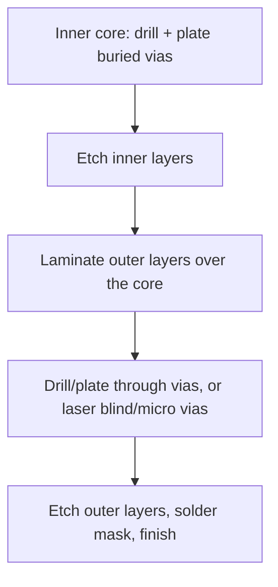

::: testing
Whether you can name the standard via families and, more importantly, **say why you would choose each one**. A list of names is not the answer. The interviewer is checking that you can:

1. Name through, blind, buried and micro vias (and stacked/staggered variants).
2. Compare them on **cost, density, reliability, signal integrity and inspectability**.
3. Know that the choice is driven by the stack-up, the component pitch and the fab's capabilities.
4. Mention stubs, aspect ratio, and the usual default: use through vias unless something forces you not to.
:::

::: why
Via choice is one of the first levers that sets board cost and layer count. A board that can use through vias only might be 6 layers at a certain cost, while the same design with laser microvias is 8 layers of HDI at roughly double the fab price but half the area. It also drives reliability: stacked microvias are a known field-failure site if the fab process isn't good. And it drives signal integrity, because the unused part of a through via (the stub) acts as a resonant antenna at multi-gigabit rates. Interviewers ask this to see whether you design with the manufacturing process in mind.
:::

::: concepts
- **Via anatomy and basics**: barrel, pad, aspect ratio. See [[q0574]].
- **Stack-up and layer count**: which layers a via spans, and what it blocks on the others. See [[q0474]] and [[q0475]].
- **Aspect ratio**: depth divided by drill diameter limits what can be plated. Deep, narrow holes are hard.
- **Sequential lamination**: building a board in several press cycles so some vias are drilled before the final lamination (this is what makes buried and blind vias possible).
- **Stub**: the unused barrel beyond the layer where the signal exits.
- **Laser drilling**: used for microvias only a single dielectric layer deep.
:::

::: answer
"There are four main families. A through via goes all the way from the top to the bottom layer. It's the cheapest, because it's one drilling and plating step for the whole board, but it takes space on every layer and leaves a stub on a fast signal that exits early. A blind via starts on an outer layer and stops at an inner one, so it doesn't use the layers below it. A buried via connects inner layers and never reaches the surface, which frees the outer layers completely. And a microvia is a very small laser-drilled blind via, usually spanning just one layer, and it's what lets you escape fine-pitch BGAs. Microvias can be stacked or staggered.

The tradeoffs are mostly cost versus density. Blind and buried vias need sequential lamination, so extra press cycles, extra drilling and plating steps, and more yield risk. Microvias need laser equipment and an HDI process. In return you get routing density and short stubs. The default is through vias, and I only go to the others when the BGA pitch, the layer count or signal integrity forces it. I'd also talk to the fab about their capabilities before choosing, because aspect ratio and stacking limits vary."
:::

::: technical
**Families.**

| Type | Spans | How made | Main benefit | Main cost / risk |
|---|---|---|---|---|
| **Through (PTH)** | top to bottom | mechanical drill after lamination, plated | cheapest, most robust, easy to inspect | uses space on every layer; stub on signals leaving early; aspect-ratio limit |
| **Blind** | outer layer to an inner layer | controlled-depth drill or laser, then plated | frees layers below; shorter stub | extra process steps; depth-control tolerance |
| **Buried** | inner layer to inner layer | drilled and plated in the core before final lamination | frees both outer layers; no surface footprint | sequential lamination (cost), cannot inspect or rework |
| **Microvia** | one dielectric layer (outer to adjacent) | laser, usually plated or filled | tiny (0.1 mm range), tiny stub, enables fine-pitch BGA | HDI process cost; reliability depends on the fab |
| **Stacked microvia** | several layers, vias vertically aligned | laser, copper-filled and plated each level | densest connection, shortest path | highest stress concentration; fails by separation if poorly made |
| **Staggered microvia** | several layers, vias offset | laser at each level with a short trace between | more robust than stacked; needs no fill | uses more area |
| **Skip via** | skips a layer (e.g. L1 to L3) | laser or depth-controlled drill | fewer layers wasted | fab-dependent capability |

**Aspect ratio.** Mechanical through via: board thickness / drill. Standard fabs often work up to about 8:1 or 10:1 (vendor-dependent). Microvias are limited to a depth-to-diameter around 0.75:1 to 1:1 so plating can fill the cone.

**Signal integrity.** A through via carrying a signal from L1 to L3 of a 1.6 mm board leaves a 1 to 1.4 mm stub. The stub's quarter-wave resonance is at $f_0=\dfrac{c}{4\,\ell\sqrt{\varepsilon_r}}$, which is 45 GHz for a 0.8 mm stub and 23 GHz for 1.6 mm with $\varepsilon_r=4.3$. For a 3 mm stub it falls to about 12 GHz, a problem for 25 Gb/s links. Fixes: shorter board, blind via, microvia, or **back-drilling** (a second drill from the back that removes most of the stub).

> [!UNCERTAIN]
> Aspect ratio limits, minimum microvia diameters (laser drills of 0.075–0.15 mm are typical), stacking limits and relative costs differ by fabricator. Treat the numbers in this page as typical, and check the fab's capability document.

**Default decision.** Start with through vias. Move to blind/buried/micro when (a) component pitch makes through-via fanout impossible, (b) signal integrity demands short stubs, or (c) routing density needs the outer layers free.
:::

::: short
"The main types are through vias, which go top to bottom and are cheapest; blind vias, which go from an outer layer to an inner one; buried vias, which connect inner layers only; and microvias, which are tiny laser-drilled vias spanning one layer, sometimes stacked. The tradeoff is cost and complexity against density and signal integrity: blind, buried and micro need extra lamination or laser steps, so I default to through vias and only go further when BGA pitch, layer count or stub resonance forces it."
:::

::: long
"There are four families I'd name. First, the through via. It's drilled through the whole board after lamination and plated. It's the cheapest and most robust, and easy to inspect. The downside is that it occupies space on every layer, and if a signal leaves on an inner layer, the unused barrel below is a stub that resonates at a few to tens of gigahertz.

Second, the blind via. It starts on an outer layer and stops at an inner one, so layers below are free for routing and the stub is shorter. Third, the buried via, which connects two inner layers and never shows on the surface, so it frees up both outer layers. Blind and buried both need sequential lamination: some layers are drilled and plated first, then pressed together with others. That adds process steps and cost, and a buried via can't be inspected or reworked.

Fourth, the microvia. It's a laser-drilled blind via, usually one dielectric layer deep, around 0.1 millimetres in diameter. That's what lets you fan out a 0.5 or 0.4 millimetre pitch BGA. You can stack microvias vertically for the densest connection, or stagger them for better reliability, since stacked vias have been a known failure site when the process isn't tight.

How do I choose? The tradeoffs are cost, density, reliability and signal integrity. Through vias win on cost and reliability. Blind, buried and microvias win on density and stubs, but cost more and add yield risk. So I default to through vias, move to HDI only when the BGA pitch, layer count or a multi-gigabit link requires it, and I check the fab's capability sheet for aspect ratio and stacking limits before I commit."
:::

::: terms
- **Through via (PTH via)**: drilled and plated through the full board thickness.
- **Blind via**: connects an outer layer to one or more inner layers but does not exit the other side.
- **Buried via**: connects inner layers only; invisible from both outer surfaces.
- **Microvia**: laser-drilled blind via, typically one dielectric layer deep, with diameter around 0.1 mm.
- **Stacked / staggered microvias**: microvias aligned on top of each other, or offset so each lands on a short trace or pad.
- **HDI (high-density interconnect)**: boards that use microvias, fine lines and sequential build-up.
- **Sequential lamination**: pressing the board in several steps so some vias are formed before the final stack is complete.
- **Back-drilling**: removing the unused stub of a through via with a larger drill from the back side.
:::

::: exceptional
**An average answer** lists through, blind, buried (and maybe micro) and says "blind is more expensive".

**An exceptional answer**:
- Compares them on a **consistent set of axes** (cost, density, SI, reliability, inspection/rework) rather than listing facts.
- Explains **why** blind and buried cost more: sequential lamination, extra drill and plate cycles, alignment tolerance.
- Quantifies stubs: quarter-wave resonance $c/(4\ell\sqrt{\varepsilon_r})$, with an example (a 1.6 mm stub resonates near 23 GHz).
- Mentions aspect ratio and that microvias need about 1:1 or less.
- Knows stacked microvias are a reliability concern and staggered are safer.
- States the default (through) and the triggers that justify going HDI, and says to check the fab's capability.
:::

::: mistakes
- **"Blind and buried vias are just better."** They cost more, need sequential lamination, and buried vias cannot be inspected or reworked. Use them when needed.
- **Mixing up blind and buried.** Blind is visible from one surface; buried is visible from neither.
- **Calling every small via a microvia.** A microvia is defined by laser formation and one-layer depth, not just by small size. A 0.2 mm mechanically drilled via is not a microvia.
- **Ignoring stubs.** On a 1.6 mm board, a signal that exits on L2 through a through via has a stub of about 1.2–1.4 mm.
- **Forgetting aspect ratio.** A 0.2 mm drill in a 3.2 mm board is 16:1, beyond most fabs' limits.
- **Assuming stacking is free.** Stacked microvias concentrate thermal-expansion stress and fail more often if not copper-filled and well plated.
:::

::: deep
## The same board, six ways to connect layers

```svg
<svg viewBox="0 0 640 330" role="img" aria-label="Cross-section of a six layer board showing through, blind, buried, micro, stacked micro and stub vias">
  <g font-family="Inter, sans-serif" font-size="12" fill="var(--d-ink)" text-anchor="middle">
    <rect x="36" y="56" width="584" height="208" fill="var(--d-box)" stroke="var(--d-ink)"/>
    <g fill="var(--d-muted)" opacity="0.55">
      <rect x="36" y="58" width="584" height="3"/><rect x="36" y="98" width="584" height="3"/><rect x="36" y="138" width="584" height="3"/>
      <rect x="36" y="178" width="584" height="3"/><rect x="36" y="218" width="584" height="3"/><rect x="36" y="258" width="584" height="3"/>
    </g>
    <g fill="var(--d-muted)" text-anchor="start"><text x="6" y="64">L1</text><text x="6" y="104">L2</text><text x="6" y="144">L3</text><text x="6" y="184">L4</text><text x="6" y="224">L5</text><text x="6" y="264">L6</text></g>
    <rect x="86" y="56" width="8" height="208" fill="var(--d-accent)"/>
    <rect x="181" y="56" width="8" height="88" fill="var(--d-accent)"/>
    <rect x="271" y="98" width="8" height="126" fill="var(--d-accent)"/>
    <polygon points="357,58 373,58 369,100 361,100" fill="var(--d-accent)"/>
    <polygon points="447,58 463,58 459,100 451,100" fill="var(--d-accent)"/>
    <polygon points="447,98 463,98 459,140 451,140" fill="var(--d-accent)"/>
    <rect x="546" y="56" width="8" height="88" fill="var(--d-accent)"/>
    <rect x="546" y="144" width="8" height="120" fill="var(--d-red)" opacity="0.8"/>
    <g fill="var(--d-orange)">
      <rect x="76" y="56" width="28" height="5"/><rect x="76" y="259" width="28" height="5"/>
      <rect x="171" y="56" width="28" height="5"/><rect x="171" y="138" width="28" height="5"/>
      <rect x="261" y="98" width="28" height="5"/><rect x="261" y="218" width="28" height="5"/>
      <rect x="349" y="56" width="32" height="5"/><rect x="351" y="98" width="28" height="5"/>
      <rect x="439" y="56" width="32" height="5"/><rect x="441" y="98" width="28" height="5"/><rect x="441" y="138" width="28" height="5"/>
      <rect x="536" y="56" width="28" height="5"/><rect x="536" y="138" width="28" height="5"/>
    </g>
    <text x="90" y="292">through</text><text x="185" y="292">blind</text><text x="275" y="292">buried</text>
    <text x="365" y="292">microvia</text><text x="455" y="292">stacked</text><text x="455" y="308">microvia</text><text x="560" y="292">through, L1-L3</text>
    <text x="560" y="308" fill="var(--d-red)">red = stub</text>
  </g>
</svg>
```
Figure: Each via spans a different layer range. The buried via leaves both outer surfaces free. The through via on the right is used only from L1 to L3, so the red lower barrel is an unused stub that rings at its quarter-wave frequency.

## Through vias: the default

A through via is drilled after the whole stack is laminated. Because it's one step, it's cheap and has the best track record. Its costs show up elsewhere:
- Every layer has an antipad or a pad at that position, so it consumes routing and plane area on all layers.
- The barrel is as long as the board, so inductance is highest (about 1.3 nH for 1.6 mm).
- A signal that doesn't use the full board leaves a stub. Stubs matter when the signal's wavelength approaches four times the stub length.
- Aspect ratio caps the smallest drill: 1.6/0.3 is 5.3:1, but 3.2/0.2 is 16:1, which most standard fabs cannot plate reliably.

## Blind and buried: sequential lamination

A blind or buried via cannot be drilled after the board is pressed, because the drill would go through. So the fab builds the board in stages:


Figure: A buried via is made in the core before the outer layers are pressed on. Each extra lamination cycle adds cost, registration (alignment) tolerance and yield risk, which is why buried vias cost noticeably more.

Because the extra steps multiply, designers keep the number of different via spans small. Fabs sometimes describe boards by build-up structure such as "1+N+1" (one build-up layer on each side of a core) or "2+N+2", with more levels meaning more cost.

## Microvias: how HDI works

A microvia is formed by a laser that ablates through the dielectric to the copper pad below, stopping on it. The result is a conical hole about 0.1 mm across and 0.1 mm deep, plated or filled with copper. The depth is limited to roughly the diameter so that the plating can cover the cone's walls. Compare volumes: a 0.25 mm-ID, 1.6 mm through via encloses about 0.079 mm³, while a 0.1 mm × 0.1 mm microvia encloses 0.0008 mm³, 100 times smaller. Therefore it won't wick solder away and can sit in a pad. See [[q0582]].

**Stacked vs staggered.**
- *Stacked*: each microvia sits directly on the one below. Shortest electrical path and least area, but the barrels share a vertical column of copper-filled vias, and thermal-expansion stress concentrates at the interfaces. It's a known failure site in thermal cycling when plating or fill is poor.
- *Staggered*: each level is offset horizontally and connected by a short pad. It uses more area but is considered more reliable, and many standards and fabs prefer it where reliability matters.

## Signal integrity and stubs

An open stub of length $\ell$ on a through-hole is a quarter-wave resonator at

$$f_0=\frac{c}{4\ell\sqrt{\varepsilon_r}}$$

```plot
{"title":"Quarter-wave stub resonance frequency vs stub length (er = 4.3)","x":{"label":"Stub length","unit":"mm","min":0.3,"max":4},"y":{"label":"f0","unit":"GHz","min":0,"max":100},
 "vars":{"er":4.3},
 "series":[{"label":"f0 = c / (4 l sqrt(er))","fn":"3e8/(4*x*1e-3*sqrt(er))/1e9"}],
 "points":[{"x":0.8,"y":"3e8/(4*0.8e-3*sqrt(er))/1e9","label":"0.8 mm: 45 GHz"},{"x":1.6,"y":"3e8/(4*1.6e-3*sqrt(er))/1e9","label":"1.6 mm: 23 GHz"},{"x":3,"y":"3e8/(4*3e-3*sqrt(er))/1e9","label":"3 mm: 12 GHz"}]}
```
Figure: A stub resonates at a lower frequency the longer it is. Real notches start to hurt well below f0, so a 25 Gb/s link (about 12.5 GHz Nyquist) wants a stub well under 1 mm. A thick backplane's 3 mm stub resonates right inside that band, which is why back-drilling exists.

The effect on a through-line is a notch in the insertion loss. For a lossless open stub of impedance $Z_s$ in shunt with a line $Z_0$,

$$|S_{21}|=\frac{1}{\sqrt{1+\left(\frac{Z_0}{2Z_s}\tan\beta\ell\right)^2}}$$

```plot
{"title":"Insertion loss notch from a via stub (illustrative, lossless, Zs = 40 Ω, Z0 = 50 Ω)","x":{"label":"Frequency","unit":"Hz","min":0,"max":30000000000},"y":{"label":"|S21|","unit":"dB","min":-25,"max":1},
 "vars":{"z0":50,"zs":40,"er":4.3,"c":3e8},
 "series":[{"label":"3 mm stub","fn":"-10*log10(1+((z0/(2*zs))*tan(2*pi*x*sqrt(er)*3e-3/c))^2)"},{"label":"1 mm stub","fn":"-10*log10(1+((z0/(2*zs))*tan(2*pi*x*sqrt(er)*1e-3/c))^2)","color":"orange"}],
 "vlines":[{"at":"c/(4*3e-3*sqrt(er))","label":"3 mm: 12 GHz","color":"muted"}]}
```
Figure: With a 3 mm stub the notch lands near 12 GHz and the loss is already about 1.5 dB at 6 GHz and 3 dB at 8 GHz, inside a 25 Gb/s signal's spectrum. The 1 mm stub pushes the first notch to 36 GHz, outside the plot. The model is idealised: real notches are shallower because of loss, but the frequency is right.

Remedies: use a blind or micro via, route the fast signal on the layers closest to where it enters/exits, reduce board thickness, or back-drill. Back-drilling leaves a short residual stub (fabs specify a maximum depth tolerance) at an extra fab cost.

## Choosing: a worked scenario

You have a 0.8 mm-pitch BGA and 6 layers. A 0.3 mm through via with a 0.6 mm pad needs a corridor of at least 0.8 - 0.6 = 0.2 mm between neighbouring pads, tight but possible for the outer ring of balls only. Inner balls need routing out. Options:
1. Two more layers, still through vias. Cost: modest, but the board gets thicker.
2. HDI with microvias in pad. Cost: higher per board, but fewer layers and shorter stubs.
3. Via-in-pad with filled/capped vias, see [[q0578]].

If the part is 0.5 mm pitch, options 2 and 3 are usually the only ones left.

## Inspection and rework

- Through vias can be inspected from both sides, and the barrel can be probed.
- Blind vias can only be inspected through the open end; plating quality is checked on coupons.
- Buried vias cannot be inspected at all after lamination; the fab relies on electrical test and cross-section coupons.
- Microvia reliability is verified by thermal-cycle or interconnect-stress testing on test coupons.

## Related design rules

- Keep via count and the number of via spans small. Each added span (L1-L3, L3-L5…) adds a drill/lamination cycle.
- Don't mix blind and buried unless the density needs it.
- Talk to the fabricator before routing, not after.
:::

::: applications
- **Smartphones and wearables**: HDI boards with microvias and stacked vias to fit fine-pitch BGAs in tiny areas.
- **Servers and network switches**: thick boards with back-drilled through vias for multi-gigabit SerDes.
- **Low-cost consumer boards**: through vias only, 2–4 layers.
- **RF and microwave boards**: blind vias to a ground plane and short ground connections near pads.
- **Automotive and industrial**: through vias with conservative aspect ratios and staggered microvias where HDI is used, chosen for thermal-cycle reliability.
- **Backplanes**: very thick boards (3 mm or more) with back-drilling and large drill sizes to keep the aspect ratio manageable.
:::

::: assumptions
- Typical FR-4 build: 0.3 mm mechanical drill, about 25 µm plating, 1.6 mm board, $\varepsilon_r\approx 4.3$.
- Fab capabilities vary: some offer 0.15 mm mechanical drills, laser vias down to 0.075 mm, 12:1 aspect ratios or more. Always quote specifics from the fab you will use.
- The stub model is lossless and assumes a stub impedance (40 Ω here), so the real notch is shallower and shifted slightly.
- For flex and rigid-flex boards, laser vias and different dielectric properties apply.
- "Cost" comparisons are qualitative; actual prices depend on volume, size and panel utilization.
:::

::: followups
### Why does a buried via cost more than a through via?
Because it must be drilled and plated in the core **before** the outer layers are laminated. That is an extra lamination cycle, an extra drill/plate/etch sequence, tighter registration, and extra scrap risk. It also can't be inspected afterwards. The number of different layer spans in the stack-up is what multiplies the price.

### What is the difference between a stacked and a staggered microvia, and which is more reliable?
Stacked microvias sit directly on top of each other, giving the shortest, densest path. Staggered ones are offset, with a pad between levels. Staggered is generally considered more robust in thermal cycling, because stacked vias stack up expansion stress at the interfaces and need good copper fill. Stacked is chosen when area is the limiting resource and the fab's process is proven.

### A 6-layer, 1.6 mm board has a 10 Gb/s signal that goes from L1 to L3. What would you worry about?
The through via leaves a stub from L3 down to L6, about 1.2 mm. Its quarter-wave resonance is about $3\times10^8/(4\cdot1.2\times10^{-3}\cdot2.07)\approx 30$ GHz. That's above the 5 GHz Nyquist frequency, so the effect at 10 Gb/s is small but not zero. At 25 Gb/s I'd worry. Options: blind via L1-L3, move the signal to L5 and L6, or back-drill.

### Can you put a via between inner layers 3 and 4 of a six-layer board without affecting the other layers?
Yes, with a buried via made in the core before final lamination. A through via would also connect L3 and L4, but it would drill through the other layers too, take up their routing space and leave stubs. See [[q0577]].

### What if the fab can't do buried vias?
Then I'd redesign: put the signal on layers reachable by through vias, accept stubs and back-drill if the speed requires it, or use a blind via from the surface to the adjacent inner layer and route the inner connection on that layer. If density is the issue, I'd add layers instead of changing the via type.
:::

::: interpretations
"Tradeoffs" is open. I covered cost, density, reliability, signal integrity and inspectability. Some interviewers also include **thermal** capability (filled copper microvias conduct heat well) and **lead time**. "Types" can also include **filled, plugged, tented and capped** variants, which describe how a via is finished rather than which layers it joins; those are [[q0578]] and [[q0579]].
:::

::: references
- IPC-2221 (generic printed board design) and IPC-2226 (design standard for HDI printed boards), for via structures and design rules.
- IPC-6012 (rigid printed board qualification) for plated-hole requirements.
- Johnson & Graham, *High-Speed Digital Design*: vias and discontinuities.
- Bogatin, *Signal and Power Integrity: Simplified*: via stubs and back-drilling.
- A fabricator's published capability sheet (aspect ratio, laser drill size, stacking rules) for the numbers you can actually order.
:::

::: rubric
- Names through, blind, buried and micro (with stacked/staggered variants) :: This is the baseline vocabulary the question asks for.
- Defines each by which layers it joins and where it is visible :: Mixing up blind and buried is a common and visible mistake.
- Compares them on cost and why (sequential lamination, laser steps) :: Shows you understand manufacturing, not just names.
- Discusses density and routing benefit (BGA fanout, free outer layers) :: The main reason to pay for advanced vias.
- Mentions stubs, resonance and back-drilling/microvias for signal integrity :: Connects via choice to high-speed performance.
- Mentions reliability or inspection (stacked microvias, buried vias not inspectable) :: Shows awareness of failure risk.
- States the default (through) and what triggers a change; mentions asking the fab :: Shows engineering judgment instead of listing.
:::

::: quiz
```json
[
 {"type":"mcq","level":"fundamental","q":"Which via connects two inner layers and is not visible from either outer surface?","options":["Through via","Blind via","Buried via","Microvia"],"answer":2,"explain":"A buried via lies entirely between inner layers. A blind via is visible from one surface. A through via is visible from both."},
 {"type":"mcq","level":"fundamental","q":"Which via type is usually the cheapest and most robust?","options":["Stacked microvia","Buried via","Through via","Skip via"],"answer":2,"explain":"A through via is drilled and plated in one pass after lamination. The others need sequential lamination or laser processing."},
 {"type":"numeric","level":"intermediate","q":"What is the quarter-wave resonant frequency of a 1.6 mm via stub in FR-4 with er = 4.3? Use c = 3e8 m/s.","answer":22.6,"tolerance":0.03,"unit":"GHz","explain":"$f_0=\\frac{c}{4\\ell\\sqrt{\\varepsilon_r}}=\\frac{3\\times10^8}{4\\cdot1.6\\times10^{-3}\\cdot2.074}\\approx 22.6$ GHz."},
 {"type":"numeric","level":"intermediate","q":"A 3.2 mm backplane is drilled with 0.3 mm holes. What is the aspect ratio (as a ratio to 1)?","answer":10.67,"tolerance":0.02,"unit":":1","explain":"3.2/0.3 = 10.67. Many standard fabs limit plated through-hole aspect ratio to around 8:1 to 10:1, so this is at or above the limit and may cost extra or need a larger drill."},
 {"type":"multi","level":"intermediate","q":"Which statements about stacked microvias are true?","options":["They give the shortest vertical connection","They always cost less than staggered microvias","They concentrate stress and can fail if the plating or fill is poor","They are formed by mechanical drilling after lamination"],"answer":[0,2],"explain":"Stacked microvias are laser-formed, direct, and dense, but they are a known thermal-cycling failure site if the copper fill is bad. They usually need a higher-end process, not a cheaper one."},
 {"type":"truefalse","level":"advanced","q":"Back-drilling a through via on a thick backplane improves signal integrity by removing the unused barrel stub.","answer":true,"explain":"The stub resonates at a quarter-wave frequency and creates insertion loss notches. Back-drilling removes most of it, leaving a short residual stub set by the fab's depth tolerance."}
]
```
:::
