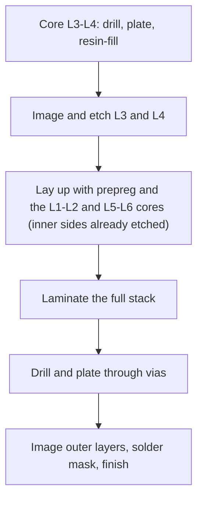

::: basics
### In plain words
To connect two inner layers of a board, you use a buried via. It lives entirely inside the board and never shows on the top or bottom. The fab drills and plates it in a thin inner core before the board is pressed together. That extra build step makes it cost more. In return it takes no space on the outer layers and leaves no stub.

### Picture it
Picture a staircase between two middle floors of a building. It does not reach the street or the roof, so it uses no ground-floor or roof space. But it has to be built before the upper floors go on, and afterward you cannot see or repair it. A stairwell through every floor is simpler, but it cuts a hole in every floor.

### Words you need
- **Buried via**: a plated hole that connects inner layers only.
- **Core**: a thin insulating sheet with copper on both sides. It is the building block of the board.
- **Lamination**: pressing the layers together with heat to form the finished board.
- **Through via**: a hole through the whole board. It touches every layer.
- **Stub**: the unused part of a through via barrel, which can disturb fast signals.
- **Inductance**: how strongly a wire resists fast current changes.

### The simplest example
Say you need to connect inner layers 3 and 4 of a six-layer board. A through via would run 1.6 mm through all six layers, cut holes in both ground planes, and leave stubs. Its inductance is about 1.3 nH, which at 5 GHz acts like about 41 Ω. A buried via in a 0.2 mm core is only 0.2 mm long. Its inductance is about 0.1 nH, 13 times lower, or about 3 Ω at 5 GHz, and it has no stub.

That is the whole idea: build the short connection inside the board, at the price of extra manufacturing steps. The rest of this page covers how it is made, its costs, and alternatives.
:::

::: testing
Whether you can pick the right via for a specific situation and defend the choice. The textbook answer is one word, **buried via**, but a strong candidate shows the reasoning:

1. A buried via joins inner layers and never reaches the surface.
2. It must be made in a **core before final lamination** (sequential lamination), which is why it costs more.
3. You know the **alternatives** (a through via with its stub, back-drilling, or re-planning the routing) and when you would use them instead.
4. You think about practicalities: cost, inspection and rework, fab capability, and whether you actually need it.
:::

::: why
Inner-layer-to-inner-layer connections come up when two inner signal layers carry a dense bus that can't afford the footprint a through via takes on every layer, or when the outer layers are crammed with BGAs and passives and can't spare any more pads. Using a through via here would punch holes through the planes and the outer layers for no reason. Using a buried via instead can shrink the board or cut layers, but it adds lamination cycles and risk. Interviewers like this question because it forces a trade-off answer rather than a definition.
:::

::: concepts
- **Via types**: through, blind, buried, micro. See [[q0576]].
- **Core and prepreg**: a core is a rigid, fully cured laminate with copper on both sides; prepreg is the uncured glass-resin sheet that bonds cores together.
- **Sequential lamination**: pressing the board in more than one stage so some vias are drilled and plated in a sub-assembly first.
- **Stack-up planning**: which layer pairs get a buried via is a decision made with the fab at the stack-up stage. See [[q0475]].
- **Cost drivers**: each extra lamination cycle and each extra via span adds price and yield risk.
:::

::: answer
"For a connection between two inner layers I'd use a buried via. It's a plated via that lives entirely inside the board: it starts and ends on inner layers, so there's no pad on the top or bottom and it doesn't consume any outer-layer space or any layers it doesn't need.

The way they're made is that the fab drills and plates the vias in a core, which is a thin laminate with copper on both sides, before the board is fully assembled. Then that core gets laminated together with the rest of the layers. That sequential lamination is why buried vias cost more: extra drilling, plating, imaging and pressing steps, and the alignment has to hold through each.

The alternative is a plain through via, which also connects any two layers it passes through, but it goes through everything. It uses space on every layer, it punches holes in the planes, and it leaves a stub that hurts fast signals. So if the density or signal integrity is worth the price, I'd go buried, and I'd check with the fab early. If it isn't, I'd use a through via, maybe with a back-drill, or re-plan the layer assignment so the connection happens between layers a through or blind via can reach. Buried vias also can't be inspected or reworked, so I'd make sure the fab's test coupons cover them."
:::

::: technical
**Answer.** Use a **buried via** (also called an inner-layer via), formed in a core before the final lamination.

**Construction.**
1. The core that holds the two layers is drilled, plated and etched on its own. A buried via in a core has a short barrel, typically the core thickness (0.1–0.3 mm), so its aspect ratio is small even for a small drill.
2. The core is laid up with prepreg and the other layers (cores whose inner sides are already etched, plus outer foils where used) and pressed.
3. Through and/or blind vias are then drilled for the outer layers.

For buried vias spanning more than one core (for example L2 to L5), the via is formed in a sub-lamination, adding a real extra press cycle. Strictly, a buried via inside a single core adds an extra drill-and-plate cycle before the main press rather than an extra press, but fabs still treat it as a sequential build and price it that way.

**Electrical benefit.** A buried via in a 0.2 mm core has barrel length 0.2 mm. The Johnson & Graham estimate gives $L\approx0.1$ nH, about 13 times lower than the 1.3 nH of a 1.6 mm through via, with a DC resistance of about 0.3 mΩ (0.2 mm drill, 20 µm plating). It also has **no stub**.

**Cost and risk.**
- More lamination cycles: each adds cost, registration error and scrap risk.
- Buried vias cannot be inspected visually or reworked after lamination. The fab relies on electrical test and cross-section coupons.
- Resin fill of the barrel (to give a flat surface for the next lamination) may be required, depending on process.

**Alternatives.**
- **Through via**: simplest and cheapest, but spans everything. It is acceptable if density allows, and with back-drilling if the stub matters.
- **Blind via from the outside** to one inner layer plus routing on that layer: fine if only one inner layer is needed.
- **Re-plan the layers** so the two signals sit on layers that a standard via can reach.

> [!UNCERTAIN]
> Which spans are cheap depends entirely on the fab's stack-up options and process (cores available, number of lamination cycles priced in, minimum core thickness). Typical numbers on this page are indicative. Ask the fab for their "build-up options" or standard stack-ups before committing.
:::

::: short
"I'd use a buried via. It connects two inner layers, never reaches the surface, and is drilled and plated in a core before the final lamination. That saves outer-layer space and avoids a stub, but it needs sequential lamination, so it costs more and can't be inspected or reworked. If density or signal integrity doesn't justify it, a through via, possibly back-drilled, is the cheaper alternative."
:::

::: long
"If I need to connect two inner layers, the textbook answer is a buried via. A buried via lives entirely inside the board: it starts and ends on inner layers, so there's no pad on the top or bottom surface.

The way it's made is the interesting part. The fab drills and plates the vias in a core, a thin rigid laminate with copper on both sides, before the board is assembled. Then it etches that core's copper, stacks it with prepreg and outer copper, and presses everything together. After that, it drills the through and blind vias for the outer layers. That's sequential lamination, and it's why buried vias cost more. Every extra press cycle adds drilling, plating, imaging and registration steps, and it adds a chance of scrap.

What do you get in exchange? Space, because the outer layers don't lose any pads and the planes don't have extra holes. Electrical performance, because the barrel is only a core thick. A 0.2 millimetre core has about a tenth of a nanohenry, versus 1.3 for a through via, and no stub. And you can keep the outer layers for fine-pitch parts.

The downsides are cost and inspection: buried vias can't be inspected or reworked after lamination, so I depend on the fab's electrical test and coupons.

The alternative is a through via. It connects the same two layers, but it also passes through all the others, takes space, perforates the planes and leaves a stub. If that's acceptable, it's the cheaper answer. So I'd decide based on density, signal speed and budget, and I'd talk to the fab early about which layer spans they offer."
:::

::: terms
- **Buried via**: a via connecting inner layers only; invisible from both board surfaces.
- **Core**: a fully cured laminate with copper on both sides, the rigid building block of a board.
- **Prepreg**: uncured glass fabric with resin that flows and bonds layers during lamination.
- **Sequential lamination**: pressing the stack in several steps so sub-assemblies can be drilled and plated first.
- **Resin-filled via**: a via whose barrel is filled with epoxy so the next lamination stays flat.
- **Registration**: alignment accuracy between layers and drill holes.
- **Via span**: the pair of layers a via connects (for example L3-L4).
- **Test coupon**: a sacrificial pattern on the panel edge that is sectioned and tested to verify plating and via quality.
:::

::: exceptional
**An average answer**: "A buried via."

**An exceptional answer**:
- Says buried via, then explains **how** it's built (drilled and plated in a core, then laminated) and why that costs more.
- Quantifies a benefit (a 0.2 mm core has about 0.1 nH vs 1.3 nH for a through via, no stub).
- States the downsides honestly: cost, extra lamination cycles, no inspection or rework.
- Offers the alternatives (through via with back-drill, blind via plus routing, re-planning layers) and says what would make each the right answer.
- Mentions asking the fab for supported spans and stack-ups before routing.
:::

::: mistakes
- **Saying "blind via" for inner-to-inner.** A blind via starts on an outer layer. If neither end is on an outer layer, it is buried.
- **Thinking a buried via can be added late.** It must be in the stack-up plan from the start, since it changes the lamination sequence.
- **Assuming any pair of inner layers is cheap.** Spanning more than one core needs sub-laminations. Adjacent layers on one core are the cheapest.
- **Forgetting inspection.** You can't look inside; plan for coupons and rely on the fab's electrical test.
- **Using a buried via when a through via is fine.** If density and speed don't need it, the extra cost isn't justified.
- **Ignoring antipads on a multi-layer span.** A buried via spanning several layers (say L2 to L5) still needs antipads in any plane it passes through.
:::

::: deep
## Where the question comes from

On a 6-layer board you might have routed two inner signal layers (L3 and L4) as a dense bus and need a connection between them. The outer layers are busy with a BGA and decoupling capacitors, so you don't want any more holes on L1 or L6, and the planes at L2 and L5 are carrying return current and shouldn't be perforated more than necessary. Putting a through via here would:

1. Place a pad and antipad on all six layers.
2. Cut holes in both reference planes.
3. Make a 1.6 mm barrel when only a 0.2 mm span is needed, with stubs of more than 1 mm on either side.

The buried via avoids all three.

## How a buried via is built

```svg
<svg viewBox="0 0 640 320" role="img" aria-label="Six layer stack-up with a buried via in the central core and a through via for comparison">
  <g font-family="Inter, sans-serif" font-size="12" fill="var(--d-ink)">
    <rect x="40" y="56" width="440" height="228" fill="var(--d-box)" stroke="var(--d-ink)"/>
    <rect x="40" y="140" width="440" height="60" fill="var(--d-grid)"/>
    <g fill="var(--d-muted)" opacity="0.65">
      <rect x="40" y="56" width="440" height="4"/><rect x="40" y="98" width="440" height="4"/><rect x="40" y="138" width="440" height="4"/>
      <rect x="40" y="198" width="440" height="4"/><rect x="40" y="238" width="440" height="4"/><rect x="40" y="280" width="440" height="4"/>
    </g>
    <g fill="var(--d-muted)"><text x="8" y="64">L1</text><text x="8" y="106">L2</text><text x="8" y="146">L3</text><text x="8" y="206">L4</text><text x="8" y="246">L5</text><text x="8" y="288">L6</text></g>
    <rect x="156" y="138" width="8" height="64" fill="var(--d-accent)"/>
    <g fill="var(--d-orange)"><rect x="146" y="138" width="28" height="4"/><rect x="146" y="198" width="28" height="4"/></g>
    <rect x="356" y="56" width="8" height="228" fill="var(--d-muted)"/>
    <g fill="var(--d-orange)"><rect x="346" y="56" width="28" height="4"/><rect x="346" y="280" width="28" height="4"/></g>
    <g fill="var(--d-box)"><rect x="342" y="96" width="36" height="8"/><rect x="342" y="236" width="36" height="8"/></g>
    <text x="160" y="228" text-anchor="middle" fill="var(--d-accent)">buried via L3-L4</text>
    <text x="160" y="244" text-anchor="middle" fill="var(--d-accent)">(0.2 mm barrel)</text>
    <text x="360" y="304" text-anchor="middle" fill="var(--d-muted)">through via L1-L6 (1.6 mm)</text>
    <text x="496" y="82">core (L1-L2)</text>
    <text x="496" y="122">prepreg</text>
    <text x="496" y="174" font-weight="600">core: drilled first</text>
    <text x="496" y="222">prepreg</text>
    <text x="496" y="262">core (L5-L6)</text>
    <text x="496" y="190" fill="var(--d-muted)" font-size="11">(has L3 and L4 foils)</text>
  </g>
</svg>
```
Figure: The shaded centre core carries L3 and L4. The buried via is drilled and plated in that core alone, before the outer layers are laminated onto it, so its barrel is only 0.2 mm long. The through via on the right spans all six layers and goes through the plane layers with antipads.

The process chain:


Figure: The buried via exists only because step A happens before the stack is complete. A board that needs buried vias in two different cores needs two sub-lamination steps, which is where costs climb.

## What you gain, with numbers

Use the 0.2 mm core as an example (drill 0.2 mm, plating 20 µm).

| | Through via, 1.6 mm | Buried via, 0.2 mm core |
|---|---|---|
| Barrel length | 1.6 mm | 0.2 mm |
| Inductance (Johnson & Graham, $d=0.3$ and 0.2 mm) | 1.3 nH | 0.10 nH |
| DC resistance | 1.3 mΩ | 0.3 mΩ |
| Aspect ratio | 5.3 : 1 | 1 : 1 |
| Stub | up to 1.4 mm | none |
| Layers that lose area | all six | none other than L3/L4 |

At 5 GHz the through via has $X_L=2\pi\cdot5\times10^9\cdot1.3\times10^{-9}\approx41\ \Omega$, while the buried via has about 3 Ω. This matters most for fast inner-layer buses. The low aspect ratio also means the plating is uniform and reliable, so the buried via is often more robust than a long through via.

## What it costs

Cost comes from the process, not the hole:
- An extra drill-and-plate cycle on the core before the main press, and extra press cycles when the span covers several cores.
- Extra drill programs and plating runs, plus imaging steps.
- Tighter registration: every sub-lamination can shift layers a little, so the designed annular rings must grow.
- Yield: more steps mean more chances for scrap. The cost is shared across the whole panel, not only the via.
- The via barrel often needs resin or paste fill so lamination doesn't squeeze resin into the hole or leave a dimple.

> [!INTERVIEW]
> A good way to frame it: "A buried via is a density and signal-integrity tool, and I treat it like a budget item. If my board closes with through vias, I'll take the cheaper route. If the BGA pitch or the SerDes lanes need it, I'll spend it, and I'd have the fab review the stack-up first."

## Alternatives, and when each wins

1. **Through via, accepting the stub.** If the signal is slow (below a few hundred MHz) the stub doesn't matter, and the only cost is board area. It is the default.
2. **Through via with back-drilling.** If the signal is fast, the board is thick, and only a few signals are affected, the fab removes the stub from the back. It costs less than a buried-via build for a few nets on a thick board.
3. **Blind via plus routing on one inner layer.** If the two inner layers aren't truly needed and you can reach an adjacent inner layer from the outer one, a blind or microvia from L1 to L2 and routing from there may do the job.
4. **Re-plan the layers.** Often the cheapest answer: swap layer assignments so the two signals are on layers a standard via can serve, or move one of them to L2 (next to the surface) so a blind via is enough.
5. **Buried via.** When none of those works: very dense inner-layer escape, or an inner-layer fast bus where the stub and perforation hurt.

## Planning with the fab

Before routing, send the fab a stack-up draft and ask:
- Which via spans are offered (L2-L3, L3-L4 …) and at what price tier.
- Minimum core thickness and drill size for the buried via, and the maximum aspect ratio (typically much lower than for through vias).
- Whether the barrel is resin-filled, and the required annular ring.
- How many lamination cycles the build needs.

Typical fabs offer a handful of standard stack-ups with fixed core and prepreg thicknesses, and buried-via spans are usually restricted to specific layer pairs.

> [!UNCERTAIN]
> Core thicknesses, minimum buried-via drills and price steps are fab-specific. The values used here (0.2 mm core, 0.2 mm drill, 20 µm plating) are typical illustrations, not guarantees.

## A quick sanity check on whether you need it

Count the nets that must cross between the two inner layers and the extra area through vias would use. If 400 nets use through vias with 0.6 mm pads, and each also needs 1.1 mm antipads in two planes, the lost plane area is $400\cdot\frac{\pi}{4}\cdot1.1^2\approx380$ mm² per plane, and routing channels on four other layers also shrink. If that is a few percent of a large board, a through via is fine. If it's 20 % of a small board, buried vias or a layer-count increase may be cheaper than the alternative. Don't guess: put numbers on it.
:::

::: applications
- **Dense HDI mainboards (phones, tablets)**: buried vias in a core combined with microvias on the outside.
- **High-layer-count server boards**: buried vias between inner signal layers to keep outer layers free for components and short stubs.
- **Compact RF modules**: buried vias for inner-layer ground connections without surface pads.
- **Aerospace and military boards**: high-reliability designs with controlled buried-via spans and thorough coupon testing.
- **Backplanes**: more often through vias with back-drilling, because buried-via builds on a thick board need several sub-laminations, which is expensive.
:::

::: assumptions
- Standard FR-4 build with rigid cores and prepreg; flexible and rigid-flex stack-ups differ.
- "Inner layers" means two layers neither of which is L1 or the bottom layer. If one of the layers is an outer layer, the answer is a blind via (or microvia).
- The fab offers sequential lamination. Not all low-cost prototype fabs do.
- Inductance numbers use the Johnson & Graham approximation and assume nearby return planes; a field solver gives more accurate values.
- If both inner layers are adjacent and on one core, this is the cheapest buried via. Spanning several cores multiplies the cost.
:::

::: followups
### Why can't you just drill a through via and say it connects the two inner layers?
You can, and it does connect them. But it also drills through every other layer, so you pay in lost area on all layers, plane perforation, and a long barrel with more inductance and a stub. If the fab can't do buried vias, or the density is relaxed, it's the right choice. The question is whether the extra cost of a buried via is worth the area and signal-integrity gain.

### What is the difference between a buried via and a blind via?
A blind via starts on an outer layer and stops at an inner one, so you see it from one surface. A buried via starts and stops on inner layers and is invisible from both. For L1 to L3 you'd use a blind via. For L3 to L4 you'd use a buried via.

### How is the aspect ratio different for a buried via?
It is the core thickness divided by the drill. A 0.2 mm core with a 0.2 mm drill is 1:1, far easier to plate than a 1.6 mm board with a 0.3 mm drill (5.3:1). That is why buried vias can be small and still reliable, and it's a reason they are common in HDI.

### What if the fab says it only supports buried vias in the outermost cores?
Then I'd move the critical signals to layers next to those cores, so the buried span matches what they offer. I'd also check if a blind via from the surface to L2 and a short route on L2 gives the same result, and if not, I'd either accept through vias with back-drill or add a layer.

### Scenario: boards with buried vias are failing continuity test at the fab at a high rate. What are some causes?
Likely causes include barrel voids or thin plating in the core, resin-fill problems, registration drift between sub-lamination cycles breaking annular rings on the buried pads, and drill wander. I'd ask for cross-sections of the coupon, check the annular ring against fab capability, and loosen the buried via drill and pad sizes. A common remedy is to increase the pad size or the core thickness so aspect ratio and registration have more margin.
:::

::: interpretations
"Between inner layers" could mean two **adjacent** inner layers (one core, the cheapest buried via) or two **non-adjacent** inner layers (L2 to L5), which needs a sub-lamination of several layers. The answer is the same (buried via), but the cost differs. Some interviewers also accept "through via plus back-drill" as a practical answer; I included it as an alternative.
:::

::: references
- IPC-2221 (generic printed board design) and IPC-2226 (HDI design), for via structures and build-up concepts.
- IPC-6012 (qualification of rigid boards) for plated-hole and inner-layer requirements.
- Johnson & Graham, *High-Speed Digital Design*, for via inductance estimates.
- A fabricator's stack-up and capability documentation for the layer spans and drill sizes actually offered.
:::

::: rubric
- Says "buried via" and defines it (inner layer to inner layer, no surface pad) :: This is the direct answer to the question.
- Explains it is formed in a core before final lamination (sequential lamination) :: Shows you know how it is manufactured, and why it costs more.
- States the benefits (frees outer layers, short barrel, no stub) :: Justifies why anyone pays for it.
- States the costs and risks (price, registration, cannot be inspected or reworked) :: A balanced answer is what interviewers look for.
- Gives at least one alternative (through via with or without back-drill, blind via, re-plan layers) :: Shows engineering judgment, not just recall.
- Mentions consulting the fab about supported spans and stack-up early :: Real designs are constrained by fab capability.
:::

::: quiz
```json
[
 {"type":"mcq","level":"fundamental","q":"Which via type connects two inner layers and is not visible from either surface of the board?","options":["Blind via","Buried via","Through via","Via-in-pad"],"answer":1,"explain":"A buried via starts and ends on inner layers. A blind via is visible from one surface; a through via from both."},
 {"type":"mcq","level":"fundamental","q":"Why does a buried via usually cost more than a through via?","options":["It needs a bigger drill","It needs sequential lamination: drilling and plating a core before final lamination","It uses more copper","It must be filled with gold"],"answer":1,"explain":"The via must exist before the outer layers are pressed on, which adds a lamination cycle, extra drilling and plating, and tighter registration."},
 {"type":"numeric","level":"intermediate","q":"A buried via is drilled in a 0.2 mm core with a 0.2 mm drill. What is its aspect ratio (as a ratio to 1)?","answer":1,"tolerance":0.01,"unit":":1","explain":"Aspect ratio = depth / diameter = 0.2/0.2 = 1:1. This is far easier to plate than a 1.6 mm board with a 0.3 mm drill (5.3:1)."},
 {"type":"numeric","level":"intermediate","q":"A 1.3 nH through via is replaced by a 0.1 nH buried via. How many times lower is its reactance at 5 GHz? (Give the ratio.)","answer":13,"tolerance":0.02,"unit":"x","explain":"Reactance is proportional to L at a given frequency, so the ratio is 1.3/0.1 = 13. At 5 GHz that is about 41 Ω vs about 3 Ω."},
 {"type":"multi","level":"intermediate","q":"Which are valid alternatives to a buried via when you need to connect two inner layers?","options":["A through via, possibly with back-drilling","Re-planning layer assignment so a blind via can reach","Using a larger trace width","Adding a zero-ohm resistor"],"answer":[0,1],"explain":"A through via connects the layers (with a stub that back-drilling can remove), and moving a signal to a layer a blind via can reach also avoids a buried via. Trace width and a 0 Ω resistor don't connect layers."},
 {"type":"truefalse","level":"advanced","q":"Buried vias can be visually inspected and reworked after the board has been laminated.","answer":false,"explain":"After lamination a buried via is enclosed in the board. The fab relies on electrical test and cross-sectioned test coupons to verify it, and it can't be reworked."}
]
```
:::
