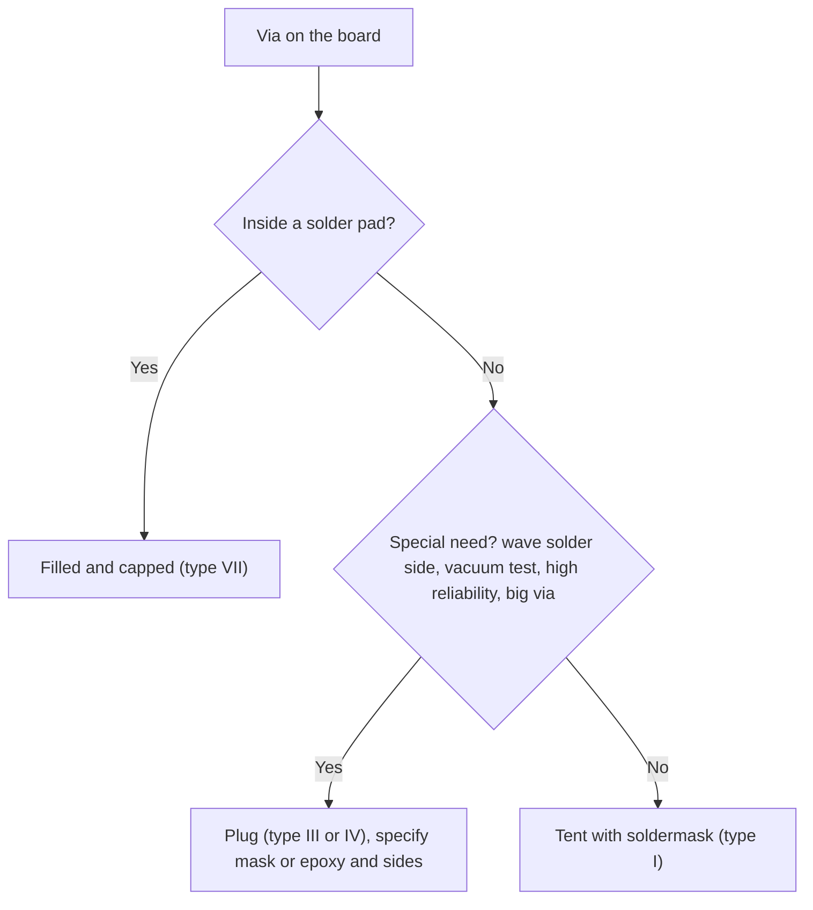

::: testing
Whether you know the **closed-via family** and can tell the members apart. "Plugged" is easy to confuse with "tented" and "filled", and interviewers use that confusion as a probe. You should be able to say:

1. What a plugged via is (barrel blocked with mask or epoxy, not planarised or capped).
2. The practical reasons: stop solder wicking and shorts near pads, seal the board for **vacuum test fixtures**, keep flux and chemicals from being trapped, block contamination.
3. Why a plugged via is **not** enough for via-in-pad (use filled and capped, [[q0578]]).
4. The cost trade-off against tenting.
:::

::: why
A bare, open via is a hole that lets solder, flux, plating chemistry, moisture and air pass through. Most boards are fine with that, because soldermask tenting covers the hole. But on boards with dense assembly, wave soldering, vacuum-fixture test, or harsh environments, a thin tent fails: it cracks, it traps chemicals, or it can't hold a vacuum. Knowing when to move from tenting to plugging, and when that's still not enough, shows you've thought about the board as a manufactured and tested product, not just a netlist.
:::

::: concepts
- **Via anatomy and open barrels**: the hollow centre is a path for fluid, solder and air. See [[q0574]].
- **Tenting**: covering the via with a thin film of soldermask over its pad, without filling the hole.
- **Plugging**: blocking the barrel with ink or epoxy so it can't pass material through.
- **Filling and capping**: planarised fill with copper plated over it. See [[q0578]].
- **IPC-4761 via protection types**: the standard vocabulary for all of these.
- **Vacuum fixtures**: in-circuit test fixtures that pull the board onto probes using vacuum. See [[q0612]].
:::

::: answer
"A plugged via is one where the barrel has been blocked with soldermask ink or epoxy, so nothing can go through it. It isn't ground flat and plated over like a filled via, so it's not a flat pad. I'd want plugged vias in a few situations.

First, to stop solder wicking and bridging: vias close to pads, or on the solder side of a board that goes through wave soldering, can pull solder through or create shorts, and plugging them closes the path. Second, for test: a bed-of-nails fixture that uses vacuum to pull the board down needs the board to be airtight, and open vias leak. Plugging seals them. Third, to keep chemicals from being trapped. During surface finishing, a via that is only tented can trap process fluids that later leak out and cause corrosion or outgassing; plugging avoids that. And fourth, for contamination or moisture in harsh environments.

What it doesn't do is make a via suitable for a solder pad. For via-in-pad I need filled and capped. And plugging costs more than tenting, so I use it only where tenting isn't robust enough."
:::

::: technical
**Definition (IPC-4761 vocabulary).**

| Type | Name | What it is |
|---|---|---|
| I | Tenting (single or double sided) | a film of mask bridges the via opening; the barrel is hollow |
| II | Tenting and covering | tented, with a further covering material over the tent |
| III | Plugging | barrel filled with a plug material (mask ink or epoxy), not necessarily flat |
| IV | Plugging and covering | plugged, then covered over (typically with mask) |
| V | Filling | barrel completely filled, planar |
| VI | Filling and covering | filled, then covered |
| VII | Filling and capping | filled, planarised and plated over with copper |

> [!UNCERTAIN]
> The type names above reflect my recollection of IPC-4761's structure. Fabs also use their own names ("mask plugged", "resin plugged"), and what each does at the edges (plug height, one or two sides) varies. Confirm against the standard and the fab's quote before using the type numbers on a drawing.

**Why plug.**
1. **Solder wicking / bridging.** Open vias near SMT pads or on the bottom side of a wave-soldered board draw solder in and out of the hole. A plug stops it.
2. **Vacuum test fixtures.** The board must seal against the fixture gasket. A board with 2,000 open 0.3 mm vias has a leak area of $2000\cdot0.0707\approx141\ \text{mm}^2$ (about 1.4 cm²), which can defeat the vacuum. Plugged vias seal.
3. **Trapped chemicals.** A tented but hollow via can hold ENIG/HASL chemistry, or flux, which can later seep out and corrode or leave residue.
4. **Environmental ingress.** Moisture, conformal-coat creep and dust or conductive debris can enter an open or weakly tented via, which matters at high voltage or in harsh environments.
5. **Short prevention** under components with exposed metal, like BGAs and connectors with metal shells, to avoid pad-to-via shorts.

**What plugging does not do.** Plugged vias are not planarised and not plated over, so the surface is not flat. **Do not put a plugged (type III/IV) via in a solder pad**; use filled and capped (type VII).

**Cost and risk.** Plugging is an extra process, usually cheaper than fill and cap but more than tenting. Poor plugging leaves voids or protruding plugs, and can trap gas in the barrel. Tenting is far cheaper and is acceptable for most boards, but a thin tent of 20–50 µm of mask is fragile.
:::

::: short
"A plugged via has its barrel blocked with soldermask or epoxy, but it isn't ground flat or plated over like a filled via. I use plugging to stop solder wicking and shorts near pads or on wave-soldered sides, to make the board airtight for vacuum test fixtures, and to avoid trapped chemicals or ingress. It's not enough for via-in-pad, which needs filled and capped, and it costs more than tenting, so I use it only where tenting isn't robust enough."
:::

::: long
"A plugged via is a via whose barrel has been blocked, either with soldermask ink or with epoxy, so material can't pass through. It differs from a tented via, where a thin film of mask just bridges the opening and the hole underneath is still empty. And it differs from a filled via, where the barrel is filled, ground flat and plated over with copper so it's usable as a solder pad.

When do I want it? The first case is solder control. If I have vias close to pads, or vias on the solder side of a board that will go through wave soldering, solder can wick into the barrel or bridge between a via and a pad. Plugging prevents that. The second case is test. Many in-circuit test fixtures use vacuum to pull the board down onto the probes, and open vias are leaks. A board with a couple of thousand 0.3 millimetre vias has about 1.4 square centimetres of leak area, which is plenty to ruin the seal. A plugged via holds the vacuum. The third case is chemical trapping: with a tent, the barrel is still hollow and can hold plating or surface finish chemicals, which can seep out later during reflow. Plugging avoids it. And the fourth is protection from moisture, dust or conductive contamination in harsh environments.

What plugging won't do is give me a flat solderable surface. If a via has to be in a pad, I need it filled and capped, IPC-4761 type VII. And plugging costs more than tenting, so for a plain consumer board I'd tent, and I'd plug only the vias that have a reason, noting the type on the fab drawing."
:::

::: terms
- **Plugged via**: barrel blocked with mask ink or epoxy; not necessarily flat or plated over.
- **Tented via**: via opening covered by a thin film of soldermask, with the barrel hollow.
- **Filled via**: barrel filled and planarised. See [[q0578]].
- **Capped via**: filled via plated over with copper.
- **Solder wicking**: molten solder drawn into the barrel by capillary action.
- **Vacuum fixture**: a test fixture that pulls the board down onto probes by air pressure difference.
- **IPC-4761**: standard describing the via protection types I to VII.
- **Soldermask opening**: the area where mask is removed so a pad is exposed for soldering.
:::

::: exceptional
**An average answer**: "To stop solder flowing through."

**An exceptional answer**:
- Defines plugged precisely and contrasts it with tented and filled.
- Lists four distinct reasons (wicking and bridging, vacuum fixture sealing, chemical trapping, environmental protection), each with the mechanism.
- Quantifies one (vacuum leak area for a few thousand vias).
- States the limit: plugged is not planar, so it can't go in a solder pad. Via-in-pad needs filled and capped.
- Mentions cost versus tenting and naming the IPC-4761 type on the fab drawing.
- Notes that a hollow via can trap process fluids, which is the reason tenting alone is sometimes banned.
:::

::: mistakes
- **Using "tented" and "plugged" interchangeably.** A tent covers; a plug blocks.
- **Plugging a via in a pad and calling it done.** The plug is not flat or solderable; solder will still wick or the pad will be uneven. Use filled and capped.
- **Assuming a thin tent is airtight.** Soldermask tents of a few tens of micrometres can crack or pop with vacuum or thermal stress, especially over larger vias.
- **Plugging every via.** Cost and process risk go up; most vias on most boards can be tented.
- **Not specifying the type.** "Plugged" alone is ambiguous: one side or both, with mask or epoxy, with or without covering.
- **Ignoring trapped chemicals.** Tenting a hollow via after ENIG can leave liquid inside that later outgasses in reflow.
:::

::: deep
## The family of closed vias

Think of a via as a tube. The ways to deal with the open end are a ladder of increasing effort:

```svg
<svg viewBox="0 0 660 220" role="img" aria-label="Seven via protection treatments from tenting to filling and capping">
  <g font-family="Inter, sans-serif" font-size="11" fill="var(--d-ink)" text-anchor="middle">
    <g id="v1"><rect x="10" y="60" width="78" height="100" fill="var(--d-box)" stroke="var(--d-ink)"/><rect x="38" y="60" width="4" height="100" fill="var(--d-orange)"/><rect x="56" y="60" width="4" height="100" fill="var(--d-orange)"/><rect x="34" y="54" width="30" height="6" fill="var(--d-green)"/></g>
    <g><rect x="104" y="60" width="78" height="100" fill="var(--d-box)" stroke="var(--d-ink)"/><rect x="132" y="60" width="4" height="100" fill="var(--d-orange)"/><rect x="150" y="60" width="4" height="100" fill="var(--d-orange)"/><rect x="128" y="54" width="30" height="6" fill="var(--d-green)"/><rect x="124" y="46" width="38" height="8" fill="var(--d-muted)" opacity="0.7"/></g>
    <g><rect x="198" y="60" width="78" height="100" fill="var(--d-box)" stroke="var(--d-ink)"/><rect x="226" y="60" width="4" height="100" fill="var(--d-orange)"/><rect x="244" y="60" width="4" height="100" fill="var(--d-orange)"/><rect x="230" y="68" width="14" height="40" fill="var(--d-purple)" opacity="0.7"/></g>
    <g><rect x="292" y="60" width="78" height="100" fill="var(--d-box)" stroke="var(--d-ink)"/><rect x="320" y="60" width="4" height="100" fill="var(--d-orange)"/><rect x="338" y="60" width="4" height="100" fill="var(--d-orange)"/><rect x="324" y="62" width="14" height="40" fill="var(--d-purple)" opacity="0.7"/><rect x="316" y="54" width="30" height="6" fill="var(--d-green)"/></g>
    <g><rect x="386" y="60" width="78" height="100" fill="var(--d-box)" stroke="var(--d-ink)"/><rect x="414" y="60" width="4" height="100" fill="var(--d-orange)"/><rect x="432" y="60" width="4" height="100" fill="var(--d-orange)"/><rect x="418" y="60" width="14" height="100" fill="var(--d-purple)" opacity="0.7"/></g>
    <g><rect x="480" y="60" width="78" height="100" fill="var(--d-box)" stroke="var(--d-ink)"/><rect x="508" y="60" width="4" height="100" fill="var(--d-orange)"/><rect x="526" y="60" width="4" height="100" fill="var(--d-orange)"/><rect x="512" y="60" width="14" height="100" fill="var(--d-purple)" opacity="0.7"/><rect x="504" y="54" width="30" height="6" fill="var(--d-green)"/></g>
    <g><rect x="574" y="60" width="78" height="100" fill="var(--d-box)" stroke="var(--d-ink)"/><rect x="602" y="60" width="4" height="100" fill="var(--d-orange)"/><rect x="620" y="60" width="4" height="100" fill="var(--d-orange)"/><rect x="606" y="60" width="14" height="100" fill="var(--d-purple)" opacity="0.7"/><rect x="590" y="56" width="46" height="5" fill="var(--d-orange)"/></g>
    <text x="49" y="182">I</text><text x="49" y="198">tent</text>
    <text x="143" y="182">II</text><text x="143" y="198">tent + cover</text>
    <text x="237" y="182">III</text><text x="237" y="198">plug</text>
    <text x="331" y="182">IV</text><text x="331" y="198">plug + cover</text>
    <text x="425" y="182">V</text><text x="425" y="198">fill</text>
    <text x="519" y="182">VI</text><text x="519" y="198">fill + cover</text>
    <text x="613" y="182">VII</text><text x="613" y="198">fill + cap</text>
    <text x="330" y="24" fill="var(--d-muted)">green = mask, grey = covering, purple = plug or fill material, orange = copper</text>
  </g>
</svg>
```
Figure: A sketch of the IPC-4761 progression (simplified, one side shown). Types I and II leave the barrel hollow. Types III and IV block it. Types V to VII fill it completely, and only VII ends with a copper cap that makes a flat solderable pad. Real cross-sections vary by fab.

**What plugging adds over tenting:** the barrel is no longer an empty tube. Nothing can pass through, nothing can be trapped, and the film can't be popped open by vacuum or reflow gas.

## The reasons, in depth

### 1. Solder wicking and bridging

A via near a pad will have its own soldermask opening unless it's tented. If a via isn't covered and sits close to a pad, solder flows along the exposed copper from the pad into the via and down the barrel. On a board that goes through wave soldering, bare vias on the solder side are exposed to the wave; solder can pass through and bridge adjacent pads. A tented or plugged via is protected. Plugging is the more robust answer when the tent might break, such as on larger vias (above about 0.4 mm), where a mask film spans a bigger gap and is more likely to crack or sag.

### 2. Vacuum fixtures

An in-circuit test fixture with vacuum pulls the board down onto spring probes. The pressure difference is the force. Open vias leak air from the top of the board into the vacuum cavity. With 2,000 open 0.3 mm vias the total leak area is about 141 mm². This is small versus a 100 mm × 100 mm board (10,000 mm²), but the leak pulls air through at high speed and reduces the pressure difference between the board's two sides. The pump may cope, or may not. If the leak is too high the fixture loses contact at the edges. Plugged vias seal. See [[q0612]] for fixtures.

> [!UNCERTAIN]
> How much leakage a given fixture tolerates depends on the pump, the gasket and the fixture design. The 141 mm² figure is the simple geometric area; it is a comparison tool, not a pass/fail limit. Ask the test-fixture vendor what they require.

### 3. Trapped chemistry

A tented via has a hollow barrel with a membrane over each end. If chemicals enter before the tent closes (during ENIG, HASL or cleaning), they are stuck inside. In reflow the temperature rises quickly and trapped liquid expands or vaporises, which can blow a hole in the tent or leach out and leave stains or corrosion. Plugging the via before surface finish leaves nothing to trap, which is why some automotive and high-reliability specifications prefer plugged vias.

### 4. Ingress and contamination

At high voltage or in humid, dusty or conductive-debris environments, an open barrel can collect contamination that forms a leakage path, and conformal coating can wick into it. Plugging stops the barrel from becoming a trap.

### 5. Short prevention under parts

A via under a BGA or under a metal-shelled connector, with exposed copper at the top, can short to the component's metal or to solder balls. Tent or plug it.

## What plugging cannot do: via-in-pad

Plugged vias aren't planarised, so the plug may be slightly raised or recessed. A recessed plug leaves a depression in the pad, and a raised one tilts a small component. Neither gives a reliable solder joint. **If a via has to be inside a solder pad, use filled and capped (type VII).** That is the line to remember: plugged keeps stuff out; filled and capped makes a pad.

## Choosing: a decision flow


Figure: The only question that forces a more expensive treatment is whether the via sits in a pad. Everything else is a reliability or test requirement that justifies plugging.

## Worked comparison

| | Tented | Plugged | Filled + capped |
|---|---|---|---|
| Barrel | hollow | blocked | solid fill |
| Surface | mask film | mask or plug, not planar | flat copper |
| Vacuum seal | marginal | good | good |
| Can go in a pad | no | no | yes |
| Chemical trap risk | yes | no | no |
| Relative cost | lowest | medium | highest |
| Typical drill | up to about 0.3–0.4 mm | similar | usually small |

## Real-hardware notes

- Tenting works best on small vias; large vias (above about 0.4–0.5 mm) don't tent reliably.
- Plugs can protrude or sag; specify "plug height" limits in the fab note if you need a flat surface for fixture contact.
- Double-sided tenting traps air and chemistry; plugging from one side and covering both is a common compromise.
- Test points must **not** be plugged vias; a plugged via isn't a probe target.
:::

::: applications
- **Boards for bed-of-nails ICT with vacuum fixtures**: vias on the probe side are plugged or filled so the fixture can seal.
- **Wave-soldered or selective-soldered boards**: bottom-side vias near through-hole pads plugged to avoid solder entering or bridging.
- **Automotive and industrial controllers**: plugged vias to avoid chemical entrapment and moisture ingress.
- **High-voltage supplies**: plugged or covered vias to keep conductive debris and moisture out of voltage-sensitive areas.
- **BGA breakout boards**: vias near ball pads plugged to prevent solder from draining or shorting.
- **Conformally coated assemblies**: plugging prevents coating from wicking into barrels.
:::

::: assumptions
- Standard FR-4 rigid board with 0.2–0.4 mm vias. Very small vias tent reliably; large vias don't.
- The IPC-4761 type letters are used as a vocabulary. Fabs may use their own names, and not all offer every type.
- The vacuum-leak argument uses geometric area only; real tolerance depends on the fixture.
- Plugged is assumed to be done with mask ink or epoxy, from one or both sides. The exact process (and whether the plug is flush) varies.
- If the board never goes through wave solder or vacuum test and has benign environment, tenting is adequate.
:::

::: followups
### What's the difference between tenting and plugging?
Tenting covers the via with a film of soldermask over its opening, but the barrel stays hollow. Plugging puts material inside the barrel so nothing can pass through. Tents can crack or trap chemicals; plugs are more robust and seal for vacuum.

### Can you put a plugged via on an SMT pad?
Not reliably. A plug isn't planarised or plated over, so the pad surface is uneven, and solder can still wick or sag. A via in a pad needs filled and capped (type VII). See [[q0582]].

### Why would a fab or customer ban tented-only vias?
Because a hollow tented via can trap plating or finish chemicals, which then leach out later or expand in reflow. In some high-reliability standards plugging is preferred for this reason.

### How would you decide between plugging and filling a via that is not in a pad?
If there's no pad, I don't need a flat surface, so plugging is enough and cheaper. I'd go with filled and capped only for a via that must be in a pad, or if a thermal or HDI reason needs copper in the barrel.

### Scenario: your new board fails vacuum-fixture test with intermittent contact on the far edge. What might be the cause and fix?
Likely vacuum leakage. I'd count open and tented vias on the probe side and compare to the fixture's tolerance. The fixes are plugging the vias on that side, adding a gasket or seal around the leaky area, or reducing the number of vias there. I'd also confirm that tented vias aren't cracking, by looking under magnification.
:::

::: interpretations
"Plugged vias" is sometimes used loosely for anything closed, including tented and filled. This page treats **plugged** as a specific IPC-4761-style category (barrel blocked, not necessarily planar) and contrasts it with tented ([[q0578]] covers filled). If the interviewer's follow-up is "so what about via-in-pad", the answer is filled and capped.
:::

::: references
- IPC-4761, *Design Guide for Protection of Printed Board Via Structures*.
- IPC-2221 and IPC-6012 for general via and plated-hole requirements.
- Your fabricator's via protection options and the in-circuit test fixture vendor's requirements for sealed boards.
- Horowitz & Hill, *The Art of Electronics*, discussion of PCB assembly and test practicalities (topic level).
:::

::: rubric
- Defines plugged (barrel blocked with ink or epoxy) and distinguishes it from tented and filled :: The question hinges on these terms.
- Gives the solder wicking/bridging reason, especially for wave-soldered or near-pad vias :: It's the most common manufacturing reason.
- Mentions vacuum test fixtures needing airtight boards :: A specific, practical reason that shows test awareness.
- Mentions trapped chemicals or environmental ingress :: Shows reliability thinking.
- States that plugged vias cannot go in pads (use filled and capped) :: Avoids the classic confusion.
- Mentions cost vs tenting and specifying the type on the fab drawing :: Demonstrates trade-off judgment.
:::

::: quiz
```json
[
 {"type":"mcq","level":"fundamental","q":"What is the key difference between a tented via and a plugged via?","options":["A tented via has a hollow barrel covered by mask; a plugged via has material blocking the barrel","A tented via is bigger","A plugged via must be in a pad","There is no difference"],"answer":0,"explain":"Tenting bridges the opening with a thin mask film, leaving the barrel empty. Plugging puts material into the barrel."},
 {"type":"mcq","level":"fundamental","q":"Which treatment is needed for a via placed inside a BGA solder pad?","options":["Tented","Plugged only","Filled and capped","Left open"],"answer":2,"explain":"The pad needs a flat, solderable copper surface. Only filled-and-capped (IPC-4761 type VII) gives that."},
 {"type":"numeric","level":"intermediate","q":"A board has 2000 open vias with 0.3 mm diameter holes. What is the total hole area in mm^2? (Use the full 0.3 mm diameter.)","answer":141.4,"tolerance":0.02,"unit":"mm²","explain":"Each hole is π/4·0.3² = 0.0707 mm². Times 2000 = 141.4 mm². That open area leaks air into a vacuum fixture."},
 {"type":"multi","level":"intermediate","q":"Which are good reasons to plug vias?","options":["Prevent solder wicking or bridging on a wave-soldered side","Keep a vacuum test fixture sealed","Make the via usable as a solder pad","Avoid trapped plating chemicals in hollow barrels"],"answer":[0,1,3],"explain":"Plugging blocks the barrel to stop solder, air and chemicals passing or being trapped. It does not make a flat pad; that needs filled and capped."},
 {"type":"truefalse","level":"advanced","q":"A plugged via is automatically planarised and plated over, so it is as good as a filled-and-capped via for via-in-pad.","answer":false,"explain":"Plugs are not necessarily flat and are not plated over. Via-in-pad needs the flat copper cap of a type VII via."},
 {"type":"mcq","level":"advanced","q":"A mask-tented via passes ENIG and then shows brown staining around it after reflow. The most likely cause is...","options":["The barrel is too short","Process chemistry trapped in the hollow barrel leaching out","The copper is too thick","The board is too thin"],"answer":1,"explain":"A tent seals the hollow barrel, which can hold surface-finish chemistry. Heat in reflow expels it. Plugging the via before finishing avoids this."}
]
```
:::
