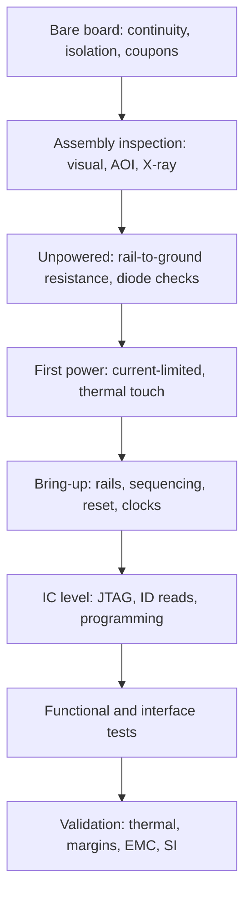

::: testing
Whether you can organise testing by **stage and purpose** instead of reciting instruments. A PCB is tested bare, assembled, powered, and functioning, and each stage catches different defects. The interviewer wants:

1. A logical order (cheap and safe first, risky last).
2. Coverage of **manufacturing tests** (shorts, opens, assembly) and **design validation** (power, timing, performance, margin).
3. The right tool per test (DMM, scope, LCR, X-ray, JTAG, thermal camera).
4. Safety awareness: current-limited first power-up.
:::

::: why
Most bring-up time is lost to testing in the wrong order: powering a board with a rail short, or debugging firmware on hardware that has a missing resistor. A structured plan finds faults cheaply and prevents damage. It is also how production test is organised at scale.
:::

::: concepts
- **Bare-board test**: continuity and isolation of the unpopulated PCB.
- **Visual/AOI/X-ray inspection**: finds assembly defects.
- **Power-up test**: current-limited supply, rail checks.
- **Functional test**: does the board do its job.
- **Margin/environmental**: temperature, voltage, vibration.
- **Instruments**: see [[q0627]] for measurement considerations.
:::

::: answer
"I'd go in stages. First, before any parts, the bare board gets an electrical test: continuity of every net and isolation between nets, usually done by the fab with a flying probe or fixture, and I'd look at the board visually.

Then after assembly, a visual and microscope inspection for solder bridges, missing or wrong parts, polarity, and X-ray for BGAs.

Before applying power, I'd measure resistance across each supply rail to ground with a multimeter to catch shorts. Then power up with a bench supply with current limit set a bit above expected, and watch the current. If that's sane, I'd check each rail voltage, sequencing, clocks and reset with a scope.

After that, functional tests: communicate with the ICs over I2C, SPI or JTAG, run firmware self-tests, check the analog signals and interfaces against spec. Finally, for validation I'd look at thermal behaviour with a camera, power and ripple under load, and corner conditions like temperature and supply voltage, and for production I'd automate it with ICT or functional test fixtures."
:::

::: technical
**Stages and tests.**

| Stage | Test | Finds | Tool |
|---|---|---|---|
| Bare board | continuity + isolation (netlist test), impedance coupons, microsection | opens, shorts, etch/plating defects, impedance error | flying probe, fixture, TDR |
| Post-assembly inspection | visual, AOI, X-ray | bridges, tombstones, missing/wrong/rotated parts, BGA voids | microscope, AOI, X-ray |
| Unpowered | rail-to-ground resistance, diode-mode checks | shorts, reversed parts | DMM |
| First power | current-limited supply, current draw, thermal touch | gross faults without damage | bench supply, thermal camera |
| Bring-up | rails, sequencing, clocks, resets | power-tree and timing errors | scope, DMM |
| Board-level IC | JTAG/boundary scan, ID reads, programming | solder opens, dead ICs | debugger, host |
| Functional | firmware self-test, interface loopback, analog accuracy | design/integration bugs | test jig, instruments |
| Validation | thermal, margin (V, T), EMC pre-scan, SI | marginal designs | chamber, scope, spectrum |
| Production | ICT, flying probe, FCT, burn-in | workmanship defects at volume | fixtures, ATE |

**First power example.** Expected 3.3 V rail load of 150 mA: set limit 300 mA; if the supply goes into limit, stop. Power at 3.3 V and 150 mA is 0.5 W; a short at 0.1 Ω would be 33 A without limit.

> [!UNCERTAIN]
> Bare-board test pass criteria (a continuity resistance limit of a few to tens of ohms and an isolation resistance in the megohm range or higher) are set per board class by IPC-9252 and by fab and customer practice. Check your fab's spec rather than quoting one number.
:::

::: short
"I test in stages: bare-board continuity and isolation, visual/AOI/X-ray after assembly, resistance of each rail to ground before power, a current-limited first power-up, then rail, sequencing and clock checks with a scope, board-level IC checks like JTAG or ID reads, functional tests, and finally validation of thermal and margin conditions. In production this becomes ICT, flying probe and functional test."
:::

::: long
"I'd organise it by stage, cheapest and safest first.

Stage one is the bare board. The fab electrically tests every net for continuity and checks isolation between nets, with a flying probe or a fixture, and they may check impedance on a test coupon. Stage two, after assembly, is inspection: visual under a microscope, AOI, and X-ray for BGAs, looking for bridges, tombstones, missing or wrong parts and voids.

Stage three is unpowered electrical checks. With a multimeter I measure each supply rail to ground, which catches shorts, and use diode mode on a few pins to check for reversed parts. Stage four is first power-up, with a bench supply and a current limit just above what I expect, say 300 milliamps for a 150 milliamp board, so a fault does no damage. I watch current and touch-check for heat.

Stage five is bring-up: rail voltages, power sequencing, reset, clocks, using a scope. Stage six is board-level IC testing: reading chip IDs over I2C or SPI, JTAG boundary scan, programming. Stage seven is functional: firmware self-test, interfaces, analog accuracy. Stage eight is validation: thermal camera, ripple under load, voltage and temperature corners, and EMC pre-scan.

For production, those become automated: ICT or flying probe for workmanship, and a functional test fixture for performance."
:::

::: terms
- **Continuity test**: checks a net is connected end to end.
- **Isolation test**: checks nets are not shorted.
- **AOI**: automated optical inspection.
- **ICT**: in-circuit test.
- **FCT**: functional test.
- **Boundary scan**: JTAG-based pin-level test.
- **Current limit**: bench supply protection setting.
- **Coupon**: sacrificial test structure on a panel.
:::

::: exceptional
**Average**: "Check with a multimeter and a scope."

**Exceptional**:
- Orders tests by risk and cost.
- Separates manufacturing defects from design validation.
- Uses current-limited first power with a number.
- Mentions coupons, X-ray, JTAG, and automated production tests.
:::

::: mistakes
- **Powering without checking rail resistance.** A rail short then shows up as smoke instead of a meter reading. Measure every rail to ground first.
- **No current limit on first power.** A 0.1 Ω fault on 3.3 V draws 33 A. Set the limit modestly above expected current (about 2x).
- **Debugging firmware before verifying rails and clocks.** Code can't fix a missing rail or a dead oscillator. Prove power, reset and clocks first.
- **Relying on visual inspection for BGAs.** The joints are hidden. Use X-ray or boundary scan.
- **Skipping bare-board test on prototypes.** The fab usually does it, but cheap prototype services sometimes skip it; confirm it is on the order.
:::

::: deep
## A test plan as a funnel


Figure: Each step is cheaper and safer than the next, and each assumes the previous passed. Skipping ahead means debugging two problems at once.

## Details per stage

**Bare board.** Netlist tests compare measured connectivity to the design. Impedance coupons are measured with TDR to confirm controlled-impedance lines. Microsections confirm plating.

**Inspection.** AOI compares images to references; X-ray sees BGA balls and voids; manual inspection checks polarity and orientation.

**Unpowered.** A DMM across each rail: a healthy 3.3 V rail with decoupling reads rising resistance as capacitors charge, and a few ohms or less steady usually means a short. Compare with a known-good board where you can, because a large processor or FPGA core rail can legitimately read only a few ohms. Diode mode on IC pins checks protection diodes (see [[q0590]]).

**First power.** Current limit sets safety. With a 3.3 V rail expected at 150 mA, a 300 mA limit protects; a 0.1 Ω fault would otherwise draw 33 A. Watch for thermal hot spots with a camera or a quick touch with the back of a finger at low power.

**Bring-up.** Rails against tolerance, ripple, sequencing order, reset release, oscillator start. See [[q0587]].

**IC and functional.** JTAG/boundary scan finds solder opens; I2C/SPI ID reads prove communication; self-tests exercise memory, peripherals.

**Validation.** Thermal behaviour at max load, supply and temperature margin, SI eye diagrams, EMC pre-compliance, vibration or humidity per product needs.

```plot
{"title":"Current drawn by a short vs resistance at 3.3 V (why a current limit matters)","x":{"label":"Short resistance","unit":"Ω","min":0.05,"max":10,"log":true},"y":{"label":"Current","unit":"A","min":0.1,"max":70,"log":true},
 "vars":{"v":3.3},
 "series":[{"label":"I = V/R (unlimited supply)","fn":"v/x"}],
 "hlines":[{"at":0.3,"label":"300 mA limit","color":"orange"}],
 "points":[{"x":0.1,"y":"v/0.1","label":"0.1 Ω: 33 A"}]}
```
Figure: Without a limit a small short pulls tens of amps; the 300 mA limit bounds dissipation to about 1 W at the supply for any short.

## Production view

At volume the plan becomes AOI + ICT or flying probe for workmanship, and FCT for function. See [[q0604]].
:::

::: applications
- **Prototype bring-up** with bench supply and scope.
- **Contract manufacturer lines**: AOI, ICT, FCT.
- **Automotive boards**: environmental and burn-in.
- **High-speed boards**: coupon TDR and eye tests.
- **Field returns**: repeat functional and thermal tests.
:::

::: assumptions
- Mixed-signal board with MCU, power and sensors.
- Prototype quantities unless noted.
- Test coverage differs for RF, power and high-voltage boards.
:::

::: followups
### Why measure rail resistance before powering?
It finds shorts without risking damage; a few ohms or less on a rail is suspicious.

### What do you do if the supply hits current limit on first power?
Power off, find the rail by resistance and thermal camera, or use voltage-injection with limited current to find the hot component.

### What's the difference between ICT and functional test?
ICT checks components and nets; functional test checks that the board does its job. See [[q0609]].

### How do you test BGA solder joints?
X-ray, boundary scan, and functional tests; cross-section for failures.

### Scenario: board works at room temperature but fails at 70 °C. Test plan?
Thermal chamber with logging, check rail drift and clock stability, thermal camera hot spots, and spray-cool components to isolate.
:::

::: interpretations
"Tests you can do on a PCB" is broad; this page gives the overall map. Specific questions follow: [[q0587]] (what you look for), [[q0590]] and [[q0591]] (ICs and components).
:::

::: references
- IPC-9252, requirements for electrical testing of unpopulated printed boards.
- IPC-A-610, acceptability of electronic assemblies.
- IEEE 1149.1, boundary scan.
- Horowitz & Hill, *The Art of Electronics*, practical measurement topics.
:::

::: rubric
- Organises tests in stages, cheapest and safest first :: The interviewer wants a plan, not a list of instruments.
- Includes bare-board continuity and isolation (and coupons for impedance or plating) :: Shows you know fab defects are caught before assembly.
- Includes assembly inspection: visual, AOI and X-ray for hidden joints :: Covers the assembly defects that cause most first-build failures.
- Checks rail resistance before power and uses a current-limited first power-up :: This is the safety habit that prevents destroying a prototype.
- Covers IC-level and functional tests (JTAG, ID reads, self-tests, interfaces) :: Shows you test that the board works, not just that it is connected.
- Mentions validation (thermal, margins, EMC) and production tests (ICT, flying probe, FCT) :: Shows breadth from prototype to volume.
:::

::: quiz
```json
[
 {"type":"mcq","level":"fundamental","q":"What should you do before applying power to a new board?","options":["Run firmware","Measure each rail's resistance to ground","Add heat sinks","Connect all peripherals"],"answer":1,"explain":"Rail-to-ground resistance catches shorts safely."},
 {"type":"mcq","level":"fundamental","q":"X-ray inspection is mainly used for...","options":["Resistor values","Hidden joints such as BGA balls","Soldermask colour","Trace width"],"answer":1,"explain":"X-ray sees through packages to joints and voids."},
 {"type":"numeric","level":"intermediate","q":"A 3.3 V rail has a 0.1 Ω short. Current without a limit, in A?","answer":33,"tolerance":0.02,"unit":"A","explain":"I = V/R = 3.3/0.1 = 33 A."},
 {"type":"truefalse","level":"intermediate","q":"A current-limited supply should be set well above the expected board current to avoid nuisance trips.","answer":false,"explain":"Set it modestly above expected (e.g. 2x) so faults are bounded."},
 {"type":"mcq","level":"advanced","q":"Which test best finds an open BGA ball without X-ray?","options":["Boundary scan","Visual inspection","Soldermask check","Weighing the board"],"answer":0,"explain":"Boundary scan drives and reads pins, exposing opens."}
]
```
:::
