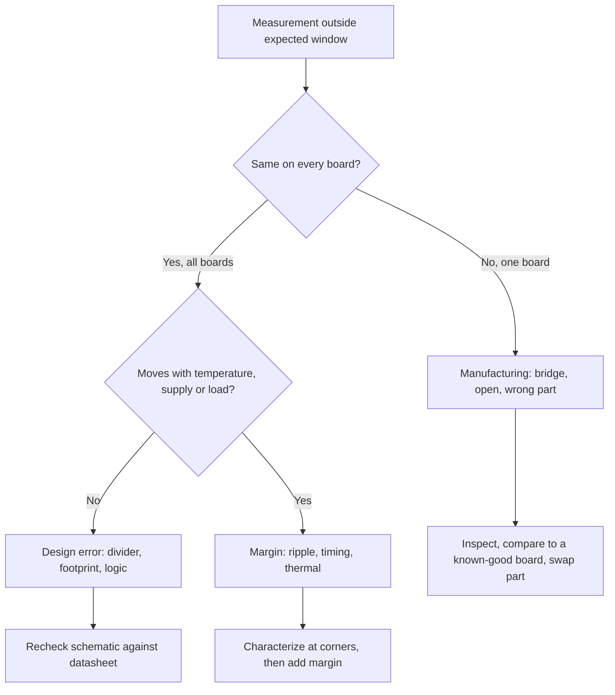

::: basics
### In plain words
When testing a board, you compare what you measure with what you expect, and the expectation comes from the design, not from a guess. It helps to sort problems into three bins. Manufacturing defects affect one board. Design errors show up on every board. Margin problems appear only when the board is stressed, for example with low supply voltage or high temperature.

### Picture it
Think of a car inspection. The mechanic checks each reading against a number in the manual, such as tire pressure. One flat tire is a single-car defect. A wrong part on the whole model is a design error. A car that runs well on a cool day but overheats on a hot hill has a margin problem.

### Words you need
- **Tolerance**: how far a value may stray from its intended value and still pass. A 3.3 V rail at ±3% must read 3.20 to 3.40 V.
- **Rail**: a supply voltage line on the board.
- **Ripple**: the small wobble on top of a steady (DC) voltage. A multimeter averages it away, so you need an oscilloscope, which draws voltage against time.
- **Sequencing**: the order and timing in which supplies and reset come up.
- **Margin**: how far a measurement is from the point where the board would fail.
- **Corner**: an extreme operating condition, such as lowest supply voltage plus highest temperature.

### The simplest example
A 1.0 V rail with ±3% tolerance must stay between 0.97 V and 1.03 V. Say you measure 1.01 V DC with 25 mV of ripple from top to bottom. The ripple swings the rail 12.5 mV either way, from 0.9975 V to 1.0225 V. It passes. But the high side has only 1.03 - 1.0225 = 7.5 mV of headroom, so a load change could push it over the limit.

That is the whole idea: measure against a calculated limit, and check both the average and the extremes. The rest of this page covers fault signatures and how to derive expected values.
:::

::: testing
Whether you know **what a pass looks like** and which symptoms point where. "Looking for bugs" is too vague. You should split findings into:

1. **Manufacturing defects** (shorts, opens, wrong/misplaced parts, bad joints).
2. **Design errors** (wrong footprint, wrong value, missing pull-up, sequencing).
3. **Marginal behaviour** (noise, ripple, timing margin, thermal).
4. **Spec compliance** (does it meet the numbers it was designed for).
And you check against a defined expected value, not "looks OK".
:::

::: why
Without expected values, a measurement is just a number. Engineers who can say "I expect 3.30 V ±3 %, under 30 mV ripple, reset released 10 ms after the last rail" find problems fast. This question probes that discipline.
:::

::: concepts
- **Expected values**: from schematic and datasheets. See [[q0586]].
- **Rail accuracy and ripple**: tolerance and noise limits.
- **Sequencing and reset**: order and timing of rails.
- **Signal integrity**: levels, edges, ringing.
- **Thermal**: temperature rise vs limits.
:::

::: answer
"I'm comparing what I measure to what I expect, and I try to sort what I find into three bins. First, manufacturing defects: shorts, opens, wrong or missing parts, reversed polarity, bad solder joints. Those show up as rails at the wrong voltage, current draw too high or zero, or a part that's cold when it should be warm.

Second, design errors: a wrong footprint, a feedback divider that sets the wrong voltage, a missing pull-up, a reset that releases before the rail is stable. Those are repeatable on every board.

Third, margins: ripple and noise on rails, clock quality, edge rates, ringing on fast lines, temperature rise at load, timing margins. These pass at room temperature but fail at corners.

Concretely I look at each rail's voltage against tolerance, its ripple with a scope, the power-up sequence and reset timing, clock frequency and start-up, communication with ICs, signal levels and edges, and temperature. And I check at the extremes, like low supply voltage and high temperature, because that's where marginal designs fail."
:::

::: technical
**Checks and pass criteria (examples).**
- **Rails**: DC within tolerance (e.g. 3.3 V ±3 % = 3.20-3.40 V), ripple below spec (e.g. <30 mV pk-pk measured with a short ground spring), load transients without droop below minimum.
- **Current**: idle and active within budget; unexpected current = short or latch-up.
- **Sequencing**: order and delays per IC datasheets; reset released only after rails and clock are valid.
- **Clocks**: frequency within ppm spec, start-up time, amplitude.
- **Digital**: logic levels meet $V_{IH}/V_{IL}$, edges, no ringing beyond limits, bus protocols decode correctly.
- **Analog**: gain, offset, noise against spec.
- **Thermal**: component temperature below rating with margin.
- **Corners**: min/max supply, temperature.

**Fault signatures.** Rail low with high current: short or overload. Rail high or wrong: divider or feedback error. No current: open or disabled. Intermittent: cracked joint or via ([[q0580]]), marginal timing.

**Ripple tolerance example.** A 1.0 V core rail with ±3 % tolerance must stay within 0.97–1.03 V. If DC is at 1.01 V and ripple is 25 mV pk-pk, the rail swings from 0.9975 V to 1.0225 V: it passes, but the high side has only 7.5 mV of headroom, and a load-release transient could exceed it.

> [!UNCERTAIN]
> Pass criteria come from datasheets and system requirements; numbers here are examples.
:::

::: short
"I compare measurements to expected values and sort the findings into manufacturing defects like shorts, opens and wrong parts; design errors like wrong dividers, footprints or sequencing; and marginal behaviour like ripple, timing, ringing and heat. I check rail voltage and ripple, current, power sequencing and reset, clocks, communication, signal levels and temperature, including at voltage and temperature corners."
:::

::: long
"I always test against expected numbers, so before I measure I write down what I expect. Then I sort what I find into three bins.

Manufacturing defects first: shorts, opens, wrong or missing or reversed parts, bad solder joints. They show up as a rail at the wrong voltage, current that's far too high or zero, or a chip that's cold when it should be warm. They are usually board-specific.

Second, design errors, which are the same on every board: a feedback divider that sets the wrong voltage, a footprint with swapped pins, a missing pull-up, a reset that releases before the rails are stable.

Third, margins: ripple and noise on rails, clock quality, edge rates, ringing, timing margins and temperature rise at load. These pass on the bench at room temperature and fail at corners.

So in practice I check each rail's voltage against its tolerance, say 3.3 volts plus or minus three percent, and its ripple with a scope and a short ground spring. I check supply current at idle and under load, the power-up sequence and reset timing, that the clocks start and are on frequency, that I can talk to every IC, that logic levels and edges are clean, and what temperature the hot parts reach. And I repeat at low and high supply voltage and temperature, because marginal designs hide there."
:::

::: terms
- **Expected value**: the datasheet/schematic prediction.
- **Ripple**: AC component on a DC rail.
- **Sequencing**: rail power-up order.
- **Margin**: distance from spec limit.
- **Corner**: extreme voltage/temperature condition.
- **Latch-up**: parasitic thyristor turn-on causing high current.
- **Droop**: transient dip in a rail.
:::

::: exceptional
**Average**: "Check voltages and signals look right."

**Exceptional**:
- Defines expected values before measuring.
- Separates workmanship, design, and margin issues.
- Knows fault signatures.
- Tests at corners, with numbers.
:::

::: mistakes
- **Measuring without an expectation.** A number means nothing without a limit. Write the expected value and tolerance first.
- **Ignoring ripple.** A DMM averages it away. Look at the rail on a scope too.
- **Testing only at room temperature.** Marginal designs fail at the corners. Test at supply and temperature extremes.
- **Long ground lead on the scope**, which picks up switching noise and shows false ripple. Use a ground spring. See [[q0588]].
- **Assuming a working board is margin-checked.** "It boots" is not "it meets spec". Measure the margins.
:::

::: deep
## Three bins

| Bin | Symptom | Repeats across boards? | Typical cause |
|---|---|---|---|
| Manufacturing | one board wrong | no | solder bridge, open, wrong part |
| Design | all boards wrong | yes | divider, footprint, logic error |
| Margin | works until stressed | partly | ripple, timing, thermal |

## Power-up behaviour

```timing
{"signals":[{"name":"VIN","wave":"01......"},{"name":"3V3","wave":"0.1....."},{"name":"1V8","wave":"0..1...."},{"name":"CLK","wave":"0...p..."},{"name":"nRESET","wave":"0.....1.","color":"accent"}],"marks":[{"t":1,"label":"VIN"},{"t":6,"label":"release"}],"hscale":1.2}
```
Figure: Expected sequence: 3.3 V, then 1.8 V, clock running, then reset released last. If reset releases before 1.8 V or the clock is valid, the chip may start in an undefined state.

## Rails

Check DC within tolerance: $\pm3\%$ of 3.3 V is 3.20-3.40 V. Ripple with a scope using a tip-and-barrel ground, not a long lead. Load step response for droop. For a 1.0 V ±3 % rail DC at 1.01 V with 25 mV pk-pk ripple, the minimum is $1.01-0.0125=0.9975$ V, comfortably above 0.97 V, but the maximum is $1.0225$ V, only 7.5 mV under the 1.03 V limit. Check both sides of the window.

## Current

Compare to budget. Excess current at idle suggests a short, latch-up or a floating input; zero suggests open or disabled chip.

## Signals

Levels against $V_{IH}$/$V_{IL}$; edge rates; ringing and overshoot; protocol decode of I2C/SPI; analog gain/offset vs spec.

## Thermal

Thermal camera; compare to the limit minus a margin. For example, if a part's maximum junction temperature is 125 °C, estimate the junction temperature from the case reading at the worst-case ambient and keep it 10–20 °C below the limit.

## Corners

Vary supply ±10 % and temperature across the range; log failures.

## The expected value is a calculation, not a round number

A pass criterion must come from the design, and the first mistake is to compare a measurement against the label on the net. A "3.3 V" rail is not designed to read 3.300 V. Take a regulator with a 0.6 V feedback reference set by a 45.3 kΩ / 10 kΩ divider (standard E96 values):

$$V_{out}=V_{ref}\left(1+\frac{R_1}{R_2}\right)=0.6\left(1+\frac{45.3}{10}\right)=3.318\ \text{V}$$

So the *nominal* reading is 3.318 V, and an engineer who expects 3.300 V will wrongly suspect a 0.5% error. Next, the worst-case spread. With a $\pm1\%$ reference and $\pm1\%$ resistors the extremes are (reference high, $R_1$ high, $R_2$ low) and the opposite:

$$V_{max}=3.407\ \text{V}\ (+2.7\%\text{ from nominal}),\qquad V_{min}=3.232\ \text{V}\ (-2.6\%)$$

Compared with the $3.3\ \text{V}\pm3\%$ window of 3.201–3.399 V, the worst-case high corner is about 8 mV *outside* the window. A root-sum-square estimate of the three tolerances is $\sqrt{1^2+0.82^2+0.82^2}=1.53\%$, so almost every board is fine, and a few are not. That is the sort of statement a pass criterion should make: "the design passes the window on the RSS basis but fails at the corner by about 8 mV; either tighten the divider to 0.5% resistors or accept the risk." On the bench, a reading of 3.38 V is thus *not* a defect, but a reading of 3.50 V is.

## Measurement uncertainty: do you trust the number?

A measurement is a reading plus an uncertainty. A bench DMM on its DC volts range is typically good to a fraction of a percent, while a scope's vertical accuracy is typically a few percent of full scale (read your instrument's datasheet; both vary by model). On a 3.3 V rail judged against a $\pm3\%$ window (±99 mV), a 3% scope error is ±99 mV by itself: the instrument can consume the whole window. That is why DC checks use a DMM and a scope is used for ripple, transients, and timing, which a DMM cannot show.

## Timing margin as a number

For a digital interface, "passes" means a positive margin against datasheet timing. Consider SPI at 20 MHz, mode 0, with the slave changing MISO on the falling edge and the master sampling on the next rising edge. The available time is half a clock period:

$$\frac{1}{2\cdot20\ \text{MHz}}=25\ \text{ns}$$

Suppose the slave's maximum clock-to-output delay is 18 ns, the round-trip trace and buffer delay add 1 ns, and the master needs 5 ns of setup. Then

$$t_{margin}=25-(18+1+5)=1\ \text{ns}$$

which is 4% of the window and not something to ship. At 10 MHz the window is 50 ns and the margin is 26 ns. On the bench you would verify this by capturing SCK and MISO at the master's pin, measuring the delay from the falling clock edge to valid data at the *worst-case* temperature and supply, and comparing that with the numbers above. The example values are illustrative; use the actual datasheet.

## Thermal as a number

A linear regulator dropping 5 V to 3.3 V at 500 mA dissipates

$$P=(5-3.3)\times0.5=0.85\ \text{W}$$

With a junction-to-ambient thermal resistance of 60 K/W (an example for a small package on a modest board; it comes from the datasheet and depends strongly on the copper area), the junction rises $0.85\times60=51$ K, to about 101 °C at a 50 °C ambient. Against a 125 °C junction limit that leaves 24 K of margin, which meets the 10–20 °C margin guidance on this page, but not by much if the enclosure runs hotter. A thermal camera reading of the package top reads a few degrees below the junction, and the reading depends on emissivity: bare shiny copper looks cooler than it is, while mold compound is close to 0.9. Put a piece of matte tape or a dab of paint on shiny surfaces before reading a temperature, and apply the correct emissivity setting.

> [!UNCERTAIN]
> The 60 K/W figure and the 125 °C limit are examples. Use the part's datasheet value for its package and the copper area you actually laid out, and note that $\theta_{JA}$ is a function of the board, not a property of the chip alone.

## Reading the result: a triage tree


Figure: The first branching question, whether the fault repeats across boards, separates assembly from design in one measurement. The second separates a fixed error from a margin problem by changing one environmental variable and watching whether the reading moves.

## What to write down before the first board arrives

1. A table of every rail with nominal value, tolerance window, ripple limit and expected idle and active current, derived as above.
2. The reset and sequencing diagram, with the delay between rails and reset release.
3. Timing margins for each fast interface, at the worst-case voltage and temperature from the datasheet.
4. The thermal budget for the hottest three parts.

Then bring-up is a matter of filling a table, and every cell that is out of range is a specific question rather than a vague worry.

> [!INTERVIEW]
> Say "I write the expected value first" - it shows discipline.
:::

::: applications
- **Bring-up of new designs.**
- **Production test limits.**
- **Field-failure analysis.**
- **Design verification reports.**
- **Qualification at temperature.**
:::

::: assumptions
- Digital/mixed-signal board with multiple rails.
- Datasheet limits known.
- Instruments adequate for bandwidth.
:::

::: followups
### How do you tell a design bug from a manufacturing defect?
Test several boards: if all fail identically, it's design; if only one, workmanship. Swap parts or compare against a known-good board.

### What ripple do you accept?
Whatever keeps the rail inside the IC's tolerance window including DC error; typical specs 1-3 % of the rail.

### Why check reset release timing?
ICs need stable rails and clocks; early release can latch the wrong state.

### What if all measurements pass but the product fails in the field?
Margins and corners: test temperature, voltage extremes, long-term stress, EMI and ESD.

### Scenario: 3.3 V rail reads 3.0 V under load, 3.3 V unloaded. Causes?
Supply current limit, regulator dropout or overcurrent, high-resistance path (via or trace), or failing decoupling; measure at the regulator and at the load to locate the drop.
:::

::: interpretations
"What are you looking for" can mean defects or spec compliance; both are covered.
:::

::: references
- Horowitz & Hill, *The Art of Electronics*, measurement chapters.
- Component datasheets for tolerances and sequencing.
- IPC-A-610 for workmanship criteria.
:::

::: rubric
- Compares every measurement to an expected value and tolerance written down first :: This is the discipline the question is really testing.
- Sorts findings into manufacturing defects, design errors and margin problems :: The bin tells you whether to fix one board or the design.
- Checks rails (DC and ripple), current, sequencing and reset, and clocks :: These are the core checks that catch most bring-up faults.
- Knows fault signatures (low rail with high current = short or overload; wrong rail = divider error; zero current = open) :: Shows you can go from symptom to cause.
- Tests at voltage and temperature corners :: Marginal designs pass at room temperature and fail in the field.
:::

::: quiz
```json
[
 {"type":"mcq","level":"fundamental","q":"A rail reads 0 V and the supply is in current limit. Most likely...","options":["Open circuit","Short on the rail","Good board","Reversed scope probe"],"answer":1,"explain":"A short pulls the supply into limit and collapses the voltage."},
 {"type":"numeric","level":"intermediate","q":"3.3 V ±3 %: minimum allowed voltage?","answer":3.201,"tolerance":0.01,"unit":"V","explain":"3.3 × 0.97 = 3.201 V."},
 {"type":"mcq","level":"intermediate","q":"Same fault on every board points to...","options":["Workmanship","Design error","Bad probe","Random ESD"],"answer":1,"explain":"Systematic faults are design errors."},
 {"type":"truefalse","level":"intermediate","q":"Reset should release before rails are stable to save startup time.","answer":false,"explain":"Reset must release after rails and clocks are valid."},
 {"type":"numeric","level":"advanced","q":"A 1.0 V rail at 1.01 V DC with 25 mV pk-pk ripple: minimum instantaneous voltage assuming symmetric ripple, in V?","answer":0.9975,"tolerance":0.002,"unit":"V","explain":"1.01 − 0.0125 = 0.9975 V."}
]
```
:::
