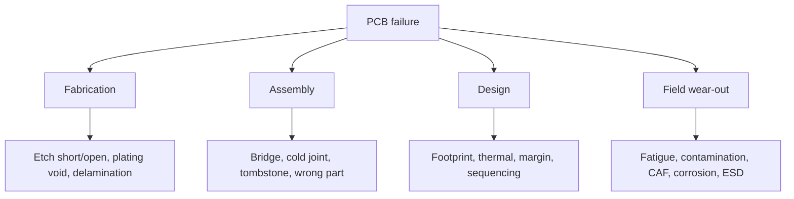

::: basics
### In plain words
It helps to sort PCB failures by where they come from. Fabrication defects are made at the board factory, such as etch shorts, plating voids and layers separating. Assembly defects come from soldering and placing parts, such as bridges, weak joints and wrong parts. Design faults are built into every board, such as a wrong footprint. Wear-out failures appear in the field from heat cycling, humidity or static zaps.

### Picture it
Think of how a bridge can fail. It can be built badly at the steel mill, which is fabrication. It can be assembled badly on site, which is assembly. It can be designed too weak, so every bridge of that design has the problem. Or it can wear out with age and weather. If every bridge fails alike, suspect the design. If only one fails, suspect the workmanship.

### Words you need
- **Cold joint**: a solder joint that did not melt and flow properly. It is weak and may open intermittently.
- **Delamination**: the board's layers separating, often from heat.
- **Contamination**: flux residue or moisture left on the board that leaks small currents between points.
- **Thermal cycling fatigue**: cracking of solder joints or vias from repeated heating and cooling.
- **ESD**: electrostatic discharge, a static zap that can silently damage a chip.

### The simplest example
Say a 1 MΩ and 1 MΩ divider from 3.3 V should output 1.65 V. Now suppose flux residue leaks like a 5 MΩ resistor across the lower resistor. The parallel value is 1 MΩ and 5 MΩ together, about 0.83 MΩ. The output becomes 3.3 × 0.83 / (1 + 0.83) = about 1.50 V, a 9% error. On a sensor this looks like drift that grows with humidity and vanishes after cleaning.

That is the whole idea: find the family first, then the cause. The rest of this page covers each family's symptoms, detection and prevention.
:::

::: testing
Whether you can classify failures by **where they originate** and connect each to symptoms and prevention. A flat list ("shorts, opens, heat") is the beginner answer. A stronger one groups:

1. **Fabrication** defects (bare board).
2. **Assembly** defects (solder, placement).
3. **Design** faults (footprint, margin, thermal).
4. **Field/wear-out** failures (fatigue, corrosion, ESD, contamination).
Each with typical symptoms and how you would detect it.
:::

::: why
Knowing the failure catalogue is how you debug quickly: an intermittent open that appears when warm points to cracks or cold joints, rising leakage in humidity points to contamination or CAF. It also drives design choices like via aspect ratio, copper balance and conformal coating. Vias are covered separately in [[q0580]].
:::

::: concepts
- **Shorts and opens**: the two basic electrical faults.
- **CTE mismatch**: cause of fatigue in joints and vias.
- **Contamination and moisture**: leakage and corrosion.
- **ESD/EOS**: overstress damage.
- **Thermal overstress**: delamination, burnt parts.
- **Design vs workmanship**: systematic vs random.
:::

::: answer
"I group PCB failures by where they come from. From fabrication: shorts or opens from etching errors, plating voids, bad vias, delamination, and wrong impedance or layer registration.

From assembly: solder bridges that short pins, cold or insufficient joints that open, tombstoned parts, head-in-pillow on BGAs, wrong or reversed components, and damage from rework or ESD.

From design: wrong footprints, undersized traces and vias that overheat, thermal hot spots, missing decoupling, and marginal timing or power sequencing.

And then wear-out in the field: solder joints and vias fatigue from thermal cycling because the materials expand differently, contamination and humidity leaking between nodes or growing dendrites and CAF, corrosion, vibration cracking, and ESD or overvoltage damage.

The symptoms help diagnose: a short usually kills a rail, an open usually kills a function, intermittent faults that change with temperature or flexing point to cracks and cold joints, and leakage that grows with humidity points to contamination."
:::

::: technical
| Origin | Failure | Typical symptom | Detection / prevention |
|---|---|---|---|
| Fab | etch short/open, over/under-etch | net short/open | netlist test, AOI |
| Fab | plating void, thin barrel | intermittent open | microsection, coupons ([[q0580]]) |
| Fab | delamination, warpage | blistering, tilting parts | material choice, profile control |
| Assembly | solder bridge | short | AOI, ICT, X-ray |
| Assembly | cold/insufficient joint, head-in-pillow | intermittent open | X-ray, boundary scan, profile tuning |
| Assembly | tombstone | open on a passive | pad symmetry, paste |
| Assembly | wrong/reversed part | wrong function | AOI, FCT |
| Design | wrong footprint/pinout | systematic failure | design review |
| Design | undersized copper/overheating | hot spot, burn | current/thermal analysis |
| Field | solder-joint fatigue | open after cycling | CTE matching, underfill, thermal test |
| Field | contamination/flux residue | leakage, drift | cleaning, coating |
| Field | CAF, dendrites | leakage then short | spacing, materials |
| Field | corrosion | open/high resistance | finish, coating |
| Field | ESD/EOS | dead input | protection ([[q0454]]) |

**Leakage example.** A 1 MΩ/1 MΩ divider from 3.3 V should give 1.65 V. A 5 MΩ flux-residue leak across the lower resistor makes it 0.83 MΩ and the output 1.50 V, a 9 % error.

> [!UNCERTAIN]
> Failure rates and mechanisms depend on materials, processes and environment; no universal statistics are implied.
:::

::: short
"I group PCB failures by origin: fabrication defects like etch shorts, plating voids and delamination; assembly defects like solder bridges, cold joints, tombstones and wrong parts; design faults like wrong footprints, undersized copper and thermal hot spots; and field wear-out like solder-joint and via fatigue from CTE mismatch, contamination and CAF, corrosion and ESD. Symptoms such as rail shorts, intermittent opens with temperature, or humidity-dependent leakage point to the cause."
:::

::: long
"I think of failures by origin. First, fabrication: etching can leave shorts or opens, plating can be thin or void, layers can delaminate or warp, and impedance or registration can be off. Most of those get caught by the fab's netlist test, but latent ones like thin plating pass and fail later.

Second, assembly: solder bridges short pins together, cold or insufficient solder gives opens, small parts tombstone, BGAs can have head-in-pillow joints, and parts can be wrong, rotated or reversed. Rework and ESD can damage parts too.

Third, design: a wrong footprint or pin swap fails on every board, an undersized trace or via overheats, a missing decoupling cap or a bad sequencing causes marginal behaviour.

Fourth, wear-out. Solder joints and vias fatigue because the board, the package and copper expand at different rates. Moisture and flux residue create leakage or corrosion, and with bias and humidity you can get dendrites or CAF. Vibration cracks joints, and ESD or overvoltage kills inputs.

Diagnosis follows symptoms: a rail short means a bridge, bad cap or damaged IC; an intermittent open that changes with temperature or flexing suggests a crack or cold joint; leakage that grows with humidity suggests contamination."
:::

::: terms
- **Tombstoning**: chip part lifting on one end.
- **Head-in-pillow**: BGA ball and paste fail to coalesce.
- **Cold joint**: poorly wetted solder joint.
- **CAF**: conductive anodic filament.
- **Dendrite**: metal growth bridging conductors.
- **Delamination**: layer separation.
- **EOS/ESD**: electrical overstress / electrostatic discharge.
- **Fatigue**: damage from cyclic strain.
:::

::: exceptional
**Average**: "Shorts, opens and overheating."

**Exceptional**:
- Groups by origin and links to symptoms and detection.
- Explains CTE mismatch as the common wear-out driver.
- Gives a leakage example with numbers.
- Distinguishes systematic design faults from random workmanship.
:::

::: mistakes
- **Treating every failure as a component failure.** Many faults are in the board or the joints, not the part. Check joints and copper before swapping ICs.
- **Ignoring contamination.** Flux residue can leak megohms across a high-impedance node. Clean and re-test before redesigning.
- **Assuming a test pass means no latent defect.** Thin plating and cracked joints can pass at room temperature. Use stress tests and cross-sections.
- **Blaming design for assembly defects, and vice versa.** Check how many boards fail: all alike points to design, one board to workmanship.
- **Forgetting thermal cycling.** CTE mismatch fatigues joints and vias over time. Include cycling in qualification.
:::

::: deep
## Four families


Figure: Start debugging by deciding which family the symptom belongs to. Systematic across all boards means design; one board means fab or assembly; failing after time or stress means wear-out.

## Contamination example

Flux residue or moisture forms a leakage resistor. A high-impedance node feels it:

```circuit
{"caption":"Divider with a leakage path across R2","elements":[
 {"t":"V","a":[0,2],"b":[0,6],"label":"3.3 V"},
 {"t":"wire","pts":[[0,2],[0,0],[4,0],[4,1]]},
 {"t":"R","a":[4,1],"b":[4,4],"label":"R_1","value":"1 MΩ"},
 {"t":"R","a":[4,4],"b":[4,7],"label":"R_2","value":"1 MΩ"},
 {"t":"wire","pts":[[4,4],[7,4]]},{"t":"dot","at":[4,4]},
 {"t":"wire","pts":[[7,4],[7,5]]},
 {"t":"R","a":[7,5],"b":[7,8],"label":"R_leak","value":"5 MΩ","color":"orange"},
 {"t":"wire","pts":[[7,8],[7,9],[4,9],[4,7]]},{"t":"dot","at":[4,9]},{"t":"dot","at":[2,9]},
 {"t":"wire","pts":[[0,6],[0,9],[4,9]]},{"t":"gnd","at":[2,9]},
 {"t":"term","at":[9,4],"label":"V_out","side":"right"},
 {"t":"wire","pts":[[7,4],[9,4]]},{"t":"dot","at":[7,4]}
]}
```
Figure: A 5 MΩ leak across R2 drops the output from 1.65 V to 1.50 V (R2 ∥ leak = 0.83 MΩ). On a high-impedance sensor node this looks like drift that appears with humidity and vanishes after cleaning.

## Fatigue

Mismatched CTE between board (about 14-17 ppm/°C in-plane), components (silicon about 3, ceramic about 6-7) and solder produces cyclic shear in joints; large ceramic or BGA parts fail first. Vias see Z-expansion strain ([[q0580]]).

## Thermal and electrical overstress

Undersized copper or vias heat up; ESD and EOS damage ICs, often leaving a latent weakened part. Protection devices and layout reduce the risk.

## Solder-joint fatigue, derived: why distance from the center matters

Solder joints between a package and the board are the only thing holding two materials with different expansion coefficients together. When temperature changes by $\Delta T$, the free expansion mismatch over a distance $L_D$ from the package's neutral point (its center) is $L_D\,\Delta\alpha\,\Delta T$, and that mismatch has to be absorbed as shear in a joint of height $h$. The average shear strain per cycle is

$$\Delta\gamma\approx\frac{L_D\,\Delta\alpha\,\Delta T}{h}$$

Use the CTE numbers from this page: a board at about 16 ppm/°C and a silicon-dominated BGA at about 3 ppm/°C, so $\Delta\alpha\approx13$ ppm/°C. For a joint height $h=0.4$ mm and a temperature swing of 100 K:

| Joint position | $L_D$ | $\Delta\gamma$ |
|---|---|---|
| Ball near the package center | 3 mm | 0.98% |
| Corner ball of a large BGA | 15 mm | 4.9% |

The corner sees five times the strain of a ball near the middle. Low-cycle fatigue of solder is commonly described by a Coffin–Manson-type law, cycles to failure $N_f\propto(\Delta\gamma)^{-n}$, with an exponent $n$ that is typically around 2 for solder (an empirical value that varies with alloy and conditions). Taking $n=2$, the corner ball survives $(4.9/0.98)^{-2}=1/25$ as many cycles as the inner ball. That is the physics behind a pattern found in failure analysis: cracks start at the corner and outermost balls and march inward, and the first symptom is an intermittent open on one corner signal.

The same formula shows the levers. Halving $\Delta T$ halves $\Delta\gamma$ (worth a factor of 4 in life at $n=2$). A taller joint (a bigger ball or a collapsible standoff) reduces strain. A smaller part reduces $L_D$. Matching the board's CTE toward the package's (a lower-CTE laminate) reduces $\Delta\alpha$. Underfill couples the package to the board so the strain is shared across the whole interface instead of the joint, at the price of rework difficulty.

> [!UNCERTAIN]
> The simple strain estimate neglects the stiffness of the package, the board and the solder's temperature-dependent creep. The exponent $n$ depends on the alloy and the dwell time. Use it to explain *why* the corner fails first and how the levers scale, and use vendor reliability data or a qualification test for an actual life prediction.

## Acceleration: how a 2-week test stands in for years

Many wear-out mechanisms speed up with temperature as described by the Arrhenius model. The acceleration factor between a use temperature $T_u$ and a test temperature $T_t$ (kelvin) with activation energy $E_a$ is

$$AF=\exp\left[\frac{E_a}{k}\left(\frac{1}{T_u}-\frac{1}{T_t}\right)\right],\qquad k=8.617\times10^{-5}\ \text{eV/K}$$

With $E_a=0.7$ eV (an assumed, commonly used value, which differs from one mechanism to another):

| Use to test temperature | $AF$ |
|---|---|
| 40 °C to 85 °C | 26 |
| 55 °C to 125 °C | 78 |
| 25 °C to 85 °C | 96 |

At 55 °C to 125 °C one week of test is about 78 weeks of use if the mechanism follows the model. The same arithmetic shows the weakness: with $E_a=0.5$ eV the factor becomes 22, so the assumed activation energy changes the answer by more than a factor of three. Arrhenius also applies to chemical and diffusion mechanisms (corrosion, dendrite growth, intermetallic growth), not to purely mechanical fatigue, which is driven by the cycle's *amplitude*, not by the temperature level.

## Contamination, generalized

The example circuit shows a divider with a leak across one resistor. The general rule is that a leakage resistance $R_{leak}$ to ground (or to a neighboring net) loads the node, and the fractional error is about

$$\varepsilon\approx\frac{R_{th}}{R_{th}+R_{leak}}$$

where $R_{th}$ is the node's Thevenin resistance. For the 1 MΩ / 1 MΩ divider, $R_{th}=0.5$ MΩ, and a 5 MΩ leak gives $0.5/5.5=9.1\%$, matching the figure.

| $R_{th}$ of the node | 1 GΩ leak | 100 MΩ leak | 10 MΩ leak |
|---|---|---|---|
| 10 kΩ | 0.001% | 0.01% | 0.1% |
| 1 MΩ | 0.1% | 1.0% | 9.1% |
| 10 MΩ | 1.0% | 9.1% | 50% |

The lesson: low-impedance nodes are immune to surface leakage, and the high-impedance ones (pH probes, electrometer inputs, sub-microamp current sensing, long RC timing, high-value dividers) are the first to drift. The standard defenses are low-leakage materials, cleaning, a conformal coating, and **guard rings**: a ring of copper driven at the same potential as the sensitive node surrounds it, so leakage flows to the guard instead of the node. A flux residue or a moisture film is also what feeds electrochemical migration and CAF, where the leak slowly turns into a metallic bridge and a short.

## From failures to a number: the bathtub curve and FIT

Failures are not uniformly distributed in time. Early-life failures (weak joints, latent ESD damage, marginal parts) dominate at the start, a steady random rate follows, and wear-out takes over at the end. For the flat region a failure rate $\lambda$ gives a reliability $R(t)=e^{-\lambda t}$. A rate is often quoted in FIT (failures per $10^9$ device-hours). As an *illustrative* figure, a board at 100 FIT has $\lambda=10^{-7}$ per hour, so over 10 years (87,600 hours) the probability of a failure is $1-e^{-0.00876}=0.87\%$, and the mean time between failures is about 1,140 years per board. The huge number does not mean the board lasts a millennium; it means that, in the random-failure region, about 1 in 115 boards fails over a decade. The early-life and wear-out regions, which these numbers hide, are where solder fatigue and corrosion live. Burn-in and stress screening target the first; derating and design margins address the second.

## How you would test for it

1. **Thermal cycling** of assembled boards across the product's temperature range, with the nets daisy-chained through the suspect joints and monitored continuously for resistance steps. The test methods are described at the topic level in the JEDEC temperature-cycling standard and in IPC's guidance on solder-attach reliability (check the current document numbers with your quality group).
2. **Temperature-humidity-bias** tests with a bias voltage across closely spaced conductors, watching insulation resistance fall over weeks.
3. **Failure analysis** of returns: X-ray, dye-and-pry of BGA joints, and cross-sectioning to see where a crack runs, which tells you whether it is a fabrication, assembly or fatigue problem.
4. **Ionic cleanliness** and surface insulation resistance (SIR) measurements on a sample board to check the process rather than waiting for a field failure.

## Diagnosis by symptom

| Symptom | First suspects |
|---|---|
| Rail short | solder bridge, shorted cap, damaged IC |
| No function, rails fine | open joint, wrong part, firmware |
| Intermittent with temperature | cold joint, cracked via, marginal timing |
| Fails after months | fatigue, corrosion, CAF |
| Drifts with humidity | contamination |
| All boards fail alike | design |
:::

::: applications
- **Root-cause analysis** of returns.
- **Process qualification** at contract manufacturers.
- **Reliability test planning** (thermal cycling, humidity).
- **Design reviews** (DFM/DFT).
- **Conformal coating decisions.**
:::

::: assumptions
- FR-4 rigid board, lead-free assembly.
- Typical materials; actual rates vary.
- Environmental stresses assumed moderate.
:::

::: followups
### Why do large BGAs fail from thermal cycling more than small chips?
Longer distance from the neutral point gives bigger differential expansion, so larger shear strain on outer balls.

### How do you tell a cold joint from a cracked via?
Reflow/reheat a suspect joint or test net resistance by 4-wire with local heating; X-ray and cross-section confirm.

### Why can cleaning fix a drifting board?
Removing ionic flux residue removes a leakage path.

### What is head-in-pillow?
Ball and paste touch but don't fuse due to warpage or oxidation; it looks fine and fails intermittently.

### Scenario: boards pass test but fail after 3 months in humid environment. Suspects?
Contamination, CAF/dendrites, corrosion; test with temperature-humidity-bias, clean, add coating, and increase spacing.
:::

::: interpretations
This is about the PCB as a whole; [[q0580]] covers vias in depth.
:::

::: references
- IPC-A-610, acceptability of electronic assemblies.
- IPC-9701, performance test methods for surface mount solder attachments (thermal cycling).
- Pecht, reliability of electronic packaging (topic level).
:::

::: rubric
- Groups failures by origin (fabrication, assembly, design, field wear-out) :: Structure is what separates a strong answer from a flat list.
- Names fabrication defects (etch shorts and opens, plating voids, delamination) :: The baseline every board starts with.
- Names assembly defects (bridges, cold joints, tombstones, head-in-pillow, wrong or reversed parts) :: These are the most common first-build failures.
- Names design faults (footprint, undersized copper, thermal, sequencing) and notes they repeat on every board :: Shows you can tell systematic from random faults.
- Covers wear-out: CTE-driven fatigue, contamination, CAF, corrosion, ESD :: Shows reliability depth beyond day-one defects.
- Links symptoms to causes and detection methods :: This is what makes the catalogue useful for debugging.
:::

::: quiz
```json
[
 {"type":"mcq","level":"fundamental","q":"A 'tombstone' is...","options":["A BGA void","A chip part standing on one end after reflow","A via crack","A short"],"answer":1,"explain":"Unequal pad pull lifts one end."},
 {"type":"numeric","level":"intermediate","q":"1 MΩ/1 MΩ divider from 3.3 V with a 5 MΩ leak across R2: output voltage in V?","answer":1.5,"tolerance":0.02,"unit":"V","explain":"R2∥5M = 0.833 MΩ; V = 3.3·0.833/(1+0.833) = 1.50 V."},
 {"type":"mcq","level":"intermediate","q":"Intermittent open that appears when warm most likely...","options":["Cracked joint or via","Wrong value","Firmware","Colour"],"answer":0,"explain":"Expansion opens fatigue cracks."},
 {"type":"truefalse","level":"intermediate","q":"A board passing room-temperature electrical test cannot have latent defects.","answer":false,"explain":"Cracks and thin plating can pass and fail later."},
 {"type":"multi","level":"advanced","q":"Which can cause leakage that grows with humidity?","options":["Flux residue","CAF","Gold finish","Dendrites"],"answer":[0,1,3],"explain":"Ionic residue, CAF and dendrites conduct in moisture."}
]
```
:::
