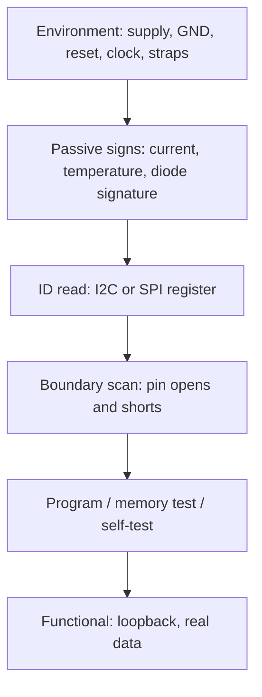

::: testing
Whether you have a **method** for deciding that an IC on a board is alive, correctly soldered and correctly configured, without a tester. The interviewer expects a ladder:

1. **Power and environment**: supply, ground, decoupling, reset, clock, strap pins.
2. **Passive signs of life**: current, temperature, protection-diode signature.
3. **Digital access**: ID registers over I2C/SPI, JTAG/boundary scan, programming and read-back.
4. **Function**: self-tests, loopback, reading real data.
5. **Isolation**: compare to a known-good, deplug, swap.
And the limits: you test the IC *as installed*, not its datasheet specs.
:::

::: why
In bring-up, "is this chip dead?" is the most common question, and wrongly blaming a part wastes days. A clean procedure finds the real cause: missing clock, floating reset, wrong strap, cold joint under a BGA. This is also how production tests IC presence at board level.
:::

::: concepts
- **Power/reset/clock triangle**: every digital IC needs all three.
- **Boundary scan (IEEE 1149.1)**: JTAG-based pin control and observation.
- **ID registers / WHO_AM_I**: simple proof of communication.
- **Protection diode signature**: DMM diode-mode on pins.
- **BIST/self-test**: on-chip test functions.
- **I2C/SPI basics**: simple register-access buses used for ID reads.
:::

::: answer
"I go in a ladder. First, power and basics: is the IC getting its supply at the pin, with ground, a stable reset, a running clock, and the right strap pins? I check those with a meter and scope. Second, passive signs of life: supply current in the expected range, and whether it warms up. I can also check the pin protection diodes with a multimeter in diode mode on the unpowered board: a normal pin reads about half a volt in one direction and open in the other, and a pin that reads zero or open both ways points to a damaged part or bad joint.

Third, digital access: read the device ID register over I2C or SPI, which proves the pins, the solder joints and the chip are working. For chips with JTAG, boundary scan can drive and read every pin and find opens and shorts even under a BGA. For microcontrollers I'd flash and read back firmware, and for memory I'd write and read patterns.

Fourth, function: run the chip's self-test or a loopback, and read real data.

If something's off, I compare with a known-good board or swap the part. Remember that this proves the IC works in my circuit, not that it meets every datasheet spec."
:::

::: technical
**Procedure.**
1. **Supply**: voltage at the IC pins (not the regulator) within tolerance; ripple; decoupling present.
2. **Reset/clock/straps**: reset deasserted after rails valid; oscillator running at the right frequency; boot/strap pins at intended levels.
3. **Current and thermal**: compare to datasheet idle/active current; thermal camera.
4. **Protection-diode signature (unpowered)**: DMM diode mode between a pin and GND, then reversed. Typical silicon clamp: about 0.4-0.7 V one way, open ("OL") the other; compare with a good board, since values vary by pin type and device.
5. **ID read**: I2C address ACK and WHO_AM_I; SPI JEDEC ID (0x9F) for flash.
6. **Boundary scan**: JTAG chain shift test (IDCODE), then EXTEST to drive and sense interconnect.
7. **Memory/MCU**: program and read back; memory pattern test.
8. **Functional/self-test**: BIST, loopback, ADC reading a known voltage.
9. **Isolation**: known-good comparison; cut/jumper to separate blocks.

**Example numbers.** 3.3 V rail within ±3 % is 3.20-3.40 V; reset released after rail good; oscillator within ±50 ppm of 16 MHz is 15.9992-16.0008 MHz.

> [!UNCERTAIN]
> Diode-signature voltages differ by device, pin and meter test current, and some pins have no clamp. Use comparison to a known-good board rather than absolute values.
:::

::: short
"I use a ladder: confirm supply, ground, reset, clock and strap pins at the IC; check supply current and temperature; use diode-mode checks on pins for a damage signature; read the ID register over I2C or SPI; use JTAG boundary scan where available; program and read back or run self-tests; and compare with a known-good board. A successful ID read proves the part and its solder joints work in the circuit."
:::

::: long
"I treat it as a ladder from cheap and safe to more involved.

Step one is the environment, because a good chip in a bad environment looks dead. I check supply voltage at the chip's pins, with a decent ripple, ground, reset released after the rails are good, the oscillator running at the right frequency, and the boot or strap pins at the right levels.

Step two is passive signs of life. I look at the supply current compared with the datasheet, and a thermal camera for a chip that's hot or stone cold. With the board unpowered I can use a multimeter's diode mode on signal pins: the clamp diodes to the rails usually show about half a volt one way and open the other. If one pin reads shorted, or open both ways, or differs from a known-good board, I suspect damage or a bad joint.

Step three is talking to it. I read the ID register over I2C or SPI, like WHO_AM_I or a flash JEDEC ID, and that proves the pins, solder joints and chip all work. If the part has JTAG, boundary scan can drive and read every pin, which finds opens and shorts even under a BGA. For a microcontroller I flash and read back; for memory I write and read patterns.

Step four is function: on-chip self-test, a loopback, an ADC reading a known voltage.

If it fails, I compare with a known-good board or swap the part. And I remember this shows the chip works in my circuit, not that it meets every datasheet limit."
:::

::: terms
- **Boundary scan / JTAG**: IEEE 1149.1 pin-level test access.
- **IDCODE**: JTAG device identification register.
- **WHO_AM_I**: ID register in many sensors.
- **JEDEC ID**: SPI flash identification command.
- **Strap pin**: pin sampled at reset to set mode.
- **BIST**: built-in self-test.
- **Clamp diode**: ESD protection diode on a pin.
- **Known-good board**: reference unit.
:::

::: exceptional
**Average**: "Check power and see if it responds."

**Exceptional**:
- Names the power/reset/clock/strap prerequisites.
- Uses diode-mode signature compared with a known-good.
- Reads ID registers and uses boundary scan for BGA.
- States that it proves the IC works in circuit, not to spec.
:::

::: mistakes
- **Measuring at the regulator, not the IC pins.**
- **Forgetting strap pins and reset.**
- **Blaming the IC when the clock isn't running.**
- **Using absolute diode values without a reference board.**
- **Assuming an ID read verifies everything.** It proves only that path.
:::

::: deep
## The ladder


Figure: Each rung assumes the one above passed. If the ID read fails, return to the first two rungs before suspecting the IC.

## Diode signature

```circuit
{"caption":"Typical input pin protection structure","elements":[
 {"t":"term","at":[0,5],"label":"pin","side":"left"},
 {"t":"wire","pts":[[0,5],[5,5]]},{"t":"dot","at":[5,5]},
 {"t":"D","a":[5,5],"b":[5,1],"label":"D_{up}"},
 {"t":"rail","at":[5,1],"label":"V_{DD}","dir":"up"},
 {"t":"D","a":[5,9],"b":[5,5],"label":"D_{dn}"},
 {"t":"wire","pts":[[5,9],[5,10]]},{"t":"gnd","at":[5,10]},
 {"t":"text","at":[8,5],"text":"IC input","anchor":"start","muted":true}
]}
```
Figure: Many pins have a diode up to VDD and a diode down from ground. With the board unpowered a meter in diode mode forward-biases D_dn when its positive lead is on GND and negative lead is on the pin, typically reading a few tenths of a volt; the reverse polarity goes through D_up and the rail's decoupling and may read differently. Compare with a good board.

## Reading an ID: SPI flash example

```timing
{"signals":[{"name":"CS_N","wave":"1.0................1"},{"name":"SCK","wave":"0.pppppppppppppppp0."},{"name":"MOSI","wave":"x.=.......x.........","data":["0x9F"]},{"name":"MISO","wave":"z.........=.......z.","data":["ID"]}],"hscale":0.7}
```
Figure: The master sends the 0x9F read-ID command on MOSI during the first 8 clocks; the flash answers on MISO in the next bytes. Any valid ID means supply, clock, CS, MISO/MOSI wiring and solder joints are all working.

## Boundary scan

An IEEE 1149.1 chain lets a tester shift patterns into each pin cell and read them back (EXTEST). Opens and shorts between devices show up even for BGA balls you cannot touch. Needs JTAG pins routed to a header or test pads.

## Programming and memory

Flash the MCU and read back; checksums verify the content. For RAM, write walking patterns; address/data line faults show as aliasing.

## Functional checks

Self-test registers, loopback on serial ports, ADC on a known reference (e.g. 1.000 V ± error).

## Limits

You see the IC in circuit; you cannot verify speed grades, leakage, or full spec limits here; production uses ATE and burn-in for that.

> [!INTERVIEW]
> Mention "WHO_AM_I read" - it's a classic.
:::

::: applications
- **Sensor boards** with WHO_AM_I checks.
- **BGA processors** verified by boundary scan.
- **Flash devices** verified by JEDEC ID.
- **Production lines**: programming and ID verification.
- **Field diagnostics**: self-test at power-up.
:::

::: assumptions
- Digital IC with standard serial interface.
- JTAG available only on some parts.
- Diode checks are comparative.
:::

::: followups
### What does a successful I2C ACK tell you?
The address matched and the device is powered and wired on SDA/SCL; it doesn't prove other pins.

### What if the ID read fails?
Check power at the pins, pull-ups, address, clock, bus levels on a scope, and whether the device is in reset; then compare boards.

### How does boundary scan find an open BGA ball?
It drives a value on one pin and reads it at the connected pin of another device; no change means an open.

### Why compare diode readings to a good board?
Clamp structures differ per pin; the board-to-board difference reveals damage.

### Scenario: MCU ID reads fine but ADC readings are noisy. What next?
Check analog supply and reference decoupling, grounding and layout, then compare to another unit.
:::

::: interpretations
"Board-level" means the IC installed on the PCB, not tested on ATE.
:::

::: references
- IEEE 1149.1, Standard Test Access Port and Boundary-Scan Architecture.
- JEDEC flash ID conventions and device datasheets.
- NXP UM10204, I²C-bus specification.
- Horowitz & Hill, *The Art of Electronics*, digital interfacing.
:::

::: rubric
- Power/reset/clock/straps first :: prerequisites.
- Current/thermal/diode checks :: passive.
- ID read :: communication proof.
- Boundary scan :: BGA access.
- Programming/self-test :: function.
- Known-good comparison; limits :: judgment.
:::

::: quiz
```json
[
 {"type":"mcq","level":"fundamental","q":"What does reading a correct WHO_AM_I register prove?","options":["The chip meets all specs","The chip is powered and communicating over that interface","The PCB passes EMC","Nothing"],"answer":1,"explain":"It proves power, wiring and communication for that path."},
 {"type":"mcq","level":"fundamental","q":"What does boundary scan help find under a BGA?","options":["Solder opens and shorts","Resistor values","Soldermask thickness","Via aspect ratio"],"answer":0,"explain":"It drives and reads pins without physical access."},
 {"type":"numeric","level":"intermediate","q":"16 MHz oscillator ±50 ppm: maximum allowed frequency in MHz?","answer":16.0008,"tolerance":0.00001,"unit":"MHz","explain":"16 × (1 + 50e-6) = 16.0008 MHz."},
 {"type":"truefalse","level":"intermediate","q":"Diode-mode readings on pins should be judged against absolute values only.","answer":false,"explain":"Compare with a known-good board; clamps vary."},
 {"type":"mcq","level":"advanced","q":"An SPI flash returns all 0xFF on ID read. Most likely...","options":["Good device","MISO floating or device not responding","Perfect timing","Wrong colour"],"answer":1,"explain":"A floating/pulled-up MISO reads 0xFF; check power, CS, mode."}
]
```
:::
