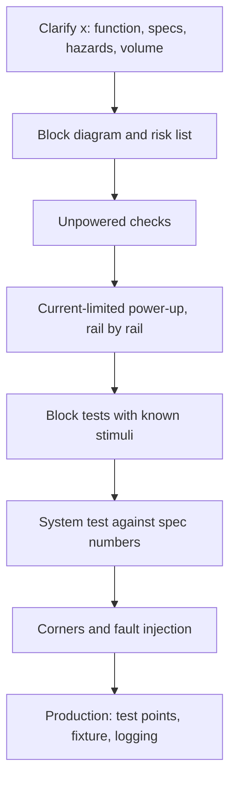

::: basics
### In plain words
This question gives you a board "x" you have never seen and asks how you would test it. The interviewer is not checking your knowledge of x. They want your method: ask what the board must do, then test it in safe stages from easy to hard, with numbers that define pass and fail.

### Picture it
Think of a home inspector walking into an unfamiliar house. First they ask what the house is for and what worries you. Then they check the building before turning anything on, switch the power on carefully one circuit at a time, test each room, and finally try everything together. A good test plan has the same order, and every check has a written pass mark. The analogy has one gap: a board can be damaged in a second, so the careful power-up matters more.

### Words you need
- **Block diagram**: a simple drawing of the board's main parts and how they connect.
- **Bring-up**: the first power-on and first checks of a new board.
- **Current limit**: a setting on the bench supply that caps the current, so a fault cannot burn the board.
- **Pass/fail limits**: the numeric range that counts as good.
- **Fault injection**: causing a fault on purpose, such as shorting an output, to see if protection works.
- **Test points**: small pads on the board where probes attach easily.

### The simplest example
Say x is a 12 V to 3.3 V power board feeding 1 A. The output power is 3.3 W. At 90 % efficiency the input power is about 3.67 W, so the input current is about 0.31 A. You would set the supply's current limit near 0.5 A, check that the output stays within 3.20 V to 3.40 V, then test with the real load. That is the whole idea. The rest of this page adds the full staged plan, ordering tests by risk, how to adapt to other kinds of board, and the measurement traps that make good boards look bad.
:::

::: testing
This is a template question: "given a PCB with **x**, how would you test it?" The interviewer will substitute x (a motor driver, an ADC front end, an RF module, a battery charger). They are testing your **process**, not x. A strong answer:

1. Asks clarifying questions (what does it do, specs, volume, risks, what's measurable).
2. Builds a plan from the block diagram: unpowered, power, each block, whole system.
3. Defines pass/fail numbers, instruments and safety limits.
4. Covers corners, fault cases and (if volume) test strategy and DFT.
5. Adapts to x's hazards (high voltage, RF, thermal, analog precision).
:::

::: why
Engineers get handed a new board weekly. The ability to produce a test plan from a block diagram, quickly and safely, with numeric limits, is what separates a bench engineer from someone who "pokes around". It also shows system thinking.
:::

::: concepts
- **Block-diagram decomposition**: test each block, then integrate.
- **Test hierarchy**: [[q0586]] stages.
- **Expected values and limits**: [[q0587]].
- **IC and component checks**: [[q0590]], [[q0591]].
- **Design for test**: [[q0616]].
- **Safety**: current limit, isolation, ESD.
:::

::: answer
"I'd start by asking what x is and what it has to do: the specs, the hazardous parts like high voltage or high current, and whether this is a one-off prototype or a production run. Then I'd redraw the block diagram and test it in layers.

First, no power: visual inspection, rail-to-ground resistance, and a polarity check. Second, power-up with a current limit, bringing up one rail at a time if I can split them, checking voltage, ripple, sequencing and reset. Third, each block on its own: for example the clock, then the communication to each chip, then the sensor or driver outputs against known inputs. Fourth, the whole system doing its job against the spec, with numbers: accuracy, bandwidth, efficiency, whatever matters. Fifth, stress and corners: supply min and max, temperature, load steps, and fault injection like a short on an output.

I'd define pass and fail numbers up front, use the right instruments, and log results. If there are many boards, I'd add test points and a fixture so it can be automated. For x specifically, I'd adapt: for a power stage, efficiency and load transients; for a sensor board, calibration against a reference; for RF, a spectrum analyser or VNA."
:::

::: technical
**Framework.**
1. **Clarify**: function, specs, voltage/current/power, interfaces, environment, volume, risks.
2. **Decompose**: block diagram (power tree, clocks, digital, analog, interfaces, protection).
3. **Unpowered**: inspection, X-ray if BGA, rail-to-ground resistance, polarity, continuity.
4. **First power**: bench supply, current limit about 1.5-2× expected, staged rails; verify tolerance, ripple, sequencing, reset.
5. **Block tests**: clocks; IC ID reads/JTAG; analog blocks with known stimuli; drivers with dummy loads.
6. **System tests**: end-to-end function against spec numbers.
7. **Margin/corner**: supply ±10 %, temperature range, load transients, EMC pre-scan, fault injection.
8. **Production**: test points, ICT/FCT fixture, programming, logging.

**Worked numbers (example x = 12 V to 3.3 V buck + MCU + IMU board).** Expected load 1 A at 3.3 V: $P_{out}=3.3$ W; at 90 % efficiency $P_{in}=3.67$ W, $I_{in}=3.67/12=0.31$ A, so set the input limit to about 0.5 A. Rail tolerance ±3 %: 3.20-3.40 V. Ripple limit e.g. 30 mV pk-pk. Load step 0.1 to 1 A: droop under 100 mV and recovery within the control loop settling. Efficiency measured as $V_{out}I_{out}/(V_{in}I_{in})$ at several loads.

**Adaptations.** High voltage: isolation, discharge, one-hand rule. RF: VNA/spectrum, matching, 50 Ω terminations. Precision analog: reference source, noise floor, shielding, calibration. Motor driver: dummy load, current limit, shoot-through check at low voltage. Battery: protection tests with simulated cells.

> [!NOTE]
> A switching regulator draws *more* input current as its input voltage falls, and it needs extra current at start-up to charge the input and output capacitors. If the bench limit is too tight, the supply drops into constant-current mode, its voltage sags, and the converter can hang at a low input voltage. If start-up stalls at the limit with no hot spot anywhere, raise the limit a little before hunting for a short.

> [!UNCERTAIN]
> The efficiency and limit numbers are an example; use the actual board's datasheet and requirements.
:::

::: short
"I'd first ask what x is, its specs and hazards, and whether it's a prototype or production. Then I'd decompose the block diagram and test in layers: unpowered checks, current-limited power-up with rail, ripple and sequencing checks, each block with known stimuli, the full system against numeric specs, then corners and fault injection. For production I'd add test points and a fixture. I'd adapt the instruments to x: efficiency for power, calibration for sensors, VNA for RF."
:::

::: long
"This is really about process, so I'd start by clarifying: what is x supposed to do, what are the specs, are there hazards like high voltage or high current, and is this one prototype or a production run?

Then I'd redraw the block diagram and test in layers. Layer one, unpowered: visual and X-ray inspection, rail-to-ground resistance, polarity checks. Layer two, first power: a bench supply with a current limit. Say it's a 12 volt to 3.3 volt buck feeding a 1 amp load; at 90 percent efficiency that's about 0.31 amps in, so I'd limit to 0.5. I'd bring up rails one at a time if I can, and check voltage within tolerance, ripple, sequencing and reset.

Layer three, each block alone: confirm the clock, read each chip's ID over its bus, drive analog inputs with a known reference and check outputs, run drivers into a dummy load. Layer four, the whole system against the spec with numbers: accuracy, efficiency across load, bandwidth, whatever matters. Layer five, stress: supply high and low, temperature, load steps, and fault injection like shorting an output to see protection works.

I'd write down pass and fail limits first, log results, and for volume add test points and a fixture so it can be automated. And I'd tailor to x: for RF, a VNA and spectrum analyser; for a sensor, calibration against a traceable reference; for high voltage, isolation and discharge safety first."
:::

::: terms
- **Block diagram**: functional decomposition of the board.
- **Bring-up**: first power and function checks.
- **Pass/fail limits**: numeric acceptance criteria.
- **Dummy load**: resistive load emulating the real one.
- **Fault injection**: deliberately creating a fault to test protection.
- **Corner testing**: extremes of voltage/temperature/load.
- **Fixture**: production test interface.
- **DFT**: design for test.
:::

::: exceptional
**Average**: "Check it powers on and works."

**Exceptional**:
- Asks clarifying questions and states assumptions.
- Decomposes the block diagram and orders tests by risk.
- Gives numeric limits (a current limit calculation, tolerances).
- Includes corners, fault injection and production considerations.
- Adapts to x with the right instruments and safety measures.
:::

::: mistakes
- **Powering the whole board at once.** One fault then hides behind another and can damage several blocks. Bring up rails one at a time where the design allows.
- **Skipping clarifying questions.** The plan for a motor driver and an ADC front end differ completely. Ask what x does, its specs and its hazards first.
- **No numeric pass/fail.** "Looks OK" can't be repeated or automated. Write limits before measuring.
- **Testing only the happy path.** Protection and corner behaviour are where products fail. Include supply and temperature corners and fault injection.
- **Ignoring safety for high-voltage or battery boards.** Stored energy can hurt you or start a fire. Plan isolation, discharge and current limits first.
:::

::: deep
## The plan as a flow


Figure: Each stage gates the next. The clarifying step and the risk list tailor the generic flow to x.

## Worked example: x = 12 V buck + MCU + IMU board

| Block | Test | Instrument | Pass |
|---|---|---|---|
| Input | reverse polarity protection, input current at idle | bench supply | no damage, I < limit |
| Buck 3.3 V | voltage, ripple, load step 0.1→1 A | DMM, scope | 3.20-3.40 V, <30 mV pp, droop <100 mV |
| Efficiency | $V_{out}I_{out}/(V_{in}I_{in})$ at 10, 50, 100 % load | DMM ×2, load | >85 % at 1 A (example) |
| MCU | reset, clock, program, read back | debugger | pass |
| IMU | WHO_AM_I, still-offset, noise | host script | within datasheet |
| Whole | log sensor data while moving | fixture/turntable | matches reference |
| Corners | 9-15 V in, 0-60 °C | chamber | functions |
| Faults | short 3.3 V output | bench | protection trips, no damage |

First-power numbers: $I_{in}=\frac{3.3\ \text{W}}{0.9\cdot12\ \text{V}}=0.31$ A so limit 0.5 A.

```plot
{"title":"Input current of a 12 V to 3.3 V buck vs load (90 % efficient) and the 0.5 A limit","x":{"label":"Load current","unit":"A","min":0,"max":1.6},"y":{"label":"Input current","unit":"A","min":0,"max":0.6},
 "vars":{"vo":3.3,"vi":12,"eff":0.9},
 "series":[{"label":"I_in = Vo·Io/(eff·Vin)","fn":"vo*x/(eff*vi)"}],
 "hlines":[{"at":0.5,"label":"0.5 A limit","color":"orange"}],
 "points":[{"x":1,"y":"vo*1/(eff*vi)","label":"1 A load: 0.31 A in"}]}
```
Figure: With efficiency held at 90 %, input current grows linearly with load (real efficiency falls at light load, so the low end is a little higher). The 0.5 A limit leaves headroom up to about 1.6 A of load but catches a gross fault on the input side.

## Adapting to different x

- **Motor driver**: test with a dummy load and low voltage first; check dead-time/shoot-through; current-limit trip; thermal.
- **ADC front end**: apply a precision reference; measure offset, gain, noise (histogram), linearity; check anti-alias filter.
- **RF module**: VNA for matching ($S_{11}$), spectrum for harmonics, power meter; 50 Ω terminations.
- **Battery/charger**: use a bench source emulating a cell, test protection thresholds, charge termination, thermal.
- **High-speed interface**: eye diagram, TDR, loopback.
- **High voltage**: isolation test, discharge, creepage verification, safe probes.

## Order the tests by risk, not by convenience

The generic flow is a default, not a law. What earns the order is a short risk list: for each block, how likely is it to be wrong, and how badly does it hurt when it is? A reversed protection diode on a 48 V input is low-probability but expensive, so it goes before power-up. A mis-strapped boot pin is high-probability and cheap, so it can wait until the rails are good. Sorting on likelihood times consequence also tells you what to automate first when you later write the production test.

| Risk | Likelihood | Consequence | Where it goes in the plan |
|---|---|---|---|
| Solder short between a rail and ground (fine-pitch parts, BGAs) | high on a first build | burns the board | Unpowered resistance checks, then current-limited power |
| Wrong footprint or reversed polarized part | medium | smoke, or a dead part | Visual check and polarity check before any power |
| Regulator unstable or sequenced wrong | medium | latch-up in downstream ICs | Rail-by-rail bring-up with the scope on enable and power-good |
| Firmware cannot talk to a peripheral | high | none, only time | Block tests, after the rails are known good |
| Out-of-spec accuracy or noise | medium | product fails its spec | System test with a reference, then corners |

## Why the current limit is a number, not a feeling

The 0.5 A limit in the example comes from the expected draw, but it hides a trap that is worth knowing cold. A switching regulator is close to a **constant-power load**: the converter tries to deliver 3.67 W at its input whatever the input voltage is, so

$$I_{in} = \frac{P_{in}}{V_{in}} = \frac{V_{out}I_{out}}{\eta\,V_{in}}$$

falls as $V_{in}$ rises and climbs as it drops. Setting the limit to 0.5 A means the supply leaves constant-voltage mode as soon as $I_{in}$ reaches 0.5 A, which happens at

$$V_{in} = \frac{P_{in}}{I_{lim}} = \frac{3.67\ \text{W}}{0.5\ \text{A}} = 7.33\ \text{V}$$

Below 7.33 V the supply cannot hold its voltage, and with the converter pulling more current as the input sags, the voltage collapses further. That is why a brownout sweep (slowly lowering the input) can look like a board defect when it is really your limit. The 9 V corner is safe: $3.67/9 = 0.41$ A. The point is to know where the knee is before you start the sweep.

```plot
{"title":"A constant-power load pulls more current as the input falls","x":{"label":"Input voltage","unit":"V","min":5,"max":16},"y":{"label":"Input current","unit":"A","min":0,"max":0.8},
 "vars":{"p":"3.3/0.9"},
 "series":[{"label":"I_in = 3.67 W / V_in","fn":"p/x"}],
 "hlines":[{"at":0.5,"label":"0.5 A limit","color":"orange"}],
 "vlines":[{"at":"p/0.5","label":"limit hit at 7.33 V","color":"orange"}],
 "points":[{"x":9,"y":"p/9","label":"9 V corner: 0.41 A"},{"x":12,"y":"p/12","label":"12 V: 0.31 A"}]}
```
Figure: The input current is a hyperbola in input voltage for a fixed 1 A, 3.3 V load. The 9 to 15 V corner range sits comfortably below the limit, but a deliberate brownout test crosses it at 7.33 V, where the bench supply flips to constant-current and the rail sags.

The start-up transient adds a second term. The output capacitor must be charged through the soft-start ramp: for $C_{out} = 100\ \mu$F ramped to 3.3 V in 2 ms, $I = C\,dV/dt = 100\ \mu\text{F}\times 3.3\ \text{V}/2\ \text{ms} = 0.165$ A of extra output current, which reflects to about 0.05 A at the 12 V input. The input capacitor is the other piece: a 22 µF cap charged to 12 V through a 0.5 A limit takes $CV/I = 22\ \mu\text{F}\times12/0.5 = 0.53$ ms, a short burst the limit will simply clamp. So the limit survives start-up, but only because the soft-start is slow. A converter with no soft-start into a big load capacitance is exactly the case where "stalls at the limit with no hot spot" shows up.

## Measuring the numbers honestly

A pass/fail limit is only as good as the measurement behind it, so the plan has to say how each number is taken.

- **Ripple.** Use the probe tip and barrel (or a coax tip) at the output capacitor, with the scope bandwidth limited to 20 MHz for the ripple figure. A six-inch ground lead is roughly 150 nH (rule of thumb, about 1 nH per mm), which is $2\pi\times30\ \text{MHz}\times150\ \text{nH}\approx28\ \Omega$ at a 30 MHz ring. That loop picks up the switch-node edge and shows spikes that are not on the rail. If a 30 mV pp limit fails with a long lead and passes with a short one, the board is fine and the measurement was wrong.
- **Efficiency.** Take $V_{in}$ at the board terminals, not at the supply display. A series ammeter with a 0.2 V burden at 0.306 A costs 61 mW, 1.7 % of the 3.67 W, so using the supply's 12 V instead of the board's 11.8 V makes a converter that is really 91.5 % efficient read 90.0 %. Use a shunt with Kelvin sensing or a source that reports at the sense point.
- **Load steps.** Drive them with an electronic load or a MOSFET and a pulse generator, with the slew rate set to what the real load can do. A 0.1 to 1 A step in 1 µs is far harsher than one in 100 µs, and the droop you measure depends on it.
- **Guard bands.** If the spec is 3.20 to 3.40 V and your DMM is good to 0.1 % of reading (3.3 mV, an assumption), a board that reads 3.201 V could really be 3.198 V. Setting the production limit at 3.205 to 3.395 V keeps escapes out. State the uncertainty you assumed.

> [!UNCERTAIN]
> Meter accuracy, probe ground-lead inductance and scope bandwidth settings vary by instrument. The figures above are typical orders of magnitude; read your own instrument's datasheet before writing them into a test report.

## What a good test plan document contains

Whatever x turns out to be, write the plan down so another engineer can repeat it. Each test gets an ID, the block under test, the setup (supply, load, firmware version), the instrument and its range, the numeric limit, and the action on fail. Keep a column for what each test would catch, because that exposes gaps: if no test would catch a cold solder joint on the IMU's I²C pull-up, a missing test is the problem, not the pull-up. Record the serial number, date, and fixture for every board. When the first ten boards show the same failure at the same step, the log tells you whether it is a design bug or a build defect, which is the real payoff of a plan over poking around.

## Production

Add test points on rails, clocks, key signals ([[q0616]]), a programming header, boundary scan, and design a fixture; log every board's results.

> [!INTERVIEW]
> Always start with questions: "What are the specs, is it for production, and what could hurt me or the board?"
:::

::: applications
- **New board bring-up.**
- **Contract manufacturer test plans.**
- **Design verification test reports.**
- **Failure analysis workflows.**
- **Acceptance testing by customers.**
:::

::: assumptions
- x unspecified; a generic mixed-signal board is used for numbers.
- 90 % efficiency and ±3 % tolerance are example values.
- Instruments available: bench supply, DMM, scope, load.
:::

::: followups
### What do you do if the board draws too much current at first power?
Power off, find the rail by resistance and thermal camera, inject limited current to locate the short, then inspect/remove parts.

### How do you decide the current limit?
Compute expected input current from load and efficiency, then set about 1.5-2× that; tighten after learning real draw.

### How would you test with x = an RF module?
Check supply and ripple, then VNA for S11 into 50 Ω, spectrum for output power and harmonics, receiver sensitivity with a signal generator.

### What changes for production volumes?
Automation: test points, fixtures, programming, logging, cycle-time and coverage targets. See [[q0614]].

### Scenario: x is a battery charger and it fails only when the battery is nearly full. How do you test?
Emulate the cell with a programmable source/electronic load, sweep voltage near termination, check the constant-voltage regulation and termination current threshold with logging, and check thermal.
:::

::: interpretations
"x" is a placeholder: the interviewer supplies the board type. This page gives the framework and adapts it to several examples. If x is unspecified, state your assumption.
:::

::: references
- Horowitz & Hill, *The Art of Electronics*, practical measurement and bring-up.
- IPC-A-610 and IPC-9252 for assembly and bare-board test.
- Device datasheets for pass/fail limits.
- IEEE 1149.1 for boundary scan where applicable.
:::

::: rubric
- Starts by clarifying what x does, its specs, hazards and volume :: The interviewer is testing process, and the plan depends on these answers.
- Decomposes the board into blocks from the block diagram and orders tests by risk :: Shows structured, system-level thinking.
- Uses a safe, staged, current-limited power-up with a calculated limit :: Protects the hardware and shows you can put numbers on it.
- Tests each block with known stimuli, then the whole system against numeric specs :: Moves from "alive" to "meets spec".
- Includes corners and fault injection :: Robustness is where real products fail.
- Mentions production test and DFT, and adapts instruments and safety to x :: Shows breadth and judgment beyond a single prototype.
:::

::: quiz
```json
[
 {"type":"mcq","level":"fundamental","q":"What should you do first when asked to test an unfamiliar board 'x'?","options":["Apply full power","Clarify function, specs and hazards","Replace all capacitors","Run EMC testing"],"answer":1,"explain":"The plan depends on what x does and what could go wrong."},
 {"type":"numeric","level":"intermediate","q":"A buck delivers 3.3 V at 1 A from 12 V at 90 % efficiency. Input current in A?","answer":0.306,"tolerance":0.02,"unit":"A","explain":"Pin = 3.3/0.9 = 3.667 W; Iin = 3.667/12 = 0.306 A."},
 {"type":"numeric","level":"intermediate","q":"Efficiency if Vin=12 V, Iin=0.35 A, Vout=3.3 V, Iout=1 A, in percent?","answer":78.6,"tolerance":0.02,"unit":"%","explain":"3.3/(12×0.35) = 3.3/4.2 = 78.6 %."},
 {"type":"truefalse","level":"intermediate","q":"Fault injection (e.g. shorting an output) is part of a thorough test plan.","answer":true,"explain":"It verifies protection works and the failure is safe."},
 {"type":"mcq","level":"advanced","q":"For a high-voltage board, what comes before probing?","options":["Safety: isolation, discharge, safe probes","Firmware flashing","Cosmetic inspection only","Raising the current limit"],"answer":0,"explain":"Safety measures protect people and the board."}
]
```
:::
