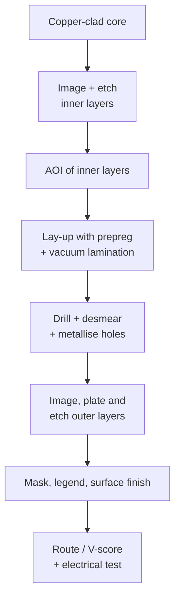

::: basics
### In plain words
A bare circuit board is made in a factory by a fixed series of steps. It starts as a sheet of fiberglass with copper on both sides. The factory removes the copper it does not need, glues layers into one stack, and drills holes that are then coated with copper to connect the layers. It adds a protective coating and a finish, cuts the board out and tests it. Each step has limits, and those limits become design rules.

### Picture it
Think of plywood: thin sheets glued under heat and pressure into one slab, like a board's layers. Now think of a stencil and a sandblaster: cover what you want to keep, then blast away the rest. Traces, the thin copper wires on a board, are made that way, with chemicals instead of sand. The chemicals also eat sideways a little, which is why very thin lines and gaps are hard to make.

### Words you need
- **Copper-clad laminate**: a fiberglass-epoxy sheet with copper foil bonded to its faces.
- **Photoresist**: a light-sensitive coating that hardens where light hits it, so it shields the copper below.
- **Etching**: dissolving the copper that is not shielded.
- **Prepreg**: glass cloth soaked in partly cured glue, used to bond layers during pressing.
- **Plated through-hole**: a drilled hole whose wall is coated with copper so it connects layers.
- **Aspect ratio**: board thickness divided by hole diameter.

### The simplest example
Take a 1.6 mm thick board. With a 0.2 mm drilled hole the aspect ratio is 1.6 / 0.2 = 8, written 8:1. With a 0.3 mm hole it is about 5.3:1. Copper must be plated onto the wall deep inside the hole, and a narrow, deep hole is harder for the plating chemicals to reach. So the 0.3 mm hole is the easier, cheaper one to make well. That is the whole idea: each process step sets a limit, and the limit becomes a design rule. The rest of this page walks through every step in order, from inner layers to final test.
:::

::: testing
Whether you know that a PCB is a *manufactured product* with a process behind it, not just a CAD file. The interviewer wants to hear the sequence (inner layers, lamination, drilling, plating, outer layers, mask, finish, routing, electrical test) and, more importantly, that you know which steps create design rules: minimum drill, aspect ratio, annular ring, trace/space, copper weight. Candidates who connect "why is there a minimum trace width?" to "because we etch copper away and the sidewall undercuts" are showing real fab awareness, not memorised steps.
:::

::: why
Every layout decision ends up as a line on a fab drawing: via size, trace/space, stackup, finish. If you ignore the process you get boards that cost double, yield badly, or cannot be built at all. Hardware interns are expected to send a Gerber/ODB++ package to a fab house, answer the CAM engineer's questions, and read a DFM report. Knowing the process also explains failure modes later: cracked barrels, copper voids, delamination, solder-mask slivers. This page covers bare-board *fabrication*. Populating the board with parts is assembly, in [[q0597]].
:::

::: concepts
- **Laminate and prepreg**: cured FR-4 core with copper foil on both sides, and uncured "prepreg" glass-resin sheets that glue layers together under heat and pressure. See [[q0575]] for materials.
- **Subtractive etching**: start with copper everywhere, protect what you want with a resist, dissolve the rest.
- **Photolithography**: a photosensitive resist plus artwork (film or laser direct imaging) defines the pattern.
- **Plated through-hole (PTH)**: a drilled hole made conductive by chemical deposition and then electroplating. This is how layers connect. See [[q0583]].
- **Surface finish**: a final metal coating (HASL, ENIG, OSP, immersion silver/tin) that protects copper and stays solderable.
- **Fab drawing / design rules**: the minimum trace/space, drill, annular ring and aspect ratio the process can hold.
:::

::: answer
"I think of it as building the inside first and the outside last. A fab starts with copper-clad laminate, which is fiberglass-epoxy with copper foil on both sides. For a multilayer board they image and etch the inner layers first: coat with photoresist, expose the pattern with UV, develop, etch away the unprotected copper, strip the resist. Then they inspect those layers optically, because after lamination you can't fix them.

Next the layers are stacked with prepreg between them and pressed under heat and pressure so it melts, flows and cures into one solid board. Then they drill the holes, mechanically for normal vias and by laser for microvias, clean the resin smear out of the holes, and deposit a thin conductive layer so the barrels can be electroplated with copper. After that the outer layers get imaged and plated, then etched. Solder mask goes on next, as a green epoxy that leaves only the pads open, then silkscreen, then a surface finish like ENIG or HASL on the exposed copper. Finally the boards are routed or scored out of the panel and electrically tested for opens and shorts.

For me the point of knowing this is design rules. Minimum trace/space comes from etching, minimum via size and aspect ratio come from drilling and plating, and that's what drives cost."
:::

::: technical
**Typical multilayer flow (subtractive, tent-and-etch / pattern-plate variants):**

1. **CAM and tooling.** Gerber/ODB++ is checked against the fab's rules; artwork and drill/route files are generated; the board is placed on a production panel (typically with rails, tooling holes and coupons).
2. **Inner layers.** Clean copper-clad core, laminate dry-film photoresist, expose (laser direct imaging or film), develop, etch (cupric chloride or alkaline etchant), strip. Automated optical inspection of each layer.
3. **Oxide / adhesion treatment** of inner copper so the resin bonds.
4. **Lay-up and lamination.** Core, prepreg, outer foil stacked, registered with pins or optical alignment, pressed under vacuum at elevated temperature (roughly 170-190 °C for common FR-4, vendor dependent) until the resin cures.
5. **Drilling.** Carbide microdrills for through holes; laser (CO₂ or UV) for blind microvias.
6. **Desmear and metallisation.** Remove drill smear, then electroless copper (or direct-metallisation) coats the hole walls and gives a seed layer.
7. **Outer layers.** Image resist, electroplate copper (typically targeting about 20-25 µm average hole-wall copper; the class in IPC-6012 sets the limit), plate a tin or tin-lead etch resist (pattern plating) or tent the holes, then etch and strip.
8. **Solder mask** (liquid photoimageable epoxy), **legend** (silkscreen or inkjet).
9. **Surface finish.**
10. **Profile (route, V-score), electrical test** (flying probe or bed-of-nails netlist test for opens/shorts), final inspection, cross-section coupons, packing.

**Process limits that become design rules.** Etch removes copper from the sides as well as down, so a thicker foil needs wider spacing: a rough etch factor of 3 on 35 µm copper undercuts about 12 µm per edge. Plating throws better into holes with lower aspect ratio (board thickness / drill diameter): 1.6 mm / 0.2 mm is 8:1, and 1.6 mm / 0.3 mm is 5.3:1. A 0.3 mm hole with 25 µm walls in a 1.6 mm board has a barrel resistance of roughly $\rho L/A \approx 1.2\ \text{m}\Omega$.

> [!UNCERTAIN]
> Lamination temperatures, plating thickness targets and capability numbers (minimum drill, trace/space, aspect ratio) differ by fab house and by IPC class. Treat the figures here as typical, and use your chosen vendor's published capability sheet for real designs.
:::

::: short
"A PCB starts as copper-clad fiberglass. Inner layers are patterned with photoresist and etched, then stacked with prepreg and laminated under heat and pressure. Holes are drilled and plated to connect the layers, the outer layers are patterned and etched, solder mask and silkscreen go on, a surface finish like ENIG or HASL protects the pads, and the boards are routed out of the panel and electrically tested for opens and shorts. The limits of etching, drilling and plating become the design rules I follow, like trace/space and aspect ratio."
:::

::: long
"I'll walk it in the order a fab does it. Everything starts with copper-clad laminate, which is a fiberglass-epoxy core with copper foil bonded to both sides. For a multilayer board the inner layers are made first. The fab laminates a photosensitive film on the copper, exposes it with UV through the artwork, or with a laser imager now, develops it so the film stays where I want copper, and then etches away everything else. After stripping the film they run optical inspection on every inner layer, because once the board is pressed together those layers are buried.

Next is lamination. The etched cores and sheets of prepreg, which is glass cloth soaked in partly cured resin, are stacked with outer copper foil and pressed under vacuum and heat. The resin flows into the gaps between traces and cures, so you get one solid slab.

Then drilling. Standard vias are mechanically drilled with tiny carbide bits; microvias are usually laser drilled. The holes are cleaned of resin smear and coated with a thin chemical copper layer so they conduct, and then electroplated until the barrel is thick enough to survive thermal cycling.

The outer layers get imaged and etched the same way as the inner ones. After that comes solder mask, which is the green coating with openings only at pads, then silkscreen text, and a surface finish on the exposed copper, like HASL, ENIG or OSP, so pads stay solderable.

Last, the board is routed or V-scored out of its panel and electrically tested for opens and shorts. As a designer the key takeaway is that each step has limits, and those limits are my design rules: trace/space, drill size, aspect ratio, annular ring, copper weight. If I stay inside the fab's standard capability the board is cheaper and yields better."
:::

::: terms
- **Core / prepreg**: cured laminate with copper on both sides / uncured resin-glass sheet used as glue between layers.
- **Photoresist**: light-sensitive film that protects copper during etching.
- **LDI (laser direct imaging)**: exposing resist with a scanned laser instead of film artwork.
- **Desmear**: chemical or plasma cleaning of resin smear from drilled holes before plating.
- **Aspect ratio**: board thickness divided by finished drill diameter, a plating limit.
- **Annular ring**: copper left around a drilled hole; covers drill wander and registration error.
- **Solder mask**: epoxy coating that stops solder bridging and protects copper.
- **ENIG / HASL / OSP**: electroless nickel-immersion gold / hot-air solder levelling / organic solderability preservative, the common surface finishes.
- **Tenting**: covering a plated hole with dry film so the etchant doesn't attack it.
:::

::: exceptional
**An average answer** lists "etch, drill, plate, mask, silkscreen" with no order or reason.

**An exceptional answer**:
- Separates inner-layer processing from lamination and outer-layer processing, and says *why* inner layers are inspected before lamination.
- Names the key mechanisms: photolithography and subtractive etching, desmear plus electroless/electrolytic copper for vias, prepreg flowing and curing.
- Connects each step to a design rule: etch undercut to trace/space, drilling and plating to aspect ratio and annular ring, lamination to symmetric stackups and warp.
- Mentions surface finish trade-offs (ENIG flat for fine pitch, HASL cheap but uneven) and electrical test at the end.
- Is honest about vendor-dependent numbers instead of quoting them as universal.
:::

::: mistakes
- **Saying copper is "printed" or "deposited" onto the board.** Most boards start with foil and *remove* copper (subtractive). Additive and semi-additive processes exist, mainly for very fine HDI features, but they aren't the default story.
- **Putting drilling before lamination for everything.** Through vias are drilled after lamination; only buried vias are drilled and plated in a sub-stack first.
- **Forgetting the hole metallisation step.** A drilled hole is just insulator; it needs desmear and a conductive seed before plating.
- **Treating the surface finish as cosmetic.** It sets solderability, shelf life, flatness for fine-pitch parts, and cost.
- **Mixing up fabrication and assembly.** Fab makes the bare board; assembly (paste, placement, reflow) populates it. See [[q0597]].
- **Quoting fixed capability numbers.** Minimum trace/space and drill depend on copper weight, board thickness and the fab. Always say "typical" and check the vendor.
:::

::: deep
## The big picture

A PCB is a sandwich of patterned copper and insulating glass-epoxy. The fab's job is to make that sandwich with every net connected exactly as in the netlist and no accidental connections. The whole process can be thought of as three repeating moves: **pattern copper**, **bond layers**, and **connect layers with holes**.


Figure: The fab flow for a standard multilayer board. Everything above the lamination step is done on separate thin cores; everything below happens on the finished slab. That is why a buried-layer mistake is unfixable but an outer-layer one can sometimes be reworked.

## Step 1: Patterning copper (photolithography and etch)

Copper foil comes in weights quoted in ounces per square foot: 1 oz of copper spread over one square foot is about 34-35 µm thick (I computed 34.1 µm from density 8.96 g/cm³; the industry round number is 35 µm or 1.4 mil). Inner layers often use 0.5 oz or 1 oz.

To pattern it:

1. Laminate a dry-film **photoresist** onto the copper.
2. **Expose** with UV through the artwork (film) or with a scanned laser (LDI). Where light hits, the resist polymerises and becomes etch-resistant.
3. **Develop**: unexposed resist washes away.
4. **Etch**: an acidic or alkaline etchant dissolves the exposed copper. The etchant attacks sideways as well as downward.
5. **Strip** the resist.

The sideways attack is the **undercut**, and it is the physical origin of minimum trace/space. Define the etch factor as depth divided by undercut per side. With an etch factor of 3 and 35 µm copper:

$$\text{undercut} \approx \frac{35\ \mu\text{m}}{3} \approx 12\ \mu\text{m per edge}$$

So a trace drawn at 100 µm comes out about 76 µm wide at the base and a bit more at the top (the cross-section is a trapezoid, not a rectangle). That is why 2 oz copper needs wider rules than 0.5 oz, and why controlled-impedance traces are specified on finished width with the fab adjusting artwork.

## Step 2: Lamination

After inner-layer inspection the layers are stacked: foil, prepreg, core, prepreg, core, ..., prepreg, foil. Prepreg is woven glass impregnated with epoxy that is *partly* cured ("B-stage"). In the press, vacuum, temperature and pressure make the resin melt, flow into the spaces between traces, and then cross-link into rigid C-stage material.

Design consequences:

- **Symmetric stackups** reduce bow and twist, because unbalanced copper and resin shrink differently. See [[q0574]] for stackups.
- **Resin starvation** can occur if a thin prepreg must fill between thick copper; this is why heavy copper needs thicker or multiple prepregs.
- **Registration**: layers shift slightly during pressing. This drift is a reason for annular ring and for large clearances around inner-layer anti-pads.

## Step 3: Drilling, desmear and metallisation

Mechanical drills are carbide bits spun at very high speed and fed through a stack of panels. Drill bit diameter has a practical floor around 0.15-0.2 mm for mechanical drilling; below that, **laser** drilling creates microvias, typically blind (one layer to the next).

Drilling smears molten resin across the exposed inner copper edges inside the hole. **Desmear** (permanganate chemistry or plasma) removes it, otherwise the plated barrel would not truly connect to the inner layer.

The hole wall is glass and resin, so it must be made conductive before electroplating. **Electroless copper** (or a direct-metallisation seed layer) deposits a thin conductive film, then **electroplating** builds copper up.

```svg
<svg viewBox="0 0 520 250" xmlns="http://www.w3.org/2000/svg" font-family="Inter, sans-serif" font-size="13">
  <rect x="150" y="30" width="220" height="190" fill="var(--d-box)" stroke="var(--d-ink)"/>
  <rect x="150" y="30" width="220" height="10" fill="var(--d-orange)" opacity="0.7"/>
  <rect x="150" y="210" width="220" height="10" fill="var(--d-orange)" opacity="0.7"/>
  <rect x="150" y="90" width="85" height="5" fill="var(--d-orange)" opacity="0.7"/>
  <rect x="285" y="90" width="85" height="5" fill="var(--d-orange)" opacity="0.7"/>
  <rect x="150" y="150" width="85" height="5" fill="var(--d-orange)" opacity="0.7"/>
  <rect x="285" y="150" width="85" height="5" fill="var(--d-orange)" opacity="0.7"/>
  <rect x="235" y="30" width="50" height="190" fill="var(--bg, #fff)" stroke="none" opacity="0.9"/>
  <rect x="235" y="30" width="6" height="190" fill="var(--d-accent)"/>
  <rect x="279" y="30" width="6" height="190" fill="var(--d-accent)"/>
  <text x="260" y="130" text-anchor="middle" fill="var(--d-ink)">hole</text>
  <line x1="60" y1="92" x2="150" y2="92" stroke="var(--d-muted)" stroke-dasharray="3 3"/>
  <text x="10" y="86" fill="var(--d-ink)">inner copper</text>
  <text x="10" y="106" fill="var(--d-ink)">layer 2</text>
  <text x="375" y="125" fill="var(--d-accent)">plated barrel</text>
  <line x1="372" y1="122" x2="287" y2="122" stroke="var(--d-accent)"/>
  <text x="375" y="40" fill="var(--d-orange)">outer copper</text>
  <text x="375" y="225" fill="var(--d-orange)">outer copper</text>
  <text x="375" y="190" fill="var(--d-ink)">FR-4 + prepreg</text>
  <line x1="480" y1="30" x2="480" y2="220" stroke="var(--d-ink)"/>
  <text x="490" y="128" fill="var(--d-ink)">T</text>
  <line x1="235" y1="238" x2="285" y2="238" stroke="var(--d-ink)"/>
  <text x="260" y="233" text-anchor="middle" fill="var(--d-ink)">d</text>
</svg>
```
Figure: Cross-section of a plated through-hole. The blue barrel (thickness set by plating time) bridges outer and inner copper layers. The aspect ratio is T/d; the deeper and narrower the hole, the harder it is for plating chemistry to reach the middle, which is why, in a real board, the barrel tends to be thinnest at mid-depth (the sketch shows it uniform for clarity).

**Aspect ratio** is the practical constraint: 1.6 mm board with a 0.2 mm drill is 8:1, which many fabs consider near their standard limit; 0.3 mm gives 5.3:1 and is comfortable. Typical average plated copper in the barrel is 20-25 µm, and the cross-section area is $A=\pi[(d/2)^2-(d/2-t)^2]$. For $d=0.3$ mm, $t=25$ µm, $L=1.6$ mm and $\rho=1.68\times10^{-8}\ \Omega\text{m}$, this gives $R\approx1.2\ \text{m}\Omega$, small but it carries heat and thermal-cycling stress in real boards.

## Step 4: Outer layers, mask and finish

Outer layers are made with either **tent-and-etch** (dry film covers the holes, copper under the film survives) or **pattern plating** (plate extra copper plus a tin etch-resist only where traces and holes are, then etch). Pattern plating is better for fine lines but adds process complexity.

**Solder mask** is a photoimageable epoxy coated over everything, exposed, developed and cured so only pads are open. Mask slivers thinner than about 0.1 mm tend to peel, which is why fabs flag small mask dams between fine-pitch pads.

**Surface finish** options:

| Finish | Strength | Weakness |
|---|---|---|
| HASL | Cheap, very solderable | Uneven thickness, poor for fine pitch BGAs |
| ENIG | Flat, good shelf life, fine-pitch friendly | Cost; "black pad" defect risk if the process is poorly controlled |
| OSP | Flat, cheap | Short shelf life, hard to rework multiple times |
| Immersion silver/tin | Flat, cost-moderate | Handling and tarnish sensitivity |

## Step 5: Outline and test

The board is routed (milled) or V-scored out of the production panel, which is a design interface covered in [[q0594]]. The fab then runs **netlist testing** (flying probe or fixtured) to confirm no opens or shorts compared to the CAD netlist. See [[q0611]] and [[q0612]] for those test methods, which are also used after assembly.

## Reading a fab quote

Cost is driven by layer count, board area, drill count and sizes, minimum trace/space, controlled impedance, finish, and lead time. Stay on standard rules (for many fabs about 0.15 mm trace/space, 0.3 mm drills and 6-layer stackups) and your board is cheap; push to HDI (laser vias, sequential lamination) and each added lamination cycle adds cost.

> [!INTERVIEW]
> If asked "how are PCBs made?", give the inside-out story in 6-8 steps, then pick one step and go deeper: "the interesting one for me is via plating, because aspect ratio is what limits how small I can make a via in a thick board." Choosing a detail shows you understand why the steps exist.
:::

::: applications
- **Choosing a stackup and via strategy** for a 4-layer microcontroller board: standard through-vias (0.3 mm drill) to keep the cost low.
- **HDI phone-style boards**: laser microvias and sequential lamination for fine-pitch BGAs.
- **Heavy copper (2-4 oz) power boards**: wider spacing rules because of etch undercut.
- **Controlled-impedance boards** (USB, DDR, RF): the fab adjusts trace width after etch compensation and reports measured impedance coupons.
- **Choosing ENIG for fine-pitch BGA/QFN** for flatness, vs HASL for cheap through-hole boards.
:::

::: assumptions
- Describes the **standard rigid multilayer, subtractive** process. Flex, rigid-flex, aluminium-core and ceramic boards differ in materials and steps.
- Quoted temperatures, plating thickness and capability limits are typical values and vary between vendors and IPC classes.
- **Additive and semi-additive (mSAP)** processes are used for HDI and IC-substrate-style fine lines (under about 40 µm); they change the etch-undercut story but not the overall flow.
- A single-/double-sided board skips lamination of inner layers; the rest is the same.
:::

::: followups
### Why can't I have a 0.1 mm via in a 3 mm thick board?
Aspect ratio. 3 mm / 0.1 mm is 30:1, far beyond what plating chemistry can fill or coat uniformly; the middle of the barrel would get almost no copper. You would use a thinner board, bigger drills, or sequential-lamination HDI with laser microvias that only span one dielectric layer.

### What's the difference between blind, buried and through vias in terms of process?
Through vias are drilled after the whole stack is laminated. Buried vias are drilled and plated in a sub-stack before the final lamination. Blind vias run from an outer layer to an inner one, typically laser-drilled after a lamination step. More lamination cycles means more cost and more registration risk. See [[q0583]].

### Why does the fab ask for a symmetric stackup?
Unsymmetric copper and resin cure and cool differently, so the board bows or twists. A bowed board is hard to print solder paste on and can crack BGA joints later. Mirror the copper and dielectric thicknesses around the centre.

### Your 50 Ω trace came back at 54 Ω on the fab's coupon. What happened?
Likely etch and dielectric tolerances: if the finished trace is narrower than drawn or the prepreg is thicker after lamination, impedance rises. You would ask the fab for the actual stackup and etch compensation and adjust trace width, or give them a ±10% impedance requirement so they tune the artwork themselves.

### How would you make a board with 4 oz copper?
Thick copper takes a long etch, so undercut is larger; you need wider trace/space (often 0.3 mm or more), thicker prepreg to fill the gaps, and care with drill and plating thermal mass. You would confirm capability with the fab early.

### You change the finish from HASL to ENIG on a finished design. What do you check?
Pad sizes and mask openings stay the same, but ENIG is flat, so fine-pitch paste printing behaves better; verify cost and lead time, solder-joint reliability and wire-bond/press-fit needs. Confirm the fab's ENIG process control to avoid black-pad risk.
:::

::: interpretations
"PCB fabrication" refers to making the **bare board**. The very next question, [[q0597]], covers "manufacturing and assembly", which is soldering parts onto it. If the interviewer says "how are PCBs made?" in a general sense, give this answer first and mention that assembly follows; they may then ask about reflow ([[q0602]]).
:::

::: references
- IPC-2221 (generic standard on printed board design) and IPC-6012 (qualification and performance of rigid boards): standards by name; check the current revision and the class requirements before quoting limits.
- Clyde F. Coombs, *Printed Circuits Handbook*: chapters on laminates, imaging, drilling and plating.
- Howard Johnson & Martin Graham, *High-Speed Digital Design*: chapter on PCB stackups and manufacturing effects on impedance.
- Fab-house capability pages (e.g. the one for the vendor you actually use): the real numbers for minimum drill, trace/space and finishes.
:::

::: rubric
- Begins with copper-clad laminate and patterns inner layers with photoresist and etching :: Shows you know the board is built inside-out and copper is mostly removed.
- Explains lamination with prepreg under heat and pressure :: Prepreg is how separate layers become one board.
- Covers drilling and the need to desmear and metallise holes before plating :: Without this, vias would not be conductive; it is the step students most often skip.
- Describes outer-layer imaging/plating/etching, solder mask, silkscreen and a named surface finish :: Completes the sequence in a correct order.
- Ends with routing/scoring and electrical test for opens and shorts :: Shows you know fabs verify connectivity against the netlist.
- Ties at least one process step to a design rule (undercut to trace/space, aspect ratio to via size) :: This is the engineering insight interviewers want.
:::

::: quiz
```json
[
 {"type":"mcq","level":"fundamental","q":"What is prepreg?","options":["Cured fiberglass with copper foil","Partially cured glass-resin sheet used to bond layers during lamination","A solder-mask ink","A plating chemical for via barrels"],"answer":1,"explain":"Prepreg is glass cloth impregnated with B-stage epoxy. Under heat and pressure it flows and cures, gluing the cores and foils into one board. The copper-clad cured sheet is the core."},
 {"type":"mcq","level":"fundamental","q":"In which order do these steps happen for a standard through-via multilayer board?","options":["Drill, laminate, etch inner layers, plate","Etch inner layers, laminate, drill, plate the holes","Plate the holes, drill, laminate, etch","Solder mask, drill, laminate, etch"],"answer":1,"explain":"Inner layers are etched while the cores are still thin and accessible. Lamination makes the slab, then through holes are drilled and plated, then outer layers are patterned."},
 {"type":"numeric","level":"intermediate","q":"A 1.6 mm thick board has a 0.2 mm finished drill. What is the aspect ratio (as thickness : diameter, give the first number)?","answer":8,"tolerance":0.01,"unit":":1","explain":"Aspect ratio = 1.6 mm / 0.2 mm = 8, so 8:1. Many fabs consider this about the upper end of standard plating capability, so a bigger drill or thinner board would be cheaper."},
 {"type":"numeric","level":"intermediate","q":"Copper is 35 µm thick and the etch factor (depth : undercut per side) is 3. How much undercut is there per edge, in µm?","answer":11.7,"tolerance":0.03,"unit":"µm","explain":"Undercut = depth / etch factor = 35/3 = 11.7 µm per edge. The trace is therefore narrower at the base than at the top, which is why heavier copper needs wider trace/space."},
 {"type":"multi","level":"advanced","q":"Select all steps that exist mainly to make hole walls reliably conductive.","options":["Desmear","Electroless (or direct-metallisation) copper","Silkscreen legend","Electroplated copper"],"answer":[0,1,3],"explain":"Desmear exposes clean inner-copper edges, the seed layer makes the glass-epoxy wall conductive, and electroplating thickens it into a robust barrel. Legend printing is cosmetic and has nothing to do with vias."},
 {"type":"truefalse","level":"advanced","q":"Buried vias are drilled and plated after the complete board has been laminated.","answer":false,"explain":"Buried vias connect only inner layers, so they are drilled and plated in a sub-stack before the final lamination. Through vias (and many blind ones) are made after lamination."}
]
```
:::
