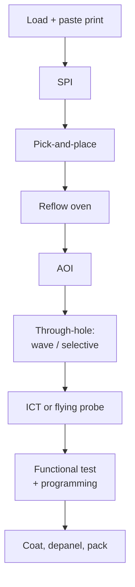

::: testing
Whether you can narrate the assembly line in order and say what each station is *for*. The interviewer wants the SMT sequence (paste print, solder-paste inspection, pick-and-place, reflow, AOI), what happens for the second side and for through-hole parts (wave or selective solder, or hand solder), and where inspection and test sit (AOI, ICT or flying probe, functional test), then cleaning, conformal coat and depaneling. A strong answer also names where defects originate and how the line is balanced and gated so a defect is found as early as possible.
:::

::: why
In a hardware job you will not only design the board, you will work with the people who build it. Knowing the line tells you why the stencil aperture rule exists, why a part needs a certain pad size, why you need test points, and why a cheap mistake at layout becomes an expensive escape at functional test. This question is the umbrella for the next ones on SMT vs through-hole ([[q0598]]), soldering ([[q0599]]), pick-and-place ([[q0600]]), reflow ([[q0602]]), wave ([[q0603]]) and test ([[q0606]]). Bare-board fabrication is the previous step, in [[q0593]].
:::

::: concepts
- **Solder paste**: powder solder (typically tin-silver-copper) suspended in flux, printed through a stencil onto pads.
- **SMT (surface mount technology)**: parts soldered to pads on the surface; see [[q0598]].
- **Pick-and-place**: a machine that places components on the wet paste. See [[q0600]].
- **Reflow soldering**: a conveyor oven that melts the paste and forms joints. See [[q0602]].
- **Through-hole assembly**: leads pushed through holes and soldered by wave, selective or hand soldering. See [[q0603]].
- **Inspection and test**: SPI, AOI, ICT, flying probe, functional test ([[q0606]]).
- **First-pass yield**: fraction of boards that pass a stage with no rework.
:::

::: answer
"Typically I'd describe a surface-mount line first, in order. The bare board comes in and gets loaded. A stencil printer squeegees solder paste onto the pads through a metal stencil. Many lines then have solder-paste inspection, a 3D check that the paste volume and position are right, because most solder defects start at the printer. Next, pick-and-place machines take parts from tape reels and trays and drop them on the paste, using cameras to align to the board's fiducials. The board then travels through a reflow oven, which follows a temperature profile that dries the flux, melts the solder and cools it into joints. After reflow, automated optical inspection looks for missing, shifted, tombstoned or bridged parts.

For a double-sided board you flip it and repeat for the second side. Through-hole parts, like connectors and big electrolytics, are inserted and soldered by wave, selective soldering or by hand. Then the board goes to test: in-circuit test or flying probe for opens, shorts and component values, and then a functional test that powers it up and exercises it. Finally there can be cleaning, programming of firmware, conformal coating and depaneling.

The principle is to catch defects as early as you can, since fixing a bad joint at the printer costs almost nothing and finding it after the box is sealed costs a lot."
:::

::: technical
**Typical SMT line (single side):**

1. **Board loader / barcode** tracks each board serial.
2. **Stencil printer**: laser-cut stainless stencil (commonly 100-130 µm thick, thinner for fine pitch), squeegee, automatic alignment to fiducials ([[q0596]]), underside cleaning.
3. **SPI (solder paste inspection)**: 3D laser or structured-light measurement of paste height, area, volume and offset.
4. **Pick-and-place** ([[q0600]]): high-speed "chip shooter" for small passives, flexible placer for large or odd parts.
5. **Pre-reflow AOI** (optional).
6. **Reflow oven** ([[q0602]]): preheat, soak, reflow (above liquidus about 217 °C for common SAC alloys, peak about 240-250 °C), cooling.
7. **AOI** ([[q0608]]).
8. Flip for the second side and repeat (heavier parts on the first side or glued down, see [[q0599]]).

**Through-hole and mixed assembly**: hand or machine insertion, then wave ([[q0603]]), selective solder, or pin-in-paste/through-hole reflow.

**Test and finish**: in-circuit or flying probe ([[q0609]], [[q0611]]), functional test ([[q0610]]), firmware programming, cleaning (if required), conformal coating, depanelization ([[q0594]]), label, pack.

**Line balance.** The slowest station sets the throughput (the "bottleneck"). For 400 parts at 20,000 components per hour, one placer takes $400/20000 \times 3600 = 72$ s per board; if the printer takes 25 s and the oven pitch is 60 s, the placer limits you. Real lines add a second placer or machine heads to balance.

**Yield.** If AOI, ICT and functional test pass 99%, 97% and 95% of boards at first pass, rolled first-pass yield is $0.99 \times 0.97 \times 0.95 = 91.2\%$ (computed); a board with 600 joints at 50 defects per million opportunities has a joint-level yield of $e^{-600\times 50\times10^{-6}} \approx 97\%$ (Poisson assumption).

> [!UNCERTAIN]
> Stencil thickness, oven profile limits, placement speeds and DPMO rates vary by solder alloy, component mix, machine and company. The figures here are typical order-of-magnitude values; use the solder paste and component datasheets for real limits.
:::

::: short
"A typical SMT line prints solder paste through a stencil, inspects the paste, places components with a pick-and-place machine, then sends the board through a reflow oven that melts the paste into joints, followed by AOI. Double-sided boards are flipped and repeated, through-hole parts are soldered by wave, selective or hand soldering, and then the board goes through in-circuit or flying-probe test and a functional test, plus coating and depaneling. The idea is to catch defects as early as possible."
:::

::: long
"I'll walk down a surface-mount line in order. The bare PCB is loaded, and the first machine is the stencil printer. A thin stainless stencil with openings at each pad sits on the board, and a squeegee pushes solder paste through the openings. Paste is tiny solder balls in flux, and the printer aligns to fiducials so the paste lands right. Many lines then use solder paste inspection to check the volume and position, since most soldering defects start with bad paste.

Next is pick-and-place. Machines pull components off tape reels and trays, check them with a camera, and place them onto the wet paste, which is tacky enough to hold small parts in place. The loaded board travels on a conveyor into the reflow oven, where it follows a temperature profile: preheat, soak to activate the flux, a short peak above the solder's melting point so it wets and forms joints, then controlled cooling. After that, automated optical inspection checks for missing, skewed, tombstoned or bridged parts.

If the board has parts on the other side, it flips and goes again. Bigger parts like connectors and large capacitors are through-hole, and they're soldered by wave soldering, selective solder, or by hand.

After assembly we have testing. Flying probe or in-circuit test checks opens, shorts and values using test points. A functional test powers the board and runs it through its job. Then there may be firmware programming, coating, depaneling, labeling and packing.

The thread through all of it is catching defects as early as possible, and design choices like stencil-friendly pads, fiducials and test points make each stage work."
:::

::: terms
- **Stencil**: thin metal sheet with apertures matching pads, used to deposit paste.
- **Solder paste**: solder powder in flux; tacky until reflow.
- **SPI**: solder paste inspection, 3D measurement of paste deposits.
- **Reflow profile**: temperature vs time curve the board sees in the oven.
- **AOI**: automated optical inspection, camera-based defect detection.
- **ICT / flying probe**: electrical test of the assembled board with probes.
- **FCT**: functional test of the board in use-like conditions.
- **FPY**: first-pass yield.
- **Conformal coating**: thin protective polymer film over assembled boards.
:::

::: exceptional
**An average answer** says "solder paste, place parts, reflow oven, test."

**An exceptional answer**:
- Gives the correct *order*, including SPI, AOI and the test sequence, and says what defect each station catches.
- Covers double-sided and mixed assembly (flip, glue, wave/selective) and where through-hole parts fit.
- Identifies line balancing and the bottleneck, with a number, and the rolled yield idea.
- Links design to process: stencil-friendly pads, fiducials, test points, component orientation for wave.
- Notes that most defects originate at printing, so inspect there, and that the earlier a defect is found the cheaper it is to fix.
:::

::: mistakes
- **Putting reflow before placement.** Reflow melts the paste; the parts must already be sitting on it.
- **Forgetting inspection.** Real lines have SPI/AOI/test gates, and the answer is much stronger with them.
- **Treating through-hole as obsolete.** Connectors and power parts are often still through-hole, which means a wave or selective step.
- **Mixing fab and assembly.** The boards arrive already etched, drilled and finished; see [[q0593]].
- **Ignoring flipping.** A double-sided board goes through the line twice with different considerations for heavy parts.
- **Saying "functional test finds everything."** It is slow, needs stimulus, and diagnosing a failure there is expensive. See [[q0606]].
:::

::: deep
## The line as a pipeline

An SMT line is a *pipeline of machines* joined by conveyors. Each stage transforms the board and then passes it on.


Figure: Time runs top to bottom. Early stations (print, SPI) are cheap places to find defects; late stations (functional test) find the most but cost the most to diagnose. For a double-sided board, the print-to-AOI steps repeat for the second side before the through-hole step.

## Station by station: what it does and what it prevents

**1. Paste printing.** A stencil of thickness $t$ with aperture area $A_a$ and wall area $A_w$ must release paste: the area ratio $A_a/A_w$ should be above about 0.66 for reliable release (a widely quoted rule, from IPC-7525; check the current revision). Fine-pitch pads and thick stencils fail this test, so DFM review adjusts the aperture. Printing defects (insufficient, excess, smeared or misaligned paste) cause the majority of solder defects, so SPI after the printer is worth the expense on dense boards.

**2. Placement.** The placer needs fiducials ([[q0596]]) and accurate component data (centroid, rotation). Parts are held by the paste's tack. See [[q0600]] and [[q0601]].

**3. Reflow.** Thermal profile follows the paste datasheet: ramp, soak, peak, cooling ([[q0602]]). A SAC305 alloy melts around 217-220 °C and the peak is typically 240-250 °C, giving only about 20-30 °C of margin above liquidus (computed 28 °C for a 245 °C peak), while component bodies have maximum temperature ratings. The profile window is narrow.

**4. AOI.** Cameras compare against golden images or CAD rules for presence, polarity and solder fillet appearance ([[q0608]]).

**5. Second side.** The board flips. Parts on the first side now hang upside down while their joints re-melt. They stay on only if surface tension can hold them (rule of thumb: component weight per unit of wetted pad area below a limit), so heavy parts are placed on the second side, or glued if they must sit on the first. See [[q0599]].

**6. Through-hole.** Leads inserted, soldered by wave ([[q0603]]) or selective soldering. Mixed-technology boards add steps and cost, one reason designers prefer all-SMT.

**7. Test.** ICT or flying probe check each component and net; functional test confirms behaviour. See [[q0604]], [[q0606]], [[q0609]], [[q0610]], [[q0611]], [[q0612]].

**8. Finishing.** Cleaning (if no-clean flux isn't acceptable), conformal coating where environment requires it, depaneling ([[q0594]]), serial label, pack.

## Worked example: line balance and yield

A board has 400 SMT components and 1 side. Station cycle times (illustrative): printer 25 s, SPI 20 s, placer 72 s (400 parts at 20,000 cph), reflow oven pitch 45 s, AOI 30 s.

- The bottleneck is the placer at 72 s per board, so the line makes $3600/72 = 50$ boards per hour.
- Add a second placer sharing the load: 36 s each, so the next bottleneck is the reflow pitch at 45 s and the line runs at $3600/45 = 80$ boards per hour.

Yield: say the first-pass yield after AOI is 99%, ICT is 97% and FCT is 95%. Rolled yield is $0.99\times0.97\times0.95=91.2\%$, so about 9 boards in 100 need rework or scrap. Improving the *weakest* stage (functional test) or, better, stopping upstream defects at the printer lifts the whole product.

## Where DFM touches each stage

| Stage | Design lever |
|---|---|
| Print | Pad/stencil aperture ratio; avoid tiny pads; fiducials |
| Place | Courtyard spacing; polarity marks; part height |
| Reflow | Thermal balance (symmetric copper on both pad ends); component temperature ratings |
| Wave/selective | Keep-outs; orientation; thermal relief |
| Test | Test points; access; boundary scan |
| Depanel | Keep-outs from break line |

See [[q0613]] for DFM and [[q0614]] for testability at volume.

> [!TIP]
> If asked to compare "manufacturing" and "assembly": in common speech, PCB *fabrication* makes the bare board, and *assembly* (or "manufacturing and assembly" in this question) populates it. Say that up front to show you know the distinction.

## Worked example: stencil release and the paste volume it delivers

For a rectangular aperture of length $L$ and width $W$ in a stencil of thickness $t$, the area ratio is

$$AR=\frac{LW}{2(L+W)\,t}.$$

For a 0.5 mm pitch QFP pad of 0.25 mm × 1.0 mm in a 0.12 mm stencil, $AR=\frac{0.25\times1.0}{2\times1.25\times0.12}=0.83$, above the 0.66 guideline, so paste releases reliably, delivering a volume of $0.25\times1.0\times0.12=0.030$ mm³ per pad. For a 0.4 mm pitch pad of 0.2 mm × 0.8 mm, a 0.12 mm stencil gives $AR=0.67$, right at the limit; a 0.15 mm stencil gives 0.53 and fails, while a 0.10 mm stencil gives 0.80 with a volume of 0.016 mm³. The trade is that thinner stencils print less paste for the large pads on the same board. That is why a mixed board with a 0.4 mm pitch part and a large power connector often uses a stepped stencil, or a thin stencil plus a larger aperture on the big pads. The decision is made in the DFM review, before the first board is printed.

> [!UNCERTAIN]
> The 0.66 area-ratio threshold is the common IPC-7525 guideline for laser-cut stainless stencils. Electroformed or nano-coated stencils and some type 4/5 pastes release reliably down to roughly 0.5, while a worn stencil may need more than 0.66; confirm with the stencil vendor and the paste datasheet.

## Worked example: the reflow oven sets the profile and the pitch

A lead-free profile has a ramp, a soak, a short time above liquidus and a controlled cool. With SAC305 liquidus near 217 °C and a 245 °C peak, the board is above liquidus only a short time. At 2 °C/s up and a similar rate down, the climb from 217 °C to 245 °C and the return take $2\times14=28$ s above liquidus, which is shorter than the 45 to 90 s that many paste datasheets list, so a real profile flattens near the peak to lengthen the time above liquidus without raising the peak temperature.

> [!UNCERTAIN]
> The ramp rate, soak and time-above-liquidus limits are paste- and component-specific. Take them from the solder paste datasheet and the component ratings (J-STD-020 classifies body temperatures for moisture-sensitive parts); the numbers here only show the arithmetic.

The oven length follows from the profile time and the conveyor speed: with a 4 minute total profile at 0.7 m/min the oven needs $0.7\times4=2.8$ m of heated length. The board pitch (how often a board enters) depends on board length plus the gap: a 0.25 m pitch at 0.7 m/min is $0.25/(0.7/60)=21$ s between boards, or 168 boards per hour. That is well under the 45 s oven pitch assumed in the line-balance example, and with a 21 s pitch the two-placer line would be placer-limited at 36 s (100 boards/h) instead of oven-limited at 80 boards/h. A 45 s pitch comes from a long board, a wide gap between boards or a slower conveyor, not from the oven physics, so the oven is usually not the bottleneck; the placer is. For a double-sided board with the same work on each side, the line makes two passes, halving the effective rate: with the line-balance numbers, 25 boards/h for the one-placer line and 40 boards/h with two placers.

## Worked example: why inspect early

Take illustrative numbers: 3 defects per 100 boards reach AOI after reflow, and 60% of them originate at the printer (insufficient or smeared paste). If SPI catches 90% of print defects before parts are placed, the boards are wiped and reprinted at the cost of seconds, and the defects reaching AOI become $3\times(1-0.6\times0.9)=1.38$ per 100, cutting the defect rate by more than half without touching the placer or oven. The folk "rule of ten" says the cost of finding a defect grows by about a factor of ten at each later stage (print, then post-reflow, then ICT, then functional test, then the field). The exact factor varies by product and is anecdotal, but the direction is reliable: a defect at the printer costs seconds, at AOI minutes of rework, at functional test a technician's time plus re-test, and in the field a return.

## Limiting cases and when the flow changes

- **Low volume or prototypes:** hand paste with a syringe, hand placement, hot air or a small reflow oven. The sequence is the same, but the stations are replaced by technicians, and the human becomes the inspection.
- **All through-hole:** no printer, placer or reflow; insertion, wave solder, and test. Today it is mostly legacy or specialist (heavy connectors, high-power parts).
- **Mixed technology:** through-hole parts on a board with reflowed SMT often use pin-in-paste (print paste into the holes and reflow the leads) to skip the wave step, which needs more paste volume and a stencil with overprint.
- **Moisture-sensitive components:** parts that have absorbed moisture can crack ("popcorn") in reflow, so the flow includes dry-pack handling and baking before reflow, a station that never shows on a simple flowchart.
- **Very large or thick boards:** need slower ramps and a bigger thermal profile window because the thermal mass makes the large parts and the small ones reach temperature at different times.

## Verification on the line

At every station the verification is a measurement, not an assumption. Print: SPI data (volume, height, offset) with control limits. Placement: first-article inspection and the placer's own vision statistics. Reflow: profile the actual board with thermocouples on the hottest and coldest locations (a large BGA and a small passive) rather than relying on the oven setpoints, and re-profile after any change of product, paste or conveyor speed. Test: track first-pass yield per station and per defect code, then look at Pareto charts: the one or two top defect codes (typically opens, bridges, tombstones, missing or wrong parts) tell you which upstream station to fix.
:::

::: applications
- **Consumer IoT devices**: all-SMT double-sided boards, high-speed lines, AOI + flying probe or ICT.
- **Power supplies**: mixed assembly with large through-hole magnetics and capacitors, selective solder.
- **Automotive and medical**: tighter process control, 3D SPI/AOI, traceability by serial number, conformal coating.
- **Prototype runs**: stencil, manual or desktop placer, hot-plate or small reflow oven, flying probe.
- **Aerospace**: additional inspection (X-ray of BGAs), cleaning and staking processes.
:::

::: assumptions
- Describes the **SMT-centric lead-free** flow. Leaded processes use lower temperatures (Sn63Pb37 melts at 183 °C).
- Assumes a contract manufacturer with in-line inspection. Low-volume prototype shops skip SPI and automatic conveyors.
- Station order varies: some lines put AOI before reflow too, or ICT before functional test, or skip ICT entirely for volume-limited products.
- Flex, rigid-flex and module assemblies (BGA stacking, SiP) have additional steps like underfill and shield attach.
:::

::: followups
### Why inspect the solder paste before placing parts?
Because bad paste is the root of most defects, and at that point the fix is trivial: wipe the board and reprint. After reflow, you'd have to rework the part. A 3D SPI measures volume, height and offset on every pad, and also gives feedback to adjust the printer.

### How does a double-sided board change the flow?
Run the first side (usually the one with fewer or lighter parts), flip, then print, place and reflow the second side. During second-side reflow the first-side joints melt again, so parts on the first side must be light enough to be held by surface tension, or are glued. Heavier parts go on the second pass. See [[q0599]].

### Where would you put through-hole connectors in the flow, and why?
After SMT reflow, because the SMT joints need the print-place-reflow sequence first and many through-hole parts (electrolytics, plastic-bodied connectors) are not rated for a reflow oven. Wave soldering requires SMT parts on the bottom to be glued, and selective soldering needs keep-out space for the nozzle. Pin-in-paste lets you reflow through-hole parts with the SMT parts when the geometry works.

### The line is missing its output target. How do you find the bottleneck?
Measure each station's cycle time, or look for the station with a backed-up queue in front of it and starved, idle machines after it. The slowest cycle time sets the line rate. Then fix the slowest: add machines, optimise the placement program ([[q0601]]), or reduce changeovers.

### Your first-pass yield at ICT suddenly dropped from 98% to 90%. What do you do?
Look at the failure signature in the log: if one component or net dominates, trace it back (stencil clog, a feeder issue, bad reel, new lot of parts, profile drift). Compare with SPI/AOI data from the same boards. Also check the ICT fixture itself (worn probes, misalignment) before blaming the boards.

### What changes for a prototype with 10 boards?
No fixtures, so use flying probe instead of a bed-of-nails; maybe a stencil and hand/semi-automatic placement and a small oven; skip SPI. Costs per board are high but setup cost is low.
:::

::: interpretations
"PCB manufacturing and assembly" can mean either (a) the whole process from bare board to finished product or (b) just population of the board. The answer above covers (b) in detail with a nod to (a) via [[q0593]]. If the interviewer is in a test-engineering context, spend extra time on the test stages in [[q0606]].
:::

::: references
- IPC-A-610 (acceptability of electronic assemblies) and IPC J-STD-001 (soldering requirements): standards by name; check the current revision and class for acceptance criteria.
- IPC-7525 (stencil design guidelines) for aperture area ratios.
- Solder paste manufacturer datasheets: reflow profile windows.
- Coombs, *Printed Circuits Handbook*: assembly chapters.
:::

::: rubric
- Gives the order: paste print, place, reflow, inspect :: The skeleton of any SMT answer.
- Mentions solder paste inspection or at least AOI after reflow :: Shows awareness of quality gates.
- Covers through-hole/wave/selective and the second side :: Real boards are often mixed or double-sided.
- Includes test stages (ICT/flying probe, functional) :: Assembly is not finished until the board is verified.
- Identifies bottleneck/line balance or yield :: Shows production thinking.
- Links at least one design choice to a process step :: Shows you can use this knowledge as a designer.
:::

::: quiz
```json
[
 {"type":"mcq","level":"fundamental","q":"What is the correct order for SMT assembly?","options":["Reflow, place, print, inspect","Print paste, place components, reflow, inspect","Place components, print paste, reflow, inspect","Wave solder, place, print, test"],"answer":1,"explain":"Paste must be on the pads before parts are placed (it holds them), and reflow melts it afterward. Inspection checks the result."},
 {"type":"mcq","level":"fundamental","q":"Why is solder paste inspection (SPI) done right after printing?","options":["Because most solder defects originate in the print step and are cheap to fix there","Because it replaces the need for reflow","Because it measures component values","Because the oven can't be run without it"],"answer":0,"explain":"A bad print can be wiped and reprinted at nearly zero cost, but after reflow it becomes a rework job. SPI doesn't measure parts."},
 {"type":"numeric","level":"intermediate","q":"A board has 600 SMT components and the placer does 30,000 components per hour. How many seconds per board does placement take?","answer":72,"tolerance":0.01,"unit":"s","explain":"600/30000 h = 0.02 h = 72 s. That is the placer's cycle time per board (ignoring board transfer)."},
 {"type":"numeric","level":"intermediate","q":"First-pass yields: AOI 98%, ICT 97%, FCT 96%. What is the rolled first-pass yield (percent)?","answer":91.3,"tolerance":0.01,"unit":"%","explain":"0.98 x 0.97 x 0.96 = 0.9126, about 91.3%."},
 {"type":"multi","level":"advanced","q":"Select true statements about double-sided SMT assembly.","options":["The board goes through reflow twice","First-side parts can drop off during the second reflow if too heavy for surface tension","Both sides are always reflowed in one pass","Heavier parts are typically placed on the second side or glued if on the first"],"answer":[0,1,3],"explain":"Each side is printed, placed and reflowed, so first-side joints re-melt. Surface tension holds light parts; heavy ones go on the last pass or are glued. Single-pass two-sided reflow isn't the standard flow."},
 {"type":"truefalse","level":"advanced","q":"Functional test makes ICT and AOI unnecessary because it tests the real behaviour of the board.","answer":false,"explain":"Functional test is slow, only covers what the firmware/stimulus exercises, and gives poor fault diagnosis. AOI and ICT find manufacturing defects early and tell you exactly where the fault is."}
]
```
:::
