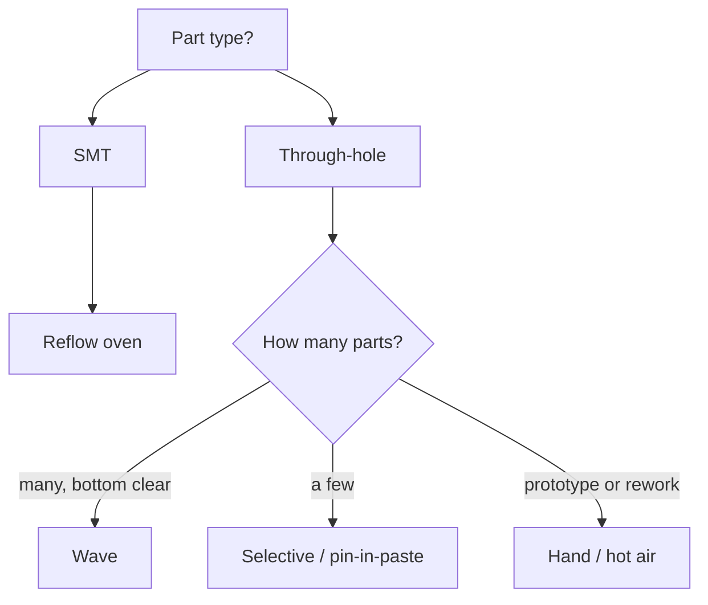

::: testing
Whether you know the soldering *methods* and when each one applies: reflow for SMT, wave or selective for through-hole, hand and hot-air for prototypes and rework. The two follow-ups probe whether you can sequence a double-sided board (which side first, what holds the parts during the second reflow, when glue is needed) and a mixed SMT plus through-hole board (reflow first, then selective or wave, or pin-in-paste). The interviewer wants a decision process, not a list.
:::

::: why
Soldering is where the design meets physics. Which side carries the heavy parts, whether a connector can be wave soldered and whether the bottom parts survive a second oven pass are decided in layout, long before assembly. An intern who asks "which soldering process will this go through?" before placing parts avoids expensive respins. See [[q0602]] for reflow and [[q0603]] for wave in depth.
:::

::: concepts
- **Wetting and the solder joint**: molten solder, flux and clean metal surfaces form an intermetallic bond, then freeze into a fillet.
- **Reflow**: pre-printed paste melts in an oven profile ([[q0602]]).
- **Wave soldering**: the board's underside passes over a standing wave of molten solder ([[q0603]]).
- **Selective soldering**: a small nozzle solders chosen through-hole joints.
- **Hand / hot-air soldering**: iron, hot air or hot plate for prototypes and rework.
- **Surface tension holding parts**: why light parts stay on an inverted board during second reflow.
- **Mixed technology**: SMT plus through-hole ([[q0598]]).
:::

::: answer
"It depends on the part type and the volume. Surface-mount parts are almost always reflowed: paste is printed on the pads, parts are placed, and the board goes through an oven that melts the paste. Through-hole parts are soldered by wave soldering, where the underside of the board passes over a wave of molten solder, or by selective soldering with a small nozzle, or by hand. For prototypes and rework I'd use an iron, hot air or a hot plate.

For a double-sided board, you reflow one side, flip it, and reflow the other. The first side's joints melt again, so I put the heavy parts on the side that goes through the oven last, or glue them, because surface tension only holds light parts hanging upside down. So the first side usually gets the small, light parts, like chip passives and small ICs, which re-melt in the second pass but stay put easily.

For a mixed board I'd reflow all the SMT first, then solder the through-hole parts. If those are few, selective soldering or pin-in-paste is cleaner than wave, because wave needs the bottom side to be glued SMT or empty. So the design rule is: decide the soldering sequence first, and layout follows it."
:::

::: technical
**Methods.**

| Method | Used for | Key facts |
|---|---|---|
| Reflow | SMT; also pin-in-paste through-hole | Paste printed, peak about 240-250 °C for SAC alloys; one pass per side |
| Wave | Through-hole, and glued SMT on the bottom | Solder pot about 250-260 °C for SAC (vendor dependent), contact 2-4 s |
| Selective | Through-hole on boards with SMT on both sides | Programmable nozzle, one joint or connector at a time, slower |
| Hand iron | Prototypes, rework, odd parts | Tip about 320-350 °C for lead-free; operator skill dependent |
| Hot air / hot plate | Prototypes, QFN/BGA rework | Preheat the board to limit thermal shock |
| Vapor phase | High-reliability or large thermal-mass boards | Peak limited by fluid boiling point; very uniform heating |

**Double-sided SMT sequence.** Side 1 (often the side with fewer or smaller parts) is printed, placed and reflowed. The board flips, side 2 is printed, placed, reflowed. During the second pass the side-1 joints are again above liquidus (about 217 °C for SAC305), but surface tension on the wetted pads holds light parts. A common rule of thumb in assembly guides: a part stays on if its weight per pad contact area is below roughly 30 g/in² (about 0.047 g/mm²); treat this as a guideline only.

> [!UNCERTAIN]
> The weight-per-area figure and exact temperatures differ between guides and alloys. Heavy parts (large electrolytics, transformers, big QFNs/BGAs) are commonly placed on the side reflowed last, or glued. Ask the assembler for their rule.

**Techniques for double-sided boards.**
1. Put heavy parts on the second-pass (top) side.
2. Glue (SMT adhesive, cured) heavy or tall bottom parts so wave or second reflow cannot drop them.
3. Use a different alloy: higher-melt first side and lower-melt second side (rare, costs process control).
4. Support the board with a carrier or pallet to avoid sag.
5. Single-pass reflow for both sides is possible only in special setups.

**Mixed assembly sequence.** (a) SMT both sides by reflow, (b) through-hole parts inserted, (c) soldered by selective soldering, wave (only if the bottom side is wave-compatible) or hand. Pin-in-paste prints paste over the holes, inserts leads, and reflows everything in one pass, which works if paste volume can fill the barrel.

**Paste volume for pin-in-paste.** A 1.0 mm hole with a 0.6 mm lead, 1.6 mm board: hole volume is $\pi(0.5^2-0.3^2)\times1.6 = 0.80$ mm³ (computed), and paste is only about 50% solder by volume and shrinks on melting, so you need roughly 1.6 mm³ of paste per hole, far more than a normal pad print: stencils use thicker "step" regions or overprinted apertures.
:::

::: short
"SMT parts are soldered by reflow: paste is printed, parts are placed, and an oven melts it. Through-hole parts are soldered by wave, selective or hand soldering. On a double-sided board you reflow one side, flip, and reflow the other, putting heavy parts on the last side or gluing them, because surface tension only holds light parts upside down. On mixed boards I'd reflow the SMT first and then do selective soldering or pin-in-paste for the through-hole parts."
:::

::: long
"There are really four ways to solder a board. Reflow for surface-mount: paste goes on the pads, the machine places parts, and an oven melts the paste following a profile. Wave soldering for through-hole: the bottom of the board rides across a standing wave of molten solder that fills the holes. Selective soldering, which is like a small programmable wave nozzle for individual through-hole joints. And hand or hot-air soldering for prototypes and rework.

Double-sided SMT boards are done one side at a time. Side one goes through print, place and reflow, then the board is flipped and side two goes through the same sequence. The catch is that the first side melts again in the second oven pass. Surface tension of the molten solder holds small parts on, but heavy ones can fall off. So technique one is putting the heaviest, biggest parts on the side that is soldered last. Technique two is gluing them with SMT adhesive. And you also make sure the board is supported in the oven so it doesn't sag.

Mixed boards, with SMT and through-hole, add a second stage. I'd do all the SMT by reflow first, then insert the through-hole parts. If there are only a few, like a connector or two, I'd use selective soldering or pin-in-paste, where paste is printed over the holes so the through-hole lead is reflowed with everything else. If there are a lot, wave soldering is fastest, but the bottom side must either be empty or have glued, wave-compatible parts.

The design takeaway: pick the soldering sequence before layout, because it decides which side each part can live on."
:::

::: terms
- **Reflow**: melting printed paste in an oven profile.
- **Wave soldering**: passing the board over a molten solder wave.
- **Selective soldering**: nozzle-based soldering of chosen through-hole joints.
- **Pin-in-paste (intrusive reflow)**: through-hole leads reflowed using paste printed into the holes.
- **SMT adhesive**: cured glue holding bottom-side parts during wave.
- **Liquidus**: temperature above which solder is fully molten.
- **Flux**: chemical that removes oxide so solder wets.
- **Carrier / pallet**: fixture that supports or masks a board during soldering.
:::

::: exceptional
**An average answer** says "reflow for SMD, wave for through-hole."

**An exceptional answer**:
- Names reflow, wave, selective and hand/hot-air, with when to use each.
- Explains the second-pass problem on double-sided boards: joints re-melt, surface tension holds light parts, heavy ones need to be last or glued.
- Gives mixed-board sequencing and the pin-in-paste option, with a quick check on paste volume.
- Mentions support/carriers, thermal profile limits and part temperature ratings.
- States the design rule: choose sequence first, then place parts by side.
:::

::: mistakes
- **Wave soldering SMT parts on the top.** Wave only contacts the bottom; top-side SMD parts shouldn't see it.
- **Putting heavy parts on the first-reflowed side without glue.** They can drop in the second pass.
- **Forgetting temperature ratings.** Electrolytics, connectors and plastics may not survive a second reflow or wave heat.
- **Assuming through-hole parts can't go through reflow.** Pin-in-paste works if the part body is rated for reflow temperatures.
- **Using wave on a board with fine-pitch SMD on the bottom.** Bridging and shadowing make it unreliable without masks or pallets.
- **Overlooking board support.** A thin double-sided board sags in the oven, causing tombstoning and open joints.
:::

::: deep
## What a solder joint is

Soldering joins two metals using a third that melts at a lower temperature, without melting the base metals. For tin-silver-copper solder on copper pads, molten solder wets clean copper and forms a thin intermetallic layer (Cu₆Sn₅, on the order of 1-3 µm). Flux removes oxides so wetting happens. When the solder cools it freezes into a fillet that is the electrical and mechanical joint. Every soldering method answers the same question: *how do I get enough heat into the joint, for long enough, without damaging the part or the board?*


Figure: Choose the process from the part type and volume. Reflow handles SMT; through-hole splits by quantity and by whether the bottom side is wave-compatible.

## Double-sided SMT: why heavy parts fall

On the second pass, the first side faces down and its solder is liquid again. Two forces act on each part: gravity, pulling it down with weight $mg$, and surface tension of the molten solder fillet, pulling it up over the pad area. Surface tension scales with the wetted perimeter and pad area, and gravity with mass. A 0402 resistor weighs about 0.6 mg, so surface tension easily wins. A large BGA or an electrolytic can weigh grams over a small pad area, so gravity can win.

A back-of-envelope check: surface tension of molten SAC solder is about 0.5 N/m (a typical figure; it varies with flux and atmosphere). A pad with a 4 mm wetted perimeter yields a maximum vertical force of about $0.5 \times 0.004 = 2$ mN, which holds roughly 0.2 g. This is why parts over a fraction of a gram, with small pad perimeters, are risky upside down (hand estimate, not a design number).

Design responses:
1. **Heavy on last-side**: assign big parts to the side that will be reflowed last.
2. **Glue**: a dot of cured adhesive under the part.
3. **Carrier**: a pallet with pockets supporting heavy parts or masking sensitive areas.
4. **Profile**: lower peak temperature and shorter time above liquidus for the second pass (within paste limits).

## Wave and selective soldering, briefly

In **wave soldering** ([[q0603]]), the board travels over a pump-driven standing wave. Liquid solder wets the exposed leads and fills the barrels by capillary action. SMT parts on the bottom must be glued, and orientation matters to avoid shadowing (a tall part blocks solder from the next pad).

**Selective soldering** uses a small solder fountain nozzle moving under the board under program control, soldering one connector or joint group at a time. It protects nearby bottom-side SMD parts and avoids pallets, but takes longer per board.

## Pin-in-paste worked example

Hole diameter 1.0 mm, lead diameter 0.6 mm, board 1.6 mm. Free volume in the barrel: $\pi(0.5^2-0.3^2)\times1.6=0.80$ mm³. Solder paste is about half solder by volume, and the flux boils off, so to fill the barrel and form fillets you need roughly 2x to 3x that volume of paste, say 2 mm³ per joint. A normal 0.13 mm stencil over a 2 mm square pad deposits about $0.13\times4 = 0.52$ mm³. So you need a thicker step stencil, an enlarged overprint aperture extending over the mask, or a few separate deposits around the hole. If it cannot be done, fall back to selective soldering.

## Hand and rework soldering

An iron at about 320-350 °C with the right tip size delivers heat by contact; the key is thermal mass. A large ground plane wicks heat so a joint stays cold, which is why thermal reliefs exist on through-hole pads ([[q0615]] covers a related effect, tombstoning, caused by uneven heating). Hot air plus a bottom preheater gently reflows QFNs and BGAs.

## Putting it together: a worked sequence

Board: double-sided, 0402-QFN parts plus one 20-pin through-hole header and one big electrolytic.
1. Top: print, place, reflow (QFN, small parts).
2. Flip, bottom: print, place small parts only, reflow (the big parts are not on the bottom).
3. Place the through-hole header, solder selectively (no wave, because the bottom has SMD).
4. The electrolytic: if it is rated for reflow temperature, put it on the last-reflowed side; otherwise hand solder or selective solder after.

> [!INTERVIEW]
> For "double-sided techniques", say the three: heavy parts on the last pass, glue, and carriers/profile control. For "mixed assembly", say: SMT reflow first, then selective, wave or pin-in-paste, and mention wave limits on the bottom side.

## Worked example: will it stay on during the second reflow?

Use the weight-per-pad-area guideline from the technical section: roughly 30 g/in², which is $30 \times 0.00155 = 0.0465$ g/mm². Two parts on the bottom side of a board (masses and pad sizes are assumed for illustration; use the datasheet and your land pattern):

- **A 16-pin SOIC**, mass 0.15 g, sixteen pads of 0.6 × 1.8 mm. Pad area is $16 \times 1.08 = 17.3$ mm², so the loading is $0.15/17.3 = 0.0087$ g/mm². That is about 19% of the limit, and it will hang on the pads comfortably.
- **A 3 g SMD aluminum electrolytic**, two pads of 2 × 2 mm. Pad area is 8 mm², so the loading is $3/8 = 0.375$ g/mm², about 8 times over the guideline. To pass on area alone it would need $3/0.0465 \approx 64$ mm² of wetted pad. Moving it to the last-reflowed side is free; gluing it is cheap; making the pads that big is not.

The cross-check with the surface-tension estimate gives the same message. With about 0.5 N/m and a 4 mm wetted perimeter the supportable weight is about 0.2 g. The SOIC has 16 pads, each with its own perimeter, so its total holding force is many times that of the electrolytic's two small pads, and it is also lighter. Both methods agree on which part to worry about.

## What the reflow profile is doing

A lead-free profile has four zones, and each exists for a physical reason:

1. **Preheat/ramp.** Take the board from room temperature up to about 150 °C at no more than roughly 1 to 3 °C/s. For a 90 s ramp from 25 to 150 °C that is $125/90 \approx 1.4$ °C/s. Too fast and fine parts heat before heavy ones (thermal shock, cracked ceramics, tombstoning in [[q0615]]).
2. **Soak.** Hold in the 150 to 200 °C region for a minute or two. The flux activates, oxides come off, and big and small parts converge toward the same temperature, so everything reaches liquidus together. This is where a large BGA catches up with the 0402s around it.
3. **Reflow (time above liquidus).** SAC305 melts at about 217 °C; the peak is typically 235 to 250 °C. Time above liquidus is commonly around 45 to 90 s, set by the paste datasheet. Too short and the joints are cold or poorly wetted; too long and the intermetallic layer grows thick and brittle, and flux residue and boards take damage.
4. **Cooling.** A moderate controlled rate sets the grain structure. Very fast cooling stresses the part, and very slow cooling gives a coarse grain and a thicker intermetallic.

The second pass uses a similar profile, which is why anything already soldered on the first side is back in the liquid state in the oven, and why bottom-side part choice matters.

> [!UNCERTAIN]
> Exact ramp limits, soak window and time above liquidus come from the solder paste datasheet and from each component's moisture/reflow classification (J-STD-020 defines the classification procedure). The numbers above are typical ranges for SAC alloys, not a recipe.

## Limits of the simple picture

**Moisture.** Plastic packages that have absorbed moisture can crack or delaminate in reflow as water turns to vapor (the "popcorn" effect). That is why moisture-sensitive parts come in dry bags with a floor-life rating and are baked if the humidity indicator card or exposure time says so. This matters more for double-sided boards, because the parts on the first side take a second heat cycle.

**Voiding and head-in-pillow.** Large thermal pads (QFN, power packages) trap flux gases and leave voids, which hurt both heat transfer and strength. BGAs can warp during reflow, so a ball lifts off the paste and then touches it only after the paste has gone paste-like: "head-in-pillow." Both are process problems and not design-rule problems, but the layout (stencil aperture windowing, via-in-pad filling) affects them.

**Thermal mass on hand soldering.** The joint temperature is set by the balance between heat delivery and heat loss into the plane. A pad tied solidly to a ground pour can sink more power than a small iron delivers, so the solder never flows. A thermal relief limits the loss, and a bigger tip or a higher setpoint on a power-limited iron fixes the symptom without damaging the pad.

## Verifying on the bench or line

1. **Thermocouple profiling.** Attach thermocouples to a sacrificial board, at least one on a big part, one on a small part and one near an edge. Run it through the oven and check peak, time above liquidus and ramp against the paste datasheet. Re-profile after any change of board, paste or oven recipe.
2. **Inspection.** AOI checks fillet shape, missing and skewed parts. X-ray shows voids and hidden BGA/QFN joints. Compare void percentage against your acceptance criteria (IPC-A-610 is the acceptability standard assemblers typically cite).
3. **Destructive checks.** Cross-section and microscopy on a sample show wetting, intermetallic thickness and barrel fill for through-hole joints (a fill percentage of the barrel is a typical acceptance metric). A shear test on a chip part checks joint strength.
4. **Double-sided check.** After the second reflow, inspect first-side parts for shifted or dropped components. If you see any, the loading calculation above is the first suspect.
:::

::: applications
- **Consumer electronics**: double-sided SMT reflow, a few connectors selectively soldered.
- **Power supplies**: SMT control board reflowed, magnetics and bulk capacitors wave or selective soldered.
- **Automotive modules**: SMT plus press-fit or selective soldered connectors, with glued bottom-side parts.
- **Prototypes**: stencil, hot plate or small oven, hand soldered through-hole.
- **BGA rework**: hot-air or infrared rework station with a bottom preheater.
:::

::: assumptions
- Lead-free SAC alloys assumed; leaded solder (Sn63Pb37, melts 183 °C) lowers temperatures.
- Numbers on surface tension, weight limits and paste volumes are approximate engineering estimates.
- Assumes parts are rated for the chosen process temperatures; many plastic connectors and electrolytics are not rated for repeated reflow.
- Single-pass two-sided reflow (with parts on both sides reflowed in one pass) is possible in specialised setups but not the default.
:::

::: followups
### How do you decide which side gets reflowed first?
Put the side with fine-pitch, more critical or lighter parts first only if the second side's heavy parts won't disturb it; usually the side with the heaviest parts goes last so they are held by paste and gravity, not hanging upside down. Also consider which side has the through-hole parts and where test points are.

### When would you use glue?
For SMT parts on the bottom side that will go through wave soldering, and for heavy bottom-side parts that could fall in a second reflow. The glue is dispensed before placement and cured in an oven or UV, then stays on the board.

### Can a through-hole part go through reflow?
Yes, with pin-in-paste if its body is rated for the reflow peak (many connectors are, some are not) and paste can fill the barrel. It saves a soldering step. Check the part datasheet for "reflow compatible" and the maximum temperature and time.

### A board has many through-hole parts and SMT on the bottom. Would wave soldering work?
Only if bottom SMT parts are glued and wave-compatible (chip passives and SOTs, not fine pitch ICs), with spacing and orientation rules. Otherwise use selective soldering or a pallet that masks the SMT area. See [[q0603]].

### After the second reflow, you find a few first-side capacitors missing. What happened and what are the fixes?
They were too heavy for surface tension. Fix by moving them to the last-reflowed side, gluing them, adding a carrier, or reducing the peak temperature and time above liquidus.
:::

::: interpretations
"How are components soldered?" is general; the two sub-bullets narrow to double-sided and mixed boards. Cover all four methods briefly and then answer the sub-questions directly. For process details see [[q0602]] (reflow) and [[q0603]] (wave).
:::

::: references
- IPC J-STD-001, *Requirements for Soldered Electrical and Electronic Assemblies*, and IPC-A-610 for acceptance criteria (standards by name; check revisions).
- IPC-7525 for stencil design (pin-in-paste uses special apertures).
- Solder paste and solder wire manufacturer datasheets for temperature windows.
- Coombs, *Printed Circuits Handbook*: assembly and soldering chapters.
:::

::: rubric
- Names reflow for SMT and wave/selective/hand for through-hole :: Core mapping of method to part type.
- Explains double-sided flow: one side at a time, flip and reflow again :: Direct answer to the first sub-question.
- Gives at least two techniques (heavy parts last, glue, carrier) :: The sub-question asks for techniques.
- Explains why parts hold or fall (surface tension vs weight) :: Shows physical understanding.
- Describes mixed assembly sequencing and options (selective, wave, pin-in-paste) :: Direct answer to the second sub-question.
- Mentions temperature ratings and board support :: Practical process awareness.
:::

::: quiz
```json
[
 {"type":"mcq","level":"fundamental","q":"Which method is standard for soldering SMT parts?","options":["Wave soldering the top side","Reflow of printed solder paste","Hand soldering every part","Ultrasonic welding"],"answer":1,"explain":"SMT uses printed paste and an oven, which solders all parts at once."},
 {"type":"mcq","level":"fundamental","q":"On a double-sided board, which parts should go on the side that is reflowed last?","options":["The lightest parts","The heaviest parts","Only through-hole parts","Only resistors"],"answer":1,"explain":"First-side parts hang upside down during the second reflow, so heavy ones may fall. Placing heavy parts on the last side avoids that."},
 {"type":"numeric","level":"intermediate","q":"A plated hole is 1.0 mm diameter with a 0.6 mm lead in a 1.6 mm board. What is the empty barrel volume in mm³? (use pi (r_hole^2 - r_lead^2) x thickness)","answer":0.8,"tolerance":0.03,"unit":"mm³","explain":"pi x (0.5^2 - 0.3^2) x 1.6 = pi x 0.16 x 1.6 = 0.804 mm³. Paste is about half solder by volume, so you need over twice this in paste."},
 {"type":"numeric","level":"intermediate","q":"Surface tension is about 0.5 N/m acting around a 4 mm wetted perimeter. What is the maximum vertical force in mN?","answer":2,"tolerance":0.02,"unit":"mN","explain":"F = 0.5 N/m x 0.004 m = 0.002 N = 2 mN, enough to hold about 0.2 g, so only light parts survive being inverted."},
 {"type":"multi","level":"advanced","q":"Select valid ways to solder a few through-hole connectors on a board that has SMT on both sides.","options":["Selective soldering","Pin-in-paste, if the connector is reflow rated","Wave soldering with nothing on the bottom protected","Hand soldering"],"answer":[0,1,3],"explain":"Wave would hit the bottom-side SMT parts unless they are glued and wave-compatible or masked by a pallet. The other methods avoid that."},
 {"type":"truefalse","level":"advanced","q":"Joints on the first reflowed side stay solid during the second side's reflow.","answer":false,"explain":"They go above liquidus again and become molten, which is why heavy parts can drop and why placement on the last side or gluing is used."}
]
```
:::
