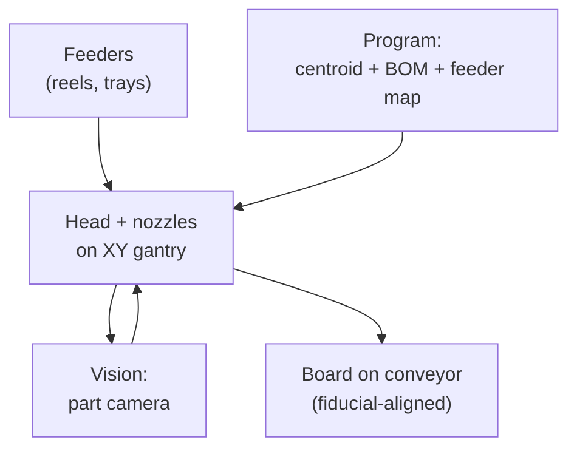

::: basics
### In plain words
Pick-and-place is the machine that puts surface-mount parts onto a board. It picks each part from a feeder with a small suction nozzle, checks the part with a camera, and sets it down at the right spot and angle on the wet solder paste. It does this for every part on the board, very quickly.

### Picture it
Think of a claw machine at an arcade, but one that is fast and precise, and always grabs the right prize. A suction tip lifts a part off a reel of parts, a camera glances at how it is sitting on the tip, and the arm corrects before setting it down. The sticky paste holds each part in place until the oven melts it. Unlike a claw machine, it never presses hard, because pushing too hard would squeeze the paste out.

### Words you need
- **Feeder**: a holder that presents one part at a time, usually from a tape reel.
- **Nozzle**: the suction tip that picks up and releases a part.
- **Centroid file**: a list from the design software giving each part's X and Y position, angle and board side.
- **Fiducials**: alignment dots the camera uses to find the board. See [[q0596]].
- **CPH**: components per hour, the machine's speed rating.

### The simplest example
Say a machine is rated at 20,000 parts per hour. One part then takes 3600 / 20,000 = 0.18 s on average. A board with 400 parts needs 400 x 0.18 = 72 s of placement. A faster machine at 80,000 parts per hour would need only 18 s. Real speeds are lower than the rating, because of reel changes and awkward parts. That is the whole idea. The rest of this page covers machine types, the data the machine needs, placement accuracy on fine-pitch parts, and the mistakes in setup that cause most bad boards.
:::

::: testing
Whether you understand the machine at the heart of SMT assembly: what it does (picks parts from feeders, checks them, places them on paste-printed pads), how it knows where to put them (CAD centroid file, fiducials, vision), what the main machine types are (high-speed chip shooters and flexible placers), and what limits speed and accuracy. The interviewer also listens for design hooks: centroid and rotation data, polarity, courtyard spacing, part orientation on reels.
:::

::: why
Every SMT board you design will be built by one. The machine's capabilities (smallest part, nozzle sizes, placement accuracy, component height) set your footprint and spacing rules, and its throughput sets your assembly cost. A wrong rotation in the centroid file, a mirrored footprint or a part that no nozzle can pick can stop a build. Interns often export the pick-and-place (centroid) file themselves, so knowing what it is used for matters.
:::

::: concepts
- **Feeder**: holds a reel or tray of components and presents one part at a known pick position. Tape reels are most common.
- **Nozzle / head**: vacuum tip(s) that pick and release parts; heads can hold several nozzles.
- **Gantry (XY) motion**: the head moves over the board; speed and path define throughput.
- **Vision**: cameras check part position on the nozzle and find board fiducials ([[q0596]]).
- **Centroid / pick-and-place file**: CSV of reference designator, X, Y, rotation and side for each part.
- **Placement accuracy and repeatability**: how close to the target and how consistently.
- **Throughput (CPH)**: components per hour. Optimisation is in [[q0601]].
:::

::: answer
"Pick-and-place is the machine that populates a board with surface-mount components. After solder paste has been printed on the pads, the machine uses a vacuum nozzle on a moving head to pick a part from a feeder, usually a tape reel, checks it with a camera to measure its offset and rotation on the nozzle, and then places it on the board at the right coordinates and angle, pressing it gently into the paste. It repeats that for every part on the board.

It knows where to place things from a centroid file exported from the CAD tool, which lists each part's X, Y, rotation and side, and it aligns the board using fiducials, so it corrects for the board's actual position. There are fast chip shooters for passives, doing tens of thousands of parts an hour, and more flexible machines for large and odd parts like connectors and BGAs at lower speed. The paste is tacky and holds the parts in place until the oven melts it."
:::

::: technical
**Cycle.** (1) Head moves to a feeder; (2) nozzle descends, vacuum on, picks the part; (3) head moves toward the board, passing over an *upward-looking camera* (or using a head-mounted camera on the fly) that measures the part's offset and angle and corrects; (4) head moves to the target, rotates the part, lowers it to the programmed height and releases with a small blow-off; (5) repeat. The board was first aligned using global fiducials.

**Machine types.**
- **Chip shooter** (turret or multi-head gantry): optimised for small passives and small ICs; throughput of tens of thousands up to over 100,000 CPH quoted by vendors in ideal conditions.
- **Flexible / fine-pitch placer**: higher accuracy, supports big and odd-form parts; roughly a few thousand to 20,000 CPH real-world, depending on parts and head.
- **Desktop / manual**: low-volume prototype lines, vacuum pen or semi-automatic gantries.

**Data needed.** Bill of materials (BOM), centroid file (RefDes, X, Y, rotation, side, package), feeder setup (which reel in which slot), nozzle assignments, component library (size, height, vision type). Mistakes here, not the machine, are the most frequent cause of bad boards: wrong rotation conventions between CAD footprints and the machine library are a classic.

**Timing example.** At 20,000 CPH a part takes $3600/20000=0.18$ s on average. A 400-part board therefore needs 72 s of placement time, or 18 s at 80,000 CPH (computed).

**Accuracy.** Placement accuracy values quoted by vendors range from about ±25 µm (fine-pitch machines) to ±50-100 µm (high-speed machines), at stated confidence (e.g. 3σ). Self-alignment of molten solder fixes small errors on passives. For 0.5 mm-pitch parts the pad is about 0.25 mm wide, so a ±0.05 mm placement error is already about 20% of the pad width (and of the 0.25 mm gap).

> [!UNCERTAIN]
> CPH and accuracy numbers are vendor-quoted and measured under ideal conditions ("IPC 9850" style benchmark rather than your board), so real throughput is usually lower. Use them only as orders of magnitude.
:::

::: short
"Pick-and-place is the machine that puts surface-mount components on a board. A vacuum nozzle picks a part from a feeder, usually a tape reel, a camera checks its position, and the head places it on the paste-printed pads at the programmed X, Y and rotation, using fiducials to align to the board. A centroid file from CAD tells it where each part goes. Chip shooters place passives at tens of thousands per hour; flexible machines handle big or odd parts more slowly."
:::

::: long
"Pick-and-place is the machine that populates the board with surface-mount parts. It sits right after the paste printer in the line. The board comes in with solder paste on the pads. The machine has a head on an XY gantry with one or more vacuum nozzles. The head goes to a feeder, which is typically a tape reel that indexes one component into a known pick position, and picks the part with vacuum. On the way to the board it passes a camera that images the part to see how it's sitting on the nozzle, offset and rotation, and corrects for it. It then moves to the right coordinates, rotates the part to the programmed angle, lowers it into the tacky paste and releases it. Then it goes back for the next part.

How does it know where things go? The CAD tool exports a centroid file with each part's reference designator, X, Y, rotation and side. The machine first finds the global fiducials on the board to learn its real position and scale, so everything is placed relative to the actual board.

Machines come in a few flavours. High-speed chip shooters place small passives incredibly fast, in the tens of thousands per hour, and flexible machines trade speed for the ability to handle larger, taller or odd-shaped parts like connectors, BGAs and QFPs with higher accuracy. Prototype lines use desktop or manual machines.

From a design side, I care about the centroid file being right, rotation conventions matching the machine library, courtyards giving the nozzle room, and parts coming on tape and reel instead of loose."
:::

::: terms
- **Feeder**: delivers components to the pick position, commonly tape-and-reel.
- **Nozzle**: vacuum pick tool sized to the part.
- **Head**: assembly holding one or several nozzles.
- **CPH**: components per hour.
- **Centroid file / pick-and-place file**: CAD export with part positions and rotations.
- **Courtyard**: keep-out area around a footprint for placement and assembly.
- **Tape and reel**: carrier tape wound on a reel, the standard SMT part packaging.
- **Collect-and-place**: multi-nozzle head picks several parts, then places them.
:::

::: exceptional
**An average answer** says "a machine that places components on the board."

**An exceptional answer**:
- Describes the full cycle: pick from feeder, vision check, move, rotate, place, with fiducial alignment of the board.
- Names the data it needs (centroid file, BOM, feeder setup) and common errors such as rotation mismatch.
- Distinguishes high-speed chip shooters from flexible placers and says why that trade-off exists.
- Gives a throughput number and its meaning (CPH to seconds per board) and caveats vendor claims.
- Mentions design implications: courtyards, packaging, polarity marking, 0201/01005 limits.
:::

::: mistakes
- **Thinking the machine "knows" where the pads are.** It trusts CAD coordinates plus fiducial correction, not pads.
- **Ignoring rotation conventions.** CAD tools and machine libraries define 0° differently for the same package; check the first board.
- **Quoting vendor CPH as real throughput.** Real lines are lower due to feeder changes, part mix and nozzle changes.
- **Forgetting packaging.** Cut tape or bulk parts may not feed; ask for tape-and-reel or order extra for setup.
- **Confusing pick-and-place with the paste printer** or with the reflow oven; the machine only positions the parts.
- **Assuming it presses parts hard into paste.** Placement force is small; paste tack holds parts, and too much force squeezes paste out.
:::

::: deep
## Anatomy of the machine


Figure: The control loop. The program supplies target X, Y, rotation; the part camera measures the actual pose on the nozzle; the head corrects before it places on the board whose position was found from fiducials.

### Feeding
Components arrive in carrier tape on reels: 8 mm wide tape for small passives with 2 or 4 mm pitch, wider for ICs and connectors. A feeder indexes the tape one pocket at a time and peels the cover film so the part is exposed at a fixed pick position. Trays hold large ICs; tubes hold some connectors and legacy parts.

### The head and the nozzle
Vacuum holds the part against the nozzle. Nozzle size matches the part: too big and it hits neighbours or leaks vacuum, too small and the part tilts. Tall or heavy parts need special nozzles. Multi-nozzle heads (4, 6, 12 or more) pick several parts in a row and then place them, saving trips ([[q0601]]).

### Vision
Two jobs: (1) **board fiducials** ([[q0596]]) give the pose of the board; (2) the **part camera** measures each part on the nozzle (centroid offset, rotation, and for ICs the lead positions) and rejects missing or damaged parts. A "fly-by" camera does this while the head moves, without stopping.

### Placement
The nozzle lowers to a programmed height (based on part thickness and board thickness), releases vacuum and often pulses a tiny puff of air so the part leaves the nozzle. The paste's tack holds it there until reflow. Placement force is set so the part sits in paste without squeezing it excessively.

## Speed and accuracy numbers

Throughput is described as CPH. Convert to time per part: 20,000 CPH is 0.18 s per part; 60,000 CPH is 0.06 s. For a 400-part board that is 72 s versus 24 s of pure placement. Compare line balance in [[q0597]]: the placer often sets the pace.

Accuracy: a quoted ±50 µm at 3σ means 99.7% of placements fall within 50 µm of target. If your pad pitch is 0.5 mm with 0.25 mm gaps, a ±50 µm error is 20% of the gap, workable. For 0.4 mm pitch parts or 01005 passives (0.4 x 0.2 mm), error budgets shrink to ±25 µm and need better machines and stencils.

## Why the head cannot just go faster: kinematics and vacuum

Two physical limits set the speed of a placer, and both fall out of simple mechanics.

**Travel time.** A gantry move is roughly a trapezoid in velocity: speed up, maybe cruise, slow down. For a short hop with no cruise phase, the head covers half the distance accelerating and half braking, so the time is

$$t = 2\sqrt{\frac{d}{a}}$$

For $d = 100$ mm and $a = 10\ \text{m/s}^2$ (about 1 g, an assumed figure for the sake of the example), that is $2\sqrt{0.1/10} = 0.2$ s. A single-nozzle head makes two such trips per part (feeder to board, board to feeder), so 0.4 s per part, or 9,000 CPH, before counting the vision and the Z motion. Multiplying acceleration by four only halves the time, because $t\propto 1/\sqrt{a}$. That square root is why vendors chase other tricks.

The trick is amortizing the long trips. A six-nozzle head that picks six parts, flies once to the board and places six, spends $0.4/6 = 0.067$ s per part on the long trips. It still needs short hops between adjacent feeders (8 mm at the same acceleration costs $2\sqrt{0.008/10} = 0.057$ s) for each pick and each place, so the total is about $0.067 + 2(0.057) = 0.18$ s per part, roughly 20,000 CPH. This is a simplified model (it ignores the Z stroke, camera time and rotary-head designs, which avoid some of the hops), but it explains the shape of the product line: turret and rotary designs for tiny parts with short travel, and multi-nozzle gantries for flexibility.

**Vacuum holding.** The nozzle holds the part with a pressure difference acting over the nozzle opening, so $F = \Delta P\cdot A$. Take a 0.4 mm bore nozzle on a 0402 capacitor with 60 kPa of vacuum (an assumed, vendor-dependent value):

$$F = 60\ \text{kPa}\times\pi(0.2\ \text{mm})^2 = 60{,}000\times1.26\times10^{-7} = 7.5\ \text{mN}$$

An 0402 ceramic weighs on the order of 1 mg (assumed), about 10 µN, so the vacuum is hundreds of times the part's weight, and the acceleration limit is far above the machine's. Now repeat with a 20 g connector on a 6 mm nozzle: $F = 60{,}000\times2.83\times10^{-5} = 1.7$ N against a weight of 0.196 N. The limit on acceleration is $F/m = 85\ \text{m/s}^2$, about 8.6 g, and that is the ideal case with a perfect seal. Any leak or a part whose underside is not flat drops it fast. So heavy parts are picked with a larger nozzle and moved with a gentler acceleration profile, which is exactly why the machine slows down for them and why a board full of tall connectors does not hit the headline CPH.

> [!UNCERTAIN]
> Vacuum levels, part masses and gantry accelerations differ by machine and package. The values above are illustrative orders of magnitude, not specifications of any machine.

## Placement error budget

The vendor accuracy figure is only one term in what the pads actually see. Several independent errors add, so the right combination is a root-sum-square of standard deviations, not a sum of the limits. Suppose the machine is quoted at ±50 µm at 3σ, so $\sigma_m = 16.7$ µm. Add a board-pose error after fiducial correction of $\sigma_b = 10$ µm and a residual vision error on the nozzle of $\sigma_v = 8$ µm (both assumed):

$$\sigma_{tot} = \sqrt{16.7^2 + 10^2 + 8^2} = 21.0\ \mu\text{m},\qquad 3\sigma_{tot} = 63\ \mu\text{m}$$

The 3σ error on the board is about 63 µm, not 50. The stencil and printed paste have their own registration error on top of that. Thermal growth is a separate, systematic term: FR-4 grows at roughly 15 ppm/°C in the plane (a typical figure, board-dependent), so a 300 mm panel that is 5 °C off from calibration is 22.5 µm larger. The fiducials let the machine fit scale as well as position, which absorbs most of this, and that is the other reason you need local fiducials beyond the global pair ([[q0596]]).

**Capability.** Turn the budget into an actual yield estimate, using the total $\sigma_{tot} = 21$ µm the pads see, not the machine's 16.7 µm. If the permitted offset for a part is ±100 µm and the process is centred, $C_{pk} = 100/(3\times21) = 1.6$, comfortable. If the permitted offset is only ±60 µm (a fine-pitch part), $C_{pk} = 60/63 = 0.95$: about 0.4 % of placements land outside the window even with a perfectly centred process. Judged on the machine's own 16.7 µm, the same part would have looked like $C_{pk} = 1.2$, which is the trap. Most engineers aim for $C_{pk}\geq1.33$ in a critical step; this is a convention in quality practice, not a law.

Small passives help themselves: when paste melts, surface tension pulls a light part toward the pad centre, and offsets up to a sizable fraction of the part width are pulled in. BGAs also self-centre well on their many balls. Fine-pitch leaded parts (QFPs) and fine-pitch QFNs get much less dependable help: the window before an offset lead touches the neighbouring pad's paste is small, so an offset turns into a bridge or an open before surface tension can correct it. This asymmetry is why "the placer accuracy is fine" is a good answer for 0603 resistors and a much weaker one for a 0.4 mm-pitch QFP.

## Verifying placement on the line

Three checks give you a picture of the real process.

1. **First article.** Pull the first board out of the line before reflow and look at it under a microscope. Parts sit in the paste, so a wrong rotation can still be fixed with tweezers and no rework. Check every polarized part against the assembly drawing.
2. **Post-placement or post-reflow AOI** ([[q0608]]) measures the offsets of every component against the nominal; the distribution tells you whether a nozzle is worn (offsets that depend on the head), a feeder is mispicking (offsets that depend on the reel) or the board stretched (offsets that grow with distance from the origin).
3. **Machine logs.** Pick failure rate per feeder and per nozzle is gold. The part camera catches most mispicks and the machine retries, so a high rate shows up first as wasted parts and lost cycle time: 0.5 % across 400 placements is about 2 retries per board. The few that escape vision (a part dropped after inspection, or tombstoned in the paste) become missing or skewed parts, so a feeder or nozzle whose rate stands out is the first place to look before you blame the design.

## What the designer controls

| Item | Why it matters |
|---|---|
| Centroid file origin and rotation | Wrong angle puts polarised parts backwards |
| Courtyard spacing | Nozzle and neighbouring part clearance |
| Polarity marks on silkscreen | For visual and AOI verification ([[q0608]]) |
| Part packaging | Tape and reel feeds; loose parts hand-fed |
| Component height | Nozzle stroke, collisions, and clearance for the next part |
| Panel fiducials | Machine alignment ([[q0594]]) |

## Worked example: setting up a board

400 parts, 55 unique values. The machine has 60 feeder slots, so every value gets a slot, and each reel is verified against the BOM before the run (a common check is barcode/lot scanning). The first board is a "first article": check polarity of diodes, ICs and electrolytics, and orientation of connectors, under a microscope, plus AOI ([[q0608]]). Only then does the line run at speed.

> [!INTERVIEW]
> If asked "what could go wrong?", say rotation mismatch, wrong reel in a feeder, tombstoning from uneven paste or placement offset ([[q0615]]), missing parts due to vacuum loss, and board warp. These show you have thought about the machine as part of a system.
:::

::: applications
- **High-volume consumer boards**: multiple chip shooters in series place millions of passives per day.
- **Industrial/automotive boards**: flexible placers with traceability (reel barcodes tied to board serials).
- **Prototype shops**: desktop placers or a manual vacuum pen with a stencil.
- **Rework stations**: BGA rework systems use pick-and-place heads with optical alignment.
- **Module assembly**: placing shield cans, crystals and odd parts that need special nozzles.
:::

::: assumptions
- Describes SMT placement, not through-hole insertion machines (axial and radial inserters work differently).
- Throughput and accuracy values are vendor-quoted typical ranges.
- Assumes tape-and-reel packaging; tray, tube and bulk parts need different feeders or manual placement.
- Machine behaviour (fly-by vision, nozzle changes) varies by manufacturer.
:::

::: followups
### What data do you give the assembly house for pick-and-place?
Gerbers (or ODB++), the BOM with manufacturer part numbers, and the centroid file with RefDes, X, Y, rotation, side and package. Also an assembly drawing noting polarity and any no-populate or special-handling parts.

### Why do parts sometimes end up rotated 90 or 180 degrees?
Because CAD and the machine's component library define zero rotation differently for a footprint, or a footprint was drawn in a non-standard orientation. The first-article check catches it and the fix is a rotation offset in the machine library or in the exported file.

### Why use fiducials if the machine is accurate to 25 µm?
Because the machine's accuracy is about the head, not the board. The board can be offset, rotated or stretched by far more than 25 µm. See [[q0596]].

### What limits how fast a pick-and-place machine can go?
Gantry acceleration and travel distance, vision time, how many parts a head carries per trip, feeder indexing speed, and the number of nozzle changes. Optimisation of those is the subject of [[q0601]].

### Your board has a 0.4 mm pitch QFN and 01005 passives. What changes?
You need a fine-pitch machine with better vision and accuracy, a thinner stencil (about 50-80 µm), tight paste control with SPI, nitrogen reflow maybe, and local fiducials near the fine-pitch parts. Cost goes up.
:::

::: interpretations
"Pick-and-place" can mean the machine, the process step, or the centroid file ("pick-and-place file"). Cover the machine and process, then mention the file. For the optimisation question see [[q0601]].
:::

::: references
- IPC-9850, *Surface Mount Placement Equipment Characterization*: the standard method for quoting placement speed/accuracy (named, not quoted; check the current revision).
- IPC-7351 for land patterns and courtyards.
- EIA-481 for tape-and-reel packaging of surface-mount parts.
- Machine manufacturers' technical documents (e.g. head types, nozzle charts).
:::

::: rubric
- Describes picking from feeders and placing on paste with vision correction :: Shows you know the cycle.
- Mentions fiducial alignment and the centroid file :: The data and alignment pieces.
- Distinguishes high-speed and flexible placers :: Shows awareness of the speed/flexibility trade-off.
- Gives or computes a throughput figure with caveats :: Quantitative thinking.
- Mentions design hooks (courtyard, polarity, rotation, tape and reel) :: Link to the designer's role.
- Mentions at least one failure mode (rotation, wrong reel, vacuum loss) :: Practical experience.
:::

::: quiz
```json
[
 {"type":"mcq","level":"fundamental","q":"Where does pick-and-place sit in an SMT line?","options":["Before paste printing","After paste printing and before reflow","After reflow","After functional test"],"answer":1,"explain":"Parts must be set on the wet paste, which then gets melted in the reflow oven."},
 {"type":"mcq","level":"fundamental","q":"What file tells the machine where each part goes?","options":["Gerber copper layer","Centroid (pick-and-place) file with X, Y, rotation and side","Netlist","Drill file"],"answer":1,"explain":"The centroid file lists RefDes, position, rotation and side for each part."},
 {"type":"numeric","level":"intermediate","q":"A placer runs at 36,000 CPH. How many seconds does it take to place 600 parts?","answer":60,"tolerance":0.01,"unit":"s","explain":"600/36000 h = 0.01667 h = 60 s."},
 {"type":"numeric","level":"intermediate","q":"A machine has +/-50 um placement accuracy. On a 0.5 mm pitch part with 0.25 mm gaps between pads, what percent of the gap is the error?","answer":20,"tolerance":0.02,"unit":"%","explain":"0.05/0.25 = 0.20, so 20% of the gap."},
 {"type":"multi","level":"advanced","q":"Select likely causes of a polarised part placed backwards on every board.","options":["Rotation convention mismatch between CAD and machine library","Wrong reel orientation or tape direction in the feeder","Solder paste too thin","Wrong centroid rotation for that footprint"],"answer":[0,1,3],"explain":"Rotation errors in data or library, or a reel loaded with parts in the wrong orientation, produce systematic reversals. Paste thickness does not rotate parts."},
 {"type":"truefalse","level":"advanced","q":"With 25 um placement accuracy, fiducials are unnecessary.","answer":false,"explain":"The accuracy is about the head's motion. The board itself can be offset, rotated or scaled by far more, so fiducials are still needed to measure its true pose."}
]
```
:::
