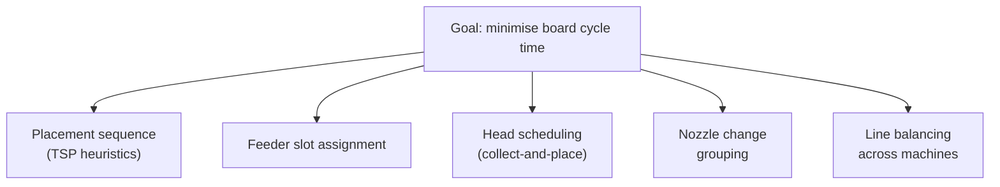

::: testing
Whether you can treat a manufacturing machine as an optimisation problem. The interviewer wants you to recognise it as a travelling-salesman-style routing problem plus a resource-assignment problem, and to name concrete levers: placement sequence, feeder slot assignment, multi-nozzle collect-and-place, minimising nozzle changes, grouping by part type, line balancing across machines, panelisation (same path repeated), and design choices that help (fewer unique parts, common packages). Bonus points for putting numbers on it and for noting that heuristics beat exact solutions in practice.
:::

::: why
Placement is often the bottleneck of an SMT line ([[q0597]]), so a 20% faster program is 20% more boards per hour from the same machine. Optimisation also reveals design-for-manufacturing levers: part-count reduction and standardised packages cut feeder slots and nozzle changes. This question is a good chance to show algorithmic thinking in a hardware setting.
:::

::: concepts
- **Travelling-salesman problem (TSP)**: find the shortest route that visits every point; the head's path between pick and place positions is TSP-like.
- **Feeder assignment**: which reel sits in which slot affects average pick distance.
- **Collect-and-place**: multi-nozzle heads pick several parts per trip, then place them.
- **Nozzle changes**: swapping nozzles costs seconds, so group parts that use the same nozzle.
- **Line balancing**: spread parts across several machines so none is the bottleneck. See [[q0597]].
- **Heuristics**: nearest-neighbour, 2-opt, genetic or simulated annealing: good-enough answers fast.
:::

::: answer
"I'd think of it as an optimisation problem with three main pieces. First, the order of placements: the head has to travel from the feeders to each spot on the board, and finding the shortest path through all of them is basically a travelling salesman problem. A good heuristic, like nearest neighbour followed by two-opt improvement, can cut the travel by large factors compared with an arbitrary order. Second, feeder assignment: put the most-used parts on the feeders closest to the board, and put parts that are picked together next to each other so a multi-nozzle head can collect several in one go. Third, reduce non-travel overhead: group parts by nozzle type to minimise nozzle changes, use collect-and-place heads so you make fewer trips, and balance the load over several machines on the line so none is the bottleneck.

On the design side, fewer unique part values and common package sizes mean fewer feeders and fewer nozzle changes, and panelising boards means the same optimised path repeats. In practice the machine vendor's software does the heavy lifting, but I'd still check that the result is balanced."
:::

::: technical
**Problem decomposition.** Minimise cycle time $T = T_{\text{travel}} + T_{\text{pick}} + T_{\text{place}} + T_{\text{vision}} + T_{\text{nozzle}}$ subject to feeder-slot limits, nozzle compatibility, head capacity and component heights. Typically solved in stages because the joint problem is NP-hard.

**1. Placement sequence (route).** Given a set of placement points, find an order minimising total head travel. Nearest neighbour is fast but greedy; 2-opt removes crossing segments. Illustrative experiment (40 random points on 100 x 60 mm, start at the origin; computed): random order about 1,705 mm of travel, nearest neighbour about 507 mm (70% less), nearest neighbour plus 2-opt about 434 mm (75% less than random). The random order is a strawman, so the real-world gain over a CAD-order sequence is smaller, but the shape of the result holds.

**2. Feeder assignment.** Place high-frequency parts nearest the board; cluster parts that are placed near each other on the board near each other on the feeder bank. For multi-nozzle heads, assign parts to adjacent slots that match the nozzle spacing so one gantry move picks several at once.

**3. Collect-and-place trips.** With a head holding $k$ nozzles, $n$ parts need $\lceil n/k\rceil$ round trips instead of $n$. Example (illustrative timings): 400 parts, single nozzle at 0.5 s per pick-travel-place cycle is 200 s; a 6-nozzle head with 0.45 s travel per trip plus 0.12 s per part is $67\times(0.45+6\times0.12)=78$ s (computed). Real gains are smaller because of constraints, but the trip-count reduction is the point.

**4. Nozzle and tooling changes.** Sort the job so parts of one nozzle type are placed consecutively; a change takes of the order of a second or more (vendor dependent), which is large compared with 0.1-0.2 s per placement.

**5. Line balancing.** Distribute parts across machines so that each cycle time is equal; the line rate is set by the slowest ($3600/T_{\max}$ boards per hour).

**6. Panel reuse.** For an $N$-up panel, the sequence is computed once and repeated; optimising which board to visit next (a panel-level TSP) adds a few percent.

> [!UNCERTAIN]
> Actual machine kinematics (acceleration limits, fly-by vision, simultaneous XY motion) change the optimal order: the cost metric is *time*, not Euclidean distance. The figures here are illustrative models, not any vendor's numbers.
:::

::: short
"It's a routing and resource-assignment problem. I'd optimise the placement order, which is like a travelling-salesman problem, using heuristics like nearest-neighbour plus 2-opt; assign feeders so frequently used and co-placed parts are close to the board and to each other; use multi-nozzle collect-and-place to cut trips; group parts by nozzle to avoid changes; and balance parts across machines so no one is the bottleneck. On the design side, fewer unique parts and common packages help too."
:::

::: long
"I'd split the problem into pieces, because solving it all at once is NP-hard. Think about what the machine spends time on: moving the head from feeders to board positions, picking, vision, placing, and sometimes changing nozzles.

First piece, sequence. Given where every part goes on the board, in what order should the head visit them? That's a travelling salesman problem. You can't brute force it, but a simple nearest-neighbour start with a two-opt clean-up gets within a few percent of optimal quite quickly. I tried a quick model of 40 random points: a random order travels about 1.7 metres, nearest neighbour about half a metre, and two-opt about 0.43 metres.

Second piece, feeders. The reels sit in a bank at the edge. Put the parts used most often closest to the board and put parts that are placed near each other on the board next to each other in the bank. With a multi-nozzle head you want several parts pickable in one move, so adjacent feeder slots matching the nozzle spacing is gold.

Third piece, the head itself. A collect-and-place head with six nozzles needs a sixth of the trips, though each trip is longer. And group parts by nozzle type, because a nozzle change costs more than several placements.

Finally, at the line level, balance parts across machines so cycle times match, because the slowest machine sets the line rate. And as a designer I can help by reducing the number of distinct parts, standardising on common packages and panelising the boards. In practice the vendor's software does the heavy lifting, but I'd check the balance."
:::

::: terms
- **TSP**: travelling salesman problem, shortest tour visiting all points.
- **Nearest neighbour**: greedy heuristic, always go to the closest unvisited point.
- **2-opt**: improvement heuristic swapping two edges to remove crossings.
- **Collect-and-place**: pick several parts, then place them in one trip.
- **Feeder bank**: row of feeder slots from which parts are picked.
- **Line balancing**: equalising cycle times across machines.
- **Takt time**: required time between completed boards to meet demand.
- **NP-hard**: no known fast exact algorithm for large problem sizes.
:::

::: exceptional
**An average answer** says "place the nearest parts first."

**An exceptional answer**:
- Frames it as sequence (TSP), feeder assignment, head scheduling, nozzle changes and line balance, and notes that the joint problem is NP-hard so staged heuristics are used.
- Quantifies something: trips reduced by $k$ nozzles, nozzle-change cost vs placement time, or the effect of 2-opt.
- Notes the cost is time (with acceleration limits, vision time) not Euclidean distance.
- Includes design-side levers: part-count reduction, common packages, panel reuse and fiducial locations.
- Mentions that vendor software performs most of this, and that you would verify the result on the line.
:::

::: mistakes
- **Minimising distance only.** Machines have acceleration limits and parallel motion; time is the metric.
- **Ignoring feeder positions.** Pick travel is as large as place travel, and feeders are a fixed bank.
- **Reordering parts without regard to height.** Placing tall parts early can block later nozzle paths; machines usually place small parts first.
- **Forgetting nozzle changes.** One change can cost as much as dozens of placements.
- **Over-optimising one machine.** If the oven or printer is the bottleneck, faster placement does nothing.
- **Believing exact solvers are needed.** Heuristics within a few percent of optimal are sufficient and fast.
:::

::: deep
## Seeing the pieces


Figure: Five levers, each a separate optimisation. Vendors solve them in stages; the order matters because feeder assignment changes pick distances and sequencing uses them.

## Lever 1: route as a TSP

For $n$ placement points there are $(n-1)!/2$ tours, so exhaustive search is hopeless beyond about 12 points. Two cheap heuristics:

- **Nearest neighbour:** from the current point, go to the closest unvisited one. $O(n^2)$, typically 20-25% above optimal in random Euclidean cases.
- **2-opt:** take two edges of the tour, reverse the segment between them if that shortens the tour, repeat until no improvement. Often within about 5% of optimal.

Experiment (my model, 40 points uniform in 100 x 60 mm, start at the origin):

| Method | Travel (mm) | vs random order |
|---|---|---|
| Random order | 1705 | baseline |
| Nearest neighbour | 507 | -70% |
| NN + 2-opt | 434 | -75% |

CAD order is not random, since designers tend to number parts spatially, so real gains over a naive order are smaller. The point of the table is the structure: greedy captures most of the gain and local search polishes it.

## Lever 2: feeder assignment

The head makes a pick and a place per part. Pick travel depends on where the reel sits. Two rules:

1. **Frequency**: the most-used parts (0.1 µF capacitors, 10 kΩ resistors, often several percent of the BOM each) go in the slots closest to the board edge.
2. **Affinity**: parts that are usually placed in the same area of the board go in neighbouring slots, so consecutive picks are short moves. For a multi-nozzle head, slot spacing must match nozzle spacing (e.g. every second slot).

The assignment problem is a quadratic assignment problem (also NP-hard), solved heuristically.

## Lever 3: collect-and-place

Single-nozzle sequential: each part costs a pick trip and a place trip. A $k$-nozzle head does $k$ picks in a short sweep along the feeder bank, travels to the board once, then places $k$ parts. The number of long trips falls from $n$ to $\lceil n/k\rceil$.

Illustrative model: single nozzle 0.5 s per part gives 200 s for 400 parts. A 6-nozzle head with a 0.45 s transit per trip and 0.12 s per part for pick and place does $67\times(0.45+0.72)=78$ s. The gain is roughly 2.5x, not 6x, because per-part pick/place time and constraints remain.

## Lever 4: nozzle changes and heights

Parts need different nozzles (0402 vs SOIC vs connector). Switching nozzles uses a nozzle station and takes on the order of 1-2 s (vendor dependent), versus 0.05-0.2 s per placement, so a change is worth tens of placements. Order the job: all parts for nozzle A, then all for nozzle B. Place short parts before tall ones, so the nozzle never collides with a tall neighbour.

## Lever 5: line balance and panels

With two placers, the best split gives each about half the total time; assign the part groups so their cycle times match within a few percent. The line speed is $3600/\max(T_i)$ boards per hour. See the worked example in [[q0597]].

For an $N$-up panel ([[q0594]]), the optimiser can treat all $N$ boards as one set of points, which gives more freedom (visit nearby parts across boards) but the program is larger.

## Design-for-optimisation

- **Reduce unique part numbers:** fewer feeders, fewer reel changes.
- **Standardise packages** (e.g. 0402 and 0603 only): fewer nozzle types.
- **Cluster same-type parts** if layout allows (e.g. decoupling caps near their ICs is a given, but standardising their values reduces slots).
- **Avoid very tall parts** or odd shapes unless needed: they need special nozzles and slow the head.

> [!INTERVIEW]
> If the interviewer wants an algorithm: say "nearest neighbour, then 2-opt for the sequence", then say why you don't need optimal: the model (distance) is already an approximation of time, and a few percent suboptimal is below the noise.
:::

::: applications
- **Machine vendor programming software**: automatic sequence, feeder and nozzle optimisation.
- **High-mix low-volume assembly**: setup time dominates, so minimising feeder changes (kitting, grouping jobs by shared reels) matters more than path length.
- **Multi-machine lines**: balance chip shooter and flexible placer loads.
- **Panelised boards**: same program repeated, optimising the panel-level order.
- **NPI (new product introduction)**: quick programs that are good enough, optimised later when volume rises.
:::

::: assumptions
- Distance is a proxy for time; real machines have acceleration profiles and may move X and Y simultaneously (time depends on the larger axis, so the metric is more like Chebyshev than Euclidean).
- Numerical example uses a synthetic random point set and simple timing assumptions, not any machine's specification.
- Assumes tape-and-reel feeders in a fixed bank. Some machines have moving feeder carriages or turret heads with different dynamics.
- In low-volume high-mix lines, setup time may dominate and the best optimisation is different.
:::

::: followups
### Why is this called a travelling-salesman problem, and why not just solve it exactly?
The head must visit every placement point once and wants the shortest route, which is the TSP. The number of tours grows factorially, and exact solvers are slow for hundreds of points; heuristics reach within a few percent in milliseconds, and the real time cost has other terms anyway.

### How would you decide which parts go closest to the board in the feeder bank?
Rank by use frequency (placements per board), then by affinity with others in the same board region. The 10 or 20 most-used reels take the nearest slots. Quadratic-assignment heuristics balance frequency and affinity.

### A 12-nozzle head isn't 12 times faster than a single-nozzle head. Why?
Per-part pick, vision and place time remain; feeders must be adjacent for simultaneous picks; part sizes need different nozzles; and travel between the pick cluster and place cluster still takes time. Speed-up is limited by the non-travel components (Amdahl-style).

### How would you balance a line with two placers?
Estimate each part group's placement time, assign groups to machines so both have similar cycle time, accounting for part-size capability (the chip shooter takes small parts, the flexible placer the big ones), then check against the printer and oven times. The slowest station sets the rate.

### Your line is slow but the placer has idle time. What do you look at?
The bottleneck is somewhere else: printer cycle, oven pitch, upstream/downstream conveyor, AOI, or operators changing reels. Measure each station's utilisation and queue; optimising the placer won't help.
:::

::: interpretations
"Repetitive paths" can mean (a) the same sequence repeated on every board of a panel or batch, or (b) the head repeatedly traversing between feeders and board. Both readings are covered: the first through panel reuse and sequence optimisation, the second through feeder assignment and collect-and-place.
:::

::: references
- Cormen et al., *Introduction to Algorithms*: NP-completeness and approximation algorithms (TSP heuristics).
- Applegate et al., *The Traveling Salesman Problem: A Computational Study*: for TSP background (named at topic level).
- IPC-9850, *Surface Mount Placement Equipment Characterization*: placement speed/accuracy definitions.
- Placement machine vendors' documentation on feeder and head configurations.
:::

::: rubric
- Recognises the sequence problem as TSP-like and names a heuristic :: Shows algorithmic framing.
- Covers feeder assignment (frequency and affinity) :: Pick travel is half the problem.
- Mentions multi-nozzle collect-and-place and trip count :: Hardware-aware optimisation.
- Mentions nozzle change minimisation and part-height ordering :: Practical machine constraints.
- Mentions line balancing across machines or identifying the bottleneck :: System-level thinking.
- Mentions design levers (fewer unique parts, common packages) :: Ties to DFM.
:::

::: quiz
```json
[
 {"type":"mcq","level":"fundamental","q":"Which classic problem best describes ordering the placements to minimise head travel?","options":["Knapsack","Travelling salesman","Shortest path in a DAG","Bin packing"],"answer":1,"explain":"Visiting every point once with minimum total travel is the TSP."},
 {"type":"mcq","level":"intermediate","q":"Why group parts by nozzle type in the program?","options":["Nozzle changes take much longer than a placement","Different nozzles use different vacuum levels electrically","It makes the solder wet better","It reduces board warp"],"answer":0,"explain":"A nozzle change takes on the order of seconds compared with tenths of a second per placement, so minimising changes saves time."},
 {"type":"numeric","level":"intermediate","q":"A head with 6 nozzles must place 400 parts. How many trips (collect-and-place cycles) are needed?","answer":67,"tolerance":0.01,"unit":"trips","explain":"ceil(400/6) = ceil(66.7) = 67 trips versus 400 for a single nozzle."},
 {"type":"numeric","level":"intermediate","q":"Model: each trip costs 0.45 s transit plus 0.12 s per part for 6 parts. How long do 67 trips take, in seconds?","answer":78.4,"tolerance":0.02,"unit":"s","explain":"Per trip: 0.45 + 6 x 0.12 = 1.17 s. 67 x 1.17 = 78.4 s."},
 {"type":"multi","level":"advanced","q":"Select good ways to speed up a placement program.","options":["Assign most-used parts to the feeder slots nearest the board","Order the job so same-nozzle parts are consecutive","Use nearest neighbour then 2-opt on the placement order","Randomise placement order to spread wear"],"answer":[0,1,2],"explain":"The first three reduce pick travel, nozzle changes and head travel. Randomising order increases travel and has no benefit."},
 {"type":"truefalse","level":"advanced","q":"If the reflow oven pitch is slower than the placer, speeding up the placer increases line throughput.","answer":false,"explain":"Line throughput is set by the slowest station. Once the placer is faster than the oven, further placer gains have no effect."}
]
```
:::
