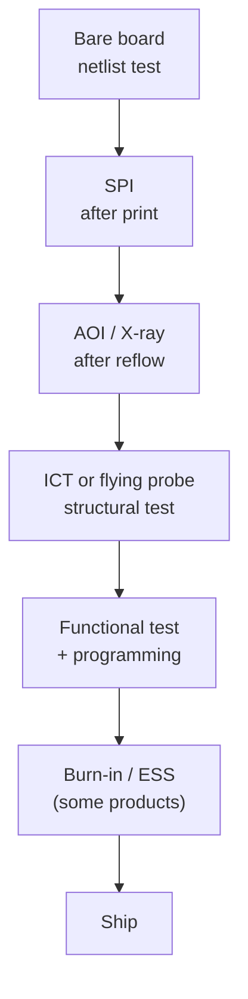

::: testing
Whether you see testing as a *chain of gates across the product lifecycle*, not one event. The interviewer wants: bare-board test at the fab (opens/shorts), in-line inspection (SPI, AOI, X-ray), electrical test after assembly (ICT or flying probe, boundary scan), functional test, and then stress screening and field/qualification testing. You should say what each finds, where in the flow it sits and why (cheap-to-fix early, broad coverage late), and distinguish design-validation bench testing from production testing.
:::

::: why
Every board that ships was tested by a process someone designed, and the test strategy depends on layout decisions you make: test points, boundary-scan chains, access to power rails, programming headers. Defects found later cost more to find and fix, and some escape to the customer. Understanding where each test sits helps you design for test ([[q0616]], [[q0614]]) and debug failures ([[q0626]]).
:::

::: concepts
- **Bare-board test**: netlist continuity and isolation test at the fab (flying probe or fixture). See [[q0593]].
- **In-line inspection**: SPI after printing, AOI after reflow, X-ray for hidden joints ([[q0608]]).
- **Structural / manufacturing test**: ICT ([[q0609]]), flying probe ([[q0611]]), boundary scan; finds *build* defects.
- **Functional test (FCT)**: runs the board like the product ([[q0610]]).
- **Stress screening**: burn-in, thermal cycling, vibration to catch infant mortality.
- **Design verification vs production test**: validation on prototypes versus fast pass/fail on every unit.
:::

::: answer
"Boards get tested at several points, and each gate catches a different class of defect. At the fab, every bare board gets an electrical netlist test for opens and shorts, because a bad board is cheapest to catch before parts go on. During assembly, inspection happens in line: solder paste inspection after printing, automated optical inspection after reflow, and X-ray for hidden joints like BGAs.

After assembly there's electrical testing. In-circuit test or flying probe touches test points and pads with probes to check for shorts, opens, wrong or missing components and component values, without even needing the board to boot. Then functional test powers the board up and checks that it actually does its job: rails, clocks, communications, sensors, firmware. Some products also get burn-in or thermal cycling to weed out early failures, and a final end-of-line check before packing.

The rule is to find defects as early and cheaply as possible, while using functional test as the final proof, because it's slower and diagnoses poorly. And separate from all that, during development an engineer tests a prototype on the bench against the spec, which is validation rather than production test."
:::

::: technical
**Test flow and what each step finds.**

| Stage | Test | Finds | Typical timing |
|---|---|---|---|
| Fab | Bare-board netlist test (flying probe or fixture) | Opens, shorts in the copper | Before shipment from fab |
| Incoming | Component inspection, moisture/bake checks, sample tests | Wrong or damaged parts | Before assembly |
| Print | SPI | Insufficient/excess paste, offsets | Seconds, in line |
| Pre/post reflow | AOI | Missing, wrong, skewed, tombstoned parts, bridges | Seconds, in line |
| After reflow | X-ray | BGA/QFN voids, bridges, head-in-pillow | Sample or 100% on critical boards |
| Post-assembly | ICT / flying probe / boundary scan | Opens, shorts, wrong value, wrong part, missing | Seconds to minutes |
| End of line | FCT | Functional failures, calibration, firmware | Seconds to minutes |
| Reliability | Burn-in, thermal cycling, vibration, ESS | Infant mortality, latent defects | Hours to days, sample or 100% |

**Cost of finding defects late.** A widely quoted rule of thumb says the cost of fixing a defect rises by roughly an order of magnitude at each later stage (board, system, field). It is a heuristic, not a measured constant, but it motivates catching defects early.

**Coverage models.** One common way to describe structural coverage is by fault class: presence, correctness, orientation, live (powered) behaviour, alignment, shorts, opens, and quality of joints (sometimes called the PCOLA/SOQ model; naming varies by source). Each test method covers some classes and not others.

**Yield arithmetic.** If stage yields are AOI 99%, ICT 97% and FCT 95%, rolled first-pass yield is 91.2% (computed). A defect that escapes AOI but is caught by ICT costs a rework; one that escapes both and is caught at FCT costs more diagnosis time.

**Design validation.** On prototypes, engineers test against the specification on the bench: power rails, signal integrity, EMI, thermal, and functionality ([[q0586]], [[q0587]]). That informs the production test limits.

> [!UNCERTAIN]
> The "10x rule" and the PCOLA/SOQ naming are industry folklore and vary by source; use them as intuition rather than citeable figures. Test times and coverage depend entirely on product and fixture.
:::

::: short
"Boards are tested in layers. The fab tests bare boards for opens and shorts. In assembly, SPI and AOI check paste and placement and X-ray checks hidden joints. After assembly, in-circuit or flying probe test finds opens, shorts and wrong or missing components, and functional test powers the board and checks it works. Some products get burn-in or thermal cycling too. The idea is to catch defects as early as possible since each later stage costs more to diagnose and fix."
:::

::: long
"I think of testing as a series of gates through the lifecycle, each tuned to catch a certain kind of problem at the lowest cost.

The first gate is at the fab. Every bare board gets a netlist test, probing the copper to confirm there are no opens or unintended shorts compared to the design. That way you don't populate a bad board.

Then in assembly there's inspection. Solder paste inspection right after the printer checks volume and alignment, and automated optical inspection after reflow looks for missing, wrong or misaligned parts and bridged joints. X-ray handles hidden joints under BGAs and QFNs.

After the board is built there's electrical testing. In-circuit test uses a bed-of-nails fixture, or flying probe test uses moving probes, to check every net for shorts and opens and to measure components, resistors, capacitors, diodes, so you know the right parts are in the right places. This works without needing the board to run. Then functional test powers the board and checks real behaviour: voltages, clocks, communication, sensors, firmware, calibration.

For reliability-critical products there's burn-in or thermal cycling and vibration to push early-life failures out before shipping.

The principle is shift left: find defects at the cheapest stage, and use functional test as the final proof. Separately, during development I test prototypes on the bench against the spec, which is validation, not production test."
:::

::: terms
- **Netlist test**: continuity/isolation test against the design connectivity.
- **SPI / AOI**: solder paste inspection / automated optical inspection.
- **ICT**: in-circuit test with a fixture ([[q0609]]).
- **Flying probe**: moving probes, no fixture ([[q0611]]).
- **FCT**: functional test ([[q0610]]).
- **Boundary scan (JTAG)**: test of pins through an on-chip scan chain (IEEE 1149.1).
- **Burn-in / ESS**: stress to expose infant mortality.
- **First-pass yield (FPY)**: fraction passing a stage with no rework.
- **Escape**: a defect that gets past a test stage.
:::

::: exceptional
**An average answer** says "ICT and functional test."

**An exceptional answer**:
- Lays out the whole chain, including bare-board test, SPI/AOI/X-ray, structural electrical test, FCT and reliability screens, and says what each can and cannot find.
- Explains the economics: early detection is cheaper, functional test diagnoses poorly, and yield compounds.
- Separates design validation from production test.
- Mentions design-for-test enablers: test points, boundary scan, programming/debug headers ([[q0616]]).
- Admits limits: no single test covers everything, so strategy mixes methods based on volume and risk.
:::

::: mistakes
- **Only naming functional test.** It is slow and poor at pinpointing defects; structural tests are the workhorses.
- **Forgetting the fab-level test.** Bare-board netlist test is standard.
- **Confusing validation and production test.** Validation checks the design; production test checks each unit's build quality.
- **Assuming AOI sees everything.** It cannot see under BGAs and QFNs or check electrical values.
- **Assuming ICT sees functional problems.** ICT finds build defects; it can't tell whether firmware or timing works.
- **Ignoring escapes.** Every test has finite coverage, so reliability screens and field data close the loop.
:::

::: deep
## A test strategy is a pipeline with economics


Figure: Each gate is cheaper per board and more specific early in the line, and broader but slower later. Which gates a product uses depends on volume, cost of failure and board complexity.

## What each stage can see

Think of each defect class and ask which test can catch it.

| Defect | SPI | AOI | X-ray | ICT/FP | FCT |
|---|---|---|---|---|---|
| Insufficient paste | yes | indirectly | no | maybe (open) | maybe |
| Missing part | no | yes | no | yes | maybe |
| Wrong value (e.g. 10k vs 1k) | no | no (unless marked) | no | yes | sometimes |
| Reversed polarised part | no | yes (if marked) | no | yes | often |
| Bridge/short | no | visible ones | yes (hidden) | yes | maybe |
| BGA open/void | no | no | yes | partial | maybe |
| Wrong firmware / cal | no | no | no | no | yes |
| Timing/SI/EMC problem | no | no | no | no | partly |

No row is covered by a single column. That's why strategies combine several.

## Why shift left

Suppose a line builds 10,000 boards with 600 joints each at 50 defects per million opportunities (DPMO): expected defects $=10{,}000\times600\times50\times10^{-6}=300$. Poisson yield per board: $e^{-0.03}=97.0\%$ (computed), so about 296 boards have at least one defect (slightly fewer than 300 because a few boards carry two).

If SPI/AOI catch most of them in line and the board gets reworked for a few dollars, the cost is small. If they escape to FCT, each failed board needs diagnosis (30-60 minutes of a technician's time, say), and if they reach the customer the cost includes returns, field service and reputation. The "rule of ten" folklore captures that growth, but you should say it is a rule of thumb.

## Design validation vs production test

On a first-spin prototype, you test everything slowly with a scope, DMM and logic analyser. You check rails, sequencing ([[q0586]] and [[q0587]] cover bench-test details), clocks, interfaces, thermal behaviour, and compare against the spec. Whatever you learn determines what the production test needs to check, with limits (pass/fail thresholds) derived from validated margins and from process variation across many units.

## Putting numbers on the economics

"Shift left" is easy to say. Here it is as an expected-cost calculation, so you can show it in an interview and also see when it fails. Take a board with a 3 % chance of carrying a build defect (the 0.03 defects per board from the DPMO example above). Every number below is an assumption chosen for illustration, not a measured figure.

| Stage | Catches (of defects that reach it) | Test cost per board | Cost to fix a defect found here |
|---|---|---|---|
| AOI | 85 % | USD 0.30 | USD 2 (rework at the line) |
| ICT | 90 % | USD 1.00 | USD 8 |
| FCT | 70 % | USD 2.00 | USD 40 (diagnosis plus rework) |
| Field | whatever is left | none | USD 400 (return, service, goodwill) |

Following a defect through the line: AOI finds $0.03\times0.85 = 0.0255$ per board and passes $0.0045$. ICT finds $0.0045\times0.90=0.00405$ and passes $0.00045$. FCT finds $0.00045\times0.70=0.000315$ and passes $0.000135$. Per board that comes to

$$\underbrace{0.0255(2)+0.00405(8)+0.000315(40)}_{\text{fixing: USD 0.096}}+\underbrace{0.3+1+2}_{\text{testing: USD 3.30}}+\underbrace{0.000135(400)}_{\text{field: USD 0.054}} = \text{USD }3.45$$

Now drop everything but FCT. It catches 70 % of 0.03, so fixing is $0.021\times40=0.84$, testing is 2.00, and the $0.009$ that escape cost $0.009\times400=3.60$, for a total of USD 6.44 per board. The layered line is cheaper because most of its saving is *not shipping bad boards*.

The same arithmetic shows where the argument breaks. If an escape costs only USD 40 (a cheap disposable product, no warranty tail), FCT-only totals $2+0.84+0.36=3.20$ against $3.40$ for the layered line, so the extra gates do not pay for themselves. This ignores fixture capital and engineering time, which push further in the same direction for low volumes. It is why a toy might ship with only a short functional check while an engine controller gets AOI, X-ray, ICT, FCT and burn-in. The right answer to "what test strategy?" always depends on what an escape costs.

## Coverage, yield and the defect level you ship

Test coverage and shipped quality are linked by a clean model, the Williams-Brown relation from IC test, which also works as intuition for boards. Let defects arrive as a Poisson process with mean $\lambda$ per board, so the yield is $Y = e^{-\lambda}$. A test with fault coverage $T$ detects each defect independently with probability $T$, so the number of *detected* defects is Poisson with mean $\lambda T$ and a board passes with probability $e^{-\lambda T}=Y^{T}$. A passing board is good only if it had no defects at all, which has probability $Y$. So the defect level among shipped boards is

$$DL = 1-\frac{Y}{Y^{T}} = 1-Y^{\,1-T}$$

With $Y=0.97$: coverage $T=0.90$ gives $1-0.97^{0.1}=0.30\ \%$ (3,040 defective boards per million shipped); $T=0.95$ gives 0.15 %; $T=0.99$ gives 0.030 % (305 ppm). Every extra nine of coverage cuts the escapes by about ten. Two independent consequences follow. First, a high-yield process helps twice: fewer defects exist, and fewer escape. Second, the coverage that matters is the coverage of the *combined* tests, so the layered numbers above (1 minus 0.15 times 0.10 times 0.30 is 99.55 %) matter more than the number on any one data sheet. The model assumes independent defects and independent detection; clustered defects or a test that shares a blind spot with an earlier one (for instance, two tests that both cannot see under a BGA) make the real figure worse.

## Order: cheap and specific first

Given a set of tests, which should run first? A decent rule is to run the test with the highest ratio of defects found to cost first, subject to what it can see. SPI and AOI cost cents and run in the flow already, so they lead. Structural test is cheap per board and points to the failing net, so it goes before functional test, which is the most expensive in time and the worst at diagnosis. A functional test also needs a good board to give meaningful results, so running it first wastes time on boards that would have failed a ten-second continuity check. Exceptions come from physical risk: if a short on a rail could damage parts at power-up, an unpowered structural check must come before any powered test, however the costs work out.

## Testing the test

A test line is a measuring instrument and has to be verified like one. Three habits separate a controlled process from a hopeful one.

- **Known-bad and known-good boards.** Keep a golden board that must always pass and a set of boards with deliberately seeded faults (a lifted pin, a wrong-value resistor, a missing part) that must always fail. Run them every shift. If the seeded failures pass, coverage has silently dropped.
- **Repeatability.** Retest the same board ten times. If a board passes six times and fails four, the problem is the fixture contact or the limits, not the board. Log which retest results change, since a line that "retests until it passes" hides real marginal parts.
- **Limit review.** Plot the measured value of each parametric test across a few hundred boards. If the distribution has its mean near a limit, a small drift pushes yield off a cliff; if it sits well inside, the limit may be too loose to catch a degraded part. Revisit limits when a component supplier or lot changes.

## Test method selection

- **Prototype or low volume (1 to a few hundred)**: flying probe ([[q0611]]), manual debug, a simple functional jig.
- **Medium volume**: flying probe or low-cost fixtures, boundary scan, functional test.
- **High volume (thousands to millions)**: bed-of-nails ICT ([[q0612]]) and fast functional test, AOI, with statistical process control. See [[q0605]] for scale.
- **High reliability (medical, automotive, aerospace)**: 100% X-ray on critical parts, burn-in/ESS, extended functional test with traceability.

## Design hooks

- **Test points** on key nets and power rails ([[q0619]]).
- **Boundary scan** chains where ICs support it.
- **Programming/debug headers** or pads for firmware loading.
- **Fiducials** for fixture/probe alignment ([[q0596]]).
- **Keep-outs** for fixture pins and tooling holes.

> [!INTERVIEW]
> Answer with the chain in time order and tag each stage with "what it catches". Then add one sentence on economics, "I'd rather find a solder bridge at AOI than at functional test", and one on design for test.
:::

::: applications
- **Consumer electronics**: AOI, flying probe or ICT and a short functional test at high volume.
- **Automotive ECUs**: AOI, X-ray, ICT/boundary scan, functional test and burn-in with full traceability.
- **Medical devices**: extended functional test with documented limits and records.
- **Prototype builds**: flying probe plus bench tests.
- **Power supplies**: functional test with load and safety (hipot) testing at end of line.
:::

::: assumptions
- Describes electronic manufacturing test, not field or compliance (EMC, safety) testing, though end-of-line safety tests like hipot exist.
- The cost-of-defect figures and yields are illustrative.
- Which tests are used depends on volume, product risk and board access (test points).
- Boards with limited access (high density, BGAs) rely more on boundary scan, X-ray and functional test.
:::

::: followups
### Why not just use functional test for everything?
It is slow, depends on the firmware and stimulus, covers only exercised paths, and diagnoses poorly: a "no boot" could be any of hundreds of defects. Structural tests like ICT point to the failing net or component quickly, and AOI finds defects before any parts are powered.

### What's boundary scan and when does it help?
Boundary scan (IEEE 1149.1, JTAG) puts a shift-register cell at each pin of compliant ICs, so you can drive and read pins through four to five test pins. It tests interconnect (opens/shorts between chips) without physical probes, which is great for BGAs and dense boards with no test access.

### When does testing happen during product development vs production?
During development you validate the design on prototypes with bench instruments, characterising margins. In production you run fast pass/fail tests on every unit, with limits derived from validation. Reliability testing such as thermal cycling is done on samples in qualification, and as screens in some production flows.

### The yield at ICT drops from 98% to 90% on one product. What's your approach?
Look at the failure log: if one net or part dominates, trace back to the process (paste, feeder or reel, new component lot, profile), compare with SPI and AOI data, then check the fixture (worn probes, misalignment). Fix the process, and update inspection to catch it earlier.

### What would you test on a board that shipped with intermittent failures in the field?
Reproduce with thermal cycling and vibration; check solder joint integrity (X-ray or cross-section), review marginal timing and supply margins, inspect cracked MLCCs, and add a screen (burn-in or thermal cycling) if infant mortality is the cause.
:::

::: interpretations
"How are PCBs tested? When does this happen?" is broad. It can mean the *bare PCB* tested at the fab, the *assembled PCB* tested on the line, or *debug testing by an engineer*. The page covers all three; see [[q0586]] for bench-level tests and [[q0606]] for the assembly-line step sequence.
:::

::: references
- IEEE 1149.1, *Standard Test Access Port and Boundary-Scan Architecture* (JTAG): standard by name.
- IPC-9252, requirements for electrical testing of unpopulated printed boards (standard by name; check revision).
- IPC-A-610 for acceptability of assemblies.
- Bushnell & Agrawal, *Essentials of Electronic Testing for Digital, Memory and Mixed-Signal VLSI Circuits*: test concepts and coverage.
:::

::: rubric
- Lists test stages in time order (bare-board, in-line inspection, structural, functional) :: Shows lifecycle thinking.
- States what each finds (opens/shorts, paste, placement, values, function) :: The question implies purpose.
- Explains why early detection is cheaper and why FCT diagnoses poorly :: Engineering judgement.
- Distinguishes production test from design validation :: Often confused.
- Mentions reliability screens (burn-in, thermal cycling) :: Complete picture.
- Mentions design-for-test hooks (test points, boundary scan) :: Links to the designer's job.
:::

::: quiz
```json
[
 {"type":"mcq","level":"fundamental","q":"Which test checks a bare board for opens and shorts against the netlist?","options":["Functional test","Netlist continuity/isolation test at the fab","AOI","Burn-in"],"answer":1,"explain":"The fab uses flying probe or fixture netlist test before shipping the bare boards."},
 {"type":"mcq","level":"fundamental","q":"Which defect can AOI NOT find?","options":["Missing component","Tombstoned chip","A wrong resistor value with identical markings","Reversed polarised capacitor with visible marking"],"answer":2,"explain":"AOI sees appearance, not electrical value, so two visually identical parts of different value look the same. ICT would measure it."},
 {"type":"numeric","level":"intermediate","q":"First-pass yields: AOI 99%, ICT 97%, FCT 95%. What is the rolled yield in percent?","answer":91.2,"tolerance":0.01,"unit":"%","explain":"0.99 x 0.97 x 0.95 = 0.9123, i.e. 91.2%."},
 {"type":"numeric","level":"intermediate","q":"600 joints per board at 50 DPMO. Expected defects per 1,000 boards?","answer":30,"tolerance":0.02,"unit":"defects","explain":"600 x 50e-6 = 0.03 defects per board, so 30 per 1,000 boards."},
 {"type":"multi","level":"advanced","q":"Select techniques that can test interconnect on a dense board with no test points.","options":["Boundary scan","X-ray inspection (for hidden joints)","Bed-of-nails ICT on every net","Functional test with firmware self-checks"],"answer":[0,1,3],"explain":"Without test access, bed-of-nails cannot reach nets. Boundary scan, X-ray and functional self-test can cover parts of the interconnect."},
 {"type":"truefalse","level":"advanced","q":"Functional test is the best place to find solder defects because it exercises the real product.","answer":false,"explain":"It is slow and its diagnosis is poor. Solder defects are best found earlier by SPI, AOI, X-ray and ICT, which locate the fault directly."}
]
```
:::
