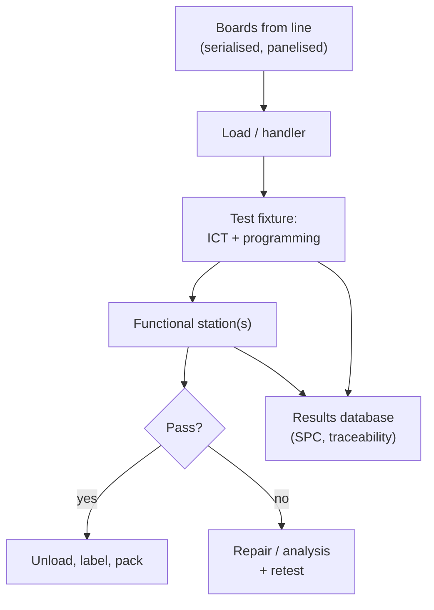

::: testing
Whether you can think about test as a *production system* with throughput, cost and data, not just a measurement. The interviewer wants: fixtures and automation (bed-of-nails, handlers, conveyors), multi-up and parallel testing, test-time budgeting and its link to line takt, cost trade-offs between fixtured and fixtureless test, test coverage versus time, calibration and gauge repeatability, data logging and traceability, statistical process control and feedback to the line, and design-for-test choices that make all of that possible.
:::

::: why
At prototype volumes you can probe by hand. At 10,000 or 1,000,000 boards, a 30 s test per board, a 1% false-fail rate or an unreliable fixture becomes real money and real delay. Test engineers are as much systems engineers as circuit engineers, and a hardware designer who understands this will add the test points and access that make a high-volume test practical ([[q0614]]).
:::

::: concepts
- **Throughput and takt time**: boards per hour a test cell must sustain to keep up with the line.
- **Fixtures and handlers**: bed-of-nails ([[q0612]]) or functional fixtures with automatic load/unload.
- **Parallel and multi-site testing**: testing several boards or panels at once.
- **Fixtureless test**: flying probe ([[q0611]]), boundary scan, firmware self-tests.
- **Test coverage vs test time**: more checks mean more seconds per board.
- **Gauge repeatability and calibration**: the measurements themselves must be trustworthy.
- **Traceability and SPC**: serial-number data used to find process drift.
:::

::: answer
"At scale it becomes a systems problem: how many boards per hour can I test, at what cost, and how do I know the test itself is trustworthy. For high volume you use fixtured test: a bed-of-nails in-circuit tester where hundreds of spring probes contact test pads at once, so a full structural test takes seconds, plus a fast functional test. Boards go through on conveyors with automatic loading and unloading, and often several boards or a whole panel are tested in parallel. You budget test time against the line's takt time; if the line makes a board every 30 seconds, the test cell needs to match, or you add test stations in parallel.

Cost-wise there's a crossover: a fixture might cost several thousand dollars but runs in seconds, while a flying probe has no fixture but takes minutes, so fixtures win above a certain volume, maybe a couple of thousand boards in an example. Then there's data: every board gets a serial number, results are logged, and statistics on yield per station and per failure type feed back to the line, so if a feeder starts misplacing a part you see it in ICT failures within the hour. Test systems are calibrated, and golden boards check that the tester still catches known faults.

For the design, I'd make this practical by adding test points on the nets that matter, on one side of the board, with fixture-friendly spacing, and boundary scan where pins are not accessible."
:::

::: technical
**Throughput maths.** For a test cell with $N_s$ parallel sites and test time $t$ (including load/unload), throughput is $\text{UPH} = 3600\,N_s/t$. To meet a line takt $T$ (s per board), $N_s \ge t/T$. Example: $t = 45$ s per board and a takt of 20 s needs $\lceil 45/20\rceil = 3$ sites (computed). A 6-up panel tested in one fixture with $t = 60$ s gives an effective 10 s per board.

**Cost per board.** $C = F/N + t\,r$ where $F$ is fixture or programming cost, $N$ the number of boards, $t$ the test time and $r$ the cost rate (machine plus operator) per second. Illustrative numbers: bed-of-nails fixture 9,000 USD, 30 s per board at 60 USD/h; flying probe programming 800 USD, 8 min per board at 40 USD/h. Then
- ICT: $9000/N + 30/3600\times60 = 9000/N + 0.50$,
- Flying probe: $800/N + 480/3600\times40 = 800/N + 5.33$.
Setting equal gives a breakeven at $N\approx(9000-800)/4.83 \approx 1{,}700$ boards (computed). Above that, the fixture wins and the gap grows.

**Measurement quality.** A test system needs: calibrated instruments (DMM, source, scope), a *golden unit* and known-bad units to check detection, gauge repeatability and reproducibility (GR&R) studies, fixture maintenance (probe wear, contact resistance), and false-fail monitoring. A probe lasting about 100,000 to 1,000,000 cycles (vendor dependent) must be replaced on schedule.

**Data and feedback.** Each board's serial, station, timestamp, measured values and verdict goes to a manufacturing execution system (MES) or database. SPC charts (mean and spread of key measurements, failure Pareto, first-pass yield by shift) detect drift before it becomes a yield crash, and trace failures to reel lots or machines.

**Test-time budget.** Fast tests first, expensive tests last, abort on first failure to save time, and skip redundant checks. Programming firmware often dominates (flash write time), so programming may be parallelised or moved to a dedicated station.

> [!UNCERTAIN]
> The cost figures, probe life and test times above are illustrative. Real values depend on the fixture vendor, board complexity, labour rates and volume.
:::

::: short
"At scale, test is a throughput and cost problem. I'd use fixtured in-circuit and fast functional test with automatic handling, test several boards or a panel in parallel, and size the number of stations from test time versus line takt. Fixtures cost thousands but run in seconds, so above some volume, around a couple of thousand boards in a typical example, they beat flying probe. Every board is serialised and logged, results feed statistical process control, and the testers are calibrated and checked with known-good and known-bad boards. Designing in test points makes it all possible."
:::

::: long
"Testing at large scale is really a production-engineering problem with three constraints: speed, cost and trust.

Speed first. The line makes a board every so many seconds, and the test cell has to keep up. If the full test takes 45 seconds and the takt is 20, I need three test stations in parallel, or I test several boards at once, like a whole panel in a single fixture. To keep time down you run the fastest tests first, abort on the first failure, and make sure slow things like flashing firmware are parallelised.

Cost second. A bed-of-nails fixture might be several thousand dollars, but then a structural test takes seconds. Flying probe has almost no setup, but takes minutes per board. So there's a volume crossover. In an example with a 9,000 dollar fixture and half a dollar per board of test time against about five dollars for flying probe, the breakeven is around 1,700 boards, and above that you'd use the fixture. Automation, like conveyors and robotic handlers, reduces labour.

Trust third. A test is only useful if it's repeatable. Testers are calibrated, probes wear out and get replaced on a schedule, and we run known-good and known-bad boards to confirm the tester catches defects. We track false-fail rates, because those cost as much as real failures.

Finally, data. Every board has a serial number, every result is logged, and statistical process control charts failures by type and station. If ICT failures on one resistor spike, I know a feeder or reel lot is bad, and I can fix the line. For the board itself, test points on fixture-friendly nets, one-sided access, and boundary scan for hidden pins are what make this practical."
:::

::: terms
- **Takt time**: time per unit the line must achieve to meet demand.
- **UPH**: units per hour.
- **Multi-up / panel test**: testing several boards in one fixture.
- **Handler**: automation that loads, tests and sorts boards.
- **Golden unit**: known-good reference board used to validate the tester.
- **GR&R**: gauge repeatability and reproducibility.
- **False fail / false pass**: good board rejected / bad board accepted.
- **SPC**: statistical process control.
- **MES**: manufacturing execution system, tracks units and results.
:::

::: exceptional
**An average answer** says "use automated testers like ICT and functional test."

**An exceptional answer**:
- Frames test as a throughput and cost problem and computes stations needed from test time and takt.
- Does the fixture-versus-flying-probe breakeven with numbers and says the crossover depends on volume.
- Covers parallelism (panel test, multi-site) and automation (handlers, conveyors).
- Addresses measurement trust: calibration, golden/bad units, probe wear, false-fail tracking.
- Closes the loop with traceability and SPC feedback to the line, and with DFT choices (test points, boundary scan, one-sided access).
:::

::: mistakes
- **Ignoring false fails.** A 2% false-fail rate on a 98%-yield line can double the apparent defect rate and flood rework.
- **Not budgeting test time against takt.** Test becomes the bottleneck and the line backs up.
- **Never recalibrating or maintaining fixtures.** Worn probes cause intermittent contact and phantom failures.
- **Testing everything at the end.** A short structural test early prevents wasting functional-test time on dead boards.
- **Keeping no data.** Without serial-level results you can't trace a field failure or process drift.
- **Assuming one method fits all volumes.** Prototype, medium and high volume call for different strategies.
:::

::: deep
## The test cell as a pipeline


Figure: A typical high-volume test cell. Results from every station go to a database, used both for pass/fail decisions and for feedback to the line. Failed boards go to a repair loop, then re-enter the flow.

## Sizing the stations

Suppose the line produces a board every 20 s (takt) and the full test takes 45 s including load/unload. A single station makes 80 UPH, but you need 180 UPH. So you need $\lceil 180/80\rceil = 3$ stations. Alternatives that reduce station count: test a 6-up panel in one fixture, so a 60 s panel test works out to 60/6 = 10 s per board; speed up programming (flash is often the biggest chunk); or split the test into two shorter stations in series (a pipeline), so the time between boards is the *longest* stage, not the sum.

## Economics: fixture or not?

```plot
{"title":"Cost per board vs volume (illustrative)","x":{"label":"Boards tested","min":50,"max":20000,"log":true},"y":{"label":"Test cost per board","unit":"USD","min":0,"max":25},
 "series":[{"label":"Bed-of-nails ICT: 9000/N + 0.50","fn":"9000/x+0.5"},{"label":"Flying probe: 800/N + 5.33","fn":"800/x+5.33","color":"red"}],
 "vlines":[{"at":1697,"label":"breakeven ≈ 1,700 boards","color":"muted"}]}
```
Figure: Fixed cost dominates at low volume, so flying probe wins; at high volume the per-board time cost dominates and the fixture wins. The crossover shifts with fixture cost, test time and labour rate. Also note that a design change forces a fixture rework, a hidden cost that favours flying probe for unstable designs.

## What makes a trustworthy tester

1. **Calibration**: DMMs, supplies and scopes calibrated on a schedule traceable to standards.
2. **Golden and fault-injected boards**: known-good boards should pass and boards with seeded faults (a lifted pin, a wrong value) must fail. Run them periodically (every shift).
3. **Contact quality**: spring probe tips wear, oxidise and collect flux; the contact resistance rises and a pass becomes a fail. Probe replacement schedules and cleaning matter; monitoring the contact check (a quick resistance test on ground pins) catches it.
4. **GR&R**: measure the same board repeatedly; the test's variation should be a small fraction of the spec range (a common target is under 10% of tolerance, but sources vary).
5. **Limits**: derived from design margins and the measured distribution of good units, not guessed.

## Sizing with availability and retests, not just test time

The station count above assumed every second is productive. A real cell loses time to probe changes, calibration, jams, operator breaks and retests, so the capacity has to be derated before you count stations. Continue the example: demand is 180 UPH, one station tests 80 UPH on paper. Suppose each station is available 90 % of the time (an assumption), so its usable capacity is $80\times0.9 = 72$ UPH. Suppose also that failing boards, both true defects and false fails, get retested once, adding about 5 % to the load, so the demand is $180\times1.05 = 189$ UPH. The stations needed are

$$N_s \ge \frac{189}{72} = 2.63 \;\Rightarrow\; 3,\qquad \text{utilization} = \frac{189}{3\times72} = 87.5\ \%$$

Three stations just fit, but 87.5 % utilization leaves little slack: any extended jam on one station builds a queue the others cannot clear quickly, and boards back up in front of the cell and starve the line's rework loop. Adding a fourth station drops utilization to 65.6 % at the cost of a fixture and an operator slot. The decision is rarely "can the cell keep up on average" and more often "how much headroom do I want for the bad day". Stating utilization alongside the station count is the sort of detail that shows you have run a line.

## Why one worn pin can fail good boards

A bed-of-nails fixture contacts every net through a spring probe, and the contact resistance is the quietly dominant error in a powered test. A new probe on a clean pad might contribute on the order of 20 mΩ (an assumption; it depends on the probe, plating and force). Run a 1 A rail through a two-wire contact and you lose $1\ \text{A}\times20\ \text{m}\Omega = 20$ mV. Against a 3.3 V ±3 % window, which is ±99 mV, that already uses 20 % of the budget. After oxidation and flux build-up the resistance can climb to 200 mΩ, and the drop becomes 200 mV, twice the whole window. The board is perfect, the test says it fails, and the operator reflexively retests until it passes.

The cure is physics, not discipline. Use a four-wire (Kelvin) connection for any powered rail: one probe forces the current, a second probe on the same pad senses the voltage through a high-impedance meter that carries no current, so the drop in the force contact never appears in the measurement. Budget two probes for each such net, and have a software contact check (a quick resistance test on ground pins, as mentioned above) at the start of each test that aborts with "bad contact" rather than a misleading parametric fail. Logging the contact-check value for every board turns probe wear into a trend you can act on before yield falls.

## Is the measurement good enough? Gauge R&R in numbers

Most of the limits in a production test come from the product spec, but whether the tester can *resolve* them is a separate question. Gauge repeatability and reproducibility (GR&R) compares the tester's own variation with the tolerance. Suppose the 3.3 V rail has a window of 198 mV (±99 mV) and measuring the same board repeatedly across fixtures and shifts gives a standard deviation of 5 mV. The common metric is

$$\%GRR = \frac{6\,\sigma_{grr}}{\text{USL}-\text{LSL}} = \frac{6\times5\ \text{mV}}{198\ \text{mV}} = 15.2\ \%$$

That is above the 10 % that the page cites as a common target, and inside the 10 to 30 % band the quality literature calls marginal. (These thresholds are convention, and sources differ.) To reach 10 %, the tester's $\sigma$ must fall to $0.1\times198/6 = 3.3$ mV. Options are a better meter range, averaging several samples at the cost of test time, or moving to four-wire sensing. Alternatively, accept the marginal figure on a non-critical rail and tighten the limits by a guard band on critical ones. Whichever route you take, it is a decision with a number attached.

## Retest policy: how not to hide defects

Retesting failures is normal, since contact problems are real. The policy matters. A rule of "retest up to three times, pass if any attempt passes" is dangerous for intermittent defects. Suppose a cold-solder joint makes a board fail 50 % of the time, independently at each attempt. A single test lets 50 % of such boards through as good. With the best-of-three policy, the board passes unless it fails all three, so $1-0.5^3 = 87.5\ \%$ of the intermittent defects escape. That is exactly the type of defect that surfaces later in the field with vibration or temperature.

A safer policy is to allow one retest after a re-seat, require the retest to pass *all* checks, flag any board that passed only on retest, and send those flagged boards to analysis rather than packing. Track the retest rate per station. A station whose retest rate rises from 1 % to 4 % is telling you about the fixture, not the product. The cost of a deliberate policy is small: at 180 UPH, a 4 % failure rate is only 7 boards an hour to look at.

> [!UNCERTAIN]
> Contact resistance, probe life and the acceptable %GRR band depend on the probe vendor, the plating, the spring force and the quality system a customer demands. Use the values here as illustrations and take real numbers from your fixture supplier and your quality standard.

## Data, SPC and feedback

Log serial, station, measured values and result. Typical outputs: first-pass yield by station and shift, failure Pareto (which test steps fail most), and control charts for key analog measurements. If a rail's mean drifts, you've found a component-lot or process issue before it fails the limit. For field returns, the stored test data lets you check the unit's margins at the factory.

```sim
{"id":"process-capability","mu":0,"sigma":1,"lsl":-4,"usl":4}
```
Figure: The control chart is the SPC step: a measured rail with spec limits at ±4σ has Cpk 1.33 and the subgroup means stay inside their ±3σ/√n limits. Drag the mean to 2 and Cpk falls to 0.67 (about 23,000 ppm out of spec) while the points start leaving the limits, as they would when a component lot drifts.

## Parallelism and automation

- **Panel test**: the fixture contacts all boards in the panel, with testers multiplexed or duplicated.
- **Multi-site functional test**: several UUTs (units under test) share instruments through relays or run on parallel instrument sets.
- **Conveyor handlers/robots**: auto load and unload, sort pass/fail, label.
- **Concurrency inside a test**: run flash programming of board A while board B is in the electrical test.

## What design must provide

| Need | Design response |
|---|---|
| Fixture access | Test points on one side, grid-friendly spacing ([[q0621]]) |
| Fast power-up | Accessible rails, defined power sequencing |
| Programming | Pogo-pin pads or header for firmware, fast bootloader |
| Hidden pins | Boundary scan ([[q0604]]) |
| Alignment | Tooling holes and fiducials ([[q0596]]) |
| Observability | Firmware self-test, debug UART, status LEDs |

See [[q0614]] for the full DFT picture.

> [!INTERVIEW]
> Show the numbers: "If takt is 20 s and test is 45 s I need three cells; and above about 1,700 boards a 9k fixture beats flying probe in my example." Then talk about trust: calibration, golden boards, probe wear and false fails.
:::

::: applications
- **Consumer electronics lines**: ICT plus short FCT, parallel stations, conveyor handlers.
- **Automotive**: 100% functional test with traceability, serial-level data retained for years.
- **Mobile phones**: multi-site RF and functional test with automated handlers and calibration steps.
- **Contract manufacturers**: shared test fixtures per product, quick changeover.
- **Power supplies**: burn-in racks with many units powered in parallel.
:::

::: assumptions
- Illustrative cost and time numbers; real fixture cost depends on net count, board complexity and vendor.
- Assumes a stable design; frequent ECOs raise fixture rework costs.
- Assumes access to test points. For boards without access, boundary scan, X-ray and functional self-test carry more of the load.
- Parallel test requires enough instrument and fixture capacity; shared instruments can serialise multi-site tests.
:::

::: followups
### How do you decide how many test stations you need?
Compute from line takt and the full per-board test time: stations $= \lceil t/T\rceil$. Then reduce by testing panels, parallelising programming, or splitting into a pipeline whose time is set by the longest stage.

### Fixture or flying probe for 500 boards a month with design changes every quarter?
Probably flying probe or a cheap simple fixture. 6,000 boards a year looks like plenty against the ~1,700-board crossover in the example, but with a change every quarter each fixture revision only serves about 1,500 boards, below that breakeven, and every engineering change adds fixture rework cost on top. So a 9,000 dollar fixture is hard to justify until the design stabilises.

### How do you know the tester itself isn't the problem?
Run golden units (should pass), fault-injected units (should fail), watch false-fail rates and contact-check results, calibrate on schedule, replace probes by cycle count, and compare failures between stations: if one station fails more than the rest, suspect the station.

### The line's first-pass yield at ICT suddenly drops but only on one fixture. What do you do?
Compare the same serials on another fixture: if they pass, it's the fixture (worn or dirty probes, misalignment, contact resistance). Clean or replace probes and re-verify with golden boards. If failures follow the board, look at the process.

### How would you reduce functional test time from 60 s to 20 s?
Parallelise programming and power-up, run tests concurrently where hardware allows, drop redundant checks already covered by ICT, speed up the bootloader, abort on first failure, and move slow calibration to a separate station.
:::

::: interpretations
The question's wording, "How are PCBs testing at a large scale?", has a typo ("testing" for "tested"). It means high-volume production test. For the individual test types see [[q0609]] (ICT), [[q0610]] (FCT), [[q0611]] (flying probe), [[q0612]] (bed-of-nails), and for the full chain [[q0604]].
:::

::: references
- IPC-2222 and IPC-2221 for general design; IPC-9252 for electrical test of bare boards (standards by name; check revisions).
- IEEE 1149.1 boundary scan standard for test access.
- Montgomery, *Introduction to Statistical Quality Control*: SPC charts and gauge studies (topic level).
- Test fixture vendors' design guidelines for probe pitch and pad sizes.
:::

::: rubric
- Treats test as throughput/cost and relates test time to takt :: Shows production thinking.
- Describes automation and parallel testing (handlers, panel test, multi-site) :: The core "large scale" tools.
- Compares fixtured and fixtureless test with a breakeven idea :: Economic judgement.
- Covers tester trust: calibration, golden/bad units, probe wear, false fails :: Practical quality of the test itself.
- Describes data logging, traceability and SPC feedback :: Closes the loop with the line.
- Mentions DFT enablers (test points, boundary scan) :: Link back to the designer.
:::

::: quiz
```json
[
 {"type":"mcq","level":"fundamental","q":"Which approach has the highest fixed cost but the lowest per-board test time?","options":["Manual probing","Flying probe","Bed-of-nails fixture","Visual inspection"],"answer":2,"explain":"A bed-of-nails fixture contacts all nets at once, costing thousands up front but testing in seconds."},
 {"type":"numeric","level":"intermediate","q":"Line takt is 20 s per board and the full test takes 45 s. What is the minimum number of parallel test stations?","answer":3,"tolerance":0.01,"unit":"stations","explain":"ceil(45/20) = ceil(2.25) = 3."},
 {"type":"numeric","level":"intermediate","q":"Fixture 9,000 USD with 0.50 USD per board of test time versus flying probe 800 USD with 5.33 USD per board. At about how many boards do they cost the same?","answer":1700,"tolerance":0.03,"unit":"boards","explain":"9000/N + 0.50 = 800/N + 5.33, so 8200/N = 4.83 and N = 1,698, about 1,700 boards."},
 {"type":"mcq","level":"intermediate","q":"Why monitor false-fail rate?","options":["False fails do not cost anything","They waste diagnosis and rework time and hide real defects","They improve yield","They only matter in prototypes"],"answer":1,"explain":"Good boards rejected by the tester cost technician time and distort the failure data, so the false-fail rate is tracked like a yield."},
 {"type":"multi","level":"advanced","q":"Select ways to reduce test time per board.","options":["Test a panel of boards in one fixture","Parallelise firmware programming","Run the slowest tests first","Abort on first failure"],"answer":[0,1,3],"explain":"Panel test, parallel programming and early abort cut time. Running the slowest tests first wastes time on boards that would have failed a fast test."},
 {"type":"truefalse","level":"advanced","q":"Worn probes in a fixture can cause good boards to fail intermittently.","answer":true,"explain":"Rising contact resistance or poor contact makes measurements wrong, giving phantom failures. Contact checks and scheduled probe replacement address it."}
]
```
:::
