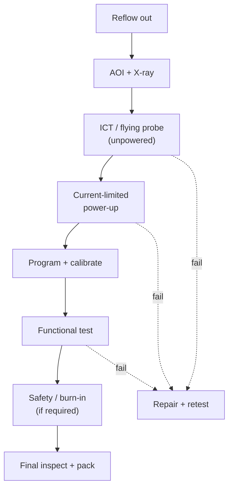

::: basics
### In plain words
After a board leaves the soldering oven, it goes through tests in a set order: cheap and safe first, powered and expensive last. First it is inspected. Then an unpowered electrical test checks for shorts and wrong parts. Next it is powered with a current limit, loaded with firmware, and given a functional test. Failures go to repair and are retested.

### Picture it
Think of checking a new house before moving in. You walk through to see that everything is built, then test the wiring for faults with the power off. Only then do you flip the main switch, and perhaps through a safety breaker. After that you try the lights and appliances. Turning power on first risks a fire from a fault you could have found in advance. A board is the same, and the current limit plays the breaker.

### Words you need
- **Unpowered test**: electrical checks done without power, so a fault cannot damage anything.
- **Current limit**: a supply setting that caps current so a fault cannot burn parts.
- **Programming**: loading firmware and the serial number into the board.
- **Functional test**: powering the board and checking it behaves like the product. See [[q0610]].
- **Repair loop**: failed boards are diagnosed, fixed and retested.

### The simplest example
A 3.3 V board draws about 85 mA when idle. You set the supply's current limit to 150 mA, enough to start up but low enough to protect the board. After power-up you measure the idle current. A reading between about 60 mA and 120 mA passes, and anything outside fails. If it passes, you flash the firmware and run the functional test. That is the whole idea. The rest of this page lists the full sequence, explains why the order is what it is, and shows how pass limits come from measuring many good boards.
:::

::: testing
Whether you can give the *ordered sequence* of tests a board sees once it is on the line and explain the logic of the order: cheap and non-powered first, powered and functional later, with a safe power-up step in between. The interviewer wants the specific tests (SPI, AOI, X-ray, ICT/flying probe, boundary scan, programming, FCT, safety/hipot, burn-in, final inspection), what each checks, and sensible judgement about what happens to a failing board (repair, retest, scrap).
:::

::: why
If you design a board you will be asked, "how will we know the one we shipped works?" The answer is a test plan that fits the line. An engineer who knows the usual order can specify a current-limited first power-up, choose which nets get test points, and decide what firmware self-test the board needs. [[q0604]] gave the whole lifecycle view; this page walks the line itself, step by step.
:::

::: concepts
- **Unpowered tests first**: do not apply power to a board that may have a short. See ICT ([[q0609]]) and flying probe ([[q0611]]).
- **Current-limited power-up**: first power-on with a supply limited to a safe current.
- **Programming/flash**: load firmware, calibration constants and serial number.
- **Functional test (FCT)**: exercise rails, clocks, interfaces, sensors and outputs ([[q0610]]).
- **Safety tests**: hipot, ground bond for mains-connected products.
- **Rework loop**: failing boards are diagnosed, repaired and retested.
:::

::: answer
"After the board comes out of the reflow oven, I'd expect roughly this sequence. First, visual and automated optical inspection to catch anything obviously wrong, like missing or skewed parts or bridges, and X-ray on boards with BGAs. Then an unpowered electrical test, either in-circuit test or flying probe, which checks for shorts, opens, and the values of resistors, capacitors and diodes, without turning the board on, so a short on a power rail can't damage anything.

Next, the first power-up, with a current-limited supply, so if something is wrong the supply folds back instead of burning parts. Then programming: flash the firmware, load calibration constants and write the serial number. After that, the functional test: check that the voltage rails come up in the right order and levels, the oscillator runs, the processor boots, communication buses work, sensors and outputs behave, and measure things like current draw. For mains-powered products there's a safety test like hipot, and some products get burn-in. Finally, labeling, final visual inspection and packing, with all results logged under the serial number.

The logic is cheap and safe first, expensive and powered last. Failing boards go to a repair station, then get retested from the start."
:::

::: technical
**Typical post-reflow sequence.**

1. **Visual / AOI** ([[q0608]]): presence, polarity marks, skew, tombstones, bridges, solder fillet appearance.
2. **X-ray** (as needed): BGA/QFN void percentage, bridges, head-in-pillow.
3. **Unpowered structural test**: ICT ([[q0609]]) or flying probe ([[q0611]]): shorts, opens, component values, diode orientation, sometimes capacitor presence via small-signal measurements. Boundary scan for non-accessible pins.
4. **Power-up (smoke) test**: apply the supply through a current limit (e.g. limit set to about 1.5-2x the expected idle current) and watch for the rail to settle; check voltage rails and quiescent current within limits.
5. **Programming**: flash firmware, write calibration, MAC/serial.
6. **Functional test (FCT)** ([[q0610]]): rail voltages and sequencing, reset and clock behaviour, bus communication (I²C, SPI, UART, USB), analog accuracy at a few stimulus points, LEDs/displays, motors/relays under load, wireless self-test, current consumption in modes.
7. **Calibration** (if needed): measure and store trim constants.
8. **Safety / compliance** (when required): hipot (dielectric withstand), ground-bond, leakage.
9. **Burn-in / ESS** (selected products): elevated temperature and power cycling for hours.
10. **Final inspection, labelling, packing**; data uploaded to the traceability database.

**Why this order.** Unpowered tests cannot damage a board with a shorted rail, so they come before power. Programming comes before functional test because firmware makes functional checks possible. Cheap tests are placed ahead of expensive ones, and a failure at any step stops the board and routes it to repair.

**Worked power-up check.** Suppose a 3.3 V board draws 85 mA typical when idle. A current limit of 150 mA (1.76x) protects the board while still letting it start up, and a reading below, say, 60 mA or above 120 mA fails the quiescent-current window; the pass limits come from characterising many good boards.

**Pass/fail limits.** Limits are derived from design margins and the measured distribution of good boards, not from the nominal value alone. For example a 3.3 V rail may pass between 3.23 V and 3.37 V (about ±2%), tighter than the regulator's guaranteed tolerance if the process shows low spread, but never tighter than the measurement uncertainty.

> [!UNCERTAIN]
> The exact order and the presence of each step varies by product, volume and company (some skip ICT, some put programming before ICT, some programme through the ICT fixture). The sequence above is a representative pattern, not a standard.
:::

::: short
"After reflow I'd expect AOI, and X-ray for BGAs, then an unpowered electrical test, in-circuit or flying probe, for shorts, opens and component values. Then a current-limited first power-up, programming the firmware and calibration, and a functional test of rails, clocks, interfaces, sensors and outputs. Mains products get a safety test like hipot, some get burn-in, and then final inspection and packing. The order is cheap and safe first, expensive and powered last, with failures going to repair and retest."
:::

::: long
"I'll walk it in order after the reflow oven. First, automated optical inspection looks for visible assembly defects: missing parts, wrong or rotated parts, tombstones and bridges. If the board has BGAs or QFNs, X-ray checks the hidden joints.

Second, an unpowered electrical test. That's in-circuit test with a bed-of-nails fixture, or flying probe. It measures resistances, capacitances and diodes at the test points and checks for shorts and opens. I like that this happens with the board off, because if there's a short between a rail and ground, nothing gets damaged.

Third, first power-up with a current-limited supply. If the board draws double the expected current, the supply limits it and we fail the board before anything cooks. We check that the rails are in range and the idle current is in a window.

Fourth, programming. We flash firmware, write calibration data and a serial number.

Fifth, functional test. This is where the board does its real job: rails and their sequencing, clocks, the processor booting, buses like I²C and SPI talking to the chips on the board, sensors reading something sensible, outputs driving a load, and current in different modes.

Then depending on the product there's a safety test like hipot, calibration, and burn-in, then final inspection, labelling and packing. Every result is stored against the serial number.

If a board fails, it goes to repair, where the failure signature from the test points the technician at the net or part, and after repair it's retested from the start. The ordering principle is cheap and safe first, expensive and powered later."
:::

::: terms
- **Smoke test**: first power-up check; if it smokes, it fails.
- **Current limit**: supply setting that caps fault current.
- **Hipot**: high-potential test applying high voltage across isolation to verify insulation.
- **Burn-in**: powered operation at elevated temperature to expose early failures.
- **Calibration**: measuring and storing trims for accuracy.
- **Failure signature**: pattern of failed measurements pointing to a root cause.
- **Retest**: running the whole sequence again after repair.
- **UUT**: unit under test.
:::

::: exceptional
**An average answer** says "visual, ICT, functional."

**An exceptional answer**:
- Gives a complete ordered sequence with the logic (unpowered before powered, cheap before expensive, programming before FCT).
- Explains the current-limited first power-up with a numeric window.
- Lists concrete FCT checks (rails, sequencing, clocks, buses, sensors, outputs, current by mode) with limits derived from good-unit data.
- Mentions safety tests, calibration, burn-in where relevant.
- Describes failure handling (repair loop, retest) and logging by serial number.
:::

::: mistakes
- **Powering a board before checking for shorts.** A rail-to-ground short can destroy parts; do the unpowered test first.
- **Setting pass limits at the datasheet limits only.** Production limits come from measured distributions and measurement uncertainty.
- **Putting programming after FCT.** The firmware is usually required for the functional checks.
- **Retesting only the failed step after repair.** Repair can disturb other joints; retest the whole sequence.
- **Believing functional test replaces inspection.** It misses defects in untested paths.
- **Forgetting data logging.** Without a serial-linked record you cannot trace failures later.
:::

::: deep
## The sequence as a timeline


Figure: The ordered flow with the repair loop. Dashed arrows are failures routed to repair; after repair the board restarts the test sequence.

## What the first power-up looks for

A smart first power-up uses the supply as an instrument. Apply the input through a current limit and a slow ramp, watch voltage and current. Real boards show characteristic signatures: if the current limit engages immediately, there is a short or a bad rail; if the current is zero, there's an open or the regulator is not enabled; if the current is much higher than normal but within the limit, a part may be hot or latched up. A quick thermal glance, using a thermal camera at a few stations, is sometimes added.

## An example functional test sequence

A small sensor node. Steps and limits (illustrative):

| Step | Check | Limit |
|---|---|---|
| 1 | Idle input current at 5 V | 20-60 mA |
| 2 | 3.3 V rail | 3.23-3.37 V |
| 3 | 1.8 V rail | 1.75-1.85 V |
| 4 | Reset released, MCU boots (UART banner) | received within 500 ms |
| 5 | I²C sensor ID read | expected value |
| 6 | ADC reads a known 1.000 V stimulus | 1.000 V ± 1% |
| 7 | Radio self-test | RSSI above threshold |
| 8 | Sleep current | < 20 µA |

The following timing diagram shows the kind of power-up behaviour a functional test verifies, with the tester checking each stage with a time-out:

```timing
{"signals":[{"name":"VIN 5 V","wave":"01......"},{"name":"3V3 rail","wave":"0.1....."},{"name":"PGOOD","wave":"0..1...."},{"name":"nRESET","wave":"0...1..."},{"name":"UART banner","wave":"x....=..","data":["BOOT OK"]}],"hscale":1.4}
```
Figure: Expected power-up order: input applied, regulator output rises, power-good asserts, reset releases, and the firmware prints a banner. A functional test measures the time and level at each stage; a missing PGOOD or a late banner points to a specific block.

## Where the seconds go: a time budget for the sequence

The order of the steps decides what a board costs, and the durations decide how many cells you need. Here is the sensor-node sequence with assumed times, to see which step is worth attacking.

| Step | Time (s) |
|---|---|
| Load, clamp, unload | 6 |
| Contact check | 1 |
| Current-limited power-up check | 3 |
| Programming | 12 |
| Boot and functional steps | 18 |
| Calibration | 4 |
| **Total** | **44** |

One station tests $3600/44 = 82$ boards per hour. Programming is the biggest single item after the functional test, and its time is set by bandwidth. Writing a 512 KiB image (a plausible size, assumed) through a UART bootloader at 115,200 baud moves about 11,520 bytes per second at 10 bits per byte, so $524{,}288/11{,}520 = 45.5$ s on the wire alone, longer than the whole budget above. Raising the baud rate to 921,600 gives 5.7 s, and a debug-port programmer with a fast clock or an on-board bootloader that takes a compressed image can be quicker still, though flash erase and write times set a floor that depends on the part. Replacing the 12 s step with the 45.5 s UART method would stretch the sequence to 77.5 s and cut a station to 46 UPH. This is why test engineers argue about programming interfaces before anything else, and why firmware size and the bootloader are design-for-test decisions.

The *order* has a second, smaller effect: **abort on first failure**. If 4 % of boards fail the power-up check at the 10 s mark and the line stops them there instead of running the other 34 s, the average time per board falls by $0.04\times34 = 1.4$ s (about 3 %), from 44 s to 42.6 s, or 84 UPH. It is a small gain per board and a large one on a line that runs three shifts, and it comes free with the right sequence. It also protects the board, because a rail that failed power-up is not asked to run firmware.

## First power-up in detail: what the current limit really does

The page above says to set the limit at 1.5 to 2 times the expected idle current. Three details make that number work in practice.

**Charge the bulk capacitance within the limit.** Take the 85 mA board from the worked power-up check, fed from 5 V, with 100 µF on the input and 47 µF on the 3.3 V rail behind a linear regulator (whose input current equals its output current). The supply must deliver $100\ \mu\text{F}\times5\ \text{V} + 47\ \mu\text{F}\times3.3\ \text{V} = 655\ \mu$C. At a 150 mA limit that takes $655\ \mu\text{C}/0.15\ \text{A} = 4.4$ ms. That is trivial against a typical bench-supply ramp, so the limit will not trip on a healthy board. A much larger capacitor bank, or a faster edge from a supply with a high compliance current, can still make a healthy board look as if it has a short for the first few milliseconds. The tester should therefore wait for a settle time and then judge current, not read at the instant the supply turns on.

**Limit for the phase, not for the product.** The 85 mA idle figure is for the powered-up board before the radio transmits. When the functional test later enables the radio, the board can draw several times that in bursts, so the programmable supply is stepped to a higher limit (or the limit is set once for the largest legitimate draw, with software windows applied per step). A fixed 150 mA limit that is right for the power-up check will trip healthy boards at the radio self-test. Record the limit used at each step with the result.

**Read the signature, not just pass or fail.** A board that sits at the limit with the supply in constant-current mode has a short or a latch-up; zero current with the output at the full supply voltage means an open or a disabled regulator; 130 mA instead of 85 mA, stable and under the 150 mA limit but above the 120 mA window, suggests a part is conducting when it should not be, and the tester can log it as a "high Iq" bin so that repair starts at the right net. The binned reasons feed the repair-station Pareto in the data section.

## Safety tests: the hipot step in numbers

Mains-powered products add a dielectric-withstand ("hipot") step. The tester applies a high AC or DC voltage between the mains (primary) side and accessible conductors for a set time and watches the leakage current for breakdown. The voltage and time come from the applicable product safety standard, and I am not going to quote a figure that I cannot verify: assume 1.5 kV AC for the arithmetic below (an illustration).

An isolation barrier is rarely a pure insulator. A Y capacitor bridging primary to secondary is an intentional leakage path, so with 2.2 nF across the barrier at 60 Hz,

$$I = 2\pi f C V = 2\pi\times60\times2.2\times10^{-9}\times1500 = 1.24\ \text{mA}$$

A hipot tester set to trip at 1 mA would fail every good board, and one set at 5 mA would pass it with room to spare but would be a coarser detector of a genuine breakdown. The usual answers are to set the trip limit above the capacitive current plus a margin, and below what a real breakdown draws, or to test with DC where the standard allows it, because a capacitor then draws only a brief charging current and the steady leakage is what remains. Hipot stresses the insulation, so it is normally run once, late in the sequence as listed above, and a board that fails it is not casually retested. A line that wants proof the board still works afterward adds a short functional re-check. Discharge and fixture interlocks are standard practice, because the stored energy and the voltage can injure an operator.

> [!UNCERTAIN]
> Hipot voltage, duration and leakage limits depend on the product category and the standard you must meet. Treat 1.5 kV and 1 mA here as illustrations of the arithmetic, not as requirements.

## Test limits come from data

Suppose 200 good boards show a 3.3 V rail with mean 3.300 V and standard deviation 8 mV. A limit of ±70 mV (3.23-3.37 V) is about 8.75σ, giving essentially no false fails from process spread, but a failing regulator at 3.45 V would be caught. A limit tighter than the measurement uncertainty (say the tester's own error is ±15 mV) creates false fails. Compute: $70/8 = 8.75\sigma$ (computed).

```sim
{"id":"process-capability","mu":0,"sigma":8,"lsl":-70,"usl":70,"shift":1.5}
```
Figure: The rail example from this section: mean 0, σ = 8 and limits at ±70 (read it as mV), which is 8.75σ and Cpk 2.92. Tighten the limits to ±20 and Cpk drops to 0.83, with about 12,000 ppm of good boards failing.

## Repair and retest

The test log is the roadmap: a failed ICT measurement identifies the part, a failed functional step identifies a block. Repair stations replace parts (see rework topics, [[q0633]]), and the board restarts from the beginning of the sequence. Repair counts are recorded; boards that fail repeatedly are scrapped or sent for analysis.

## Choosing steps for your product

- **Simple consumer board**: AOI, flying probe or ICT, programming + short FCT.
- **Mains-powered**: add hipot and ground bond.
- **High reliability**: X-ray, extended FCT, burn-in, traceability.
- **RF modules**: add calibration and RF performance test in a shielded fixture.

> [!INTERVIEW]
> Mention "current-limited first power-up" and "programming before functional test": they show you've thought about a real line, not just a list of acronyms. Then say what you'd add to the board: test points on rails, a boot banner on UART, and a self-test mode.
:::

::: applications
- **IoT sensor node**: AOI, flying probe, programming, FCT with radio check.
- **Power adapter**: AOI, ICT, powered FCT under load, hipot, label.
- **Automotive ECU**: AOI, X-ray, ICT/boundary scan, FCT, burn-in.
- **Industrial controller**: functional test with I/O loopbacks, calibration of analog inputs.
- **Prototype build**: flying probe plus manual bring-up checklist.
:::

::: assumptions
- A representative lead-free SMT line with in-line and end-of-line test.
- Sequence and limits vary by product and company.
- Assumes board access via test points for ICT/FP; otherwise boundary scan and FCT carry more load.
- Burn-in and safety tests apply only to some products.
:::

::: followups
### Why test unpowered before powered?
A short from a rail to ground can burn parts or the board when power is applied. An unpowered test finds shorts and wrong or missing parts safely. After that, a current-limited power-up covers any remaining risk.

### What does a functional test actually check?
That the board works as a product: rails and sequencing, resets and clocks, the processor boots, buses communicate, sensors read plausible values, outputs drive loads, wireless links work, and power consumption is within limits in each mode.

### Why does programming come before the functional test?
The firmware often enables the very things the functional test checks: peripheral initialisation, test modes, and self-checks. Programming also writes the serial and calibration data. Sometimes the programming happens through the ICT fixture to save a station.

### A board fails ICT on a resistor value. What next?
The log gives the part and measurement. The repair technician verifies with a DMM, replaces or reseats the part, retests from the start. The data also goes into SPC, since a pattern for one reference designator suggests a feeder, stencil or reel problem.

### Your functional test passes boards that fail in the field after a month. What do you add?
Look at the failure mode: if it's latent solder or component defects, add burn-in/thermal cycling or tighter inspection (X-ray, AOI); if it's margin-related, add margin tests (voltage and temperature corners) and tighten limits from measured distributions.
:::

::: interpretations
Both "What sort of tests do PCBs undergo on the assembly line?" and "What are the steps?" are answered as one ordered list. Station-specific descriptions of what you would "see" on a floor are in [[q0607]], and the individual techniques in [[q0608]] to [[q0612]].
:::

::: references
- IPC-A-610 for acceptability of assemblies (visual criteria).
- IEEE 1149.1 for boundary scan; IPC-9252 for bare-board electrical test.
- IEC 62368-1 or product-specific safety standards for hipot and ground-bond requirements (standard by name; the applicable one depends on product).
- Bushnell & Agrawal, *Essentials of Electronic Testing*: coverage and test sequencing concepts.
:::

::: rubric
- Gives AOI/inspection before electrical test :: Correct ordering.
- Includes ICT or flying probe unpowered test :: Structural test is the workhorse.
- Mentions current-limited power-up :: Real-world safety step.
- Includes programming and functional test with examples :: Core product verification.
- Mentions safety, calibration or burn-in where relevant :: Shows breadth.
- Describes failure handling and logging :: Closed-loop production thinking.
:::

::: quiz
```json
[
 {"type":"mcq","level":"fundamental","q":"Why is the unpowered electrical test done before the first power-up?","options":["It is faster","A short on a rail could damage parts when power is applied","Powered tests are not allowed","To program the firmware"],"answer":1,"explain":"Detecting shorts and wrong or missing parts without power cannot damage the board, so structural test comes first."},
 {"type":"mcq","level":"fundamental","q":"Which step usually comes right before functional test?","options":["Reflow","Programming firmware and calibration","Stencil printing","Depanelization of bare boards"],"answer":1,"explain":"Firmware enables many of the functional checks, so the board is programmed first."},
 {"type":"numeric","level":"intermediate","q":"A board idles at 85 mA. You set the supply current limit to 150 mA. What multiple of idle current is that?","answer":1.76,"tolerance":0.02,"unit":"x","explain":"150/85 = 1.76. Enough headroom for start-up inrush, but low enough to protect the board in a fault."},
 {"type":"numeric","level":"intermediate","q":"Good boards have a 3.300 V rail with sigma = 8 mV and the limit is +/-70 mV. How many sigma is the limit?","answer":8.75,"tolerance":0.02,"unit":"sigma","explain":"70 mV / 8 mV = 8.75 sigma, so process spread gives essentially no false fails."},
 {"type":"multi","level":"advanced","q":"Select checks that belong in a typical functional test.","options":["Rail voltages and sequencing","Bus communication with on-board chips","Stencil aperture area ratio","Idle and sleep current"],"answer":[0,1,3],"explain":"Stencil design is a process concern, not a board functional test."},
 {"type":"truefalse","level":"advanced","q":"After repairing a failed board, only the failed step needs to be retested.","answer":false,"explain":"Rework heat and handling can disturb other joints, so the sequence is rerun from the beginning."}
]
```
:::
