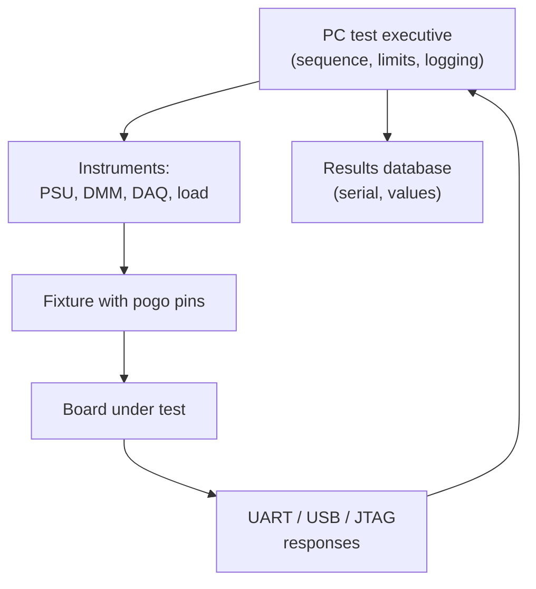

::: testing
Whether you understand functional test as *behavioural verification of the assembled board*, as opposed to structural test. The interviewer wants: what FCT is (power the board, apply stimuli, measure responses against limits), what it captures (system-level faults, analog accuracy, firmware/hardware interaction, interface problems, marginal parts, calibration) and what it misses (poor coverage of untested paths, weak fault isolation, intermittent solder issues), plus the practical design of a test: fixture, instruments, test executive, limits, guardbands, time budget.
:::

::: why
Customers don't care if the resistors measure right; they care that the product works. FCT is the last gate before shipping and often the only one that exercises the firmware and hardware together. A designer influences it by providing self-test modes, accessible interfaces, defined power-up behaviour and accessible rails. It is also where marginal analog design (a 3.3 V rail at the edge of its limit) becomes visible on the production line rather than in the field.
:::

::: concepts
- **Stimulus and response**: apply known inputs (power, signals, loads), measure outputs.
- **Test fixture / jig**: contacts the board (pogo pins, connectors) and houses loads and instruments ([[q0612]]).
- **Test executive**: software sequencing steps, comparing results with limits, logging.
- **Limits and guardbands**: pass/fail thresholds set from design margins, measured distributions and measurement uncertainty.
- **Loopback and self-test**: connecting outputs back to inputs, or firmware testing its own peripherals.
- **Coverage**: which faults the test can actually detect.
- **Structural vs functional**: ICT checks build ([[q0609]]); FCT checks behaviour.
:::

::: answer
"Functional test checks that an assembled board actually does its job. You put the board in a fixture, power it up, and run through a scripted sequence of stimuli and measurements: check the voltage rails and their sequencing, make sure the processor boots and talks over its buses, read sensors with a known input, drive outputs into test loads, measure current in different modes. Each result is compared against pass/fail limits, and the result is logged under the board's serial number.

What it can capture: faults that matter to the product, such as a rail that's out of tolerance, a clock that doesn't start, a communication bus that doesn't work, analog accuracy errors, a sensor reading wrong, or a firmware and hardware mismatch. It's also where calibration is often done. It catches problems that structural tests can't see, such as parts that are present and the right value but don't behave right together.

What it's not good at: pinpointing where the fault is, since 'doesn't boot' could have many causes, and covering anything the test doesn't exercise. So it complements AOI and ICT rather than replacing them. And designing it well means choosing limits from real data, with allowance for measurement uncertainty, and keeping the test short enough for the line."
:::

::: technical
**Typical FCT architecture.** UUT in a fixture (pogo pins to test points and connectors) → programmable power supply (with current measurement) → stimulus/measurement instruments (DMM, DAQ, scope, function generator, load, RF where needed) → PC with a test executive (Python, LabVIEW, or commercial) → results database. Often a microcontroller on the board reports results via UART, USB or a bootloader link.

**Common test steps.**
1. Power-up with current limit; idle current within a window.
2. Rail voltages and sequencing (3.3 V, 1.8 V, power-good, reset).
3. Clocks and oscillators (frequency, start-up).
4. Programming/boot: bootloader and application version.
5. Digital interfaces: I²C/SPI device ID reads, UART loopback, USB enumeration, Ethernet link.
6. Analog: ADC with known stimulus, DAC output, op-amp gain, sensor with reference.
7. Outputs: LEDs, drivers, relays, motor driver with test load, current limit checks.
8. Wireless: RF output power/frequency in shielded fixture.
9. Power modes: sleep and active current.
10. Calibration: measure error, store constants.

**Worked analog example.** Apply 1.000 V to a 12-bit ADC with 3.3 V reference. Expected code $=1.000/3.3\times4096=1241.2$. One LSB is $3.3/4096=0.806$ mV. A ±1% limit is ±12.4 codes (computed). If the measurement system's own uncertainty is much larger than the spec, the test is meaningless; a common rule of thumb is a test accuracy ratio of about 4:1, so for a ±10 mV spec the stimulus and reference should be good to about ±2.5 mV (computed).

**Guardbanding.** If the spec limit for a rail is 3.23-3.37 V and the tester's uncertainty is ±15 mV, a conservative production limit moves inward to 3.245-3.355 V so that a part passing the test is guaranteed inside spec. The cost is a few extra false fails.

**Capturing and missing.** FCT can detect system-level and parametric faults, firmware/hardware integration problems and margin issues, plus many manufacturing faults indirectly. It misses faults in untested circuits, cosmetic and mechanical faults, weak solder joints that only fail under stress, and often cannot isolate the fault to a part.

**Time.** A test of 30-60 s is typical for a modest board; programming and slow settling measurements dominate. Reduce by parallelising, early abort and doing structural checks upstream.

> [!UNCERTAIN]
> The 4:1 test accuracy ratio is a common industry rule of thumb (in calibration practice) rather than a hard standard; step times and typical limits depend entirely on the product.
:::

::: short
"Functional test powers up an assembled board in a fixture and exercises it like the real product: rails and sequencing, clocks, boot, communication buses, sensors with known inputs, outputs into loads and current in each mode, all compared against limits. It captures system-level faults, analog accuracy errors and firmware-hardware problems that structural tests can't see, and it's often where calibration happens. It's weak at pinpointing faults and only covers what the test exercises, so it complements AOI and ICT."
:::

::: long
"Functional test, FCT, answers 'does this board do its job?'. Where ICT checks that the parts are the right ones and connected, FCT runs the board.

In a typical station the board goes into a fixture where pogo pins and connectors contact it. A programmable power supply powers it, with a current limit, and a PC running a test sequence drives instruments and talks to the board. The first checks are basic: idle current in range, rails at the right voltage and in the right order. Then the processor boots, we read the firmware version, and we check interfaces: read an ID register over I²C, loop back a UART, enumerate over USB. Analog parts get a known stimulus, say 1.000 V on an ADC input, and we check the reading falls within a band; at 12 bits with a 3.3 V reference that's about code 1241 plus or minus 12. Outputs drive test loads, LEDs are checked with a light sensor, and we measure sleep current. For products that need calibration, this is where trims are measured and stored.

The strength is that it catches whatever matters to the customer, including combinations of parts that individually look fine. The weaknesses are coverage and diagnosis. It only tests what we thought of, and a failure like 'no boot' doesn't tell you which of a hundred joints is bad. So I'd use it after AOI and ICT, which find build defects and tell you where.

Doing it well involves limits from real data with a guardband for measurement uncertainty, a test time short enough for the line, and designing the board with test modes, UART logs and accessible rails to make the fixture simple."
:::

::: terms
- **FCT**: functional test.
- **UUT / DUT**: unit / device under test.
- **Fixture / jig**: mechanical and electrical interface to the board.
- **Test executive**: software that sequences and logs tests.
- **Loopback**: connecting an output to an input to verify a path.
- **Guardband**: tightening limits to account for measurement uncertainty.
- **TAR / TUR**: test accuracy (uncertainty) ratio between spec and instrument.
- **Pogo pin**: spring-loaded contact pin.
- **Self-test (BIST)**: built-in test run by the product itself.
:::

::: exceptional
**An average answer** says "power it on and see if it works."

**An exceptional answer**:
- Lists a concrete step sequence with limits and rationale (rails, clocks, boot, buses, analog, outputs, power modes, calibration).
- Quantifies something: ADC code window, guardbanding with measurement uncertainty, or 4:1 accuracy ratio.
- States coverage and diagnosis limits and how FCT complements AOI and ICT.
- Describes the fixture/instrument/executive/database architecture.
- Mentions design hooks: test modes, UART logs, accessible rails, loopbacks, boundary scan.
:::

::: mistakes
- **Treating "boots" as a full test.** A board can boot with a bad ADC, flaky bus or poor rail margin.
- **Setting limits at datasheet limits with no guardband.** Uncertainty then lets out-of-spec units pass.
- **Relying on FCT alone.** Poor diagnosis makes repair slow and costly.
- **No data logging.** Without values logged you can't see drift before it fails limits.
- **Tests that are too long.** FCT becomes the line bottleneck; trim and parallelise.
- **Skipping calibration of the tester.** An uncalibrated reference makes every measurement suspect.
:::

::: deep
## Anatomy of a functional test cell


Figure: The test executive controls instruments and the board, collects measurements and board-reported data, compares them with limits, and writes everything to a database keyed by serial number.

## From spec to production limit

Start from the product specification and design margins. For a 3.3 V rail with a regulator guaranteed ±3% over temperature: spec 3.20-3.40 V. Production tests at room temperature and measure a distribution of good boards: mean 3.300 V, σ = 8 mV. Set the limit between the distribution and the spec: say 3.23-3.37 V (±2.1%, 8.75σ from mean). Now include tester uncertainty ±15 mV: guard to 3.245-3.355 V. Why not tighter? Tight limits create false fails from process spread and noise; too loose lets marginal boards through. A good strategy uses statistics (Cpk) on measured data: a test with Cpk ≥ 1.33 means the limit is at least 4σ away from the mean.

$$C_{pk}=\frac{\min(\text{USL}-\mu,\ \mu-\text{LSL})}{3\sigma}$$

With USL = 3.355, LSL = 3.245, μ = 3.300, σ = 8 mV: $C_{pk}=0.055/(3\times0.008)=2.29$ (computed).

## Analog tests

For analog accuracy: apply a *reference* that is several times more accurate than the specification (TUR 4:1 or better), measure the response, and compare. If you also measure two points, gain and offset errors can be separated and stored as calibration constants:

$$\text{gain}=\frac{V_2-V_1}{\text{code}_2-\text{code}_1},\quad\text{offset}=V_1-\text{gain}\cdot\text{code}_1$$

ADC resolution matters: 12 bits at 3.3 V gives 0.806 mV per code, so a 1 mV-level stimulus resolution is pointless without averaging.

## Digital and interface tests

- **I²C/SPI**: read device ID registers, write/read back a scratch register; confirms pull-ups, address pins and wiring.
- **UART**: loopback or talk to the board's bootloader; at 115,200 baud, 10 bytes of 8N1 frames take $10\times10/115200=0.87$ ms (computed), so the test time is dominated by setup, not data.
- **USB/Ethernet**: enumeration and link up; throughput tests if needed.
- **Memories**: write/read patterns (walking ones, address-in-address) for external RAM or flash.
- **Wireless**: power and frequency accuracy in a shielded fixture, receiver sensitivity at a reference level.

## Worked example: a two-point calibration, and what a single point hides

Use the 12-bit, 3.3 V ADC from the technical section, one LSB = 0.806 mV. The tester applies two reference voltages through a stimulus source good to 1 mV (comfortably better than the 4:1 rule for a ±10 mV spec). Ideal codes are $0.500/3.3\times4096 = 620.6$ and $3.000/3.3\times4096 = 3723.6$. Suppose the board reads 626 and 3712. The calibration constants are

$$\text{gain}=\frac{3.000-0.500}{3712-626}=0.8101\ \text{mV/code},\qquad \text{offset}=0.500-0.0008101\times626 = -7.13\ \text{mV}$$

The nominal gain would be 0.8057 mV per code, so this converter has a gain error of +0.55 % and an offset of about −7.1 mV, ordinary for an ADC with a 1 % reference and no trimming (an assumption about the part). Now see what each point alone would have told you. At 1.000 V the raw code is $(1.000+0.00713)/0.0008101 = 1243$, versus 1241 ideal, so the nominal conversion is off by only 1.6 mV, easily inside a ±1 % limit of ±10 mV. At 3.000 V the nominal conversion reads $3712\times0.8057 = 2.9906$ V, off by −9.4 mV, six times as large. A one-point test at 1 V would pass this board without noticing a gain error whose effect is six times larger at the top of the range. Two points that straddle the range are the minimum; a third at mid-scale checks linearity, since gain and offset alone cannot see a bow in the transfer curve.

The reference error propagates directly into the constants. If the 3.000 V source is really 3.001 V, the computed gain moves by $1\ \text{mV}/2.5\ \text{V} = 0.04\ \%$, a small shift here, but the same fraction applies to every board built on that fixture. That is why stimulus sources have their own calibration interval and why the fixture's source is checked with a golden board each shift ([[q0605]]).

**Noise and averaging.** The conversion is not a fixed code but a distribution. If the board's ADC noise is 2 LSB rms (an assumption), a single reading at 1.000 V is uncertain by ±2 codes at one sigma, and a ±12.4 code limit still leaves 6σ. For the offset constant in a precision application, you would average: 16 samples cut the noise to $2/\sqrt{16}=0.5$ LSB at a cost of 1.6 ms at 10 kSa/s. Averaging helps only random noise. It does nothing for the fixture's reference error or for systematic offsets, and for 1/f drift longer averaging can make things worse.

## What FCT catches that the structural tests cannot: a load-step example

The interview line about a regulator that is "in tolerance on the bench but droops under the radio's burst current" deserves its arithmetic. Say a 3.3 V rail powers a radio that steps from 5 mA to 125 mA in microseconds. A rail with 10 mΩ of output impedance (regulator plus capacitor ESR, assumed) drops $0.12\ \text{A}\times10\ \text{m}\Omega = 1.2$ mV, fine. A regulator with a poor transient response (a weak loop, undersized output capacitor, or a wrong inductor) might sag 150 mV for a few tens of microseconds, enough to brown out the radio's own digital core. Every static check passes: the rail reads 3.30 V at idle, ICT sees the right parts. Only a test that *performs the burst* and watches the rail with a fast capture finds it. The functional step is "trigger transmit, capture the rail with a DAQ at 1 MS/s or faster, report minimum voltage", with a limit set from the design's margin.

The fixture itself can hide or fake that droop. Suppose the supply reaches the board through 0.1 Ω of cable and 0.2 Ω of pogo-pin contact. A 120 mA burst drops $0.12\times0.3 = 36$ mV across the path before the board sees it, more than the board's own droop. Sense the voltage at the board's input with a separate Kelvin pair, or measure at a test point on the rail rather than at the supply, so that the number belongs to the board and not to the fixture. Many apparent field-versus-factory disagreements are measurement-path problems of this kind.

```sim
{"id":"yield-coverage","Y":0.97,"aoi":0.6,"ict":0.8,"fct":0.9}
```
Figure: Functional test is the last net in this funnel: at 90% coverage it catches the 22 boards that AOI and ICT missed. Set functional coverage to 0 and shipped defects rise from 244 DPPM to about 2,400 DPPM. The model assumes independent detection, which is exactly what a load-step failure can violate.

## Margining: testing off the nominal point

A board that works at exactly 5.00 V and 25 °C may fail in the field at 4.5 V and 60 °C. Functional test can probe that margin cheaply by repeating a few key steps at low and high supply voltage, for example at 4.5 V and 5.5 V (±10 %). It finds marginal parts (a comparator threshold close to its limit, a regulator with a high dropout, a clock that does not start at low supply) that would pass at nominal. The cost is time: each extra voltage point adds settling, boot, and the measurement, perhaps 5 to 10 s on a 40 s test. So margining is applied selectively, to the steps that historically show sensitivity, and the data decides: if the low-voltage points never fail across thousands of boards and every board shows large margin, the extra seconds buy nothing and should be dropped. Temperature margining is rarer in the factory because it is slow, which is why thermal cycling is reserved for qualification and screening ([[q0604]]).

## How the engineer validates the test before trusting it

Before a test goes live, three bench checks give you confidence it measures what it claims. Correlate it: run ten boards through both the FCT and a bench setup with a lab-grade meter and confirm the readings agree within the stated uncertainty. Seed it: put a known-bad part on a board (a resistor 10 % off in the rail divider, a bridged I²C pull-up, a wrong crystal capacitor) and confirm the test fails at the step you expect, since a test that cannot detect the faults you think it detects is worse than no test. Time it: log every step's duration over a hundred boards and look at the tail, because the occasional 10 s outlier is usually a timeout and a retry that the average hides.

## Design for functional test

| Need | Design response |
|---|---|
| Observability | UART log, status registers, LEDs, test mode via a pin or command |
| Controllability | Bootloader, test commands, loopback paths, jumpers or GPIO controlled test muxes |
| Access | Test pads for rails and key signals ([[q0619]], [[q0621]]) |
| Safety | Current-limited power-up, protection for reverse polarity |
| Speed | Fast boot, parallel programming, short settling times |
| Repeatability | Reference voltages and loads stable and calibrated |

See [[q0614]] and [[q0616]] for design-for-test.

## Failure analysis from FCT

A failed step carries information. Failing at "idle current" suggests a short or a stuck part; failing at "3.3 V rail" points to a regulator or load; failing at "I²C ID" suggests that device, its pull-ups or bus wiring; failing only at hot or cold points to margin problems. A good test is built so the failing step name narrows down the fault, and a library of failure signatures grows over time.

> [!INTERVIEW]
> A crisp phrase: "ICT tells me the board was built right; FCT tells me the product works." Then offer one example of a defect only FCT catches (a regulator in tolerance on the bench but that droops under the radio's burst current) and one that only ICT/AOI catches cheaply (a missing resistor).
:::

::: applications
- **Consumer devices**: 20-60 s test of rails, radios, sensors and buttons.
- **Automotive ECUs**: functional test with I/O simulators and CAN traffic, plus calibration.
- **Motor drives and power supplies**: powered tests under load, protection trip checks, efficiency spot-checks.
- **Industrial I/O modules**: loopback tests across channels and calibration of analog inputs.
- **Medical devices**: test with documented limits, full traceability and uncertainty analysis.
:::

::: assumptions
- Assumes an assembled, programmed board and a repeatable fixture.
- Limits and times are illustrative; real ones come from the product spec and measured data.
- Assumes tester instruments are calibrated and traceable.
- FCT scope varies: some products also include environmental or burn-in stages, which are separate.
- Gaussian distribution assumed for the Cpk example; real data may be skewed.
:::

::: followups
### What's the difference between ICT and FCT?
ICT is structural: it measures parts and nets to confirm the board was assembled correctly and tells you where a fault is. FCT is behavioural: it runs the board and checks it does its job, covering things ICT can't (firmware, timing, system interaction) but diagnosing poorly.

### How do you set pass/fail limits?
From the spec and design margins, then refine with measured distributions of good boards, and move inward by the measurement uncertainty (guardband). Check Cpk on real data. Limits too tight give false fails; too loose let marginal boards ship.

### A board passes FCT but fails in the field after weeks. What do you do?
Investigate failure mode: if solder or part defects, add inspection and stress screens (thermal cycling, burn-in); if margin issues (rail droop, temperature), add margin tests at voltage/temperature corners and tighten limits; log data to see which parameters drift.

### How would you add testability to the board?
Test mode accessible by pin or command, UART log, accessible power rails and a programming interface, loopbacks for interfaces, a self-test routine, and pads for the fixture. Keep boot fast and states defined.

### How do you test a wireless board at the factory?
In a shielded RF box with a known reference: measure transmit power, frequency error and modulation quality, and receive sensitivity or RSSI at a calibrated level, and store calibration offsets. Use conducted tests through a test connector or coupler where possible.
:::

::: interpretations
"What can it capture?" asks for fault classes: functional and parametric faults, firmware/hardware integration issues and marginal analog behaviour. Pair this with the limitation: poor fault isolation and coverage only of exercised paths. Not to be confused with *functional verification* of a design on the bench ([[q0586]]).
:::

::: references
- IPC-9252 and IEEE 1149.1 cover structural access; for functional test design, test-system vendors' application notes (e.g. instrument makers) are the practical reference.
- ISO/IEC 17025 and calibration practice documents for measurement uncertainty and test accuracy ratios (standard by name).
- Montgomery, *Introduction to Statistical Quality Control*: Cpk and capability analysis.
- Bushnell & Agrawal, *Essentials of Electronic Testing*: functional vs structural test concepts.
:::

::: rubric
- Defines FCT as powering and exercising the board against pass/fail limits :: Core.
- Lists concrete test steps (rails, boot, buses, analog, outputs, current) :: Shows practical knowledge.
- States what it captures (system, parametric, integration, calibration) :: Direct answer.
- States limits (diagnosis, coverage) and places it after AOI/ICT :: Balanced judgement.
- Discusses limits/guardband or measurement accuracy :: Quality of the test itself.
- Mentions design hooks for testability :: Linking design and test.
:::

::: quiz
```json
[
 {"type":"mcq","level":"fundamental","q":"What does functional test check?","options":["That solder joints look good","That the assembled board behaves as the product should","That the bare board has no opens","That the stencil was clean"],"answer":1,"explain":"FCT exercises the board and compares behaviour to limits; visual and structural checks are other stations."},
 {"type":"mcq","level":"intermediate","q":"Why is a guardband used on pass/fail limits?","options":["To make the test slower","To account for measurement uncertainty so a passing board is truly in spec","To hide failures","To reduce cost of the fixture"],"answer":1,"explain":"Moving the limits inward by the tester uncertainty ensures that a board measured inside the limits is within spec."},
 {"type":"numeric","level":"intermediate","q":"A 12-bit ADC with a 3.3 V reference reads a 1.000 V input. What is the expected code (nearest integer)?","answer":1241,"tolerance":0.002,"unit":"code","explain":"1.000/3.3 x 4096 = 1241.2, so about 1241."},
 {"type":"numeric","level":"intermediate","q":"For a +/-10 mV test spec and a 4:1 test accuracy ratio, what is the maximum acceptable stimulus/measurement uncertainty in mV?","answer":2.5,"tolerance":0.02,"unit":"mV","explain":"A 4:1 ratio means the reference must be four times better than the tolerance being checked: 10 mV / 4 = 2.5 mV. Otherwise the instrument error eats the margin you are trying to verify."},
 {"type":"numeric","level":"advanced","q":"Rail mean 3.300 V, sigma 8 mV, limits 3.245-3.355 V. What is Cpk?","answer":2.29,"tolerance":0.02,"unit":"","explain":"Distance to nearest limit 0.055 V; Cpk = 0.055/(3 x 0.008) = 2.29."},
 {"type":"truefalse","level":"advanced","q":"A board that boots successfully has passed an adequate functional test.","answer":false,"explain":"Booting exercises only a small subset of the hardware. Analog accuracy, interfaces, outputs, power modes and margins need explicit tests."}
]
```
:::
