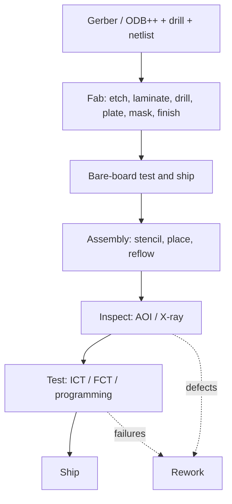

::: basics
### In plain words
Designing a PCB for manufacturing means drawing a board that the factories can build reliably and cheaply. Each factory has limits: how thin a line it can etch, how small a hole it can drill, how precisely it can place parts. A good design stays comfortably inside those limits instead of pushing to the edge, so more boards come out good.

### Picture it
Think of writing a recipe for a kitchen you do not own. If the recipe needs a special oven setting that the kitchen can barely reach, many dishes will fail. If you write for the standard equipment, with a little margin, almost every dish works. A board design is the recipe. The factory's published capability sheet tells you what the kitchen can do, and the real limits differ between factories.

### Words you need
- **Trace/space**: the width of a copper line and the gap between lines, often written like 5/5 mil. A mil is a thousandth of an inch.
- **Annular ring**: the ring of copper around a drilled hole, which must survive small drilling errors.
- **Land pattern**: the shape and size of the pads where a part is soldered.
- **Fiducials**: alignment dots for machine cameras. See [[q0596]].
- **Panelization**: arranging boards in a frame for building. See [[q0594]].
- **DRC**: design rule check, the software that tests your layout against the factory's limits.

### The simplest example
Say your fab's standard process makes 4/4 mil traces and gaps. You could draw 4/4, but any small error then causes a defect, and the fab may charge extra. Drawing 5/5 gives margin at almost no cost. Likewise you keep the ring around each hole at 0.1 mm or more, so a slightly off-center drill still leaves copper all around. That is the whole idea. The rest of this page lists the rules for the fab side and the assembly side, then ends with a design rule check, a factory check and a small pilot build.
:::

::: testing
Whether you understand that a board has to survive **two factories**: the bare-board fab (etch, drill, plate, mask) and the assembly line (paste, place, reflow, inspect, test). A schematic that works on a simulator can still have 5% yield if the layout ignores them.

The interviewer is listening for:

1. You ask about **volume, fab, assembler and class** before you pick rules. DFM is a negotiation with real capability numbers, not a fixed checklist.
2. You separate **fabrication DFM** (trace/space, drill, annular ring, mask, aspect ratio) from **assembly DFM** (pad shapes, spacing, fiducials, symmetry, panel).
3. You know *why* each rule exists: a mechanism, not a memorised number.
4. You close the loop: DRC against the fab's rules, a DFM review, a pilot run.
:::

::: why
A prototype can be hand-nursed. A thousand boards cannot. Every extra reflow defect, every board that needs touch-up, every fab "engineering query" costs days or money, and by a common rule of thumb the cost of fixing a problem grows by roughly an order of magnitude at each later stage (design, prototype, production, field). Hardware engineers who design with the factory in mind get boards that build the first time, cost less, and ship on schedule. In interviews it's a fast discriminator: people who have only done hobby layouts list "10 mil traces"; people who have been through a build talk about fiducials, tombstoning, solder mask dams, panel rails and test access.
:::

::: concepts
- **Fabrication capability**: the fab's minimum trace/space, drill size, annular ring and layer count. These set what is cheap versus costly. See [[q0593]].
- **Assembly flow**: stencil paste, pick-and-place, reflow, optional wave or selective solder, AOI, test. Each step has its own constraints. See [[q0597]] and [[q0602]].
- **Land patterns (IPC-7351 style)**: pad geometry sized for a reliable solder fillet, not copied from the datasheet drawing blindly.
- **Panelization and fiducials**: how boards are held, aligned and separated. See [[q0594]] and [[q0596]].
- **Thermal balance**: copper on each pad affects how solder melts. See [[q0615]].
- **Test access**: pads for ICT or probes decided at layout time. See [[q0614]] and [[q0616]].
- **DRC and DFM review**: the automated and human checks that catch problems early. See [[q0641]].
:::

::: answer
"First I'd ask what we're building: volume, which fab and assembler, and how dense the board is. A 50-piece lab build and a 100k-piece product have different rules.

Then I design to the factory's capability with margin, not to the absolute minimum. On the fab side that means trace and space, drill and annular ring that the fab can do on their standard process, a sensible drill aspect ratio so plating works, copper kept away from the board edge, and solder mask dams between fine-pitch pads.

On the assembly side I use proper land patterns, keep a courtyard around every part so the placer and rework tools fit, put three fiducials on the board plus local ones near fine-pitch parts, keep parts on one or at most two orientations, and make small passives thermally symmetric so they don't tombstone. I put the large heavy parts on the side that's reflowed last, avoid via-in-pad unless it's filled, and think about the panel: rails, tooling holes, and breakaway tabs away from sensitive parts.

Finally I plan for test: a pad per important net, on one side, at a pitch the fixture can hit. Then I run DRC against the fab's rule file, send the Gerbers or ODB++ for a DFM check, and do a small pilot build before releasing volume."
:::

::: technical
**Fabrication side (bare board).**

- **Trace/space and drill.** Stay at least one grade above the fab's minimum (for example, design at 5/5 mil if the fab's standard is 4/4). Tighter rules cost yield and money because etching and registration have finite tolerance.
- **Annular ring.** The pad must surround the drilled hole after worst-case drill wander. A 0.1 mm (4 mil) ring or better is a common target for standard processes. Check the fab's number.
- **Aspect ratio.** Board thickness over finished hole diameter: 1.6 mm / 0.2 mm = 8:1; 1.6 mm / 0.3 mm = 5.3:1. Plating gets harder past roughly 8:1 to 10:1 for standard fabs, so small vias need thinner boards or microvias. Vendor-specific.
- **Copper to edge** ≥ 0.25–0.5 mm to avoid exposed copper or shorts from routing/V-scoring.
- **Solder mask.** Keep mask dams (slivers of mask) between pads of fine-pitch parts. Mask slivers narrower than the fab's limit (often around 0.075–0.1 mm) lift off, causing solder bridges. Where you can't have a dam, use a gang opening.
- **Silkscreen** off pads, readable (text height ≥ ~0.8 mm, line weight ≥ ~0.15 mm; check fab).
- **Acid traps and slivers**: acute angles trap etchant; avoid.
- **Copper balance** across layers and a symmetric stack-up to limit bow and twist.

**Assembly side.**

- **Pads and paste.** Stencil apertures are driven by *area ratio* (aperture area / aperture wall area, commonly cited ≥ 0.66) and *aspect ratio* (width / stencil thickness, commonly ≥ 1.5), both from IPC-7525 practice. A 0.5 × 0.45 mm aperture in a 0.1 mm stencil gives area ratio $\frac{0.5\cdot0.45}{2(0.5+0.45)(0.1)} = 1.18$, healthy. Pitches shrink the aperture and the ratio, so the finest parts dictate stencil thickness.
- **Spacing.** Courtyards (IPC-7351 style) so the placer nozzle, AOI cameras and rework nozzles fit. Leave room around tall parts and connectors.
- **Fiducials.** Three global fiducials (round copper ~1 mm with ~2 mm mask/copper clearance, non-symmetric positions so the board can't be loaded backwards) plus local fiducials near BGAs and fine-pitch ICs.
- **Orientation.** Align polarised parts and ICs the same way. It reduces placement and inspection errors.
- **Thermal symmetry.** Equal copper connection on both pads of 0402/0201 passives. See [[q0615]].
- **Via-in-pad.** Only filled and capped, otherwise solder wicks into the barrel and starves the joint.
- **Panel.** Rails (typically 5–10 mm), tooling holes, breakaway tabs or V-score, and keep components out of the singulation zone. See [[q0594]], [[q0595]].
- **Heavy parts on one side** (the last side reflowed) and avoid parts on both sides unless needed; the second reflow adds risk.

**Process control.** Run DRC with the fab's rules, then an independent DFM check, then a pilot build with a first-article inspection.

> [!UNCERTAIN]
> All numeric limits (trace/space, annular ring, mask dam, aspect ratio, edge clearance) are *typical* values. Every fab and assembler publishes its own capability sheet. Use theirs, and quote them in the answer as "typically".
:::

::: short
"I design to the factory's real capability with margin. For the fab: comfortable trace/space, annular ring and drill aspect ratio, copper pulled back from the edge, and mask dams between fine-pitch pads. For assembly: proper land patterns, courtyards, fiducials, consistent orientation, thermally balanced small passives, and filled via-in-pad only. I think about the panel and test access up front, then run DRC with the fab's rules, a DFM review, and a pilot build before volume."
:::

::: long
"I start by pinning down the constraints: volume, the fab and assembler, the board class, and cost targets, because a rule that's free at 100 pieces can be expensive at 100,000.

For the bare board I design to the fab's published capability with margin. I'd rather use 5-mil trace and space on a fab that can do 4 than live on the edge, because the edge is where yield falls. I check the annular ring against drill wander, keep the drill aspect ratio under about 8 to 1 so the plating is reliable, pull copper back from the edge so routing doesn't expose it, and keep solder mask dams between fine-pitch pads so they don't bridge.

For assembly I use proper IPC-style land patterns and a courtyard around every part so the pick-and-place nozzle, the AOI cameras and a rework tool all fit. I add three global fiducials in non-symmetric positions plus local ones by BGAs and fine-pitch parts. I align parts in consistent orientations, put the heavy and tall parts on the side that's reflowed last, and make small passives thermally symmetric, equal copper on both pads, so they melt at the same time and don't tombstone. I avoid open via-in-pad because solder wicks down the barrel.

The panel matters too: rails, tooling holes, and breakaway tabs or V-score placed so singulation stress stays away from ceramics and BGAs.

And I plan test and rework from the start: a test pad on each important net on one side, at fixture-friendly pitch, plus room to rework.

Last, I close the loop. I load the fab's rule set into DRC, send the data to the fab and assembler for a DFM review, and do a small pilot lot so any surprises appear on ten boards, not ten thousand."
:::

::: terms
- **DFM**: design for manufacturing. Choosing geometry and process options so the board can be fabricated and assembled with high yield at low cost.
- **DRC**: design rule check. Automated verification of spacing, width, drill and mask rules.
- **Annular ring**: copper left around a drilled hole after drilling. Too small means breakout.
- **Aspect ratio (drill)**: board thickness divided by finished hole diameter. Limits reliable plating.
- **Solder mask dam**: mask strip between neighbouring pads that stops solder bridging.
- **Fiducial**: a copper mark the assembly machine's camera uses to register the board. See [[q0596]].
- **Courtyard**: the keep-out outline around a component footprint for placement and rework.
- **Area ratio**: stencil aperture area divided by aperture wall area; predicts paste release.
- **Panelization**: arranging several boards on one production panel. See [[q0594]].
- **Land pattern**: the pad layout for a component, defined by IPC-7351 conventions.
:::

::: exceptional
**An average answer** lists "wider traces, bigger pads, add silkscreen" and stops.

**An exceptional answer**:

- Starts with volume, fab/assembler capability and class, and says the rules come from *their* capability sheets.
- Separates fab DFM from assembly DFM and gives the *mechanism* for each rule (drill wander, plating aspect ratio, mask lift, paste release, tombstoning).
- Gives a few numbers with the right hedge ("typically 8:1", "mask dams around 4 mil").
- Brings up panelization, fiducials, thermal symmetry and via-in-pad unprompted.
- Ties DFM to test and rework (DFT, DFR) and describes the process: DRC, vendor DFM review, pilot build, then a feedback loop from yield data.
- Admits trade-offs: tighter rules for density versus yield and cost.
:::

::: mistakes
- **Designing to the absolute minimum rules.** The fab *can* do 3 mil, but yield drops. Use margin unless density demands it.
- **Copying the datasheet land pattern blindly.** It's a recommendation for one process; check pad extension and courtyard against your assembler.
- **Open via-in-pad.** Solder wicks into the hole and the joint is starved. Fill and cap it, or offset the via.
- **Unbalanced copper on small passives.** One pad on a plane, one on a thin trace. One side melts first and the part stands up. See [[q0615]].
- **No fiducials or tooling holes.** Placement accuracy suffers and fine-pitch parts misalign.
- **Components too close to the panel break line.** Singulation stress cracks ceramic capacitors.
- **Treating DFM as a final step.** It belongs at stack-up and footprint selection, not after routing is finished.
:::

::: deep
## Two factories, two sets of rules

A PCB goes through two different industrial processes that rarely sit in the same building:


Figure: DFM rules come from each box. Fab rules limit what the bare board can be; assembly rules limit pad shapes, spacing and thermal balance; test rules need pads at layout time; rework needs room.

You are really designing against yield. If each of five independent steps yields 99%, the line yield is $0.99^5 = 95.1\%$. Take one step to 97% and the total falls to about 93% ($0.99^4 \cdot 0.97 = 0.932$). Small design choices (a mask sliver, an unbalanced pad) move individual step yields by a percent or two, and that compounds across thousands of joints.

## Fabrication DFM

**Trace and space.** Etching removes copper sideways as well as downward, so a line comes out narrower than drawn and a gap wider (on outer layers with plating it varies). The fab compensates, but the tolerance stays. Designing with margin means a defect-free board even when a batch drifts.

**Drill and annular ring.** The drill lands within some tolerance of the target. If the pad is only slightly bigger than the hole, a wandering drill breaks out of the pad. Required ring after worst-case wander is what you check with DRC.

**Aspect ratio.** Plating solution has to flow into the hole. A 1.6 mm board with a 0.2 mm hole is $1.6/0.2 = 8$:1; a 0.3 mm hole is 5.3:1. Beyond about 8:1 to 10:1 (standard fab, vendor dependent) the barrel in the middle plates thinner than at the ends: a reliability risk under thermal cycling. If you need smaller vias, thin the board or use laser microvias on HDI.

```plot
{"title":"Drill aspect ratio vs finished hole size (1.6 mm and 2.4 mm boards)","x":{"label":"Finished hole diameter","unit":"mm","min":0.1,"max":0.6},"y":{"label":"Aspect ratio (thickness : hole)","min":0,"max":25},
 "vars":{"t1":1.6,"t2":2.4},
 "series":[{"label":"1.6 mm board","fn":"t1/x"},{"label":"2.4 mm board","fn":"t2/x","color":"orange"}],
 "hlines":[{"at":8,"label":"≈ 8:1 (typical comfortable limit)","color":"red"}],
 "points":[{"x":0.2,"y":8,"label":"0.2 mm on 1.6 mm = 8:1"}]}
```
Figure: Halving the hole diameter doubles the aspect ratio. The red line is a commonly quoted comfort level; your fab's capability sheet is the real limit.

**Solder mask.** Mask is photoimaged with a registration tolerance of the order of 50 µm. If you ask for a 50 µm sliver between pads, it will either lift off or vanish; then solder bridges. Choose between a proper dam (if the pitch allows) and a gang opening (accept the bridge risk and control the paste instead).

**Copper to edge and slots.** Routing and V-scoring wander. Copper too near the edge gets exposed or shorted.

## Assembly DFM

### Paste printing

Solder paste is printed through a stencil. Paste leaves the aperture only if it sticks to the pad more than to the aperture wall, hence the area ratio. For a 0.5 mm × 0.45 mm aperture in a 0.1 mm stencil:

$$\text{area ratio} = \frac{L W}{2(L+W)T} = \frac{0.5\cdot0.45}{2(0.95)(0.1)} = 1.18$$

and aspect ratio $W/T = 4.5$. A tiny 0201 aperture (say 0.25 × 0.3 mm) at 0.1 mm gives about 0.68 area ratio, right at the edge, so 0201 and fine-pitch BGAs force thinner stencils and tighter layout control.

> [!UNCERTAIN]
> The 0.66 area ratio and 1.5 aspect ratio are widely cited IPC-7525 style guidelines. Treat them as rules of thumb; your assembler's stencil supplier will say what they use.

### Placement and spacing

The placer's nozzle is larger than the component. Neighbouring tall parts can collide with it. AOI cameras look from an angle and are blinded by a tall part right next to a small one, and a rework nozzle (hot air) needs a keep-out, typically a few mm around BGAs (check your rework tool).

### Thermal balance

During reflow, each pad heats at a rate set by the copper attached to it. Small 0402/0201 passives are the classic victims. See [[q0615]] for the physical picture.

### Fiducials and panel

Place at least three global fiducials (corners, non-symmetric positions) and a pair of local ones near fine-pitch ICs. Add rails (typically 5–10 mm) on at least the panel's long sides, with tooling holes. Orient parts consistently so inspection is easier and reduces wrong-polarity risk.

### One-sided versus two-sided

Placing parts on both sides means the first side is reflowed twice. Heavy parts on the first-reflowed side can fall off during the second pass if molten-solder surface tension can't hold their weight against pad area, so heavy or large-pad parts go on the *last* side reflowed, or get glued. See [[q0599]].

## Putting it into practice: a DFM flow

1. **Before layout**: ask the fab for their capability sheet and stack-up; select a stack-up and via strategy that fits (drill ≥ minimum, aspect ratio OK).
2. **Library**: build footprints to a standard (IPC-7351 style), add courtyards, check polarity marks.
3. **During layout**: constraints in the CAD tool (net classes, clearances, via sizes). Review thermal symmetry for every 0402 and smaller.
4. **Pre-release**: DRC at zero errors, a DFM tool or the fab's check, a review of the panel drawing, fiducials, test point list, and BOM alternates (see [[q0617]] for prototype-specific choices).
5. **Pilot build**: build 10–50 pieces, inspect with AOI/X-ray, measure first-pass yield, and feed defect Pareto back into the layout.

## Trade-offs

| Choice | Benefit | DFM cost |
|---|---|---|
| Finer trace/space | Higher density, fewer layers | Lower yield, higher fab price |
| Microvias / HDI | Escape BGAs | Added process steps and cost |
| 0201/01005 passives | Space saving | Tight stencil/placement, tombstone risk |
| Components on both sides | Space saving | Double reflow, harder inspection and rework |
| Via-in-pad | Short loops, fine-pitch escape | Needs fill and cap (extra cost) |
| Smaller panel rails | More boards per panel | Poor handling, warp |

> [!INTERVIEW]
> If asked "what's the single most important DFM habit?", say: talk to the fab and assembler *before* layout and design to their capability sheet. It shows you treat manufacturing as a collaboration, not a hand-off.
:::

::: applications
- **Consumer volume products**: panels of 20+ boards with V-score, 0402/0201 passives and fully automated SMT lines where a 0.5% yield loss means thousands of dollars per week.
- **Fine-pitch BGAs on phones and wearables**: HDI stack-ups with laser microvias and filled via-in-pad, designed with local fiducials and stencil step-ups.
- **Automotive electronics**: stricter reliability classes (e.g. IPC Class 3 style requirements for high-reliability products) driving larger annular rings and conformal coating areas.
- **Test fixtures and bring-up boards**: relaxed rules and big pads so a technician can solder and rework by hand. See [[q0617]].
- **Mixed technology boards** with through-hole connectors: wave or selective soldering constraints on keep-outs and pad shapes. See [[q0603]].
:::

::: assumptions
- **Assumes standard rigid FR-4 boards with SMT** assembly. Flex, rigid-flex, metal-core and RF materials have extra rules (bend radius, coverlay, PTFE handling).
- **Capability numbers vary** by fab, copper weight, layer count and price tier. The values here are typical, not guarantees.
- **Volume changes the answer.** For prototypes, maximise ease of hand assembly and probing ([[q0617]]); for volume, maximise yield and fixture compatibility ([[q0614]]).
- **Lead-free vs leaded** solder changes reflow peak temperature (about 245 °C peak versus about 215 °C), thus laminate choice and thermal stress.
- **Alternative good answer**: organise by lifecycle (design, fab, assembly, test, rework) instead of by fab/assembly. Both are fine as long as mechanisms are clear.
:::

::: followups
### What is the first thing you'd do before starting layout for a new product?
Ask the intended fab and assembler for their capability sheets, stack-ups and any preferred land-pattern conventions, and decide the board class, volume and panel size. Then I set the CAD constraints (min width/space, via sizes, mask expansion) to their rules plus margin. Starting with their numbers avoids a late redesign when the fab flags a violation.

### Why do you keep a drill aspect ratio below about 8:1?
Plating chemistry has to reach the middle of the barrel. For a 1.6 mm board, a 0.2 mm hole gives 8:1. At larger ratios the centre of the barrel gets thinner copper and cracks under thermal cycling. If I need smaller vias I use a thinner board, blind/buried microvias, or accept a thicker fab tier. The exact limit is vendor specific.

### Your assembler reports solder bridges on a fine-pitch QFP. What do you check?
First, solder mask: is there a dam between pads, or a gang opening? Second, stencil aperture: area ratio, thickness, and whether apertures are reduced from pad size (often 10% smaller for fine pitch). Third, pad length extension past the lead and board warp. I'd look at AOI/X-ray data to see whether bridges are concentrated in one corner (warp or stencil alignment) or uniform (paste volume). Fix at the stencil or footprint, not by rework.

### How does DFM change for a 2-sided assembled board?
The first side goes through reflow twice. The first-reflowed side hangs upside down during the second pass, and heavy parts there can drop off unless the molten solder's surface tension holds them. Rule of thumb: put the lighter, smaller parts on the first-reflowed side, keep tall or heavy parts for the last side reflowed, or glue them. And you need clearance for both sides' nozzles and probes. See [[q0599]].

### What if the fab says your design needs 12:1 drill aspect ratio at the same cost?
Don't accept it quietly. Ask about yield and reliability data at that ratio, then consider alternatives: thinner board, larger vias (if density allows), or a microvia/HDI stack-up. If it's unavoidable, request cross-section (microsection) reports on the first lot and add an IPC-level reliability test coupon to the panel.

### Scenario: first pilot build has 8% first-pass failures, mostly open joints on 0402 resistors on one end. What do you do?
That pattern (one end open, part standing or skewed) looks like tombstoning: unequal melting. Check the stencil volume on each pad, the copper connection on each pad (one pad on a plane?), the placement offset, and the reflow ramp. Fix by equalising pads (thermal reliefs or trace connection), adjusting pad size or stencil, and slowing the ramp. Validate on the next lot with AOI data. See [[q0615]].
:::

::: references
- IPC-2221 (generic standard on printed board design) and IPC-7351 (generic requirements for surface mount design and land pattern standard): the baseline for design rules and pad geometry.
- IPC-7525 (stencil design guidelines): area ratio and aspect ratio guidance for paste printing.
- Your fab's and assembler's published design-for-manufacturing guidelines (capability sheets): the authoritative numbers.
- Montrose, *Printed Circuit Board Design Techniques for EMC Compliance*, chapter on stack-up and layout: manufacturing-aware layout practice.
:::

::: rubric
- Starts by clarifying volume, fab/assembler and class :: DFM numbers are vendor-specific; asking shows you know that.
- Covers fabrication rules (trace/space, annular ring, aspect ratio, mask dams, edge clearance) :: These cause bare-board defects and cost.
- Covers assembly rules (land patterns, courtyards, fiducials, orientation, thermal symmetry) :: These cause reflow and placement defects.
- Explains at least one mechanism, not just a number :: Mechanisms let you reason about new situations.
- Mentions panelization and tooling :: Shows you've seen the whole line, not only the board.
- Plans test access and rework space at layout time :: DFM, DFT and DFR are linked.
- Describes the process loop: DRC, DFM review, pilot build, feedback :: Shows engineering discipline and learning from yield data.
:::

::: quiz
```json
[
 {"type":"mcq","level":"fundamental","q":"Why do you keep copper pulled back from the board edge?","options":["To make the board look neat","Because routing or V-scoring can expose or short copper at the edge","To lower the board's capacitance","To make the solder mask thicker"],"answer":1,"explain":"Routing, scoring and registration tolerance mean copper right at the edge can be exposed or smeared into a short. Typically 0.25 to 0.5 mm clearance is used; check the fab."},
 {"type":"numeric","level":"fundamental","q":"A 1.6 mm board has finished vias of 0.2 mm diameter. What is the drill aspect ratio (thickness : hole)? Enter the first number of N:1.","answer":8,"tolerance":0.01,"unit":"","explain":"1.6 / 0.2 = 8, so the aspect ratio is 8:1, right at the commonly quoted comfort limit for standard fabs."},
 {"type":"mcq","level":"intermediate","q":"Which choice most directly reduces solder bridging between pads of a fine-pitch IC?","options":["Larger silkscreen text","Solder mask dams between pads together with correctly sized stencil apertures","More vias in the pads","A thicker board"],"answer":1,"explain":"Mask dams stop wicking and flow between pads; correctly sized, slightly reduced apertures control paste volume. Silkscreen, vias or thickness don't address the bridging mechanism."},
 {"type":"numeric","level":"intermediate","q":"A stencil aperture is 0.5 mm × 0.45 mm in a 0.1 mm thick stencil. What is the area ratio (aperture area / aperture wall area)? Give a number.","answer":1.18,"tolerance":0.02,"unit":"","explain":"Area = 0.225 mm². Wall area = perimeter × thickness = 2(0.5+0.45)(0.1) = 0.19 mm². Ratio = 1.18, comfortably above the ~0.66 rule of thumb."},
 {"type":"truefalse","level":"advanced","q":"Designing at exactly the fab's absolute minimum trace/space is the best way to keep cost low, because the fab can build it.","answer":false,"explain":"Minimum rules reduce process margin and yield, and fabs often charge more for the tighter tier. Designing one grade looser keeps yield and cost better unless density forces otherwise."},
 {"type":"multi","level":"advanced","q":"Select all that are good DFM practices for an assembled two-sided board.","options":["Three non-symmetric global fiducials","Open (unfilled) via-in-pad under 0402 pads","Lighter, smaller parts on the first-reflowed side and heavy parts on the last-reflowed side","Thermally balanced connections on both pads of small passives"],"answer":[0,2,3],"explain":"Fiducials help registration, parts on the first-reflowed side hang upside down in the second pass, so keeping them light reduces drop-off, and balanced copper prevents tombstoning. Open via-in-pad wicks solder away from the joint."}
]
```
:::
