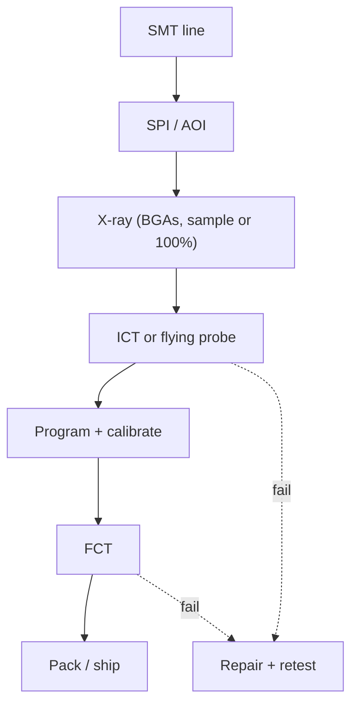

::: basics
### In plain words
Testability at high volume means planning, while you lay out the board, how a factory will test thousands of them quickly. A test station can only check what it can reach. So you add test pads, a way to load firmware (the board's built-in program), and a way to command the board, and you do the math on how many stations you need. Testing is mostly about access.

### Picture it
Think of a car with service panels built in. A mechanic can plug in a scanner and reach the oil filter in seconds, because the designers planned it. A car with no access forces the mechanic to take half of it apart. A board without test access is the same. You cannot easily add access after the board is made, so you must plan it in the layout.

### Words you need
- **Test pad**: an exposed copper spot where a probe can touch a net (one set of points wired together).
- **Bed-of-nails fixture**: a holder of spring pins that contact many pads at once. See [[q0612]].
- **Boundary scan**: using the chips themselves to drive and read their own pins, when probes cannot reach.
- **Functional test**: powering the board and checking it behaves like the product. See [[q0610]].
- **Utilization**: the fraction of time a station is really testing.

### The simplest example
A factory builds 500,000 boards a year and runs 4,000 hours a year. A 60 s functional test, at 85 % utilization, needs 500,000 x 60 / (3600 x 4000 x 0.85) = about 2.45 stations, so 3. A 20 s in-circuit test (an unpowered check of every part) needs about 0.82, so 1 station. A 15,000 USD fixture spread over 500,000 boards adds only 0.03 USD per board. That is the whole idea. The rest of this page covers test pad rules, boundary scan for unreachable pins, and ranking which nets deserve a pad.
:::

::: testing
Whether you can think about test as a **production line with a cost per second**, not just a few probe points on a bench. The interviewer wants to hear:

1. You know the test stack (AOI, ICT or flying probe, functional test, programming/calibration) and what each can and can't see. See [[q0604]] and [[q0606]].
2. You design **access** (pads, connectors, firmware hooks) at layout time to match what the station needs.
3. You reason in numbers: test time per board, stations per line, fixture cost amortised over volume, and coverage versus escape rate.
4. You think about the *fixture* mechanically (one side, pitch, alignment) and about *data*: logging, binning, and feedback to the process.
:::

::: why
At 500,000 boards per year, a test step that takes 60 seconds needs more than two stations running all year; one that takes 20 seconds needs less than one. Fixture cost is spread across every board. A missing test pad can mean a board that cannot be tested by the cheap, fast station and has to go to a slow flying-probe machine or a manual bench. Test strategy is decided during layout, not after, because adding access later means a respin. Interviewers ask this to see if you can connect circuit design to the economics of a factory.
:::

::: concepts
- **Test hierarchy**: AOI and X-ray for assembly defects, ICT/flying probe for shorts, opens and values, functional test (FCT) for behaviour. See [[q0608]], [[q0609]], [[q0610]], [[q0611]].
- **Bed-of-nails fixtures**: spring probes contact test pads in one go; fast, but needs pad access and costs money up front. See [[q0612]].
- **Boundary scan (IEEE 1149.1, JTAG)**: test pins through the chips themselves when nodes aren't physically accessible.
- **Test coverage and escapes**: fraction of faults the test detects, and the defects that slip through to the customer.
- **Test time and throughput**: seconds per board decide stations and cost per unit. See [[q0605]].
- **Design for test (DFT)**: access, controllability, observability. See [[q0616]].
:::

::: answer
"I'd start by asking what volume, what defects we're most worried about, and what test stations the factory already has. Then I plan test at layout time, because it's mostly about access.

For a bed-of-nails station, I'd give every net that matters a test pad on one side of the board, at least about 1 mm in size on a grid and spacing that the fixture vendor can probe, away from tall parts, no solder mask on it. I'd keep power and ground pads spread across the board so there's a clean return for each region. For nets I can't reach, like dense BGA signals, I'd use boundary scan, so the chips themselves become the test pins.

For functional test I'd add a test mode and a simple interface, like a UART or USB port, so the station can command the board, read self-test results and program calibration data without special hardware. I'd also design the programming path so firmware flashes in-circuit through pads or a connector.

Then I'd do the math: test seconds per board times annual volume gives the number of stations, and fixture cost divided by volume is the per-board cost. And I'd log every result with the serial number so we can track yield and catch drift early."
:::

::: technical
**Layered strategy.**

| Stage | Catches | Access needed |
|---|---|---|
| SPI/AOI/X-ray | missing, wrong, misaligned parts; solder defects (X-ray for BGA) | none (optical) |
| ICT (bed of nails) | shorts, opens, component values, orientation of some parts, power-up of subcircuits | test pad on most nets, ideally one side |
| Flying probe | similar to ICT, no fixture, slower | pads or component leads |
| Boundary scan | opens/shorts on JTAG-connected pins, even without probe access | JTAG port (TAP) |
| FCT | full behaviour, calibration, firmware | connector, test mode, power |

**Access rules for a fixture.** One-sided (bottom) probing is cheapest; two-sided fixtures cost more and are slower. Typical guidance is pads of about 0.9–1.0 mm or larger, pitch at least 1.27 mm (50 mil) (2.54 mm for the most robust probes), a keep-out around tall parts, and at least two tooling holes for alignment. Exact numbers are set by the fixture vendor.

**Throughput maths.** Stations needed $N = \frac{V \cdot t}{3600 \cdot H \cdot u}$ where $V$ is annual volume, $t$ the test time in seconds, $H$ the yearly line hours and $u$ utilisation. For $V = 500{,}000$, $H = 16 \cdot 250 = 4000$ h and $u = 0.85$: a 60 s FCT needs 2.45 stations (so 3), a 20 s ICT needs 0.82 (so 1). Test time scales cost directly.

**Fixture cost.** If the fixture costs USD 15,000, amortised over 500,000 boards is USD 0.03 per board. At 500 boards it is USD 30 per board, so flying probe wins at low volume.

**Coverage versus cost.** Not every net needs a probe. Rank nets by risk (power rails, resets, programming lines, nets with fine-pitch parts) and by what other tests cover. See [[q0625]]. Boundary scan, built-in self-test (BIST) and firmware loopbacks cover many nets without physical access.

**Programming and calibration** are part of test: flash firmware, write MAC/serial, store calibration constants. Design the programming pads or connector and budget the time (flash time can dominate FCT).

**Data and process control.** Log serial, station, time and measured values. Track first-pass yield and Cpk of key measurements so drift triggers action before failures appear.

> [!UNCERTAIN]
> Pad sizes, pitches and probe ratings are typical; fixture vendors and factories have their own rules. Always ask for the factory's DFT guideline before routing.
:::

::: short
"I'd design test access at layout time: one-sided test pads on the nets that matter, at fixture-friendly size and pitch, with boundary scan for nets I can't reach. For functional test I'd add a test mode and a simple port so the station can command, read results and program the board. Then I'd do the math, test seconds times volume gives stations, fixture cost divided by volume gives cost per board, and I'd log every result by serial number to track yield."
:::

::: long
"The way I think about it is that every second of test time and every missing pad becomes money at volume, so I plan for it at layout time.

First I decide the test stack with the factory: AOI or X-ray for solder and placement, an in-circuit test on a bed-of-nails for shorts, opens and values, and a functional test for behaviour, with programming and calibration folded in.

For the in-circuit fixture, access is everything. I put a test pad on each net that matters, on one side of the board, at least about a millimetre across, with a pitch the fixture vendor can reliably probe, away from tall components and with no solder mask on top. I spread power and ground pads so each region has a close return. Where nets are buried under BGAs, I rely on boundary scan: the chips drive and sense their own pins through JTAG, so I only need access to the JTAG port.

For functional test, I give the board a test mode and a simple interface like UART or USB. The station can send commands, read self-test results, and write calibration data. I make firmware programming happen in-circuit, through pads or a connector.

Then the numbers. At 500,000 boards a year, a 60-second functional test needs about three stations, while a 20-second ICT needs one. A 15,000 dollar fixture is three cents per board at that volume but 30 dollars per board at 500 pieces, where flying probe is the better choice.

And I'd log every test with serial number, station and measured values, so we can watch yield and Cpk and catch drift before the field does."
:::

::: terms
- **ICT**: in-circuit test; bed-of-nails measurement of shorts, opens and component values. See [[q0609]].
- **FCT**: functional test; powers the board and checks its real behaviour. See [[q0610]].
- **Bed-of-nails fixture**: a plate of spring-loaded probes aligned to the board's test pads. See [[q0612]].
- **Flying probe**: movable probes that test pads one at a time; no fixture, slower. See [[q0611]].
- **Boundary scan (JTAG)**: IEEE 1149.1 scan chain that lets chips drive and read their pins for interconnect test.
- **Test coverage**: share of possible faults the test can detect.
- **Escape**: a defective unit that passes test.
- **First-pass yield (FPY)**: fraction passing all tests without rework.
- **Cpk**: process capability index, how far the mean sits from limits in units of spread.
- **Golden board**: a known-good reference unit used to verify a fixture or station.
:::

::: exceptional
**An average answer** says "add test points and use ICT".

**An exceptional answer**:

- Starts from volume, defect Pareto and existing stations.
- Names where each test stage sits and what it can't see, so the combination covers the faults.
- Gives access rules for the fixture (one side, size, pitch, keep-outs, tooling holes) and the mechanical reason.
- Uses boundary scan or BIST to cover inaccessible nets.
- Does the **economics**: stations per volume and fixture amortisation.
- Designs programming, calibration and test mode into the board, and logs by serial for process control.
- Mentions test-fixture reliability (probe wear, golden-board checks).
:::

::: mistakes
- **Treating test as an afterthought.** Without pads on the right nets and side, the test strategy is already decided by the layout.
- **Probing both sides.** Two-sided fixtures are costly and slow; plan to probe one side.
- **Test pads covered by solder mask or too close to tall parts.** The probe can't touch or is deflected.
- **Assuming 100% net access is needed.** Cover by risk, with boundary scan and functional self-test for the rest. See [[q0625]].
- **Ignoring test time.** A great test that takes 5 minutes cannot run at volume.
- **No programming path.** If firmware can only be loaded through a rarely-accessible header, production stalls.
- **No data logging.** You can't improve what you can't see in yield trends.
:::

::: deep
## The test problem at volume

A prototype test is "does it work on my bench". A production test must answer in seconds whether *this particular unit* has any assembly defect, bad component, or calibration problem, and it must do it for thousands of units without human judgment. Three quantities govern it: **coverage** (what faults get caught), **time** (seconds per unit) and **cost** (fixture, station, labor).


Figure: A typical line. Cheap, early tests catch cheap-to-fix defects; the expensive functional test sees only boards that already passed the earlier stages. Fail loops go to repair and retest.

## Where defects are cheapest to catch

A rule of thumb used in manufacturing is that the cost of finding a defect rises roughly tenfold per stage (component, board, system, field). The numbers are only illustrative, but the lesson is real: catch shorts and opens at ICT, not in the customer's hands.

## Access design

**Bed-of-nails.** Each probe is a spring-loaded pin (a pogo pin) that presses on a test pad with tens to a couple hundred grams of force. To work reliably it needs:

- a flat pad free of mask and flux residue, of about 0.9–1.0 mm or larger for standard probes (smaller probes exist and cost more),
- spacing between pads (typically 1.27 mm minimum, 2.54 mm for the robust style),
- clearance from tall parts, because the probe plate sits very close to the board,
- two or more tooling holes so the board sits in the same place every time,
- most nets on the bottom, where there's room, with the board's top held by a vacuum or press-down plate.

**Why one side matters.** A two-sided fixture needs a second probe plate and a more complex press, increasing cost, and it prevents fast loading. Put test pads on one side and put components that need probing there too.

**Boundary scan.** On a chain of JTAG devices, the chips' boundary cells drive and capture their pins. Opens and shorts between two chips' pins can be tested through the TAP (TDI, TDO, TCK, TMS) alone. It does not test analog or non-JTAG parts, but it removes the need for pads on hundreds of BGA nets. Put a TAP connector or test pads on the board and route the chain properly (a [[q0616]]-style DFT decision).

## Functional test design

- **Test mode.** A strap or command that puts the board into a self-test state.
- **Access.** A connector (often the product's own) or pogo-pin pads for power, UART/USB/SPI, and a few analog nodes.
- **Loopbacks.** Hardware loopback on communication ports (for example, short TX to RX on the fixture) test drivers and connectors without a partner device.
- **Calibration.** Station applies known stimulus (e.g. precise voltage), the board measures it, and stores correction constants in non-volatile memory.
- **Programming.** In-circuit via SWD/JTAG pads or bootloader on UART. Program as early as possible so the firmware's own self-tests can run.

## Worked example: how many test stations?

Plan: 500,000 boards/year, 16 hours per day, 250 days, 85% utilisation. Stations $= \frac{V t}{3600 H u}$.

```plot
{"title":"Stations needed vs test time (500,000 boards per year)","x":{"label":"Test time per board","unit":"s","min":5,"max":180},"y":{"label":"Stations needed","min":0,"max":8},
 "vars":{"v":500000,"h":4000,"u":0.85},
 "series":[{"label":"stations = V·t / (3600·H·u)","fn":"v*x/(3600*h*u)"}],
 "points":[{"x":20,"y":0.82,"label":"ICT 20 s → 0.82"},{"x":60,"y":2.45,"label":"FCT 60 s → 2.45"}]}
```
Figure: Stations scale linearly with test time. Cutting FCT from 60 s to 30 s saves more than one station (and its operator and floor space) every year.

Cost per board adds fixture amortisation: a USD 15,000 fixture over 500,000 boards is USD 0.03 per board; over 500 boards it is USD 30. This is why prototypes and low-volume builds use flying probe or manual bench test, and volume products justify a fixture.

## Coverage versus pads: prioritise

You may not have the space for every pad. Rank nets by (a) likelihood of defect (fine-pitch, BGA, hand-soldered), (b) severity (power, reset, boot), (c) whether other tests cover it (boundary scan, self-test). See [[q0625]] for a scoring approach.

## Catching test problems

- A **golden board** run through the station every shift verifies the fixture and measurement chain.
- **Probe wear** adds contact resistance: monitor measured values for drift.
- **False failures** from dirty or oxidised pads waste repair time; clean or no-clean flux and pad finish (ENIG, not OSP, for probing) help. Pad finish compatibility with probing depends on the factory.

## Data loop

Every test result goes to a database with serial number, time, station, and measured parameters. Trend charts (FPY by station and by lot, Cpk of key parameters) reveal drifts, bad component lots and process issues. A "test as sensor" attitude lets the factory fix the cause upstream.

```sim
{"id":"dmm-lab","view":"4wire"}
```
Figure: Production measurements of low resistance (shunts, interconnect, probe contact) use Kelvin (4-wire) sensing to remove lead and probe contact resistance. Compare 2-wire and 4-wire readings as lead resistance rises. Fixtures use the same idea with force and sense probes.

> [!INTERVIEW]
> Close with the economics: "I'd decide between fixture and flying probe by the volume: the fixture costs maybe tens of thousands up front and tests in seconds; flying probe has no fixture but takes minutes." It shows you think like a manufacturing engineer.
:::

::: applications
- **Consumer electronics** (routers, wearables): ICT on the main board, boundary scan for the SoC, and a UART-based FCT station with RF calibration.
- **Automotive ECUs**: 100% ICT plus end-of-line functional test with traceability by serial number.
- **Server and telecom boards**: JTAG/boundary scan for the dense BGAs, X-ray for BGA solder, and burn-in for infant-mortality failures.
- **Battery packs**: functional test that calibrates the fuel gauge and checks protection thresholds.
- **Contract manufacturers** running many products on one flying probe line for low-volume jobs.
:::

::: assumptions
- Assumes SMT boards built in a contract or in-house factory with standard test equipment.
- **Volume decides the strategy.** At prototype volume, test pads and a header suffice. At very high volume with a stable design, fixtures and automated handling pay off.
- **Numbers are examples.** Test time, utilisation, hours and fixture cost vary with product and site.
- Boundary scan only covers digital JTAG-capable parts; analog nets need physical access or functional tests.
- Valid alternative answers emphasise functional self-test and built-in diagnostics (BIST) over physical access, which is more common in tiny, dense consumer products.
:::

::: followups
### What if you can't fit test pads for every net?
Prioritise by risk and by what else covers the net: power and ground rails, resets, boot and programming lines, nets with fine-pitch or hand-soldered parts. Use boundary scan for BGA nets and rely on functional self-test for nets whose failure would be visible. See [[q0625]].

### ICT or flying probe for 2,000 boards a year?
Flying probe. A fixture might cost USD 10,000–20,000 and over 2,000 boards that's USD 5–10 per board, more than the cost of a slow test at low volume. For a stable design at 500,000 per year, the fixture amortises to a few cents and the seconds-per-board advantage wins.

### How do you make a functional test fast?
Run tests in parallel on the board, keep measurements to the minimum needed to detect faults, use self-test in firmware instead of external instruments, and program in the same fixture. Avoid long settling waits by measuring after a known time and extrapolating or testing in a state that settles fast.

### How would you detect an open on a BGA ball you can't probe?
Boundary scan interconnect test: drive a pattern from one device's boundary cell and read it at the connected device. If there's no JTAG, X-ray inspection finds opens and head-in-pillow defects, or a functional test that exercises that net (for example memory test for the DDR data lines).

### Scenario: FCT yield suddenly drops from 99% to 93% on one station. What do you check?
First, the station: run a golden board; if it fails or measures differently, the fixture or probes are the cause (contact resistance, worn pogo pins, calibration). If the golden board passes on that station, look at the lot: trend by component lot, solder paste lot or reflow oven. Examine the failure signature in logged measurements: a shift in a voltage or a specific test failing points to cause. Fix upstream and verify.
:::

::: references
- IEEE Std 1149.1 (JTAG, standard test access port and boundary-scan architecture).
- IPC-2221, generic standard on printed board design (testability and design rules in general terms).
- Bushnell & Agrawal, *Essentials of Electronic Testing for Digital, Memory and Mixed-Signal VLSI Circuits*: test coverage, DFT and boundary scan concepts.
- Your fixture vendor's and contract manufacturer's published DFT guidelines: authoritative for pad size, pitch and clearances.
:::

::: rubric
- Plans test at layout time, not after :: Access (pads, ports) cannot be added after the board is built.
- Names the test stack and what each stage catches :: Shows you can build coverage from complementary tests.
- Gives fixture access rules (one side, pad size, pitch, tall-part keep-out, tooling holes) :: These determine whether the fixture works reliably.
- Uses boundary scan or self-test for inaccessible nets :: Solves the density problem without extra pads.
- Includes programming, calibration and test mode in the plan :: Production test is more than measurement.
- Does the economics (stations from test time, fixture amortisation) :: Connects the design to production cost.
- Logs data and uses golden boards/trend monitoring :: Turns test into process control.
:::

::: quiz
```json
[
 {"type":"mcq","level":"fundamental","q":"Which test is best at finding a short between two nets on a bare assembled board, without powering it?","options":["Functional test","In-circuit test / flying probe","Visual inspection by eye","Thermal imaging only"],"answer":1,"explain":"ICT and flying-probe measure resistance between nets on the unpowered board, finding shorts and opens directly. FCT can show the symptom but not localise it."},
 {"type":"numeric","level":"intermediate","q":"Volume 500,000 boards/year, test time 60 s, 4000 line hours per year, 85% utilisation. How many stations are needed (before rounding up)?","answer":2.45,"tolerance":0.02,"unit":"stations","explain":"N = V t /(3600 H u) = 500000×60 /(3600×4000×0.85) = 2.45, so 3 stations."},
 {"type":"numeric","level":"intermediate","q":"A bed-of-nails fixture costs USD 15,000 and is used for 500,000 boards. What is the fixture cost per board in US cents?","answer":3,"tolerance":0.02,"unit":"cents","explain":"15,000 / 500,000 = 0.03 USD = 3 cents per board."},
 {"type":"truefalse","level":"fundamental","q":"Boundary scan can test connections between BGA pins without physical probe access, if the devices support JTAG.","answer":true,"explain":"The devices' boundary cells drive and sample their own pins through the TAP, so interconnect opens and shorts can be tested without probes on those nets."},
 {"type":"multi","level":"advanced","q":"Select all that reduce the cost or time of production test.","options":["Put test pads on one side of the board","Add a firmware test mode with a UART interface","Require two-sided probing on every board","Use hardware loopbacks on communication ports in the fixture"],"answer":[0,1,3],"explain":"One-sided access keeps the fixture simpler, a test mode and port lets the station command and read results, and loopbacks test interfaces without partner hardware. Two-sided probing adds cost and slows loading."},
 {"type":"mcq","level":"advanced","q":"A volume line's FCT yield drops on one station only. The golden board also fails there. What is the most likely cause?","options":["A bad lot of capacitors","The fixture or station (worn probes, contact resistance, calibration)","A design error in the schematic","The firmware version"],"answer":1,"explain":"A known-good board failing on one station isolates the problem to that station's fixture or measurement chain, not the product or the lot."}
]
```
:::
