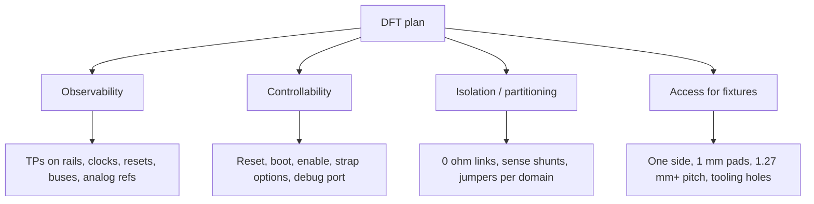

::: basics
### In plain words
Designing a board for testing means you can both set up and observe what is happening inside it. You do that for the factory and for yourself at the bench. In practice you add test pads on the important nets, a connector to program and debug the chip, and ways to power and measure one block at a time.

### Picture it
Think of a house built with access panels and windows into the walls. The plumber can check each pipe without tearing out plaster, and can shut off the water to one room to test it. A board needs the same two things: places to look (observe) and ways to switch parts on or off (control). The analogy has one catch. Every opening costs space, and on fast signals even a tiny pad can disturb the signal.

### Words you need
- **Test point**: a pad, loop or via where a probe can touch a signal. See [[q0619]].
- **Observability**: the ability to measure what a node is doing.
- **Controllability**: the ability to force a node into a known state.
- **Boundary scan**: using the chips' built-in pin controls to test connections you cannot probe.
- **Zero-ohm link**: a tiny jumper in a supply line that you can remove or replace to isolate or measure that block.

### The simplest example
Put a 10 mΩ shunt, which is a small known resistor, in the supply line of one block, with test pads across it. If the block draws 2 A, the voltage across the shunt is 2 A x 10 mΩ = 20 mV, so measuring 20 mV tells you the current. The power lost is 2 A x 20 mV = 40 mW, small enough to ignore. That is the whole idea. The rest of this page covers which nets to give pads, how debug connectors and firmware test modes help, and the trade-offs of area and fast signals.
:::

::: testing
Whether you know design for test (DFT) is about two things: **controllability** (can I put the circuit in a known state?) and **observability** (can I see what it's doing?). Interviewers want to hear that you plan test access at schematic and layout time for *both* the factory and the lab:

1. Physical access: test points, programming and debug connectors, probe-able nets.
2. Isolation and partitioning: so a failure can be localised.
3. Firmware and silicon hooks: test modes, boundary scan, loopbacks, LEDs, status registers.
4. Awareness of the cost/size/signal-integrity trade-offs of adding access.
:::

::: why
The first time a board powers on, something will be wrong. How fast you find out *what* depends on whether you left yourself a way in. The same decisions also decide how cheaply the factory can test every unit. A board with no test access is slow to debug, expensive to test, and often respun just to add the pads that should have been there. See [[q0614]] for the high-volume factory side and [[q0617]] for prototypes.
:::

::: concepts
- **Controllability and observability**: the two pillars of testability. Can you set a node, and can you read it?
- **Test points**: pads/loops/vias for probes. See [[q0619]].
- **Partitioning**: splitting the design into blocks (power, clock, digital, analog) that can be powered and tested independently.
- **Boundary scan / JTAG / SWD**: digital access to the chip's pins and internals.
- **ICT/flying probe/FCT access**: what the factory stations need. See [[q0609]], [[q0610]], [[q0611]], [[q0612]].
- **Measurement access**: ground points, current-sense jumpers, probe-friendly layout. See [[q0618]] and [[q0627]].
:::

::: answer
"For me, design for test is making sure I can both set up and see what's happening inside the board, for the factory and for me at the bench.

On the physical side, I'd give every power rail, ground, reset, clock, and key signal a test pad, with ground pads right next to them so a scope ground spring can reach. I'd put a programming and debug connector on, SWD or JTAG, and a UART header, and leave a path for factory fixtures by putting pads on one side at a pitch the fixture supports.

I'd also build the board so I can partition it. Zero-ohm links or jumpers in series with supplies, so I can power one block at a time or measure its current; a way to hold the processor in reset; and pull-up and pull-down options so strapping pins can be forced.

On the firmware side: a test mode, status LEDs, loopbacks on communication ports, and boundary scan on parts where I can't reach the pins, like BGAs.

Then I trade it off. Every test pad costs area and, on fast nets, a bit of capacitance, so I prioritise by risk, and for high-speed or sensitive signals I use a tiny stub or an in-line pad, or rely on built-in self-test. And I check the plan with the factory's test engineer before layout is final."
:::

::: technical
**Principles.**

1. **Observability**: at least one measurable point per functional block: rail voltages, clocks, resets, enable and power-good signals, bus lines, key analog nodes (reference, bias, sense).
2. **Controllability**: ways to force states: reset and boot pins accessible, enable signals can be overridden, strapping resistors with alternate footprints, debug interface to the MCU, GPIO test lines.
3. **Isolation**: series jumpers (0 Ω links, solder bridges, or low-value sense resistors) in the supply path of each block so it can be disconnected or its current measured. Series 0 Ω in a feedback loop is risky: see below.
4. **Access for stations**: test pads on one side, size about 1 mm, pitch at least 1.27 mm, no mask, with keep-out from tall parts; tooling holes. Check the factory guideline.
5. **Digital test infrastructure**: JTAG/SWD header (standard pinout), boundary scan chain routed through devices, programming lines, UART/USB debug.
6. **Self-test**: firmware test mode, loopbacks, memory self-tests, ADC/DAC reference readbacks.
7. **Signal integrity**: on high-speed nets, use minimal stubs, or in-line pads, or use dedicated coax connectors. See [[q0623]].
8. **Documentation**: silkscreen net names and test point labels (TP numbers) and a test-point table.

**Measuring current.** Series current-sense options: a 10 mΩ shunt with test pads across it (Kelvin pads), or a header with a jumper where an ammeter can be inserted. A 10 mΩ shunt carrying 2 A drops 20 mV and dissipates 40 mW ($P = I^2R$).

**Trade-offs.**

| Choice | Benefit | Cost |
|---|---|---|
| More test pads | Better coverage | Area, routing, capacitance on fast nets |
| 0 Ω links | Isolation, current measurement | BOM lines, board resistance |
| Debug headers | Fast bring-up | Connector cost and area; remove or depopulate for final product |
| Boundary scan | Tests BGA interconnect | Silicon support, scan chain routing |
| Extra pull-up/down footprints | Control straps | More DNP parts |

> [!UNCERTAIN]
> Pad sizes, pitches and probe pressures depend on the fixture vendor and factory. Use their DFT guideline when it exists.
:::

::: short
"Design for test means building in controllability and observability. I give each rail, clock, reset and key signal a test pad with a nearby ground, add programming and debug connectors, series jumpers so I can power and measure blocks separately, and test modes, loopbacks or boundary scan in firmware and silicon. For the factory I put pads on one side at fixture-friendly size and pitch. I prioritise by risk and keep fast nets clean."
:::

::: long
"I think of design for test as controllability and observability. Controllability is whether I can put the board in a known state: hold the MCU in reset, force an enable, change a boot strap. Observability is whether I can see what's happening.

For observability I put a test pad on each power rail, on ground next to them, and on resets, clocks, power-good and enable signals, key buses, and the analog nodes that matter, like references. I give each pad a label on the silkscreen. I put ground pads right next to signal pads so a scope can use a short ground spring, which matters because a long ground lead on a fast signal adds ringing.

For controllability and isolation, I'd add series zero-ohm links or low-value sense resistors in each power domain so I can power one block at a time, or measure its current. I'd give strapping pins pull-up and pull-down options and make reset accessible. I'd include a debug header, SWD or JTAG, and a UART, so firmware can be loaded and test modes triggered.

In silicon and firmware, I'd use boundary scan on BGAs where I can't touch the pins, plus loopbacks on the communication ports and a self-test mode that reports results.

For production, I'd talk to the factory: test pads on one side, about a millimetre across, at a pitch the fixture can handle, with keep-outs around tall parts and tooling holes.

The trade-off is that every pad costs area and some capacitance, so I prioritise by risk, and on high-speed nets I keep stubs tiny or use an in-line pad or rely on self-test instead."
:::

::: terms
- **DFT (design for test)**: design choices that make a product easy to test.
- **Controllability**: ability to set internal nodes to desired states.
- **Observability**: ability to measure or infer node states.
- **Test point (TP)**: a pad, loop or via for probing. See [[q0619]].
- **Boundary scan**: IEEE 1149.1; chips shift data through pin cells to test interconnect.
- **SWD/JTAG**: debug and programming interfaces for microcontrollers and SoCs.
- **Loopback**: connecting an output to its input to test a link without a partner.
- **Partitioning**: splitting a design into independently testable blocks.
- **Strap (strapping pin)**: pin sampled at reset to set a mode.
- **DNP**: "do not populate"; a footprint left empty on the production BOM.
:::

::: exceptional
**An average answer** says "add test points on important signals".

**An exceptional answer**:

- Frames it as controllability + observability and gives examples of each.
- Covers *both* production test (one-sided pads, pitch, keep-outs, boundary scan) and bench debug (ground pads, current-sense jumpers, debug headers).
- Uses isolation and partitioning to localise faults, such as power domain jumpers and reset hold.
- Names the SI trade-off on fast nets and the options (short stubs, in-line pads, coax, self-test).
- Pairs the layout with firmware hooks (test mode, loopbacks, status LEDs).
- Says to align with the factory's test engineer before layout is final.
:::

::: mistakes
- **Pads only on signals, not on grounds.** A scope ground clip lead then dangles across the board. See [[q0618]].
- **No way to hold the processor in reset or boot from alternate source.** A hung firmware makes the board un-debuggable.
- **Adding stubs to fast nets for convenience.** A pad on a fast edge acts like capacitance and a stub. See [[q0623]].
- **Putting a 0 Ω link inside a sensitive feedback or high-speed path.** It adds inductance and resistance where it hurts.
- **Test pads under components or on both sides.** The fixture can't reach them or becomes two-sided and costly.
- **Not labelling test points.** A pad nobody can identify is useless in the field.
- **Leaving debug connectors out of the production design with no alternative access.** Provide pads or a pogo-pin pattern.
:::

::: deep
## Two kinds of testing, one set of decisions

There are two customers of your DFT choices:

1. **You, at the bench**: debugging a first prototype, tracing a noisy rail, reading bus traffic.
2. **The factory**: station fixtures, programmers and ICT/FCT software testing hundreds of units per day. See [[q0614]].

They want overlapping things, but not identical: you want probe-friendly points in the middle of fast nets and a quick way to cut a rail; the factory wants one-sided pads at a regular pitch and a programming interface that always works.


Figure: A DFT plan has four threads. Each maps to concrete layout and schematic features you can show in an interview.

## Observability: what to expose

A good checklist:

- **Every power rail** (after the regulator and at the load), with a ground pad adjacent.
- **Power-good, reset and enable** lines: they tell you whether sequencing worked. See [[q0626]] for fault-hunting.
- **Clocks**: crystal oscillators are fragile (probe capacitance can stop one), so expose the buffered clock output or the MCU's clock-out pin instead of the crystal pins directly.
- **Bus signals** (I²C, SPI, UART): easy to decode with a logic analyser clip at the connector or test pads.
- **Analog references and key sense nodes**: reference voltage, bias nodes, ADC input before the filter.
- **Status LEDs** on rails and fault signals: free, instant observability.

## Controllability: what to be able to force

- **Reset line** accessible (pad or pushbutton) and reset held while probing.
- **Boot strap pins** with pull options (0 Ω footprints) so you can pick boot source.
- **Enable pins** of regulators with a pad or footprint to force on/off, which lets you power domains in order. See [[q0626]].
- **Debug port**: SWD/JTAG header or pogo pads. Standard pinouts matter because tools plug directly.
- **GPIO test lines** to drive test signals from firmware.
- **Analog stimulus**: a pad where you can inject a test signal (with a series resistor to protect the node).

## Isolation: make the board partitionable

A fault such as a short on a power rail is much easier to localise if you can disconnect parts of the rail. Insert a **0 Ω link or low-value sense resistor** in series with each power domain, each of which feeds a block:

```circuit
{"elements":[
 {"t":"V","a":[0,2],"b":[0,8],"label":"V_{in}"},
 {"t":"wire","pts":[[0,2],[0,0],[3,0]]},
 {"t":"R","a":[3,0],"b":[8,0],"label":"R_{sense}","value":"10 mΩ"},
 {"t":"wire","pts":[[8,0],[12,0]]},
 {"t":"dot","at":[3,0]},{"t":"dot","at":[8,0]},
 {"t":"wire","pts":[[3,0],[3,-2]]},{"t":"term","at":[3,-2],"label":"TP_A","side":"top"},
 {"t":"wire","pts":[[8,0],[8,-2]]},{"t":"term","at":[8,-2],"label":"TP_B","side":"top"},
 {"t":"box","at":[12,-1],"w":4,"h":5,"label":"Block","pins":[{"side":"left","pos":1,"name":"VDD"},{"side":"left","pos":4,"name":"GND"}]},
 {"t":"wire","pts":[[0,8],[0,10],[10,10]]},
 {"t":"wire","pts":[[12,3],[10,3],[10,10]]},
 {"t":"gnd","at":[5,10]},{"t":"dot","at":[5,10]},
 {"t":"text","at":[5.5,-4.5],"text":"V(TP_A) − V(TP_B) = I · R_{sense}","anchor":"middle","muted":true}
]}
```
Figure: A series sense resistor with a test pad on each side gives both isolation (remove or lift it to disconnect the block) and a current measurement. At 2 A, 10 mΩ drops 20 mV and burns 40 mW.

Numbers: $V = IR = 2 \cdot 0.010 = 20$ mV; $P = I^2R = 4 \cdot 0.010 = 40$ mW. A scope or DMM on the millivolt range reads the current without breaking the circuit; a zero-ohm link works if you want to insert an ammeter.

**Caution.** Don't put these links where they break a regulation loop's sense point or a high-speed return path; place them in the supply path *before* the load's local decoupling so the decoupling stays attached to the block.

## Access for production fixtures

- Test pads on one side (bottom).
- Pad about 1 mm across or larger, 1.27 mm or more apart, with no solder mask.
- Keep-outs from tall parts so the fixture plate can sit down.
- Two or more non-symmetric tooling holes.
- Pad for each important net; for the others, rely on boundary scan or functional tests. See [[q0625]].

## Digital infrastructure

- **JTAG/boundary scan**: route the chain through devices; add a header; if a device lacks JTAG it breaks the chain: use a bypass or separate chain.
- **SWD**: two wires (SWDIO, SWCLK) plus reset and ground; tiny footprints (Tag-Connect style pads) are used where headers don't fit.
- **UART console**: a three-pin pad group (TX, RX, GND) is enough to get logs and a shell.
- **USB or Ethernet** diagnostics for products that have those anyway.

## Signal integrity cost

A test pad on a fast net adds capacitance of the order of 0.5 pF plus any stub. At 100 ps edges that already causes about 12% reflections on a 50 Ω line (see [[q0623]]). So for fast or sensitive nets: use a very short stub from an in-line pad, a coax connector or a "probe via", or rely on self-test and eye-scan features in the transceiver.

## Worked example: a small IoT board

A 4-layer board with an MCU, a Wi-Fi/BLE module, a buck converter and a sensor.

- Test pads: VIN, 3V3, 1V8, GND (three), RESET, PG, SWD (4 pads), UART TX/RX, I²C SDA/SCL, ADC reference.
- Jumpers: 0 Ω in series with the Wi-Fi module supply to measure its burst current; 10 mΩ shunt on VIN with TP pads.
- Boot straps with 0 Ω options.
- LED on 3V3.
- Test mode in firmware prints a pass/fail table on UART at boot when a strap is set.
- Factory: bottom-side pads at 1.27 mm pitch for the VIN/GND/UART/SWD set and a pogo adaptor; the rest of the signals are covered by the self-test.

```sim
{"id":"dmm-lab","view":"burden"}
```
Figure: Measuring current with a DMM adds its burden voltage. Switch to the 200 µA range (a 1 kΩ internal shunt) and lower the circuit resistance: watch the burden voltage the meter steals and the reading error grow. This is why a series jumper for an ammeter needs a range whose shunt is far below the circuit resistance, or why a PCB sense resistor read as millivolts is often the better choice.

> [!INTERVIEW]
> If asked "what would you regret not adding on a first prototype?", answer with a concrete list: a reset pad, rail test points with ground next to them, a debug header, series jumpers on each power domain, and strap options. It signals bench experience.
:::

::: applications
- **Microcontroller dev boards** with SWD/JTAG headers, UART pins and many labelled TPs.
- **Server and networking boards** with boundary scan chains and BMC-accessible sensors.
- **Power supplies** with test pads on feedback, compensation and switch nodes (with care) and sense shunts for current.
- **Automotive ECUs** with factory test connectors and end-of-line functional test modes.
- **Wearables** with tiny pogo-pad programming and test areas on the back.
:::

::: assumptions
- Assumes a product that will be tested both in the lab and in a factory.
- Test point count and style depend on cost, size and signal speed; a tiny wearable has far fewer than a lab board.
- Pad size and pitch vary by fixture vendor.
- Boundary scan requires JTAG-capable devices; many analog and legacy parts lack it.
- **Alternative view**: in very dense products, designers rely on firmware self-test and a few connector-based signals instead of physical pads, trading observability for size.
:::

::: followups
### What's the difference between controllability and observability?
Controllability is how easily you can set a node to a given state (forcing a reset, an enable or a GPIO); observability is how easily you can see a node's state (a test pad, a status register, an LED). Good DFT needs both: seeing a fault is useless if you can't set up the conditions to reproduce it.

### How do you add current measurement without a big burden?
Use a low-value sense resistor in series, say 10 mΩ, with a test pad each side, and measure the voltage with a scope or DMM. At 2 A that's 20 mV and 40 mW. For a DMM in current mode, the burden is the meter's shunt voltage, which can be too large at low ranges.

### Why not put a test pad on every net?
Pads cost area and can hurt routing; on fast nets they add capacitance and stubs; they increase fixture complexity and cost. Prioritise by risk and use boundary scan and functional self-test for nets that don't need physical access. See [[q0625]].

### What do you do if the product has no room for a debug header?
Use pogo-pin pads (a small footprint like a Tag-Connect style pattern), edge pads, or reuse an existing connector pins with a test mode (for example USB with a bootloader). You can also have the pads on the board and depopulate headers in production.

### Scenario: the first prototype powers up, the MCU doesn't boot, and there's no debug header. What do you do?
Measure rails and clocks at whatever pads exist, check reset and boot pins with a scope, and look for the SWD pins on the MCU package to bodge-wire onto. If reset or boot straps aren't accessible, I'd lift the pin or use a small wire. Then on the revision I'd add the header, reset pad and boot straps, and a rail LED. This is a classic reason to add DFT for the prototype. See [[q0617]].
:::

::: references
- IEEE Std 1149.1, standard test access port and boundary-scan architecture.
- Bushnell & Agrawal, *Essentials of Electronic Testing for Digital, Memory and Mixed-Signal VLSI Circuits*: controllability, observability and DFT concepts.
- Horowitz & Hill, *The Art of Electronics*, 3rd ed.: practical debugging and measurement chapters.
- IPC-2221 generic standard on printed board design, for design practice context.
:::

::: rubric
- Frames DFT as controllability and observability :: Shows conceptual understanding rather than a list of tricks.
- Test pads on rails, grounds, resets, clocks, buses and analog references :: These are the signals that localise failures.
- Ground pads next to signal pads :: Needed for short return paths and accurate scope measurements.
- Isolation/partitioning with jumpers or sense resistors :: Lets you localise shorts and measure current.
- Debug/programming interfaces and firmware hooks :: Without them you can't get the system into a testable state.
- Factory access requirements (one side, size, pitch, keep-outs) :: Shows production awareness.
- Discusses the SI/area trade-offs and how to mitigate :: Shows engineering judgment about cost of test access.
:::

::: quiz
```json
[
 {"type":"mcq","level":"fundamental","q":"What does 'controllability' mean in design for test?","options":["How easily you can see a node's state","How easily you can set a node into a desired state","How many test points there are","How fast the board can be tested"],"answer":1,"explain":"Controllability is the ability to force nodes (reset, enable, GPIO, straps) into a known state; observability is the ability to see them."},
 {"type":"numeric","level":"fundamental","q":"A 10 mΩ series sense resistor carries 2 A. What is the voltage across it, in mV?","answer":20,"tolerance":0.01,"unit":"mV","explain":"V = I R = 2 × 0.010 = 0.020 V = 20 mV."},
 {"type":"numeric","level":"intermediate","q":"Same resistor and current: how much power does it dissipate, in mW?","answer":40,"tolerance":0.01,"unit":"mW","explain":"P = I² R = 4 × 0.010 = 0.04 W = 40 mW."},
 {"type":"mcq","level":"intermediate","q":"Why put a ground test pad right next to a signal test pad?","options":["To make the board symmetrical","So a scope probe can use a short ground return, reducing ringing and pickup","Because the fixture requires it","To reduce solder defects"],"answer":1,"explain":"A short ground path keeps the probe's loop inductance and area small. A long ground lead rings and picks up noise on fast edges."},
 {"type":"truefalse","level":"advanced","q":"Adding test pads to a high-speed differential pair has no effect on signal integrity if the pads are small.","answer":false,"explain":"Even a small pad adds capacitance and possibly a stub, causing reflections and eye closure, especially at sub-nanosecond edges. Use minimal stubs, in-line pads or self-test."},
 {"type":"multi","level":"advanced","q":"Select all good DFT features for a first prototype.","options":["Accessible reset pad","0 Ω link in series with each power domain","Debug header (SWD/JTAG)","Removing all labels to save silkscreen space"],"answer":[0,1,2],"explain":"Reset access, current/isolation links and a debug header all aid bring-up. Removing labels makes the pads hard to use."}
]
```
:::
