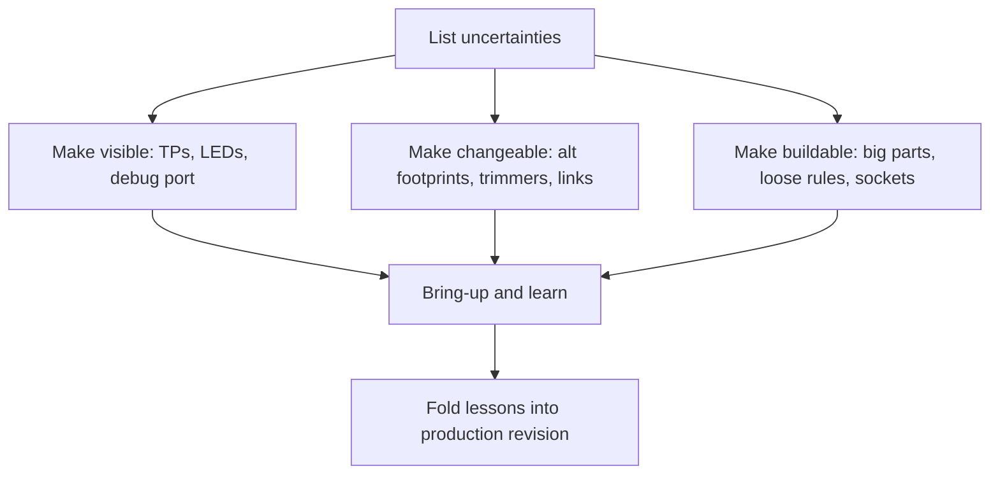

::: testing
Whether you know a prototype's job is **to be learned from**, not to be pretty. A prototype board is an experiment: you expect to change things. The interviewer wants to hear that you:

1. Optimise for **debuggability and changeability**, not cost or size.
2. Plan *which parts of the design you're unsure of* and give each an escape hatch (alternate footprints, adjustable values, jumpers).
3. Still respect DFM enough that the board builds, since a prototype that can't be assembled teaches nothing. See [[q0613]].
4. Know the difference between the prototype and what you'd ship: you'll depopulate, shrink and cost-reduce later.
:::

::: why
A first spin almost never works fully. Typos in pinouts, wrong footprints, a marginal power rail, a datasheet that lied. Each respin costs weeks and money. The best prototype boards turn "respin" into "cut a trace, swap a resistor, add a bodge wire" so you learn five things from one build. Interviewers use this question to see whether you've built hardware: people who've done it always mention test points, jumpers and debug headers.
:::

::: concepts
- **Test points and ground access**: see [[q0619]] and [[q0618]].
- **Isolation links**: 0 Ω resistors, solder jumpers or headers in power and signal paths. See [[q0616]].
- **Footprint options (DNP/alternates)**: pads for multiple component choices or values on uncertain circuits.
- **Debug and programming interfaces**: SWD/JTAG, UART, breakouts.
- **Bodge-friendly layout**: space and exposed pads to add wires, cut traces and rework. See [[q0636]].
- **Margin**: oversized components, current capacity and area so a wrong estimate doesn't kill the build.
:::

::: answer
"For a prototype I design for change and observability instead of cost or size.

First, I make it easy to see: test points on every rail, clock, reset and key signal, with ground pads next to them, plus status LEDs and a debug header. Second, I make it easy to change. Anywhere I'm unsure, a feedback divider, a filter corner, a compensation network, a gain setting, I add extra footprints so I can try different values without cutting anything, or I use a trim pot or a jumper to switch options. I put 0 Ω links in series with power domains so I can power or measure one block at a time, and strap options on boot pins.

Third, I break out spare pins from the MCU or FPGA to a header, so if I find I need another signal I can wire it.

I use larger, hand-solderable parts, 0603 or 0805 instead of 0201, wherever space allows, and leave room around ICs for rework, and I put clear silkscreen net names. I'd keep the stack-up and traces conservative so any fab can make it, and use sockets for the expensive or likely-to-change parts.

I still follow DFM basics, because a prototype that can't be assembled doesn't teach me anything, and I order a few extra boards."
:::

::: technical
**Design for observability.** Rail, reset, clock, enable and bus test points with adjacent grounds; a header for SWD/JTAG and UART; LEDs for rails and faults; scope-friendly probe loops for fast nets, preferably with small, in-line pads (see [[q0623]]).

**Design for changeability.**

- **Alternate footprints.** Unsure of a feedback divider? Place a bottom resistor and a second parallel footprint. For a 0.8 V feedback regulator with a 31.6 kΩ / 10 kΩ divider the output is $0.8(1 + 31.6/10) = 3.33$ V. A parallel 100 kΩ across the bottom resistor gives 3.58 V; 47 kΩ gives 3.87 V; and a 220 kΩ gives 3.44 V, so one spare footprint spans a useful range for tuning or margining.
- **Trim options.** A small trimmer or digital potentiometer for gain or offset; solder jumpers or 0 Ω links to select modes.
- **Compensation and filters.** Footprints for extra R/C so the control loop or filter can be adjusted. See [[q0626]].
- **Series links.** 0 Ω resistors in series with outputs of uncertain blocks, supply entries to each domain, enable pins, and strap resistors.
- **Spare pins.** Break unused MCU/FPGA I/O to a header or pads, and keep a few spare gates or op-amp sections accessible.

**Design for hand assembly and rework.**

- Larger packages (0603/0805, SOIC over QFN, QFP over BGA where the choice is free), more spacing around ICs, and ample courtyards.
- Exposed pads/vias near critical nets for bodge wires; avoid burying signals you may want to cut on inner layers. A cut-able trace on an outer layer is a free "switch".
- Sockets for MCUs, FPGAs, memory or sensors that might need replacement.
- Avoid very fine features: 5/5 mil or looser, 0.3 mm vias or bigger, so a cheap fab can build it. See [[q0613]].

**Design for margin.** Current-carrying copper wider than necessary, regulators sized for 2× expected load, and decoupling capacitors with spare footprints. A prototype with margin lets you find the real limits.

**Design for learning.** Add measurement features: shunts for current (a 10 mΩ shunt at 1 A drops 10 mV), temperature sensor pads, a thermocouple pad near hot parts.

**Documentation.** Silkscreen net names, TP numbers, pin 1, orientation, version and date. Keep a spreadsheet of options and DNPs.

**What to avoid in a prototype.** Premature cost reduction (tiny parts, blind vias), tightly packed boards with no probe access, and unobtainable parts (check stock and alternates before layout).

> [!UNCERTAIN]
> Whether to prototype on the final stack-up depends on the signal speeds. For high-speed or RF designs, use the production stack-up and material even for prototypes, because impedance and loss depend on it; this is a judgment call, not a rule.
:::

::: short
"For prototypes I optimise for debuggability and changeability, not size or cost. I add test points with nearby grounds, a debug header, LEDs and spare-pin breakouts. Where I'm unsure, I add alternate footprints, trimmers and 0 Ω links so I can change values or isolate blocks without cutting traces. I use bigger, hand-solderable parts with rework room, keep rules conservative for a cheap fab, put margin on power, and order extra boards."
:::

::: long
"For a prototype I'm optimising for learning. I expect something to be wrong, so I want to find it fast and fix it without a respin.

For finding problems, I add test points on every rail, reset, clock and key signal, each with a ground pad next to it, plus rail LEDs and an SWD or JTAG header and a UART. I try to expose anything I'd need to probe, and I use in-line pads on fast signals so I'm not hanging stubs off them.

For fixing problems, I add options wherever I'm unsure. A feedback divider gets a spare footprint in parallel so I can shift the output. A filter or loop compensation gets extra R and C footprints. I add 0 Ω links in series with each power domain, so I can power one block at a time or put an ammeter in the path, and strap options on boot pins. I break unused MCU pins out to a header in case I need another signal, and I leave room for bodge wires and cut-able traces on the outer layer.

For building it, I use bigger parts, 0603 or 0805, give them courtyard space for rework, keep trace and via rules loose enough for a cheap fab, and socket expensive or likely-to-change parts. I put silkscreen net names and a version on the board.

I give power a margin, regulators and traces sized for double the load, so a wrong estimate doesn't kill the build.

And I still follow DFM basics and check part availability, because a prototype I can't assemble teaches me nothing. I order extra boards, since one will get damaged."
:::

::: terms
- **Bodge wire**: a manual jumper wire added to fix a design error on a built board.
- **DNP (do not populate)**: footprint on the board left empty in a given build.
- **Alternate footprint**: extra pads allowing different component values or types.
- **0 Ω link**: a zero-ohm resistor used as a removable jumper.
- **Trimmer / trim pot**: adjustable resistor for tuning.
- **Breakout header**: header exposing unused pins.
- **Respin**: a new board revision after a design change.
- **Margining**: deliberately varying supply or parameters to test robustness.
- **Debug header**: connector for programming and debug (SWD/JTAG/UART).
:::

::: exceptional
**An average answer** says "add test points and use bigger parts".

**An exceptional answer**:

- States the principle: a prototype is an experiment, so optimise for debuggability and changeability.
- Targets uncertainty with specific escape hatches (spare footprints on dividers/filters/compensation, trimmers, jumpers), with a worked number.
- Includes isolation links and shunts for per-domain power measurement.
- Breaks out spare I/O and exposes debug interfaces.
- Keeps DFM and part availability in mind so the board builds the first time.
- Knows when *not* to relax: high-speed/RF stack-ups should match production.
- Plans for the shrink step: what gets depopulated or removed in the production revision.
:::

::: mistakes
- **Copying the final product's density.** Tiny parts and no probe access make debugging painful.
- **No way to isolate power domains.** A short or a big load can't be localised.
- **Hard-wiring values you're unsure about.** Divider, filter or gain changes become a respin.
- **Forgetting a debug interface.** No SWD header means no way into a dead MCU.
- **Using unobtainable or single-source parts.** Delays the prototype and can force a redesign.
- **Over-relaxing a high-speed prototype.** Using a different stack-up than production changes impedance and loss, so results won't carry over.
- **Ordering exactly one board.** Boards get damaged during bring-up.
:::

::: deep
## The prototype is a measuring instrument

Think of the first board as an instrument for measuring your own assumptions. For each block, ask: *what am I unsure about, and how will I find out?* The layout then answers two questions: how will I see it, and how will I change it?


Figure: The design loop for a prototype. Each uncertainty gets a way to see it and a way to change it. The final step, folding lessons back, includes removing the extra footprints and links that the production board no longer needs.

## Making things changeable: the divider example

A buck converter's feedback divider sets the output voltage: $V_{out} = V_{FB}(1 + R_1/R_2)$. With $V_{FB} = 0.8$ V, $R_1 = 31.6$ kΩ and $R_2 = 10$ kΩ, $V_{out} = 3.33$ V. Suppose the downstream chip turns out to need 3.6 V for a marginal I/O level. A spare footprint in parallel with $R_2$ moves the output without cutting traces.

```circuit
{"elements":[
 {"t":"term","at":[0,0],"label":"V_{out}","side":"left"},
 {"t":"wire","pts":[[0,0],[4,0]]},
 {"t":"R","a":[4,0],"b":[4,4],"label":"R_1","value":"31.6 kΩ"},
 {"t":"wire","pts":[[4,4],[8,4]]},{"t":"dot","at":[4,4]},
 {"t":"term","at":[8,4],"label":"FB","side":"right"},
 {"t":"wire","pts":[[4,4],[4,5]]},
 {"t":"R","a":[4,5],"b":[4,9],"label":"R_2","value":"10 kΩ"},
 {"t":"wire","pts":[[4,5],[0,5]]},{"t":"dot","at":[4,5]},
 {"t":"R","a":[0,5],"b":[0,9],"label":"R_3 (DNP)","value":"100 kΩ","color":"orange","labelSide":"other"},
 {"t":"wire","pts":[[0,9],[4,9]]},{"t":"dot","at":[4,9]},
 {"t":"wire","pts":[[4,9],[4,10]]},{"t":"gnd","at":[4,10]}
]}
```
Figure: R₃ is an unpopulated spare footprint in parallel with R₂. Without it, V_out = 3.33 V. Adding 100 kΩ gives 3.58 V; 47 kΩ gives 3.87 V; 220 kΩ gives 3.44 V. One extra footprint opens a range of tuning. (Shown electrically in parallel with R₂: both go from the FB node to ground.)

The same idea applies to compensation networks (spare R/C pads around the error amplifier), filter corners, op-amp gains, pull-up values and LED currents. Choose footprint size to fit 0603 or 0805 for hand soldering.

## Making things observable

Set up the checklist from [[q0616]], then add prototype-specific items:

- **Ground pads** next to every probed signal so scope ground springs are short. See [[q0618]].
- **In-line pads** on fast signals and probe vias rather than long stubs. See [[q0623]].
- **Current-sense shunts** (e.g. 10 mΩ with test pads: 1 A gives 10 mV) on each rail you might want to profile, particularly radio or motor rails with bursty currents.
- **LEDs** for power-good and fault signals: they are free instruments.
- **Temperature**: thermocouple pads or a footprint for an NTC near hot parts.

## Making things buildable and fixable

- **Hand-assembly friendly**: 0603/0805 passives; QFP or SOIC over QFN/BGA where there's freedom; wide pad extensions; stencils optional.
- **Rework room**: leave 1–3 mm around ICs and don't place small parts directly under BGAs on the bottom if you'll need to reflow the BGA. See [[q0636]].
- **Bodge-friendly**: key nets accessible on the top layer; extra via or pad "islands" for wires; a few solder-jumper pads in series with traces you might want to cut.
- **Sockets** for MCUs, FPGAs, boot flash or experimental sensors; or a module on headers.

## Margin and stack-up

Over-spec the board on things you can't easily change after assembly: power trace widths, regulator current rating, decoupling, and thermal area. For signal-integrity-sensitive designs (high-speed digital, RF), use the production stack-up and materials even for the prototype; otherwise your measurements won't predict production behaviour. For simple low-speed boards a cheap 2- or 4-layer service is fine.

## What the prototype becomes

The production revision removes what you learned you don't need: DNP footprints, headers (replaced by pads), extra jumpers; consolidates values; and tightens layout for cost. Keep the test points that the factory uses. See [[q0614]]. Keep a log: every bodge wire on the prototype becomes a line item in the next spin.

## Worked example: counting cost of a respin

A respin costs board fab and assembly (say 1–2 weeks) plus engineer time. As an illustration, if the prototype has a 1-in-3 chance of a blocking error, and a "bodge-able" layout lets you recover in 50% of those cases, you avoid a respin in about one build in six ($1/3 \times 0.5 \approx 0.17$). Cheap options (a few extra footprints and links) are the best deal in hardware.

```sim
{"id":"e-series","value":93000,"series":"E24","tol":0.01}
```
Figure: When tuning with spare footprints, you're limited to standard values. To hit 3.6 V in the divider above, R₂ ∥ R₃ must be 9.03 kΩ, so R₃ ≈ 93 kΩ. The sim starts at that target: the nearest E24 value is 91 kΩ (3.61 V). Switch to E12 and see that you must pick 82 kΩ (3.64 V) or 100 kΩ (3.58 V), then run the Monte-Carlo to see what 1% parts do to the spread.

> [!INTERVIEW]
> A good closing line: "I assume my first board has at least three bugs and design so I can find and fix them on that same board." It's honest and shows you've been through bring-up.
:::

::: applications
- **Evaluation boards** from IC vendors: many test points, jumpers to select options, spare footprints and header breakouts.
- **Motor drive prototypes** with shunts and test points across each phase current sense, jumpers for gate resistor options.
- **RF front-end boards** with footprints for matching network components (pi networks) to tune on the bench.
- **Power supply prototypes** with spare compensation footprints and removable output load options.
- **Sensor interface boards** with selectable gain resistors and filter capacitor footprints.
:::

::: assumptions
- Assumes a development-stage board, where the goal is to learn and iterate, and that a production revision follows.
- Part sizes and rules assume hand or small-batch assembly; with a full pilot line, the prototype may be built under production DFM instead.
- **High-speed/RF**: prototype on production stack-up. Extra footprints can add parasitics, so place them carefully.
- Alternate valid answer: some teams prototype on a dev kit or breadboard/module first and only then spin a custom PCB, which reduces risk before the board spin.
:::

::: followups
### Why add 0 Ω resistors instead of just wires or traces?
A 0 Ω link is a standard SMD part, easy to place or remove with a soldering iron, and it shows on the BOM and silkscreen. It lets you open a path to isolate a block, insert an ammeter, or swap in a real resistor, such as a series damping resistor. The cost is a bit of resistance (roughly 10–50 mΩ typical, check the datasheet) and inductance.

### How would you prototype a switching regulator?
Use the layout recommended in the datasheet, keep the power loop tight, and add test points on VIN, VOUT, FB and the soft-start/enable pins; footprints for compensation and feedback options; a load footprint (resistor or electronic load connector); and a shunt for output current. Probe the switch node with a short ground spring, not a long lead. See [[q0629]].

### When would you *not* relax rules for a prototype?
When the performance depends on geometry: high-speed buses, RF matching, precision analog or switching converters. For those the stack-up, trace widths and loops must match what you'll ship, otherwise measurements won't carry over. You can still add test options, but keep stubs and parasitics small.

### What's the downside of adding many options and jumpers?
They add parasitics (inductance, capacitance, resistance), area and BOM complexity, and each option creates a way to misconfigure the board. So I place options only where I have real uncertainty, document each in a table, and plan to remove them in the production revision.

### Scenario: your board is dead on arrival. No output from the 3.3 V rail. How does your prototype help you debug?
The rail test points and LEDs show whether VIN reaches the regulator, enable and power-good states, and the 0 Ω link at the load lets me disconnect the load to see if the regulator starts unloaded. The shunt tells me the current if it's a short. If the regulator is fine unloaded and collapses with the load, I power domains one at a time through their links. See [[q0626]].
:::

::: references
- Horowitz & Hill, *The Art of Electronics*, 3rd ed.: chapters on construction, debugging and breadboarding practice.
- Johnson & Graham, *High-Speed Digital Design: A Handbook of Black Magic*: why prototype stack-ups and layouts must match production for high-speed designs.
- IPC-2221 generic standard on printed board design and IPC-7351 land patterns for general design rules and footprints.
- Texas Instruments and other vendor evaluation-module user guides: examples of prototype boards with test points, jumpers and spare footprints (look up the EVM user guide for any regulator you use).
:::

::: rubric
- States that prototype goals are debuggability and changeability :: Different priorities from production: cost and size come second.
- Test points, ground pads, LEDs and a debug header :: Observability is the first need in bring-up.
- Alternate footprints, trimmers and links where uncertain :: Turns respins into quick fixes.
- Isolation/shunts for power domains :: Allows localising faults and measuring current.
- Hand-assembly friendly parts and rework room :: Makes the board buildable and repairable.
- Breakout of spare pins / bodge-friendly layout :: Gives escape routes for design mistakes.
- Mentions high-speed/RF exception and the shrink to production :: Shows judgement about when the rules change.
:::

::: quiz
```json
[
 {"type":"mcq","level":"fundamental","q":"What's the main goal of prototype PCB design choices?","options":["Minimum cost and size","Easy debugging and changing, so one build teaches as much as possible","Maximum density","Using the smallest components"],"answer":1,"explain":"A prototype is an experiment; you optimise for observability and changeability. Cost and size come at the production revision."},
 {"type":"numeric","level":"intermediate","q":"A regulator has V_FB = 0.8 V with R1 = 31.6 kΩ (top) and R2 = 10 kΩ (bottom). What is V_out in V?","answer":3.33,"tolerance":0.01,"unit":"V","explain":"V_out = 0.8 (1 + 31.6/10) = 0.8 × 4.16 = 3.328 V."},
 {"type":"numeric","level":"intermediate","q":"A spare 100 kΩ resistor is added in parallel with R2 = 10 kΩ (same R1 and V_FB). What is the new V_out in V?","answer":3.58,"tolerance":0.01,"unit":"V","explain":"R2' = 10‖100 = 9.09 kΩ. V_out = 0.8 (1 + 31.6/9.09) = 3.58 V."},
 {"type":"truefalse","level":"intermediate","q":"For a high-speed or RF design, it is fine to prototype on a completely different stack-up than production, because only functionality matters.","answer":false,"explain":"Impedance, loss and coupling depend on the stack-up and materials. A different stack-up changes the behaviour you're trying to measure, so the prototype won't predict production."},
 {"type":"multi","level":"intermediate","q":"Select all that help a prototype be debugged and reworked.","options":["0 Ω links in series with power domains","Courtyard space around ICs","Placing every signal on inner layers","Breakout headers for spare I/O"],"answer":[0,1,3],"explain":"Links isolate and measure, space allows rework, and spare I/O breakouts give escape routes. Burying all signals on inner layers makes bodges and probing impossible."},
 {"type":"mcq","level":"advanced","q":"A 10 mΩ shunt is placed on a rail with test pads on each side. A scope reads 15 mV across it. What is the current?","options":["150 mA","1.5 A","15 A","15 mA"],"answer":1,"explain":"I = V/R = 0.015 / 0.010 = 1.5 A. The 150 mA answer comes from dropping a factor of ten."}
]
```
:::
