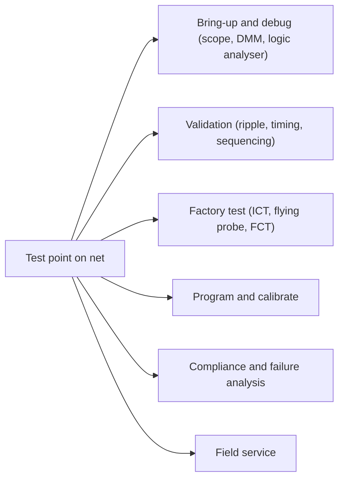

::: basics
### In plain words
A test point is a small, labeled connection to a net on the board. It is usually a pad, a loop of wire or a via (a small plated hole), placed there so a person or a machine can measure or drive that net. Without test points you must probe the legs of parts, which is slow, risky and often impossible on modern small parts.

### Picture it
Think of the valve on a car tire. You do not cut into the tire to check the pressure. The valve is a deliberate access point, and anyone with a gauge can use it. A test point is the same idea for a signal. The analogy has one catch: a valve costs almost nothing, but a test point takes board space and adds a small load to the signal, so you place them where they matter.

### Words you need
- **Net**: all the copper that is electrically one connection.
- **Bring-up**: the first power-on and debugging of a new board.
- **Bed-of-nails fixture**: spring pins that touch many test points at once in factory testing. See [[q0612]].
- **Ground reference**: a nearby ground point; a test point is useless without one. See [[q0618]].
- **Stub**: the short spur of copper that a test point adds to a signal.

### The simplest example
A 1 mm round pad sitting 0.1 mm above a ground plane adds about 0.3 pF of capacitance, a tiny bit of charge storage that slows fast edges. On a slow power supply line (a rail) that is nothing. On a signal running at multiple gigabits per second it can matter. So power rails, ground, reset, clocks, programming lines and key analog nodes nearly always get test points, and the fastest nets get a tiny pad or none. That is the whole idea. The rest of this page covers who uses test points, from bench debugging to factory test to field service, and the cost of each.
:::

::: testing
Whether you can define a test point simply and then show you know *why* engineers pay for them in board area. A strong answer covers the use cases across the whole product life, from the first bring-up to the factory and field service, not only "to put a scope probe on". The interviewer is listening for:

1. A crisp definition: a deliberately exposed, labelled connection to a net.
2. Use cases in several phases: bring-up and debug, production test, programming and calibration, compliance and field service.
3. Awareness of cost: area, capacitance on fast nets, and the need for a plan. See [[q0622]] and [[q0623]].
:::

::: why
Without test points, probing means touching a component lead or a via, which is slow, risky (slipped probe tips short rails) and often impossible with fine-pitch parts. The test point turns a net into something a probe, fixture pin, programmer or technician can reliably contact. Cheap copper pads decide how fast a bug is found on the bench, how many units a factory can test per hour ([[q0614]]), and whether a field unit can be diagnosed without destroying it.
:::

::: concepts
- **Net and probing**: a signal is a copper net; probing means contacting it electrically. See [[q0627]].
- **Observability and controllability**: test points give you both (see [[q0616]]).
- **Bed-of-nails/fixture access**: factory stations contact pads with spring pins. See [[q0612]].
- **Ground reference**: a test point is useless without a nearby return. See [[q0618]].
- **Cost of a stub**: a pad adds capacitance to a net. See [[q0623]].
- **Test coverage**: which nets need points and which do not. See [[q0625]].
:::

::: answer
"A test point is a deliberately placed, labelled connection to a net on the board, usually a small pad, a through-hole loop or a via, that exists so someone or something can measure or drive that net.

The use cases run across the life of the product. During bring-up and debug, I probe rails, clocks and resets with a scope or a meter. In production, a bed-of-nails fixture or flying probe lands on the pads to check for shorts, opens and values, and to program firmware and calibrate. In compliance testing and validation, test points let you measure ripple, timing and power sequencing. In the field, a technician can check a voltage or inject a signal without removing the board.

The reason they matter is that without them you're probing component leads or vias, which is slow, risky and, with modern fine-pitch parts, often impossible.

The cost is a bit of area, and on fast or sensitive nets, a small capacitance, so I decide where they go based on risk. Power rails, ground, reset, clocks, programming lines and key analog nodes almost always get them."
:::

::: technical
**Definition.** A test point (TP) is an intentional, accessible, labelled conductor connected to a net. Physical forms: an SMD pad, a plated through-hole with or without a loop/post, or an exposed via. Details of types are in [[q0620]].

**What a test point provides.**

| Function | Example |
|---|---|
| Observe | Scope a clock, measure ripple on a rail |
| Control/inject | Force an enable, inject a test signal with a series resistor |
| Measure current | Pads across a shunt resistor |
| Contact for fixtures | ICT/flying probe lands on the pad |
| Program/calibrate | Pads for SWD, UART bootloader or trim |
| Reference | Ground pads for probe returns |

**Typical use cases.**

1. **Bring-up and debug**: first power-up, rail and clock checks, bus decoding, short hunting. See [[q0626]].
2. **Characterisation and validation**: ripple, noise, timing margins, power sequencing, thermal tests.
3. **Production test**: ICT, flying probe and functional test stations contact test points ([[q0609]], [[q0610]], [[q0611]]).
4. **Programming and calibration**: firmware, serial numbers, trim values.
5. **Compliance**: pre-compliance EMI debugging and measuring power-supply specs.
6. **Field service and failure analysis**: diagnostics without desoldering parts.

**Electrical cost.** A 1 mm pad over a ground plane 0.1 mm away (FR-4, εr ≈ 4.2) has a parallel-plate capacitance of about 0.3 pF; 0.2 mm dielectric gives about 0.15 pF. Typical measured values with the stub and probe are higher (0.5–1 pF is a safe planning number, vendor/geometry dependent). That is negligible on a power rail and noticeable on a multi-gigabit net.

> [!UNCERTAIN]
> The pad capacitance depends heavily on stack-up and clearance; the figures are estimates from parallel-plate calculations, not measurements.
:::

::: short
"A test point is a deliberate, labelled pad, loop or via on a net so something can measure or drive it. Engineers use them during bring-up and debug to probe rails and signals, factories use them for in-circuit and functional test, programming and calibration, and technicians use them for diagnosis in the field. They cost a little area and, on fast nets, some capacitance, so I place them on the nets where observability matters most."
:::

::: long
"A test point is a deliberately placed, labelled connection to a net, so that something can measure or drive that net. Physically it's usually a small pad on the board surface, sometimes a through-hole loop you can hook a clip onto, or an exposed via.

The use cases span the whole life of the board. In bring-up and debug, it's the first thing I use: scope the rails, check reset and clocks, decode a bus, hunt a short. In validation I use them to measure ripple, sequencing and timing margins. In production, the factory's bed-of-nails fixture or flying probe lands on them to test for shorts, opens and values, and the functional test stations use them to power the board, program the firmware and write calibration. And in the field, a technician can check a rail or inject a signal without taking the board apart.

The alternative is probing component leads or vias, which is slow, easy to slip and short something, and for BGAs and tiny packages basically impossible.

The cost is small: some board area, and on fast or sensitive nets a little capacitance and a stub. So I'd always put them on the supply rails and ground, reset, key clocks, programming and debug lines, and the analog nodes that matter, and I'd keep them away from the fastest signals, using in-line pads or built-in self-test instead.

I'd also label them on the silkscreen and keep a ground pad nearby so the measurement is clean."
:::

::: terms
- **Test point (TP)**: an intentional connection to a net for probing or driving.
- **Probe**: scope probe, DMM lead or fixture pin that contacts the point.
- **Bed-of-nails**: fixture with spring pins that contact test pads. See [[q0612]].
- **Stub**: a short branch off a net; with a test pad it adds capacitance.
- **Observability / controllability**: ability to see / set a node.
- **Net**: an electrically connected set of conductors.
- **Fiducial vs test point**: fiducials are for machine vision alignment, test points are for electrical contact. See [[q0596]].
:::

::: exceptional
**An average answer** says "test points let you probe signals".

**An exceptional answer**:

- Defines it as intentional, labelled, accessible, then spans use cases across the lifecycle (bring-up, validation, production, programming/calibration, compliance, field).
- Contrasts with probing component leads or vias, and says why that fails with modern packages.
- Notes who contacts them (people, probes, fixtures, programmers). See [[q0624]].
- Mentions the cost (area, capacitance) and gives a rough number, and that some nets don't get one.
- Pairs signal points with ground pads and labels.
:::

::: mistakes
- **Thinking test points are only for the scope.** Production fixtures and programmers are bigger consumers.
- **Putting them everywhere.** Each costs area and, on fast nets, signal integrity. See [[q0622]].
- **Unlabelled or buried pads.** Under a connector or on the wrong side of the board they can't be used.
- **No ground pad nearby.** A signal TP with no good return gives a noisy measurement. See [[q0618]].
- **Mistaking fiducials or mounting pads for test points.** They have different jobs.
- **Assuming a pad is "free".** A pad on a 5 Gb/s net has real reflection and loading effects.
:::

::: deep
## What a test point actually is

A test point is nothing more than **copper you promised to keep accessible**. The promise is the engineering: it has a size, location, label, and a net name that a human or a machine can find. A bare via or a resistor leg can be probed in a pinch; a test point is a probe target by design.


Figure: One pad serves many customers over the product's life. The more customers a net has (power rails, resets, programming lines), the stronger the case for a test point.

## Use cases in depth

### Bring-up and debug

The first board is wrong somewhere. You need to see rails (is 3.3 V actually 3.3 V?), reset and power-good states, clocks, and bus traffic. Test points make each measurement a one-handed, repeatable action. Compare with hunting for a tiny capacitor pad under a microscope. See [[q0626]] for how this fits a short-hunting flow.

### Validation and characterisation

You'd measure ripple on rails (with a ground pad next to the TP to keep the loop short), sequencing between rails, startup transients and timing. Standards and datasheets define how to measure (bandwidth limit, probe type); a test point on the output cap with a nearby ground makes the measurement reproducible.

### Production test

An ICT or flying-probe station checks shorts, opens and values by contacting nets. A bed-of-nails fixture presses 100–1000+ spring pins on the pads. A pad each on the main nets lets the fixture cover them. See [[q0614]] for the production perspective and [[q0621]] for pad layout rules.

### Programming and calibration

Pads for SWD/JTAG/UART let the factory load firmware and write per-unit data (serial, MAC, trim values). Calibration usually injects a precision reference or reads a sensor through a test pad or connector.

### Compliance and failure analysis

Pre-compliance debugging of EMI often involves measuring switching-node and rail noise; test points make it possible without altering the circuit. After a field failure, an analyst can probe the same TPs on a returned unit.

## Cost: area and capacitance

A pad is copper over a dielectric to a reference plane, so it has capacitance:

$$C = \varepsilon_0\varepsilon_r\frac{A}{d}$$

For a 1 mm diameter pad ($A = 7.85\times10^{-7}$ m²), $\varepsilon_r = 4.2$:

- $d = 0.1$ mm (thin 4-layer prepreg): $C \approx 0.29$ pF
- $d = 0.2$ mm: $C \approx 0.15$ pF
- $d = 1.6$ mm (2-layer board, plane on the far side): $C \approx 0.02$ pF

These are parallel-plate estimates; fringing and any stub trace add more. A planning number of 0.5–1 pF per test point including the stub is reasonable. For a rail with 10 µF of decoupling it is nothing; for a 50 Ω line with 100 ps edges it is a visible reflection (about 12% at 0.5 pF, see [[q0623]]).

```plot
{"title":"Test-pad capacitance vs dielectric thickness (1 mm pad, εr = 4.2)","x":{"label":"Pad-to-plane dielectric thickness","unit":"m","min":5e-5,"max":6e-3,"log":true},"y":{"label":"Capacitance","unit":"F","min":1e-14,"max":1e-12,"log":true},
 "vars":{"e0":8.854e-12,"er":4.2,"a":7.85e-7},
 "series":[{"label":"C = ε0 εr A / d","fn":"e0*er*a/x"}],
 "points":[{"x":1e-4,"y":2.9e-13,"label":"0.1 mm → 0.29 pF"},{"x":1.6e-3,"y":1.8e-14,"label":"1.6 mm → 0.02 pF"}]}
```
Figure: Capacitance falls inversely with the distance to the reference plane. On thin multilayer stack-ups the plane is close, so the pad's capacitance is higher; a keep-out under the pad (a plane cutout) is one trick to cut it on a sensitive net.

## Where test points come from in the design flow

1. **Schematic**: place TP symbols on the nets you decided to expose (with names such as TP_3V3). Capture them in the netlist so the factory's tools see them.
2. **Layout**: place them following guidelines ([[q0621]]), usually on one side, with ground pads beside them.
3. **Fabrication data**: mask openings so the pad is bare; the finish matters (ENIG or HASL are common for probing, OSP is often discouraged for repeated contact, but check with your factory).
4. **Test engineering**: the fixture or flying-probe program uses the coordinates and net names.

## When you add them: a checklist

- Every supply rail, near its load and near its source.
- Ground, several of them.
- Reset, power-good, enable lines.
- Clocks (buffered output, not the crystal itself).
- Programming/debug lines.
- Key analog nodes: references, bias, sense inputs.
- Buses at a connector or via the debug header.

```sim
{"id":"dmm-lab","view":"loading"}
```
Figure: The meter you touch to a test point has finite input resistance (10 MΩ here). On a high-impedance node, connecting it changes the voltage you measure; test points make probing easy but not free of loading. Raise the source resistance and watch the reading drop.

> [!INTERVIEW]
> After defining it, list customers: "people, scope probes, fixtures, programmers". It shows you're thinking beyond "I put a scope on it".

## Worked example: what does touching a test point cost the circuit?

A test point is only useful if the thing you attach to it does not change what you are measuring. Take a passive 10× scope probe, which presents about 10 MΩ in parallel with roughly 10 pF at its tip (typical values; check your probe's datasheet). Put it on a node driven through a 100 kΩ pull-up, a common situation on an open-drain line.

- **DC error.** The 10 MΩ input forms a divider with the 100 kΩ source resistance: the loading error is $100\text{ k}/(10\text{ M}+100\text{ k}) = 0.99\%$. That is small, and it is the same as a DMM's.
- **Bandwidth.** The pull-up resistance and the probe capacitance form a low-pass: $f_c = 1/(2\pi \times 100\text{ k}\Omega \times 10\text{ pF}) = 159$ kHz. An edge that the real circuit makes in 100 ns now takes microseconds, because the probe is charging 10 pF through 100 kΩ ($\tau = 1\ \mu$s). The scope shows a slow ramp that the circuit does not have.

So the same pad is harmless for a power rail (a stiff source), mildly intrusive for a 100 kΩ node's DC level, and misleading for its edges. The remedy is to measure where the source impedance is low (at the driver's output, not at the pull-up node), to use an active probe with sub-picofarad input capacitance, or to accept the DC reading and judge speed some other way. The pad itself adds only the tenths of a picofarad computed in the cost section, which shows that the instrument, not the copper, is often the larger load.

## Worked example: area and stub budget for a small board

Suppose a 40 × 30 mm board (1,200 mm²) with 40 test points. If each pad needs a 1.5 mm diameter keep-out circle including clearance to neighbors, that is $\pi \times 0.75^2 = 1.77$ mm² per point, or 71 mm² in total, about 5.9% of the board. That is the real cost of "just add a test point": on a crowded board, 6% of the area is a design decision, which is why the prioritization in [[q0625]] and [[q0622]] exists.

For the stub, consider a pad connected to the net by a 5 mm trace. On FR-4 with an effective dielectric constant of about 3.1 for an outer-layer microstrip (a typical figure, not a constant), the propagation speed is $3\times10^8/\sqrt{3.1} \approx 1.7\times10^8$ m/s. A stub resonates when it is a quarter wavelength, $f = v/(4\ell)$: 8.5 GHz for 5 mm and 4.3 GHz for 10 mm (computed). Those frequencies are above the content of most digital signals, which is why short stubs on moderate-speed nets are safe, and why long stubs on gigabit nets are not.

## Where the simple "add a test point" advice breaks down

**Electrostatic discharge enters through any exposed pad.** A test point is an exposed conductor, and a person touching a board can inject a human-body-model discharge. The model is a 100 pF capacitor behind about 1.5 kΩ, so a 2 kV discharge peaks near $2000/1500 = 1.3$ A (computed). Most production boards are handled only in ESD-controlled areas, but a test point on a high-impedance input of a CMOS device deserves a series resistor or a protection diode, and boards that go into the field are better with conformal coating or covered pads on sensitive nets.

**Pads attract flux, moisture and contamination.** A bare pad on a very high-impedance node collects surface leakage. At 1 MΩ the leakage of a flux residue can change the node. This is one reason sensitive analog nodes get guard rings instead of pads.

**A test point you cannot reach is not a test point.** A pad under a tall connector, or on the side facing a heat sink, or hidden by an enclosure is just decoration. Check accessibility in the 3D model.

> [!UNCERTAIN]
> The effective dielectric constant of a microstrip stub depends on trace width, stack-up and whether it is covered by solder mask, so the quarter-wave frequencies above are estimates. For a specific high-speed net, confirm with simulation or measurement.

## Verifying on the bench that your test points work

1. **Walk the list with a real probe.** For each test point on the schematic, put a spring-ground probe on it and a ground pad. If any point needs a clip lead, the layout has failed to deliver access.
2. **Measure the loading.** For a sensitive net, record the signal with and without the probe attached and compare. Any difference in edge time or level is the measurement's cost, and it tells you which nets need buffered or in-line points.
3. **Reflection test on a fast net.** Use a TDR or a fast pulse generator and compare the response with a populated test pad against a version where the pad is cut away. The size of the reflection is the discontinuity, which you can compare with the $\tau/t_r$ calculation.
4. **Factory dry run.** Put the board in the intended fixture, or run the flying-probe program, and verify every net that was supposed to be covered is reached with acceptable contact resistance. Missing coverage here is much cheaper to find than in production.
:::

::: applications
- **Power-supply boards**: TPs on VIN, VOUT, FB and enable for validation, with ground pads for ripple measurement.
- **Microcontroller boards**: reset, SWD and UART pads for programming and logs.
- **Consumer products**: bottom-side pad fields for factory pogo-pin fixtures.
- **Telecom and server boards**: TPs on rails and clocks for validation and manufacturing, plus boundary scan access.
- **Industrial controllers**: labelled TPs for field technicians with a DMM.
:::

::: assumptions
- Assumes a board where probing access is a design decision. In extremely small products there may be few or no physical TPs and testing is through firmware.
- Pad capacitance values are parallel-plate estimates for FR-4; real values differ.
- Focused on conventional PCBs; wafer-level and IC test structures have their own meaning of "test point".
- The ordering of customers (lab, factory, field) varies; for a consumer product, production test is the biggest customer; for a lab prototype, the engineer.
:::

::: followups
### Why not just probe a component pin or via?
It works occasionally, but the probe slips (shorting rails), fine-pitch and BGA pins aren't reachable, and via barrels are small. A test point is a larger, flat, labelled target that probes, fixtures and hands can hit repeatedly.

### Do test points affect the circuit?
Slightly: capacitance (roughly 0.3–1 pF including the stub) and a small inductance of the stub. Negligible on power and slow digital nets, noticeable on multi-Gb/s lines and some sensitive analog nodes, where you'd use in-line pads, a series resistor or no pad. See [[q0623]].

### Where do you put the ground test point relative to the signal point?
A couple of millimetres away, connected to the plane with vias, so a spring ground tip gives a small loop. See [[q0618]].

### What is the difference between a test point and a fiducial?
A fiducial is a copper mark for the assembly machine's camera; it is not electrically used. A test point is an electrical contact. They may look similar (round copper pads), so label and place them differently.

### Scenario: a regulator sometimes fails to start in the field. You have only one test point to add. Where?
I'd pick the net with most information: probably the enable/power-good signal (shows whether the regulator tried to start) or the output rail with a nearby ground pad. In practice I'd put the output rail and PG together, but if I'm limited to one I'd choose power-good, because it tells whether the failure is upstream or in the load. See [[q0625]] for prioritising.
:::

::: references
- Horowitz & Hill, *The Art of Electronics*, 3rd ed.: chapters on construction and measurement practice.
- Bushnell & Agrawal, *Essentials of Electronic Testing for Digital, Memory and Mixed-Signal VLSI Circuits*: controllability and observability.
- IPC-2221, generic standard on printed board design, for general layout practice.
- Fixture manufacturers' DFT guidelines (obtain from your contract manufacturer) for physical pad requirements.
:::

::: rubric
- Defines a test point as a deliberate, labelled access to a net :: Shows you know it's an engineering decision.
- Lists use cases across lifecycle :: Demonstrates breadth beyond bench debugging.
- Names who/what contacts them (probes, fixtures, programmers) :: Connects to production and factory.
- Explains the alternative (probing leads/vias) and why it's worse :: Justifies the cost.
- States the cost (area, capacitance) and when it matters :: Shows trade-off judgement.
- Mentions ground pad pairing and labelling :: Practical measurement knowledge.
:::

::: quiz
```json
[
 {"type":"mcq","level":"fundamental","q":"What is a test point?","options":["A machine-vision alignment mark","A deliberate, labelled connection to a net for measuring or driving it","A mounting hole","A silkscreen label"],"answer":1,"explain":"A test point is an intentional, accessible electrical contact to a net. Alignment marks are fiducials."},
 {"type":"multi","level":"fundamental","q":"Select all that typically use test points.","options":["Engineer debugging a prototype","Production in-circuit test fixture","Firmware programming station","The board's own silkscreen printer"],"answer":[0,1,2],"explain":"Engineers, fixtures and programmers all contact test points; a silkscreen printer doesn't."},
 {"type":"numeric","level":"intermediate","q":"Estimate the parallel-plate capacitance (in pF) of a 1 mm diameter test pad over a plane 0.1 mm away in FR-4 with εr = 4.2.","answer":0.29,"tolerance":0.05,"unit":"pF","explain":"A = π(0.5 mm)² = 7.85e-7 m². C = 8.854e-12 × 4.2 × 7.85e-7 / 1e-4 = 2.9e-13 F = 0.29 pF (fringing adds more)."},
 {"type":"truefalse","level":"intermediate","q":"Test points are always harmless to circuit performance because they are just copper.","answer":false,"explain":"A pad adds capacitance and a stub. Negligible on power rails but noticeable on high-speed or very sensitive nets."},
 {"type":"mcq","level":"advanced","q":"Which net most likely deserves a test point on almost every board?","options":["A decorative LED's anode","The main power rails and ground","An unused spare gate input","A mechanical shield tab"],"answer":1,"explain":"Rails and ground are needed in every phase: bring-up, test, programming and field diagnosis."}
]
```
:::
