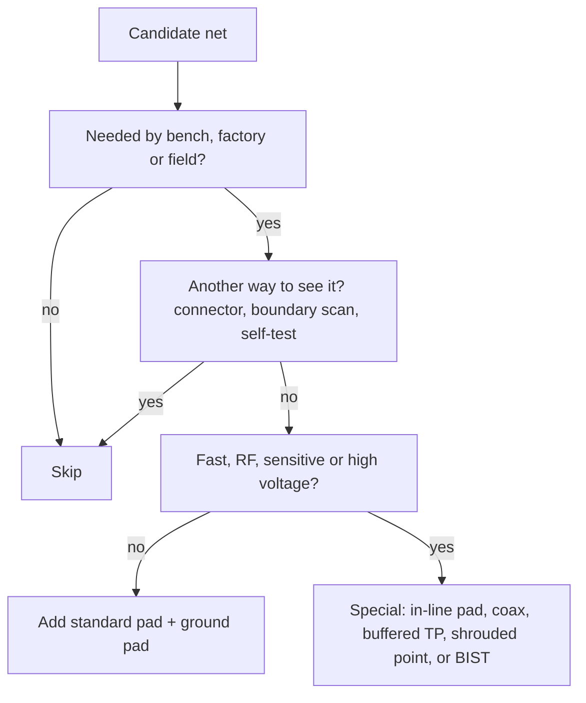

::: testing
Whether you treat test points as an **engineering trade-off**, not a reflex. "Should / shouldn't you use them?" is looking for a decision rule: add a test point where the information or control it gives is worth its cost (area, stub, routing, fixture complexity), skip it where it harms the signal, where the net is already observable some other way, or where space is unaffordable. Good answers give examples on both sides and a way to decide (risk, observability, alternatives).
:::

::: why
Every pad has a cost: board area, routing congestion, capacitance, a fixture pin (typically a few USD of fixture cost each at volume) and a place to collect contamination or ESD. But a missing pad on a power rail can make an issue invisible and add days of debug. The skill is deciding fast and defensibly. This question separates people who add "TP" symbols everywhere from those who think about what each one buys. See [[q0625]] for prioritising under space limits and [[q0623]] for high-speed nets.
:::

::: concepts
- **Information value**: how much a measurement at this net tells you about faults. See [[q0616]].
- **Alternative observability**: other ways to see the net (a connector pin, a component pad, boundary scan, firmware readback).
- **Cost of a pad**: area, capacitance, stubs, fixture pin. See [[q0621]].
- **Signal integrity and sensitive nodes**: where pads harm. See [[q0623]].
- **Test strategy**: what the ICT/FCT/field-service stations need. See [[q0614]].
- **Safety and ESD**: exposed copper at high voltage or sensitive nodes.
:::

::: answer
"I use a test point when what it gives me is worth what it costs.

I'd definitely use them on power rails and ground, resets and enables, power-good, clocks I can reach safely, programming and debug lines, and the key analog nodes like references and bias points, because those are where a fault shows first and where I'll need to look during bring-up, production test and field service. I'd also use them on nets whose failure I can't detect any other way, or that the factory fixture needs to check for shorts and opens.

I'd skip or be careful on high-speed or very sensitive nets, because a pad adds capacitance and a stub that distorts the signal. For those I'd use an in-line pad, a coax connector, or built-in self-test. I'd skip nets that are already reachable at a connector or component pad, nets covered by boundary scan or functional test, and anywhere there isn't space or the fixture can't reach. Also high-voltage nets, where exposed copper is a safety issue, need a guarded or isolated point rather than a bare pad.

Then I decide per net by asking: what does this tell me, who needs it, what does it cost, and is there another way to see it."
:::

::: technical
**Decision framework** (per net):

1. **Value**: failure likelihood × severity × diagnostic information. Power, reset, clock and programming nets rank high.
2. **Users**: who needs it (bench, factory, field)? A net needed only by firmware status might get a register readback instead.
3. **Alternatives**: connector pins, existing component pads, boundary scan, BIST or functional self-tests may give the same information.
4. **Cost**: area; routing; fixture pin (typically on the order of USD 1–10 per pin including fixture build, vendor dependent); electrical effect (capacitance of 0.3–1 pF; stub inductance about 1 nH/mm).
5. **Risk**: ESD, safety (voltage above about 50 V needs creepage/guarding), EMI antennas (long stubs), and noise pickup on high-impedance nodes.

**Use when:**

| Situation | Reason |
|---|---|
| Power rails, ground, references | Core health; measure ripple, droop, sequencing |
| Resets, enables, power-good, interrupts | Show sequencing and fault state |
| Slow/moderate digital buses | Easy decode, low SI risk |
| Programming/debug/boot lines | Needed for production and recovery |
| Hard-to-reach nets (under BGA) with no boundary scan | Probe pads at via fan-out (if SI allows) |
| Nets where an ICT fixture must check shorts/opens | Test coverage |
| Calibration injection/measurement | Production calibration |

**Avoid or adapt when:**

| Situation | Why | Alternative |
|---|---|---|
| Multi-Gb/s or fast-edge nets | Pad capacitance reflects: about 12% at 0.5 pF and 100 ps | BIST, eye scan, coax, in-line pad |
| High-impedance, low-leakage analog nodes | Probe loading, leakage, pickup | Guard ring, buffered TP, no point |
| Crystal/oscillator pins | Probe capacitance can stop or shift the oscillator | Buffered clock-out pin |
| RF paths | Any pad is a discontinuity | RF connector footprint |
| High-voltage or mains nets | Safety and creepage | Isolated, shrouded test points |
| Already visible/covered | Wasteful | Connector pin, boundary scan |
| Extreme space limits | Area cost beyond value | Prioritise ([[q0625]]) |

**Numbers to remember.** A 1 mm pad adds about 0.15–0.3 pF over a close plane; with a short stub 0.5–1 pF is a planning number. For a 50 Ω line, peak reflection for an edge of 100 ps is about 12.5% for 0.5 pF and 24.5% for 1 pF.

> [!UNCERTAIN]
> The fixture cost per pin and the safety voltage threshold depend on the vendor, region and safety standard; treat the figures as order-of-magnitude. Consult the applicable safety standard for your product class.
:::

::: short
"I add test points where the information is worth the cost: rails, ground, resets, power-good, programming lines, slow buses and key analog nodes. I skip or modify them on high-speed, RF, high-impedance and oscillator nets, where the pad adds capacitance and a stub, and on nets I can already see through a connector, boundary scan or self-test. High-voltage nets need guarded points. I decide per net by value, user, alternatives and cost."
:::

::: long
"I treat it as a trade-off per net: what does the point tell me, who needs it, and what does it cost.

I'd use them on power rails and ground, since they're where I check health and sequencing; resets, enables and power-good; programming and debug lines; slow or moderate buses I'll want to decode; and key analog nodes like references. I'd also use them where the factory fixture needs to check a net for shorts or opens, and on nets I can't reach another way, for example under a BGA with no boundary scan.

I'd avoid or modify them in a few cases. On multi-gigabit or fast-edge nets, a pad adds capacitance and a stub: a half-picofarad pad on a 50 ohm line with a 100 picosecond edge reflects about 12 percent, so I'd use built-in self-test, a coax connector or at most an in-line pad. On crystals and oscillators, the probe capacitance can stop the oscillator, so I'd tap a buffered clock output instead. On high-impedance analog nodes, the pad and the probe load and leak, so I'd use a guarded or buffered point or none. On RF paths, any pad is a discontinuity, so I'd put a connector footprint. And on high-voltage or mains nets, exposed copper is a safety problem, so I'd use an isolated or shrouded point.

I'd skip them on nets that are already visible at a connector or component pad, or covered by boundary scan or functional self-test, and when space is tight I'd prioritise.

So the rule: value times usefulness, minus cost and risk, and check the alternatives first."
:::

::: terms
- **Observability**: ability to see a node's state.
- **Stub**: dead-end branch that can reflect and resonate.
- **Boundary scan**: JTAG interconnect test without probes.
- **BIST**: built-in self-test.
- **Guard ring**: conductor around a high-impedance node held at the same potential to reduce leakage.
- **Creepage/clearance**: surface/air distance for voltage isolation.
- **Fixture pin cost**: cost of adding a probe to a bed-of-nails fixture.
- **Coverage**: fraction of nets or faults tested.
:::

::: exceptional
**An average answer** says "use them on important signals, not on high-speed ones".

**An exceptional answer**:

- Gives a decision framework (value, users, alternatives, cost, risk) rather than a list.
- Lists use cases and exceptions *with reasons and numbers* (pad capacitance, reflection percentage, crystal loading).
- Offers alternatives for each exception (BIST, coax, buffered point, boundary scan).
- Mentions safety (high voltage), ESD and EMI as reasons to skip or shield.
- Connects to production (fixture pin cost, coverage) and prioritisation.
:::

::: mistakes
- **"Test points on every net."** Area, cost and fixture complexity explode, and fast nets suffer.
- **"Never on high-speed nets."** Sometimes you must observe them; use in-line or special structures rather than banning.
- **Probing a crystal pin.** The probe's 10–15 pF can stop or detune it.
- **Bare pads on mains-referenced nets.** A safety hazard.
- **Duplicating a net's access** when a connector pin already exists.
- **Ignoring pad capacitance on high-impedance analog nodes.** Leakage and pickup corrupt readings.
:::

::: deep
## The decision is economic and electrical

Each test point has a **benefit** (information, coverage, control) and a **cost** (area, SI impact, fixture pin, risk). You are choosing the set that maximises coverage per unit cost.


Figure: A per-net decision flow. Most nets end at "standard pad"; the interesting engineering is in the special-case branch.

## When to add: worked reasoning

**Power rail.** Failure is common (shorts, droop, ripple), information is high, cost is trivial (0.15–0.3 pF barely registers on a µF-decoupled rail). Add a pad and a ground pad.

**Reset and power-good.** A boot failure cannot be diagnosed without knowing whether reset released. A pad costs nothing electrically. Add.

**I²C/UART.** Slow (100 kHz to a few MHz edges of tens of ns), so a pad is invisible. Add near the connector or MCU.

**Programming/debug.** The factory needs it. Add header or pogo pads.

**Under-BGA nets.** If the net can't be reached and boundary scan doesn't cover it, a via fanned out to a pad might be the only observation point.

## When not to add: the physics

### Fast edges

A pad is a shunt capacitance $C$ on a line of impedance $Z_0$. The pad sees two lines in parallel: $Z_0/2$, so $\tau = Z_0 C/2$. For a ramp of rise time $t_r$ the peak reflection is $\rho_{pk} = \frac{\tau}{t_r}\left(1-e^{-t_r/\tau}\right)$.

```plot
{"title":"Peak reflection from a test pad vs edge rate (50 Ω line)","x":{"label":"Edge rise time (0–100%)","unit":"s","min":5e-11,"max":3e-9,"log":true},"y":{"label":"Peak reflection (fraction of step)","min":0,"max":0.5},
 "vars":{"z":50},
 "series":[{"label":"0.5 pF","fn":"(z/2*0.5e-12/x)*(1-exp(-x/(z/2*0.5e-12)))"},{"label":"1.0 pF","fn":"(z/2*1e-12/x)*(1-exp(-x/(z/2*1e-12)))","color":"orange"}],
 "hlines":[{"at":0.05,"label":"5% budget","color":"red"}]}
```
Figure: With a 5% reflection budget (red), a 0.5 pF pad is fine for edges slower than about 250 ps, but a 1 pF pad needs edges slower than about 500 ps. For multi-Gb/s links with rise times of tens of ps, a pad is not acceptable, so you use BIST or an in-line structure.

Computed: 0.5 pF at 100 ps = 12.5%; at 300 ps = 4.2%; 1 pF at 300 ps = 8.3%; at 1 ns = 2.5%.

### Crystals

A crystal oscillator is tuned for a specific load capacitance (often 6–20 pF). A scope probe adds around 10 pF (or more for a 1× probe), which pulls the frequency or stops oscillation. Never probe the crystal pins: use the MCU's clock-out or measure at a buffer.

### High-impedance analog

A 10 MΩ node with a pad and a probe: the 10 MΩ scope input halves the voltage on a 10 MΩ source. Even without a probe, a contaminated pad adds leakage. Use a guard ring around the node, a buffered test point (op-amp follower) or no point. See the loading discussion in [[q0627]].

```sim
{"id":"dmm-lab","view":"loading"}
```
Figure: A DMM's 10 MΩ input resistance forms a divider with the source. Raise the source resistance and see how the reading falls. A test pad on a high-impedance node invites exactly this error.

### RF

RF paths have controlled impedance and often need S-parameter-accurate transitions. A pad is a discontinuity; use a footprint for a connector or a switch-coax and depopulate it in production if needed.

### High voltage

Exposed pads on mains-referenced or high-voltage nets create shock risks and may violate creepage and clearance requirements. Use test points that are shrouded (recessed), isolated through a resistor, or placed only on the isolated side with a defined test procedure.

## Alternative observability

- **Connector pins** (USB, Ethernet, debug) are free test points.
- **Existing component pads**: a resistor pad on a net can be probed by hand.
- **Boundary scan** and **register readback** (ADC reading itself, PMIC status registers over I²C) reveal states without pads.
- **BIST/eye scan** in SerDes receivers reports link quality.

## Counting: the budget view

Suppose a fixture has 200 probes and costs about USD 30,000 total including the plate and wiring: roughly USD 150 per probe. If your product sells 10,000 units, a pad costing one probe adds USD 0.015 per unit. At 100 units, it costs USD 1.50 per unit. Pads are cheap in volume and expensive in tiny runs (when you'd use flying probe anyway). (Illustrative numbers.)

## Interview framing

> [!INTERVIEW]
> When asked "should you?", never answer yes or no. Say "it depends on the net": then give one example where you would, one where you wouldn't and why, and the alternative. That demonstrates trade-off thinking.
:::

::: applications
- **Power management boards**: pads on every rail, PG and EN; no pads on the switch node except a carefully placed one with a ground spring.
- **High-speed digital boards**: no pads on PCIe/DDR lanes; margining and eye scan through firmware instead.
- **Precision analog front ends**: guarded test points or buffered monitor outputs.
- **RF modules**: coax or switchable connectors for conducted tests.
- **Mains-connected products**: only low-voltage-side test points; HV side measured through isolated test procedures.
:::

::: assumptions
- Assumes a production product with both bench and factory users.
- Safety voltage thresholds depend on the standard and product category.
- Cost figures are illustrative.
- Valid alternative: for tiny prototypes it's reasonable to add many pads and remove them in the production revision.
- Pad capacitance estimates use FR-4 parallel-plate values plus a small stub.
:::

::: followups
### Name three nets where you would always add a test point.
Main power rails (with ground pads), reset, and a programming/debug interface. They have high diagnostic value and negligible electrical cost.

### Why not probe a crystal?
A typical oscilloscope probe adds around 10 pF, comparable to the crystal's load capacitance of 6–20 pF, so it detunes or stops the oscillator and loads the gain stage. Probe a buffered clock output or use an active low-capacitance probe on a nearby pad instead.

### How do you observe a DDR data bit if you can't put a pad on it?
Use the controller's built-in margining, read training results and error counters from firmware, or use interposer/probing points designed into the board during bring-up only (and removed later), or a BGA probing fixture. For compliance you may need special probing methods defined by the memory standard.

### What if there is a pad you decide to remove?
Remove the pad and its stub, keep the net routing clean, update the TP list and fixture data, and verify nothing in the factory test depended on it. Re-run signal-integrity checks if you remove it to improve performance.

### Scenario: the layout is congested and the manager wants all test points removed to meet the size target. What do you say?
Show the plan from prioritisation: keep the few that carry the most diagnostic value (rails, reset, PG, programming) and move others to existing connectors or rely on self-test. Quantify the risk: each missing access adds expected debug time or escapes. Offer a compromise such as pogo pads on the back or removing pads in the production revision after first-article validation. See [[q0625]].
:::

::: references
- Johnson & Graham, *High-Speed Digital Design: A Handbook of Black Magic*: capacitive loading and reflections from stubs.
- Horowitz & Hill, *The Art of Electronics*, 3rd ed.: probe loading and measurement practice.
- IEEE Std 1149.1 (boundary scan) for alternative observability.
- Applicable product-safety standards for creepage/clearance and accessible live parts (e.g., IEC 62368-1 for audio/video and ICT equipment): consult the current edition for your product.
:::

::: rubric
- Gives a per-net decision rule (value vs cost) :: Shows trade-off thinking.
- Lists where to use (rails, resets, buses, programming, key analog) :: Practical coverage of common cases.
- Lists where not (fast, RF, crystal, high-Z analog, HV) with reasons :: The core of the "shouldn't" half.
- Quantifies the SI effect of a pad :: Backs the claim with numbers.
- Offers alternatives (BIST, boundary scan, connectors, buffered points) :: Shows resourcefulness.
- Mentions safety/ESD/EMI and production cost :: Whole-system awareness.
:::

::: quiz
```json
[
 {"type":"mcq","level":"fundamental","q":"Which net should almost always get a test point?","options":["A multi-GHz differential pair","The main supply rail","A crystal oscillator pin","A mains-referenced node"],"answer":1,"explain":"Power rails are high-value and tolerate pad capacitance easily. The other nets are sensitive or hazardous."},
 {"type":"truefalse","level":"fundamental","q":"Probing a crystal oscillator pin is generally harmless because the probe is high impedance.","answer":false,"explain":"The probe adds roughly 10 pF of capacitance, comparable to the crystal's load capacitance, which can detune or stop oscillation."},
 {"type":"numeric","level":"intermediate","q":"A 0.5 pF pad on a 50 Ω line sees a 300 ps (0–100%) edge. Using peak = (τ/tr)(1−e^(−tr/τ)), τ = Z0C/2, what is the peak reflection in %?","answer":4.2,"tolerance":0.05,"unit":"%","explain":"τ = 25 × 0.5 pF = 12.5 ps; τ/tr = 0.0417; the exponential term is ≈ 0, so ≈ 4.2%."},
 {"type":"mcq","level":"intermediate","q":"What is the best way to give a bench engineer observation of a 10 Gb/s link?","options":["A pin header on each lane","A large pad with a long stub","Built-in eye scan/margining and controlled-impedance probing at designed points","Probe the BGA ball with a clip"],"answer":2,"explain":"At 10 Gb/s a pad or header destroys the signal. Use the transceiver's eye-scan/margining and purpose-designed measurement structures."},
 {"type":"multi","level":"advanced","q":"Select all valid reasons to skip a test point on a net.","options":["The net is already reachable at a connector","Boundary scan covers the net","The net is the main 3.3 V rail","The pad would load a sensitive RF path"],"answer":[0,1,3],"explain":"Alternate access and RF sensitivity justify skipping. The main rail is a prime candidate for a pad."},
 {"type":"mcq","level":"advanced","q":"A 10 MΩ analog node needs observation. Which is best?","options":["Direct pad and a 10 MΩ scope probe","A buffered (op-amp follower) test point or no point","A header pin","A tented via"],"answer":1,"explain":"A 10 MΩ probe on a 10 MΩ node halves the voltage. A buffer isolates the node; or avoid a point."}
]
```
:::
