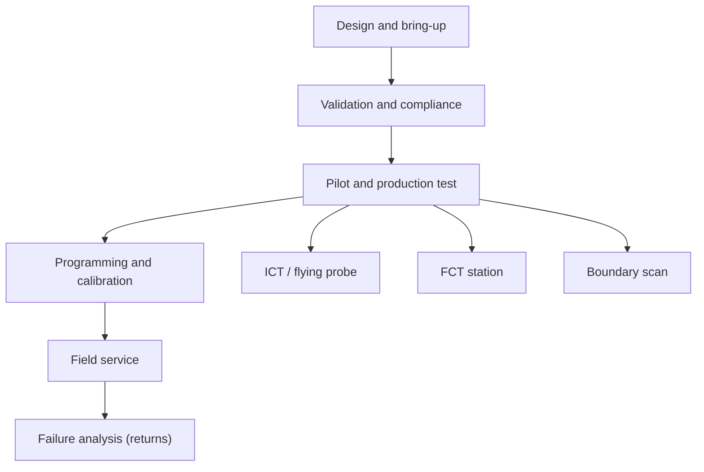

::: basics
### In plain words
Many different users rely on test points, both people and machines. Design engineers use them to debug. Factory fixtures use them to check boards. Programming stations use them to load firmware. Field technicians use them for repairs. Each user needs something different, so you design the points with the user in mind.

### Picture it
Think of a public tap on a water main. A plumber, a city inspector and a meter reader may all use it, but each uses a different fitting. A test point is the same: one net, several people. A machine wants a flat, precise spot at a fixed pitch. A technician wants a labeled loop to clip onto. A programmer wants a standard plug. Satisfying all of them takes a bit of planning.

### Words you need
- **Bring-up**: the first power-on and debugging of a new board.
- **Bed-of-nails fixture**: factory spring pins that land on pads. See [[q0612]].
- **Programming station**: a station that loads firmware and a serial number.
- **Calibration**: injecting a known value and storing a correction.
- **Boundary scan (JTAG)**: a standard test port that lets a tool check connections between chips.
- **Field technician**: a person who repairs products after they have shipped.

### The simplest example
Take the 3.3 V supply rail of one board. A design engineer clips a scope onto a loop on the top. The factory fixture lands on a flat bottom pad. A field technician measures it with a meter at a labeled point. A programming station uses a standard debug header to flash firmware. The same net serves four users, each with a different fitting. That is the whole idea. The rest of this page lists each user, what they need from a point, and the safety care required for hazardous voltages.
:::

::: testing
Whether you see test points as an **interface between the board and many different "users"**, human and machine, over the product's life. A weak answer says "engineers with scopes". A strong one names the actors: design/bring-up engineers, validation and compliance labs, production fixtures (ICT, flying probe, FCT), programmers and calibration stations, automated test software, field technicians, and failure-analysis teams, and says what each one needs from the pad (size, side, access, reliability).
:::

::: why
If you only design for the first user (yourself with a scope), you'll miss that the factory's fixture, the programmer and the field technician have requirements that differ: one-sided pads at a fixed pitch for fixtures, a header for a programmer, a labelled loop for a technician with a DMM. Knowing the users tells you where to put points, how to size them and which nets matter. See [[q0619]], [[q0621]] and [[q0614]].
:::

::: concepts
- **Human users**: bring-up, validation, compliance, field service. See [[q0627]].
- **Fixtures**: bed-of-nails and flying probe. See [[q0611]] and [[q0612]].
- **Programmers and calibration stations**: write firmware and trim data.
- **Automated test software**: station software that drives instruments and reads results.
- **Test types**: ICT, FCT, boundary scan. See [[q0609]], [[q0610]].
- **Access requirements** differ per user. See [[q0621]].
:::

::: answer
"Quite a few different users, human and machine.

During development, it's the design and bring-up engineers with scopes, meters and logic analysers, and later the validation and compliance people measuring ripple, timing and power sequencing.

In production, it's machines: the bed-of-nails fixture in in-circuit test, a flying-probe machine, and the functional test station, which contacts pads to power the board, run self-tests and measure signals. Programming stations use pads or a header to flash firmware and write serial numbers, and calibration stations use test points to inject a reference or read a value and store trim constants. Automated test software drives all of that and logs results by serial number.

After that, field technicians use labelled test points to check a rail with a DMM, and failure-analysis engineers use them on returned units. Boundary scan controllers use the JTAG test access port, which is basically a standardised set of test points.

Each user needs something different: a fixture wants a flat bare pad on one side at a certain pitch, a technician wants a labelled loop to clip a lead onto, and a programmer wants a standard header. So I design points with the user in mind."
:::

::: technical
**Users and requirements.**

| User | What they do | What they need from the point |
|---|---|---|
| Design / bring-up engineer | scope, DMM, logic analyser; debug | accessible, labelled pads, nearby ground, clips/hooks |
| Validation / characterisation | ripple, timing, margins, thermal | repeatable access, ground pads, stable contact |
| Compliance / EMC lab | pre-compliance debug | nets safe to probe; sometimes none (system-level test) |
| ICT/bed-of-nails | automated shorts/opens/values | flat 1 mm pads on one side, fixture pitch ([[q0612]]) |
| Flying probe | same, no fixture | pads or component leads reachable from the top/bottom ([[q0611]]) |
| FCT station | power up, drive/measure functions | connector or pogo pads for power, I/O, comms ([[q0610]]) |
| Programming station | flash firmware, serial/MAC | SWD/JTAG/UART pads or header; reset, boot control |
| Calibration station | inject reference, store trim | access to the sensing input and to nonvolatile memory |
| Boundary-scan controller | interconnect test | JTAG TAP (TDI, TDO, TCK, TMS, TRST/reset) |
| Field technician | DMM checks, swap/repair | labelled, safe, easy-clip points on key rails |
| Failure analysis | root-cause returned units | the same points as production plus extra for diagnosis |
| Firmware/diagnostics software | self-test, loopback | pads/headers for UART logs; internal measurement nodes |

**Machine vs human contact.** Machines need precise geometry and flat pads; humans need clip points, labels and clearances. Many boards provide both for key rails: a bottom-side pad for the fixture and a top-side loop for the bench.

**Data and traceability.** Each station contacting the board records results by serial number; test points are the physical anchor for those measurements.

**Safety.** Field technicians must be protected from hazardous nets: hazardous voltage points are shrouded, isolated or omitted.

> [!UNCERTAIN]
> Which stations a given factory runs (ICT versus flying probe versus FCT only) varies by company and volume. Ask the contract manufacturer.
:::

::: short
"Engineers during bring-up and validation use them with scopes and meters. In production, in-circuit and flying-probe testers, functional test stations, programmers and calibration stations contact them, driven by test software that logs by serial number. Boundary-scan controllers use the JTAG port. Afterwards, field technicians and failure-analysis engineers use them. Each user needs something different, like fixture pads, clip loops or a programming header."
:::

::: long
"I'd split the users into people and machines, across the product's life.

People first. During bring-up, it's me or a colleague with a scope, a meter or a logic analyser, probing rails, resets, clocks and buses. Later come validation and compliance engineers measuring ripple, sequencing, timing and thermal behaviour, who need repeatable access. And after shipping, field technicians check a rail with a DMM, and failure-analysis engineers diagnose returned units. They want labelled points they can clip a lead onto and ground pads nearby.

Then machines. In the factory, an in-circuit tester with a bed-of-nails fixture, or a flying-probe machine, touches the pads to find shorts, opens and wrong values. A functional test station contacts a connector or pogo pads to power the board and exercise it. A programming station uses SWD, JTAG or UART pads to flash firmware and write serial numbers and MAC addresses. A calibration station injects a known reference at a test point or connector, reads the board's measurement and stores trim constants. A boundary-scan controller drives the JTAG port to test interconnects. All of this is driven by test software that logs results by serial number so the factory can track yield.

The point is each of these has different requirements. Fixtures want flat, bare pads of about a millimetre on one side at fixed pitch; technicians want labelled loops; programmers want a standard header. So I design test points for their users, and I ask the factory which stations they plan to use before I finalise the layout."
:::

::: terms
- **ICT**: in-circuit test. See [[q0609]].
- **FCT**: functional test. See [[q0610]].
- **Flying probe**: movable probes testing pads sequentially. See [[q0611]].
- **Bed-of-nails**: fixed spring-pin fixture. See [[q0612]].
- **Programming station**: flashes firmware and personalises units.
- **Calibration station**: measures and stores trim data.
- **TAP**: test access port (JTAG).
- **Traceability**: linking measurements to a serial number.
- **Pogo pin**: spring-loaded contact.
:::

::: exceptional
**An average answer** says "engineers and the factory".

**An exceptional answer**:

- Lists human and machine users across the lifecycle, including programmers, calibration, boundary scan and field service.
- States each user's requirements and how they differ (flat bare pad versus clip loop versus header).
- Mentions test software and traceability.
- Notes safety for field users and compliance labs.
- Says to ask the factory which stations exist before finalising layout.
- Gives a design consequence: provide both a fixture pad and a bench loop on key rails.
:::

::: mistakes
- **Designing only for the scope.** The factory is the larger user in volume products.
- **Forgetting the programming/calibration station.** Boards that can't be flashed or trimmed at line speed stall production.
- **Assuming one pad serves all users.** Fixtures need bottom flat pads; humans need loops.
- **No labels or documentation for the field.** Technicians can't use unlabelled points.
- **Exposing hazardous nets** without shrouds.
- **Ignoring boundary scan** as a test user for BGAs.
:::

::: deep
## A map of users over the product life


Figure: The same copper pad is used at every stage. Early users are people with instruments; middle users are machines; late users go back to people. The design must work for all.

## The people

**Bring-up engineers** want fast access: rails, resets, clocks, bus lines, with ground pads so a scope hook doesn't dangle. They accept bigger loops and extra headers.

**Validation and characterisation engineers** use the same points to run systematic tests: ripple at multiple loads, sequencing across temperature, timing margins. They need *repeatable* contact, so grounds close to signals, stable pads and labelled points; they often add a shunt or Kelvin pads for current. See [[q0628]] for how test points are used for measurement.

**Compliance labs** typically test the product as shipped; they don't probe boards, but pre-compliance debugging does, so keep access to switch nodes and rails with careful ground pads.

**Field technicians** use a DMM and a few tools. They need labels, safe voltage, and a clear procedure (for example "TP3 should read 5.0 V ± 5%"). Provide a test-point table in the service manual.

**Failure-analysis engineers** use the points on returned units, often in combination with thermal imaging and curve tracing. They benefit from extra access to rails and key signals, which sometimes motivates leaving more points on than production strictly requires.

## The machines

### ICT and flying probe

In-circuit test and flying probe measure impedance and continuity between nets with the board unpowered (and sometimes with limited power), finding shorts, opens, wrong or missing parts. They contact **pads** (and sometimes component leads for flying probe). Fixture pads: flat, bare, about 1 mm, bottom side. See [[q0612]].

### Functional test

The FCT station applies power and stimulus and checks outputs. It contacts connectors, a few pogo pads or the product's own interfaces. Typical pads: power, ground, UART/USB for commands, analog nodes for sensing, and a few GPIOs. FCT time is a major cost so interfaces are kept fast. See [[q0614]] for the economics.

### Programming and calibration

Programming needs a reliable, fast interface: SWD/JTAG (4–6 wires), UART bootloader, or USB DFU. Pads or a Tag-Connect-style footprint avoid a connector. Calibration needs a stimulus input and a way to store data: for an ADC channel, apply a precise reference at a test point or connector, read the code, and write gain/offset into flash.

### Boundary scan

A boundary-scan controller uses the JTAG TAP (TDI, TDO, TCK, TMS and optionally TRST) on the board's header or pads to test device interconnects without probes. In effect the TAP is a standardised set of test points. See [[q0614]].

## Where the users overlap and conflict

```plot
{"title":"Illustrative test-time budget for one board: where users spend time","x":{"label":"Stage (AOI, ICT, programming, FCT, pack)","min":0,"max":5},"y":{"label":"Seconds","min":0,"max":70},
 "series":[{"label":"time per stage (s)","points":[[0,5],[1,20],[2,35],[3,60],[4,10],[5,10]],"step":true,"fill":true}],
 "points":[{"x":0.5,"y":5,"label":"AOI 5 s"},{"x":1.5,"y":20,"label":"ICT 20 s"},{"x":2.5,"y":35,"label":"Program 35 s"},{"x":3.5,"y":60,"label":"FCT 60 s"},{"x":4.5,"y":10,"label":"Pack 10 s"}]}
```
Figure: An illustrative line (not a measurement). Programming and functional test dominate the per-board test time (95 of 130 s here), so their interfaces deserve the best test-point design: fast ports and reliable contacts matter more than a dozen extra ICT pads.

Conflicts: fixtures want pads on the bottom; engineers want loops on top; field technicians want labelled points where the enclosure allows access. Designers resolve by providing both (a bottom pad for the fixture and a top loop on rails) and documenting each.

## Documentation is a user interface

- Silkscreen: TP number or name next to each pad.
- A **test-point table** in the design package: TP number, net, expected value, who uses it (bench, ICT, FCT, field).
- ODB++/Gerber data so fixture builders place probes exactly.
- Service documentation listing expected voltages.

```sim
{"id":"dmm-lab","view":"burden"}
```
Figure: Technicians often use a DMM in current mode through a test jumper. The meter's burden voltage changes the circuit; this is why shunt-based test points with a voltage across them are preferred for current checks.

> [!INTERVIEW]
> Mention "test software and traceability": it shows you know a test point's job isn't done when a probe touches it; the data has to be recorded and trended.

## Worked example: which user sets the pad count and the interface?

Different users want different things, so use the illustrative time budget above to see whose needs should win. The stages were AOI 5 s, ICT 20 s, programming 35 s, FCT 60 s and packing 10 s (all assumed).

**Line rate.** If the stations are separate and the board moves through them in a pipeline, the line rate is set by the slowest one, not the sum: with FCT at 60 s the line makes $3600/60 = 60$ boards per hour from one FCT station. The total of 130 s is the time one board spends on the line, which matters for work-in-process, not for rate. If the product needs 120 boards per hour, the takt time is 30 s, so FCT needs $\lceil 60/30\rceil = 2$ stations, and the programming station (35 s) needs 2 as well. Each extra station is another fixture, another set of pogo pins and another calibration, so the cheapest improvement is often shortening the slow step rather than duplicating it.

**Programming interface.** Suppose the firmware image is 256 kB and the flash can be written at about 50 kB/s (an assumed figure that varies hugely between parts). Writing then takes $256\times1024/50{,}000 = 5.2$ s over a debug interface such as SWD, where the link itself is not the limit (raw transfer at a 4 MHz clock is about 0.5 s). The same image over a UART bootloader at 115,200 baud takes $256\times1024\times10/115{,}200 = 22.8$ s, because each byte costs 10 bit-times. So the choice of which pads the programmer touches (a debug header or footprint versus a serial port) moves about 17 s of programming time per board, on the station that is already the second slowest at 35 s; that alone can decide whether the line needs one programming station or two. A pad set that costs four extra pads and enables SWD can be worth more to the factory than a dozen ICT pads, which is the point of the time-budget figure.

**Contact resistance on power pins.** A spring-pin contact on a power pad is typically some tens of milliohms (vendor and wear dependent; assume 20 mΩ). If FCT draws 2 A through one pin on a 5 V rail, the drop is $2\times0.02 = 40$ mV, 0.8% of the rail. With four pins in parallel it is 10 mV, 0.2%. For a test with a ±1% limit on a rail measurement, a single pin eats most of the budget, and the fix is more power pads and a separate sense pad (Kelvin) so the measurement is taken at the board and not at the supply. So the user that sets the number of power and ground pads is the test engineer thinking about current, not the bench engineer thinking about convenience.

## Where users' interests conflict, and what to do

**Bench wants flexibility; the factory wants a frozen layout.** An engineer wants spare test pads and links; the fixture builder wants the pad positions frozen, because moving a pad means a new fixture. The usual compromise is to freeze the factory pad set early and add bench-only points on the opposite side of the board, where fixtures do not touch.

**Field wants safe, labeled points; machines want bare pads.** A pad that is fine in a factory is a shock or ESD risk in a customer's hands. Field-facing points sit behind a cover, or are limited to low-voltage nets, or are replaced by diagnostic output from the product's own firmware.

**Firmware wants access too.** Software test routines read internal nodes through ADC channels, which makes the product self-testing. That reduces the need for pads but adds a dependency: a firmware bug that reports a rail as good is invisible to everyone unless someone also has a pad and a meter.

> [!UNCERTAIN]
> Station mix, contact resistance, flash speed and per-station test times differ widely between factories and parts. The numbers above are assumed values to show the method; ask the contract manufacturer for their actual stations and times.

## Verifying that every user is served

1. **Build a user-by-pad matrix.** List each test point with a column for each user (bench, ICT, FCT, programming, calibration, field). Any pad with no user is a candidate to remove; any user with no pad for something they need is a gap. Review the matrix with test engineering before layout is frozen.
2. **Fit-check the fixtures.** Put the CAD data of the fixture or pogo plate against the board's 3D model to confirm each pad is reachable, not under a tall part and not too close to a fixture post.
3. **Pilot run.** On the first pilot lot, record contact failures per pad. A pad with a much higher failure rate than the rest has a geometry, finish or contamination problem, and it will cost more in retests than any area saved by shrinking it.
4. **Service dry run.** Give the service documentation and a board to someone who did not design it, and ask them to measure the listed test points. Mislabels and unreachable pads appear in the first ten minutes.
:::

::: applications
- **Contract-manufactured IoT product**: ICT fixture plus UART-based FCT with programming and RF calibration.
- **Automotive ECU**: end-of-line test connects through the product's own connector, with extra pads for in-circuit test earlier in the line.
- **Server board**: boundary scan for BGAs, rail TPs for validation, BMC-visible telemetry for field diagnosis.
- **Medical device**: labelled test points and service procedures with expected values for technicians.
- **Lab instrument**: calibration stations injecting references at dedicated points.
:::

::: assumptions
- Assumes a product manufactured at some volume with factory test; for one-off prototypes, only the engineer is the user.
- The set of stations varies by company: some skip ICT and rely on AOI and FCT.
- Field service may use the product's own diagnostics rather than test points, depending on the market (consumer versus industrial).
- Alternate view: "what" that uses test points may include firmware (self-test reading internal nodes) and test instruments like logic analysers.
:::

::: followups
### Who decides which stations are used?
Test engineering and the contract manufacturer, together with product engineering. The design team provides coverage requirements; the factory picks stations by volume, cost and existing equipment. Ask early so layout can include the right pads.

### Why do programming and calibration matter for test-point design?
They run on every unit and can dominate cycle time; a flaky programming contact means line stoppage. Provide a reliable, standard interface and control signals (reset, boot) and put the calibration reference access on a dedicated pad or connector pin.

### How is boundary scan a "user" of test points?
It uses the JTAG TAP pins as its access and the chips' boundary cells as virtual probes. The TAP header or pads are the test points, and the benefit is it replaces hundreds of physical pads under BGAs.

### What do you give a field technician?
A short list of labelled, safe test points with expected values, and a procedure. Keep hazardous nets inaccessible. Often a diagnostic LED or status code does the first-level check.

### Scenario: the factory says its ICT station can't contact your test pads because they're on the top side. What can you do?
Check whether it's a top-side fixture or flying probe option; otherwise move pads to the bottom in the next revision. If time is short, use flying probe (no fixture) for the pilot build, add bottom-side pads in the next spin, and move the tall components off the probe-side keep-out. See [[q0621]].
:::

::: references
- Bushnell & Agrawal, *Essentials of Electronic Testing for Digital, Memory and Mixed-Signal VLSI Circuits*: test access and users of test infrastructure.
- IEEE Std 1149.1 (boundary scan / JTAG).
- Contract manufacturer and fixture vendor DFT guidelines: station-specific requirements.
- IPC-2221 for printed board design in general.
:::

::: rubric
- Names human users: bring-up, validation, compliance, field service, failure analysis :: Shows breadth across the life cycle.
- Names machine users: ICT, flying probe, FCT, programming, calibration, boundary scan :: Shows production awareness.
- States each user's requirement and how they differ :: Links users to design decisions.
- Mentions test software and traceability :: The data is the purpose of contact.
- Mentions safety for field use :: Real-world responsibility.
- Says to ask the factory early :: Shows collaboration with manufacturing.
:::

::: quiz
```json
[
 {"type":"multi","level":"fundamental","q":"Select all that use test points.","options":["Bring-up engineers","In-circuit test fixtures","Programming stations","The silkscreen printer"],"answer":[0,1,2],"explain":"Engineers, fixtures and programming stations all contact test points; the silkscreen printer doesn't."},
 {"type":"mcq","level":"fundamental","q":"What does a boundary-scan controller use as its access?","options":["Every net's test pad","The JTAG test access port (TAP)","The scope probe ground","The power rail"],"answer":1,"explain":"Boundary scan uses TDI, TDO, TCK, TMS (and sometimes TRST) on the JTAG port to drive and read device pins."},
 {"type":"mcq","level":"intermediate","q":"A fixture and a field technician both need access to a 5 V rail. What is a good design?","options":["Only a top-side loop","Only a bottom-side pad","A bottom-side flat pad for the fixture and a labelled top-side loop for hands, or one accessible option that satisfies both","Neither, to save space"],"answer":2,"explain":"Fixtures need flat bottom pads; technicians need clip points. Provide both for key rails."},
 {"type":"numeric","level":"intermediate","q":"A line has stage times AOI 5 s, ICT 20 s, programming 35 s, FCT 60 s, pack 10 s. What fraction of the total (as %) is programming plus FCT?","answer":73,"tolerance":0.03,"unit":"%","explain":"Total = 130 s. Programming + FCT = 95 s. 95/130 = 73%."},
 {"type":"truefalse","level":"advanced","q":"Calibration stations don't need test points because calibration is done in firmware only.","answer":false,"explain":"Calibration needs a way to inject a known stimulus or read a value (a pad or connector pin) and a way to store trim data, often through the programming interface."},
 {"type":"mcq","level":"advanced","q":"The most valuable question to ask the contract manufacturer before finalising test-point layout?","options":["What colour is the solder mask?","Which test stations (ICT, flying probe, FCT) will be used and their pad/pitch rules","What is the delivery truck's size?","Which CAD tool do they like?"],"answer":1,"explain":"Station choice sets one-sided access, pad size and pitch, so it drives the layout."}
]
```
:::
