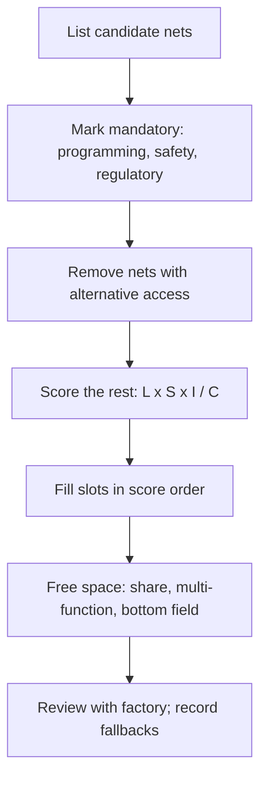

::: basics
### In plain words
Space on a board is limited, so you cannot give every net a test point. You rank the nets by how much each point is worth compared with what it costs, and you give pads to the highest-ranked ones first. For the nets you skip, you write down how they are covered another way and what risk remains.

### Picture it
Think of packing a small suitcase for a trip. You pack the passport, phone and medicine first, because the trip fails without them. Then comfort items, and last the nice-to-haves. If space runs out, you leave the extras at home, and you plan what you will do without them. Choosing test points works the same way: essentials first, extras only if there is room.

### Words you need
- **Net**: all the copper that forms one electrical connection.
- **Power rail**: a net that carries a supply voltage.
- **Fixture pin**: each test point on a factory fixture needs its own spring pin, which adds cost.
- **Boundary scan and built-in self-test**: ways for chips to test connections without a pad. See [[q0616]].
- **Fallback**: another way the fault would still be caught if a net gets no pad.

### The simplest example
Score each net from 1 to 5 for likelihood of a fault (L), severity (S) and unique information (I), then divide by cost (C). Score = L x S x I / C. The 3.3 V supply rail scores 5 x 5 x 5 / 1 = 125, so it gets a pad. A crystal, the part that sets a chip's clock, scores 2 x 1 x 1 / 5 = 0.4, so it gets none, because a probe can stop it from running. Programming lines get pads anyway, since the factory needs them. That is the whole idea. The rest of this page gives a full example table and ways to free space, like sharing pads with connectors.
:::

::: testing
Whether you can make a **defensible prioritisation** under a hard constraint instead of saying "I'd add as many as fit". The interviewer wants a method: rank nets by diagnostic value (how likely a fault is, how bad, how much information the pad gives that nothing else does), cost (area, SI, fixture pin), and who needs it (factory, bench, field). Then show alternatives that free space: shared access through connectors, boundary scan, firmware self-test, multi-function pads, bottom-side pad fields, and temporary validation-only points.
:::

::: why
Small boards, wearables and dense designs often have room for 10 pads where you'd like 40. A random or "first come first served" choice leaves the nets that matter blind. A structured choice means the first prototype can be debugged and the factory can test the board with high coverage. It also shows judgement and communication: you can defend your list to a manager or test engineer. See [[q0614]] for the factory view and [[q0622]] for per-net use/skip logic.
:::

::: concepts
- **Risk-based coverage**: test where faults are likely and consequential.
- **Information value**: whether the pad gives information not available elsewhere.
- **Alternative access**: connectors, boundary scan, readbacks. See [[q0622]].
- **Cost model**: area, SI, fixture pin cost. See [[q0621]].
- **Users**: bench, factory, field. See [[q0624]].
- **Net criticality**: power, reset, clock, programming, analog references. See [[q0616]].
:::

::: answer
"I'd rank nets by value over cost, and I'd say it out loud as a method.

Value is: how likely is that net to fail, how bad is it when it does, and does a pad there tell me something I can't learn another way. Cost is area, signal-integrity impact and a fixture pin.

That puts the must-haves at the top: ground, a main supply rail and its downstream rails, reset and power-good or enable, and the programming and debug interface, because without those the board can't be brought up or manufactured. Next come the clocks I can safely reach, a UART or other console, and the key analog nodes like references and sense inputs. Then slower buses and general I/O. At the bottom, signals that are already reachable at a connector, nets covered by boundary scan or firmware self-test, and fast nets where a pad would hurt.

Then I'd free space: share points with a connector, use multi-function pads, put the pad field on the bottom, use pogo-pad patterns instead of headers, and add validation-only pads for the first spin that I remove in production.

And I'd review the list with the factory's test engineer, because they know which stations cover which faults. If something critical gets cut, I'd write down the risk and the fallback, for example firmware readback."
:::

::: technical
**Scoring model.** For each candidate net, estimate:

- $L$: likelihood of a fault or a need to observe (1–5)
- $S$: severity if undetected (1–5)
- $I$: information not otherwise available (1–5; 1 if another access exists)
- $C$: cost (1–5): area, SI penalty, fixture pin, risk

Rank by $\text{Score} = \dfrac{L \cdot S \cdot I}{C}$. Then **override** for mandatory items (programming, safety, regulatory).

**Illustrative example** (IoT board; numbers are judgement calls, not measurements):

| Net | L | S | I | C | L·S·I | Score |
|---|---|---|---|---|---|---|
| 3V3 rail | 5 | 5 | 5 | 1 | 125 | 125 |
| GND (several) | 5 | 5 | 5 | 1 | 125 | 125 |
| RESET | 5 | 4 | 5 | 1 | 100 | 100 |
| Power-good | 4 | 4 | 5 | 1 | 80 | 80 |
| UART console | 4 | 5 | 4 | 1 | 80 | 80 |
| 1V8 rail | 5 | 4 | 4 | 1 | 80 | 80 |
| SWD (4 pins) | 5 | 5 | 3 | 2 | 75 | 37.5 (mandatory: programming) |
| I²C SDA/SCL | 3 | 3 | 4 | 1 | 36 | 36 |
| ADC reference | 4 | 3 | 2 | 2 | 24 | 12 |
| USB D+/D− | 3 | 2 | 2 | 4 | 12 | 3.0 (use connector) |
| LED drive | 1 | 1 | 3 | 1 | 3 | 3.0 |
| DDR data | 3 | 1 | 1 | 5 | 3 | 0.6 (BIST) |
| Crystal | 2 | 1 | 1 | 5 | 2 | 0.4 (never probe) |

The scores say: rails, ground, reset, PG, UART and 1V8 first; SWD is mandatory regardless of score; I²C next; skip DDR, crystal, USB (use connector).

**Free up space.**

1. Share access: a connector pin or existing component pad doubles as a test point.
2. **Multi-function pads**: a pad connected to a net that's naturally available (e.g., use a resistor pad of a pull-up already on the net).
3. **Bottom-side pad field**: group pads in a zone away from tall parts; allowed one-sided.
4. **Pogo pad patterns** for programming (Tag-Connect style) in place of a header.
5. **Boundary scan** for BGA nets and **firmware self-test** (ADC reads of rails, status registers).
6. **Temporary validation pads** (first spin only) that go away in production.
7. **Reduce pad size** (0.75 mm with finer probes) if the fixture vendor supports it, at a cost.
8. **Share grounds**: fewer ground pads placed centrally, since every fixture ground pin serves many signals.

**Document trade-offs.** For each omitted point, record the fallback (which test covers the net) and the residual risk.

> [!UNCERTAIN]
> Scores are subjective and depend on product, team and volume; the point is the structured reasoning and being able to defend it. Pad and fixture cost numbers vary by vendor.
:::

::: short
"I'd rank nets by value over cost. Value is fault likelihood times severity times how much information the pad gives that nothing else does. Cost is area, signal-integrity impact and a fixture pin. That puts ground, main rails, reset, power-good and programming at the top, then clocks, console and key analog nodes. I'd make space by sharing connector pins, using boundary scan or firmware readback, and bottom-side pad fields, and I'd review the list with the factory."
:::

::: long
"I'd treat it as a ranking problem with a clear method.

For each candidate net I ask three value questions: how likely is a fault there or a need to look at it, how bad is it if I can't see it, and does a pad give me information I can't get another way. Then the cost side: board area, signal-integrity impact, and a fixture pin. Roughly, value divided by cost.

That puts the must-haves at the top. Ground, because everything needs a return; the main supply rail and the rails downstream of it; reset and power-good or enable, which tell me why something won't start; and the programming and debug interface, which isn't optional because the factory can't load firmware without it. Next: a UART or console, any clock I can reach safely, and key analog nodes like references and sense inputs. After that, slower buses and I/O. At the bottom: nets I can already reach at a connector, nets covered by boundary scan or a firmware self-test, and fast nets where a pad would hurt, like DDR data or USB, and anything like a crystal.

Then I look for ways to make space. Share a connector pin or an existing component pad as an access point. Use a bottom-side pad field. Replace a programming header with a pogo-pad pattern. Rely on boundary scan for BGA nets and read rail voltages through an ADC in firmware. And for the first prototype, add extra validation-only points that I remove once the design is proven.

Last, I'd review the list with the factory's test engineer, and for anything I cut I'd record the fallback and the risk."
:::

::: terms
- **Risk-based test**: allocating test access in proportion to fault likelihood and severity.
- **Coverage**: fraction of nets or faults the test strategy catches.
- **Information value**: unique diagnostic information provided by a point.
- **Multi-function pad**: a pad that serves more than one purpose or reuses an existing pad.
- **Pad field**: grouped test pads in a zone for a fixture.
- **Pogo-pad pattern**: pad layout for a spring-pin programming cable.
- **Fallback test**: alternate way of covering a net (boundary scan, BIST).
- **Residual risk**: risk accepted after the omission of a point.
:::

::: exceptional
**An average answer** says "pick the important signals like power and clocks".

**An exceptional answer**:

- Presents a method (likelihood, severity, information, cost) with a worked ranking, and states the override for mandatory items.
- Gives concrete tiers: tier 1 rails/ground/reset/PG/programming, tier 2 console/clocks/analog refs, tier 3 buses/I/O, skip: covered or fast nets.
- Offers space-saving tactics beyond "make pads smaller": sharing, multi-function, bottom-side field, pogo-patterns, boundary scan, firmware readback, validation-only points.
- Documents omitted nets with fallbacks and risk, and reviews with the factory.
- Considers each user (factory, bench, field), not just one.
:::

::: mistakes
- **Choosing by gut or by routing convenience.** Whatever is easy to reach gets a pad, and critical nets get none.
- **Cutting ground pads first.** Grounds are the cheapest, most-shared points and every measurement needs one.
- **Spending pads on nets covered elsewhere.** Wastes fixture pins and area.
- **Forgetting the programming interface** until the factory asks.
- **Adding pads to fast nets to "be safe".** Hurts signal integrity. See [[q0623]].
- **No documentation of what was cut.** Later debugging wastes time re-deriving it.
:::

::: deep
## Frame the problem: a coverage budget

You have $N$ pad slots. Each potential pad $i$ has value $v_i$ and cost $c_i$. Choose a set with $\sum c_i \le$ budget maximising $\sum v_i$. This is a knapsack problem, but the reasoning is simple because the values vary by orders of magnitude and a few items are mandatory.


Figure: The prioritisation flow. Mandatory items are removed from the competition first, then alternatives are subtracted, and only the leftover candidates are scored.

## The tiers in a typical product

**Tier 0: mandatory.**

- Programming/debug (SWD/JTAG, UART bootloader) with reset and boot control.
- Any pad required by a standard or safety test.
- Fixture alignment features (tooling holes aren't test points, but they use space).

**Tier 1: failure is immediately blinding.**

- Ground (several).
- Main input and each regulated rail.
- Reset, enable, power-good.

Reason: no rail, no function; without these a dead board is a black box. Cost is nearly zero electrically.

**Tier 2: high diagnostic value.**

- Console UART.
- Main clocks (via a buffered output or safe pad).
- Analog references, bias and sense inputs (buffered if sensitive).
- Interrupt lines or status pins that reveal system state.

**Tier 3: nice to have.**

- Slower buses (I²C, SPI) at the connector or via nearby component pads.
- GPIOs for LEDs, buttons.

**Tier 4: skip or use alternatives.**

- High-speed differential pairs and memory buses: BIST, eye scan.
- Nets already on connectors.
- Crystals and RF lines (see [[q0623]]).
- Nets covered by boundary scan.

## A quick numeric sense of the cost side

A 1 mm pad with 0.25 mm clearance plus a short stub needs about 2–3 mm² of board and a routing channel. On a 25 × 25 mm wearable (625 mm²), 10 pads use about 4% of the area; 40 pads would use about 16%, which is why you can't have everything. For fixture cost, the average cost per probe including the fixture build is on the order of tens to a couple of hundred dollars (vendor dependent; the marginal cost of one more probe is lower). That amortises to cents over a large run but matters in small runs.

```plot
{"title":"Board area consumed by test pads (2.5 mm² each) on a 25 mm × 25 mm board","x":{"label":"Number of test pads","min":0,"max":60},"y":{"label":"Share of board area","unit":"%","min":0,"max":30},
 "vars":{"a":2.5,"board":625},
 "series":[{"label":"area share","fn":"100*a*x/board"}],
 "points":[{"x":10,"y":4,"label":"10 pads → 4%"},{"x":40,"y":16,"label":"40 pads → 16%"}]}
```
Figure: Area use is linear in the pad count, but on a small board each percent competes with routing and components. Ten well-chosen pads cost about 4% of a 25 mm square; forty cost about 16%.

## Ways to buy more coverage with fewer pads

1. **Share with connectors.** Any signal at a connector is already a test point (USB, a camera flex). Fixtures can contact connector pins with a plug or pogo adapter.
2. **Use existing pads.** A pull-up resistor pad on a net is a probe target for hand probing. For fixtures it's too small, so it's useful for bench only.
3. **Test-via fanout.** Place exposed vias under a probe region or along an edge where there's free copper.
4. **Multi-function pad.** A single pad serving both as the programming interface's pin and as a test pad for the same net.
5. **Boundary scan and firmware readback.** An ADC reading each rail via a divider, or a PMIC's status registers over I²C, report voltages with no pad. This depends on the processor being alive, so it's no use if the board is dead.
6. **Pogo patterns** replacing headers.
7. **Validation-only pads**: place for the first spin in available free areas (they may be on top where fixture rules don't apply) and remove for production.

> [!TIP]
> Be careful with "firmware readback replaces rail pads": if the MCU doesn't boot, the readback is gone exactly when you need it. Keep pads on the nets whose failure prevents boot (rails, reset, clock).

## Worked example: a small wearable

Board: 25 × 25 mm, MCU, radio module, buck/LDO, IMU, battery charger. Space: 12 pads.

| Rank | Pads | Why |
|---|---|---|
| 1 | GND ×2 | everything needs a return; shared central spots |
| 2 | VBAT, 3V3, 1V8 | health of power tree |
| 3 | RESET, PG | boot/sequencing |
| 4 | SWDIO, SWCLK (with RESET, GND shared) | programming (mandatory) |
| 5 | UART TX, RX | logs, FCT command port |
| – | I²C, SPI | at nearby component pads (hand-probe) |
| – | Radio RF | RF switch footprint, populated for validation only |
| – | IMU signals | firmware self-test |
| – | Crystal | never; use buffered clock-out |

That's 2 + 3 + 2 + 2 + 2 = 11 pads, leaving one for the charger status. The fixture design is a bottom-side pogo field for these 12. For the first prototype the team adds a 20-pad "validation strip" along the board edge to be removed later.

```sim
{"id":"power-sequencing"}
```
Figure: Tick "Fault: VDD_CORE stalls at 60%". PG_CORE never asserts, so every rail chained after it stays off and the whole board looks dead. Only a pad on VDD_CORE and on its PG line tells you the first rail stalled, rather than that the later regulators failed. That is why rails and PG pads are Tier 1.

## Communicating the trade-off

When you present to a manager or test engineer, show the table with scores, the cut line, and fallbacks. Say "if we remove the PG pad we lose one diagnostic for no-boot; fallback is reading the PMIC register, which fails when the MCU is down". That makes the decision explicit and reversible.

> [!INTERVIEW]
> Close with "I'd document what we cut and the fallback". It's what separates engineers who've shipped hardware from those who haven't.
:::

::: applications
- **Wearables and hearing aids**: tiny boards with a handful of pogo pads for programming, power and one or two diagnostics.
- **Automotive modules**: mandatory EOL test through the product connector plus a small pad set for ICT.
- **Smartphone and tablet boards**: heavy use of boundary scan and firmware diagnostics, with a limited pad field for rails and programming.
- **IoT sensors**: UART, SWD and rail pads, since size is small and volume large.
- **Evaluation boards**: opposite extreme: many pads; space isn't the constraint.
:::

::: assumptions
- Assumes a fixed number of pads allowed by area and fixture limits, and that the board can be tested at least by FCT.
- Scoring numbers are subjective; different teams weigh severity and cost differently.
- Product volume matters: at low volume, flying probe makes pad count less critical to cost; at high volume it dominates.
- Alternative view: some teams make test access a hard requirement (100% net access) for safety-critical or regulated products, and then area is the cost of compliance.
:::

::: followups
### Which three test points would you keep if you could only have three?
Ground, the main supply rail (or the first rail after the input), and the programming/debug interface including reset (as a single access set). Those let me power the board, see whether the power tree is alive and load firmware, which unlocks the rest of the diagnostics.

### Is it OK to rely on firmware readback instead of rail pads?
Only partly: readback needs a working processor, and rails are exactly what's wrong when the processor doesn't boot. Keep pads on rails that gate boot, reset and clocks; use firmware readback for everything else.

### How do you handle a request to add 15 more pads when you're out of space?
Ask what each pad is for and who uses it; score them against the existing list; look for alternatives (existing pads, connector pins, boundary scan); propose temporary validation-only pads for the prototype; and agree on what gets removed in production. If they truly need all, explore a larger board or moving to a bottom-side pogo field.

### Should ground pads count against the budget?
They should, but they're the cheapest and most valuable: each ground pad serves many signals. Place a few centrally and one per fixture region; fewer than you'd think, but never zero. See [[q0618]].

### Scenario: Your layout review leaves room for only eight pads, and the factory wants coverage for shorts on all power rails. What do you do?
Use rails' decoupling capacitor pads or a shared bus bar as access, put the rail pads on a small bottom-side field, and rely on the ICT's measurement of rail-to-ground impedance through one pad per rail. I'd propose boundary scan for the digital nets and reduce signal pads. If still short, I'd ask the factory about flying probe, which can contact component leads.
:::

::: references
- Bushnell & Agrawal, *Essentials of Electronic Testing for Digital, Memory and Mixed-Signal VLSI Circuits*: test economics, coverage and design for testability.
- IEEE Std 1149.1 (boundary scan) for covering nets without pads.
- Fixture vendor and contract-manufacturer DFT guidelines for pad count, pitch and cost.
- Horowitz & Hill, *The Art of Electronics*, 3rd ed.: debugging practice and which measurements matter first.
:::

::: rubric
- Presents a method: value (likelihood, severity, information) versus cost :: Makes the choice defensible.
- Identifies mandatory items (programming, ground, rails, reset/PG) :: These unlock everything else.
- Puts covered/fast/sensitive nets at the bottom with alternatives :: Avoids wasting pads and hurting SI.
- Offers space-saving tactics (sharing, multi-function, pad field, pogo, boundary scan, validation-only pads) :: Shows creativity under constraint.
- Notes firmware readback fails when the MCU is dead :: Shows depth in debugging thinking.
- Documents cuts and fallbacks and reviews with the factory :: Real-world process.
:::

::: quiz
```json
[
 {"type":"mcq","level":"fundamental","q":"Which set deserves test points first when space is tight?","options":["Decorative LEDs and spare GPIOs","Ground, main rails, reset/power-good and the programming interface","DDR data lines","A crystal's pins"],"answer":1,"explain":"Those give a way to power, observe and program the board; the others are low value or harmful to probe."},
 {"type":"numeric","level":"intermediate","q":"Each test pad uses about 2.5 mm² of area. On a 25 mm × 25 mm board, what percentage of the area do 40 pads use?","answer":16,"tolerance":0.02,"unit":"%","explain":"40 × 2.5 = 100 mm². Board = 625 mm². 100/625 = 16%."},
 {"type":"numeric","level":"intermediate","q":"Using Score = L·S·I / C: L = 4, S = 5, I = 4, C = 2. What is the score?","answer":40,"tolerance":0.01,"unit":"","explain":"L·S·I = 80; divided by C = 2 gives 40."},
 {"type":"truefalse","level":"intermediate","q":"Firmware readback of rail voltages fully replaces rail test points.","answer":false,"explain":"If the MCU doesn't boot, the readback is unavailable exactly when you need to debug. Keep pads on rails that gate boot."},
 {"type":"multi","level":"advanced","q":"Select all valid ways to gain coverage without adding more pads.","options":["Boundary scan for BGA nets","Using a connector pin as the access point","Putting a pad on every net 'to be safe'","Firmware self-test readbacks for non-boot-critical nodes"],"answer":[0,1,3],"explain":"Boundary scan, connectors and self-tests give coverage without pads. Adding pads everywhere is what the constraint forbids."},
 {"type":"mcq","level":"advanced","q":"Why are ground test pads typically cheap yet valuable?","options":["They have no capacitance","One ground pad serves many signals' returns and nearly every measurement and fixture needs it","They are required by law","They reduce solder defects"],"answer":1,"explain":"Every measurement needs a return; ground pads cost almost nothing electrically and serve many signals."}
]
```
:::
