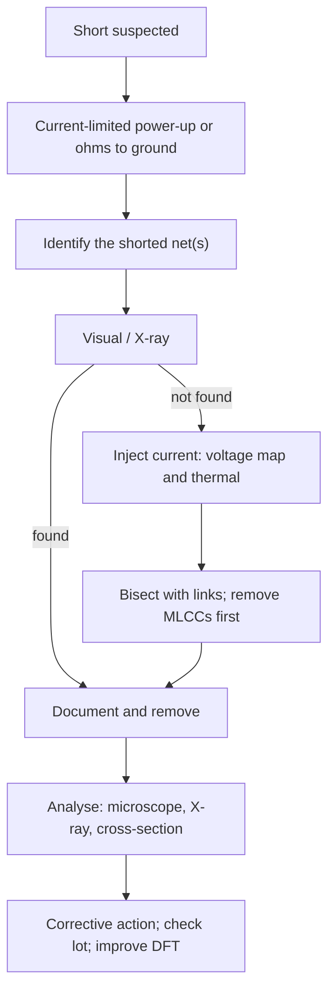

::: basics
### In plain words
A short is an unwanted low-resistance connection, such as between a supply and ground. Handling one has three steps: detect it, find where it is, and work out why it happened. The whole time you limit the current, so the fault shows itself without burning anything.

### Picture it
Imagine a garden hose with a hidden leak. Turn the water on gently and you can follow the wet trail. Turn it on at full blast and you flood the garden. A current-limited supply is the gentle flow. The current takes the easiest route to the short, so the voltage along the copper is lowest near the fault, like water pressure that drops toward the leak. Follow the drop to the spot.

### Words you need
- **Short**: a connection with very low resistance that should not exist.
- **Current limit**: a supply setting that caps how much current can flow.
- **Milliohm**: a thousandth of an ohm; shorts often read this low.
- **Thermal camera**: a camera that shows hot spots, where a short is heating up.
- **Bisecting**: splitting the shorted connection into halves, by lifting links or parts, to see which half has the fault.

### The simplest example
Set the bench supply to the board's normal supply voltage with a 1 A current limit. If the board has a 50 mΩ short, the supply hits its limit and the voltage sags to about 1 A x 50 mΩ = 50 mV. Now follow the current. A square patch of standard board copper (35 µm thick, called 1 oz), of any size, has about 0.49 mΩ end to end. Across 5 such squares at 1 A, the drop is about 2.5 mV, which a sensitive meter can read. You step toward lower voltage until you reach the fault. That is the whole idea. The rest of this page covers thermal methods, bisecting, and tracing the root cause.
:::

::: testing
Whether you debug **systematically**, not by randomly probing. A short is the classic bring-up fault. The interviewer wants a three-stage answer:

1. **Detect**: how you know there's a short and which rail (current-limited supply, resistance to ground, thermal rise, ICT).
2. **Locate**: narrowing it down by isolation (remove or lift parts, split the net), voltage-drop mapping with a milliohm-level measurement, thermal imaging, and inspection.
3. **Root cause**: why it happened (component, assembly, fabrication, design), confirmed by analysis (microscope, X-ray, cross-section), and what you change so it doesn't recur.

And safety: never power a suspected short without a current limit.
:::

::: why
Shorts are the most common reason a first board "does nothing" or smokes. A methodical approach saves hours (and parts), and a root-cause mindset keeps the same failure from hitting the next hundred boards. In production the same skill appears as failure analysis on ICT rejects. Interviewers like this question because it reveals whether you've actually debugged hardware: current limit first, then isolate, then measure rather than guess.
:::

::: concepts
- **Current-limited supply**: caps current to avoid damage while showing the fault. See [[q0627]].
- **Resistance and Ohm's law at milliohm levels**: V = IR with µV resolution; Kelvin/4-wire. See the `dmm-lab` sim.
- **Sheet resistance of copper**: about 0.49 mΩ/square for 1 oz, used to estimate voltage gradients.
- **Power dissipation**: $P = I^2R$ heats the short; thermal cameras find it.
- **Isolation by bisection**: split the net, test each half.
- **Test points and links**: make isolation easy. See [[q0616]] and [[q0617]].
- **Failure analysis**: microscope, X-ray, cross-section, SEM/EDX.
:::

::: answer
"I'd go detect, find, root-cause, and be careful about power the whole way.

To detect: power from a bench supply with the current limit set low, say a few hundred milliamps, so I can see a short as the supply going into current limit with the voltage collapsing, without damaging anything. Or measure resistance from each rail to ground with the board unpowered: a healthy rail reads hundreds of ohms to kilohms or climbs as the capacitors charge, while a short reads a few ohms or milliohms.

To find it: first look. Magnification for solder bridges, a component placed wrong, debris. Then use physics. If the short is dissipating power, a thermal camera or freeze spray shows the hot spot. Otherwise I inject a known current, say 1 amp from a current-limited supply, through the shorted net and measure the voltage drop along the copper with a millivolt meter. Voltage is lowest near the short, because current flows toward it. Copper is about half a milliohm per square, so a few millivolts per amp separates points. And I isolate: lift ferrite beads or zero-ohm links, remove suspect capacitors one by one, and bisect the net until the resistance changes.

To root cause: remove or analyse the culprit under a microscope, X-ray for hidden shorts under BGAs, and cross-section if it's inside the board. Then ask why: a cracked ceramic capacitor from flex, a solder bridge from stencil or pad design, a fab defect like a plating burr, contamination. And fix it at the source, and check other boards from the lot."
:::

::: technical
**Detect.**

- **Bench supply with current limit.** Set the voltage to the rail's nominal and a current limit appropriate to the board (e.g. 100–500 mA to begin). A short appears as CC mode with voltage sagging toward the short's $I_{lim}R_{short}$. Example: 1 A limit into a 50 mΩ short shows 50 mV.
- **Resistance check unpowered.** DMM rail-to-ground: a healthy rail with big decoupling reads a rising value as capacitors charge; a stable reading below a few ohms indicates a short. Use a milliohm (4-wire) meter for sub-ohm values.
- **Thermal rise.** A short dissipating $P = I^2R$ heats locally: 2 A in 20 mΩ is 80 mW.
- **In-line tests.** ICT/flying probe finds shorts with a resistance threshold. See [[q0609]], [[q0611]].
- **Symptoms.** Regulator hot or in hiccup mode, battery drains, or the board draws unexpected current.

**Locate.**

1. **Visual** (stereo microscope, good light, 10–40×): solder bridges, tombstoned or cracked parts, stray solder balls, debris, flux residue. X-ray for BGAs and QFNs.
2. **Isolate by partitioning**: use 0 Ω links, ferrite beads, jumpers and test points to separate loads; remove loads in halves. Check the resistance each time.
3. **Voltage-drop mapping.** Force $I$ through the shorted net, measure along the copper. For 1 oz copper, $R_{sq} = \rho/t = 1.72\times10^{-8}/35\ \mu\text{m} \approx 0.49$ mΩ/sq. Between two points 5 squares apart at 1 A: $5 \times 0.49$ mΩ × 1 A = 2.5 mV, readable on a meter with µV resolution. The potential is lowest at the short; step toward decreasing voltage. This works for planes where current converges on the fault.
4. **Thermal imaging or freeze spray.** With the current limited to a few hundred mA to 1–2 A, the short's location warms first. With freeze spray, the frost melts first over the hot spot; a thin film of isopropyl alcohol evaporates first there.
5. **Cross-probing**: if the short is between two nets, inject current between them and follow the voltage maps on both.
6. **Remove suspects**: MLCCs (cracks cause shorts), TVS diodes, tantalum capacitors, ESD parts, and shorted ICs. Lift or remove one at a time (see [[q0636]]).

**Root cause.**

| Evidence | Likely cause | Fix |
|---|---|---|
| Solder bridge between fine-pitch pads | stencil/paste volume, mask dam, pad design | adjust stencil, add mask dam, review land pattern ([[q0613]]) |
| Cracked MLCC shorted | board flex, singulation stress, thermal shock | move away from edge/screws; use flex-term caps; process review |
| Solder ball under part | paste spatter, wash residue | process/stencil cleaning |
| Via/trace short inside board (found by cross-section) | fab: drill smear, copper burr, sliver | supplier corrective action; add via clearance margin ([[q0580]]) |
| Short appears after power-on, not before | component failure (overstress, ESD, reversed part) | check polarity, overvoltage, protection |
| Contamination/dendrites (humidity-related) | flux residue, electrochemical migration | cleaning, no-clean flux selection, conformal coat |
| Short only for some boards of a lot | lot/process-specific | trace by lot/date code, Pareto |

Confirm the root cause by physical evidence (photo, X-ray, cross-section), reproduce or rule out alternatives, then implement a corrective action and verify on subsequent boards.

**Safety.** Use current limits; keep fingers off a heating board (a short at 5 A can burn); wear eye protection when using hot air; don't add heat to a lithium cell.

> [!UNCERTAIN]
> Resistance thresholds for "a short" depend on the rail (a 1 Ω reading on a 1 V, 10 A rail is a problem but on a high-impedance net it's normal). Judge relative to the expected value and the schematic.
:::

::: short
"I power from a current-limited supply or check resistance to ground to detect it. To find it, inspect under magnification, then use physics: thermal camera or freeze spray for the hot spot, or force a known current and map the voltage drop along the copper, since copper is about half a milliohm per square. I bisect the net by lifting links or removing parts. For root cause I use microscope, X-ray or cross-section, ask whether it's a part, assembly or fab defect, and fix it at the source."
:::

::: long
"I'd approach it in three stages, with a current limit throughout.

Detect: I power from a bench supply with the current limit set low, a few hundred milliamps. A short shows as the supply in constant-current mode with voltage collapsing. Or I check resistance from each rail to ground unpowered: a healthy rail reads high or climbs as the capacitors charge, a short sits at ohms or milliohms and doesn't move. I know the symptom location, the rail, from where the supply sags or which regulator runs hot.

Find: first a microscope, because most shorts are visible: a solder bridge, a stray solder ball, a part placed wrong. Then X-ray if it's under a BGA. If it's not visible, I use physics. I inject a known current, say 1 amp, from the supply into the shorted rail, and with a millivolt meter measure along the copper. Copper is about half a milliohm per square for 1 ounce, so 5 squares at 1 amp is about 2.5 millivolts, easily readable, and the voltage is lowest nearest the short because the current converges there. Or a thermal camera or freeze spray shows the hot spot, since the short is dissipating I squared R. And I bisect: lift ferrite beads or zero-ohm links, remove suspect parts like ceramic capacitors, and see when the resistance changes.

Root cause: I take the part or cross-section the board if needed, and identify the mechanism: a cracked ceramic capacitor from board flex, a solder bridge from the stencil or pad design, a fab defect like drill smear, contamination, or a failed protection part. Then I fix it at the source, check other boards from the lot, and note the lesson, such as adding a link or test point so next time bisecting is easy."
:::

::: terms
- **Short circuit**: unintended low-resistance connection between nets.
- **Current limit (CC mode)**: supply feature that caps output current.
- **Sheet resistance**: resistance per square of a conductive layer ($\rho/t$).
- **Bisection**: repeatedly splitting a problem region to locate a fault.
- **Kelvin / 4-wire measurement**: removes lead resistance from low-resistance measurements.
- **Freeze spray**: coolant sprayed on the board; the frost melts first over the hot spot, which marks the short.
- **Thermal imaging**: infrared camera showing temperature maps.
- **Cross-section (microsection)**: cutting and polishing the board to inspect internal structure.
- **MLCC flex crack**: crack in a ceramic capacitor from board bending, often causing a short.
:::

::: exceptional
**An average answer** says "use a multimeter in continuity mode and look for a solder bridge".

**An exceptional answer**:

- Starts with safety: current-limited supply, and uses the supply's behaviour as the detector.
- Quantifies: copper sheet resistance (0.49 mΩ/sq), expected mV per amp, P = I²R for thermal visibility.
- Offers multiple locating methods (visual/X-ray, thermal, voltage-drop mapping, isolation/bisection) and says when each applies.
- Knows the usual suspects (MLCC cracks, solder bridges under QFN/BGA, tantalum, TVS, inner-layer defects).
- Closes with root cause and corrective action, including lot checks, and designs links/test points to make future debugging easy.
:::

::: mistakes
- **Powering the board at full current.** A short can burn traces and parts. Always current-limit.
- **Using continuity beep as a measurement.** Many meters beep at up to ~50 Ω. Use a milliohm measurement for low-ohm faults.
- **Probing only one point.** A single reading says little; you need a map or a bisection.
- **Removing parts randomly.** Order by likelihood (MLCCs on the shorted rail first) and by ease; document changes.
- **Stopping at "found the solder bridge".** Without the root cause (stencil, pad design, mask dam) it recurs.
- **Heating the board for long with hot air** and creating new defects.
- **Ignoring that the short may be in an inner layer.** Visual inspection can't see it; use thermal or voltage mapping.
:::

::: deep
## A short is a resistor: use it

A short is a low-resistance path $R_s$ between two nets. Current $I$ forced through it creates a voltage $V = IR_s$ and a power $P = I^2R_s$. Every location technique uses one or both:

- **Voltage**: map where the voltage is lowest.
- **Power**: look for where it's hot.

```circuit
{"elements":[
 {"t":"I","a":[0,8],"b":[0,2],"label":"I = 1 A"},
 {"t":"wire","pts":[[0,2],[0,0],[4,0]]},
 {"t":"term","at":[4,0],"label":"P1","side":"top"},
 {"t":"R","a":[4,0],"b":[10,0],"label":"R_{path1}","value":"2.5 mΩ"},
 {"t":"term","at":[10,0],"label":"P2","side":"top"},
 {"t":"R","a":[10,0],"b":[16,0],"label":"R_{path2}","value":"2.5 mΩ"},
 {"t":"wire","pts":[[16,0],[18,0],[18,2]]},
 {"t":"R","a":[18,2],"b":[18,6],"label":"R_{short}","value":"20 mΩ","color":"red"},
 {"t":"wire","pts":[[18,6],[18,8],[0,8]]},
 {"t":"gnd","at":[9,8]},
 {"t":"text","at":[10,-2.5],"text":"V(P1) − V(P2) = 2.5 mV, V(P2) > V(short end)","anchor":"middle","muted":true}
]}
```
Figure: A current source pushes 1 A along a trace into a short (red). Each segment drops I·R, so the voltage falls toward the short. Probing P1, P2 and onward with a millivolt meter shows the gradient and points at the fault. The short itself dissipates I²R = 20 mW here.

## Detecting: three signatures

1. **Supply behaviour.** Set the limit to 100–500 mA. If the short is $R_s$ and the supply voltage is $V$, the supply would deliver $V/R_s$ — far above the limit — so it goes into constant-current mode and $V_{out}$ collapses to $I_{lim}R_s$. For $R_s = 50$ mΩ and 1 A: 50 mV.
2. **Unpowered resistance.** Rail-to-ground: millivolt-level excitation is not always available on the DMM; the meter's ohm range applies about 0.1–1 mA (meter dependent). A reading < 1 Ω that doesn't climb is a short. Reverse the leads to rule out diode paths. Compare with a known-good board.
3. **Thermal.** A heat spot, regulators entering hiccup mode, or a battery that drains.

> [!TIP]
> Compare rails against a known-good board: the expected resistance isn't in any datasheet but a good board gives a baseline. A reading that's 10× lower than the good unit points to the shorted rail even if it isn't "zero".

## Locating: the toolbox

### Visual and X-ray

Magnification catches most. Look under shield cans, around QFN thermal pads, and at tiny capacitors. X-ray shows bridges under BGAs and QFNs and via-to-via shorts in some cases.

### Voltage-drop mapping (current injection)

Choose a current that won't overheat (0.5–2 A for typical traces). The voltage drop is $I R_{sq} N_{sq}$, with $R_{sq} = \rho / t$. For 1 oz copper (35 µm): 0.49 mΩ/sq. Compute for a 0.5 mm wide, 40 mm long trace: 80 squares × 0.49 mΩ = 39 mΩ, i.e. 39 mV at 1 A. For planes, current spreads and converges on the short; the lowest-voltage region contains it. Use a meter with ≤ 10 µV resolution (a bench DMM on its mV range) and Kelvin-style probing. The "dmm-lab" sim shows how contact and lead resistance corrupt low-resistance readings, which is why 4-wire matters here.

```sim
{"id":"dmm-lab","view":"4wire"}
```
Figure: With 2-wire sensing, lead and contact resistance add to the reading and can swamp a 20 mΩ short. Raise the lead resistance and see the error; 4-wire Kelvin sensing removes it. Use this principle when measuring millivolts along a trace: sense with high-impedance probes while the current flows through separate wires.

### Thermal

At the current limit, power is $I^2R_s$. 20 mΩ at 2 A is 80 mW concentrated in a small area: enough for a thermal camera with good sensitivity (a few tens of mK) at close range, especially if the board is first cooled or the camera uses a macro lens. Without a camera, coat the area with freeze spray: the frost melts first over the hot spot (a thin film of isopropyl alcohol likewise evaporates first there). Pulse the current (lock-in thermography is the professional version) for better contrast.

### Isolation and bisection

Design aids: 0 Ω links, jumpers and test points between blocks (see [[q0616]], [[q0617]]). In a big rail with N loads, bisection finds the faulty branch in about $\log_2 N$ steps: 16 loads take 4 measurements. Remove or lift in this order: (1) bulk and ceramic capacitors on the rail (they fail short most often), (2) protection devices, (3) ICs, (4) ferrites/links.

### Check inner layers

If nothing is visible and the gradient points at a zone with no components, suspect an inner-layer short: via-to-plane, drill smear, or copper debris. Cross-section confirms. Raise with the fab with photographic evidence.

## Root cause: the five whys applied to a short

Example: 3 of 200 boards from lot X have a short on 1.8 V.

1. *Where?* A 0402 capacitor C47 shorted (found by voltage mapping and removal).
2. *What happened to it?* Crack in the MLCC body (microscope).
3. *Why?* Cracks usually come from mechanical stress or thermal shock. C47 sits near a V-score edge and a mounting screw.
4. *Which mechanism?* Board flex during depanelisation or screw tightening.
5. *Fix:* move C47 away from the edge/screw, orient the cap parallel to the score line, use flexible-termination capacitors, change depanelisation method; add strain-gauge testing in the process.

Confirm the hypothesis: bend a few good boards in a controlled test and check whether the same failure appears; check the other lots.


Figure: The workflow in one picture. Safety first, cheap checks next, physics-based localisation if needed, then analysis and a design or process fix.

## Design for debuggability

Add what you wish you had: test points on every rail, 0 Ω links or sense resistors in series with each domain, thermal-friendly pours (not so much copper that heat spreads and hides the spot), and rail LEDs. Keep ceramic capacitors away from board edges, V-score lines and screw holes, where flex cracks start. See [[q0580]] and [[q0583]] for via-related defects.
:::

::: applications
- **First bring-up** of any new board: the first power-up uses a current limit as a short detector.
- **Production ICT reject analysis**: ICT flags a short; repair stations use the same voltage-map/thermal/removal steps.
- **Field returns**: battery products with a drained cell often have a short from contamination or a damaged capacitor.
- **Power-supply debugging**: hiccup-mode regulators indicate a load short; locate by injecting current.
- **Failure analysis labs**: cross-sectioning, X-ray, SEM/EDX to verify the mechanism.
:::

::: assumptions
- Assumes accessible rails and a bench supply; for very dense boards you may need thermal cameras and X-ray.
- Resistance values and copper sheet resistance assume 1 oz copper at room temperature (about +0.39%/°C increase).
- Shorts that appear only under power (overstress, intermittent) need different tactics: log current, use a scope on the rail, tap the board.
- High-voltage shorts are an arc or leakage problem; treat with safety standards.
- Alternate good answers emphasise ICT/flying probe data for production and X-ray for BGA.
:::

::: followups
### Why are ceramic capacitors the first suspects for a rail-to-ground short?
MLCCs are brittle; bending, thermal shock or poor soldering cracks them and the crack can short the electrodes. There are many on every rail and they're directly across the rail, so a short through one is common. Removing them one by one from the shorted rail often finds it quickly.

### How do you find a short on an inner-layer plane?
Inject current between the shorted planes and map the voltage along the surface or at several vias; the lowest-voltage region contains the short. A thermal camera at the board surface may show the hot spot through the laminate. If still inconclusive, X-ray, or cross-section the suspicious region after consulting the fab. Report to the fab with the evidence.

### Your multimeter shows 0.4 Ω between 3.3 V and ground. Is it a short?
It depends. A healthy rail with many capacitors can read low while charging, and low-impedance loads (like a regulator's output FET body diode in reverse) can show small values. Compare with a known-good board, reverse the leads, wait for charging to settle, and measure the current drawn when powered at a limit. A fixed 0.4 Ω on a high-impedance rail is suspicious.

### Why use a current source/limit instead of a full-voltage supply to find the short?
A current limit keeps dissipation small and safe: $P = I^2R$ with I limited, and the supply's CC mode shows $I_{lim}R_s$ so you read the short's resistance directly. A full-voltage supply could drive tens of amps and burn the short open, destroy components or lift traces.

### Scenario: the short moves when you press on the board. What does it suggest?
A mechanical defect: a cracked capacitor, a hairline in a via barrel, a solder ball or a lifted pad. Press at different locations to see where the resistance changes, then inspect and use microscope/X-ray. Intermittent shorts also point at flex-related cracks, so check components near edges, screw holes, connectors.
:::

::: references
- Horowitz & Hill, *The Art of Electronics*, 3rd ed.: debugging and measurement chapters.
- IPC-A-610, acceptability of electronic assemblies: criteria for solder bridging and component defects.
- IPC-2221 and IPC-6012 (qualification and performance specification for rigid printed boards): context for fabrication defects.
- Capacitor manufacturers' application notes on flex cracking of MLCCs (for example, from major MLCC makers): mechanism and layout guidance.
:::

::: rubric
- Uses a current-limited supply and/or rail-to-ground resistance to detect :: Safe, fast detection and tells you which rail.
- Starts with visual/X-ray inspection :: Most shorts are visible; it's cheap.
- Uses physics to locate: voltage-drop mapping and thermal imaging, with numbers :: Shows you can find hidden shorts.
- Isolates by bisection with links/removal, MLCCs first :: Systematic and efficient.
- Names likely culprits and mechanisms :: Turns the search from random to informed.
- Performs root-cause analysis and corrective action, checking the lot :: Prevents recurrence.
- Mentions safety and design for debuggability :: Shows maturity and practicality.
:::

::: quiz
```json
[
 {"type":"mcq","level":"fundamental","q":"What should you do before powering a board with a suspected short?","options":["Power it at full current to see what happens","Set a bench supply current limit to a low value","Remove all the capacitors first","Heat the board with hot air"],"answer":1,"explain":"A current limit prevents damage and turns the supply into a short detector (constant-current mode with collapsing voltage)."},
 {"type":"numeric","level":"intermediate","q":"1 oz copper has about 0.49 mΩ per square. You force 1 A through 5 squares of copper. What voltage (in mV) do you expect?","answer":2.45,"tolerance":0.03,"unit":"mV","explain":"V = I × R = 1 A × 5 × 0.49 mΩ = 2.45 mV."},
 {"type":"numeric","level":"intermediate","q":"A short of 20 mΩ carries 2 A. How much power does it dissipate, in mW?","answer":80,"tolerance":0.02,"unit":"mW","explain":"P = I²R = 4 × 0.020 = 0.08 W = 80 mW."},
 {"type":"mcq","level":"intermediate","q":"Which component class is the most common culprit for a rail-to-ground short after board flex?","options":["Resistors","Ceramic capacitors (MLCCs)","LEDs","Connectors"],"answer":1,"explain":"MLCCs are brittle and crack under mechanical or thermal stress; the crack can short the electrodes."},
 {"type":"truefalse","level":"advanced","q":"With 2-wire resistance measurement, lead and contact resistance have no effect on a 20 mΩ reading.","answer":false,"explain":"Leads and contacts typically add tens to hundreds of mΩ, swamping a 20 mΩ value. Use 4-wire (Kelvin) measurement."},
 {"type":"mcq","level":"advanced","q":"A rail has 16 loads that can each be disconnected. How many bisection measurements are needed in the worst case to find the shorted load?","options":["1","4","8","16"],"answer":1,"explain":"Each measurement halves the candidates: log2(16) = 4."}
]
```
:::
