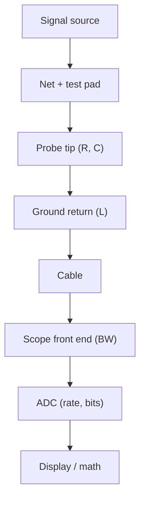

::: basics
### In plain words
Measuring a signal on a board means choosing the right instrument and setting it up so it does not mislead you. A meter suits steady (DC) voltages. A scope shows how a signal changes over time. A logic analyzer reads many digital lines. The instrument and probe themselves can change what you see, through limited speed, loading and the ground connection.

### Picture it
Think of photographing a fast-moving ball. If the camera is slow, the ball is a smear, and you cannot tell its real shape. A scope that is too slow smears a fast edge (a quick jump in voltage) in the same way. Also, if you hold the camera with a shaky, floppy strap, the shake shows up in the photo. A long ground lead on a probe is that floppy strap, and it adds its own wobble.

### Words you need
- **Oscilloscope**: an instrument that draws a signal's voltage against time.
- **Bandwidth**: how fast a signal the instrument can follow; higher is faster.
- **Rise time**: how long a signal takes to go from low to high.
- **Probe loading**: the probe itself drawing a little current or adding capacitance (stored charge that slows edges) at the point you measure.
- **Ground lead**: the wire that connects the probe's return to the board's ground.

### The simplest example
A scope's rise time is about 0.35 divided by its bandwidth. A 200 MHz scope has a rise time of about 0.35 / 200 MHz = 1.75 ns. If you measure a true 1 ns edge, the readings combine like the sides of a right triangle: the square root of (1 squared + 1.75 squared) is about 2.0 ns. The scope makes the edge look twice as slow. A 1 GHz scope would show about 1.06 ns. That is the whole idea. The rest of this page covers choosing instruments, probe loading, ground-lead ringing and safety around mains-powered circuits.
:::

::: testing
Whether you treat measurement as **an experiment that disturbs the thing measured**. A mediocre answer says "put a scope probe on it". A strong one:

1. Chooses the right instrument (DMM, scope, logic analyser, spectrum analyser, current probe) for the quantity and frequency.
2. Checks that instrument and probe **bandwidth**, **loading** (resistance and capacitance) and **grounding** are adequate, with numbers.
3. Picks a good measurement *location* (at the receiver, at a test pad with a ground pad) and a good *setup* (trigger, bandwidth limit, scale).
4. Knows safety and isolation issues, and how to sanity-check a surprising result (is it real or a probe artifact?).
:::

::: why
Half of all "mystery bugs" turn out to be measurement artifacts: ringing from a long ground lead, a probe that loads the node, a scope too slow to see the edge, or a ground loop that injects mains hum. Conversely, a real problem can hide if the measurement setup filters it. Interviewers use this question to see if you can trust your own numbers, which is the basis of all debugging. See [[q0629]] to [[q0631]] for the ground-loop side and [[q0628]] for the test-point side.
:::

::: concepts
- **Voltage is relative**: every probe needs a reference connection; the return path is part of the measurement. See [[q0629]].
- **Bandwidth and rise time**: scope rise time $t_r \approx 0.35/BW$; edges contain energy to about $0.35/t_r$.
- **Probe loading**: input resistance and capacitance of the probe and meter load the node. See [[q0623]].
- **Sampling and aliasing**: sample rate must be ≥ 2× the bandwidth of interest, and in practice 4–5×.
- **Noise and resolution**: scope vertical resolution (typically 8 bits) and noise floor limit small signals.
- **Triggering**: capturing the event you care about.
- **Isolation and safety**: ground-referenced scope inputs and floating or high-voltage nodes.
:::

::: answer
"First I decide what I'm measuring, then pick the instrument and set it up so the measurement doesn't lie.

For DC rails and slow signals a DMM is fine. For anything dynamic, ripple, edges, bus traffic, I use an oscilloscope, a logic analyser for digital buses with many channels, and for frequency content a spectrum analyser or the scope's FFT. For current, a shunt with a differential measurement or a current probe.

The considerations are the real answer. Bandwidth: a scope with a 200 MHz bandwidth has a rise time of about 1.75 ns, so it will smear a 1 ns edge and show it as about 2 ns; I want the scope to be several times faster than the signal's knee frequency, which is 0.35 over the rise time. Loading: a 10x passive probe is about 10 megaohms in parallel with 10 or so picofarads; fine for most nodes, but not for a high-impedance or very fast one. Grounding: the probe's ground lead is part of the circuit; a long clip lead adds around 150 nanohenries and rings, so I use a short spring tip or tip-and-barrel at a ground pad next to the signal. Setup: bandwidth limit for noise or ripple, correct trigger, proper vertical scale, and probe compensated.

And I sanity-check: if I see 100 millivolts of ringing, I ask whether it changes when I shorten the ground lead or move the probe. If it does, it's probe artifact. I measure at the receiver where the signal matters and use test points designed for it."
:::

::: technical
**Instrument choice.**

| Quantity | Instrument | Notes |
|---|---|---|
| DC rail, resistance | DMM (4-wire for mΩ) | ~10 MΩ input; loads high-Z nodes ([[q0626]]) |
| Ripple, transients, edges | Oscilloscope + probe | bandwidth, ground, loading |
| Many digital lines | Logic analyser | threshold, sample rate; protocol decode |
| Frequency content, EMI | Spectrum analyser or scope FFT; near-field probes | |
| Current | Shunt + diff probe; current probe; clamp | burden voltage |
| Small differential, floating | Differential or isolated probe | CMRR, safety |
| Impedance, delay | TDR/VNA | controlled-impedance verification |

**Bandwidth and rise time.** A scope's rise time is $t_{r,scope} \approx 0.35/BW$ (for a Gaussian-like response; some scopes with sharper roll-off use 0.4–0.45). Measured rise time combines in quadrature: $t_{r,meas} = \sqrt{t_{r,sig}^2 + t_{r,scope}^2 + t_{r,probe}^2}$. Example: 200 MHz scope ⇒ 1.75 ns; a 1 ns edge measures as $\sqrt{1 + 3.06} = 2.0$ ns. With a 1 GHz scope (0.35 ns) the same edge reads 1.06 ns. A rule of thumb is a scope bandwidth of at least 3–5× the signal's knee frequency $0.35/t_r$ (for 1 ns edges, knee 350 MHz, so 1–1.75 GHz).

**Probe loading.** A passive 10× probe is typically 10 MΩ ∥ about 10–15 pF at the tip (spec varies by model); a 1× probe is 1 MΩ ∥ ~100 pF (plus cable). Magnitude of input impedance for 10 MΩ ∥ 10 pF: 15.9 kΩ at 1 MHz, 1.6 kΩ at 10 MHz, 159 Ω at 100 MHz, 45 Ω at 350 MHz. So a 10× probe is nearly invisible on a 50 Ω source but is a serious load on a 10 kΩ node at 10 MHz (pole at 1/(2π·10 kΩ·10 pF) = 1.6 MHz). 1× probes are only for slow signals. Active probes reduce tip capacitance to about 1 pF or below.

**Ground and loop.** Ground lead inductance ≈ 1 nH/mm rule of thumb; with probe C it rings at $1/(2\pi\sqrt{LC})$: 130 MHz for 150 nH & 10 pF; spring tip 10 nH ⇒ 500 MHz. See [[q0629]]–[[q0631]].

**Setup.**

- Compensate the 10× probe on the scope's square-wave output; an over/under-compensated probe distorts edges.
- Choose vertical scale to use most of the screen; 8-bit resolution means 1 LSB ≈ 0.4% of full scale.
- For ripple: 20 MHz bandwidth limit, AC coupling, tip-and-barrel at the output capacitor, and check the noise floor with the probe tip shorted to ground.
- Trigger on the event; use normal/single mode for rare events; use averaging only for repetitive signals (it hides random glitches).
- Sample rate ≥ 4–5× bandwidth, and ≥ 3–5 samples across the fastest edge. See the `measurement-bw` sim.

**Where to measure.** At the receiver pin or as close as possible (the signal there decides pass/fail); through test points with adjacent ground; avoid measuring at a driver with the stub of the net hanging off.

**Safety and isolation.** A scope's ground clip is earthed through the mains plug; clipping it to a mains-referenced or floating node causes short-circuit currents. Use a differential or isolated probe, or an isolated scope, for floating/high-voltage nodes; never "float" the scope by removing its safety earth.

> [!UNCERTAIN]
> Probe capacitance and resistance depend on the model (e.g. 10 MΩ ∥ 3.9 pF for some modern passive probes; 10 MΩ ∥ ~10–15 pF for generic ones). Check the actual probe's datasheet. The 0.35/BW factor assumes a Gaussian-like response.
:::

::: short
"I pick the instrument by the quantity, DMM for DC, scope for dynamic signals, logic analyser for buses, then make sure the measurement doesn't lie. That means scope bandwidth well above the signal's knee frequency (0.35 over rise time), a probe whose resistance and capacitance don't load the node, and a short ground connection, because a long ground lead rings and picks up noise. I measure at the receiver, using test points with nearby grounds, and sanity-check surprising results by changing the setup."
:::

::: long
"I start with what I'm measuring and pick the instrument: a DMM for DC levels and resistance, a scope for anything that changes in time, a logic analyser when I need many digital lines or protocol decode, a spectrum analyser or the scope's FFT for frequency content, and a shunt with a differential probe or a current probe for current.

Then I think about how the measurement can lie. First bandwidth. A scope has a rise time of about 0.35 divided by its bandwidth, so a 200 MHz scope is about 1.75 nanoseconds, and a 1 nanosecond edge will read as about 2 nanoseconds. I want a scope several times faster than the signal's knee frequency, which is 0.35 over the rise time, so for 1 ns edges I want at least 1 GHz. Second, loading. A 10x passive probe is about 10 megaohms in parallel with 10 or so picofarads. That's nothing on a 50 ohm line but on a 10 kilohm node at 10 MHz it already forms a pole around 1.6 MHz. For fast or high-impedance nodes I use an active probe. Third, ground. The ground lead is part of the circuit: a 15 cm clip lead is about 150 nanohenries and rings with the probe capacitance near 130 MHz, so I use a spring tip or the tip-and-barrel method at a ground pad next to the signal.

Setup: compensate the probe, pick the vertical scale, bandwidth-limit for ripple, trigger properly, sample fast enough.

I measure at the receiver, because that's where the signal has to be right. And I always sanity-check: if I see something surprising, I change the ground lead or the probe and see if it moves. If it does, it was the measurement. And for floating or mains-referenced nodes I use a differential or isolated probe, never defeating the scope's safety earth."
:::

::: terms
- **Bandwidth (−3 dB)**: frequency where the scope's response is down 3 dB.
- **Rise time**: 10%–90% edge time; scope $t_r \approx 0.35/BW$.
- **Knee frequency**: $f_{knee} \approx 0.35/t_r$; most of the edge's energy lies below it.
- **Passive probe (10×)**: resistive divider probe, 10 MΩ ∥ small C, compensated.
- **Active probe**: probe with a buffer at the tip; very low capacitance.
- **Differential probe**: measures the voltage between two points with high CMRR.
- **Probe compensation**: adjusting the probe's trimmer so the divider is flat vs frequency.
- **Aliasing**: false low-frequency signal from sampling too slowly.
- **Tip-and-barrel**: probing using the tip and the ground barrel without the lead.
- **Burden voltage**: voltage a current meter drops in the circuit.
:::

::: exceptional
**An average answer** says "use an oscilloscope and probe the signal".

**An exceptional answer**:

- Matches instrument to quantity and frequency.
- Computes bandwidth and rise-time effects, giving numbers (200 MHz ⇒ 1.75 ns; 1 ns edge reads 2.0 ns).
- Describes probe loading with R and C and when to use active probes.
- Treats the ground loop as part of the circuit with inductance/ringing numbers, and uses spring tip/tip-and-barrel.
- Gives setup advice (compensation, bandwidth limit, trigger, sample rate) and safety/isolation.
- Verifies results by changing the setup and measures at the receiver.
:::

::: mistakes
- **Using a 1× probe on fast signals.** 100 pF of capacitance and low bandwidth.
- **Long ground lead on fast edges.** Ringing that isn't there in the circuit.
- **Scope bandwidth about equal to the signal's.** Edges are slowed and overshoot hidden.
- **Probe not compensated.** Square waves show humps or rounding.
- **Measuring at the driver stub instead of the receiver.** Doesn't show what the receiver sees.
- **Clipping the scope ground to a non-ground node.** Shorts that node to earth.
- **Averaging when looking for glitches.** It hides non-repetitive events.
- **Trusting 8-bit scope resolution for µV-level noise** without checking the noise floor.
:::

::: deep
## A measurement is a system

The thing you see on the screen is the signal *as modified by* the probe tip, the ground return, the cable, the scope's front-end, the ADC and the display settings. To trust it, you model each stage.


Figure: Every block shapes the waveform. Loading happens at the tip, ringing in the ground return, bandwidth smoothing in the front end, and aliasing in the ADC.

## Bandwidth and rise time, in numbers

Rise time adds in quadrature (for approximately Gaussian responses):

$$t_{r,meas} = \sqrt{t_{r,sig}^2 + t_{r,scope}^2 + t_{r,probe}^2}$$

with $t_{r,scope} \approx 0.35/BW$.

| Scope BW | $t_{r,scope}$ | Measured rise of a true 1 ns edge | Error |
|---|---|---|---|
| 200 MHz | 1.75 ns | 2.02 ns | +102% |
| 500 MHz | 0.70 ns | 1.22 ns | +22% |
| 1 GHz | 0.35 ns | 1.06 ns | +6% |

A scope that is 3× faster than the signal's knee gives about 5–10% rise-time error. The sim below shows measured rise time against scope bandwidth and the harmonic content.

```sim
{"id":"measurement-bw","tr":1e-9,"bw":200e6,"fs":1e9}
```
Figure: With a 1 ns edge and a 200 MHz scope, the displayed rise time is about 2 ns, nearly double. Raise the bandwidth to 1 GHz and the error drops to about 6%; at 2 GHz it is under 2%. The sim models a Gaussian front end, so a slow scope only rounds the edge and adds no overshoot (real scopes with a sharper roll-off can add a little ringing of their own). Then lower the sample rate and slide the sampling phase: with fewer than about two samples on the edge, the measured rise time jumps around.

## Probe loading

```plot
{"title":"Probe input impedance magnitude vs frequency","x":{"label":"Frequency","unit":"Hz","min":100,"max":1e9,"log":true},"y":{"label":"|Z_in|","unit":"Ω","min":10,"max":2e7,"log":true},
 "vars":{"r10":1e7,"c10":1e-11,"r1":1e6,"c1":1e-10,"ra":1e6,"ca":1e-12},
 "series":[{"label":"10× passive (10 MΩ ∥ 10 pF)","fn":"1/sqrt(1/(r10*r10)+(2*pi*x*c10)^2)"},{"label":"1× passive (1 MΩ ∥ 100 pF)","fn":"1/sqrt(1/(r1*r1)+(2*pi*x*c1)^2)","color":"orange"},{"label":"Active FET (1 MΩ ∥ 1 pF)","fn":"1/sqrt(1/(ra*ra)+(2*pi*x*ca)^2)","color":"green","dashed":true}],
 "hlines":[{"at":50,"label":"50 Ω line","color":"muted"}]}
```
Figure: Above about 1.6 kHz (where 10 pF's reactance equals 10 MΩ) a 10× probe is capacitive, not 10 MΩ. At 100 MHz a 10× probe is about 160 Ω and a 1× probe about 16 Ω, a heavy load on anything but a low-impedance node. An active probe (≈ 1 pF, green) is about 1.6 kΩ at 100 MHz and stays above 1 kΩ up to roughly 150 MHz.

Loading error for a source of resistance $R_s$ with probe capacitance $C_p$: pole at $f_p = 1/(2\pi R_s C_p)$. For $R_s = 10$ kΩ, $C_p = 10$ pF: 1.6 MHz. So measuring a 10 kΩ-source node with a 10× probe limits what you can see to about 1.6 MHz: the measurement changes the circuit's bandwidth too.

## Ground return: the hidden half

See [[q0629]] for definition. The key numbers: 150 nH clip lead with 10 pF rings at 130 MHz; 10 nH spring tip at 500 MHz; critical damping needs about 245 Ω or 63 Ω of series resistance respectively. Hence tip-and-barrel at a ground pad ([[q0618]]).

```sim
{"id":"scope-probe","view":"compensation"}
```
Figure: Adjust the compensation capacitor and watch the corner of the square wave change from rounded (under-compensated) to peaked (over-compensated). Compensate every probe on every channel before trusting the edge shape.

## Specific measurements

### Ripple on a rail

- AC-couple, 20 MHz bandwidth limit (to match common spec conditions), 10–50 mV/div, tip-and-barrel at the output capacitor.
- First measure the noise floor: tip shorted to the ground barrel; if you see 20 mV spikes there, your ground loop is picking up the switcher.
- Do not measure ripple with the long clip lead.

### Fast digital edge

- Probe at the receiver pin or its via, spring ground at a pad next to it.
- Active probe if available; scope bandwidth ≥ 3–5× knee.
- Check overshoot/undershoot against the receiver's absolute-maximum ratings.

### High-impedance analog node

- Use an active FET probe or buffer; check by touching the DMM and comparing readings. If the voltage moves when you probe, you're loading it.

### Current

- Shunt (e.g., 10 mΩ) with test pads and differential measurement: 1 A → 10 mV; burden 10 mV at 1 A. Or a current probe (clamp) for non-intrusive measurement; DC offsets need degauss and zero.

### Power sequencing

- Multi-channel scope; trigger on the first rail, scale each channel; look for glitches and order. See [[q0628]].

## Sanity checks

1. **Does the waveform change when you shorten the ground lead?** If yes, part of it was artifact.
2. **Is the amplitude consistent between DMM and scope for DC?**
3. **Does the signal look the same with a different probe?** Differences reveal loading.
4. **Is the edge faster than scope rise time allows?** Impossible; bandwidth-limited.
5. **Zoom and check sample points per edge.**

## Safety

The scope's input BNC shield is connected to mains earth. Clipping it to a node that is not at earth potential drives current through the earth connection. Use a differential/isolated probe or an isolated-input scope for floating nodes (for example, a motor drive's high side or off-line converters). Do not defeat the safety earth of the scope: it removes the protection and doesn't solve the problem. Follow your lab's safety rules for voltages above about 30–50 V.

> [!INTERVIEW]
> The phrase that impresses: "I check that the measurement doesn't change the thing I'm measuring": loading, bandwidth, ground. Then give one number for each.
:::

::: applications
- **Power supply debug**: ripple and load-step response with tip-and-barrel and 20 MHz limit.
- **Digital bring-up**: logic analyser decoding I²C/SPI; scope for edges and levels.
- **Signal-integrity validation**: high-bandwidth scope with active probes at receiver vias.
- **EMI debugging**: near-field probes with a spectrum analyser to find sources.
- **Motor drive work**: differential probes for floating half-bridge nodes.
:::

::: assumptions
- Passive-probe numbers are typical; actual specs vary by model.
- The 0.35/BW rule applies to Gaussian-response scopes; some are 0.4–0.45 for flat-response designs.
- Assumes ground-plane boards where a ground pad is available; without one, results degrade.
- Safety values depend on local regulation; defer to lab policy.
- Alternative: for RF, use a spectrum analyser and 50 Ω coax measurement instead of probes.
:::

::: followups
### A 10 ns rise-time signal is measured with a 100 MHz scope. How much error in rise time?
Scope $t_r = 0.35/100\text{ MHz} = 3.5$ ns. Measured $= \sqrt{10^2 + 3.5^2} = 10.6$ ns, a 6% error. If the scope were 1 GHz, 10.006 ns. The rule: scope rise time less than a third of the signal's gives about 5% error.

### Why does a 10× probe have a lower bandwidth impact than 1×?
It has about a tenth of the capacitance (≈10 pF vs ≈100 pF plus cable), so its impedance stays high to higher frequency and its own bandwidth is higher. The trade-off is 10× attenuation, which reduces sensitivity (it also reduces loading).

### When would you use a differential probe instead of a normal probe?
When the measurement is between two non-ground nodes (a floating shunt, a half-bridge, a differential pair), and when the common-mode voltage is large. It has high CMRR and avoids connecting the scope's earth to the circuit.

### Why does the scope show 200 mV ripple that disappears when you remove the probe?
Probably an artifact: the probe's ground loop picks up the switch node's magnetic field or the probe disturbs the circuit. Shorten the ground path (tip-and-barrel), compare with a different probe, and test the noise floor with the tip shorted to ground. If the noise remains with the tip shorted, it's pickup, not ripple. See [[q0630]].

### Scenario: you need to see a 100 ps edge on a controlled-impedance trace with no test pad. What do you do?
Compute the needed bandwidth: knee is 3.5 GHz, so a scope of at least about 10 GHz (3×) and active probe with tiny tip capacitance, soldered-in leads to the nearest via or component pad at the receiver. Accept that a rough measure might be enough: if a 3 GHz scope shows 150 ps, the real edge is $\sqrt{150^2 - 117^2} = 94$ ps. Or de-embed. Plan a probe footprint in the next revision.
:::

::: references
- Horowitz & Hill, *The Art of Electronics*, 3rd ed.: chapters on oscilloscope use, probes and measurement.
- Johnson & Graham, *High-Speed Digital Design: A Handbook of Black Magic*: measurement and probing practice at high speed.
- Oscilloscope manufacturers' primers on probing and bandwidth (Tektronix, Keysight, Teledyne LeCroy publish "XYZ Primer" style documents): use for probe-specific figures.
- Ott, *Electromagnetic Compatibility Engineering*: loops, grounding and pickup in measurement.
:::

::: rubric
- Selects instrument by quantity (DMM, scope, logic analyser, spectrum, current) :: Right tool for the job.
- Discusses scope/probe bandwidth with rise-time numbers :: Slow instruments hide the signal.
- Discusses probe loading (R and C) and active probes :: Measurement must not disturb the node.
- Treats the ground return as part of the circuit and minimises it :: The most common source of artifacts.
- Gives setup practices: compensation, bandwidth limit, trigger, sample rate :: Prevents misleading displays.
- Measures at the receiver and uses test points with ground pads :: Gets the real signal.
- Mentions isolation and safety, and sanity checks :: Maturity and caution.
:::

::: quiz
```json
[
 {"type":"numeric","level":"fundamental","q":"A scope has 200 MHz bandwidth. Estimate its rise time with t_r ≈ 0.35/BW, in ns.","answer":1.75,"tolerance":0.02,"unit":"ns","explain":"0.35 / 200e6 = 1.75e-9 s = 1.75 ns."},
 {"type":"numeric","level":"intermediate","q":"A true 1 ns edge is measured with a scope whose own rise time is 1.75 ns. What rise time is displayed (quadrature sum), in ns?","answer":2.02,"tolerance":0.02,"unit":"ns","explain":"√(1² + 1.75²) = √4.06 = 2.015 ns."},
 {"type":"mcq","level":"fundamental","q":"Why is a 10× passive probe preferred over 1× for fast signals?","options":["It has more gain","It has lower capacitance and higher bandwidth","It is cheaper","It removes the need for a ground"],"answer":1,"explain":"A 10× probe has ~10 pF versus ~100 pF for 1×, so it loads the node less and keeps higher bandwidth, at the cost of 10× attenuation."},
 {"type":"numeric","level":"intermediate","q":"A node with 10 kΩ source resistance is probed with 10 pF of probe capacitance. What is the resulting pole frequency in MHz?","answer":1.59,"tolerance":0.03,"unit":"MHz","explain":"f = 1/(2π × 10e3 × 10e-12) = 1.59 MHz."},
 {"type":"truefalse","level":"intermediate","q":"If a ripple measurement still shows noise when the probe tip is shorted to its own ground, the noise is partly pickup in the measurement loop rather than real ripple.","answer":true,"explain":"A shorted-tip test should read ~0. Remaining signal is magnetic/electric pickup in the probe loop or the scope's noise floor."},
 {"type":"multi","level":"advanced","q":"Select all good practices when measuring a switching-regulator output ripple.","options":["Use a 20 MHz bandwidth limit if the spec defines it that way","Use tip-and-barrel at the output capacitor","Use a long alligator ground clip for convenience","Check the noise floor with the tip shorted"],"answer":[0,1,3],"explain":"Bandwidth limit per the spec condition, a minimal ground loop and a noise-floor check give credible numbers. A long ground lead picks up switching noise."}
]
```
:::
