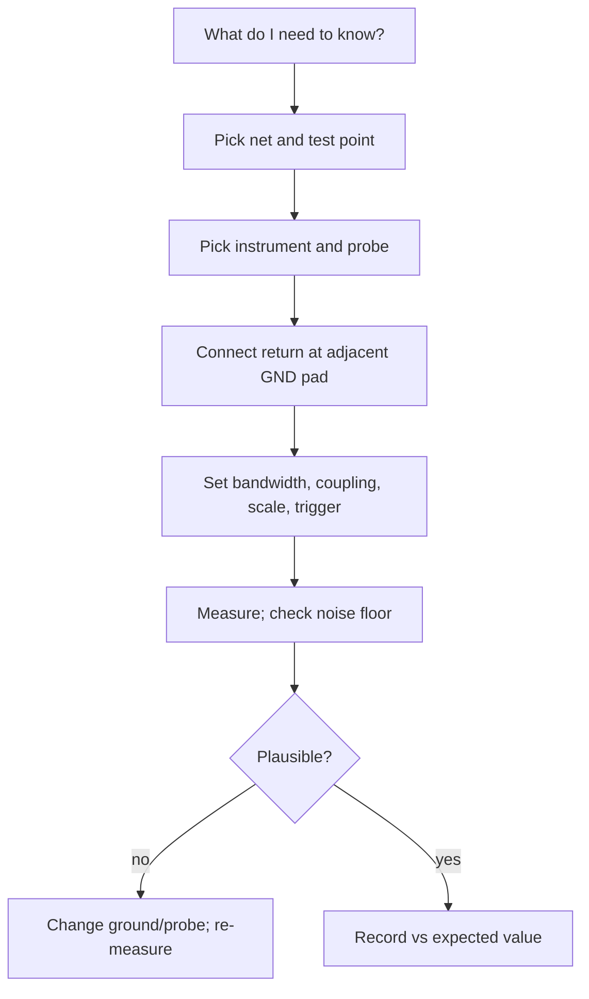

::: testing
Whether you can describe **concretely, step by step**, how a test point turns into a trustworthy measurement. This is the hands-on companion to [[q0627]]. The interviewer wants:

1. The workflow: pick the net, pick the instrument, connect the return properly, set up, measure, interpret.
2. A set of **named measurements** done through test points: rail voltage, ripple, sequencing, bus decode, current via a shunt, differential or Kelvin sense, signal injection.
3. The cautions that belong to test points specifically: the ground pad, stub/loading, pad contact quality, not shorting neighbouring pads, and ESD.
:::

::: why
Test points are only valuable if they make measurements quick and *repeatable*. A tidy set of points with grounds lets you power a board and check ten things in a minute, while a hunt across fine-pitch parts burns an hour and risks shorts. Knowing the standard measurement recipes for rails, sequencing, buses and currents is the daily work of a hardware engineer. Interviewers ask it to see if you've actually used test points on a bench.
:::

::: concepts
- **Test point + ground pad**: the pair that defines a clean measurement. See [[q0618]], [[q0621]].
- **Scope and probe setup**: bandwidth, coupling, trigger. See [[q0627]].
- **DMM measurements**: DC, resistance, loading. See the `dmm-lab` sim.
- **Shunt-based current measurement**: Ohm's law, burden.
- **Logic analyser and protocol decode** on slow buses.
- **Injection and control**: forcing signals via test points.
- **Loop and ground effects**: see [[q0629]] and [[q0631]].
:::

::: answer
"The recipe is: pick the net, pick the instrument, hook the return up properly, then set up the instrument.

For a DC rail I put the DMM black lead on a ground pad and the red on the rail pad and read it, and compare to the expected value, maybe checking under load too. For ripple and noise I use the scope with a spring ground tip or tip-and-barrel on the rail pad and the adjacent ground pad, AC coupled, 20 MHz bandwidth limit. For power sequencing I put several scope channels on the enable and rail pads and trigger on the first rail, which shows the order and timing. For a bus like I2C or UART I clip a logic analyser or scope onto the pads and decode the traffic.

For current, I probe across the shunt's two test pads: 10 millivolts across a 10 milliohm shunt means 1 amp, measured with a differential probe or a meter on its millivolt range, or I lift a zero-ohm link and put an ammeter in series.

I can also use test points to inject: drive an enable high, hold reset, or inject a test signal through a series resistor.

The main cautions are: use the ground pad, not a far-away clip; don't slip and short neighbouring pads; check the probe doesn't load the node; and sanity-check by changing the ground connection. For fast or sensitive nets I use special points. And I write down what I measured at each test point so the next board can be compared."
:::

::: technical
**Standard recipes.**

| Measurement | Setup at the test points | Numbers/notes |
|---|---|---|
| DC rail | DMM across TP and GND pad; check unloaded and loaded | accuracy ~0.1–1% of reading typical; DMM input ~10 MΩ |
| Ripple/noise | Scope, tip-and-barrel at TP/GND pad, AC coupling, 20 MHz limit, 10–50 mV/div | measure noise floor with tip shorted |
| Power sequencing | 2–4 scope channels on EN/PG/rails, trigger on first rail | compare to datasheet sequencing spec |
| Reset/boot timing | Scope on RESET and rail; single-shot | glitches and brown-out |
| Bus decode (I²C, SPI, UART) | Logic analyser or scope decode on pads | threshold 1.65 V for 3.3 V logic; sample ≥ 4–10× bit rate |
| Current | Differential probe or DMM mV across shunt TPs; clamp probe | $I = V/R$; 10 mΩ → 10 mV/A; burden $I^2R$ |
| Load step | Scope on output TP, electronic load or switchable resistor | measure droop and recovery ([[q0626]] for fault hunting) |
| Frequency/clock | Scope or frequency counter on buffered clock TP | probe loading can shift crystals |
| Resistance/short | 4-wire (Kelvin) via two pads | removes lead resistance |
| Injection | Function generator through a series resistor at a TP | protects the node |

**Using a shunt with test pads.** For a shunt $R_s$ with pads on each side: $I = (V_A - V_B)/R_s$. With $R_s = 10$ mΩ, 25 mV means 2.5 A, and $P = I^2 R_s = 62.5$ mW. Measure with a differential probe or two channels with math ($V_A - V_B$), but beware common-mode: if both nodes sit at 12 V and the difference is 25 mV, the two-channel subtraction has error from channel mismatch; a differential probe with high CMRR is better. Kelvin sensing (separate sense pads on the inner edges of the shunt's pads) avoids including solder-joint resistance.

**Signal injection.** To test a feedback loop or an analog node, inject a small signal through a resistor (for example 1 kΩ–10 kΩ) at a test point; to force a digital input use a series resistor to avoid a fight with the driver.

**Contact and handling.**

- Use the spring ground tip or a hook on a loop; avoid probing with the tip floating (the tip skates and shorts neighbouring pads: a pad-pitch of 1.27 mm is easy to bridge). Use insulated or fine tips.
- Ensure the board is ESD-protected (wrist strap, mat) when touching exposed nets.
- Never probe a net at high voltage without insulation and the appropriate probe rating.

**Documentation.** Keep a test-point table with expected values and tolerances (e.g., TP3 = 3.3 V ±3%) and record measured values on each board.

> [!UNCERTAIN]
> DMM accuracy and probe specifications vary by model; consult the instrument's datasheet. Thresholds for logic decoding depend on the logic family.
:::

::: short
"I connect the instrument's return to the ground pad next to the test point and measure with the right tool: a DMM for DC rails, a scope with tip-and-barrel and a bandwidth limit for ripple, several scope channels for sequencing, a logic analyser for buses, and a millivolt reading across a shunt's pads for current. I can also use test points to force or inject signals. I watch for probe loading and slips, and sanity-check by changing the ground."
:::

::: long
"A test point makes a measurement a repeatable routine. I connect the instrument's return to the ground pad next to the test point, and the tip to the test point, then use the right instrument.

For a DC rail: a DMM, red on the pad, black on ground, and compare with the expected value, ideally also under load. For ripple and noise: the scope, spring tip or tip-and-barrel on the rail pad and the adjacent ground pad, AC-coupled, 20 MHz bandwidth limit, and I first check the noise floor with the tip shorted to ground. For sequencing: three or four scope channels on enable, power-good and rails, triggered on the first rail, to check the order and timing against the datasheet. For buses, I clip a logic analyser or use the scope's decode on the pads: I²C, SPI or UART traffic.

For current, I look at the two pads around a shunt. If it's 10 milliohms and I read 25 millivolts, that's 2.5 amps, and it's burning about 60 milliwatts. I'd use a differential probe or the DMM's millivolt range, because both nodes may be at 12 volts and subtracting two single-ended channels is inaccurate.

Test points also let me control the board: hold reset, force an enable, or inject a test signal through a series resistor.

Cautions: always use the ground pad, because a long ground lead rings. Don't slip and short neighbouring pads; mind probe loading, especially on high-impedance nodes; use ESD precautions. If something looks odd, I change the ground connection or use a different probe to see whether it's real. And I log the measurement per board against an expected-value table."
:::

::: terms
- **Tip-and-barrel**: probing without the ground lead, using the probe barrel on the ground pad.
- **Shunt resistor**: low-value series resistor for current measurement.
- **Kelvin sense pads**: separate sense connections on a shunt to avoid pad/solder resistance.
- **Differential probe**: measures the difference between two nodes with high CMRR.
- **CMRR**: common-mode rejection ratio.
- **Bandwidth limit**: scope filter (e.g., 20 MHz) to cut high-frequency noise.
- **Logic analyser**: instrument capturing many digital lines with decode.
- **Noise floor**: reading with input shorted; the measurement's minimum.
- **Burden**: voltage drop an ammeter or shunt adds to the circuit.
:::

::: exceptional
**An average answer** says "put the probe on the test point and look at the scope".

**An exceptional answer**:

- Names the pair "test point + ground pad" and why.
- Gives specific recipes for rails, ripple, sequencing, buses, current, load step and injection, each with a setup detail and number.
- Computes the shunt example (10 mΩ, 25 mV = 2.5 A, 62.5 mW) and explains differential versus two-channel subtraction.
- Mentions Kelvin sense, noise-floor check and bandwidth limit.
- Mentions handling (slip risk, ESD) and documentation of expected values.
:::

::: mistakes
- **Using a far-away ground clip while probing a nearby test point.** See [[q0629]].
- **Measuring a rail with the scope DC-coupled at 1 V/div** and concluding "no ripple". Use AC coupling and a small scale.
- **Subtracting two scope channels at 12 V common mode to measure 25 mV.** Gain mismatch errors dominate.
- **Slipping and shorting two pads.** Probe tips on 1.27 mm pitch are easy to slip.
- **Probing the net and not recording the value.** The next board can't be compared.
- **Injecting directly into a driven digital node.** Use a series resistor.
- **Using a DMM current range in series on a supply.** The burden voltage can brown out the load.
:::

::: deep
## The workflow


Figure: A repeatable workflow. The "plausible?" gate is where artifacts get caught: if the result changes when you change the probe or ground, it wasn't the signal.

## Recipe 1: DC rail

DMM: black on ground pad, red on the TP. Measure unloaded (just powered) and under load (firmware running). A rail reading 3.12 V instead of 3.30 V under load tells you the regulator droops (5.5%). The DMM loads 10 MΩ, which for a regulator output is nothing, but on a high-impedance divider midpoint it can matter. See the sim:

```sim
{"id":"dmm-lab","view":"loading"}
```
Figure: The DMM's 10 MΩ input forms a divider with the node's source resistance. Increase the source resistance until the reading falls by a visible amount, and notice at which resistance the error exceeds 1%.

## Recipe 2: ripple and noise

Set the scope: AC coupling, 20 MHz bandwidth limit (a common spec condition, check yours), 10–50 mV/div, time base to see the switching period (e.g., 2 µs/div for 500 kHz). Probe: tip on the output-capacitor test point, barrel against the adjacent ground pad. Check the noise floor: tip shorted to the barrel; anything you still see is pickup. Compare ripple to the spec (for example 30 mVpp).

For the same buck converter, the switch node is very fast (ns edges), so ripple measured with a long ground lead will include spikes: the expected ripple of a buck with $\Delta I_L$ in ESR $R_{ESR}$ is $\Delta V \approx \Delta I_L R_{ESR}$ plus capacitive part; a probe artifact adds on top.

## Recipe 3: power sequencing

Three or four channels: EN, PG, rails. Trigger on the first rail rising. Look for: order (rail A before rail B), time between rails, monotonic ramps, overshoot, resets glitching while rails ramp. Check against the datasheet's sequencing diagram. See the sim:

```sim
{"id":"power-sequencing"}
```
Figure: The timeline shows enable and power-good ordering. The same view appears on your scope when you probe EN, PG and rails at their test points, so practise reading it.

## Recipe 4: bus decode

For I²C at 400 kHz, the bit period is 2.5 µs, so a logic analyser sampling at ≥ 4 MHz (10 MHz recommended) works; use the scope's decode for edge quality (rise time of the open-drain line, hump from pull-up). For UART at 115200 baud, bit = 8.68 µs. For SPI at 10 MHz clock, scope bandwidth ≥ 100 MHz to see edges, logic analyser at 100 MS/s. Probe loading on I²C: 10 pF is small versus the 400 pF bus limit, but a 1× probe at 100 pF is not.

## Recipe 5: current through a shunt

Place Kelvin pads on the shunt: sense pads connect to the inner edges of the shunt's pads so solder and trace resistance are excluded. Then:

$$I = \frac{V_{A} - V_{B}}{R_{shunt}}$$

For $R_{shunt} = 10\ \text{m}\Omega$ and $\Delta V = 25$ mV: $I = 2.5$ A; $P = I^2R = 62.5$ mW; the shunt's heating will change its resistance slightly (copper alloys like manganin have low temperature coefficients). Measure with a differential probe or a DMM on a millivolt range, with leads soldered or probe tips firmly seated; at 25 mV a 5 mΩ contact resistance error would be 50% — a reason for Kelvin.

```plot
{"title":"Shunt voltage and power vs current (10 mΩ)","x":{"label":"Current","unit":"A","min":0,"max":5},"y":{"label":"Voltage (mV) and power (mW)","min":0,"max":250},
 "vars":{"r":0.01},
 "series":[{"label":"V = I·R (mV)","fn":"1000*r*x"},{"label":"P = I²·R (mW)","fn":"1000*r*x*x","color":"orange"}]}
```
Figure: The shunt voltage grows linearly (10 mV per amp) while power grows with the square (62.5 mW at 2.5 A, 250 mW at 5 A). Pick the shunt so the lowest current gives a readable voltage and the highest gives acceptable heat and burden.

A DMM in series on its current range can have a burden of hundreds of mV on the low ranges, enough to starve a load, so use the shunt pads instead.

## Recipe 6: load step and loop check

Use an electronic load (or MOSFET + resistor) to step current from 10% to 90%; scope the output TP in AC coupling; measure the droop (mV) and recovery time. Compare against the control-loop expectation.

## Recipe 7: control and injection

- Hold reset low via a pad to keep the processor from interfering while you check rails.
- Pull enable high/low through a jumper or test lead to turn blocks on one at a time.
- Inject: a small AC signal (10–100 mV) through a 1–10 kΩ resistor to a feedback or sense node to look at loop response (needs a network analyser or at least scope+generator and care about disturbing the loop). Never inject at low impedance without a series resistor.

## Handling test points well

- A **grounded probe tip holder** or tip with a spring reduces slips; **insulate** all but the last millimetre of a probe tip when working near fine pitch.
- **ESD**: touch ground first, use a wrist strap; some nets (reset, GPIO lines) are sensitive.
- **Don't leave probes clipped on** while moving the board; strain pulls pads off.
- **Label** and record readings.

> [!INTERVIEW]
> Give one complete example end to end: "10 mΩ shunt, 25 mV = 2.5 A, 62.5 mW, measured with a differential probe because both nodes sit at 12 V". A specific story signals experience.
:::

::: applications
- **Power-supply bring-up**: DC rail, ripple, load-step and sequencing measurements via TPs.
- **Embedded firmware debug**: reset, UART and SWD pads for logs and probe attachment.
- **Battery products**: shunt pads for current profile (sleep µA to radio burst).
- **Motor drives**: differential measurements on current-sense shunts at test pads.
- **Production line**: automated stations measure the same TPs and compare to limits.
:::

::: assumptions
- Assumes ground pads adjacent to each test point and a ground-plane board.
- Typical instrument specs (20 MHz limit, 10 MΩ DMM) are assumed; check yours.
- Shunt values and numbers are illustrative.
- For floating high-voltage nodes, use isolated measurement; the recipes here assume ground-referenced low-voltage nodes.
- Alternative: use current probes for non-intrusive measurement, which need no shunt but have limited low-current resolution.
:::

::: followups
### How do you measure a 5 mA load current through a test point?
Put a 10 Ω or 100 Ω shunt (or use the existing sense resistor) with Kelvin pads and measure the voltage: 100 Ω × 5 mA = 500 mV, easy for a DMM; burden 500 mV may be too much, so choose 10 Ω for 50 mV and use the scope or DMM mV range. For µA sleep currents, use a larger shunt with a bypass switch or a dedicated ammeter (source-measure unit).

### Why use the 20 MHz bandwidth limit for ripple?
Standard ripple specs are often defined at a 20 MHz bandwidth so that high-frequency spikes (switching-edge noise) are measured separately. It also reduces scope noise. Report the bandwidth used with the number.

### Why not measure the 25 mV across a shunt by subtracting two scope channels?
Each channel sees 12 V common mode with its own gain and offset errors (±1–2% of full scale or more); subtracting two 12 V signals to find 25 mV amplifies those errors. A differential probe or a dedicated current-sense amplifier rejects common mode.

### How do you check power sequencing?
Probe enables and rails on separate channels with the first rail as a trigger, record the order and delays, and compare to the datasheet; zoom on each ramp to look for non-monotonic ramps or glitches; also test with different input ramp rates and temperature.

### Scenario: a test pad reads 3.3 V on the DMM but the scope shows 3.3 V with 400 mV of 50 MHz noise. Which is right?
Both: the DMM averages and doesn't see the noise. Check the scope's noise floor with the tip shorted; if the noise persists, it's pickup in the loop. Use tip-and-barrel at the ground pad; if the noise remains, it's real ripple or a coupled clock. Identify its source from its frequency (does it match a clock or the switching frequency?) or with a near-field probe.
:::

::: references
- Horowitz & Hill, *The Art of Electronics*, 3rd ed.: measurement practice, oscilloscope and DMM use.
- Johnson & Graham, *High-Speed Digital Design: A Handbook of Black Magic*: measurement and probing issues.
- Instrument manufacturers' application notes on ripple measurement and current measurement with shunts and differential probes.
- Regulator datasheets (power sequencing and ripple measurement conditions).
:::

::: rubric
- Describes test point + ground pad + right instrument as the basic recipe :: This is the core technique.
- Gives named recipes (DC, ripple, sequencing, bus, current) with setup details :: Concrete experience.
- Computes a shunt current example with power :: Shows numeracy.
- Explains why differential or Kelvin sensing matters :: Avoids common errors.
- Mentions noise floor, bandwidth limit and sanity checks :: Credibility of results.
- Mentions slip/ESD handling and documentation :: Practical lab habits.
:::

::: quiz
```json
[
 {"type":"numeric","level":"fundamental","q":"Across a 10 mΩ shunt you measure 25 mV. What is the current in A?","answer":2.5,"tolerance":0.02,"unit":"A","explain":"I = V/R = 0.025 / 0.010 = 2.5 A."},
 {"type":"numeric","level":"intermediate","q":"How much power does the same shunt dissipate, in mW?","answer":62.5,"tolerance":0.02,"unit":"mW","explain":"P = I²R = 6.25 × 0.010 = 0.0625 W = 62.5 mW."},
 {"type":"mcq","level":"fundamental","q":"For ripple on a rail, which scope setup is standard?","options":["DC coupling at 5 V/div, full bandwidth","AC coupling, 20 MHz limit, tens of mV/div","Single-shot at 1 kV/div","Persistence off and no ground"],"answer":1,"explain":"AC coupling removes the DC level so you can use a sensitive scale; the 20 MHz limit is the common spec condition and cuts noise."},
 {"type":"mcq","level":"intermediate","q":"Why is a differential probe better than subtracting two scope channels to measure 25 mV across a shunt at 12 V?","options":["It is cheaper","It rejects the 12 V common mode, avoiding channel gain/offset errors","It has less bandwidth","It does not need a ground"],"answer":1,"explain":"Two single-ended channels each carry 12 V common mode and their mismatches are comparable to 25 mV. A differential probe's high CMRR cancels it."},
 {"type":"numeric","level":"advanced","q":"I²C at 400 kHz has a bit period of how many µs?","answer":2.5,"tolerance":0.02,"unit":"µs","explain":"The period is 1/f = 1/400 kHz = 2.5 µs per bit, so a logic analyser needs a sample rate of at least a few MHz to decode it."},
 {"type":"truefalse","level":"advanced","q":"If the scope shows noise with the probe tip shorted to its ground barrel on a ripple test, the noise is guaranteed to be real ripple.","answer":false,"explain":"A shorted-tip reading should be zero. Any signal comes from pickup in the probe loop or from the scope's own noise, not from the rail."}
]
```
:::
