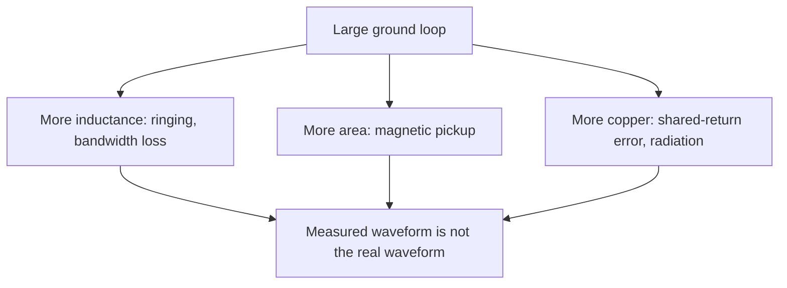

::: testing
Whether you can justify "keep the loop small" from physics, with numbers, instead of repeating it as a slogan. There are three separate reasons and a good answer gives all three:

1. **Inductance**: loop inductance scales with loop size, so $L\,dI/dt$ voltage and LC ringing grow.
2. **Pickup** (Faraday's law): induced voltage is proportional to loop *area*.
3. **Radiation/EMI and common-impedance**: bigger loops radiate and receive more; long return paths share copper with other currents.

The interviewer also wants the consequence: what you *see* (ringing, noise, wrong amplitude and rise time) and what it costs (wasted debug hours).
:::

::: why
Measurement error scales with loop size, and the error looks like real circuit behaviour. A loop 10× bigger in each dimension has roughly 10× the inductance (which tracks length) and 100× the pickup (which tracks area), which can turn a clean 30 mV ripple into 200 mV of "noise", send you chasing a non-existent layout problem, or hide a real one. The same rule shows up in PCB layout (small current loops for switching converters and clocks) and EMC. It's a principle every hardware engineer applies daily. See [[q0629]] for what the loop is and [[q0631]] for reduction techniques.
:::

::: concepts
- **Loop inductance** ($L \propto$ size): $L = \Phi/I$; for a given current a larger loop encloses more flux.
- **Faraday's law**: $v = -d\Phi/dt = -A\,dB/dt$ for a uniform field.
- **LC resonance and damping**: $f_0 = 1/(2\pi\sqrt{LC})$. See [[q0629]].
- **Radiation**: a loop radiates in proportion to area and current. See [[q0562]].
- **Common-impedance coupling**: return currents sharing copper.
- **Rise time and bandwidth**: edges contain energy to $0.35/t_r$. See [[q0627]].
:::

::: answer
"Because the loop is part of the circuit you're measuring, and its size sets how much it distorts the measurement. There are three effects, and they all scale with loop size.

First, inductance. A loop's inductance grows with its size, roughly a nanohenry per millimetre of lead. That inductance is in series with the probe's capacitance, so it makes a resonance, f equals one over two pi root LC. With 150 nanohenries and 10 picofarads it's about 130 MHz and fairly underdamped, so a fast edge rings. Shrink the loop to a spring tip of around 10 nanohenries and the ring goes up to 500 MHz and is damped. 

Second, pickup. By Faraday's law, a changing magnetic field through the loop induces a voltage proportional to the loop area. If the loop is 80 times bigger in area, it picks up 80 times more from, say, a nearby switch node. With a 100 milliamp, 5 nanosecond edge five centimetres away, a 10 by 2 centimetre loop would see around 160 millivolts, while a 5 by 5 millimetre loop sees about 2 millivolts. That's the difference between thinking you have a noise problem and not.

Third, a long return path shares copper with other currents and also radiates and receives more EMI.

So a small loop gives a more accurate waveform, with real rise time, real overshoot and real noise. That's why I use a spring tip or tip-and-barrel at a ground pad right next to the signal."
:::

::: technical
**1. Inductance and ringing.** Loop inductance of a wire loop: approximately $L \approx \mu_0 \ell\,\cdot f(\text{geometry})$; the rule of thumb of 1 nH/mm is adequate. The probe's input capacitance $C$ and series resistance $R$ give

$$f_0 = \frac{1}{2\pi\sqrt{LC}},\quad \zeta = \frac{R}{2}\sqrt{\frac{C}{L}},\quad \text{overshoot} = e^{-\pi\zeta/\sqrt{1-\zeta^2}}$$

| Ground connection | L | $f_0$ (C = 10 pF) | ζ (R = 50 Ω) | Overshoot |
|---|---|---|---|---|
| Long clip lead (~15 cm) | 150 nH | 130 MHz | 0.20 | 52% |
| Short lead (~5 cm) | 50 nH | 225 MHz | 0.35 | 30% |
| Spring tip (~1 cm) | 10 nH | 503 MHz | 0.79 | 1.7% |

Also the **inductive impedance** $\omega L$ at the edge's knee frequency: at 350 MHz it is 330 Ω for 150 nH versus 22 Ω for 10 nH, large against a 50 Ω system.

**2. Magnetic pickup.** $v_{induced} = A\,\frac{dB}{dt}$. Example: 100 mA in a wire 5 cm away gives $B = \mu_0 I/(2\pi r) = 2\times10^{-7}\times0.1/0.05 = 0.4$ µT. If it switches in 5 ns, $dB/dt = 80$ T/s. Loop area 10 cm × 2 cm = $2\times10^{-3}$ m² gives 160 mV; 5 mm × 5 mm = $25\times10^{-6}$ m² gives 2 mV. The ratio is the area ratio (80×). (Uniform-field, order-of-magnitude estimate: real fields are non-uniform and the probe loop is only partly exposed.)

**3. Radiation/receiving.** The same loop acts as a receiving antenna (EMI susceptibility) and, for a loop carrying current, as a radiating antenna; small-loop radiation grows with area and the square of frequency.

**4. Common impedance.** A longer return path touches more copper at different potentials. Voltage drop $IR + L\,dI/dt$ from other currents appears in series with your measurement.

**5. Electrical length.** When the loop's electrical length approaches a tenth of a wavelength, it stops behaving as a lumped inductor; a 15 cm lead is $\lambda/10$ at roughly 200 MHz (in free space, $\lambda = 1.5$ m at 200 MHz), so a long lead is also a poor transmission structure.

> [!UNCERTAIN]
> Pickup numbers depend on the geometry and distance; the estimate uses a long straight wire and uniform field and is an order-of-magnitude illustration. The important result is the proportionality to area.
:::

::: short
"Because the loop is part of the measurement. Its inductance, about 1 nH per mm, rings with the probe's capacitance (130 MHz for a 150 nH clip lead) and distorts fast edges. Its area picks up magnetic fields in proportion to area, so a loop 80 times bigger sees 80 times more noise from a nearby switch node. A longer return also shares copper with other currents and radiates and receives more. Small loop, accurate waveform."
:::

::: long
"The loop is part of the circuit I'm measuring, so the smaller it is, the less it distorts the result. There are three physical reasons.

One is inductance. A loop's inductance scales with its size, about a nanohenry per millimetre. It sits in series with the probe's input capacitance, so it makes a resonance at one over two pi root LC. With a 15 centimetre clip lead, 150 nanohenries, and a 10 picofarad probe, that's about 130 megahertz, with a damping ratio around 0.2, so a fast edge shows about 50 percent overshoot that doesn't exist on the board. With a spring tip of 10 nanohenries it's about 500 MHz and well damped. Also at 350 MHz a 150 nanohenry lead has an impedance of over 300 ohms, so the probe can't even see the signal properly.

Two is pickup. Faraday's law says the induced voltage is the loop area times the rate of change of the magnetic field. If a switch node 5 centimetres away changes a 100 milliamp current in 5 nanoseconds, a 10 by 2 centimetre loop sees roughly 160 millivolts, while a 5 millimetre square loop sees about 2. The ratio is just the area ratio, 80.

Three is that a long return path shares copper with other currents, so their IR and L di/dt drops add into my reading, and bigger loops radiate and receive more EMI.

The practical consequence is that a big loop makes me chase noise and ringing that aren't in the circuit, and can hide the real behaviour. So I use a spring tip or tip-and-barrel at a ground pad right next to the signal."
:::

::: terms
- **Loop inductance**: flux per ampere of the loop; grows with size.
- **Faraday's law of induction**: induced emf equals the negative rate of change of flux.
- **Damping ratio ζ**: measure of how quickly ringing decays; ζ < 1 is underdamped.
- **Overshoot**: peak excess over final value, $e^{-\pi\zeta/\sqrt{1-\zeta^2}}$.
- **Common-impedance coupling**: coupling through a shared conductor's impedance.
- **Electrical length**: physical length relative to wavelength.
- **Susceptibility**: tendency to pick up interference.
- **Knee frequency**: $0.35/t_r$.
:::

::: exceptional
**An average answer** says "a big loop picks up noise and has inductance".

**An exceptional answer**:

- Gives the three mechanisms (inductance/ringing, pickup ∝ area, shared return/radiation) with formulas.
- Gives numbers: 150 nH → 130 MHz, ζ = 0.2, 52% overshoot; spring tip → 503 MHz, 1.7% overshoot; pickup ratio 80 for 80× area.
- Notes inductive reactance at the edge's knee frequency (330 Ω at 350 MHz for 150 nH).
- Mentions that errors *look like real circuit behaviour* and how to test for artifacts.
- Connects to PCB layout: small current loops in converters and clocks.
:::

::: mistakes
- **"The loop is only a problem above 1 GHz."** Pickup of switching noise is a problem at tens of MHz; mains loops at 50/60 Hz.
- **Counting only the lead length, not the area.** A short lead far from its return can still enclose a large area.
- **Thinking inductance only affects ringing.** It also limits bandwidth: $\omega L$ blocks the edge's high-frequency content.
- **Using an active probe with a long ground lead.** The probe's tiny capacitance doesn't save you from the lead inductance.
- **Assuming a bigger ground wire gauge fixes it.** Inductance depends mainly on geometry (length, area), not the wire's thickness (logarithmically).
- **Keeping the ground lead near the noise source to "shield" it.** That increases pickup.
:::

::: deep
## Reason 1: inductance makes the probe ring and block the edge

A loop of current stores magnetic energy; the inductance $L$ is the proportionality between current and the flux through the loop. The bigger the loop, the more flux per ampere. Two consequences in the frequency domain:

- **Impedance** $\omega L$ in series with the signal's return. At the edge's knee frequency $f_k = 0.35/t_r$, a 1 ns edge has $f_k = 350$ MHz, so $\omega L = 2\pi\cdot350\text{ MHz}\cdot150\text{ nH} = 330$ Ω for the clip lead and $22$ Ω for a 10 nH spring tip. The 330 Ω in series with the probe capacitance severely limits what reaches the scope.
- **Resonance** with the probe capacitance, with $Q = Z_0/R$.

```plot
{"title":"Probe overshoot vs ground-lead inductance (default R = 50 Ω, C = 10 pF)","x":{"label":"Ground-lead inductance","unit":"H","min":5e-9,"max":3e-7,"log":true},"y":{"label":"Overshoot (fraction)","min":0,"max":0.8},"vars":{"z10":"(r/2)*sqrt(c/1e-8)","z150":"(r/2)*sqrt(c/1.5e-7)"},"series":[{"label":"overshoot = exp(−πζ/√(1−ζ²)), ζ = (R/2)√(C/L)","fn":"ite(r/2*sqrt(c/x)<1, exp(-pi*(r/2*sqrt(c/x))/sqrt(1-(r/2*sqrt(c/x))^2)), 0)"}],"points":[{"x":1e-8,"y":"ite(z10<1,exp(-pi*z10/sqrt(1-z10*z10)),0)","label":"10 nH"},{"x":1.5e-7,"y":"ite(z150<1,exp(-pi*z150/sqrt(1-z150*z150)),0)","label":"150 nH"}],"params":[{"name":"r","label":"Source R","min":20,"max":100,"value":50,"unit":"Ω"},{"name":"c","label":"Probe C","min":5e-12,"max":2e-11,"value":1e-11,"log":true,"unit":"F"}],"vlines":[{"at":"r*r*c","label":"ζ = 0.5","color":"muted"}],"readouts":[{"label":"Overshoot at 10 nH","expr":"100*ite(z10<1,exp(-pi*z10/sqrt(1-z10*z10)),0)","unit":"%"},{"label":"Overshoot at 150 nH","expr":"100*ite(z150<1,exp(-pi*z150/sqrt(1-z150*z150)),0)","unit":"%"},{"label":"Lead L where ζ = 0.5","expr":"r*r*c","unit":"H"}]}
```
Figure: Overshoot stays under about 2% for lead inductance up to about 10 nH (ζ ≈ 0.8). By 15 nH it is about 7%, and it climbs steeply as the lead grows (30% at 50 nH, 52% at 150 nH). The curve is the probe artifact, not the circuit's. Drag the probe capacitance down to 5 pF: the whole curve shifts to the left, so even a 10 nH lead overshoots by about 12%.

Try it in the simulator:

```sim
{"id":"scope-probe","view":"ground"}
```
Figure: Compare the long ground lead against the spring tip on the same signal. Note the ring frequency, and how much of the "overshoot" is only the probe.

## Reason 2: pickup scales with area

An external magnetic field through the loop induces

$$v = -\frac{d\Phi}{dt} = -A\frac{dB}{dt}$$

(for a uniform field normal to the loop). Take a nearby current of 100 mA switching in 5 ns at 5 cm:

- $B = \dfrac{\mu_0 I}{2\pi r} = \dfrac{2\times10^{-7}\times0.1}{0.05} = 0.4\ \mu\text{T}$
- $dB/dt \approx 0.4\ \mu\text{T}/5\ \text{ns} = 80$ T/s
- Big loop ($10\ \text{cm}\times2\ \text{cm} = 2\times10^{-3}$ m²): $v \approx 160$ mV
- Small loop ($5\ \text{mm}\times5\ \text{mm} = 2.5\times10^{-5}$ m²): $v \approx 2$ mV

```plot
{"title":"Pickup vs loop area (100 mA, 5 ns, 5 cm away: uniform-field estimate)","x":{"label":"Loop area","unit":"m²","min":1e-6,"max":1e-2,"log":true},"y":{"label":"Induced voltage","unit":"V","min":1e-4,"max":1,"log":true},
 "vars":{"dbdt":80},
 "series":[{"label":"v = A·dB/dt","fn":"x*dbdt"}],
 "points":[{"x":2.5e-5,"y":0.002,"label":"5×5 mm → 2 mV"},{"x":2e-3,"y":0.16,"label":"10×2 cm → 160 mV"}]}
```
Figure: On log axes the induced voltage is a straight line of slope one: cut the area by 10 and the pickup falls by 10. An 80× reduction in area (clip lead to spring tip) turns a believable 160 mV "ripple" into a 2 mV curiosity.

> [!WARNING]
> The numbers use a straight-wire, uniform-field assumption and a fully exposed loop. Treat them as an illustration of proportionality, not a prediction for your board. Measure by shorting the tip to its own ground and watching the noise floor.

## Reason 3: shared copper, radiation and susceptibility

If the clip is on a far ground pad, the return current in the measurement is small (high-impedance scope input), but the *ground voltage* at that pad includes the drops from other currents. For a pad on the same copper as a switcher's power ground, the drop $L\,dI/dt$ from a 2 A, 20 ns edge across 5 nH of plane is $5\text{ nH}\times2\text{ A}/20\text{ ns} = 0.5$ V. That's a 500 mV "signal" that is actually the difference in ground potential between the two places. Hence probe at the ground nearest the signal's own return.

Radiation is reciprocal to pickup: the same area that receives fields also radiates when the loop carries current. For a loop carrying signal return current (like the board's own clock loops) the same logic applies in PCB design: small current loops radiate less. That's why return paths are kept under signals on a plane. See [[q0562]].

## Putting numbers on "small enough"

Rules of thumb for the probe loop:

- Keep lead inductance ≲ 10–20 nH (≈ 1–2 cm) for signals with edges below ~1 ns.
- Keep loop area ≲ 25–50 mm² near switching nodes.
- Reduce further when measuring mV-level quantities.

How do you know it's small enough? When the measurement stops changing as you shrink it further. That's the practical test: if cutting the ground path in half changes the waveform, it wasn't small enough.


Figure: One cause, three paths to the same outcome: a distorted measurement.

> [!INTERVIEW]
> If asked "how small is small?" say "small enough that making it smaller doesn't change what I see". That is both honest and operational.

## Worked example: setting a loop budget from the measurement you need

The rules of thumb above ("under 10 to 20 nH, under 25 to 50 mm²") are the end of a calculation, which you should be able to run yourself.

**Area budget from a noise target.** Suppose you are measuring 50 mV of ripple near a switching node, and you want pickup below 5% of that, 2.5 mV, using the same 80 T/s field as the example above. Then $A \le v/(dB/dt) = 2.5\text{ mV}/80\text{ T/s} = 3.1\times10^{-5}$ m², which is 31 mm² (computed). That is consistent with the 25 to 50 mm² guideline; a 5 mm × 5 mm loop meets it and a 10 cm × 2 cm loop misses it by a factor of 64. If the field is ten times stronger, which is plausible right next to a power inductor, the same target needs a loop ten times smaller, about 3 mm², which is a spring ground on an adjacent pad and nothing bigger.

**Inductance budget from a damping target.** With $R = 50\ \Omega$ and $C = 10$ pF, require $\zeta \ge 0.7$ so the overshoot stays under 5%. From $\zeta = (R/2)\sqrt{C/L}$, $L \le C\,(R/2\zeta)^2 = 10\text{ pF}\times(50/1.4)^2 = 12.8$ nH (computed). That is about 13 mm of lead, consistent with the 10 nH spring tip passing and the 50 nH short lead failing.

**What damping cannot fix.** Even at the 12.8 nH limit the probe is a second-order low-pass with $f_0 = 445$ MHz, and with $\zeta = 0.7$ its 10-90% rise time is about $2.14/\omega_0 \approx 0.34/f_0 = 0.77$ ns (a direct simulation of the series RLC gives 0.76 ns). Measuring a true 1 ns edge, the displayed rise time is roughly $\sqrt{1^2 + 0.77^2} = 1.26$ ns, a 26% error in edge rate even with a good ground. Shrinking the lead further does not rescue it: as $L \to 0$ the circuit becomes a plain RC, and the rise time grows toward $2.2RC = 2.2\times50\ \Omega\times10\text{ pF} = 1.1$ ns (simulated: 0.88 ns at 5 nH, 1.01 ns at 2 nH). Below about 13 nH the limit is no longer the ground lead but the 10 pF loading the 50 Ω source. Measuring the 1 ns edge honestly needs much less capacitance (an active probe under 1 pF gives $2.2RC \approx 0.1$ ns) or a 50 Ω coax connection, which is why edge-rate measurements use those, and why a passive spring-tip result should be reported as "at least this slow".

## Worked example: shared-return error

The shared-copper term can be as large as the other two. Take a ground pad that carries the switch-node return of a 2 A converter whose current edge takes 20 ns. Across 5 nH of plane inductance between that pad and the point where your signal returns, the voltage is $L\,dI/dt = 5\text{ nH}\times2\text{ A}/20\text{ ns} = 0.5$ V (computed). If you clip your probe ground there and probe a quiet 3.3 V rail 10 mm away, the scope shows a 500 mV spike that the rail never had, yet the rail is not at fault; the difference between the two grounds is. Moving the ground clip to a pad on the rail's own return path, two millimeters from the signal, removes it. This is the case where the loop's area is irrelevant, because the pickup is conducted and not magnetic, and it is why the checklist says "same reference as the signal".

## Where the "smaller is better" rule stops

**Practical lower bound.** A spring ground is as small as a human can use, a few millimeters. Below that you need a solder-in lead or a coax connector. Cost and time rise sharply for each factor of two, so you stop when the measurement stops changing.

**Loops that cannot shrink.** A current probe or a Rogowski coil has a loop by design; the loop is the sensor. The question there becomes where the loop sits and how it couples to nearby fields.

**Inductance shrinks more slowly than pickup.** Loop inductance scales roughly with the loop's linear size (with a logarithmic correction), while pickup scales with its area, which is the square of the size. Halving the loop size therefore halves the inductance but cuts pickup to a quarter, so ringing improves less than pickup when you shrink the loop.

> [!UNCERTAIN]
> The field strength used for the pickup budget (80 T/s) is an illustrative figure from a straight-wire estimate, not a measurement of any real board. The budget formula, $A \le v_{max}/(dB/dt)$, is the part that carries over. Measure your own noise floor with the tip-to-ground test to calibrate it.

## Verifying on the bench

1. **Shrink until it stops changing.** Measure with the clip lead, a short lead and a spring tip. If the last two agree within your tolerance, the loop is small enough for this signal.
2. **Measure the pickup directly.** With the tip touching its own ground and the DUT running, record the amplitude. Compare with your budget (the 2.5 mV in the example). If it exceeds the budget, the loop or the location is wrong.
3. **Check edge rate with a faster probe.** Measure the same edge with an active probe or a coax connection. The difference in rise time is the passive probe's contribution, which you can then subtract in quadrature, as above.
4. **Move the ground.** Place the ground clip on two different pads near the same signal. A difference in the waveform means shared-return error, and the pad on the signal's own return is the better one.
:::

::: applications
- **Switching converter ripple**: tip-and-barrel at the output capacitor to avoid pickup from the inductor/switch node.
- **Gate-drive waveform**: spring tip at the MOSFET pins; a long lead makes the gate ring.
- **High-speed digital edge**: spring tip or soldered-in probe at the receiver.
- **Low-level analog (µV)**: small loops and twisted pairs to reduce magnetic pickup.
- **EMC design**: small current loops for clocks and switching currents on the PCB itself.
:::

::: assumptions
- Lumped, quasi-static model: valid while the loop is much smaller than a wavelength.
- Probe capacitance 10 pF and series resistance 50 Ω are representative; real probes vary.
- The pickup model assumes a uniform field and a source 5 cm away; the real field falls with distance and varies spatially.
- At very low frequency (DC, audio), the loop matters mainly through pickup (mains hum) and common-impedance voltage drops, not through inductance.
- Alternative explanation: the same conclusion follows from antenna theory (loop antenna effective area).
:::

::: followups
### What's the ring frequency with 50 nH and 10 pF?
$f_0 = 1/(2\pi\sqrt{50\text{ nH}\times10\text{ pF}}) = 225$ MHz. With R = 50 Ω, ζ = 0.35 and the overshoot is about 30%.

### Does using an active probe remove the ground loop issue?
No. An active probe lowers the tip capacitance (≈1 pF), which raises the resonance and reduces loading, but the ground connection's inductance and the loop's area still matter. Active probes come with short ground accessories for that reason.

### Why does the loop pick up noise even with no current in it?
Because the loop is a closed conductor enclosing area, so a time-varying magnetic flux from other currents induces an emf around it. With a high-impedance scope input, this voltage appears across the scope input. Current flows only in the capacitance, but the voltage is there.

### If I halve the ground lead length, does the pickup halve?
Not necessarily. Pickup follows area, not length. If halving the length also halves the width of the loop (the leads move closer), area drops by 4. If the lead is shorter but the loop remains wide (tip and ground far apart), area stays similar. Keep the tip and its return close together.

### Scenario: you measure 150 mV of ripple on a 5 V rail with a clip lead, and 15 mV with tip-and-barrel. Which do you report?
The tip-and-barrel reading, 15 mV, after checking the noise floor with the tip shorted to its ground and perhaps repeating with a coax (SMA) connection. The 10× difference shows most of the 150 mV was pickup in the larger loop. Also state the bandwidth limit used.
:::

::: references
- Ott, *Electromagnetic Compatibility Engineering*: loop inductance, magnetic coupling and loop antennas.
- Johnson & Graham, *High-Speed Digital Design: A Handbook of Black Magic*: inductance and probing measurement issues.
- Horowitz & Hill, *The Art of Electronics*, 3rd ed.: ground loops and magnetic pickup.
- Purcell & Morin, *Electricity and Magnetism*: Faraday's law and inductance (topic-level).
:::

::: rubric
- Gives inductance/resonance reason with numbers :: Explains ringing and bandwidth loss quantitatively.
- Gives Faraday pickup ∝ area with an estimate :: Shows why area (not just length) matters.
- Mentions shared copper/common impedance and EMI :: Completes the mechanisms.
- States the visible consequence (artifacts mistaken for circuit behaviour) :: Links physics to debugging practice.
- Gives a practical test for "small enough" :: Turns theory into lab practice.
- Connects to PCB layout (small current loops) :: Shows the principle generalises.
:::

::: quiz
```json
[
 {"type":"mcq","level":"fundamental","q":"Which statement best explains why a small probe ground loop is preferred?","options":["It makes the probe look nicer","It reduces inductance and pickup, so the waveform is closer to the real signal","It increases the scope's bandwidth","It reduces the DUT's supply voltage"],"answer":1,"explain":"Smaller loops have less inductance (less ringing) and enclose less area (less pickup)."},
 {"type":"numeric","level":"intermediate","q":"Loop inductance 50 nH, probe capacitance 10 pF. What is the ring frequency in MHz?","answer":225,"tolerance":0.03,"unit":"MHz","explain":"f0 = 1/(2π√(50e-9 × 10e-12)) = 225 MHz."},
 {"type":"numeric","level":"intermediate","q":"Induced voltage = A·dB/dt. For A = 2e-3 m² and dB/dt = 80 T/s, what is the voltage in mV?","answer":160,"tolerance":0.02,"unit":"mV","explain":"v = 2e-3 × 80 = 0.16 V = 160 mV."},
 {"type":"numeric","level":"intermediate","q":"By what factor does the pickup change if the loop area drops from 2×10⁻³ m² to 2.5×10⁻⁵ m²?","answer":80,"tolerance":0.02,"unit":"×","explain":"Pickup is proportional to area: 2e-3 / 2.5e-5 = 80."},
 {"type":"truefalse","level":"advanced","q":"An active probe's low input capacitance means the ground lead length no longer matters.","answer":false,"explain":"The lead's inductance and the loop's area still add ringing and pickup. Active probes ship with short ground accessories for this reason."},
 {"type":"mcq","level":"advanced","q":"Inductive reactance of 150 nH at 350 MHz is closest to:","options":["33 Ω","100 Ω","330 Ω","3.3 kΩ"],"answer":2,"explain":"ωL = 2π × 350e6 × 150e-9 = 330 Ω, large compared with a 50 Ω system, which is why a long lead cripples fast-edge measurements."}
]
```
:::
