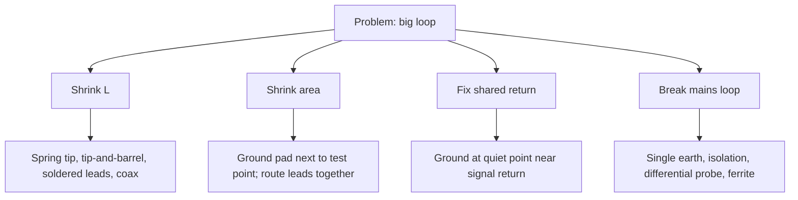

::: testing
Whether you can turn the theory ([[q0629]], [[q0630]]) into a **checklist you'd actually use at the bench and in layout**. The interviewer wants a prioritised, concrete list, grouped by who changes what:

1. Probe technique: remove the lead, spring tip, tip-and-barrel, ground at the nearest quiet point.
2. Board design: ground pads next to test points, vias to the plane, coax/SMA footprints, probe-friendly layout.
3. Instrument choice: active or differential probes, soldered-in leads, isolation for floating nodes.
4. Mains/earth loops: single earth point, isolation, differential measurement, never lifting the safety earth.
5. Verification: a way to prove the loop is small enough.
:::

::: why
Every measurement you take on a board is only as good as the loop you used. The fixes are cheap (a $2 spring tip or a 0.5 mm ground pad), yet engineers routinely lose hours to a clip lead. Knowing the options, in order of effectiveness, makes you the person who gets a clean waveform in the first five minutes. It also shows you can plan for measurement during design: adding the right pads is nearly free and pays back at bring-up. See [[q0618]], [[q0621]] and [[q0628]].
:::

::: concepts
- **Loop inductance and area**: both scale with loop size. See [[q0629]], [[q0630]].
- **Probe accessories**: spring ground tip, ground blade, tip-and-barrel, soldered-in leads, SMA/MMCX adapters.
- **Ground test pads**: bare copper tied to the plane with vias. See [[q0618]].
- **Active and differential probes**: low capacitance, floating-capable.
- **Mains earth loops**: single earth, isolation, common-mode chokes.
- **Noise-floor check**: tip shorted to ground to prove the setup. See [[q0627]].
:::

::: answer
"I'd work in order of effectiveness.

The first fix is technique: take off the long alligator clip. Use a spring ground tip or just the probe barrel pressed against a ground point, the tip-and-barrel method. That alone cuts the lead from roughly 150 nanohenries to about 10, and the loop area by a lot.

The second is to pick the ground point carefully: the nearest quiet ground, ideally a pad a couple of millimetres from the signal and connected to the plane with vias, not the power ground of a switching stage. That's why I put ground pads next to test points when I design the board.

The third is better hardware: an active or low-capacitance probe with a short ground accessory, a soldered-in probe lead, or an SMA or MMCX connector on the board so a coax gives a controlled return. For differential or floating signals I use a differential probe, which isn't referenced to scope ground.

For mains-type loops, I connect grounds at one point, power the DUT from an isolated or battery supply, or use a differential or isolated probe, and I never lift the scope's safety earth.

Last, I verify: short the tip to its ground at the pad and check the noise floor; shorten the loop further and see if the waveform changes. When it stops changing, the loop is small enough."
:::

::: technical
**Priority list.**

| # | Fix | Effect (typical) | Cost |
|---|---|---|---|
| 1 | Remove the clip lead; use a spring ground tip or tip-and-barrel | L: 150 nH → 5–15 nH; area ↓ by 10–100× | cents |
| 2 | Ground at the nearest quiet ground pad (not a switcher's power ground) | removes common-impedance error | free (needs a pad) |
| 3 | Ground pad adjacent to each test point, vias to the plane ([[q0618]]) | enables #1; a loop of a few mm² | pad + 1–2 vias |
| 4 | Soldered-in probe leads or probe tips; or SMA/MMCX footprint | L ≈ 1–3 nH; controlled return | connector cost |
| 5 | Low-capacitance active probe with short ground accessory | higher resonance, less loading | instrument cost |
| 6 | Differential or isolated probe for floating/high-side nodes | removes scope-earth loop; high CMRR | instrument cost |
| 7 | Single-point earth; isolate or battery-power the DUT; common-mode choke (ferrite) on the probe cable | breaks mains loop; reduces cable common-mode | small |
| 8 | Twist or co-route signal and return leads; keep leads away from noise sources | cuts pickup area and coupling | free |
| 9 | Bandwidth-limit (20 MHz) where the spec permits | reduces picked-up HF noise | free |

**Numbers.** Ring frequency $f_0 = 1/(2\pi\sqrt{LC})$ with $C = 10$ pF: 150 nH → 130 MHz; 50 nH → 225 MHz; 10 nH → 503 MHz; 3 nH → 919 MHz. Overshoot with $R = 50$ Ω: 52%, 31%, 1.7%, 0% (overdamped). Pickup scales with loop area: 5 × 5 mm vs 10 × 2 cm is 80× less.

**Design for a small loop (PCB side).**

- Ground pad within about 2–3 mm of each test point, 1 mm diameter, 1–2 vias to the plane.
- Keep the plane continuous under the test point region (no splits).
- For fast nets, in-line pads ([[q0623]]); optional coax footprint.
- Mark grounds clearly; provide several around the board.
- For power rails, put the probe pads directly at the output capacitor.

**Mains/earth loops.**

- Connect all instruments and the DUT to the same power strip (single earth reference), or use isolation.
- A floating DUT from a battery or isolated supply breaks the earth path.
- Use differential or isolated probes for measuring across a floating shunt or half-bridge.
- Ferrite clamp (common-mode choke) on the probe cable reduces common-mode current at tens of MHz and above.
- *Never* defeat the safety earth to "fix" hum; that is a hazard.

**Verify.** (a) Noise floor: tip shorted at the ground pad; (b) shorten or change the ground path and see whether the signal changes; (c) compare with a different probe; (d) compare with a coax measurement.

> [!UNCERTAIN]
> Spring-tip and soldered-lead inductances (≈ 3–15 nH) depend on the accessory and how you place it; look up your probe's specified ground inductance. The "20 MHz limit" is only appropriate if the question you're answering (e.g., a ripple spec) defines it.
:::

::: short
"I'd shrink the loop in order of effectiveness: remove the long clip and use a spring ground tip or tip-and-barrel; ground at the nearest quiet ground pad, which I design in next to test points with vias to the plane; use soldered leads, SMA connectors or low-capacitance active probes for fast signals; and use differential or isolated probes for floating nodes. For mains loops, one earth point or isolation, never lifting the safety earth. Then verify with a shorted-tip noise-floor check."
:::

::: long
"I'd go in order of what gives the most for the least.

First, technique. Take off the long alligator clip and use a spring ground tip, or the tip-and-barrel method where the probe's barrel touches a ground point right next to the signal. That drops the lead from around 150 nanohenries to about 10, and shrinks the loop area by tens of times.

Second, ground point choice. I want the nearest quiet ground, a pad a couple of millimetres from the signal, tied to the ground plane with a couple of vias. Not the power ground of a switching stage, because the voltage drop in that copper from fast current edges adds to my reading. And that's a design decision: I put ground pads next to test points at layout time.

Third, hardware. For fast signals I'd solder a probe lead directly, or put an SMA or MMCX connector on the board so a coax gives a clean controlled return, or use a low-capacitance active probe with its short ground accessory. For floating or high-side signals I'd use a differential or isolated probe so there's no earth connection to the circuit.

For mains-style loops, I'd tie the instruments and the board to one earth point, power the board from a battery or an isolated supply, and sometimes put a ferrite on the probe cable. I would never remove the scope's safety earth.

Finally, I verify the loop is small enough: short the probe tip to its ground at the pad and check the noise floor, then shorten things further and see if the waveform changes. When it doesn't, the loop is small enough."
:::

::: terms
- **Spring ground tip / ground blade**: short ground accessory pressing onto a pad.
- **Tip-and-barrel**: probe barrel as the ground contact, no lead.
- **Soldered-in probe lead**: a probe tip wire soldered to the DUT for a short, stable connection.
- **SMA / MMCX / U.FL**: small coaxial connectors for controlled-impedance connections.
- **Differential probe**: measures the difference between two nodes, not referenced to earth.
- **Isolated probe/scope**: input isolated from earth, withstands floating high voltage.
- **Common-mode choke (ferrite)**: increases impedance to common-mode current on a cable.
- **Star (single-point) earth**: one common earth connection for all equipment.
- **Noise floor check**: measuring with the input shorted to see the setup's own noise.
:::

::: exceptional
**An average answer** says "use a short ground lead".

**An exceptional answer**:

- Prioritises: technique, ground point choice, hardware, then mains-loop fixes, with typical numbers for each.
- Includes board-side design (ground pads, vias, in-line pad, coax footprint, continuous plane).
- Distinguishes the probe loop from the mains ground loop and gives the right fix for each, including the safety caution.
- Uses a verification procedure (shorted-tip noise floor, change the setup, compare probes).
- Mentions probe choice (active, differential, isolated) and cable ferrites.
- Notes the limits: even the best accessory has a few nH; at multi-GHz use coax/ microprobe fixtures.
:::

::: mistakes
- **Using a 1× probe with a short lead and thinking it's fine.** 100 pF capacitance and low bandwidth remain.
- **Grounding at the power-stage ground** of a converter: its large dI/dt copper drops add to the reading.
- **Removing the scope earth pin.** Hazardous and not the right fix.
- **Twisting leads that are not meant to be twisted** (a probe's cable is a coax; twist is for bare leads).
- **Putting the ground pad on the other side of a split in the plane.** The return path detours.
- **Adding a ferrite clamp near the tip** where it won't help; it works on common-mode current in the cable.
- **Assuming a short lead is enough without verifying.** Always check the noise floor.
:::

::: deep
## Strategy: shrink L, shrink A, break the unwanted loops

The causes (see [[q0630]]) are inductance, area and shared copper. Every fix attacks one or more:


Figure: Four attack routes. The first two are the same action (a short, close ground connection) viewed in two ways: lower inductance and less area.

## Step 1: the probe technique

- **Remove the clip lead.** Most probes come with a spring ground tip and a "ground blade".
- **Tip-and-barrel**: with the tip touching the signal pad, push the barrel's ground band onto the ground pad. The loop is the distance between the tip and the barrel: a few mm.
- **Ground blade**: bridges tip and ground pad at standard 2.54 mm (0.1") spacing, which is why designers put signal and ground pads 2.54 mm apart.

The ring frequency with various accessories ($C$ = 10 pF):

```plot
{"title":"Probe ring frequency vs ground path (10 pF probe)","x":{"label":"Ground-path inductance","unit":"H","min":1e-9,"max":3e-7,"log":true},"y":{"label":"Ring frequency","unit":"Hz","min":1e8,"max":2e9,"log":true},
 "vars":{"c":1e-11},
 "series":[{"label":"f0","fn":"1/(2*pi*sqrt(x*c))"}],
 "hlines":[{"at":3.5e8,"label":"knee of a 1 ns edge (350 MHz)","color":"red"}],
 "points":[{"x":1.5e-7,"y":1.3e8,"label":"clip lead 150 nH"},{"x":1e-8,"y":5.03e8,"label":"spring tip 10 nH"},{"x":3e-9,"y":9.19e8,"label":"soldered lead ~3 nH"}]}
```
Figure: To keep the ring above the edge's knee frequency (red line), the ground path must be below roughly 20 nH for a 1 ns edge. Clip leads sit well below the line (ring in-band), spring tips and soldered leads above it.

## Step 2: the ground point

**Quiet ground.** Choose a pad connected to the plane near the signal's own return path; avoid the power-stage ground of a switching converter, high-current paths and noisy digital grounds when measuring small analog signals. In a switching regulator measuring output ripple, the output capacitor's ground pad is the right reference: it's the point whose potential the load sees.

**Vias.** A pad connected through a thin trace adds inductance (≈ 1 nH/mm). Use one or two vias straight to the plane next to the pad.

**Reference plane continuity.** Don't put the ground pad on a plane island or across a split from the signal's reference plane.

## Step 3: design the board for it

Adding probe-friendly features at layout time is almost free:

1. **Ground pad adjacent to each test point**, centre spacing about 2.54 mm for spring tips (or whatever your probe accessory uses), 1 mm pads.
2. **Probe vias** for BGA or dense areas: signal via and ground via pair, 2.54 mm apart.
3. **Coax footprint** (SMA, MMCX, U.FL) on key high-speed or RF nets, populated only in prototypes.
4. **In-line pads** on high-speed nets ([[q0623]]).
5. **Silkscreen** the GND pads clearly.
6. **Current-sense and rail pads** with adjacent grounds. See [[q0621]].

## Step 4: better probes and connections

- **Soldered-in probe leads**: a short, fine wire from the probe's tip adapter to the pad with a ground wire a few mm long. Inductance ≈ 3–5 nH.
- **Active probes**: ≈ 1 pF or less; come with short grounds and tiny tip adapters.
- **Coax and SMA**: the cleanest; the shield provides a coaxial return, and a 50 Ω scope input or a 1 MΩ/50 Ω adapter measures it. Use a bias-tee or a DC block if needed; a 50 Ω input will load the node, so use a series resistor to form a 450 Ω / 10:1 divider ("Z0 probe" or "resistor-divider coax probe") for low capacitance on a high-speed net.
- **Differential probe** or **isolated probe**: no earth connection, so no mains loop; high CMRR rejects common-mode ground differences. See the discussion in [[q0627]].

```sim
{"id":"scope-probe","view":"ground"}
```
Figure: Switch between the long ground lead and the spring tip and compare. Then, in your own lab, repeat the same experiment on a real board by changing only the ground connection: the difference is the loop.

## Step 5: mains and earth loops

If the problem is hum or low-frequency noise:

1. **Single earth reference**: plug the scope, DUT supply and other instruments into the same power strip; avoid daisy-chaining earth through USB cables to a laptop.
2. **Isolate**: battery or isolated supply for the DUT, USB isolator on the laptop, isolation transformer (a proper medical-/lab-grade one), or an isolated scope/probe.
3. **Differential probes** for floating nodes.
4. **Ferrite clamps** on the probe cable and USB leads for common-mode current in the tens-of-MHz range.
5. **Shorter, co-routed cables**; avoid loops of cable lying near transformers.
6. **Don't lift the safety earth**: it removes protection and may not fix anything.

Estimate: 100 mA of stray earth current through 50 mΩ gives 5 mV of 50/60 Hz hum; isolating the DUT reduces it to the instruments' leakage.

## Step 6: verify

1. **Noise floor**: connect the tip to the ground barrel at the ground pad. The trace should be flat; anything that remains is pickup or instrument noise. Record it.
2. **Perturb**: change the ground path (shorter, longer) and see if the waveform changes. If so, the loop was still contributing.
3. **Cross-check** with a second probe or coax.
4. **Mains check**: unplug the DUT's earth-connected peripherals one by one, or use a battery; see whether hum drops.

## Worked example: a gate-drive waveform

A MOSFET gate shows 6 V of ringing at 150 MHz when probed with a clip lead (150 nH, 10 pF → 130 MHz, consistent). Switching to a spring tip on a ground pad 2.5 mm away (10 nH → 503 MHz): the ring drops to 0.5 V and the true gate waveform emerges, with its Miller plateau. Conclusion: the ringing was mostly the probe; the board's real ringing is the small residual. If it were all real, changing the lead wouldn't change the ring frequency.

> [!INTERVIEW]
> A good final line is: "I'd make it a habit to check the noise floor with the tip shorted to ground, which tells me how much of what I see is the setup." It signals discipline.
:::

::: applications
- **Power-electronics bring-up**: tip-and-barrel at gate and switch-node pads; differential probes for half-bridge high sides.
- **Digital debug**: soldered-in or microprobe leads at receiver vias; SMA footprint on clocks.
- **Audio and low-level analog**: single-point earth and isolated supplies to remove hum.
- **Production test**: fixtures with several ground pins and short, coaxial signal paths.
- **EMC debugging**: small-loop near-field probes (the "loop" principle applied deliberately).
:::

::: assumptions
- Assumes the board has a ground plane and that you can add or choose a nearby ground point.
- Inductance numbers are typical for the accessories named; check your probe.
- Mains-loop fixes assume lab AC power; follow safety rules for hazardous voltages.
- At very high frequencies (multi-GHz), no ground lead is small enough: use coax, microprobes or the receiver's built-in diagnostics.
- Alternate good answers focus mostly on probe accessories; both board-side and instrument-side are valid.
:::

::: followups
### What spacing should signal and ground pads have for a spring ground tip?
Many spring ground tips and ground blades are designed for about 2.54 mm (0.1") centres, a common compromise; some accessories adjust. Check your probe accessory and use the same spacing on the board.

### Why avoid grounding to a switcher's power ground when measuring ripple?
That copper carries the converter's pulsed return current; the voltage drop across it ($IR + L\,dI/dt$) adds to your measurement. For example, 2 A switching in 20 ns across 5 nH is 0.5 V. Ground at the output capacitor's pad instead.

### How does a differential probe help, and what's the catch?
It measures between two nodes without connecting to scope earth, rejecting common-mode (ground differences). The catch: limited bandwidth versus single-ended active probes, higher cost, larger input capacitance on each leg, and finite CMRR at high frequency.

### Is a coax (SMA) connection always better than a probe?
It's the cleanest return, but the 50 Ω input loads the node heavily (a 1 V signal through a 50 Ω source sees half), so you need a series resistor/divider or a high-Z buffer. It also requires a footprint on the board. For high-speed nets with 50 Ω drivers it's often the best choice.

### Scenario: after switching to a spring tip, the ringing on your signal drops but doesn't vanish. How do you decide whether what's left is real?
Check whether the ring frequency still depends on the ground-path inductance: shorten it further or use a soldered lead; if the remaining ring doesn't move, it's likely real circuit behaviour, with a frequency set by the circuit's own L and C. Cross-check with a different probe or with coax. Then fix the circuit: add damping (series resistor), shorten the trace, or add a snubber.
:::

::: references
- Johnson & Graham, *High-Speed Digital Design: A Handbook of Black Magic*: probing and measurement practice.
- Horowitz & Hill, *The Art of Electronics*, 3rd ed.: grounding, ground loops and probing.
- Ott, *Electromagnetic Compatibility Engineering*: ground loops, common-mode currents and ferrites.
- Oscilloscope and probe manufacturers' accessory guides and probing primers (ground-lead inductance and spring tips).
:::

::: rubric
- Removes the clip lead; uses spring tip or tip-and-barrel :: The single most effective fix.
- Chooses a close, quiet ground point and designs ground pads with vias :: Reduces area and shared-return error.
- Uses better hardware (soldered leads, coax, active probes) for fast nets :: Pushes the ring frequency beyond the signal.
- Uses differential/isolated probes and one-point earth for mains loops :: Addresses the other kind of ground loop.
- Warns against lifting the safety earth :: Safety awareness.
- Verifies with noise-floor and perturbation tests :: Proves the fix worked.
- Gives numbers (nH, resonance, overshoot) :: Shows quantitative understanding.
:::

::: quiz
```json
[
 {"type":"mcq","level":"fundamental","q":"Which is the single most effective quick fix for a ringing, noisy probe measurement of a fast edge?","options":["A longer ground lead","Replace the alligator clip with a spring ground tip or tip-and-barrel","Turn the scope bandwidth up","Use a 1× probe"],"answer":1,"explain":"A spring tip or tip-and-barrel reduces lead inductance and loop area by an order of magnitude."},
 {"type":"numeric","level":"intermediate","q":"With a soldered lead of 3 nH and 10 pF probe capacitance, what is the ring frequency in MHz?","answer":919,"tolerance":0.03,"unit":"MHz","explain":"f0 = 1/(2π√(3e-9 × 10e-12)) = 919 MHz."},
 {"type":"mcq","level":"intermediate","q":"Why connect the ground pad to the plane with vias instead of a thin trace?","options":["Vias look better","A thin trace adds inductance (≈1 nH/mm) and a detour, defeating the short return","Vias are cheaper","Traces cause solder bridging"],"answer":1,"explain":"The trace's inductance adds to the loop, so the ground connection must be a direct via to the plane."},
 {"type":"truefalse","level":"fundamental","q":"The correct fix for mains hum is to remove the scope's safety earth pin.","answer":false,"explain":"This removes protection and creates a shock risk. Use isolation, a single earth point or a differential probe instead."},
 {"type":"numeric","level":"advanced","q":"A switcher's power-ground pad sees 2 A changing in 20 ns across 5 nH of plane. What voltage appears across that copper, in V?","answer":0.5,"tolerance":0.02,"unit":"V","explain":"v = L di/dt = 5e-9 × 2 / 20e-9 = 0.5 V. Grounding the probe there adds this to your reading."},
 {"type":"multi","level":"advanced","q":"Select all good ways to verify that your probe loop is small enough.","options":["Short the tip to its ground barrel at the pad and check the noise floor","Shorten the ground path and see if the waveform changes","Assume it's fine if the lead looks short","Compare with a coax or second probe"],"answer":[0,1,3],"explain":"Noise floor, perturbation and cross-checks are measurable tests. Visual judgement isn't."}
]
```
:::
