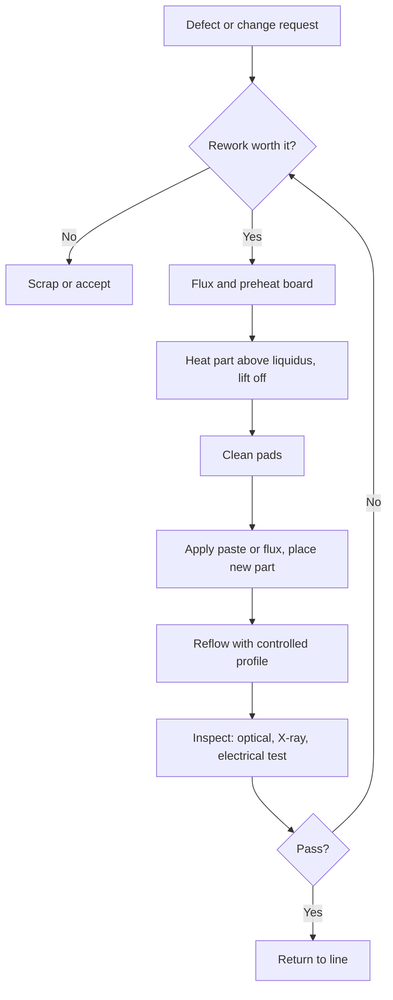

::: basics
### In plain words
PCB rework means going back to a board that is already built and changing it. You take a part off, put a new one on, or fix a bad connection. It exists because boards sometimes come out wrong, and fixing one is often cheaper than scrapping it. The catch is that rework melts the solder again, so the board gets another dose of heat it has to survive.

### Picture it
Imagine fixing one brick in a wall whose mortar has already set. You have to soften the mortar around that brick without loosening its neighbors, and each repair leaves the wall a little weaker. A cheap wall you would just rebuild. A board works the same way, except that solder really can be melted again, which is what makes the fix possible at all.

### Words you need
- **Solder**: a metal that melts at a fairly low temperature and joins a part to the board.
- **Pad**: the small copper patch on the board that a part is soldered to.
- **Flux**: a paste that cleans the metal so melted solder sticks to it.
- **Preheat**: warming the whole board gently first, so it is not shocked by local heat.
- **Rework, repair, modification**: rework restores the original design, repair fixes damage, and modification deliberately changes the design.

### The simplest example
A built board has a resistor of the wrong value. You put flux on it, preheat the board, and heat the part until its solder melts. Common lead-free solder melts at about 217 °C. You lift the part off, clean the pads, solder on the right resistor, and check it. That second dose of heat is the cost of the fix.

That is the whole idea. The rest of this page shows what a controlled heating profile looks like, how to tell rework, repair and modification apart, and how to decide whether a board is worth fixing or cheaper to scrap.
:::

::: testing
Whether you understand rework as a controlled manufacturing process rather than "fixing stuff with a soldering iron". The interviewer wants a crisp definition (removing, replacing or modifying parts or connections on an already-assembled board), the distinction between **rework**, **repair** and **modification**, and the awareness that every rework cycle costs the board something: extra thermal exposure, possible pad lift, possible delamination. Strong candidates mention that rework is a last resort priced against scrapping the board, and that good designs make it unnecessary or at least survivable.
:::

::: why
Every real board goes through bring-up, and most go through at least one rework. A prototype with a wrong footprint, a production lot with a few BGA opens, a late engineering change that swaps a resistor value, a field return with a dead regulator: all of these end at someone holding a hot-air station. If you design hardware, you will both request rework and have your boards reworked, so knowing what it does to a board (and what it costs) changes how you lay things out. It is also a standard interview opener for the manufacturing section because it exposes whether you have ever actually touched a board.
:::

::: concepts
- **Reflow soldering and solder alloys**: rework is basically controlled re-melting of joints. SAC305 melts at about 217 to 220 °C, eutectic SnPb at 183 °C. See [[q0602]] and [[q0599]].
- **Thermal mass and heat flow**: copper planes and big parts steal heat, which is why rework is harder on some joints. See [[q0538]] and [[q0637]].
- **Flux**: cleans oxide and lets solder wet. Rework adds flux because the original is gone or burnt.
- **Pad adhesion limits**: copper pads are glued to the laminate and the glue weakens with temperature and repeated cycles.
- **Defect types**: bridges, opens, tombstones ([[q0615]]), cold joints, wrong parts, BGA head-in-pillow.
- **Design for manufacturing (DFM)**: layout decisions that reduce the need for, and risk of, rework. See [[q0613]] and [[q0636]].
:::

::: answer
"PCB rework is any process where you take an already-assembled board and remove, replace or modify something on it. Usually that means desoldering a part and soldering a new one in, but it also covers adding jumper wires, cutting traces, or fixing a bad solder joint.

The reasons are things like a manufacturing defect, say a bridge or a tombstoned resistor, a component that failed or was the wrong value, or a design change after the boards were already built. I'd also separate rework from repair: rework brings the board back to its original spec, while modification changes the design and repair restores damaged copper or laminate.

The important thing is that it's a controlled process, not just touching it with an iron. You need the right temperature profile for the alloy, flux, a way to preheat the board so you're not shocking it, and ESD protection. Every cycle puts extra heat into the board and can lift pads or damage nearby parts, which is why standards like IPC-7711 and IPC-7721 limit what's allowed and why a shop will often scrap a cheap board instead of reworking it. And as a designer I try to make rework easy: good spacing, no hidden parts under big BGAs, and test and bodge options on the board."
:::

::: technical
**Definition.** Rework is the process of returning a defective or non-conforming assembly to a conforming state. In IPC usage the family of terms is *rework* (return to original specification using the original process type), *repair* (restore functionality of something damaged, may not match the original appearance) and *modification* (change to the design after release, for example a cut-and-jump). IPC-7711/7721 is the standard that documents rework, modification and repair procedures and acceptance expectations.

**Typical rework steps for an SMD component.**
1. Apply flux and preheat the board from below (commonly to roughly 100 to 150 °C) to cut the temperature step the top-side heat has to supply.
2. Heat the part to above liquidus, about 217 to 220 °C for SAC305 or 183 °C for SnPb, using hot air, IR or a conduction tool. Peak is typically 235 to 250 °C for lead-free depending on part and board.
3. Lift off the part when all joints are molten (vacuum pickup or tweezers).
4. Clean the pads: remove old solder with braid or a vacuum tool, clean flux residue with solvent.
5. Apply fresh paste, flux or pre-tin, place the new part, and reflow with a profile close to the original.
6. Inspect: visually, with a microscope, with X-ray for BGAs, and with an electrical test.

**Thermal constraints.** Lead-free needs about 34 °C more than SnPb at the melting point ($217 - 183 = 34$ °C). Typical practice is to keep the ramp slow, about 1 to 3 °C/s, and keep time above liquidus (TAL) to tens of seconds, roughly 30 to 90 s for typical lead-free. Check part datasheets for maximum body temperature (often 260 °C peak per JEDEC J-STD-020 moisture-sensitivity classification) and the board's laminate Tg and Td.

**Cost of rework.** Each cycle adds intermetallic growth in joints, stresses via barrels and pads, and can cause measling or delamination. A rework is only worthwhile when expected rework cost plus residual risk is below the scrap cost of the board (see [[q0635]]).

**Rework versus ECO jumpers.** Wire jumpers and cuts ([[q0634]]) are modification; a design-for-rework approach ([[q0636]]) tries to make them unnecessary.
:::

::: short
"Rework is removing, replacing or modifying parts or connections on a board that's already been assembled. Usually that's desoldering a bad component and soldering in a new one, or adding jumper wires for a design change. It needs a controlled thermal profile, flux, preheat and ESD care, because every rework cycle stresses the pads and laminate. It's a last resort that gets weighed against scrapping the board, and good layout makes it easier."
:::

::: long
"Rework means taking a board that's already been assembled and removing, replacing or modifying something on it. The classic case is desoldering a component that failed, was the wrong part, or was soldered badly, and putting a new one in. It also includes cutting a trace and adding a jumper wire when there's a design change, and cleaning up a defect like a solder bridge or a tombstoned chip resistor.

I usually split it into three words. Rework puts the board back to its original design. Repair fixes damage, like a lifted pad or a burnt trace. Modification changes the design, for example swapping a resistor value or adding a cut-and-jump to fix a schematic mistake.

Doing it well is about heat control. I'd flux the joint, preheat the board from underneath to something like 100 to 150 degrees so the top heat only has to cover the last stretch, then bring the part above the solder's melting point, around 217 for lead-free SAC305 or 183 for tin-lead, and hold it just long enough that every joint is liquid. Then I clean the pads, put on fresh solder or paste, place the new part and reflow with a profile close to the original. For BGAs I'd also use X-ray afterwards because you can't see the joints.

The catch is that every cycle costs the board something. Pads can lift, via barrels crack, laminate can delaminate. IPC-7711 and 7721 give guidance on how much is acceptable. So rework is a last resort priced against scrapping the board, and as a designer I try to help: keep keepout around big parts, avoid hiding parts under BGAs, add test points and zero-ohm options so a fix doesn't need a wire."
:::

::: terms
- **Rework**: returning an assembly to its original specification by removing and replacing parts or fixing joints.
- **Repair**: restoring damaged elements (lifted pad, burned trace) so the board functions; may not look original.
- **Modification (ECO)**: a planned design change on built boards, such as a cut-and-jump or part-value swap.
- **Liquidus**: temperature above which the solder is fully liquid (about 217 to 220 °C for SAC305, 183 °C for eutectic SnPb).
- **Time above liquidus (TAL)**: how long the joint stays molten. Too short gives cold joints, too long grows brittle intermetallics and stresses the board.
- **Preheat**: raising the whole board temperature before local heating, to reduce thermal shock and the temperature step the local source must supply.
- **IPC-7711/7721**: the IPC documents on rework, modification and repair of electronic assemblies.
- **Reballing**: replacing the solder balls on a BGA so it can be reattached.
- **Delamination / measling**: laminate layers separating or white spots in the glass weave caused by excess heat or cycles.
:::

::: exceptional
**An average answer** says "it's fixing a board by desoldering and resoldering parts" and stops.

**An exceptional answer**:
- Separates **rework, repair and modification** and gives an example of each.
- Describes the process as a **thermal profile**: flux, preheat, ramp, peak above liquidus for the right TAL, cool. Names alloys and temperatures.
- Says what rework **costs the board** (pad lift, delamination, intermetallics) and that cycles are limited.
- Frames it economically: rework only if the cost plus risk is below scrap.
- Links to design: reworkability is a layout decision (keepouts, thermal reliefs, test points, DNP options).
- Mentions inspection after rework (X-ray for BGAs, electrical test), not just "I resoldered it".
:::

::: mistakes
- **"Rework is the same as repair."** Rework restores to the original spec, repair restores a damaged board, and a modification changes the design. Interviewers notice the distinction.
- **Cranking the iron to 450 °C.** More temperature is not more speed: you burn flux, lift pads and damage the part. Use a proper profile and enough heat capacity.
- **Skipping preheat on a big or multilayer board.** The planes soak heat and force you to overheat the local area.
- **Reusing a BGA without reballing.** The old balls collapsed and reattaching is unreliable. Replace the part or reball.
- **Forgetting moisture.** Parts and boards that absorbed moisture can pop-corn or delaminate during rework. Bake per the moisture-sensitivity level when needed.
- **Assuming you can rework unlimited times.** Pads and laminate degrade each cycle. Many shops cap the number of cycles.
:::

::: deep
## What rework actually is

An assembled board is a stack of materials with very different thermal properties: FR-4 laminate (glass-reinforced epoxy), copper foils and planes, solder alloy, component packages (epoxy mold compound, ceramic, plastic). They all expand and conduct heat differently. Rework is a controlled way of locally getting some of those joints above the solder's liquidus without harming everything around them.


Figure: Rework is a loop with an economic gate at the start (is it worth it?) and an inspection gate at the end. A failed inspection sends you back around, adding another thermal cycle to the board.

## The thermal profile

The target is the same shape as the original reflow profile in [[q0602]]: ramp, soak, brief peak above liquidus, cool. Here is an illustrative lead-free rework profile measured at the joint (numbers are typical shapes, not a spec).

```plot
{"title":"Illustrative lead-free rework profile at the joint","x":{"label":"Time","unit":"s","min":0,"max":260},"y":{"label":"Joint temperature","unit":"°C","min":0,"max":270},
 "series":[{"label":"Joint temperature","points":[[0,25],[90,150],[150,180],[190,245],[220,245],[250,150]],"color":"accent"}],
 "hlines":[{"at":217,"label":"217 °C (SAC305)","color":"red"},{"at":183,"label":"183 °C (SnPb)","color":"orange"}],
 "xspans":[{"from":172.8,"to":228.8,"label":"TAL about 56 s"}]}
```
Figure: Slow preheat (about 1.4 °C/s from 25 to 150 °C), a soak to even out temperatures between a big part and its neighbours, a ramp to a 245 °C peak, and about 56 s above 217 °C. Notice that the peak is only about 28 °C above liquidus: the margin is small, which is why a wrong profile gives either cold joints or damaged parts.

Check the numbers: the ramp from 150 to 245 °C takes 150 to 190 s. The profile is at 180 °C at 150 s and 245 °C at 190 s, so it crosses 217 °C at $t = 150 + 40\cdot\frac{217-180}{245-180} = 150 + 40\cdot\frac{37}{65} = 172.8$ s. Cooling goes from 245 °C at 220 s to 150 °C at 250 s; it crosses 217 °C at $220 + 30\cdot\frac{28}{95} = 228.8$ s. So TAL $=228.8 - 172.8 = 56$ s.

> [!UNCERTAIN]
> Actual rework profiles depend on the part (JEDEC J-STD-020 maximum body temperature and MSL), paste or alloy datasheet, board thickness and copper content. Use the component and paste manufacturers' recommended profile; the numbers above are illustrative shapes.

## Why preheat matters

If you try to heat a joint on a ground plane using only a local source, the local source must raise the temperature from room temperature while the plane drains the heat. Preheating raises the baseline and cuts the step the local heat has to supply. For a target of 217 °C starting from 25 °C the step is 192 °C. Starting from a 120 °C preheated board it is 97 °C, about half. Since the steady heat flow needed to hold a temperature step across a fixed thermal resistance scales with the step, preheat roughly halves the power the tool must deliver in that case. [[q0637]] works this out with numbers.

Preheat also reduces the **thermal gradient across the board**. Large gradients warp boards (FR-4 expands several times more through its thickness than in-plane, and the mismatch with copper and ceramics adds stress), crack ceramic capacitors, and cause BGA balls on one side to melt while the other side hasn't.

## Types of rework by tool

| Tool | Good for | Risk |
|---|---|---|
| Soldering iron | Through-hole parts, small SMD, gull-wing leads, touch-ups | Local overheating, pad lift if you pry |
| Hot-air station | Small SMD, QFP, SOIC, passives | Blows away neighbours, burns flux, uneven heating |
| IR or convection rework station with bottom heater | BGAs, QFNs, large parts | Cost, needs profile and training |
| Solder fountain | Through-hole connectors | Setup, only for some shapes |
| Hand tools (knife, wire, microscope) | Cut-and-jump mods | Operator skill |

## Inspection after rework

Fixing a joint you can see is easy to verify. For a BGA or QFN with hidden joints, you need X-ray for opens, bridges, voids and ball alignment, followed by an electrical test (boundary scan or functional). Reworked boards should be tracked: serial number, what was reworked, how many cycles. If failures cluster on one component, it points to a design or process root cause ([[q0635]]).

## The economics

Let $C_s$ be the cost of a scrapped board (all value added to date), $C_r$ the rework labour and consumables, and $p$ the probability the rework succeeds. If a failed rework scraps the board, expected cost is $C_r + (1-p)C_s$. Rework beats scrap when that is less than $C_s$:

$$C_r + (1-p)C_s < C_s \;\Rightarrow\; C_r < pC_s.$$

With a board worth USD 120, rework cost USD 15, and 85% success: $15 < 0.85\times120 = 102$, so rework wins easily. If the board is a USD 4 board, rework loses even at 99% success. The same logic is why high-value BGA boards are reworked and cheap consumer boards are often recycled.

## What this means for design

You can't make rework free, but you can lower its cost: leave room around large parts for hot-air nozzles, don't bury a fragile part under a BGA, tie big pads to planes through thermal reliefs, mark polarity and reference designators in silkscreen outside the part body, and include options such as zero-ohm links so fixes are population changes rather than wires. [[q0636]] expands that list.
:::

::: applications
- **Prototype bring-up**: swapping a wrong-value resistor, replacing a damaged regulator, tacking on a pull-up the schematic missed.
- **Production yield recovery**: touching up opens or bridges found at automated optical inspection (AOI) or in-circuit test.
- **BGA replacement**: removing a bad memory or FPGA with a rework station, reballing or replacing it and X-raying the result.
- **Engineering change orders**: factory modifying a released lot with a cut-and-jump or a part swap.
- **Field and RMA repair**: replacing a failed connector or power IC on a returned unit.
- **Failure analysis**: removing a suspect part intact so it can be examined.
:::

::: assumptions
This page assumes standard FR-4 type laminate, SMT assembly, and either SAC305 or SnPb solder. The numbers change with the following.
- **Alloy**: low-temperature solders such as Sn-Bi melt near 138 °C, so rework temperatures are far lower, but Sn-Bi is brittle and can contaminate other alloys.
- **Board type**: flex, high-frequency laminates or metal-core boards have different temperature limits.
- **Part type**: ceramic capacitors crack from thermal shock; LEDs and sensors can be damaged at lower body temperatures; moisture-sensitive parts need baking.
- **Volume**: in production, "rework" is a defined station with a qualified profile; in a lab it's often an engineer with a hot-air pencil. Both are valid answers depending on context.
- **Definition**: some companies say "rework" to cover all three of rework, repair and modification. The IPC distinction is useful but not universal.
:::

::: followups
### What is the difference between rework, repair and modification?
Rework puts the assembly back to its original specification, for example replacing a part that was soldered badly. Repair restores a damaged board, for example fixing a lifted pad or a burned trace, and the result may not be identical to the original. Modification changes the design on built boards, for example a cut-and-jump because the schematic had a mistake. In practice people use "rework" loosely for all three, but the distinction matters when you talk to a customer or a quality group, because modifications often need a documented engineering change.

### Why do you preheat the board?
Preheat raises the whole board's temperature so the local heat source only has to supply the final step to liquidus. On a plane-heavy board that nearly halves the power needed: a 192 °C step from room temperature becomes about 97 °C from a 120 °C preheat. It also reduces thermal gradients that warp the board or crack ceramic parts, and it lets you use lower tip or air temperatures, which protects pads and flux.

### How many times can a board be reworked?
There's no universal number. It depends on the laminate, pad size, copper thickness, and process; many shops cap the count for a given location, often at a small number such as two or three cycles, and the limit is in their process documentation. IPC-7711/7721 gives procedures but the cycle limit is company-specific. What I would say in an interview is that every cycle adds thermal stress and intermetallic growth, so you track rework and avoid going beyond what's been qualified.

### How would you decide whether to rework or scrap a board?
Compare the expected cost: rework labour plus the chance of failure times the board cost, against scrapping. Rework wins when $C_r < pC_s$. For a USD 120 board with a USD 15 rework and 85% success it's obviously worth it. I'd also consider schedule (can I wait for a new board?), what else is on the board (if it carries an expensive FPGA, rework is more attractive), and risk to reliability (a reworked board used for qualification might be unrepresentative).

### What if the BGA you removed was reballed three times already?
I'd stop. Each reflow grows the intermetallic layer (Cu6Sn5 and Cu3Sn) at the ball-to-pad interface, which makes joints more brittle, and each cycle risks package warpage and moisture damage. For a high-reliability product, I'd replace the part with a new one rather than reball it again, and I'd check for a limit in the part's datasheet, since many packages state a maximum number of reflows (often three for MSL rated parts, but check).

### Scenario: after replacing a regulator, the board powers up but a neighbouring capacitor is now open. What happened?
Most likely the capacitor was a ceramic MLCC close to the regulator, and the hot-air flow or the iron thermally shocked it, creating a micro-crack that opened the part or cracked a solder joint. Or the neighbouring part's solder re-melted and it blew away or shifted. I'd inspect with a microscope, then look for a crack or tilt, replace the capacitor, and next time shield nearby parts with Kapton tape, lower the nozzle airflow, and preheat the board.
:::

::: interpretations
"PCB rework" is sometimes used loosely in industry to mean any hand-modification of a board (including adding wires, "bodges"), and sometimes only the narrow IPC sense of restoring to the original spec. The answer above gives both and explains the difference. If the interviewer is asking in a bring-up context, lead with the engineer's view (swap parts, add jumpers); in a manufacturing context, lead with the production view (defect repair at a rework station with a qualified profile).
:::

::: references
- IPC-7711/7721, *Rework, Modification and Repair of Electronic Assemblies* (the IPC standard on these procedures).
- IPC J-STD-020 / JEDEC moisture and reflow sensitivity classification for SMDs, for the maximum body temperature of components.
- IPC-7095, *Design and Assembly Process Implementation for BGAs*, for BGA rework considerations.
- Lau and Pao, *Solder Joint Reliability of BGA, CSP, Flip Chip, and Fine Pitch SMT Assemblies* (chapters on solder joint reliability and thermal cycling).
:::

::: rubric
- Defines rework as removing, replacing or modifying parts or connections on an assembled board :: This is the core definition the interviewer is checking.
- Distinguishes rework, repair and modification :: Shows familiarity with IPC vocabulary and different intent of each.
- Describes a controlled thermal process (flux, preheat, profile above liquidus, TAL) :: Rework is a process, not an iron held on a joint.
- Names alloy melting points (SAC305 about 217 °C, SnPb 183 °C) :: Shows you know why lead-free is harder.
- States that each cycle stresses the board and cycles are limited :: Shows awareness of the real cost of rework.
- Mentions inspection afterwards, including X-ray for hidden joints :: A reworked joint is not proven good until verified.
- Weighs rework against scrap and ties it to design for reworkability :: Connects the process to engineering decisions.
:::

::: quiz
```json
[
 {"type":"mcq","level":"fundamental","q":"Which statement best describes the difference between rework and modification?","options":["They are the same thing","Rework restores the original design; modification changes the design on built boards","Rework is for through-hole parts only; modification is for SMD","Modification is done only before assembly"],"answer":1,"explain":"Rework returns the assembly to its original specification. Modification, such as a cut-and-jump or part-value swap, deliberately changes the design after boards are built."},
 {"type":"mcq","level":"fundamental","q":"Why is lead-free rework generally harder than SnPb rework?","options":["Lead-free solder is lighter","Lead-free solder melts about 34 °C higher, leaving less margin before part and board limits","Lead-free needs no flux","Lead-free joints are always stronger so they resist removal"],"answer":1,"explain":"SAC305 liquidus is about 217 °C versus 183 °C for eutectic SnPb, so the same parts must be heated about 34 °C more, closer to their maximum body temperatures."},
 {"type":"numeric","level":"intermediate","q":"A board is preheated from 25 °C to 150 °C in 90 s. What is the average ramp rate?","answer":1.39,"tolerance":0.03,"unit":"°C/s","explain":"(150 − 25)/90 = 125/90 = 1.39 °C/s, comfortably in the typical slow 1 to 3 °C/s range."},
 {"type":"numeric","level":"intermediate","q":"A rework costs USD 15 and succeeds with probability 0.85. If a failed rework scraps a board worth USD 120, what is the expected cost per attempt (USD)?","answer":33,"tolerance":0.02,"unit":"USD","explain":"Expected cost = C_r + (1−p)C_s = 15 + 0.15 × 120 = 33 USD, much less than scrapping (120 USD), so rework is justified."},
 {"type":"truefalse","level":"intermediate","q":"Raising the soldering iron to the maximum temperature is the best way to speed up rework on a board with a big ground plane.","answer":false,"explain":"A higher tip temperature burns flux and risks pad lift and part damage. Preheating the board and using adequate heat capacity is the correct fix."},
 {"type":"multi","level":"advanced","q":"Select all that are legitimate concerns when reworking a BGA.","options":["Hidden joints require X-ray to verify","Reusing the old balls without reballing","Moisture absorbed by the package or board","The board's Tg and maximum heat exposure"],"answer":[0,1,2,3],"explain":"All four matter: hidden joints need X-ray, collapsed old balls make unreliable joints, moisture can cause popcorning or delamination, and board Tg or Td limits constrain the profile."}
]
```
:::
