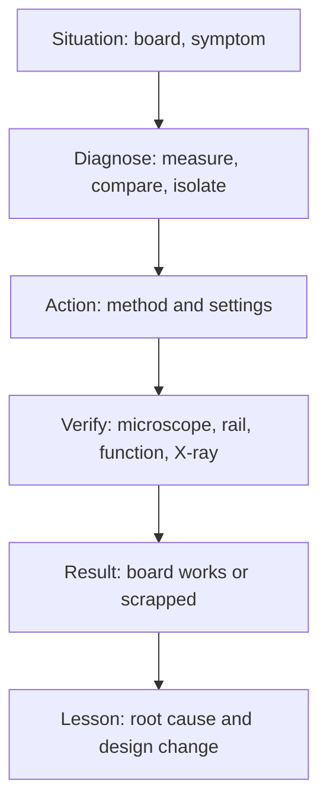

::: testing
This is a behavioural question, so the interviewer is not testing a fact. They want evidence you have **actually handled boards** and learned from it, and they use your story to probe how deep your knowledge goes. They listen for: a specific situation, the tools and technique you used (iron vs hot air, flux, preheat, wick), what went wrong, how you checked the result, and what you changed afterwards. Honest candidates with limited experience can still score well by being specific about a small job and showing they understand the physics behind it. Invented heroics fall apart on the first follow-up.
:::

::: why
Hardware interns spend a surprising amount of time swapping parts on prototypes: a wrong resistor, a regulator that died, a connector that needs to move. Teams want someone who can do that without destroying the only working board, and who treats a rework as information about the design (why did this need fixing?). The way you tell the story also shows how you communicate: situation, action, result, lesson. That is the same structure you will use in design reviews and postmortems.
:::

::: concepts
- **What rework is and what it risks**: see [[q0632]]; pads lift, parts get cooked, neighbours move.
- **Hand soldering technique**: tip temperature, tinning, flux, drag soldering, wick, desoldering pump.
- **Hot air and preheat**: why you preheat and how to protect neighbouring parts. See [[q0637]] for the heat-sinking reason.
- **Types of rework**: part swaps, jumpers, cuts. See [[q0634]].
- **ESD and handling**: wrist strap, grounded mat, bag storage.
- **Root cause thinking**: a rework is a symptom; what design or process decision caused it? See [[q0635]].
- **STAR/CAR story structure**: situation, task, action, result (plus what you learned).
:::

::: answer
"Yes. In my [your project, e.g. senior design / a club robot / a personal board] I had a board with [e.g. a 0603 LDO and a QFN motor driver] that didn't power up correctly. Using the multimeter I found [e.g. the 3.3 V rail sagging to 1.1 V], and the thermal camera or touch test showed [part] heating. I swapped the [part] with a hot-air station: flux on the pads, board on a preheater to roughly 100 degrees, 350 degree air with low airflow, Kapton tape on the neighbouring parts, and lifted the part when the joints flowed. Then I cleaned the pads with braid and flux, tinned one pad, placed the new part and reflowed.

The first try [honest detail: e.g. I lifted a pad on the output cap because I pried before the solder was fully molten]. I fixed it with a short piece of 30 gauge wire to the trace. The lesson was to wait for all joints to be liquid and use more flux. I verified with a microscope and by measuring the rail again, and then went back to find why it failed. It turned out [root cause, e.g. I'd reversed a cap footprint], so I fixed the footprint in the layout for the next spin.

If I'm being honest, my experience is mostly hand soldering and some hot-air on prototypes, not production-line BGA rework, but I understand how that works: preheat, a profile above liquidus, X-ray afterwards."
:::

::: technical
**What a technically strong rework story contains.**
1. **Context**: board, part package (0402, SOIC, QFN, BGA), why it needed rework (see [[q0635]]).
2. **Diagnosis before rework**: how you decided which part was bad (continuity, rail voltage, thermal image, oscilloscope, X-ray, swapping a known-good board). Rework without diagnosis is guessing.
3. **Method and settings** (typical values, flag them as typical, not universal):
   - Iron: 300 to 350 °C for SnPb, roughly 350 to 380 °C for lead-free, with a tip big enough for the joint, tinned and flux-coated.
   - Hot air: roughly 300 to 380 °C at the nozzle with low airflow for small parts so they do not blow away; preheat the board from below.
   - Flux: no-clean or rosin paste flux applied liberally; clean residue if the board has high-impedance analog nodes.
   - Wick or vacuum to clear old solder; fresh solder or paste for the new part.
4. **Verification**: microscope, continuity, power rail check, functional test, X-ray for hidden joints.
5. **Outcome and learning**: root cause, design change, process change, number of boards saved.

**Key physics to be ready for.** Joint temperature must exceed liquidus (about 217 to 220 °C for SAC305; 183 °C for SnPb); heat flow to ground planes is the usual obstacle ([[q0537]], [[q0538]], [[q0637]]); too much time at temperature degrades pads and laminate; ceramic capacitors crack from thermal shock; moisture-laden parts can pop. If you can say *why* each step exists, you will pass the follow-ups.

**If you have little experience.** Be specific about whatever you did: "replaced an 0603 resistor on a breakout board", "added a cut-and-jump on a motor driver", "reworked a through-hole header in a lab". Then show you understand the next level: "I haven't done BGAs but I know they need bottom preheat, a profile, and X-ray afterwards."
:::

::: short
"On my [project] board, a [part] failed, so I diagnosed it with a multimeter and thermal camera, then replaced it with a hot-air station: flux, preheat, low airflow, Kapton on the neighbours. I lifted a pad on the first attempt, patched it with a wire, and learned to wait until every joint is liquid. Afterwards I checked under the microscope, re-measured the rail, and fixed the footprint error that caused the failure."
:::

::: long
"The example I'd use is [your project]. We had a board where [symptom, e.g. the 3.3 V rail was sagging and a regulator was getting hot]. Before touching anything I diagnosed it: I checked the rail with a multimeter, looked at the board with a thermal camera, and compared with a second board that worked. That narrowed it to [the part] being damaged or shorted.

For the actual rework I treated it as a process. I put flux on the pads, set the board on a preheater, and used a hot-air station at a modest temperature with low airflow so the small parts around it wouldn't blow away. I put Kapton tape on the nearby connector and capacitors. When all the joints looked liquid, I lifted the part, cleaned the pads with braid and flux, tinned one pad, and placed the new part and reflowed it.

It didn't go perfectly. [Honest detail: e.g. I lifted a pad on the output capacitor because I pulled before the solder was fully molten.] I repaired it with a thin wire to the trace and then re-checked with a microscope and by powering the board up and measuring the rail. The lesson was to use more flux, wait for the joints to flow, and not force anything.

Then I asked why it happened. The root cause was [e.g. a reversed polarised capacitor footprint], so I fixed the footprint in the layout, added a polarity mark in the silkscreen, and noted it in our design checklist.

I should be honest that most of my rework has been hand soldering and hot-air on prototypes. I haven't done production BGA rework, but I understand it needs bottom preheat, a controlled profile above liquidus, and X-ray inspection afterwards."
:::

::: terms
- **Hot-air station**: a tool that heats the part and joints with a stream of hot air; used for SMD rework. Airflow and temperature must be tuned.
- **Preheater**: heater under the board that raises the baseline temperature before local heating.
- **Flux**: a chemical that removes oxide and promotes wetting; essential in rework.
- **Solder wick (braid)**: copper braid that pulls molten solder from a pad by capillary action.
- **Drag soldering**: dragging a loaded iron tip along fine-pitch leads so surface tension separates the joints.
- **Kapton tape**: heat-resistant polyimide tape used to shield neighbouring parts.
- **Cold joint**: a joint that did not fully wet, looks dull and grainy, and may be intermittent.
- **Lifted pad**: copper pad separated from the laminate by heat or force.
- **Cut-and-jump / bodge wire**: a modification where a trace is cut and a wire added. See [[q0634]].
:::

::: exceptional
**An average answer** says "I soldered some parts and fixed a board once" with no detail.

**An exceptional answer**:
- Tells a **specific story**: board, part, symptom, diagnosis, action, result.
- Describes **diagnosis before rework** (measurement, comparison with a good board).
- Gives **technique with reasons**: preheat because planes sink heat, Kapton because hot air moves small parts, flux because oxide stops wetting.
- Admits a **mistake and what it taught** (lifted pad, cooked part). That reads as credibility, not weakness.
- Ends with **root cause and design change**: "so I changed the footprint / added a test point."
- States the **limits of experience honestly** and shows knowledge of the next level (BGA rework, X-ray, profiles).
:::

::: mistakes
- **Inventing experience.** The interviewer will ask what temperature, what flux, what happened. Make up nothing; use a small true example.
- **Talking only about the tool.** "I used a hot-air station" is not a story. Say what the problem was and what you learned.
- **No diagnosis step.** Replacing parts at random looks like guessing.
- **Skipping the failure.** Everyone lifts a pad at some point. A story with no mistakes sounds unrealistic.
- **Claiming BGA rework without having done it.** Say "I haven't, but here's how it works" instead.
- **Ending at "it worked."** Close the loop: root cause, prevention, verification.
- **Blaming others.** If the design had a flaw, say what you would do differently.
:::

::: deep
## What the interviewer hears

An interviewer asking "describe any rework experience you have" is running two tests at once. The first is **competence**: can you touch a board without ruining it, and do you know the real-world details (flux, preheat, ESD, inspection)? The second is **engineering judgement**: do you understand why the rework was needed and what you changed so it does not happen again?


Figure: A rework story is a diagnosis story with a soldering step in the middle. Interviewers follow your reasoning along this chain; weak answers contain only the "Action" box.

## Build your answer from true material

**Step 1: pick an example.** It does not have to be glamorous. Any of these is fine, provided you really did it:
- Replacing an LED, resistor or capacitor on a prototype.
- Reworking a through-hole header, switch or connector.
- Adding a wire to fix a schematic or layout error.
- Fixing a solder bridge on a fine-pitch IC with flux and wick.
- Helping a more experienced person with BGA rework and observing the process.
- Hand-assembling a kit or a small board and fixing joints.

**Step 2: collect the technical details.** Before the interview, write down for your example: the board, the part and package, the symptom, what you measured, the tool and approximate settings, what went wrong, how you verified, and what the root cause turned out to be.

**Step 3: mark the lesson.** It should be a transferable engineering rule ("add polarity marks", "leave room for the nozzle", "add a test point on that rail"), not "be careful".

**If you have never done rework.** You can say so honestly and answer from the "next best" experience: soldering projects, lab assembly, debugging boards. Then show you've prepared: "I haven't done rework on a production board, but I've practiced on scrap boards, and here is how I would approach replacing a QFN: tape neighbours, flux, preheat, hot air at X, wick the pads, paste, place, reflow, microscope, power test." Prepared honesty beats inflated stories.

## Technical knowledge that makes the story survive follow-ups

### Iron versus hot air

A soldering iron heats through contact with a tip; the efficiency depends on tip thermal mass and contact area, not just tip temperature. A big chisel tip with solder bridging tip to joint conducts heat far better than a tiny conical tip on a dry pad. Hot air heats a whole footprint at once and is what you need for QFP, SOIC and multi-pin parts.

### Why preheat and flux matter

A joint to a plane or a large copper pour loses heat as fast as you add it (see [[q0637]]). Preheating raises the starting point. Here is a simple first-order picture. Suppose the joint temperature heads toward an effective tip temperature $T_\infty$ with time constant $\tau$:

$$T(t) = T_\infty - (T_\infty - T_0)e^{-t/\tau}.$$

```plot
{"title":"Illustrative joint heating with and without board preheat","x":{"label":"Time","unit":"s","min":0,"max":14},"y":{"label":"Joint temperature","unit":"°C","min":0,"max":320},
 "vars":{"tinf":300,"tau":6,"t0a":25,"t0b":120},
 "series":[{"label":"No preheat (25 °C start)","fn":"tinf-(tinf-t0a)*exp(-x/tau)","color":"red"},{"label":"Preheat to 120 °C","fn":"tinf-(tinf-t0b)*exp(-x/tau)","color":"green"}],
 "hlines":[{"at":217,"label":"SAC305 liquidus about 217 °C","color":"orange"}]}
```
Figure: With these illustrative numbers ($T_\infty = 300$ °C, $\tau = 6$ s), the unheated joint takes $6\ln(275/83) = 7.2$ s to reach 217 °C, while the preheated one takes $6\ln(180/83) = 4.6$ s. Less dwell time means less damage to the part and the pad. The numbers are a teaching model, not a measurement.

Flux removes oxide so the solder wets; without it, solder balls up and heat transfer through the joint is poor.

### Protecting neighbours

Hot air can melt neighbouring joints and blow small parts across the board. Tape (Kapton), a reduced airflow setting, and a nozzle sized to the part help. Ceramic capacitors are particularly sensitive to thermal shock, which can cause cracks that appear later as shorts or leakage.

### ESD and handling

Wear a wrist strap tied to a grounded mat, store parts in static-shielding bags, and avoid touching pins. For MOSFET and CMOS parts this is not optional; latent ESD damage can pass a test and fail later.

### Inspection

Look under a microscope for bridges, tilt, cold joints, and flux residue. For hidden joints (BGA, QFN thermal pads) X-ray is the right tool. Electrically, check continuity and shorts before applying power, then power up with a current-limited supply, then run a functional test.

## Example of a strong answer with placeholders

"*[Your project]* had a motor-driver board with a QFN driver. The motor wouldn't spin and the driver ran hot. I measured the supply at *[value]* and saw *[symptom]*, so I suspected a bridged pin or a damaged part. I put the board on a preheater, added flux, and used hot air with Kapton tape on neighbouring caps. I removed the QFN, cleaned the pads with braid, and found a solder bridge between two pins under the package, which explained the heat. After fitting a new part, I checked for shorts with the multimeter before powering. The root cause was *[paste stencil / aperture / pad design]*, so I changed the land pattern on the next revision. That taught me to inspect first and to check for shorts before reapplying power."

Make it your own: replace every bracket with a true detail and delete anything that did not happen.

## What if the interviewer pushes?

Typical probes: "what temperature did you use?", "why that tip?", "how did you know the joint was good?", "what would you do for a BGA?", "what if the part was on a ground plane?" Practise one-sentence answers to each. For the plane question the right idea is thermal mass: preheat, larger tip or hot air, and a design note to add thermal reliefs ([[q0538]]). For BGA: bottom heat, profile, X-ray, reball or replace.
:::

::: applications
- **Hardware internship projects**: fixing prototype boards on the bench is part of most intern jobs.
- **Lab bring-up**: modifying first-spin boards with wires and part swaps.
- **Student competitions (robotics, rocketry, FSAE electronics)**: field repair before a run.
- **Manufacturing engineering**: rework stations in production, with qualified profiles.
- **Design reviews and postmortems**: using rework history to improve footprints and layout rules.
:::

::: assumptions
The sample answer assumes a prototype setting with SMD parts and hand tools. Details change by context. In production, rework is performed by trained operators at a qualified station with documented profiles, and "my experience" means working with those processes. For through-hole or hobby work, the iron temperature and technique differ. The temperatures given are typical lab values; always follow the part and solder datasheets. If you truly have no experience, the valid honest answer is to say so, describe related experience (soldering, debugging, assembly), and demonstrate that you understand the process and the risks.
:::

::: followups
### What temperature do you set your iron or hot air to, and why?
For an iron I'd typically use roughly 300 to 350 °C with SnPb and around 350 to 380 °C for lead-free, because the iron's tip sees a drop when it touches a joint and the solder's liquidus is higher for lead-free. The right number depends on tip size and thermal mass. Higher is not better: it burns flux and lifts pads. For hot air I'd use a moderate nozzle temperature with low airflow for small parts and preheat the board, because airflow blows small parts around. I'd always check the part and paste datasheets.

### How do you know a reworked joint is good?
Visually under a microscope: smooth, shiny, concave fillet that wets both pad and lead (for SnPb; lead-free is duller). Check for bridges, tilt and flux residue. Electrically check for shorts and continuity before powering. For hidden joints I'd use X-ray, and I'd verify function with the board running, including a thermal or stress check if the part is power related.

### What would you do differently for a BGA?
A BGA needs bottom preheat and a controlled profile above liquidus with an even temperature across the whole package, because joints are hidden. I'd remove with a rework station, clean and level the pads, reball or use a new BGA, apply flux or paste, align, reflow and use X-ray to check for opens, bridges and voids. I'd also check moisture status and bake if needed.

### Tell me about a time rework went wrong.
Use a true example: a lifted pad, a cracked ceramic cap, a neighbouring part blown away. Say what you did to recover (wire to trace, replaced the part, restarted), what the cause was (too much force, not enough flux, too much heat), and what you do now. Interviewers usually like honest failures because they show learning.

### Scenario: you must replace a power connector on a 6-layer board with solid ground connections. How would you do it?
I would expect the pins to be heat-sunk by the planes. I'd preheat the board, use a large tip or hot air from the bottom, add leaded solder to the joint to lower the melting point locally, and use a desoldering station or wick, not force. I'd check the board's thermal relief design afterwards and note that future spins should add reliefs, which makes this much easier ([[q0637]]).

### What if you're asked to rework something and it takes more than three attempts?
I'd stop and think. Repeated cycles degrade the pad and laminate, so I'd review what's going wrong (temperature, flux, tool, board), and consider whether the board is worth continuing with. In a team setting I'd ask someone more experienced or request a new board, and I'd record what I tried.
:::

::: interpretations
This is a behavioural question, so the "right answer" depends on the candidate's real experience. The page gives a structure and technical content to adapt. Bracketed text in the sample answer is a placeholder: do not state anything you did not do. If you have only hobby experience (kits, Arduino boards), say so; interviewers usually value honesty and understanding over scale.
:::

::: references
- IPC-7711/7721, *Rework, Modification and Repair of Electronic Assemblies*.
- IPC J-STD-001, *Requirements for Soldered Electrical and Electronic Assemblies* (workmanship of solder joints), and IPC-A-610, *Acceptability of Electronic Assemblies*.
- Horowitz and Hill, *The Art of Electronics*, sections on construction, soldering and prototyping.
- Paul Scherz and Simon Monk, *Practical Electronics for Inventors*, chapter on soldering and prototyping.
:::

::: rubric
- Gives a specific situation, symptom and diagnosis :: Shows you debug before you rework.
- Names tools and technique with reasons (flux, preheat, hot air, wick, tape) :: Shows you understand the process rather than reciting a tool list.
- Mentions at least one mistake or limit and the lesson :: Credibility and learning ability are what behavioural questions test.
- Verifies the result (microscope, continuity, power test, X-ray) :: A fix isn't done until it is verified.
- Identifies root cause and a design or process change :: Shows engineering ownership beyond the bench.
- Honestly states the scope of experience :: Prevents inflated claims collapsing on follow-ups.
- Shows knowledge of heat flow, ESD, and BGA basics :: This is the technical depth interviewers probe next.
:::

::: quiz
```json
[
 {"type":"mcq","level":"fundamental","q":"What is the main purpose of preheating the board before hot-air rework?","options":["To make the flux evaporate","To raise the baseline temperature so less local heat is needed and thermal shock is reduced","To harden the solder mask","To test the part for moisture"],"answer":1,"explain":"Preheat reduces the temperature step the local source must supply and lowers thermal gradients that crack parts or warp the board."},
 {"type":"mcq","level":"fundamental","q":"Which is the best structure for describing a rework experience?","options":["List every tool you own","Situation, diagnosis, action, verification, result and lesson","Only describe the final working board","Say that rework is easy"],"answer":1,"explain":"A story with diagnosis, method, verification and a lesson shows competence and engineering judgement."},
 {"type":"numeric","level":"intermediate","q":"A joint heads toward 300 °C with τ = 6 s, starting at 25 °C. How long (s) to reach 217 °C?","answer":7.19,"tolerance":0.03,"unit":"s","explain":"t = τ ln((300−25)/(300−217)) = 6 ln(275/83) = 7.19 s."},
 {"type":"numeric","level":"intermediate","q":"Same model, but the board is preheated to 120 °C. How long (s) to reach 217 °C?","answer":4.64,"tolerance":0.03,"unit":"s","explain":"t = 6 ln((300−120)/(300−217)) = 6 ln(180/83) = 4.64 s, about 35% less dwell than without preheat."},
 {"type":"truefalse","level":"intermediate","q":"If you have never done BGA rework, you should claim you have to appear stronger in the interview.","answer":false,"explain":"Follow-ups on temperatures, profiles and X-ray would expose it. Say what you have done, and show you understand how BGA rework works."},
 {"type":"multi","level":"advanced","q":"Select all that make a rework story stronger.","options":["Describing how you diagnosed the fault before touching the board","Admitting a mistake and what it taught you","Stating the root cause and design change that followed","Claiming nothing ever went wrong"],"answer":[0,1,2],"explain":"Diagnosis, honest reflection and root-cause follow-through show engineering ownership. A story with no problems sounds unrealistic."}
]
```
:::
