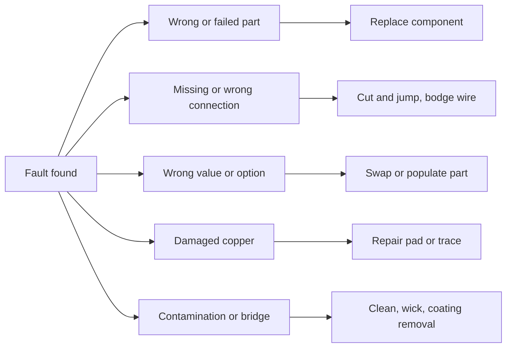

::: basics
### In plain words
Rework comes in a few kinds, and each kind fits a different fault. You can replace a part, add a wire to change a connection, change which parts are fitted, repair damaged copper, or clean up solder mess.

### Picture it
Think of fixing a road. Replacing a broken sign is swapping a part. Building a detour is adding a wire. Filling a pothole is repairing a lifted pad. Sweeping up debris is cleaning off a solder bridge. A detour is fine for a slow footpath, but it adds extra distance, and on a fast highway that extra distance causes trouble. A wire on a circuit is the same: harmless for slow signals, a problem for very fast ones.

### Words you need
- **Bodge wire (jumper)**: a thin wire added by hand to make a connection the board does not have.
- **Cut-and-jump**: cutting a copper trace so a connection is removed, then adding a wire to connect somewhere else.
- **DNP (do not populate)**: a spot on the board left empty on purpose, so a part can be fitted later if needed.
- **Inductance**: how strongly a wire resists changes in current. It only matters when the signal changes very fast. See [[q0039]].
- **Lifted pad**: a copper pad that has peeled off the board.

### The simplest example
Suppose a reset signal was never connected to the chip that needs it. You scrape a little coating off, solder a thin wire from the reset pad to the chip pin, and glue the wire down. A 30 mm wire has about 30 nH of inductance (a rough rule is 1 nH per millimeter). At 1 MHz that is only about 0.19 Ω, and at 100 MHz about 19 Ω. A reset line barely changes, so the wire is harmless. A 100 MHz clock would be badly disturbed.

That is the whole idea. The rest of this page covers the tools for each kind of fix, more wire math, and how to design in options so you need fewer wires.
:::

::: testing
Whether you can list the real categories of rework and say, for each one, what tool it needs and what it risks. A good answer is organised: component replacement (through-hole, SMD, hidden-joint packages like BGA and QFN), connection changes (cuts, jumpers, bodge wires), population changes (DNP or alternate parts), repairs (lifted pads, damaged traces, solder mask), and cleanup (bridges, flux, conformal coating). The interviewer also listens for judgement: which of these affect signal integrity, which damage the board, and which should be designed out.
:::

::: why
In bring-up you rarely get a board that works first time. Knowing the menu of fixes tells you how to respond quickly: a wrong pull-up value is a part swap, a missing connection is a jumper, a net that should not connect is a cut, a missing footprint option is a lesson for the next spin. Knowing which fixes are electrically safe (a bodge on a slow GPIO) and which are not (a wire on a DDR clock) saves days of chasing ghosts. It also helps you design boards that make the common fixes easy.
:::

::: concepts
- **Component replacement**: desolder and solder a new part; tool depends on package. See [[q0632]].
- **Cut-and-jump (modification)**: break a trace and add a wire to make a different connection.
- **Parasitic inductance of wires**: a jumper adds roughly a nanohenry per millimetre, which matters at high frequency. See [[q0039]].
- **Population options**: DNP (do not populate) parts and zero-ohm links so a variant is a part swap, not a wire.
- **Repair of lifted pads and traces**: restoring copper with wire, epoxy or pad kits.
- **Reballing / hidden-joint rework**: for BGA and QFN packages. See [[q0644]].
- **Thermal limits**: each of these adds heat cycles, see [[q0637]].
:::

::: answer
"I think about rework in five buckets. First, **replacing a component**: that could be a through-hole part with an iron and a desoldering pump, an SMD part with hot air, or a BGA or QFN with a rework station and X-ray afterwards. Second, **changing connections**: cutting a trace with a knife and adding a bodge wire to make a connection the layout missed. Third, **changing population**: swapping a resistor value, fitting a footprint that wasn't populated, or removing a part. Fourth, **repairs**: fixing a lifted pad or a damaged trace with a wire or a pad kit. And fifth, **cleanup**: removing a solder bridge, cleaning flux, or removing conformal coating to get to a part.

Each one has a risk. Part swaps stress pads. Wires add inductance, so I would happily bodge a slow GPIO or enable line but I would avoid a wire on a DDR clock or a switching node. And if I know a connection might need to change, I'd rather design in a zero-ohm link or an extra footprint than depend on cutting a trace. When I do a modification, I'd also document it so the next board spin includes the fix."
:::

::: technical
**1. Component replacement**
- *Through-hole*: desolder with pump, wick or a desoldering station, clear the barrel, insert the part, solder. Planes and thermal reliefs dominate difficulty ([[q0637]]).
- *Small SMD (chip R/C, SOT)*: iron (two-tip or tweezer) or hot air. Risk: tombstoning of the new part ([[q0615]]), ceramic cracking.
- *Gull-wing (SOIC, QFP)*: hot air or drag soldering; bridges are fixed with flux and wick.
- *Bottom-terminated or area-array (QFN, LGA, BGA)*: hot-air or IR rework with bottom preheat, a profile, paste or flux, X-ray inspection ([[q0644]]).

**2. Connection changes**
- *Cut*: use a hobby knife or a Dremel to cut a trace; confirm with a meter. Keep cut width wide enough that the gap doesn't re-bridge.
- *Jumper / bodge*: thin enamelled wire (about 30 AWG, 0.25 mm) from pad to pad, tacked and secured with glue or Kapton. Resistance is negligible (30 AWG is about $0.34\,\Omega$/m, so 30 mm is about 10 mΩ). Inductance is the real limit, about 1 nH/mm as a rule of thumb ([[q0039]]).

**3. Population changes**
- DNP part swaps (e.g. pull-up vs pull-down options), alternate values, 0 Ω links, stuffing options, or removing a part to isolate a rail.

**4. Repairs**
- *Lifted pad*: bond a wire to the trace remnant; use pad repair kits or conductive epoxy only when appropriate.
- *Damaged trace*: bridge with wire or foil; scrape solder mask to expose copper.
- *Via or barrel damage*: use an eyelet or wire through the hole.

**5. Cleanup**
- Remove bridges, solder balls, flux residue; remove conformal coating (solvent, scraping, or abrasive) before touching a part; recoat afterwards.

**Which are valid for which signals.** A 30 mm wire at about 1 nH/mm adds roughly 30 nH. At 100 MHz that is $2\pi f L = 18.9\,\Omega$, comparable to a 50 Ω line, so the wire is a serious discontinuity for fast edges. At 10 MHz it is 1.9 Ω and at 1 MHz 0.19 Ω, usually harmless for DC and slow control signals.

> [!UNCERTAIN]
> The 1 nH/mm figure is a common rule of thumb for a free wire; real inductance depends on wire diameter, height above a return plane and loop area. Wires routed close to a ground plane or twisted with a ground wire have much less loop inductance. Treat 1 nH/mm as an order-of-magnitude estimate.
:::

::: short
"I split rework into component replacement (through-hole, SMD, or BGA/QFN with a rework station), connection changes like cut-and-jump bodge wires, population changes like swapping values or fitting DNP parts, repairs of lifted pads or traces, and cleanup of bridges or coating. Each has risks: wires add about a nanohenry per millimetre, so fine for slow signals and bad for fast ones, and every thermal cycle stresses the board."
:::

::: long
"I like to group rework into five types. The first is component replacement. That's a through-hole part with a desoldering pump or wick, a small SMD part with an iron or hot air, a gull-wing IC with hot air or drag soldering, and bottom-terminated parts like QFNs and BGAs with a rework station, bottom preheat and X-ray inspection afterwards.

The second is changing connections. A cut-and-jump means cutting a trace with a knife and adding a thin bodge wire to make the connection the layout missed. A wire has negligible resistance, around 10 milliohms for 30 millimetres of 30 gauge, but about a nanohenry per millimetre of inductance, so on a 30 millimetre wire at 100 MHz it's already about 19 ohms of reactance. That's fine for a reset line or a GPIO, but it's not something I'd do on a DDR clock or a switching node.

The third is changing population: swapping a pull-up value, populating a footprint that was marked do-not-populate, or removing a part to isolate a rail. This is the cheapest and cleanest kind of fix, and it's why I like designing in zero-ohm links and optional footprints.

The fourth is repair: fixing a lifted pad with a wire to the trace, or patching a damaged trace. And the fifth is cleanup: removing a solder bridge with flux and wick, cleaning residue, or removing conformal coating to get to a part.

In all of them I'd watch the heat, because each cycle weakens the pads, and I'd document the change so the next board revision includes the fix."
:::

::: terms
- **Bodge wire / jumper**: a thin wire added by hand to make a connection not in the layout.
- **Cut-and-jump**: cutting an existing trace and adding a wire to re-route a net.
- **DNP (do not populate)**: a footprint left empty on the standard build; can be filled in for a variant or fix.
- **Zero-ohm link**: a 0 Ω resistor used as a placeholder connection that can be moved, removed or replaced.
- **Reballing**: replacing the solder balls on a BGA.
- **Lifted pad**: copper pad that has detached from the laminate.
- **Conformal coating**: thin protective polymer layer on assembled boards that must be removed before rework.
- **ECO (engineering change order)**: a controlled change to a released design, often implemented as a modification on built boards.
:::

::: exceptional
**An average answer** lists "replace parts and add wires".

**An exceptional answer**:
- Organises rework into **categories** (replace, reconnect, repopulate, repair, clean) and gives tools and risks for each.
- Quantifies the **cost of a bodge wire**: milliohms of resistance but roughly nH/mm of inductance, with a number and a frequency where it matters.
- Distinguishes which nets **can** be bodged (slow, low-impedance, non-critical) and which **cannot** (high-speed clocks, switching nodes, sensitive analog).
- Prefers **designed-in options** (0 Ω links, DNP footprints) over cut-and-jump.
- Names **hidden-joint rework** (BGA/QFN) and the need for X-ray.
- Mentions **documenting** modifications so they propagate to the next revision.
:::

::: mistakes
- **Treating all wires as free.** A wire that looks like "just a connection" has inductance and picks up noise.
- **Cutting a trace without confirming.** Always measure for continuity across the cut afterwards.
- **Leaving long loose wires.** They snag, break, and act as antennas; glue or tape them.
- **Pulling a lifted pad's remnant.** Reinforce or re-bond the pad before adding more heat.
- **Forgetting conformal coating.** Soldering through it burns it and contaminates the joint; remove it first.
- **Not recording the change.** The next spin needs it; otherwise the same bug returns.
:::

::: deep
## A taxonomy of fixes


Figure: Most bring-up fixes fall into one of five branches. The cheapest and safest branches (population changes) are the ones you can design in; the others need heat and skill.

## Cut-and-jump in detail

```circuit
{"caption":"Cut-and-jump","elements":[
 {"t":"box","at":[0,0],"w":4,"h":4,"label":"U1","pins":[{"side":"right","pos":2,"name":"OUT"}]},
 {"t":"box","at":[16,0],"w":4,"h":4,"label":"U2","pins":[{"side":"left","pos":2,"name":"IN"}]},
 {"t":"box","at":[16,8],"w":4,"h":4,"label":"U3","pins":[{"side":"left","pos":2,"name":"IN"}]},
 {"t":"wire","pts":[[4,2],[9,2]]},
 {"t":"wire","pts":[[11,2],[16,2]]},
 {"t":"text","at":[10,1],"text":"cut","anchor":"middle"},
 {"t":"dot","at":[6,2]},
 {"t":"wire","pts":[[6,2],[6,10],[16,10]],"dashed":true},
 {"t":"text","at":[11,9],"text":"bodge wire","anchor":"middle","muted":true}
]}
```
Figure: The original trace from U1 to U2 is cut near the middle; a bodge wire (dashed) from U1's output now goes to U3 instead. The piece of old trace between U1 and the cut stays on U1's live net as a dead-end stub, so on a fast net make the cut as close to U1 (just past where the jumper attaches) as practical; the remainder stays with U2, which then needs its own defined level if it is an input.

Practical details: put the cut close to the end that stays driven, just past where the jumper attaches (so the dead stub left on the live net is short), measure continuity across the cut to confirm it is open, strip and tin the wire, tack it with minimal heat, and secure it with glue or tape so it doesn't peel off the pad.

## What a bodge wire does electrically

A short wire is a resistor in series with an inductor. For 30 AWG wire (about $0.34\,\Omega$/m) and 30 mm length, $R \approx 0.01\,\Omega$. Using the rule of thumb of 1 nH/mm, $L \approx 30$ nH. The magnitude of its impedance is

$$|Z| = \sqrt{R^2 + (2\pi f L)^2}.$$

```plot
{"title":"Impedance of a 30 mm bodge wire (R = 10 mΩ, L = 30 nH)","x":{"label":"Frequency","unit":"Hz","min":1e5,"max":1e9,"log":true},"y":{"label":"|Z|","unit":"Ω","min":0.01,"max":300,"log":true},
 "vars":{"r":0.01,"l":"30e-9"},
 "series":[{"label":"|Z| of wire","fn":"sqrt(r^2+(2*pi*x*l)^2)","color":"accent"}],
 "hlines":[{"at":50,"label":"50 Ω line impedance","color":"red"}]}
```
Figure: The wire looks like 10 mΩ at DC and low frequency, then rises at 20 dB per decade once $2\pi fL$ exceeds R. It crosses a 50 Ω line impedance at about 265 MHz ($f = 50/(2\pi\cdot30\text{ nH})$). A signal with a 1 ns edge has significant content up to about $0.35/t_r = 350$ MHz, so this wire is not transparent to it.

At 1 MHz, $|Z| = 0.19\,\Omega$; at 10 MHz, 1.9 Ω; at 100 MHz, 18.9 Ω; at 1 GHz, 188 Ω. The wire also forms a resonant loop with whatever capacitance is at its ends: with 10 pF, $f_0 = 1/(2\pi\sqrt{LC}) \approx 291$ MHz, which can ring on a fast edge.

So the rule of thumb is: bodge wires are fine for DC rails if short (milliohm drop, though also check current), slow digital inputs, resets, enables, GPIOs, I²C at 100 kHz to 400 kHz, and low-speed analog. They are risky for clocks and DDR, switching nodes in power converters (the wire is an antenna and an inductor in the hot loop), high-impedance analog nodes (noise pickup), and anything with sub-nanosecond edges.

## Better ways to do the same thing

**Population options on the board.** If you know a pull-up or pull-down, a mode strap, or a termination might need to change, put footprints for both and populate only one. Changing from option A to option B is then a part move, not a wire.

**Zero-ohm links** in series with signals you might want to disconnect, such as a rail feeding a sub-block for current measurement. A 0603 0 Ω is a convenient test and cut point: you remove it instead of cutting copper. Be careful on high-speed lines, where the footprint adds stub and capacitance.

**Test points and cut pads.** A pair of small pads separated by a thin trace "gap" (or a deliberate narrow trace) is a designed place for a cut-and-jump.

**Jumper headers.** For prototype boards, a 2-pin header makes a reversible connection.

[[q0636]] collects these design-for-rework tricks.

## Lifted pad and trace repair

If a pad lifts, the part's lead has nothing to bond to. The usual fix: scrape solder mask on the trace remnant, tin it, run a thin wire to the component lead, and fix the wire down with epoxy or Kapton. Pad repair kits exist but are fiddly on fine-pitch parts. A trace burned by an iron is bridged by a wire or a thin copper foil strip, again with strain relief.

## BGAs and other hidden joints

QFN, LGA and BGA need a rework station with a bottom heater and, for BGA, usually a stencil to apply paste or a reballing fixture. IPC-7095 covers BGA design and assembly considerations, and X-ray inspection looks for opens, bridges, voiding and ball alignment. When BGA reballing is done multiple times, intermetallic growth and warpage risk increase ([[q0644]]).

## Conformal coating

Boards with acrylic, silicone, urethane or parylene coatings need that coating removed locally before you can solder: local removal with solvents or scraping for acrylic, harder for parylene. Afterwards you clean and recoat the area, otherwise the board loses its protection.

## Putting numbers on the risk

Every rework cycle is a heat excursion. Reflow-qualified parts typically see a few cycles in their rating, board pads are glued with an adhesive that softens with temperature, and the intermetallic layer at the joint grows with time above liquidus. The practical limits are company specific; the right habit is to track them and avoid reworking the same location repeatedly ([[q0635]]).

## Worked example: a missing pull-up on a first-spin board

Suppose bring-up shows that the I²C bus between the MCU and a sensor never works: the schematic had no pull-up resistors on SDA and SCL (open-drain lines need them). The fix is a population-style rework, not a cut-and-jump: tack a resistor from each line to the 3.3 V rail.

Which value? The rise time of an RC-loaded open-drain line from 30% to 70% of the rail is $t_r \approx 0.8473\,RC$. With a total bus capacitance of 100 pF:

- 4.7 kΩ: $t_r = 0.8473\times4700\times100\text{ pF} = 398$ ns, fine for standard mode (limit 1000 ns) but too slow for fast mode (limit 300 ns).
- 2.2 kΩ: $t_r = 186$ ns, meets fast mode.
- 10 kΩ: $t_r = 847$ ns, borderline even for standard mode.

So for a 400 kHz bus I would use about 2.2 kΩ, and check that the sink current $3.3\text{ V}/2.2\text{ k}\Omega = 1.5$ mA is within the 3 mA the I²C specification expects drivers to sink. The rework itself is two 0402 resistors soldered dead-bug style between the nearest 3.3 V pad and the signal pads, with leads kept to a few millimetres so the added capacitance (roughly a pF per centimetre of wire) is negligible against 100 pF. This is slow, tolerant logic, which is exactly where a hand fix is safe. See [[q0755]] for sizing I²C pull-ups and [[q0759]] for slow rise time.

The record-keeping step matters as much as the soldering: write down "R_pu1/R_pu2 added, 2.2 kΩ, 3V3 to SDA/SCL" in the ECO list so the next layout includes the footprints. If you skip this, the bug returns on the next spin and the bench fix, which only exists on the boards you touched, is lost.

## Choosing the repair technique by fault location

| Fault | First choice | Fallback |
|---|---|---|
| Wrong value, same footprint | Swap part | None needed |
| Missing component, no footprint | Dead-bug part on adjacent pads | Small daughter board |
| Wrong connection, short run, slow net | Cut and jump with 30 AWG | Layout respin |
| Wrong connection, fast net | Respin, or a short controlled-impedance flex jumper | Accept reduced speed |
| Damaged pad on a fine-pitch part | Wire to the trace remnant under the microscope | Replace part and repair after |
| Bad BGA joint | Reflow or replace with a rework station, X-ray | Reball |

The pattern is that the decision depends on net speed and component access. The cheaper and more reversible the fix, the earlier in the list it appears.

:::

::: applications
- **Prototype bring-up**: bodge wires and part swaps to fix a first-spin layout error.
- **Variant production**: populating or leaving off options for different SKUs.
- **Test and characterisation**: removing a 0 Ω to measure a rail's current.
- **Field repair**: replacing a failed connector or power part on a returned unit.
- **Failure analysis**: removing a part for analysis or isolating a short by removing parts one by one.
- **Production ECOs**: factory modification lines applying a documented cut-and-jump to a batch.
:::

::: assumptions
The discussion assumes standard rigid FR-4 boards, hand and station rework, and typical lead-free assembly. The inductance numbers are rules of thumb; a wire tightly coupled to a return plane or ground wire has less loop inductance. For high-reliability products (aerospace, medical, automotive) some of these fixes are not allowed or require formal approval and special process control. In very small volume, hand modifications are acceptable; in volume, cuts and jumpers are replaced by a layout revision. Some companies consider only part replacement to be "rework" and the other categories "modifications". Both framings are valid; say which one you are using.
:::

::: followups
### When is a bodge wire a bad idea?
When the signal is fast or sensitive. A 30 mm wire is roughly 30 nH, which is 19 Ω of reactance at 100 MHz and comparable to a 50 Ω trace at about 265 MHz, so it disturbs high-speed clocks, DDR, and USB. It's also bad on a switching node, where it adds loop inductance and radiates, on high-impedance analog nodes where it picks up noise, and on high-current paths where the thin wire drops voltage and heats up. For those, I'd redo the board or use a controlled-impedance fix.

### How do you decide between swapping a part and cutting a trace?
If the fix can be achieved by changing the population (a different resistor value, populating a pad, removing a part), that's always cleaner: fewer thermal cycles, no added wire. If the connection doesn't exist in the layout, you have to cut and jump. I'd always prefer a fix that has a documented, repeatable path to the next spin.

### How would you check a cut-and-jump was done properly?
Continuity checks: confirm the cut is open (no continuity across it), confirm the new wire connects the intended pads and only those, and look for any residual shorts to neighbouring nets. Then power up with a current-limited supply and test the function. I'd also view it under a microscope for stray strands or solder splashes, and fix the wire with epoxy or tape.

### How much current can a bodge wire carry?
It depends on the wire gauge and acceptable temperature rise. Ordinary 30 AWG wire-wrap or enamelled wire is intended for signal currents; a few hundred milliamps is a common order of magnitude in practice but I'd check the insulation rating and the voltage drop. For power I'd use a heavier gauge, several wires in parallel, or a rework that uses a copper strap. [[q0544]] looks at trace-current limits.

### What's the best way to avoid needing a cut-and-jump in the first place?
Design in options: 0 Ω links for nets that may need to be disconnected, DNP footprints for alternate pull-ups, straps and termination choices, jumpers on power rails for current measurement, and test points. Also do a thorough schematic and layout review and prototype the risky interfaces on a breakout board first.

### Scenario: your buck converter's feedback node needs an extra capacitor, but there is no footprint. What do you do?
I'd solder a small capacitor directly across the existing feedback resistor pads (dead-bug style) with the shortest possible leads, rather than running a wire to a faraway pad. The feedback node is high impedance and sensitive to noise, so a long wire could pick up switching noise and change the loop dynamics. I'd then remeasure the loop or output ripple, and add the footprint on the next revision.
:::

::: interpretations
"What sort of rework can be done" can mean *categories* (replace, reconnect, repair) or *which components* can be reworked (SMD, through-hole, BGA). The answer covers both: the bucket list is first, and the package-specific rework appears in the technical section. Some interviewers also mean production versus lab rework; the same categories apply, but the production version uses qualified profiles and documented ECOs.
:::

::: references
- IPC-7711/7721, *Rework, Modification and Repair of Electronic Assemblies*.
- IPC-7095, *Design and Assembly Process Implementation for BGAs*.
- IPC-A-610, *Acceptability of Electronic Assemblies* (what a good joint looks like).
- Henry Ott, *Electromagnetic Compatibility Engineering*, chapter on grounding and inductance, for why wires have inductance.
:::

::: rubric
- Organises rework into categories (replace, reconnect, repopulate, repair, clean) :: Shows structured thinking rather than a random list.
- Names appropriate tools or methods for each package type :: Shows hands-on awareness.
- Explains the electrical cost of a bodge wire (resistance small, inductance about nH/mm) :: Shows signal-integrity awareness.
- Knows which nets can and cannot be bodged :: Judgement is what the interviewer wants.
- Prefers designed-in options (DNP, 0 Ω, test pads) :: Shows design-for-rework mindset.
- Mentions inspection or verification after the fix :: A modification is only done when verified.
- Notes the thermal cost and documenting the change :: Connects to board health and the next revision.
:::

::: quiz
```json
[
 {"type":"mcq","level":"fundamental","q":"Which change is best done by swapping or populating a part rather than adding a wire?","options":["Changing a pull-up from 10 kΩ to 4.7 kΩ","Adding a connection between two unrelated nets","Moving a connector to the other side","Rerouting a ground plane"],"answer":0,"explain":"A value change is a population change: remove one resistor, fit another. A new connection needs a wire and a layout change would need a new board."},
 {"type":"mcq","level":"fundamental","q":"What does a cut-and-jump do?","options":["Replaces a part with a larger package","Breaks an existing trace and adds a wire to route the net differently","Fills a via with solder","Removes conformal coating"],"answer":1,"explain":"The cut disconnects the unwanted connection and the jumper makes the new one."},
 {"type":"numeric","level":"intermediate","q":"A 40 mm bodge wire has about 1 nH/mm. What is its reactance (Ω) at 100 MHz?","answer":25.1,"tolerance":0.03,"unit":"Ω","explain":"L = 40 nH, X = 2π f L = 2π × 1e8 × 40e-9 = 25.1 Ω."},
 {"type":"numeric","level":"intermediate","q":"At what frequency (MHz) does a 30 nH wire have 50 Ω reactance?","answer":265,"tolerance":0.03,"unit":"MHz","explain":"f = X/(2πL) = 50/(2π × 30e-9) = 2.65e8 Hz = 265 MHz."},
 {"type":"truefalse","level":"intermediate","q":"A bodge wire is acceptable on a DDR clock line as long as its resistance is low.","answer":false,"explain":"Resistance is tiny, but inductance and the resulting impedance discontinuity ruin signal integrity at hundreds of MHz."},
 {"type":"multi","level":"advanced","q":"Select all good design choices that reduce the need for bodge wires.","options":["Footprints for alternate pull-up and pull-down resistors","0 Ω links in series with optional connections","Burying all test pads under the BGA","Jumper headers or cut pads where options may change"],"answer":[0,1,3],"explain":"Population options, 0 Ω links and designed cut pads make changes simple. Hiding access under a BGA makes debugging and fixes harder."}
]
```
:::
