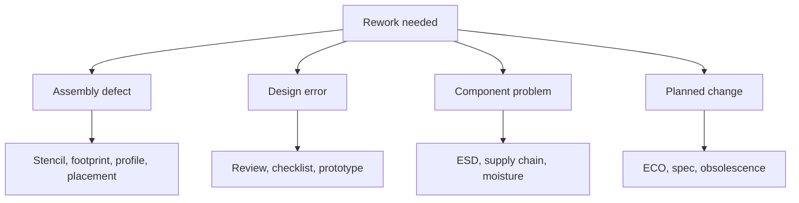

::: testing
Whether you see rework as a symptom with root causes rather than an ordinary part of life. A good answer groups the reasons into manufacturing defects, design errors, component problems, and intentional changes, and gives a concrete example of each. The better candidates add the **yield arithmetic** (why a tiny defect rate per joint still produces rework on a board with thousands of joints) and say that the goal is to find and remove the cause, not just to fix the board.
:::

::: why
In production, rework cost is a direct hit to margin and schedule; in a prototype lab it is the difference between a one-day and a one-week bring-up. Understanding the causes lets you decide where to spend effort: better footprints and DFM review to prevent assembly defects, schematic and layout review to prevent design errors, incoming inspection and counterfeit control for component problems, and flexible design choices for changes. It is also how interviewers judge whether you think like an engineer who owns outcomes, not someone who just solders.
:::

::: concepts
- **Assembly defects**: bridges, opens, tombstones, cold joints, misplaced parts, BGA head-in-pillow. See [[q0615]], [[q0602]].
- **Design errors**: wrong footprint, wrong pinout, missing pull-up, power sequencing, layout mistakes.
- **Component failures**: ESD or overstress damage, infant mortality, counterfeit or out-of-spec parts.
- **Engineering changes**: spec change, firmware needs a different strap, obsolescence, supplier substitutions.
- **First-pass yield (FPY) and defect rates**: defects per million opportunities (DPMO) times opportunities per board.
- **Design for manufacturing / test**: how layout choices lower defect rates and make faults findable. See [[q0613]], [[q0614]].
:::

::: answer
"I'd group the reasons into four buckets. First, **manufacturing defects**: solder bridges, opens, tombstoned resistors, cold joints, or BGA joints that didn't wet. Even a very low defect rate adds up when a board has thousands of joints. Second, **design errors**: wrong footprint, flipped pinout, a missing pull-up, a layout mistake. These show up in prototypes and are the main reason for bodge wires and part swaps in bring-up. Third, **component problems**: a part damaged by ESD or overstress, a bad lot, an out-of-spec or counterfeit part, or something that failed in test or in the field. And fourth, **changes**: a spec change after boards are built, a part going obsolete, or firmware wanting a different configuration.

Which one it is matters, because the response is different. Assembly defects point at the paste stencil, the footprint, or the reflow profile. Design errors point at review and checklists. Component issues point at supply chain and handling. If I see the same rework in the same spot repeatedly, I treat it as a design or process problem and fix that, not just rework it again."
:::

::: technical
**Cause categories with examples.**

| Category | Examples | Detected by | Preventive action |
|---|---|---|---|
| Assembly defect | Bridges on fine pitch, opens, tombstones, insufficient solder, head-in-pillow, misplacement, wrong orientation | AOI, X-ray, ICT, flying probe, functional test | Stencil design, DFM review ([[q0613]]), profile tuning, polarity marks |
| Design error | Wrong footprint, swapped pins, missing pull-up, wrong reference, bad power sequencing, wrong net connection | Bring-up, DRC/ERC misses, review | Checklists, peer review, prototypes, simulation |
| Component issue | ESD damage, counterfeit/out-of-spec part, moisture damage, lot defect | Incoming inspection, test, field return | ESD control, trusted supply, moisture handling (MSL) |
| Change | ECO, firmware, obsolescence, cost reduction, regulatory fixes | Release process | Options on board (DNP, 0 Ω), planned spin |

**Yield arithmetic.** If each solder joint has defect probability $d$ (expressed as DPMO / $10^6$) and a board has $N$ joints, expected defects per board is $\lambda = Nd$. Assuming independence (Poisson), first-pass yield is

$$\text{FPY} \approx e^{-Nd}.$$

For $N = 1000$ and $d = 50$ ppm, $\lambda = 0.05$ and FPY $= e^{-0.05} = 95.1\%$. About 4.9% of boards need rework, which is 49 boards in a lot of 1000. For $N = 5000$ and 200 ppm, $\lambda = 1.0$ and FPY $= 36.8\%$: most boards need rework.

**Economics.** If rework costs $C_r$ and succeeds with probability $p$, and a failure scraps a board of value $C_s$, rework is worthwhile if $C_r < pC_s$ ([[q0632]]).

**Detection.** Rework needs a defect to be found: AOI for visible faults, X-ray for hidden joints, in-circuit test (bed-of-nails, [[q0612]]), flying probe ([[q0611]]) and functional test. Each only finds what it can reach; testability design matters ([[q0614]]).
:::

::: short
"Rework is needed for four reasons: manufacturing defects like bridges, opens or tombstones, design errors like a wrong footprint or missing pull-up, component failures from ESD or bad lots, and changes like ECOs or obsolescence. Even a tiny per-joint defect rate adds up: 1000 joints at 50 ppm gives about 5% of boards needing rework. I try to find the root cause so we fix the process or the design, not just the board."
:::

::: long
"I'd split the reasons into four groups. The first is manufacturing defects. Solder bridges on fine-pitch parts, opens, tombstoned chip components, cold joints, misplaced or backwards parts, BGA balls that didn't wet. A defect rate that sounds tiny still matters because boards have a lot of joints. If each joint has a 50 ppm chance of being bad and a board has 1000 joints, the expected number of defects is 0.05, so first-pass yield is about e to the minus 0.05, roughly 95 percent. That's about 49 boards per thousand needing rework. With 5000 joints at 200 ppm, the expected defects is one per board and only about 37 percent pass first time.

The second group is design errors: a wrong footprint, swapped pins, a missing pull-up, a power sequencing issue. This is the biggest cause of rework on prototypes, and the fixes are bodge wires and part swaps.

The third is component problems. ESD damage, an out-of-spec or counterfeit part, moisture damage from improper storage, or a failure in test or in the field.

The fourth is deliberate change: a spec or firmware change after boards are built, an obsolete part, or a supplier substitution.

Why it matters is that the fix depends on the cause. Assembly defects point at stencil, footprints and reflow profile. Design errors point at review. Component problems point at supply chain and handling. If the same rework keeps happening at the same reference designator, I'd fix the design or process instead of reworking it forever."
:::

::: terms
- **First-pass yield (FPY)**: fraction of boards that pass test with no rework.
- **DPMO**: defects per million opportunities (each joint or placement is an opportunity).
- **AOI**: automated optical inspection that finds visible assembly faults.
- **ICT (in-circuit test)**: bed-of-nails test of component presence and values. See [[q0612]].
- **ECO / ECN**: engineering change order / notice, a formal design change.
- **Head-in-pillow**: BGA defect where the ball and paste fail to merge, looking like a head resting on a pillow in X-ray cross-section.
- **MSL (moisture sensitivity level)**: classification for how long a part can be exposed to air before it needs baking.
- **Counterfeit part**: a part that is remarked, recycled, or not made by the claimed manufacturer.
:::

::: exceptional
**An average answer** says "because of mistakes or defects".

**An exceptional answer**:
- Groups causes into **defect, design error, component, change** and ties each to a different corrective action.
- Quantifies with **yield maths**: $\text{FPY} \approx e^{-Nd}$ and a worked example.
- Mentions **where the defects are detected** (AOI, X-ray, ICT, functional) and the visibility limits.
- Notes that **design for manufacturing and test** reduces defects and makes faults locatable.
- Treats **repeat rework at the same location** as a root-cause signal.
- Brings in **economics**: rework vs scrap, and cycle limits.
:::

::: mistakes
- **"Human error" as the only answer.** It's an excuse, not a cause. Find the process or design factor.
- **Blaming the factory for every defect.** Many defects are footprint, stencil or DFM issues that begin in design.
- **Ignoring yield math.** With thousands of joints, rare defects are common events per board.
- **Reworking without root cause.** The next board has the same problem.
- **Assuming test finds everything.** AOI misses hidden joints; ICT only tests what it can reach.
- **Forgetting field returns.** Latent damage (ESD, overstress) can pass test and fail later.
:::

::: deep
## Four buckets, four root causes


Figure: Each cause points at a different part of the process. Treat the leaves as the fix; the rework itself is just a symptom.

### Assembly defects

The reflow process melts paste on every pad. A few ways it fails:
- **Bridges**: too much paste or too small a gap on fine-pitch parts. Fixed by stencil aperture reduction and mask dams between pads.
- **Opens and insufficient solder**: too little paste, lifted leads (coplanarity), warped parts or boards, or poor wetting.
- **Tombstoning**: one end of a chip part wets earlier than the other. See [[q0615]].
- **Head-in-pillow**: warpage during reflow lifts the ball from the paste so the two never coalesce.
- **Misplacement and polarity errors**: wrong orientation or part feeder issue.

Prevention usually starts in layout: symmetric pad geometry, appropriate pad and stencil design per IPC land-pattern guidance, polarity marks, and keeping thermal masses balanced ([[q0613]]).

### Design errors

Prototype boards reveal footprint errors, swapped pins, a missing pull-up on an open-drain line, a power rail that powers up in the wrong order, and nets that should have been connected. Mitigation is a review checklist, comparing footprints against datasheet drawings, and building a breakout or evaluation board for risky parts. These cause a large share of prototype rework because the only fix is on the board in your hand.

### Component problems

- **ESD and electrical overstress** during handling or bring-up, often a latent partial damage.
- **Moisture**: parts stored out of their dry bag absorb moisture and may crack in reflow (popcorning). The classification is MSL (J-STD-020).
- **Counterfeit or out-of-spec parts**, especially from non-authorised distributors.
- **Infant mortality**: early-life failures in a lot that burn-in or screening tries to catch.

### Planned changes

A firmware team decides on a different strap setting; a supplier goes end-of-life; a cost-down swaps a part; a regulatory test needs a filter component. These are ECOs and are usually implemented first as a modification on built boards, then folded into the next revision.

## The yield arithmetic

Let each joint have an independent defect probability $d$. For a board with $N$ joints (each joint is an "opportunity"), the number of defects is approximately Poisson with mean $\lambda = Nd$, so the probability of zero defects is

$$P_0 = e^{-\lambda} = e^{-Nd}.$$

```plot
{"title":"First-pass yield versus joints per board","x":{"label":"Joints per board","unit":"","min":0,"max":6000},"y":{"label":"First-pass yield","unit":"","min":0,"max":1.02},
 "vars":{"d1":"10e-6","d2":"50e-6","d3":"200e-6"},
 "series":[{"label":"10 ppm per joint","fn":"exp(-x*d1)","color":"green"},{"label":"50 ppm per joint","fn":"exp(-x*d2)","color":"accent"},{"label":"200 ppm per joint","fn":"exp(-x*d3)","color":"red"}]}
```
Figure: Even good processes lose yield as the joint count rises. At 5000 joints, 10 ppm gives 95.1%, 50 ppm gives 77.9%, and 200 ppm gives 36.8% FPY. Complex boards (servers, phones) need very low defect rates or accept high rework.

Worked check: 1000 joints at 50 ppm gives $\lambda = 0.05$ and FPY $= e^{-0.05} = 0.951$. Out of 1000 boards, about $1000(1 - 0.951) = 49$ need rework. A BGA with 600 balls at 20 ppm adds $\lambda = 0.012$, small per part but large when you build many boards.

> [!UNCERTAIN]
> Real defect rates vary widely with process maturity, part type and board design. The ppm values above are illustrative to show scale, not benchmarks. Also, defects cluster (the same bad stencil or the same bad part affects many joints), so a Poisson model underestimates variation between lots.

## Where defects are caught

| Method | Finds | Misses |
|---|---|---|
| AOI | missing parts, polarity, bridges, shifted parts | hidden joints, internal opens |
| X-ray | BGA/QFN voids, bridges, opens, misalignment | electrical function |
| ICT (bed-of-nails, [[q0612]]) | opens, shorts, wrong values | untested nets with no probe access |
| Flying probe ([[q0611]]) | same, without a fixture | slower throughput |
| Functional test | whether the board works | which joint, specifically |

Testability decisions ([[q0614]]) determine how many defects you find before shipping, and how quickly you can localise them.

## Economics and decisions

Combining the yield and cost view: for a lot of $M$ boards with $\text{FPY} = e^{-\lambda}$, the expected rework count is $M(1 - e^{-\lambda})$. If a rework station costs USD 15 per board and succeeds 85% of the time on a USD 120 board, $C_r < pC_s$ ($15 < 102$) says rework. On a USD 4 board it says scrap. For prototypes, time is the real currency: a bodge now saves a week.

## Using rework as data

Rework is useful information. Track defects by reference designator, part number, and panel position. If one location keeps failing, check the footprint and stencil aperture; if one panel position fails, check warpage and printing; if one lot of parts fails, quarantine it. A fix upstream is nearly always cheaper than a rework forever.
:::

::: applications
- **High-volume assembly**: pareto charts of defects feeding stencil and footprint fixes.
- **Prototype bring-up**: bodge wires and part swaps for design errors on first-spin boards.
- **Reliability and returns**: reworking or replacing parts damaged in the field.
- **Supply chain**: swapping an obsolete part or an allocation-constrained one.
- **Regulatory fixes**: adding or changing EMI filter components after a pre-compliance scan.
- **Medical and aerospace builds**: documented rework with limits on cycles and inspection.
:::

::: assumptions
The yield model assumes independent, Poisson-distributed defects; real defects cluster by part, stencil, lot and panel, so the actual spread is greater. The ppm numbers are illustrative. The list of causes assumes a typical SMT assembly line; hand-built prototypes have different dominant causes (human routing, wrong parts, handling damage). In regulated industries, some changes require formal ECO approval and documented rework even for trivial modifications. The "rework vs scrap" rule is a simple expected-cost model that ignores schedule, reliability risk of reworked boards, and policy limits on rework count.
:::

::: followups
### What's the most common reason for rework on a prototype?
Design errors: wrong footprints, swapped pins, missing pull-ups or options, and layout mistakes. With a first-spin board there are no process defects to speak of, but there are always a few schematic or layout issues, and the quickest fix is a part swap or bodge. That's why I'd include DNP options and test points for any risky interface.

### Why does a very small defect rate still lead to lots of rework?
Because the board has many joints. If each of $N$ joints fails independently with probability $d$, first-pass yield is about $e^{-Nd}$. With $N = 5000$ and $d = 200$ ppm, $Nd = 1$, so only about 37% of boards pass first time. Even at 10 ppm you'd lose about 5%. Complex boards therefore need excellent processes and good test coverage.

### How do you tell whether rework is due to design or process?
Look at the pattern. A defect that appears at the same reference designator on many boards is a design or stencil issue (footprint, aperture, mask, thermal imbalance). A defect that appears randomly across locations is a process issue (printing, placement, profile). A defect that follows a part lot is a component issue. I'd collect data by location, panel position and lot to see which pattern it is.

### Can rework hurt reliability?
Yes. Each cycle adds heat, grows the intermetallic layer, and can lift pads or crack ceramics. Reworked joints can be less reliable than original ones, which is why high-reliability products limit cycles and require inspection. For qualification, I'd avoid using reworked boards as representative samples or I'd record that they were reworked.

### Scenario: your first production lot shows 8% of boards with an open on one BGA. What do you do?
First, X-ray and cross-section a few to see whether it's head-in-pillow, non-wetting, or a pad issue. Check board and package warpage during reflow, the stencil aperture and paste volume, the reflow profile (peak and TAL), and moisture history of the BGA. Short term, rework affected boards with reballing or replacement. Long term, fix the root cause: adjust the profile, stencil, or pad design, and possibly add a test or inspection step before the line produces more.

### How would you reduce rework on your next board revision?
Run a DFM review with the assembler, correct footprints against datasheets and IPC land patterns, add polarity and pin-1 marks, balance pad thermal connections, add test points and boundary scan access, plan options for uncertain circuits, and review the schematic and layout with a checklist. I'd also look at the rework log from the previous build and fix every repeated defect in the layout.
:::

::: interpretations
"Why may rework be needed?" can be read as manufacturing (why would a factory need it) or engineering (why would I as a designer need it). The page covers both: defects and component issues are the production view, design errors and changes are the engineering view. If the interviewer asks in a bring-up context, emphasise design errors and changes; in a manufacturing context, emphasise defects, yield and root-cause analysis.
:::

::: references
- IPC-A-610, *Acceptability of Electronic Assemblies*, for what counts as a defect.
- IPC-7351, *Generic Requirements for Surface Mount Design and Land Pattern Standard*, for footprint design.
- IPC-7711/7721, *Rework, Modification and Repair of Electronic Assemblies*.
- JEDEC/IPC J-STD-020, moisture/reflow sensitivity classification for SMDs.
- Any quality-engineering text on process capability and DPMO (e.g. Montgomery, *Introduction to Statistical Quality Control*).
:::

::: rubric
- Groups causes: assembly defects, design errors, component problems, changes :: Shows structured thinking and different corrective actions.
- Gives concrete examples (bridge, tombstone, wrong footprint, ESD damage, ECO) :: Evidence of real understanding.
- Uses yield math: FPY ≈ e^(−Nd) with numbers :: Explains why small rates add up on complex boards.
- Links root cause to a different corrective action per category :: Engineers fix causes, not symptoms.
- Mentions detection methods and their blind spots :: Rework is only possible after a defect is found.
- Notes the economic rework vs scrap decision :: Rework is a business choice.
- Treats repeated rework at one location as a design/process signal :: Shows ownership.
:::

::: quiz
```json
[
 {"type":"mcq","level":"fundamental","q":"A footprint error causes the same part to fail on every prototype board. Which category is this?","options":["Assembly defect","Design error","Component counterfeit","Random process variation"],"answer":1,"explain":"A repeated failure at the same location from a wrong footprint is a design error, not a random process defect."},
 {"type":"mcq","level":"fundamental","q":"Which method best finds a missing solder joint under a BGA?","options":["Visual microscope inspection","X-ray inspection","Measuring supply voltage with a multimeter","AOI from above"],"answer":1,"explain":"BGA joints are hidden beneath the package; X-ray sees through it. AOI and microscopes cannot see the joints."},
 {"type":"numeric","level":"intermediate","q":"A board has 2000 joints at 50 ppm defect probability each. What is the first-pass yield (%) under the Poisson model?","answer":90.5,"tolerance":0.01,"unit":"%","explain":"λ = 2000 × 50e-6 = 0.1, FPY = e^−0.1 = 0.9048, so 90.5%."},
 {"type":"numeric","level":"intermediate","q":"For 1000 boards with FPY 95.1%, about how many need rework?","answer":49,"tolerance":0.05,"unit":"boards","explain":"1000 × (1 − 0.951) = 49 boards."},
 {"type":"truefalse","level":"intermediate","q":"If the same reference designator needs rework on many boards, the best response is to train the rework operators faster.","answer":false,"explain":"A repeated failure at one location points to a design or stencil/footprint root cause that should be fixed upstream."},
 {"type":"multi","level":"advanced","q":"Select all that are plausible causes of rework in a production lot.","options":["Insufficient paste volume on a pad","Component moisture exposure beyond its MSL limit","An out-of-spec or counterfeit part","A change order from the firmware team"],"answer":[0,1,2,3],"explain":"All four lead to rework: process defect, component damage, supply chain, and deliberate change."}
]
```
:::
