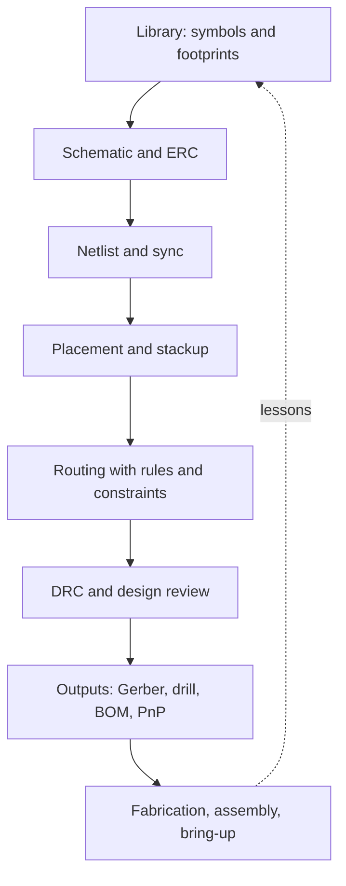

::: basics
### In plain words
The interviewer is asking which board-design programs you have really used, and whether you understand the steps every one of them shares. Those steps are the same everywhere: draw the circuit, define the parts, lay out the board, check it, and send files to the factory. A short, honest answer about one real board beats a long list of tool names.

### Picture it
It is like being asked which word processor you use. The real skill is writing; the programs differ mostly in menus and shortcuts. A good answer names the program, says what you made with it, and admits which ones you have not touched. It also shows you could learn the team's program quickly.

### Words you need
- **ECAD**: software for drawing circuits and designing circuit boards.
- **Schematic**: the circuit diagram, showing which parts connect to which.
- **Footprint**: the pattern of copper pads on the board that a part is soldered onto.
- **Layout**: arranging the parts on the board and drawing the copper paths between them.
- **DRC (design rule check)**: an automatic check that the layout obeys the factory's limits, such as minimum spacing. See [[q0641]]. A similar check on the schematic is called ERC and catches things like unconnected pins.
- **Gerber files**: the standard files you send to the factory that makes the board.

### The simplest example
Here is a skeleton to fill in with your own true details. "I used *[tool]* on *[board]*. I made the footprints from the datasheets, drew the schematic and ran the checks, laid out the board with rules set to the factory's limits, and sent Gerber files. When I first powered the board, I found *[one mistake]*, so I fixed *[library or checklist]*. I have not used *[other tools]*, but the steps are the same, so I would learn the team's tool in a couple of weeks."

Do not claim tools you have not used.

That is the whole idea. The rest of this page covers how the four tools differ, what skills carry over, and follow-up questions.
:::

::: testing
This is a screening question with a hidden second layer. On the surface: "have you used a mainstream ECAD tool?" Underneath: do you understand the **workflow** that every tool shares (schematic, library, netlist, layout, rules, outputs), can you be honest about which tools you have actually used, and can you adapt quickly to the one the team uses? Interviewers also listen for the differences between the tools (cost, library model, constraint handling, collaboration), because naming real differences is hard to fake. A truthful "I've used KiCad for two boards and know how it maps to Altium" is a good answer; "I've used all four" with no detail is not.
:::

::: why
Every hardware team uses one of these tools, and the interviewer wants to know your ramp-up time. The tools are more alike than different: all of them have schematic capture, a part library with symbols and footprints, an electrical rules check, a layout editor with design rules, and fabrication outputs. A candidate who understands that structure can pick up a new tool in days, while one who only memorised menu clicks cannot. The question also surfaces whether you have ever taken a board from schematic through fabrication, which is the real skill behind the question.
:::

::: concepts
- **Schematic capture and ERC**: drawing connectivity and checking for electrical rule violations (unconnected pins, conflicting drivers).
- **Library management**: symbols, footprints, 3D models, and part parameters; the biggest source of errors. See [[q0639]].
- **Netlist and layout synchronisation**: how schematic changes flow to the board (forward and back annotation, ECO).
- **Design rules (DRC)**: clearance, width, via and drill constraints. See [[q0641]].
- **Fabrication and assembly outputs**: Gerber/Excellon, ODB++ or IPC-2581, BOM, pick-and-place. See [[q0593]].
- **Stackup and constraints**: layer definitions, impedance, differential pairs and length rules. See [[q0476]].
- **Scripting and automation**: see [[q0640]].
:::

::: answer
"I've used *[tool(s) you've actually used, e.g. KiCad and Altium]*. My main one is *[tool]*, which I used for *[project: e.g. a four-layer STM32 motor controller board]*. I drew the schematic, made a few of my own symbols and footprints from the datasheet, ran ERC, laid out the board with controlled-impedance traces for USB, set up design rules to match the fabricator's capabilities, ran DRC, and generated Gerbers, drill files, the BOM and the pick-and-place file.

I know the others at a conceptual level and have looked at them: Eagle is simpler, with a single-file library model and ULPs for scripting; Altium has an integrated schematic-and-PCB environment with strong rules and collaboration; KiCad is open source and increasingly capable, with a Python API; and Allegro is the heavyweight in large companies, with a constraint manager and strong high-speed tools.

What I'd say is that the workflow is the same in all of them: library, schematic, ERC, netlist to layout, rules, DRC, outputs. So if the team uses a tool I haven't, I'd expect to be productive in a week or two, mostly on library conventions and shortcuts. I'd also learn the team's library and review processes first, because most layout errors start in the library."
:::

::: technical
**Workflow common to every tool.**
1. Create or import **library parts**: symbol (pins, names), footprint (pads, courtyard, silkscreen), optional 3D model, and part metadata (MPN, value, supplier).
2. **Schematic**: place symbols, wire, label nets, add power symbols; run **ERC** (electrical rules check) for floating pins, conflicting outputs, missing power flags.
3. **Netlist / sync** to the PCB: the tool creates footprints and rat's nest. Later changes flow via ECO (engineering change order) or update PCB.
4. **Stackup and rules**: define layers and materials, trace and via sizes, clearances, diff-pair and length constraints, net classes.
5. **Placement and routing**: critical parts first, interactive routing, plane pours.
6. **DRC** against both your rules and the fabricator's capabilities. See [[q0641]].
7. **Outputs**: Gerber (RS-274X) or ODB++/IPC-2581, Excellon drill, IPC-D-356 netlist for test, BOM, assembly drawings, pick-and-place.

**How the four tools differ (typical, check current versions).**

| Tool | Licence/cost model | Notable traits | Scripting |
|---|---|---|---|
| Eagle (Autodesk) | Subscription, being folded into Fusion | Simple, library-centric, popular in hobby and small teams | ULP and SCR scripts |
| Altium Designer | Commercial subscription | Unified schematic/PCB, strong rules, 3D, Altium 365 collaboration | Scripts (Delphi, VBScript, JScript) and an API |
| KiCad | Open source (free) | Cross-platform, active development, good community libraries | Python in the PCB editor, netlist and BOM plugins |
| Cadence Allegro / OrCAD | Commercial, high end | Constraint Manager, high-speed and large-board capabilities, used in big organisations | SKILL and Tcl-based scripting |

> [!UNCERTAIN]
> Product lines and licensing change often. Autodesk has announced that standalone EAGLE will be retired in favour of Fusion's electronics tools (check Autodesk for the current date and status), KiCad releases a new major version about yearly, and Cadence and Altium rename products regularly. Verify specifics before quoting them in an interview.

**What "experience" means at different levels.** Basic: drew a schematic and exported a netlist. Intermediate: built custom libraries, laid out a 2 to 4 layer board, ran DRC, ordered a board and brought it up. Advanced: controlled impedance, differential pairs, length matching, constraint-driven layout, scripting, library governance, and manufacturing outputs reviewed with an assembler.
:::

::: short
"I've used *[tool]* for *[board]*: library parts from datasheets, schematic with ERC, layout with design rules set to the fab's limits, DRC, then Gerbers, drill, BOM and pick-and-place. I know the others conceptually: Eagle is simple and library-centric, Altium is integrated with strong rules and collaboration, KiCad is open source with Python scripting, and Allegro is the high-end constraint-driven tool. The workflow is the same, so I'd ramp up on a new one in a couple of weeks."
:::

::: long
"I'll be specific about what I've actually done. I've used *[your tool(s)]*, mainly for *[project]*. On that board I made the symbols and footprints myself from datasheets, drew the schematic and ran ERC, and then did layout. I set the design rules to match the fabricator's capabilities, so minimum trace and space, drill size and annular ring, routed USB as a differential pair with controlled impedance based on the stackup, ran DRC until it was clean, and then generated Gerbers, drill files, the BOM and pick-and-place. I also bring up the board afterwards, so I've seen which of my decisions caused trouble, mostly footprint mistakes.

For the others, I'll be honest about the level. I understand them conceptually: Eagle is simple and library-centric, and was popular for small teams; Altium has a unified schematic and PCB environment with strong rule checking and cloud collaboration; KiCad is open source and has become very capable, with a Python scripting interface; and Allegro, with OrCAD for schematics, is what a lot of larger companies use for complex high-speed boards, with a Constraint Manager that drives routing.

The reason I'm not worried about switching tools is that the workflow is the same across all of them: library, schematic, ERC, netlist to layout, constraints, DRC, outputs. What changes is the shortcuts, the library conventions and how they handle constraints. If the team uses Allegro and I've only used KiCad, I'd spend the first weeks learning their libraries and review process, because that's where most layout errors originate, and I'd ask someone to review my first board before it goes to fab."
:::

::: terms
- **ECAD**: electronic computer-aided design software for schematics and PCB layout.
- **Symbol / footprint**: the schematic representation of a part / the physical land pattern on the board.
- **ERC**: electrical rules check on a schematic (unconnected pins, conflicting drivers).
- **DRC**: design rule check on the layout. See [[q0641]].
- **Netlist**: list of connections between pins; the link between schematic and board.
- **ECO**: engineering change order; also the process of propagating schematic changes to layout.
- **Gerber (RS-274X) / Excellon**: standard fabrication files for copper layers / drill holes.
- **ODB++ / IPC-2581**: richer intelligent manufacturing data formats that carry stackup, netlist and more.
- **Constraint manager**: tool feature for setting electrical and physical rules per net or class (Allegro, Altium).
:::

::: exceptional
**An average answer** says "yes, I've used Altium" or "I've used KiCad a bit".

**An exceptional answer**:
- Names **what they actually used**, on **which board**, with the scope (layers, interfaces, outputs).
- Describes the **workflow** and gives details that only a real user would know (library creation from datasheets, net classes, fab rules, ERC and DRC clean-up).
- States **honestly** what they haven't used and shows they understand the differences at a conceptual level.
- Gives a **ramp-up plan** for a new tool: libraries, shortcuts, review process.
- Mentions **a mistake and a lesson** (footprint error, DRC rule set too loose).
- Mentions **scripting or automation** if relevant ([[q0640]]).
:::

::: mistakes
- **Claiming all four tools.** Unless true, the first detail question collapses the answer. Name one or two and describe them well.
- **Describing tools by logo or UI only.** Interviewers want workflow and decisions, not "the interface is nice".
- **No mention of libraries.** Most real PCB errors are footprint and pinout errors.
- **Forgetting to say how you checked the board.** ERC, DRC, design review, and bring-up all matter.
- **Dismissing a tool as "toy" or "legacy".** Teams use what fits their scale and history.
- **Treating the tool as the skill.** The skill is stackup, constraints and manufacturability; the tool is how you express them.
:::

::: deep
## What the interviewer wants to learn

When someone asks "do you have experience with Eagle/Altium/KiCad/Allegro?" they have two different decisions to make. One is **fit**: will your skills transfer to their tooling? The other is **depth**: have you actually taken a design through fabrication or only drawn pictures? Your answer should address both: name a tool, show end-to-end ownership, and be explicit about transfer.


Figure: The same loop exists in every tool. The dashed arrow is the one that separates experienced designers: bring-up findings go back into the library and the checklists so the next board doesn't repeat the mistake.

## The four tools in context

### Eagle

EAGLE began at CadSoft and is now owned by Autodesk. It uses a single library file model with devices that tie a symbol to a package, a simple UI, and small-team friendliness. It has ULPs (user language programs) for automation and SCR script files for command sequences. It was a hobbyist and startup staple, so many open-source designs are in Eagle format. Autodesk has said it is moving users to Fusion's electronics tools; confirm the current status before relying on it.

### Altium Designer

A commercial tool known for a unified schematic and PCB environment, a rules-driven editor, strong 3D and MCAD integration, and Altium 365 for cloud-based collaboration and component management. It is common in startups through mid-sized companies. Scripting is available through built-in scripting languages and an API.

### KiCad

Open source and free, with a schematic editor, PCB editor, 3D viewer, and a large community library. It supports multi-layer boards, differential pair routing, length tuning, and design rules. It exposes Python for the PCB editor and produces netlists and BOMs that scripts can post-process. It has made big gains in recent releases and is popular with students, startups and open-hardware projects.

### Cadence Allegro (with OrCAD)

Allegro PCB Editor is a high-end tool with strong constraint management, high-speed design, and large-board support; schematics are often drawn in OrCAD Capture or Allegro System Capture. It's widely used in larger companies for complex, high-layer-count boards. Its scripting layer (SKILL) is powerful but has a steeper learning curve.

## What transfers and what doesn't

| Skill | Transfers across tools? |
|---|---|
| Reading datasheets and drawing correct footprints | Yes, fully |
| Choosing a stackup and trace geometry for impedance | Yes |
| Net classes, clearances, via sizes, diff pair and length rules | Yes in concept; UI and terminology differ |
| Placement strategy, power and ground planes, return paths | Yes |
| Library conventions and part management | No: it is team and tool specific |
| Shortcuts, command speed | No: needs practice |
| Scripting | Language specific (Python, SKILL, Delphi, ULP) |

## Honest ways to answer at different levels

**If you have used one tool on real boards.** Say so and describe one board in depth. Add: "The workflow maps to the others; I'd expect to pick up your tool within a couple of weeks, starting with your library conventions."

**If you used a tool only in a class.** Describe the course project (schematic, layout, simulated or fabricated?), and what you learnt about footprints, ERC and DRC. Say what you would do with a first board: order a small fabrication run, check footprints against datasheets, and have someone review it.

**If you have used none but built circuits by hand.** Say that directly, then show you know the workflow and have started: "I've been learning KiCad on a small project: here's the board, and here's what I learnt about footprints." Showing a real small board beats a vague claim.

## Example answer with placeholders

"I've used *[KiCad]* for *[a 4-layer STM32 + USB board]*. I created the symbols and footprints from the datasheets and compared the footprint pad dimensions against the recommended land pattern. I ran ERC after fixing power flags, defined net classes with 0.15 mm track/space for signals and wider tracks for power, set the stackup in the fab's calculator to get 90 Ω differential for USB, routed it, and ran DRC against the fab's rule file. I generated Gerbers and drill, checked them in a Gerber viewer, then ordered five boards. On bring-up I found one footprint was mirrored, which I fixed with a cut-and-jump and corrected the library. I haven't used Allegro or Altium in depth, but I understand the equivalent steps and would learn the team's libraries first."

Replace every bracket with true detail. If you did not do an item, delete it.

## Questions that follow

Typical follow-ups: "What is the difference between a schematic symbol and a footprint?", "How do you make sure a footprint is right?", "What does ERC catch that DRC doesn't?", "How did you set your design rules?", "What files did you send to the fab?", "How would you handle a team library?". Short answers: symbol = logical pin view, footprint = physical pads; compare to the datasheet's land pattern and print 1:1 on paper to check; ERC checks connectivity logic, DRC checks geometry against manufacturing limits ([[q0641]]); rules came from the fab's published capabilities; Gerbers, drill, BOM and pick-and-place; a controlled, reviewed library with part numbers and revision history.

## What to avoid saying

Don't say you've mastered a tool you've touched once, don't say tools are "all the same", and don't criticise the interviewer's tool. A confident, specific answer with an honest limit is better than a long list.
:::

::: applications
- **Startups and small teams** often choose KiCad or Altium for cost and speed.
- **Mid-size and large hardware companies** often standardise on Altium or Allegro for libraries, governance and constraints.
- **High-speed digital boards** (DDR, PCIe, many layers) lean on Allegro or Altium's constraint features.
- **Open-hardware projects** frequently ship KiCad or Eagle sources.
- **University labs and student competitions** use KiCad, Eagle or Altium student licences.
- **Contract manufacturers and assemblers** accept Gerber/ODB++ from any tool, so the output format, not the tool, is what matters to them.
:::

::: assumptions
The tool descriptions are summaries of widely known positioning, not a feature-by-feature comparison, and products change. The answer assumes you are describing real experience with at least one tool; if you are not, adapt the structure honestly. Different companies weigh ECAD experience differently: for an intern, demonstrating understanding of workflow and the ability to learn the team's tool often outweighs expertise in a specific package. For a firmware-leaning role, "I've read schematics and layouts, and used KiCad for a small board" may be sufficient. For a PCB-layout-focused role, expect detailed questions on constraints, stackup and manufacturing outputs.
:::

::: followups
### What is the difference between a symbol and a footprint, and why do errors there matter?
A symbol is the schematic view: pins with names and numbers and logical function. A footprint is the physical land pattern: pad positions, sizes, courtyard and silkscreen. The two are linked by pin-to-pad mapping. Errors in either can sink a board: a wrong footprint means the part doesn't fit; a mismatched pin map connects the wrong signals. I verify footprints against the manufacturer's recommended land pattern and print the layout at 1:1 to check parts against paper.

### How do you set your design rules for a board?
I start from the fabricator's published capabilities (minimum trace/space, drill, annular ring, solder mask expansion) and my own needs: power trace width from current requirements, spacing for voltage, and controlled-impedance geometry from the stackup calculator. I define net classes (power, signal, high speed) with those values and set the DRC accordingly. Then I run DRC and review the exceptions rather than silencing them.

### Which output files do you send to the fabricator and the assembler?
For fabrication: Gerber files for each copper layer, solder mask, silkscreen and board outline; Excellon drill files; a stackup and notes document; optionally ODB++ or IPC-2581. For assembly: the BOM with manufacturer part numbers, the pick-and-place (centroid) file, assembly drawings with polarity, and any special instructions. I open the Gerbers in a separate viewer to check before sending.

### What would you do in your first week on a team whose tool you don't know?
Learn their library and design-review process, because that's where errors come from. I'd open an existing board, read how nets are named and how rules are set, practise the key shortcuts on a small task, and ask a colleague to review my first change. I'd map what I know from my previous tool: schematic, library, constraints and outputs all exist, just with different names.

### How do ERC and DRC differ?
ERC checks the schematic for logical and electrical problems: unconnected pins, outputs driving the same net, missing power drivers. DRC checks the layout geometry against rules: clearances, widths, drill sizes, annular rings, courtyards and unrouted nets. Neither proves the circuit works; both catch classes of mistakes early. See [[q0641]].

### Scenario: you inherit a board design from a colleague who left, in a tool you don't have. How do you proceed?
First export what I can in neutral formats: Gerbers or ODB++ for the layout, the BOM, netlist and PDF schematics. If I need to edit, I'd ask for a licence or a viewer, or recreate the schematic in the team tool, comparing netlists to verify. I'd check footprints against datasheets, re-run rules in the new tool, and compare generated Gerbers to the original, since that's the ground truth for what was built.
:::

::: interpretations
This is a closed question on its surface ("Do you have experience with…?") but in an interview it is a prompt for an honest description of experience. The page treats it as behavioural. The list "Eagle/Altium/KiKad/Cadence Allegro" contains a typo in the source ("KiKad" for KiCad). If you have used none of these but have used another ECAD tool (OrCAD, PADS, EasyEDA, Fusion 360 Electronics, Proteus), say so and map it to the workflow. [[q0639]] is the more open-ended version of this question.
:::

::: references
- Official user manuals for the tool you use (KiCad documentation, Altium documentation, Cadence Allegro/OrCAD documentation, Autodesk Fusion/EAGLE help); consult the current versions.
- IPC-7351, *Generic Requirements for Surface Mount Design and Land Pattern Standard*, for footprints.
- IPC-2221, *Generic Standard on Printed Board Design*, for design rule fundamentals.
- Your fabricator's published capabilities document (minimum trace/space, drill, etc.).
:::

::: rubric
- Names tools actually used and the project :: Honesty and specificity are the main signals.
- Describes the end-to-end workflow (library, schematic, ERC, layout, DRC, outputs) :: Shows real ownership.
- Mentions library creation and verification :: Footprint errors are the most common real mistake.
- Explains how design rules were chosen (fab capabilities, current, impedance) :: Connects the tool to engineering decisions.
- States honestly what hasn't been used and what transfers :: Credibility and learning ability.
- Mentions outputs (Gerber, drill, BOM, pick-and-place) :: Shows you have actually sent a board to fab.
- Offers a plan to ramp up on the team's tool :: Interviewers care about time-to-productivity.
:::

::: quiz
```json
[
 {"type":"mcq","level":"fundamental","q":"Which pair of tools in the question are most associated with open-source and with high-end constraint-driven design, respectively?","options":["Eagle and KiCad","KiCad and Allegro","Altium and Eagle","Allegro and KiCad"],"answer":1,"explain":"KiCad is open source; Allegro is the high-end constraint-driven tool used in large companies."},
 {"type":"mcq","level":"fundamental","q":"What does ERC check?","options":["Trace clearances on the board","Electrical connectivity rules in the schematic","The solder mask expansion","The silkscreen text size"],"answer":1,"explain":"ERC (electrical rules check) is a schematic-level check for things like unconnected pins and conflicting drivers. DRC checks layout geometry."},
 {"type":"mcq","level":"intermediate","q":"Which skill is least likely to transfer directly between ECAD tools?","options":["Reading a datasheet land pattern","Choosing a stackup for impedance","Library conventions and keyboard shortcuts","Understanding return paths"],"answer":2,"explain":"Library conventions and shortcuts are tool and team specific. The underlying engineering knowledge transfers."},
 {"type":"truefalse","level":"intermediate","q":"The best answer to this question is to claim experience with all four tools to look as strong as possible.","answer":false,"explain":"Detailed follow-ups will expose a claim you can't support. Honest, specific experience with one or two tools plus an understanding of the workflow is better."},
 {"type":"multi","level":"advanced","q":"Select all files typically provided to a fabricator for a rigid PCB.","options":["Gerber (or ODB++/IPC-2581) copper, mask, silkscreen and outline","Excellon drill file","Pick-and-place (centroid) file","Stackup and fabrication notes"],"answer":[0,1,3],"explain":"The fabricator needs layer artwork, drill data and the stackup/notes. The pick-and-place file goes to the assembler, not the board fabricator."},
 {"type":"mcq","level":"advanced","q":"After bring-up you find a mirrored footprint. What is the best long-term action?","options":["Fix the board with a bodge wire only","Correct the library footprint, update the design, and add a library review step","Ignore it because the board works","Change the schematic symbol only"],"answer":1,"explain":"A bodge fixes one board, but the library error will recur unless corrected and reviewed."}
]
```
:::
