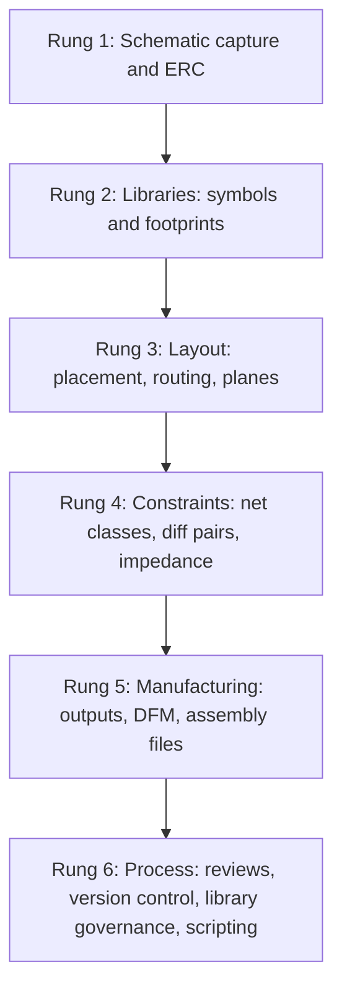

::: basics
### In plain words
The interviewer wants to know how far you have taken a real board in design software, and whether you can explain the choices you made. This question is open, so you choose the story. Name one project, describe a few decisions with reasons, say how you checked your work, and mention one mistake and what you changed afterward.

### Picture it
Think of giving a guided tour of one house you built. You do not list every tool in the shed. You say why the walls are where they are, how you checked that they stand, and which door you had to rehang. A good answer in miniature is that tour: one board, three decisions, one check, one mistake.

### Words you need
- **Footprint**: the pattern of copper pads that a part is soldered onto.
- **Stackup**: the order and thickness of the copper and insulating layers inside the board. See [[q0476]].
- **Net class**: a group of connections that share rules, such as how wide their copper paths (traces) must be.
- **DRC (design rule check)**: an automatic check of the layout against the factory's limits. See [[q0641]].
- **BOM (bill of materials)**: the list of parts to buy, with part numbers.

### The simplest example
Here is a skeleton with placeholders. "My project was *[board and purpose]* in *[tool]*. I made the footprints from datasheets and checked them against a 1:1 printout. I chose a *[number]*-layer stackup because *[reason, such as a ground layer under the signals]*. I made the power traces wider, sized from the current they carry. I ran the design rule check with the factory's limits, looked at the output files in a separate viewer, and had a classmate review the schematic. When I first powered the board, *[a real mistake]* showed up, so I *[fixed the board and the library]*."

Replace every bracket with something true, and delete any step you did not do.

That is the whole idea. The rest of this page adds the numbers behind typical choices (trace width, impedance), what a complete release package contains, and likely follow-up questions.
:::

::: testing
The interviewer is gauging how far you have actually taken a design in an ECAD tool and whether you can describe it with engineering substance. They are listening for the *stages* of the workflow you owned (libraries, schematic, layout, constraints, outputs), the *decisions* you made (stackup, trace widths, clearances, placement), and the *checks* you ran (ERC, DRC, review, bring-up). Unlike [[q0638]], which asks about specific tools, this question is open: you choose the story. The best candidates pick a concrete board, describe three or four non-trivial decisions, and say what went wrong and what they changed.
:::

::: why
In hardware roles, ECAD skill is the ability to turn an idea into a manufacturable board, and it is rarely tested directly. This question is the direct test. Interns who can say "I made the footprints, set net classes from the current requirements, routed USB as a differential pair on a controlled-impedance stackup, and caught a clearance error in DRC" sound like they will be useful quickly. Ones who say "I used Altium" do not. It also introduces the follow-ups about libraries, DRC and scripting ([[q0640]], [[q0641]]).
:::

::: concepts
- **Schematic capture, hierarchy and naming**: readable, reviewable schematics. See [[q0638]].
- **Library creation and verification**: symbols, footprints, 3D models, parts metadata.
- **Stackup and impedance**: layer arrangement, dielectric, trace geometry for target Z0. See [[q0476]].
- **Placement and routing strategy**: power, grounds, return paths, decoupling, fan-out.
- **Design rules and constraints**: clearances, widths, via sizes, differential pairs, length matching. See [[q0641]].
- **Manufacturing outputs**: Gerber/ODB++, drill, BOM, pick-and-place, assembly notes. See [[q0593]], [[q0613]].
- **Design review and bring-up feedback**: how errors are caught and prevented.
:::

::: answer
"I've used *[tool(s)]* on *[N]* boards. The one I'm proudest of is *[project: e.g. a four-layer motor controller with an STM32, a gate driver and USB]*. I did it end to end: I created the symbols and footprints from the datasheets, drew a hierarchical schematic, ran ERC, then did the layout.

A few decisions I can walk through. I used a four-layer stackup with a ground plane directly under the top layer so the return paths were short. I set net classes: signals at 0.15 mm, power traces sized from the current, and I used the IPC-2221 charts to size the 2 A motor supply trace to about 0.8 mm on an outer layer for a 10 degree rise. I routed USB as a 90 ohm differential pair against the plane, matched the lengths, and kept it away from the switching node. I put decoupling capacitors on the same side as the pins, with vias right at the capacitor pads.

For checking, I ran DRC with the fab's minimum rules, reviewed the Gerbers in a separate viewer, and had a classmate review the schematic against the datasheets. At bring-up I found *[an error, e.g. a mirrored footprint]*, which I fixed with a bodge wire and corrected in the library.

My weaker areas are *[e.g. DDR, RF, and scripting]*, which I'd like to learn."
:::

::: technical
**A good answer covers the pipeline with decisions at each stage.**

1. **Libraries.** Symbols from datasheet pinouts; footprints from the manufacturer's recommended land pattern (check pad dimensions, pin-1, courtyard, paste and mask apertures). Verify by overlaying a 1:1 print.
2. **Schematic.** Hierarchy, net names, power flags, decoupling at each supply pin, test points, version and variant notes. ERC clean.
3. **Stackup and constraints.** Choose layer count (2, 4, 6, ...) from density, EMI and impedance. Compute trace geometry for target impedance (e.g. 50 Ω single-ended, 90 Ω differential for USB) with the fab's stackup. Set net classes and diff-pair rules.
4. **Trace widths from current.** IPC-2221 external layer: $I = k\,\Delta T^{0.44}A^{0.725}$ with $k = 0.048$ (external) or $0.024$ (internal), $A$ in mil². For 2 A with $\Delta T = 10$ °C on 1 oz copper: $A = (2/(0.048\cdot10^{0.44}))^{1/0.725} = 42.4$ mil², width $= 42.4/1.378 = 30.8$ mil = 0.78 mm. The same current on an internal layer needs about 2.0 mm.
5. **Placement and routing.** Critical parts first (connectors, MCU, power stage), short high-current loops, decoupling close to pins, controlled impedance, return paths over unbroken planes.
6. **DRC and review.** Fab rules, unrouted nets, clearances, courtyards, silkscreen over pads. Peer review with a checklist.
7. **Outputs and release.** Gerber/ODB++, drill, IPC-D-356 netlist, BOM with manufacturer part numbers, pick-and-place file, fabrication notes (stackup, finish, tolerances).
8. **Feedback.** Bring-up findings go into library fixes and the checklist.

**Describing depth honestly.**
- *Basic*: drew schematics, exported a netlist, laid out a simple 2-layer board.
- *Intermediate*: made libraries, 2 to 4 layers, ran DRC, ordered and assembled a board.
- *Advanced*: controlled impedance, high-speed constraints, multi-board designs, scripting and library governance.

> [!UNCERTAIN]
> IPC-2221 trace-current charts are conservative fits for long straight traces in still air and have limits in their validity range; for critical power designs, verify with thermal measurements or a more recent method (e.g. IPC-2152). State that choice in an interview as an engineering judgement.
:::

::: short
"I've done *[N]* boards in *[tool]*, including *[project]*, end to end: libraries from datasheets, schematic with ERC, a four-layer stackup, net classes with trace widths sized from current, USB as a 90-ohm differential pair, DRC with the fab's rules, and Gerber, drill, BOM and pick-and-place. At bring-up I found a footprint error, fixed the board with a bodge, and then fixed the library. I'm weaker on DDR and RF and want to learn them."
:::

::: long
"I've designed *[N]* boards in *[tool]*. The most substantial is *[project: a four-layer motor controller]*, which I owned from schematic to bring-up.

I started with the libraries. For each new part I built the symbol from the datasheet pinout and the footprint from the manufacturer's recommended land pattern, then printed the footprint 1:1 and checked it against the real part. Then I drew the schematic in hierarchical sheets, with decoupling at each supply pin and test points on the main rails, and ran ERC.

For the layout I chose a four-layer stackup with a ground plane directly beneath the top signal layer, so return paths were short and I could hit about 90 ohms differential for USB. I defined net classes: 0.15 millimetre track and space for ordinary signals, and wider traces for power based on current. For a 2 amp motor supply on 1 ounce copper at a 10 degree rise, the IPC-2221 formula gives about 0.8 millimetres on an outer layer, so I used a pour instead. I placed the power stage first to keep the high-current loop small, put decoupling capacitors next to the pins, and kept the USB pair away from the switching node.

For verification I ran DRC against the fab's published minimums, then exported Gerbers and looked at them in a separate viewer before ordering. I also reviewed the schematic with a classmate against each datasheet.

At bring-up I found that one connector footprint was mirrored. I fixed the board with wires and then corrected the library and added a footprint-review step to my checklist. If I joined your team, my gaps are high-speed memory interfaces and RF layout, which I'd want to learn."
:::

::: terms
- **Land pattern**: the recommended pad geometry for a component, from the manufacturer or IPC-7351.
- **Net class**: group of nets sharing rules (width, clearance, via size).
- **Stackup**: the ordered list of copper and dielectric layers with thicknesses and materials.
- **Controlled impedance**: trace geometry chosen so characteristic impedance matches a target (e.g. 50 Ω, 90 Ω differential).
- **Differential pair**: two traces carrying complementary signals, routed together with tight coupling.
- **Courtyard**: keepout around a part used for placement checks.
- **Design review**: structured peer check of schematic and layout.
- **IPC-2221 / IPC-2152**: PCB design standard / conductor current-carrying capacity standard.
- **BOM / pick-and-place**: bill of materials / component coordinates for assembly.
:::

::: exceptional
**An average answer** lists tools and says "I've done schematics and PCB layouts".

**An exceptional answer**:
- Picks **one project** and walks through the **workflow stages** with specific decisions.
- Shows **numbers**: layer count, trace widths, impedance targets, clearances, with the source (IPC-2221, fab capabilities, stackup calculator).
- Explains **checks**: ERC, DRC against fab rules, Gerber viewer check, peer review.
- Includes **a mistake and a systemic fix** (library review, checklist).
- Notes **collaboration** aspects: version control, shared libraries, ECO handling.
- States **gaps honestly** and a plan to close them.
:::

::: mistakes
- **Listing tool names only.** The tool is not the skill; the decisions are.
- **Skipping libraries.** Footprint and pin-mapping errors are the most common real failures.
- **Claiming high-speed experience you lack.** DDR and RF are specialities; follow-ups will expose guesses.
- **Quoting rules without sources.** "0.1 mm clearance" means little unless tied to the fab's capability.
- **Forgetting outputs.** If you never generated Gerbers and a BOM, you haven't taken a board to fab.
- **Presenting a flawless project.** Real boards have errors; show how you found and fixed them.
:::

::: deep
## A skill ladder for ECAD

Interviewers have a mental ladder. Locate yourself honestly and describe the rungs you own.


Figure: Each rung builds on the one below. A strong intern answer usually owns rungs 1 to 5 on at least one board and has an opinion about 6. Don't skip to the top: "constraint-driven DDR layout" without the lower rungs sounds hollow.

### Rung 2: libraries are where boards go wrong

A footprint holds more than pads. Mark what you check:

```svg
<svg viewBox="0 0 640 230" role="img" aria-label="Elements of a surface-mount footprint">
  <rect x="150" y="60" width="340" height="110" fill="none" stroke="var(--d-muted)" stroke-dasharray="5 4" stroke-width="1.5"/>
  <text x="156" y="52" font-family="Inter, sans-serif" font-size="12" fill="var(--d-muted)">courtyard (keepout)</text>
  <rect x="200" y="85" width="80" height="60" fill="var(--d-orange)" opacity="0.7" stroke="var(--d-ink)"/>
  <rect x="360" y="85" width="80" height="60" fill="var(--d-orange)" opacity="0.7" stroke="var(--d-ink)"/>
  <rect x="190" y="75" width="100" height="80" fill="none" stroke="var(--d-blue)" stroke-width="1.5"/>
  <rect x="350" y="75" width="100" height="80" fill="none" stroke="var(--d-blue)" stroke-width="1.5"/>
  <rect x="215" y="95" width="210" height="40" fill="none" stroke="var(--d-ink)" stroke-width="1.5" stroke-dasharray="3 3"/>
  <text x="306" y="120" font-family="Inter, sans-serif" font-size="12" fill="var(--d-ink)">body</text>
  <circle cx="172" cy="80" r="4" fill="var(--d-red)"/>
  <text x="196" y="188" font-family="Inter, sans-serif" font-size="12" fill="var(--d-orange)">copper pad</text>
  <text x="196" y="204" font-family="Inter, sans-serif" font-size="12" fill="var(--d-blue)">mask opening around pad</text>
  <text x="196" y="221" font-family="Inter, sans-serif" font-size="12" fill="var(--d-red)">red dot: pin 1 mark in silkscreen, outside the pads</text>
  <text x="196" y="30" font-family="Inter, sans-serif" font-size="13" fill="var(--d-ink)">Footprint layers (schematic of a two-pad part)</text>
</svg>
```
Figure: A footprint is a stack of layers: copper pads, solder mask openings (slightly larger than the pad), paste apertures (not shown), the component body outline (dashed; the part sits across both pads, so it is drawn on the assembly or fab layer, not in silkscreen, which must stay off the pads), a pin-1 or polarity mark outside the pads, and a courtyard. Each can be wrong independently, which is why you verify the footprint against the datasheet's land pattern and your assembler's rules.

Library habits that impress: one source of truth for library parts, manufacturer part numbers stored in the symbol, 1:1 print checks, and a review before a part is released into the shared library.

### Rung 3 and 4: where the numbers come from

**Trace width from current.** IPC-2221 gives $I = k\,\Delta T^{0.44}A^{0.725}$ ($A$ in mil², $k = 0.048$ outer, $0.024$ inner). Solve for the area, then divide by thickness (1.378 mil for 1 oz) to get the width:

$$A = \left(\frac{I}{k\,\Delta T^{0.44}}\right)^{1/0.725}, \qquad w = \frac{A}{1.378\,\text{mil}\cdot(\text{oz})}.$$

Worked results for 1 oz copper: 1 A at 10 °C rise gives $A = 16.3$ mil², $w = 11.8$ mil (0.30 mm); 2 A at 10 °C gives 0.78 mm external and about 2.0 mm internal; 2 A at 20 °C gives 0.51 mm external; 5 A at 20 °C gives 1.8 mm external. Note how much wider the inner-layer trace must be: inner traces lose heat only through the dielectric.

**Impedance.** For USB 2.0 the differential pair target is 90 Ω; the geometry depends on dielectric thickness and constant, so you use your fabricator's stackup and a field-solver or calculator rather than a rule of thumb. See [[q0476]] for stackups and [[q0617]] for prototyping choices.

**Clearances.** Set from the fab's capability first (they can't make less), then from voltage needs: higher voltages need more space (see [[q0641]] for the IPC-2221 tables).

### Rung 5: the release package

At release a board needs: Gerber or ODB++ for each layer, drill file(s), a fabrication drawing with stackup, material, finish and tolerances, the BOM with manufacturer part numbers, a pick-and-place file, assembly drawing with polarity, and an IPC-D-356 netlist if the fab or test house will run a netlist test. You can answer many follow-ups by describing this package.

### Rung 6: process

Version control for schematic and layout (or at least labelled releases), a design-review checklist, a shared library with ownership, and scripts to generate outputs or check rules ([[q0640]]). These show that you think about teams and not just one board.

## Telling the story: structure and timing

You have about 60 to 90 seconds. A structure that works:

1. **Context** (10 s): board, purpose, tool, your role.
2. **Three decisions** (40 s): pick three from stackup, trace widths, placement, impedance, library verification, DRC rules, with numbers.
3. **Verification** (15 s): ERC, DRC, Gerber viewer, review.
4. **A problem and fix** (15 s): bring-up error, root cause, systemic change.
5. **Gaps** (10 s): what you haven't done and want to learn.

Keep one level of detail in reserve for follow-ups. If you mention "controlled impedance", expect "how did you calculate it?"; if you mention "DRC", expect "what rules did you set?".

## If you have limited experience

Build a small board now. A two-layer board with a microcontroller, a regulator and a connector takes a weekend in KiCad, costs a few dollars to fabricate from a prototype service, and gives you a real story with real mistakes. Document it: schematic, layout screenshot, DRC settings, Gerbers, and a bring-up note. If you can't build one before the interview, describe course or club work honestly and show you know the next steps.

## Common interviewer probes and short answers

- *"How do you verify a footprint?"* Compare to the datasheet land pattern, print at 1:1 and place the part on the paper.
- *"How did you pick the trace width?"* IPC-2221 for current at a chosen rise, then check voltage drop and fab minimums.
- *"What did DRC miss?"* DRC checks geometry, not intent: a correct but wrong net, a bad pin mapping, a return path crossing a split. Review catches those.
- *"What would you change?"* Name a real thing: library review, test points, option footprints.

## Worked example: sizing a controlled-impedance trace

An interviewer often follows with "how did you get 50 ohms?" A credible answer shows the formula or tool and the assumptions. For an outer-layer microstrip over a ground plane, the IPC-2141 approximation is

$$Z_0 \approx \frac{87}{\sqrt{\varepsilon_r + 1.41}}\ln\!\left(\frac{5.98\,h}{0.8\,w + t}\right),$$

valid for roughly $0.1 < w/h < 2.0$. For FR-4 with $\varepsilon_r \approx 4.2$, a prepreg thickness $h = 0.2$ mm, and 1 oz copper ($t = 0.035$ mm):

- $w = 0.30$ mm gives $Z_0 = 54$ Ω.
- $w = 0.35$ mm gives $Z_0 = 49$ Ω.
- Solving for 50 Ω gives $w \approx 0.34$ mm, and $w/h = 1.7$, inside the formula's range.

If the stackup instead uses a thinner 0.1 mm dielectric under the signal layer (typical for a four-layer board with the ground plane directly beneath the top layer), the same target needs $w \approx 0.15$ mm, and $w/h = 1.5$. That is why the stackup is chosen first: the geometry follows from it. The formula is only a first estimate; the real value depends on the actual dielectric constant of the fab's material at the frequency of interest, copper roughness, solder mask over the trace, and etch factor, so the final width comes from the fab's field-solver calculation and is confirmed on a test coupon. State this in the interview: "I used the formula to sanity-check, then took the fab's impedance calculator and stackup."

> [!UNCERTAIN]
> Dielectric constant for FR-4 is commonly quoted in the range of about 4.0 to 4.7 depending on resin content and frequency. Use the fab's stated value for their material.

## What a good project walkthrough sounds like under follow-up

Interviewers rarely stop at the first answer. A realistic chain of follow-ups on the sample project goes: *"Why four layers?"* (density and a continuous ground reference for USB), *"Where did you put the decoupling?"* (same side as the pins, vias at the capacitor pads), *"What would you do differently?"* (library review and an extra test point), *"How did you hand it to the fab?"* (Gerbers and drill checked in a viewer, plus a stackup note). Each answer should reference something you actually did.

A useful preparation exercise is to write, for your best board, a one-page "design record": the requirements, the stackup, the rules and where each number came from, the DRC and review results, the bring-up findings, and what you changed afterwards. Reading it aloud is the interview answer; looking at it before the interview makes sure you can defend each number.

:::

::: applications
- **Interns and new graduates** describing coursework, club or hobby boards in interviews.
- **Teams onboarding new hires** who need to know how far to trust a newcomer's layouts.
- **Contract design shops** that list tool skills and project types on a resume.
- **Open-hardware contributors** whose public repos double as proof of ECAD experience.
- **Project portfolios** for hardware roles, with schematics, layouts and bring-up notes.
:::

::: assumptions
The sample answer assumes a modest-complexity board (four layers, USB, motor drive) and a student or early-career context. If your experience is mostly simple two-layer boards, describe those and the decisions you made; if it includes high-speed memory or RF, expect deeper follow-ups and be ready with specifics. The IPC-2221 numbers are conservative estimates in still air for long traces; short traces and pours do better. Different employers weight ECAD differently: for a firmware-heavy role, correctly reading schematics and layouts may be enough; for a board-design role, constraints and manufacturing outputs matter more. Placeholders in brackets must be replaced with true details.
:::

::: followups
### How did you verify the footprints you made?
I compared the pad sizes and pitch with the manufacturer's recommended land pattern, checked pin 1 and the numbering against the datasheet, and printed the footprint at 1:1 to place the actual part on the paper. For larger or fine-pitch parts I also had a second person check. I treat library parts as released only after that review, because a wrong footprint is a board you can't fix without wires.

### How do you size a power trace?
From the current and an acceptable temperature rise using IPC-2221 or IPC-2152 charts. For example, 2 A at a 10 °C rise on 1 oz external copper needs about 0.78 mm; on an inner layer about 2.0 mm. I then check voltage drop (for 2 A over 50 mm of 0.78 mm trace on 1 oz copper the resistance is about 31 mΩ, so about 63 mV), and whether a pour or multiple vias is easier than a long trace.

### What does DRC not catch?
Anything where the geometry is legal but the intent is wrong: a net connected to the wrong pin, a wrong footprint, a return path crossing a plane split, a decoupling capacitor on the wrong side of a via, or an impedance mismatch from a bad stackup assumption. Those are caught by schematic and layout review, simulation, and bring-up.

### How do you manage libraries on a team?
A shared, controlled library with one owner, part numbers and manufacturer data stored with each part, a review step before release, and revision history. Individuals don't edit released parts; they request changes. That avoids five different 0603 footprints and mismatched pinouts.

### Tell me about a layout mistake and what it taught you.
Use a true one. For example: "I put a decoupling cap's vias on the far side from the pin, so the loop was longer than it needed to be; I noticed ringing on the 3.3 V rail. I moved the vias next to the capacitor pad, between the pad and the pin, and added a rule to my checklist."

### Scenario: your fab says your 0.1 mm trace/space design has low yield. What do you do?
Check their capability and yield data for the layer in question; ask whether they recommend a different minimum or a different process class. Loosen the rules wherever there's room (0.15 mm or more), widen traces on non-critical nets, use the minimum only where density demands it (BGA escape), and re-run DRC with the new rules. If the density really needs 0.1 mm, pay for the finer process and confirm the cost and lead time.
:::

::: interpretations
"What experience do you have with ECAD software?" is the open version of [[q0638]]. The interviewer may mean which tools, which tasks, or how deep; the best answer addresses all three using one project as the thread. The placeholders in the sample answer show structure; replace them with real details and delete steps you didn't do. If you only have schematic-capture experience, say so and describe what you'd do for layout.
:::

::: references
- IPC-2221, *Generic Standard on Printed Board Design*, and IPC-2152, *Standard for Determining Current Carrying Capacity in Printed Board Design*.
- IPC-7351, *Generic Requirements for Surface Mount Design and Land Pattern Standard*.
- Eric Bogatin, *Signal and Power Integrity: Simplified*, chapters on transmission lines and stackups.
- Howard Johnson and Martin Graham, *High-Speed Digital Design: A Handbook of Black Magic*, for layout practice.
- Your tool's user manual and your fabricator's capabilities document.
:::

::: rubric
- Picks a concrete project and describes ownership from libraries to outputs :: Shows real, end-to-end experience.
- Gives engineering decisions with numbers (stackup, widths, impedance, clearances) :: Shows depth rather than tool familiarity.
- Explains verification (ERC, DRC with fab rules, Gerber viewer, review) :: Shows quality discipline.
- Describes a mistake and a systemic fix :: Shows learning and ownership.
- Mentions libraries and how they are verified :: Library errors are the main real failure.
- Is honest about gaps and plans to close them :: Credibility and growth.
- Mentions release outputs (Gerber/ODB++, drill, BOM, pick-and-place) :: Proves the board reached manufacturing.
:::

::: quiz
```json
[
 {"type":"mcq","level":"fundamental","q":"Which statement best describes a footprint?","options":["The schematic symbol of a part","The physical pad pattern, mask, silkscreen and courtyard of a part","The 3D model of a part","The list of nets on the board"],"answer":1,"explain":"A footprint is the physical land pattern used on the board; the symbol is the schematic representation."},
 {"type":"mcq","level":"fundamental","q":"What is the best way to verify a new footprint?","options":["Trust the library name","Compare with the datasheet land pattern and print it at 1:1 to check against the real part","Check only the pad count","Wait for DRC to flag errors"],"answer":1,"explain":"DRC can't tell if a pad pattern matches the real part; a datasheet comparison and a 1:1 print can."},
 {"type":"numeric","level":"intermediate","q":"Using IPC-2221 external layers (k = 0.048), 1 oz copper, what trace width (mm) carries 2 A at a 10 °C rise?","answer":0.78,"tolerance":0.05,"unit":"mm","explain":"A = (2/(0.048×10^0.44))^(1/0.725) = 42.4 mil²; width = 42.4/1.378 = 30.8 mil = 0.78 mm."},
 {"type":"numeric","level":"intermediate","q":"Using the same formula with the internal-layer constant (k = 0.024), what width (mm) carries 2 A at a 10 °C rise on 1 oz copper?","answer":2.03,"tolerance":0.05,"unit":"mm","explain":"A = (2/(0.024×10^0.44))^(1/0.725) = 110.3 mil²; width = 110.3/1.378 = 80 mil = 2.03 mm."},
 {"type":"truefalse","level":"intermediate","q":"A clean DRC proves that the board is electrically correct.","answer":false,"explain":"DRC checks geometry against rules. It cannot detect a wrong pin mapping, wrong footprint, or a wrong design intent."},
 {"type":"multi","level":"advanced","q":"Select all items that normally belong in a release package for fabrication and assembly.","options":["Gerber or ODB++ layer files and drill data","BOM with manufacturer part numbers","Pick-and-place (centroid) file","Only the schematic PDF"],"answer":[0,1,2],"explain":"Fabrication needs layer and drill data; assembly needs the BOM and placement file. A schematic PDF alone is not enough to build the board."}
]
```
:::
