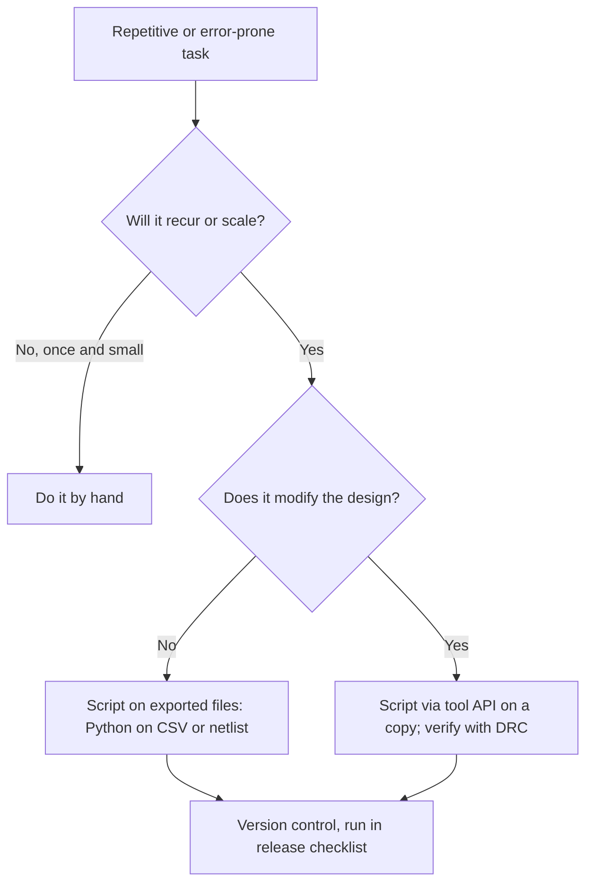

::: testing
Whether you see ECAD tools as programmable and know *when* scripting pays off. The interviewer is not asking for a specific language; they want to hear that you have automated something real (generating or checking a BOM, placing parts in a pattern, batch-exporting outputs, building libraries, running rules checks) and that you understand the risks (scripts that silently corrupt a design, API changes between tool versions). If you have no ECAD scripting experience, the strong answer is honest, names adjacent scripting you have done (Python on CSV or netlist files), and shows you know the hooks each tool provides.
:::

::: why
Boards have repetitive structure: 64 LEDs in a ring, a hundred decoupling capacitors, a BOM that must match a supplier database, outputs that must be regenerated identically on every release. Scripting turns hours of mouse work into seconds and removes human error from the boring parts. It also enforces consistency: a script that checks every part has an MPN, or that every footprint is in the approved library, catches problems a person skims over. Teams value interns who can write a 30-line Python script that saves a week.
:::

::: concepts
- **Tool scripting interfaces**: KiCad's Python API, Altium's scripting languages, Eagle's ULPs and script files, Allegro's SKILL. See [[q0638]].
- **Offline data scripting**: parsing exported files (CSV BOM, netlist, Gerber, pick-and-place) with Python, independent of the tool.
- **Geometry and coordinates**: polar-to-Cartesian placement, units (nm or mm or mil), y-axis direction.
- **Design rules and checks**: scripts that verify rules beyond built-in DRC. See [[q0641]].
- **Version control and repeatability**: scripts under version control, deterministic outputs.
- **Risk management**: work on a copy, test on a small design, check results visually.
:::

::: answer
"Honestly, my ECAD scripting experience is *[level: e.g. light / moderate]*. *[What you really did: e.g. I wrote a short Python script in KiCad to place twelve LEDs in a circle, and a separate script that reads the exported BOM and flags parts without a manufacturer part number.]*

The ring placement is a good example: you loop over the parts, compute the angle as 2π i over N, set x as the centre plus r cos θ and y as r sin θ, and rotate each part by its angle so they face outward. Doing that by hand for 12 LEDs is slow and imprecise; doing it for 60 is unreasonable. The BOM checker groups lines by value, footprint and MPN, prints the counts, and exits with an error if any line has no part number, which I run before I send a release.

I know the other tools expose similar hooks: Altium has built-in scripting and an API, Eagle uses ULPs and script files, and Allegro uses SKILL. I'd treat any script that modifies the board carefully: run it on a copy, check the result visually and with DRC, and keep the script in version control. What I like about scripting is that it makes releases repeatable: the same script generates the same outputs every time."
:::

::: technical
**Where scripting hooks exist (typical).**

| Tool | Mechanism | Typical uses |
|---|---|---|
| KiCad | Python API in the PCB editor (the `pcbnew` module), command-line tools (`kicad-cli`), plugins, netlist/BOM generator scripts | Pattern placement, batch exports, custom checks, BOM generation |
| Altium Designer | Built-in scripting languages (such as DelphiScript, VBScript, JScript) plus an API; output jobs | Report generation, bulk edits, library utilities |
| Eagle | User Language Programs (ULP, C-like) and SCR command scripts | BOM exports, bulk parameter edits, drawing generation |
| Cadence Allegro | SKILL (Lisp-like) and script files; OrCAD Capture has Tcl | Automated placement, report extraction, constraint application |

> [!UNCERTAIN]
> APIs change between tool versions: function names and argument types in KiCad's Python API changed between major releases, and KiCad has been introducing a newer IPC-based API that is expected to replace the older bindings over time. Check the current documentation of the exact version before relying on code from memory or old forum posts.

**Example 1: place N parts on a circle.** With centre $(c_x, c_y)$, radius $r$, and $N$ parts, part $i$ goes at

$$x_i = c_x + r\cos\theta_i,\quad y_i = c_y + r\sin\theta_i,\quad \theta_i = \frac{2\pi i}{N}.$$

For $N = 12$, $r = 20$ mm: $\theta_i$ steps by 30°, giving positions (20, 0), (17.32, 10), (10, 17.32), (0, 20), and so on. Note that in most ECAD tools **y increases downward**, so the ring is traversed clockwise on screen unless you flip the sign. Rotate each part by the angle plus an offset so it points radially.

A sketch of the KiCad version (check names for your version):

```python
import math, pcbnew
board = pcbnew.GetBoard()
cx, cy, r = pcbnew.FromMM(100), pcbnew.FromMM(80), pcbnew.FromMM(20)
N = 12
for i in range(N):
    fp = board.FindFootprintByReference(f"D{i+1}")
    a = 2 * math.pi * i / N
    fp.SetPosition(pcbnew.VECTOR2I(int(cx + r * math.cos(a)), int(cy + r * math.sin(a))))
    fp.SetOrientationDegrees(90 - math.degrees(a))
pcbnew.Refresh()
```

**Example 2: BOM check.** A short Python script reads an exported BOM CSV, groups by (value, footprint, MPN) and reports lines missing an MPN. Tested on a six-line sample, it prints the group counts and exits non-zero if any MPN is blank, so it can run in a release script:

```python
import csv, sys
from collections import defaultdict
groups, missing = defaultdict(list), []
with open(sys.argv[1], newline="") as f:
    for row in csv.DictReader(f):
        groups[(row["Value"], row["Footprint"], row["MPN"])].append(row["Reference"])
        if not row["MPN"].strip():
            missing.append(row["Reference"])
for (value, fp, mpn), refs in sorted(groups.items()):
    print(f"{len(refs):3d}  {value:8s} {fp:8s} {mpn or '-':16s} {','.join(refs)}")
if missing:
    print("MISSING MPN:", ", ".join(missing)); sys.exit(1)
```

**Safety checklist for scripts that edit a design.** Work on a copy or a version-controlled branch; make the script idempotent (running twice should not move things twice); print what it changed; run DRC and compare before/after; never run an untrusted script from the internet on a production design.
:::

::: short
"My scripting is *[level]*. I've done *[e.g. a KiCad Python script that places LEDs on a circle using x = cx + r cos θ, y = cy + r sin θ, and a BOM checker in Python that groups lines and flags missing part numbers]*. The other tools have hooks too: Altium scripting and API, Eagle ULPs, Allegro SKILL. I'd run any editing script on a copy, check with DRC, and keep it in version control so releases are repeatable."
:::

::: long
"My ECAD scripting is *[light/moderate]*, and I'd rather describe what I did than oversell it. In KiCad I wrote a Python script for a ring of LEDs. For each footprint it computes the angle, 2π times the index over the count, then sets x to the centre plus r cosine of the angle and y to the centre plus r sine, and rotates the part so it faces outward. For twelve LEDs at a twenty millimetre radius that's one loop instead of twelve manual placements, and it's exactly symmetric. I had to remember that y points down in the tool's coordinates, so the direction of rotation flips.

I also wrote a separate Python script that doesn't touch the design at all. It reads the exported BOM as a CSV, groups lines by value, footprint and manufacturer part number, prints the counts, and exits with an error if any line has no part number. I run it before each release. That's the kind of thing I like scripting for: it takes a check that a person would skim and makes it systematic.

I know the other tools have equivalent hooks. Altium has built-in scripting and an API, Eagle uses ULPs and script files, and Allegro uses SKILL, which is a Lisp-like language and is popular for large automated flows. APIs change between versions, so I check the documentation for the exact release.

The rules I follow: work on a copy, make scripts idempotent, print what changed, run DRC afterwards, and keep scripts in version control so outputs are repeatable. And if a script only reads data, I prefer running it on exported files because it can't damage the design."
:::

::: terms
- **ECAD scripting**: automating design tasks by running code through a tool's API or script interface.
- **API**: application programming interface; the functions a tool exposes to scripts.
- **ULP**: User Language Program, Eagle's scripting mechanism.
- **SKILL**: Cadence's Lisp-like extension language.
- **`pcbnew`**: the Python module exposed by KiCad's PCB editor.
- **BOM**: bill of materials; the list of parts, values, footprints and part numbers.
- **MPN**: manufacturer part number.
- **Idempotent**: running the script twice gives the same result as running it once.
- **Pick-and-place (centroid) file**: part coordinates and rotations for assembly machines.
:::

::: exceptional
**An average answer** says "a little Python" or "no" with nothing else.

**An exceptional answer**:
- Gives a **specific script** with its purpose, inputs, outputs and the maths where relevant.
- Distinguishes **read-only scripting** (parse exports) from **editing scripting** (modify the design) and explains the risk difference.
- Names **hooks in at least two tools** without overclaiming.
- States **safety practices**: copies, idempotence, DRC, version control.
- Mentions **API version drift** and checking the docs.
- If no experience: honest answer, plus a plan or an adjacent example (Python on CSV/netlists) and knowledge of what could be automated.
:::

::: mistakes
- **Claiming scripting skill you lack.** A one-question follow-up on the API will expose it. Say "light" and describe the example.
- **Editing a production design with an untested script.** Always test on a copy.
- **Ignoring units.** KiCad's internal unit is nanometres; mixing mm and nm moves parts by factors of a million.
- **Forgetting the y-axis direction.** Rotations come out mirrored.
- **Writing a script for a one-off task.** If it takes longer to write than to do by hand and won't be reused, don't.
- **Skipping version control for scripts.** A release process that depends on a forgotten file on one laptop is fragile.
- **Trusting forum snippets for the wrong version.** Names and arguments change.
:::

::: deep
## Why scripting matters in hardware

Hardware engineers sometimes treat scripting as a software skill, but boards are data: lists of parts, coordinates, nets, rules, and layers. Anything that is regular can be generated or checked by code. The payoff comes in three places.

1. **Speed**: placing 60 LEDs, renaming 200 nets, updating a field on every part.
2. **Consistency**: the same outputs, in the same format, for every release.
3. **Verification**: checks beyond the tool's built-in rules (every part has an MPN, no two parts share a reference, every power net has a decoupling cap within N mm).


Figure: The first decision is whether the task is worth automating at all. The second splits scripts into safe (read exported files) and risky (edit the live design), which determines how careful you must be.

## Example: polar placement

Suppose you need 12 LEDs on a 20 mm radius circle around $(c_x, c_y)$. Each LED $i$ is at angle $\theta_i = 2\pi i/12 = 30°\cdot i$:

```plot
{"title":"Twelve LEDs on a 20 mm circle: x = r cos θ, y = r sin θ","x":{"label":"x","unit":"mm","min":-25,"max":25},"y":{"label":"y","unit":"mm","min":-25,"max":25},
 "series":[{"label":"LED positions (joined)","points":[[20,0],[17.32,10],[10,17.32],[0,20],[-10,17.32],[-17.32,10],[-20,0],[-17.32,-10],[-10,-17.32],[0,-20],[10,-17.32],[17.32,-10],[20,0]],"color":"accent"}]}
```
Figure: The axes are not equally scaled in this plot, so the ring looks flattened; the positions are a true circle. The twelve positions are exactly 30° apart, and the chord between neighbours is $2r\sin(15°) = 10.35$ mm, so the LEDs need a footprint that fits in 10.35 mm of centre-to-centre spacing. Scripts make symmetric patterns exact, which is hard to do by hand with grid snapping.

Check: $2\cdot20\cdot\sin(15°) = 40\times0.2588 = 10.35$ mm. If your LED footprint is 5 mm long and must keep 1 mm clearance, that fits comfortably; for 60 LEDs the chord drops to $2\cdot20\cdot\sin(3°) = 2.09$ mm, so you would need a larger radius or smaller parts: $r \ge 5/(2\sin3°) = 47.8$ mm for 5 mm parts touching end to end.

**Rotation.** To make each part face outward, rotate by $\theta_i$ plus a fixed offset depending on how the footprint is drawn. Because y points down in most tools, the sign of rotation may be reversed relative to mathematics. Test with one or two parts before running all.

**Units.** KiCad stores lengths internally in nanometres, so `pcbnew.FromMM(20)` is 20 000 000. Altium and others use mils or mm. Always convert explicitly and print a couple of results to sanity-check.

## Example: BOM and rule checks on exported data

Exports are the safest place to start. Typical read-only checks:

- Every BOM line has a manufacturer part number and a supplier number.
- No duplicate reference designators.
- All capacitors on a given rail have at least a minimum total value (sum of values per net, if you export a netlist).
- Footprints are drawn from the approved list.
- Compare the BOM to the pick-and-place file: same references, no part in one but not the other.

A six-line test BOM (two 100 nF capacitors, one 10 µF capacitor, two 10 kΩ resistors and one 4.7 kΩ resistor, with MPNs missing on the 10 µF and 4.7 kΩ parts) groups into four lines and flags two references, C3 and R3, with no MPN. That is the type of output you can paste into a release checklist.

## Example: batch outputs

Rather than clicking through export dialogs, tools offer command-line or script interfaces to generate Gerbers, drill, PDF, BOM and pick-and-place in one go. Benefits: the same settings every time, files named consistently with the revision, and a record (the script) of exactly what was exported. KiCad has a command-line interface (`kicad-cli`); Altium uses output job files; Eagle has CAM jobs; Allegro uses batch scripts. This is often what teams actually mean by "ECAD scripting".

## What can go wrong

- **Silent corruption**: a script that moves parts with the wrong units or rotates by the wrong sign can wreck a layout without error messages. Always diff the result: DRC, a visual check, and compare to version control.
- **Hidden state**: scripts that rely on selection or the active layer behave differently each time.
- **Version drift**: API changes break scripts after a tool upgrade.
- **Over-engineering**: a script that takes a day to write for a task that takes an hour by hand and never recurs is a loss.
- **Bus factor**: if only one person understands the script, it becomes a liability.

Mitigations: tests on a tiny example board, comments with the tool version, scripts kept next to the project in version control, and a README with how to run them.

## If you don't have ECAD scripting experience

Be honest, then show the adjacent skill and the plan: "I haven't scripted inside the layout tool, but I've written Python to process CSV and log data, and I know KiCad exposes Python. For my next board I'd start with a BOM checker, because it's read-only and safe, then move to placement scripts." If you have a few days before the interview, write the BOM checker above for your own project: it takes 30 lines and gives you a real story.

## Linking to the rest of the workflow

Scripting connects with design rule checking ([[q0641]]): custom checks extend DRC with rules your team cares about; and with library management ([[q0639]]): generating many footprints (resistor series, connector families) from parameters is a classic scripting use. Programmatic footprints from a table of dimensions reduce errors compared with drawing each one by hand.
:::

::: applications
- **Pattern placement**: LED rings, connector arrays, test-point grids, heat-sink via arrays.
- **BOM tooling**: merging, checking MPNs, adding supplier data, checking against stock.
- **Release automation**: one command that generates Gerbers, drill, BOM, pick-and-place and a PDF, named by revision.
- **Library generation**: families of footprints from tables of dimensions.
- **Custom checks**: footprints from approved libraries only, decoupling capacitor proximity, net naming conventions.
- **Panelisation and variants**: scripts that create panels or variant BOMs from a master design.
:::

::: assumptions
The examples assume a typical open-source or commercial ECAD tool with a scripting API; exact function names differ per tool and version. Python on exported files is portable and recommended as a first step. The value of scripting depends on volume: a one-off board rarely justifies it, while a product family or a team release process does. Interview expectations differ by role: for a hardware intern, a small script and the right attitude is plenty; for a layout-automation role, expect deeper questions on API details and testing. Different employers also restrict running third-party scripts on production designs, so follow your company's policy.
:::

::: followups
### What's the safest kind of ECAD scripting to start with?
Read-only scripts that process exported files, such as a Python script that reads the BOM CSV, checks for missing part numbers, and groups lines. It can't corrupt the design, it's easy to test with a small sample file, and it gives you a real result quickly. After that, move to scripts that edit a copy of the design, and verify each with DRC and a visual check.

### How do you place 24 parts evenly around a circle?
Loop over $i = 0\ldots23$, with $\theta_i = 2\pi i/24 = 15°\cdot i$, and set $x = c_x + r\cos\theta_i$, $y = c_y + r\sin\theta_i$. Rotate each part to $\theta_i$ plus an offset. Convert units (mm to the tool's internal unit), remember that y points down in many tools, and test the first and last part by eye. For 24 parts at 30 mm radius, the chord between neighbours is $2\cdot30\sin(7.5°) = 7.83$ mm, which must be larger than the footprint length plus clearance.

### What can go wrong when a script edits a layout?
Wrong units (parts end up a million times away), mirrored rotations from the y-axis direction, moving locked or wrongly selected parts, and silent partial runs that leave the board half edited. I'd run on a copy, print each change, run DRC afterwards, and compare to version control. If the script fails halfway, I'd discard the copy and fix the script, not hand-patch the result.

### How would you automate release outputs?
Write one script or output job that generates the same set of files with the same settings each time: Gerbers per layer, drill, BOM, pick-and-place, PDF of schematic and assembly drawings, named with the board revision, and put into a release folder. Check the files by opening them in an independent viewer. Because it's scripted, any engineer can regenerate an identical release, and I'd keep the script in version control with the project.

### Why might a company prefer Python on exports instead of in-tool scripting?
Portability and stability. Exported CSV, netlist, and Gerber files are stable formats that work across tool versions and even across tools; in-tool APIs change and tie you to one product. Exports are also safer since scripts can't modify the design. In-tool scripting wins when you must move or create objects, such as patterned placement or batch edits.

### Scenario: you must update the "Manufacturer" field on 400 BOM lines for a supplier change. What do you do?
If the tool stores these as part fields, a script via the API or an export-edit-import cycle is the right tool. I'd export the BOM with references, build a mapping from old part number to new, apply it in Python, import back (or write through the API), and diff the before and after BOM. I'd run it on a copy first, spot-check ten lines against the supplier's catalogue, and commit the script with the release.
:::

::: interpretations
"Do you have any scripting experience in ECAD?" is a yes/no on the surface and a prompt for a specific example in practice. "ECAD scripting" can mean automating inside the layout tool (API, ULP, SKILL) or processing exported design data with external scripts. The answer covers both and recommends starting with the external route. The code in this page is a sketch to show structure: check it against your tool version's documentation before using it on a real board.
:::

::: references
- KiCad documentation for the Python scripting interface and the command-line interface (current version).
- Altium documentation on scripting and the API.
- Autodesk EAGLE ULP and script documentation (check current status; EAGLE is being retired in favour of Fusion).
- Cadence Allegro and OrCAD documentation on SKILL and Tcl.
- Python documentation for the `csv` module, for the BOM example.
:::

::: rubric
- Describes a specific script: purpose, inputs, outputs :: Shows real experience and engineering thought.
- Uses correct geometry/maths for placement (cos/sin, angles, units, y-axis) :: Shows technical competence.
- Distinguishes read-only export scripts from editing scripts :: Shows risk awareness.
- Names scripting hooks for more than one tool without overclaiming :: Shows breadth with honesty.
- States safety practices: copy, idempotence, DRC, version control :: Shows professional discipline.
- Mentions API/version drift :: Shows realism about maintenance.
- If inexperienced, is honest and offers an adjacent example and a plan :: Honesty beats inflated claims.
:::

::: quiz
```json
[
 {"type":"mcq","level":"fundamental","q":"Which kind of ECAD scripting is the safest to start with?","options":["Scripts that modify the live layout","Scripts that read exported files such as a BOM CSV","Scripts downloaded from forums run on production boards","Scripts that delete unused layers"],"answer":1,"explain":"Read-only scripts on exported data can't damage the design and are easy to test."},
 {"type":"mcq","level":"fundamental","q":"What is KiCad's internal length unit in the Python API?","options":["Mils","Millimetres","Nanometres","Inches"],"answer":2,"explain":"KiCad stores lengths in nanometres; use FromMM and ToMM helpers to convert and avoid factor-of-a-million mistakes."},
 {"type":"numeric","level":"intermediate","q":"12 parts are placed on a circle of radius 20 mm. What is the centre-to-centre chord (mm) between neighbours?","answer":10.35,"tolerance":0.02,"unit":"mm","explain":"Chord = 2 r sin(π/N) = 2 × 20 × sin(15°) = 10.35 mm."},
 {"type":"numeric","level":"intermediate","q":"What is the x coordinate (mm) of the part at index i = 2 of 12 on a circle of radius 20 mm centred at the origin (θ = 2πi/12)?","answer":10,"tolerance":0.02,"unit":"mm","explain":"θ = 60°, x = 20 cos 60° = 10 mm (and y = 17.32 mm)."},
 {"type":"numeric","level":"advanced","q":"What minimum radius (mm) lets 60 parts, each 5 mm long, sit on a circle with neighbours touching end to end (chord = 5 mm)?","answer":47.8,"tolerance":0.02,"unit":"mm","explain":"r = chord/(2 sin(π/60)) = 5/(2 × 0.05234) = 47.8 mm."},
 {"type":"truefalse","level":"intermediate","q":"If a placement script runs without errors, you can skip DRC and visual inspection.","answer":false,"explain":"A script can run cleanly and still produce wrong units, mirrored rotation or overlaps. Always verify with DRC and a visual check."}
]
```
:::
