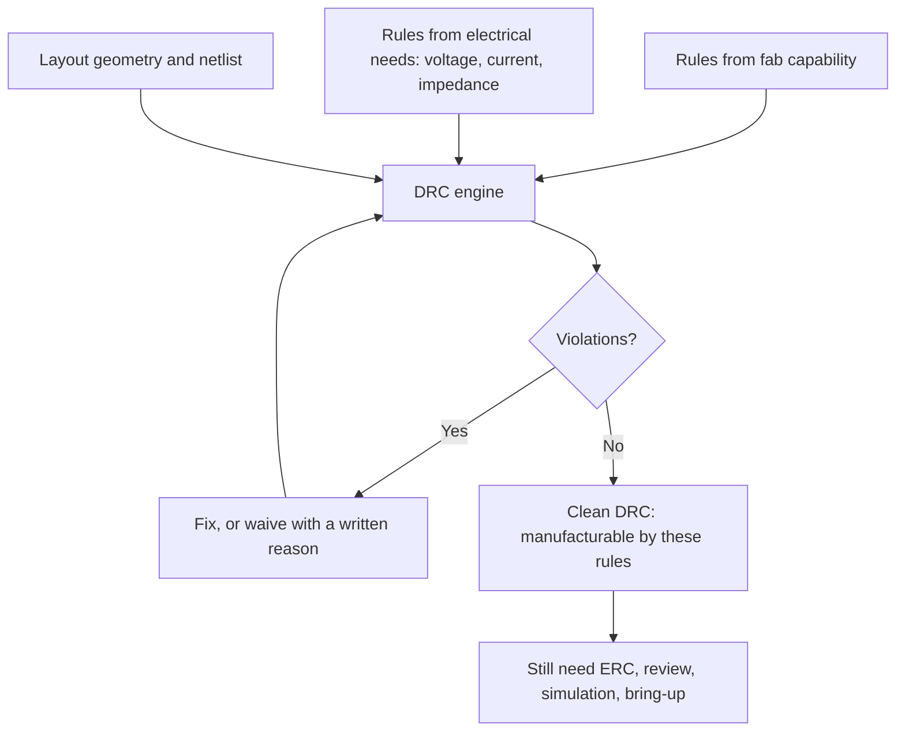

::: testing
Whether you know DRC as the bridge between your design and the fabricator's process limits, and whether you understand what it does *not* guarantee. A good answer defines DRC (automated check of layout geometry against rules), lists the main categories (clearance, minimum width, drill and annular ring, via rules, solder mask and silkscreen, board-edge, unconnected nets), says where the rule values come from (the fab's capabilities plus electrical needs), and distinguishes DRC from ERC and from design review. Interviewers are especially pleased by the line "a clean DRC means it is manufacturable by the rules I set, not that it is correct".
:::

::: why
A bad DRC is a bad board: shorts from insufficient clearance, opens from traces narrower than the fab can etch, via barrels that break out of their pads, parts that can't be assembled because mask slivers disappear. DRC catches thousands of such issues in seconds. It is also the formal handshake with the fabricator: your rules say "I need this", the fab's capability document says "we can make this", and a clean DRC proves the board stays inside the overlap. Misconfigured rules (too loose, or silenced violations) are one of the most common causes of preventable board failures.
:::

::: concepts
- **Clearance (spacing)**: minimum distance between copper features of different nets, set by fab capability and voltage (see the deep dive below).
- **Minimum trace width**: set by etch capability and current. See [[q0639]].
- **Drill, via and annular ring**: ring of copper left around a drilled hole after tolerances. See [[q0574]].
- **Solder mask**: opening, expansion and minimum web (sliver) between pads. See [[q0473]].
- **Silkscreen rules**: no ink on pads, minimum line width and height for legibility.
- **Connectivity checks**: unrouted nets and shorts between nets.
- **ERC vs DRC**: electrical (schematic) vs geometric (layout). See [[q0638]].
- **DFM**: DRC is the minimum, DFM is the broader practice. See [[q0613]].
:::

::: answer
"DRC, or design rule check, is an automated check that runs on the PCB layout and compares the geometry against a set of rules. The rules come from the fabricator's process limits and from my own electrical needs. The usual categories are clearance between copper of different nets, minimum trace width, drill size and annular ring on vias and holes, solder mask and silkscreen rules, board-edge clearance, and connectivity, meaning unrouted nets or shorts between nets.

I use it constantly. I set the rules at the start from the fab's capability sheet, for example 0.1 millimetre trace and space and a minimum drill of 0.3 millimetres, tighten them where electrical needs require it, like larger spacing for a 48 volt rail, and run DRC after every routing session, not only at the end. Violations are either fixed or, rarely, waived with a documented reason.

The caveat I'd stress is that DRC checks geometry against rules, not intent. A board can pass DRC and still have a wrong footprint, a swapped pin, or a return path crossing a split. That's what ERC, design review, simulation and bring-up are for. In an IC layout context there's a similar idea: DRC against the foundry's rules, plus LVS to check the layout matches the schematic."
:::

::: technical
**Definition.** A design rule check is an automated verification of a layout against a rule set: minimum and maximum geometric constraints on conductors, holes, masks and marking, plus connectivity.

**Typical rule categories and where values come from.**

| Category | Example rule | Source |
|---|---|---|
| Clearance | copper-to-copper between nets ≥ 0.15 mm | Fab capability, voltage (IPC-2221), creepage standards |
| Track width | ≥ 0.15 mm; power per current | Fab etch limit; IPC-2221/2152 for current |
| Drill | minimum finished hole 0.2 to 0.3 mm | Fab drilling capability, aspect ratio |
| Annular ring | ≥ 0.1 mm (outer), after tolerances | Fab registration and drill tolerance |
| Via | via-to-via and via-to-pad spacing, aspect ratio | Fab plating capability |
| Solder mask | mask web between pads ≥ fab minimum; expansion | Fab and assembler |
| Silkscreen | no ink on pads, minimum stroke | Fab legibility rules |
| Board edge | copper-to-edge ≥ 0.2 to 0.5 mm | Routing/V-score tolerance |
| Connectivity | no unrouted nets, no shorts | Schematic netlist |
| Courtyard | no overlapping part courtyards | Assembly clearance |

> [!UNCERTAIN]
> The example values are typical of low-cost prototype processes; every fabricator publishes its own minimums by process class, and the tighter the rule, the higher the cost and the lower the yield. Always take values from your fabricator's current capability document.

**Annular ring arithmetic.** Annular ring is $AR = \dfrac{D_{pad} - D_{drill}}{2}$. For a 0.6 mm pad and 0.3 mm drill, $AR = 0.15$ mm nominal. Worst case: subtract half the drill-diameter tolerance (hole could be larger) and the layer-to-drill registration error. With 0.05 mm drill tolerance and 0.075 mm registration: $0.15 - 0.025 - 0.075 = 0.05$ mm, which may be below the fab's minimum, so the nominal ring must exceed the rule with margin.

**Voltage-dependent clearance.** IPC-2221 gives minimum conductor spacing versus voltage, differing by internal vs external layers, coated vs uncoated, and altitude. For example (see caution below), external uncoated conductors at sea level need on the order of 0.1 mm up to about 30 V and about 0.6 mm in the 31 to 150 V range, increasing in steps with voltage.

> [!UNCERTAIN]
> These figures show the general magnitude and pattern of IPC-2221's voltage-spacing table and are not a substitute for it; look up the actual table for your layer, coating and altitude before using a value in a design. For mains-connected equipment, product safety standards (for example IEC 60664-1 and IEC 62368-1) govern creepage and clearance, and those requirements override generic DRC defaults.
:::

::: short
"DRC is an automated check of the PCB layout against rules: clearance between nets, minimum trace width, drill and annular ring, solder mask and silkscreen rules, board-edge distance and connectivity. I set the rules from the fab's capability sheet plus my electrical needs, and run it after every routing session. A clean DRC means it's manufacturable by those rules, not that it's correct, so I still need ERC, review and bring-up."
:::

::: long
"A design rule check is an automated check that compares the geometry of the PCB layout against a set of rules and flags violations. It's the main way you make sure the board you drew is something the fabricator can actually build.

The rules fall into groups. Clearance: minimum spacing between copper features of different nets, which prevents shorts and depends on the fab's capability and on voltage. Minimum trace width, set by what the etching process can do and by current. Holes and vias: minimum drill, and annular ring, which is the copper left around a hole. For a 0.6 millimetre pad and a 0.3 millimetre drill the ring is 0.15 millimetres nominal, but after drill tolerance and layer registration it can shrink to 0.05, which is why you leave margin. Then solder mask rules, like minimum sliver between pads, silkscreen rules so ink doesn't land on pads, board-edge clearance, courtyard overlaps, and connectivity, meaning unrouted nets or accidental shorts.

I set the rules at the start from the fab's capability document and add electrical requirements, like larger spacing on higher-voltage nets, using IPC-2221 tables or the relevant safety standard. I run DRC regularly, not just at the end, and if I waive a violation I write down why.

What DRC doesn't do is check intent. A wrong footprint, a swapped pin or a return path over a plane split can all pass. That's why I also use ERC on the schematic, design review, and bring-up. In IC design the equivalent is DRC against the foundry rules plus LVS, which checks layout versus schematic."
:::

::: terms
- **DRC**: design rule check; automated geometric verification of the layout against rules.
- **ERC**: electrical rules check on the schematic. See [[q0638]].
- **Clearance**: minimum copper-to-copper spacing between different nets.
- **Annular ring**: copper remaining around a drilled hole after drilling tolerances.
- **Aspect ratio**: board thickness divided by drill diameter; limits plating quality.
- **Solder mask web / sliver**: thin strip of mask between adjacent pad openings; may peel if too narrow.
- **Courtyard**: component keepout outline used for placement checks.
- **Creepage / clearance (safety)**: surface and air distances between conductors required by safety standards.
- **Waiver**: a documented decision to accept a specific DRC violation.
- **LVS**: layout-versus-schematic check, used in IC design.
:::

::: exceptional
**An average answer** says "DRC checks that the layout follows the design rules".

**An exceptional answer**:
- Lists **categories** and says where **each rule value comes from** (fab capability, current, voltage, assembler).
- Quantifies one rule, such as **annular ring** after tolerances.
- Distinguishes **ERC / DRC / review / LVS** and says what DRC **cannot** catch.
- Mentions **voltage-based clearance** and that **safety standards** override generic rules for mains.
- Describes **practice**: run often, don't silence violations, document waivers, re-check after pours.
- Notes DRC is **necessary but not sufficient** for DFM ([[q0613]]).
:::

::: mistakes
- **Using the tool's default rules.** Defaults are generic; your fab's actual limits and your voltages decide.
- **Disabling a rule to make the red markers go away.** Understand the violation first; waive only with a reason.
- **Running DRC only at the end.** Early checks avoid a rework of the whole routing.
- **Forgetting to refill copper pours** before DRC, so clearances are checked against stale shapes.
- **Assuming "DRC clean" means correct.** It doesn't check footprints, pin mapping or return paths.
- **Ignoring nominal vs worst-case.** Annular ring must survive drill and registration tolerance.
- **Applying generic clearances to mains.** Safety standards set creepage and clearance.
:::

::: deep
## What DRC does under the hood

The layout is a collection of geometric objects: tracks (lines with width), pads, vias, copper zones (polygons), holes, mask openings, silkscreen text and outlines. Each belongs to a layer and, for conductors, a net. A DRC engine checks pairs of objects (and single objects) against rules:

- For each pair of copper objects on the same layer with different nets, compute the minimum distance; flag if less than the clearance.
- For each track, compare width to the minimum for its net class.
- For each hole, compare diameter to the minimum, and the copper ring to the minimum annular ring.
- For each net, verify that it forms a single connected set (otherwise it is *unrouted*), and that no two nets are connected (a *short*).
- For mask openings, check the web between adjacent openings.
- For silkscreen, check overlap with pads and the board edge.

Because these are geometric tests, DRC is exact for what it checks and blind to everything else.


Figure: DRC combines two rule sources (the fab's limits and your own electrical needs) with the layout. A clean result is an input to release, not the conclusion; the right-hand box lists what DRC cannot cover.

## The rules, one at a time

```svg
<svg viewBox="0 0 640 250" role="img" aria-label="Common DRC rule categories illustrated on copper features">
  <rect x="10" y="10" width="620" height="230" fill="none" stroke="var(--d-muted)" stroke-width="1"/>
  <!-- clearance -->
  <rect x="30" y="50" width="120" height="14" fill="var(--d-orange)" opacity="0.8"/>
  <rect x="30" y="82" width="120" height="14" fill="var(--d-blue)" opacity="0.8"/>
  <line x1="170" y1="64" x2="170" y2="82" stroke="var(--d-red)" stroke-width="2"/>
  <text x="178" y="77" font-family="Inter, sans-serif" font-size="12" fill="var(--d-red)">clearance</text>
  <text x="30" y="40" font-family="Inter, sans-serif" font-size="13" fill="var(--d-ink)">Spacing between nets</text>
  <!-- width -->
  <rect x="30" y="140" width="140" height="8" fill="var(--d-green)" opacity="0.8"/>
  <line x1="190" y1="140" x2="190" y2="148" stroke="var(--d-red)" stroke-width="2"/>
  <text x="198" y="148" font-family="Inter, sans-serif" font-size="12" fill="var(--d-red)">min width</text>
  <text x="30" y="128" font-family="Inter, sans-serif" font-size="13" fill="var(--d-ink)">Trace width</text>
  <!-- annular ring -->
  <circle cx="400" cy="90" r="32" fill="var(--d-orange)" opacity="0.8"/>
  <circle cx="400" cy="90" r="16" fill="var(--d-box)" stroke="var(--d-ink)"/>
  <line x1="416" y1="90" x2="432" y2="90" stroke="var(--d-red)" stroke-width="2"/>
  <text x="440" y="86" font-family="Inter, sans-serif" font-size="12" fill="var(--d-red)">annular ring</text>
  <text x="440" y="102" font-family="Inter, sans-serif" font-size="11" fill="var(--d-ink)">= (pad - drill)/2</text>
  <text x="350" y="40" font-family="Inter, sans-serif" font-size="13" fill="var(--d-ink)">Via or plated hole</text>
  <!-- mask web -->
  <rect x="310" y="170" width="60" height="40" fill="var(--d-orange)" opacity="0.8"/>
  <rect x="400" y="170" width="60" height="40" fill="var(--d-orange)" opacity="0.8"/>
  <rect x="302" y="162" width="76" height="56" fill="none" stroke="var(--d-blue)" stroke-width="1.5"/>
  <rect x="392" y="162" width="76" height="56" fill="none" stroke="var(--d-blue)" stroke-width="1.5"/>
  <line x1="378" y1="190" x2="392" y2="190" stroke="var(--d-red)" stroke-width="2"/>
  <text x="478" y="190" font-family="Inter, sans-serif" font-size="12" fill="var(--d-red)">mask web (sliver)</text>
  <text x="310" y="152" font-family="Inter, sans-serif" font-size="13" fill="var(--d-ink)">Mask openings (blue outline)</text>
  <!-- edge -->
  <line x1="30" y1="220" x2="250" y2="220" stroke="var(--d-ink)" stroke-width="3"/>
  <rect x="60" y="196" width="120" height="10" fill="var(--d-green)" opacity="0.8"/>
  <line x1="120" y1="206" x2="120" y2="220" stroke="var(--d-red)" stroke-width="2"/>
  <text x="128" y="216" font-family="Inter, sans-serif" font-size="12" fill="var(--d-red)">copper-to-edge</text>
</svg>
```
Figure: Each red marker shows the dimension a rule constrains: spacing between different nets, minimum width, the copper ring around a hole, the mask web between adjacent pad openings, and copper-to-board-edge distance. DRC measures each one against a minimum.

### Clearance and voltage

Minimum spacing has two parts: what the fab can make (typically 0.1 to 0.15 mm for standard processes, tighter for premium) and what the voltage demands. The voltage requirement grows in steps with voltage and depends on internal versus external layers and coating. A representative reading of IPC-2221's tables, to show the pattern rather than to design with:

| Peak voltage between conductors | Internal | External, uncoated, sea level | External, with permanent polymer coating |
|---|---|---|---|
| ≤ 30 V | 0.05 mm | 0.1 mm | 0.1 mm |
| 31 to 50 V | 0.1 mm | 0.6 mm | 0.13 mm |
| 51 to 100 V | 0.1 mm | 0.6 mm | 0.13 mm |
| 101 to 250 V | 0.2 mm | 0.6 to 1.25 mm | 0.4 mm |

> [!UNCERTAIN]
> Treat this table as an illustration of how strongly coating and layer matter, not as design data; verify against the standard's own table. Notice the step between 30 V and 50 V on uncoated external layers: this is why many boards use wider spacing around 48 V rails.

```plot
{"title":"Illustrative pattern: required spacing grows with voltage (internal vs external uncoated)","x":{"label":"Peak voltage","unit":"V","min":0,"max":500},"y":{"label":"Minimum spacing","unit":"mm","min":0,"max":3},
 "series":[{"label":"Internal layer","fn":"ite(x<=30,0.05,ite(x<=100,0.1,ite(x<=300,0.2,0.25)))","step":true,"color":"blue"},{"label":"External, uncoated","fn":"ite(x<=30,0.1,ite(x<=150,0.6,ite(x<=300,1.25,2.5)))","step":true,"color":"red"}]}
```
Figure: Both curves are step functions of voltage. The external uncoated curve is far above the internal one because surface contamination and humidity allow tracking across the surface. The numbers are for illustration; use the standard's table for a design.

### Annular ring and drill

A plated through-hole must keep copper around it after the hole is drilled slightly off-centre and the inner layers are slightly misregistered. If the ring breaks (breakout), the connection can open or the pad can crack. Worked example: pad 0.6 mm, drill 0.3 mm, nominal $AR = 0.15$ mm. Allow drill tolerance 0.05 mm (radius effect 0.025) and registration 0.075 mm: worst case $0.15 - 0.025 - 0.075 = 0.05$ mm. If your fab requires at least 0.075 mm after tolerances, increase the pad to 0.7 mm: $AR = 0.2$ nominal and 0.10 worst case. Also check aspect ratio: board thickness 1.6 mm with a 0.2 mm drill is 8:1, which many fabs consider the limit for reliable plating; check the fab's number.

### Solder mask and silkscreen

Solder mask has a minimum feature size; a web between two adjacent pad openings thinner than the fab minimum will peel off or be omitted, which invites solder bridges on fine-pitch parts. Silkscreen on pads is trimmed by the fab or flagged. These rules often differ between the fabricator and the assembler.

### Connectivity

Unrouted nets are the ones the ratsnest still shows: DRC reports them so you don't send an incomplete board. Shorts between nets are flagged as clearance violations of zero. After changing pours, always refill zones before the final DRC, otherwise stale shapes hide violations.

## DRC versus its neighbours

| Check | Operates on | Catches | Misses |
|---|---|---|---|
| ERC | Schematic | Floating pins, driver conflicts, missing power flags | Geometry, wrong but legal connections |
| DRC | Layout | Geometry vs rules, unrouted nets | Wrong footprints, wrong pinout, return paths |
| LVS (IC) | Layout vs schematic netlist | Layout that doesn't implement the circuit | Performance, timing |
| Design review | Both | Intent errors, missing protections | Anything nobody thinks of |
| DFM review (fab/assembler) | Gerbers/ODB++ | Process-specific yield issues | Electrical correctness |

Where DRC ends, simulation (signal integrity, power integrity) and review begin ([[q0613]]). In IC design, DRC checks the layout against the foundry's rules for minimum widths, spacings, enclosures and densities, and LVS confirms it matches the schematic. The foundry will not accept a design that fails its DRC.

## Practice: how to use DRC well

1. **Set rules first.** Import the fab's rule file if available; otherwise enter minimums by hand.
2. **Define net classes** (power, signal, high speed) with their widths and clearances.
3. **Run early and often.** Fixing a violation after one session is cheap; after 200 traces, expensive.
4. **Refill zones** before each check.
5. **Review every waiver.** A waived violation is a deliberate exception with an owner and a reason in the design notes.
6. **Compare to the fab's own check.** Many fabricators run their own DFM check on your Gerbers; read its report, because it tests against their actual process.
7. **Extend with scripts** for rules the tool doesn't have ([[q0640]]).

## What a clean DRC does not prove

Imagine a regulator footprint with pins mirrored. Every pad has the right size and spacing; DRC is clean. The board won't work. Or a high-speed trace crosses a plane split: legal geometry, bad return path. Or two nets that should be one are routed separately: legal, wrong. These are intent errors, caught by schematic review ([[q0639]]), checklists, simulation and bring-up.
:::

::: applications
- **Every PCB release**: DRC is a gate before sending Gerbers to fabrication.
- **High-voltage boards** (48 V buses, mains-adjacent isolation): voltage-dependent spacing and slots, with safety standards in force.
- **HDI and fine-pitch BGA boards**: tight trace/space, microvia rules and mask webs set by the fab's advanced process.
- **Panelised and assembled products**: board-edge and V-score clearances and courtyard checks for pick-and-place.
- **IC layout**: foundry DRC and LVS before tape-out.
- **Contract manufacturing**: fabricator's own DFM/DRC report on your files before they start.
:::

::: assumptions
Rule values are typical for standard rigid FR-4 boards from low-cost fabricators and change with process class (standard, advanced, HDI) and cost. IPC-2221 voltage-spacing values depend on altitude, coating, layer and whether conductors are in the same layer; use the standard's tables, and mains safety standards for line-connected equipment. The annular-ring example uses illustrative tolerances. In IC design, DRC rules are far more numerous and dictated by the process node; the principle is the same. Some tools merge DRC and other checks (for example differential-pair and length rules) into one report; the categories here are conceptual. A valid alternative viewpoint is that DRC should be run against stricter rules than the fab's minimums to leave yield margin; many teams do exactly that.
:::

::: followups
### Where do your DRC rule values come from?
Two places. The fabricator's capability document gives the floor: minimum trace and space, drill, annular ring, mask web, board-edge distance. My own electrical needs set the ceiling in particular nets: wider traces for current from IPC-2221 or IPC-2152, more clearance for higher voltage, impedance-driven geometry for high-speed pairs. I take the stricter of the two for each net class. I also leave margin above the fab's minimum where I can, since pushing every dimension to the limit costs money and yield.

### Is a DRC-clean board a working board?
No. DRC verifies geometry against rules and connectivity against the netlist. It won't catch a wrong footprint, a swapped pinout, a missing pull-up, a return path across a plane split or a stackup that gives the wrong impedance. Those need ERC, review, simulation and bring-up. DRC-clean means "manufacturable under the rules I set, and connected as the schematic says".

### What is the annular ring and why does it matter?
It's the ring of copper around a drilled hole: $(D_{pad} - D_{drill})/2$. Drill wander and layer misregistration eat into it. If the hole breaks out of the pad, the connection can become unreliable or open. For a 0.6 mm pad and 0.3 mm drill the nominal ring is 0.15 mm, but with 0.05 mm drill tolerance and 0.075 mm registration it falls to 0.05 mm, so I check against the fab's worst-case requirement.

### When is it acceptable to waive a DRC violation?
Rarely, and with a record. Examples: a connector footprint from the vendor that intentionally violates a mask-web rule and is known to be fine with the fab, or an intentional net tie where two nets meet. I'd confirm with the fabricator or assembler, add a note in the design file, and review it in the release checklist. I would not waive clearance on a high-voltage net because "it looks fine".

### How does DRC differ for ICs?
Same principle, different scale and rules. IC DRC checks the layout against the foundry's rule deck: minimum widths and spacing per layer, enclosures, densities and antenna rules. It is paired with LVS, which extracts a netlist from the layout and compares it to the schematic. Tape-out requires DRC and LVS clean (or approved waivers) because masks are extremely expensive to fix.

### Scenario: your fab's DFM report flags 40 narrow mask slivers between fine-pitch QFP pads, but your DRC was clean. What happened?
My DRC rule for mask web was either off or set below the fab's actual minimum. The fab's report tests their process: with a mask expansion of 0.05 mm, a 0.5 mm pitch leaves too little web between pads. I'd check the fab's minimum web (often given per mask colour), reduce the mask expansion, or ask for a mask-defined-opening-in-group (a gang opening) with the assembler's agreement. Then I'd update the rule in my template so DRC catches it next time.
:::

::: interpretations
"Design rule checks (DRC)" sits in the ECAD section, so the page answers for PCB layout. In IC design, the same acronym applies to checks against the foundry's layout rules; the answer includes a short mention. Some interviewers use "DRC" loosely for "any automated rule check" (including ERC); the page distinguishes them and uses ERC for schematic checks.
:::

::: references
- IPC-2221, *Generic Standard on Printed Board Design* (conductor spacing and current guidance).
- IPC-2152, *Standard for Determining Current Carrying Capacity in Printed Board Design*.
- Your fabricator's published capability document (minimum trace/space, drill, annular ring, mask web).
- IEC 60664-1 and IEC 62368-1 for creepage and clearance in line-powered equipment (consult the current editions).
- Rabaey, Chandrakasan, Nikolic, *Digital Integrated Circuits*, chapter on layout and design rules (for the IC meaning).
:::

::: rubric
- Defines DRC as an automated geometric check against rules :: This is the core definition.
- Lists main categories: clearance, width, drill/annular ring, mask/silkscreen, edge, connectivity :: Shows breadth.
- Says rule values come from the fab's capabilities and electrical needs :: Shows engineering sources, not defaults.
- Quantifies annular ring or clearance with numbers :: Shows depth.
- States what DRC does not catch (intent, footprint, return paths) :: Shows maturity.
- Distinguishes ERC, DRC, review and LVS :: Shows the whole verification picture.
- Describes good practice (run often, refill zones, document waivers) :: Shows professional habits.
:::

::: quiz
```json
[
 {"type":"mcq","level":"fundamental","q":"What does DRC compare?","options":["Schematic connectivity against the BOM","Layout geometry against manufacturing and electrical rules","Component values against datasheets","Simulation results against measurements"],"answer":1,"explain":"DRC checks the layout geometry (clearance, width, drill, mask, edge) and connectivity against a rule set."},
 {"type":"mcq","level":"fundamental","q":"Which problem will a clean DRC NOT catch?","options":["Two nets closer than the clearance rule","A trace narrower than the minimum","A footprint with mirrored pins that matches the library","A hole whose annular ring is too small"],"answer":2,"explain":"DRC checks geometry against rules. A footprint that is geometrically legal but electrically wrong (mirrored pins) passes."},
 {"type":"numeric","level":"intermediate","q":"A pad is 0.7 mm and the drill is 0.3 mm. What is the nominal annular ring (mm)?","answer":0.2,"tolerance":0.02,"unit":"mm","explain":"AR = (0.7 − 0.3)/2 = 0.2 mm."},
 {"type":"numeric","level":"intermediate","q":"For a 0.6 mm pad and 0.3 mm drill, with 0.05 mm drill-diameter tolerance (half applies to the ring) and 0.075 mm registration, what is the worst-case ring (mm)?","answer":0.05,"tolerance":0.05,"unit":"mm","explain":"Nominal 0.15 − 0.025 (half of 0.05) − 0.075 = 0.05 mm."},
 {"type":"truefalse","level":"intermediate","q":"It is good practice to run DRC only once, immediately before sending the Gerbers.","answer":false,"explain":"Running DRC often catches problems early when they are cheap to fix, and zone refills should precede the final check."},
 {"type":"multi","level":"advanced","q":"Select all that are sources of DRC rule values for a PCB.","options":["The fabricator's capability document","Voltage and safety-standard clearance requirements","Current requirements via IPC-2221/2152","The default values of the tool, accepted without review"],"answer":[0,1,2],"explain":"Fab limits, voltage/safety needs and current requirements define the rules. Unreviewed defaults are not a valid source."}
]
```
:::
