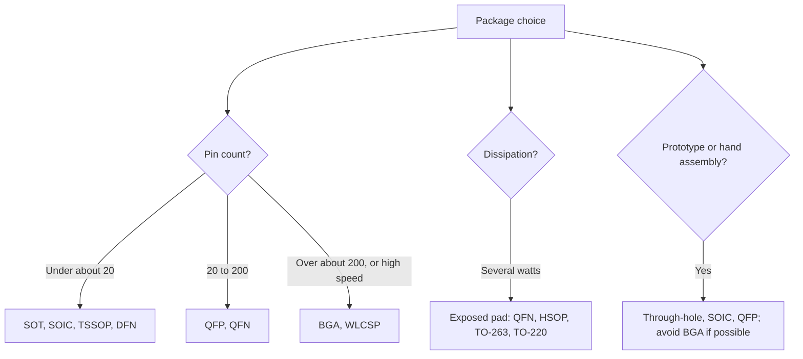

::: testing
Whether you can name the main package families and compare them on the axes that matter in a real design: pin count and density, board area, thermal performance, electrical parasitics (lead inductance, capacitance), hand-solderability and prototyping, inspection and rework, and cost. A strong answer groups packages (through-hole, leaded SMD, leadless, area-array, wafer-level), gives one or two typical pitches or examples for each, and ends with how you would choose for a specific job. Mentioning that package choice can be dictated by the part (some ICs only come in a BGA) and by assembly capability earns credit.
:::

::: why
Package choice is a system decision: it sets how many pins you can have, how well the chip sheds heat, how the signals behave at high speed, whether you can hand-solder a prototype, whether your assembler needs X-ray, and how the board must be routed (layer count, via technology). A student who treats "package" as a footprint detail misses that a QFN versus a QFP can change the thermal design, and a BGA versus an SOIC can change the stackup and cost of the whole board. It is also the entry point for the rest of this section ([[q0643]], [[q0644]], [[q0647]]).
:::

::: concepts
- **Through-hole vs surface-mount**: leads through the board vs soldered to pads on the surface. See [[q0643]].
- **Leaded vs leadless**: gull-wing leads (SOIC, QFP) vs terminations flush with the body (QFN, DFN, LGA).
- **Peripheral vs area-array**: pins around the edge vs a grid under the package (BGA). See [[q0644]].
- **Pitch**: centre-to-centre pin spacing; drives routing difficulty and assembly yield.
- **Thermal path**: junction to case to board; exposed pads and balls help. See [[q0540]].
- **Parasitics**: package leads and bond wires add inductance and capacitance. See [[q0039]].
- **Wafer-level and stacked packages**: WLCSP, flip chip, PoP. See [[q0645]], [[q0647]], [[q0656]].
:::

::: answer
"I'd group packages by how they connect. First, **through-hole**, like DIP and TO-220: easy to prototype and mechanically strong, but big and not good at high frequency. Second, **leaded surface-mount**, like SOIC, TSSOP and QFP: gull-wing leads you can see and hand-solder, with pitches from 1.27 mm down to about 0.4 mm. Third, **leadless**, like QFN and DFN: smaller, lower inductance, and an exposed pad for heat, but hard to inspect and rework by hand. Fourth, **area-array**, like BGA and LGA: pins in a grid under the package, so you get hundreds of pins in a small body with very short connections, at the cost of X-ray inspection, harder rework and a more demanding PCB, often with more layers or HDI. And fifth, **wafer-level and stacked packages**, like WLCSP and package-on-package, which are chip-sized and used in phones.

The trade-offs are pin density, board area, thermal performance, parasitics, assembly and rework, and cost. For example, a 10 mm body can fit about 80 pins around a QFP at 0.5 mm pitch but 400 balls in a 0.5 mm BGA. And lead inductance matters: with 5 nH of ground lead inductance, eight outputs switching 20 mA in 1 ns bounce the ground about 0.8 V, while a ~1 nH package cuts that to about 0.16 V. In practice I pick the package that meets the pin count and thermal needs and that my assembly process can handle, using the most hand-friendly option for prototypes."
:::

::: technical
**Package families.**

| Family | Examples | Typical pitch | Strengths | Weaknesses |
|---|---|---|---|---|
| Through-hole | DIP, TO-220, TO-92 | 2.54 mm (0.1") | Hand-solderable, strong mounting, breadboard-friendly, good for power and heat sinks | Large, parasitic leads, board area on both sides, wave/selective soldering, not for high pin counts |
| Small-outline SMD | SOT-23, SOIC, SSOP, TSSOP | 0.65 to 1.27 mm (SOT-23 about 0.95 mm) | Small, easy to hand-solder, visible joints, cheap | Limited pin count, higher inductance than leadless |
| Quad flat | QFP, LQFP, TQFP | 0.4 to 0.8 mm | Many pins on a single layer, visible joints | Fragile leads, bridging risk at fine pitch, larger body per pin than BGA |
| Leadless | QFN, DFN, LGA | 0.4 to 0.65 mm (QFN) | Small, low inductance, exposed pad gives good heat path | Joints hidden under the body, harder inspection and rework |
| Ball grid array | BGA, FBGA, CSP | 0.4 to 1.27 mm | Highest pin density, short electrical path, good thermal path via balls | X-ray inspection, rework needs station, escape routing and more layers |
| Wafer-level | WLCSP, flip chip | 0.35 to 0.5 mm | Smallest size, very low parasitics | Fragile die edges, underfill/handling, needs fine-pitch assembly |
| Stacked | PoP, SiP, multi-chip | varies | Memory near processor, small board area | Thermal coupling, rework, cost ([[q0647]]) |

> [!UNCERTAIN]
> Pitches given are common ranges, not limits: new package variants appear regularly and every manufacturer defines its own package family and pitches. Check the datasheet's package drawing and the IPC/JEDEC standards.

**Pin density: peripheral vs area-array.** For a square body of side $L$ and pitch $p$, a single-row peripheral package gives about $4L/p$ pins, while a fully populated area-array gives about $(L/p)^2$. For $L = 10$ mm: a QFP at 0.5 mm pitch has about 80 pins; a 0.8 mm BGA has about 156 (144 whole-ball positions after rounding) and a 0.5 mm BGA about 400. The crossover where an 0.8 mm BGA beats a 0.5 mm QFP is at $L = 4\cdot0.8^2/0.5 = 5.1$ mm.

**Electrical parasitics.** Pins are inductors. With package ground-lead inductance $L_g$ and $N$ outputs switching current step $\Delta I$ in time $\Delta t$, ground bounce is

$$\Delta V \approx L_g\,N\,\frac{\Delta I}{\Delta t}.$$

With $L_g = 5$ nH, $N = 8$, $\Delta I = 20$ mA, $\Delta t = 1$ ns: $\Delta V = 5\text{ nH}\times 8\times0.02/1\text{ ns} = 0.8$ V. With 1 nH: 0.16 V. See [[q0039]] for inductance and [[q0509]] for decoupling impact.

> [!UNCERTAIN]
> Lead and bond-wire inductances vary widely: from a fraction of a nanohenry for a BGA ball or flip-chip bump to several nanohenries for QFP leads and over ten for DIPs, depending on lead length and the bond wires. The values above are order-of-magnitude illustrations; use datasheet parasitics or a field solver for design.

**Thermal.** The junction-to-ambient thermal resistance $\theta_{JA}$ depends on package, PCB copper and airflow. Exposed-pad packages (QFN, HSOP, TO-263) route most heat through the pad into board copper; BGAs through the balls into planes. Datasheet $\theta_{JA}$ values are measured on a JEDEC standard board and are not what you get on your board. See [[q0540]].
:::

::: short
"Packages fall into families: through-hole like DIP and TO-220, leaded SMD like SOIC and QFP, leadless like QFN with an exposed pad, area-array BGAs with balls under the package, and wafer-level or stacked packages for phones. Moving along that list gives more pins per area, lower inductance and better thermals, but harder inspection, rework and PCB routing. I choose by pin count, heat, speed and what my assembly process can handle, and use the hand-friendly option for prototypes."
:::

::: long
"I think of packages by how they connect to the board. Through-hole parts like DIP and TO-220 have leads that go through the board. They're easy to prototype and mechanically strong, and TO-220 is great for bolting to a heat sink, but they're large and the leads add inductance, so they're poor for fast signals.

Surface-mount leaded packages, like SOT-23, SOIC, TSSOP and QFP, have gull-wing leads. You can see the joints and hand-solder them, pitch runs from about 1.27 millimetres down to 0.4, and they're the default for microcontrollers and general ICs. Leadless packages like QFN and DFN are smaller, with lower inductance and an exposed pad that gives a good heat path to the board, but the joints are hidden, so inspection and rework are harder.

Then ball grid arrays. Instead of pins around the edge you get a grid of solder balls under the package. For a 10 millimetre body, a 0.5 millimetre pitch QFP gives about 80 pins, while a 0.5 millimetre BGA gives about 400. The connections are short, so inductance is low and ground bounce is smaller, and the balls help with heat. The costs are X-ray inspection, rework stations, and a board that needs finer routing, more layers or via-in-pad.

Finally wafer-level packages and stacked packages, which are chip-sized or stacked to save area in phones.

When I choose, I look at pin count, power dissipation, speed, board area, prototype and assembly capability, and cost. For a first prototype I'd rather use QFN or QFP than a BGA if there's a choice, and if the part is only offered as a BGA I plan the stackup and assembly for it from the start."
:::

::: terms
- **Pitch**: centre-to-centre spacing of pins or balls.
- **Gull-wing lead**: lead that extends outward and bends down, as in SOIC and QFP.
- **QFN / DFN**: quad/dual flat no-lead; terminations on the package bottom edge, usually an exposed pad.
- **BGA**: ball grid array; solder balls on a grid under the package.
- **WLCSP**: wafer-level chip-scale package; the die is the package, with balls or bumps on it.
- **Exposed pad (thermal pad)**: bottom metal plate soldered to the board for heat removal.
- **$\theta_{JA}$**: junction-to-ambient thermal resistance (K/W).
- **Lead inductance**: parasitic inductance of a package pin or bond wire.
- **Courtyard**: required clearance around a package footprint.
:::

::: exceptional
**An average answer** lists names: "DIP, SOIC, QFP, BGA".

**An exceptional answer**:
- Organises packages into **families** and compares along stated **axes** (pins/area, thermal, parasitics, assembly, cost).
- Gives **numbers**: pitches, the $4L/p$ vs $(L/p)^2$ pin-count scaling, and a ground-bounce estimate from lead inductance.
- Mentions **thermal paths** (exposed pad, balls) and that $\theta_{JA}$ depends on board.
- Notes **assembly and inspection** consequences (X-ray, rework, via-in-pad).
- States how to **choose**: prototype-friendliness vs production density, part availability.
- Flags **vendor-dependent** values honestly.
:::

::: mistakes
- **"BGA is always better."** It's denser and electrically better, but costs inspection, rework and board complexity.
- **Treating datasheet $\theta_{JA}$ as your result.** It is measured on a standard JEDEC board.
- **Calling QFN "no-lead so no inductance".** It has less, not none, and the board connection matters.
- **Ignoring the exposed pad.** A QFN with an unsoldered thermal pad overheats and may have poor grounding.
- **Choosing the smallest package for a prototype.** Hand assembly of 0.4 mm pitch parts is hard; choose a friendlier one if available.
- **Mixing up pitch and size.** Fine pitch is about pin spacing, not body size.
:::

::: deep
## Sorting packages by how they connect

A package does four jobs: it protects the die from moisture and mechanical damage, it connects the die's tiny pads to board-scale pads, it conducts heat out, and it makes the part handleable by machines. Different families emphasise different jobs.


Figure: A package decision usually starts with pin count and power, then asks about assembly capability. Notice that prototype-friendliness can override density; many chips are offered in several packages for exactly that reason.

## Pin density: peripheral against area-array

Consider a square package of side $L$ with pitch $p$.

- A single row of pins on four sides: $N_{periph} \approx 4L/p$ (minus corners).
- A full grid of balls: $N_{array} \approx (L/p)^2$.

```plot
{"title":"Pins available versus body size (idealised, fully populated)","x":{"label":"Body side L","unit":"mm","min":3,"max":20},"y":{"label":"Pins or balls","unit":"","min":0,"max":800},
 "series":[{"label":"QFP, 0.5 mm pitch (4L/p)","fn":"4*x/0.5","color":"blue"},{"label":"BGA, 0.8 mm pitch ((L/p)^2)","fn":"(x/0.8)^2","color":"orange"},{"label":"BGA, 0.5 mm pitch","fn":"(x/0.5)^2","color":"red"}]}
```
Figure: Area-array scales with the square of size, peripheral with the first power. For $L = 10$ mm the three give 80, 156 and 400 pins (the curves) and 80, 144 and 400 after rounding to whole pins. The 0.8 mm BGA overtakes the 0.5 mm QFP above $L = 5.12$ mm: set $8L = (L/0.8)^2 \Rightarrow L = 8\times0.64$. A 0.5 mm BGA overtakes it above 2 mm.

The ideal numbers overstate real parts: BGAs often depopulate the centre or corners, QFPs lose pins at corners, and thermal pads take area. But the scaling is why high-pin-count processors and FPGAs are BGAs.

## Electrical effects

Every pin is a small inductor and capacitor. A QFP lead plus a bond wire may add a few nanohenries; a BGA ball path less than a nanohenry; a flip-chip bump even less. The consequences:

- **Ground bounce and simultaneous switching noise**: $\Delta V \approx L_g N \,\Delta I/\Delta t$. With $L_g = 5$ nH, $N = 8$, $\Delta I = 20$ mA, $\Delta t = 1$ ns: 0.8 V; with $L_g = 1$ nH: 0.16 V; with 0.5 nH: 0.08 V.
- **Decoupling effectiveness**: the loop inductance between the die and the capacitor includes the package pins. Packages with power and ground balls near the centre and many of them give the lowest loop ([[q0509]]).
- **Bandwidth and signal integrity**: stubs and bond wires limit high-speed interfaces; this is why gigabit transceivers sit in flip-chip BGAs.

An illustration of why lead length matters can be built with the impedance explorer: a capacitor with larger ESL behaves like an inductor above its self-resonant frequency.

```sim
{"id":"impedance-explorer","part":"capacitor","c":1e-7,"esr":0.02,"esl":5e-9}
```
Figure: Try changing the ESL from 5 nH to 0.5 nH. The self-resonant frequency rises by about $\sqrt{10}$, and the part stays capacitive to higher frequencies: the same effect as shortening a package's power leads.

## Thermal behaviour

Heat leaves a package through the board (via leads, balls or the exposed pad), through the top (convection and radiation, optionally a heat sink), or both. In a QFN with an exposed pad soldered to a copper pad and via array, most of the heat goes into the board's copper. In a BGA, balls under the die and planes beneath them provide a path. Through-hole TO-220 parts conduct through the tab to a heat sink.

The datasheet's junction-to-ambient figure $\theta_{JA}$ is measured on a JEDEC standard board and is only a comparison number: $T_J = T_A + P\,\theta_{JA}$ gives an estimate, but your board copper, airflow and neighbours change it. For a 2 W part with $\theta_{JA} = 40$ K/W: $\Delta T = 80$ K, so at 40 °C ambient the junction is 120 °C, too hot for many parts, and you'd choose a package or layout with lower $\theta_{JA}$. See [[q0540]] for board-level thermal measures.

## Assembly, inspection and rework

| Package | Inspection | Hand soldering | Rework |
|---|---|---|---|
| DIP / TO-220 | Visual | Easy | Easy |
| SOIC / TSSOP | Visual, AOI | Easy to moderate | Moderate |
| QFP | Visual, AOI | Moderate (drag soldering) | Moderate (hot air) |
| QFN / DFN | AOI of fillets, X-ray for pad | Hard (hot air, paste) | Hard |
| BGA | X-ray | Not feasible by hand | Rework station, reballing |
| WLCSP | X-ray, optical | Very hard | Very hard |

This is why a prototype board often uses the SOIC/QFP version of a part while production uses a smaller one, or why the BGA part needs a plan from the start for inspection and test (boundary scan, [[q0614]]).

## Routing consequences

A fine-pitch BGA forces the board design: pads of 0.25 to 0.4 mm, traces between pads of 0.1 mm or less, vias in or near the pad, more layers. [[q0644]] works through the escape-routing arithmetic. For QFNs, you need a thermal pad with via array and paste stencil design that avoids floating the part. For through-hole parts, drill sizes and annular rings matter ([[q0641]]).

## Choosing in practice

1. List requirements: pin count, signal speed, power dissipation, board area, cost, volume.
2. List constraints: assembler capability (X-ray? fine pitch?), board layer count and technology, prototype time.
3. Check availability: many chips come in several packages; stock and lead time differ.
4. Pick the least aggressive package that meets 1 and 2.
5. Verify footprint, thermal and routing early, because changing the package later changes the board.
:::

::: applications
- **Microcontrollers**: LQFP and QFN for hobby and mid-range parts, BGA or WLCSP for tiny wearables.
- **Power regulators and MOSFETs**: QFN, DFN, SO-8 power variants, TO-263 and TO-220 for higher power.
- **Processors, FPGAs and memories**: BGA families, sometimes multi-hundred or thousand-ball arrays.
- **Phones and wearables**: WLCSP and PoP for minimum area.
- **Prototyping modules and breakouts**: breaking a QFN or BGA out onto a hand-solderable module.
- **Legacy and educational designs**: DIP parts on breadboards and perfboard.
:::

::: assumptions
The pitch ranges and parasitic values are typical for commercial parts and vary by manufacturer and package variant. The pin-density formulas assume a square body, uniform pitch and a fully populated grid; real packages lose area to corners, thermal pads and unpopulated balls. Inductances are order-of-magnitude. Package families overlap (for example, an LGA is like a BGA without balls; a QFN with extended leads), and naming conventions differ by vendor. For power devices, the electrical connection is usually dominated by the tab or pad, not the small signal leads. A reasonable alternative answer organises by application (power, logic, RF, memory) instead of by connection style; both are valid.
:::

::: followups
### Why are BGAs better for high-speed parts?
Their connections are short and the ball grid puts power and ground close to the signals. Inductance per connection is under a nanohenry compared with several nanohenries for a leaded package, so ground bounce and supply droop are smaller, and signals see fewer stubs and discontinuities. With $L_g = 1$ nH instead of 5 nH, the 8-output bounce example drops from 0.8 V to 0.16 V. They also fit many more pins in a small area, which allows wide buses.

### What are the downsides of QFN packages?
The joints are under the package, so you can't inspect them visually; X-ray or functional test are needed. Rework requires hot air or a rework station. The exposed pad must be soldered correctly (paste volume and voiding) or the part overheats; too much paste can float the part. They're also easy to damage in handling, and hand prototyping is difficult. But they have low inductance and good thermal performance, so they're very common.

### How do you decide between SOIC and TSSOP?
Pitch and size. SOIC has a 1.27 mm pitch and is easier to hand-solder and route; TSSOP is typically 0.65 mm pitch in a thinner, narrower body, saving board area. If the pin count and area allow SOIC, I'd use it for prototypes. TSSOP is fine in production with a controlled stencil, but bridging risk is higher and routing between pins is tighter.

### How do you estimate junction temperature for a packaged part?
$T_J = T_A + P\,\theta_{JA}$, using a $\theta_{JA}$ from the datasheet as a starting point, and then correct for my board: copper area, vias under thermal pads, airflow. If the datasheet gives $\psi_{JT}$ (junction-to-top characterisation parameter), I can measure the case top temperature with a thermocouple and compute $T_J = T_T + P\,\psi_{JT}$, which is more reliable than $\theta_{JA}$ on a custom board.

### What if the only package for the IC you need is a 0.4 mm BGA and you have a 4-layer budget?
I'd check escape-routing feasibility before committing: with 0.4 mm pitch and 0.25 mm pads, there's only 0.15 mm between pads, which won't fit a trace and clearance at standard rules; I'd need via-in-pad and HDI (microvias), which means a more expensive board. Options: partially depopulated BGA or different part, a larger pitch variant, or moving to a six-layer HDI stackup. [[q0644]] covers the arithmetic.

### Scenario: your prototype with a QFN regulator overheats at 2 A but the datasheet says it is fine. What do you check?
First, whether the exposed pad is actually soldered, using X-ray or by checking a cross-section or the temperature at the pad; a floating pad or heavy voiding ruins the thermal path. Then the PCB copper under and around the pad and the via array to inner planes, because the datasheet number is for a standard board. Then airflow, neighbouring heat sources and the power loss itself (efficiency at that load). I'd measure the case temperature and compute $T_J$ with $\psi_{JT}$ to see if it's near limits.
:::

::: interpretations
"Common IC packages" has no fixed list; the answer groups them into families and gives examples. If the interviewer expects only a few, lead with the ones relevant to the job (QFN and BGA for modern digital and power parts). "Tradeoffs" can be read as electrical, thermal or assembly; the page covers all three. The resistor and capacitor chip sizes (0402, 0603) are a separate topic covered in [[q0018]].
:::

::: references
- JEDEC package outline standards (JEP95 registrations) and IPC-7351 for land patterns; consult the current documents.
- IPC-7093, *Design and Assembly Process Implementation for Bottom Termination Components* (QFN/LGA), and IPC-7095 for BGAs.
- Lau (ed.), *Ball Grid Array Technology* and Tummala, *Fundamentals of Microsystems Packaging*, for package families and parasitics.
- Manufacturer package application notes (for example, thermal and mounting guidance for QFN and BGA from major semiconductor vendors).
:::

::: rubric
- Names and groups packages by family (through-hole, leaded SMD, leadless, BGA, wafer-level/stacked) :: Shows structure instead of a list.
- Compares on pin density, board area, thermal, electrical and assembly axes :: This is the core of "trade-offs".
- Gives pin-count scaling or numbers for density :: Shows quantitative reasoning.
- Explains lead inductance and its effect on ground bounce :: Shows signal-integrity awareness.
- Explains thermal paths (exposed pad, balls) and the limits of $\theta_{JA}$ :: Shows system-level thinking.
- Mentions inspection and rework (X-ray, hidden joints) :: Shows manufacturing awareness.
- Describes how to choose for prototype vs production :: Shows engineering judgement.
:::

::: quiz
```json
[
 {"type":"mcq","level":"fundamental","q":"Which package type has solder joints hidden under the body and usually an exposed thermal pad?","options":["SOIC","QFP","QFN","DIP"],"answer":2,"explain":"QFN is leadless: terminations and an exposed pad are on the underside, so joints can't be seen from above."},
 {"type":"mcq","level":"fundamental","q":"Which package is most suitable for a first hand-soldered prototype if a choice exists?","options":["0.4 mm BGA","WLCSP","SOIC or QFP","PoP"],"answer":2,"explain":"Visible gull-wing leads and moderate pitch make SOIC and QFP easy to hand-solder and inspect."},
 {"type":"numeric","level":"intermediate","q":"Using N ≈ (L/p)² for a fully populated BGA, how many balls fit a 10 mm body at 0.8 mm pitch (use the formula value)?","answer":156,"tolerance":0.02,"unit":"balls","explain":"(10/0.8)² = 12.5² = 156.25 ≈ 156 (a real part would have 12 × 12 = 144 whole positions)."},
 {"type":"numeric","level":"intermediate","q":"Ground bounce: L = 5 nH, 8 outputs each switch 20 mA in 1 ns. What is ΔV (V)?","answer":0.8,"tolerance":0.03,"unit":"V","explain":"ΔV = L N ΔI/Δt = 5e-9 × 8 × 0.02 / 1e-9 = 0.8 V."},
 {"type":"numeric","level":"intermediate","q":"A 2 W regulator has θJA = 40 K/W. At 40 °C ambient, what is the junction temperature (°C)?","answer":120,"tolerance":0.02,"unit":"°C","explain":"T_J = T_A + P θ_JA = 40 + 2 × 40 = 120 °C."},
 {"type":"multi","level":"advanced","q":"Select all true statements about BGAs compared with QFPs.","options":["They allow many more pins for the same body size","They have shorter electrical paths and lower inductance","Their solder joints can be inspected visually from above","Escape routing from the ball grid can need more PCB layers or HDI"],"answer":[0,1,3],"explain":"BGAs give higher density and shorter paths, but joints are hidden (X-ray needed) and escape routing is demanding."}
]
```
:::
